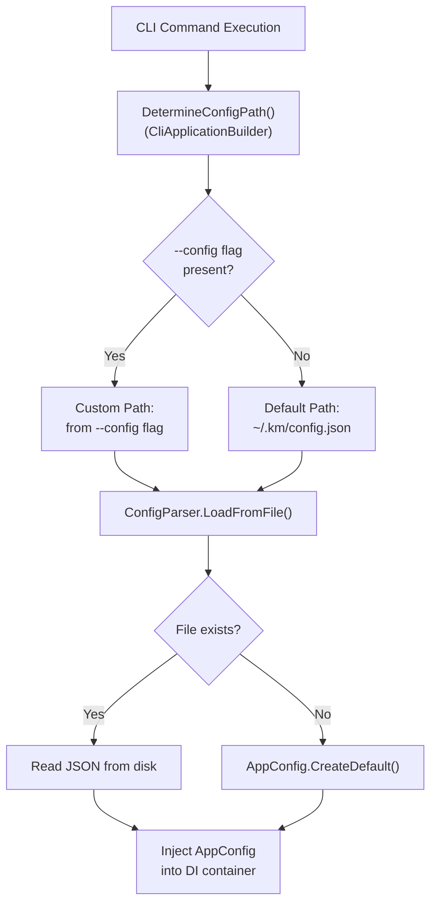
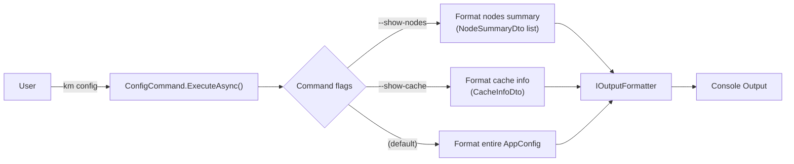
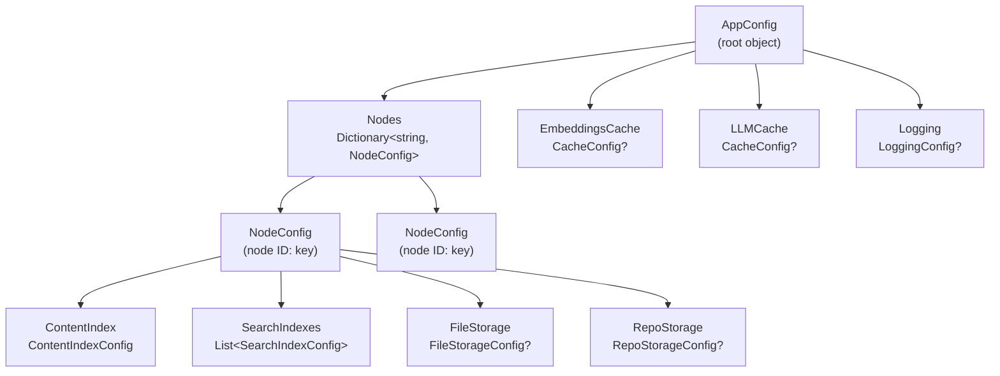
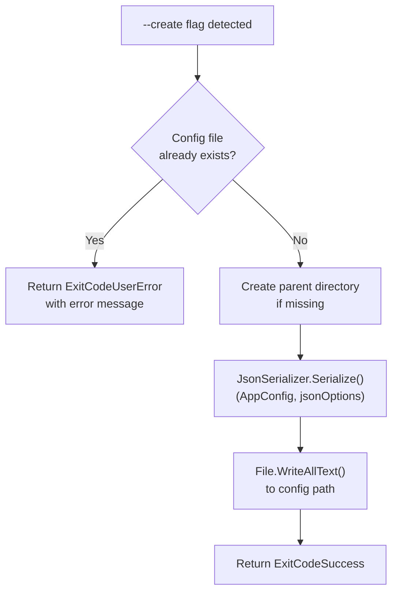
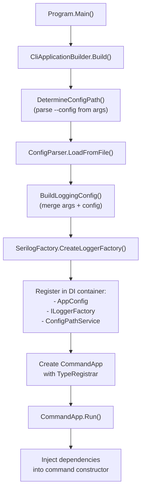

<!-- source: DeepWiki mcp.deepwiki.com · repo microsoft/kernel-memory · page 2.2 Configuration Basics · fetched 2026-10-26 -->

# Configuration Basics

<details>
<summary>Relevant source files</summary>

The following files were used as context for generating this wiki page:

- [src/Main/CLI/CliApplicationBuilder.cs](src/Main/CLI/CliApplicationBuilder.cs)
- [src/Main/CLI/Commands/BaseCommand.cs](src/Main/CLI/Commands/BaseCommand.cs)
- [src/Main/CLI/Commands/ConfigCommand.cs](src/Main/CLI/Commands/ConfigCommand.cs)
- [src/Main/CLI/Commands/DeleteCommand.cs](src/Main/CLI/Commands/DeleteCommand.cs)
- [src/Main/CLI/Commands/GetCommand.cs](src/Main/CLI/Commands/GetCommand.cs)
- [src/Main/CLI/Commands/ListCommand.cs](src/Main/CLI/Commands/ListCommand.cs)
- [src/Main/CLI/Commands/UpsertCommand.cs](src/Main/CLI/Commands/UpsertCommand.cs)
- [tests/Main.Tests/Integration/CliIntegrationTests.cs](tests/Main.Tests/Integration/CliIntegrationTests.cs)
- [tests/Main.Tests/Integration/CommandExecutionTests.cs](tests/Main.Tests/Integration/CommandExecutionTests.cs)
- [tests/Main.Tests/Integration/ConfigCommandTests.cs](tests/Main.Tests/Integration/ConfigCommandTests.cs)
- [tests/Main.Tests/Integration/ReadonlyCommandTests.cs](tests/Main.Tests/Integration/ReadonlyCommandTests.cs)

</details>


This page explains the KM² configuration system, including the `config.json` file structure, how to view and create configuration files, and how configuration is loaded and used by CLI commands. Configuration controls nodes (logical partitions), search indexes, caches, storage locations, and logging behavior.

For information about specific configuration options within nodes (content indexes, search indexes, storage), see [Node Configuration](#6.2). For details about the `km config` command and its options, see [Configuration Command](#4.3).

---

## Configuration File Location

KM² uses a JSON configuration file to define all system settings. The configuration file location is determined by the following precedence:

| Priority | Method | Example |
|----------|--------|---------|
| 1 | `--config` or `-c` flag | `km list --config /path/to/config.json` |
| 2 | Default location | `~/.km/config.json` |

The default configuration directory is `~/.km/` (user home directory). If no configuration file exists at the resolved path, KM² uses a default in-memory configuration.



**Configuration Path Resolution Flow**

The path resolution happens in `CliApplicationBuilder.DetermineConfigPath()` before any command executes. The configuration is loaded once during application startup and injected into all commands via dependency injection.

**Sources:** [src/Main/CLI/CliApplicationBuilder.cs:108-129](), [src/Main/CLI/CliApplicationBuilder.cs:62-105]()

---

## Viewing Current Configuration

Use the `km config` command to view the current configuration. This command shows the entire `AppConfig` structure by default:

```bash
# View entire configuration (AppConfig structure)
km config

# View as JSON (default is human-readable format)
km config --format json

# View summary of all nodes
km config --show-nodes

# View cache configuration
km config --show-cache
```

The default output shows the complete `AppConfig` object structure, allowing you to copy and paste the output into a configuration file. The `ConfigCommand` serializes configuration with these JSON options:

- **Property Naming:** camelCase (`PropertyNamingPolicy.CamelCase`)
- **Formatting:** Indented for readability (`WriteIndented = true`)
- **Null Fields:** Omitted from output (`DefaultIgnoreCondition.WhenWritingNull`)



**Configuration Display Flow**

The `ConfigCommand` does not perform node selection like other commands. It operates on the entire `AppConfig` object to show all configuration, not just a single node's details.

**Sources:** [src/Main/CLI/Commands/ConfigCommand.cs:66-143](), [src/Main/CLI/Commands/ConfigCommand.cs:41-46]()

---

## AppConfig Structure Overview

The `AppConfig` class is the root configuration object containing all system settings. It is structured as a hierarchy with nodes, caches, and logging configuration.



**AppConfig Object Hierarchy**

**Core Configuration Properties:**

| Property | Type | Required | Description |
|----------|------|----------|-------------|
| `Nodes` | `Dictionary<string, NodeConfig>` | Yes | Logical partitions with independent storage and indexes |
| `EmbeddingsCache` | `CacheConfig?` | No | Shared embedding cache across all nodes |
| `LLMCache` | `CacheConfig?` | No | Shared LLM response cache across all nodes |
| `Logging` | `LoggingConfig?` | No | Logging configuration (file path, level) |

The `Nodes` dictionary key is the node ID (e.g., "personal", "shared"). This ID is used with the `--node` flag to select which node a command operates on. If no `--node` flag is provided, the first node in the dictionary is used as the default.

**Sources:** [tests/Main.Tests/Integration/ConfigCommandTests.cs:36-46](), [src/Main/CLI/Commands/BaseCommand.cs:57-79]()

---

## Creating Configuration Files

KM² can write the current configuration to disk using the `--create` flag. This is useful for:
- Saving the default configuration for customization
- Creating a new configuration file at a custom location
- Documenting the current in-memory configuration

```bash
# Create configuration file at default location
km config --create

# Create configuration file at custom location
km config --config /path/to/my-config.json --create
```

**Behavior:**
- **File exists:** Returns error (exit code 1) without overwriting
- **Directory missing:** Creates parent directories automatically
- **Format:** Writes prettified JSON with camelCase properties



**Configuration Creation Flow (ConfigCommand.HandleCreateConfig)**

The `ConfigCommand.HandleCreateConfig()` method performs the file creation with safety checks to prevent accidental overwrites. The JSON serialization uses the same options as viewing configuration, ensuring consistency between `km config` output and saved files.

**Sources:** [src/Main/CLI/Commands/ConfigCommand.cs:154-187](), [tests/Main.Tests/Integration/ConfigCommandTests.cs:231-265]()

---

## Default Configuration

When no configuration file exists, KM² uses an in-memory default configuration created by `AppConfig.CreateDefault()`. This default configuration provides a single personal node with SQLite-based storage and search.

**Default Configuration Contents:**

| Component | Default Value | Location |
|-----------|---------------|----------|
| Node ID | `"personal"` | First and only node |
| Content Index | SQLite database | `~/.km/nodes/personal/content.db` |
| Search Index | SQLite FTS5 | Same database, FTS5 virtual table |
| File Storage | Not configured | `null` |
| Repository Storage | Not configured | `null` |
| Embeddings Cache | Not configured | `null` |
| LLM Cache | Not configured | `null` |

The default personal node is created using `NodeConfig.CreateDefaultPersonalNode()`, which sets up:
- Node ID: `"personal"`
- Access mode: `ReadWrite`
- Content index: `SqliteContentIndexConfig` pointing to `~/.km/nodes/personal/content.db`
- Search indexes: Single `SqliteFTSConfig` with ID `"default"`

**Command Behavior with Default Configuration:**

```bash
# These commands work without creating config.json
km list          # Uses default personal node
km put "Hello"   # Creates database on first write
km search "test" # Searches in default node

# Warning displayed when using defaults (in human format)
# "Warning: Using default configuration. Config file does not exist: ~/.km/config.json"
```

The CLI displays a warning (in human format only) when using the default configuration, prompting users to run `km config --create` to persist their configuration.

**Sources:** [src/Main/CLI/Commands/ConfigCommand.cs:86-91](), [tests/Main.Tests/Integration/ConfigCommandTests.cs:318-365](), [tests/Main.Tests/Integration/ConfigCommandTests.cs:40-41]()

---

## Configuration Loading and Usage

Configuration is loaded early in the CLI application lifecycle, before any command executes. This ensures consistent configuration access across all commands without repeated file I/O.



**Configuration Loading and Dependency Injection Flow**

### Early Configuration Loading

The `CliApplicationBuilder.Build()` method loads configuration in this sequence:

1. **Path Determination** ([CliApplicationBuilder.cs:113-129]()): Scans command-line arguments for `--config` flag before command parsing
2. **Configuration Load** ([CliApplicationBuilder.cs:70]()): Calls `ConfigParser.LoadFromFile()` once
3. **Logging Configuration** ([CliApplicationBuilder.cs:73-76]()): Merges CLI args (e.g., `--verbosity`) with config file settings
4. **DI Registration** ([CliApplicationBuilder.cs:92-96]()): Registers `AppConfig`, `ILoggerFactory`, and `ConfigPathService` as singletons

### Command-Level Configuration Usage

Commands receive configuration through constructor injection (see `BaseCommand<TSettings>`):

```
BaseCommand constructor parameters:
- AppConfig config        (already loaded)
- ILoggerFactory loggerFactory
```

The `BaseCommand.Initialize()` method selects the appropriate node from the configuration:

1. **Node Selection**: Uses `--node` flag value or defaults to first node in `Nodes` dictionary
2. **Validation**: Throws `InvalidOperationException` if node not found
3. **Formatter Creation**: Creates `IOutputFormatter` based on `--format` flag

**Node Selection Logic:**

```csharp
var nodeName = settings.NodeName ?? config.Nodes.Keys.First();
if (!config.Nodes.TryGetValue(nodeName, out var node)) {
    throw new InvalidOperationException($"Node '{nodeName}' not found");
}
```

**Sources:** [src/Main/CLI/CliApplicationBuilder.cs:62-105](), [src/Main/CLI/Commands/BaseCommand.cs:31-79]()

---

## Configuration Examples

### Minimal Configuration

Single node with SQLite storage:

```json
{
  "nodes": {
    "personal": {
      "id": "personal",
      "access": "ReadWrite",
      "contentIndex": {
        "type": "sqlite",
        "path": "/home/user/.km/nodes/personal/content.db"
      },
      "searchIndexes": [
        {
          "id": "default",
          "type": "sqliteFTS"
        }
      ]
    }
  }
}
```

### Multi-Node Configuration

Personal and shared nodes with embedding cache:

```json
{
  "nodes": {
    "personal": {
      "id": "personal",
      "access": "ReadWrite",
      "contentIndex": {
        "type": "sqlite",
        "path": "/home/user/.km/nodes/personal/content.db"
      },
      "searchIndexes": [
        {
          "id": "default",
          "type": "sqliteFTS"
        }
      ]
    },
    "shared": {
      "id": "shared",
      "access": "ReadOnly",
      "contentIndex": {
        "type": "sqlite",
        "path": "/mnt/shared/.km/nodes/shared/content.db"
      },
      "searchIndexes": [
        {
          "id": "default",
          "type": "sqliteFTS"
        }
      ]
    }
  },
  "embeddingsCache": {
    "type": "Sqlite",
    "path": "/home/user/.km/cache/embeddings.db",
    "allowRead": true,
    "allowWrite": true
  }
}
```

### Configuration with Logging

Custom log file and verbosity level:

```json
{
  "nodes": {
    "personal": {
      "id": "personal",
      "access": "ReadWrite",
      "contentIndex": {
        "type": "sqlite",
        "path": "/home/user/.km/nodes/personal/content.db"
      },
      "searchIndexes": [
        {
          "id": "default",
          "type": "sqliteFTS"
        }
      ]
    }
  },
  "logging": {
    "filePath": "/home/user/.km/logs/km.log",
    "level": "Debug"
  }
}
```

**Sources:** [tests/Main.Tests/Integration/ConfigCommandTests.cs:36-46](), [tests/Main.Tests/Integration/CliIntegrationTests.cs:32-45]()

---

## Configuration Validation and Health Checks

The `km doctor` command validates configuration and checks system health. This includes:

- Verifying configuration file is parseable JSON
- Checking that all node database paths are accessible
- Validating cache configurations
- Testing search index connectivity

For details on diagnostic commands, see [Doctor Command](#4.6).

**Sources:** [src/Main/CLI/CliApplicationBuilder.cs:259-263]()

---

