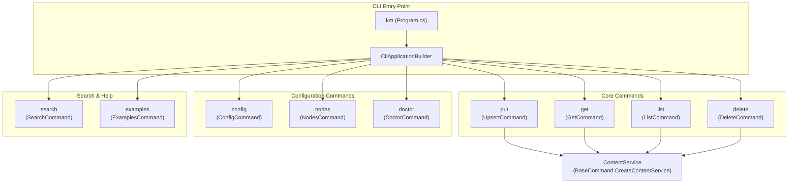
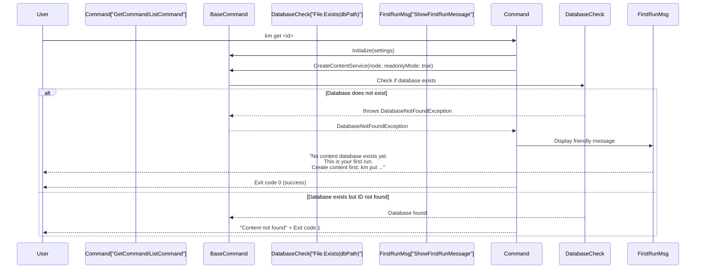
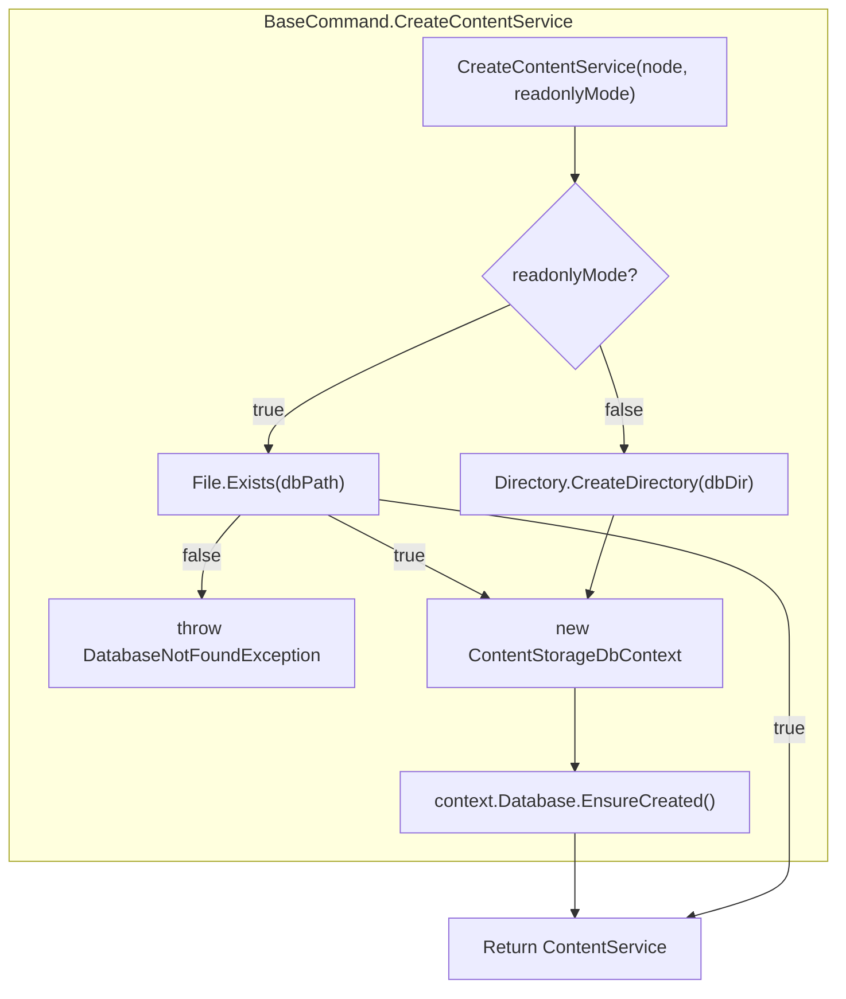
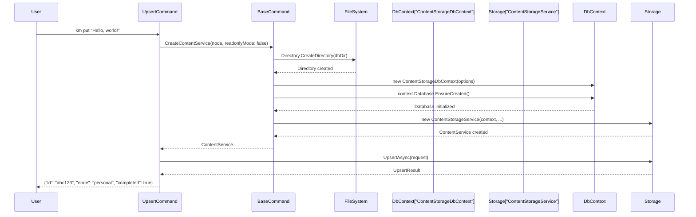
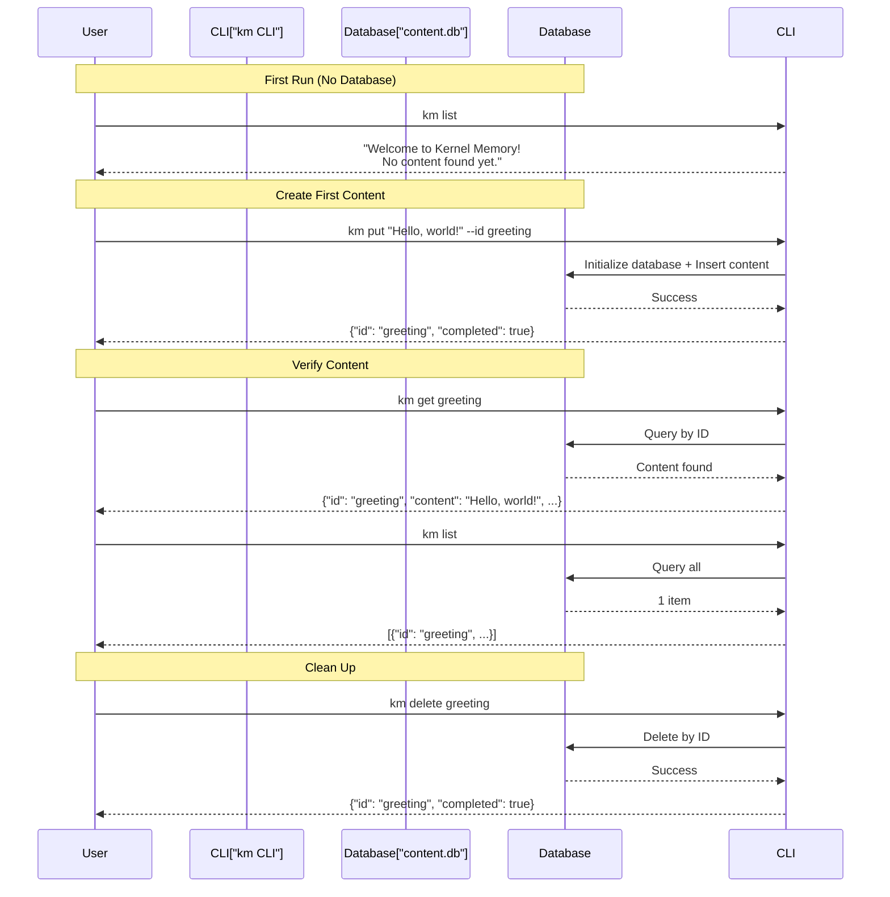
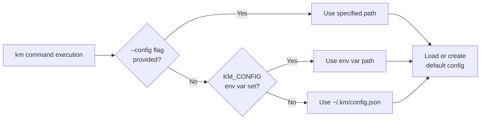

<!-- source: DeepWiki mcp.deepwiki.com · repo microsoft/kernel-memory · page 2.3 First Steps with the CLI · fetched 2026-10-26 -->

# First Steps with the CLI

<details>
<summary>Relevant source files</summary>

The following files were used as context for generating this wiki page:

- [src/Main/CLI/CliApplicationBuilder.cs](src/Main/CLI/CliApplicationBuilder.cs)
- [src/Main/CLI/Commands/BaseCommand.cs](src/Main/CLI/Commands/BaseCommand.cs)
- [src/Main/CLI/Commands/ConfigCommand.cs](src/Main/CLI/Commands/ConfigCommand.cs)
- [src/Main/CLI/Commands/DeleteCommand.cs](src/Main/CLI/Commands/DeleteCommand.cs)
- [src/Main/CLI/Commands/GetCommand.cs](src/Main/CLI/Commands/GetCommand.cs)
- [src/Main/CLI/Commands/ListCommand.cs](src/Main/CLI/Commands/ListCommand.cs)
- [src/Main/CLI/Commands/UpsertCommand.cs](src/Main/CLI/Commands/UpsertCommand.cs)
- [tests/Main.Tests/Integration/CliIntegrationTests.cs](tests/Main.Tests/Integration/CliIntegrationTests.cs)
- [tests/Main.Tests/Integration/CommandExecutionTests.cs](tests/Main.Tests/Integration/CommandExecutionTests.cs)
- [tests/Main.Tests/Integration/ConfigCommandTests.cs](tests/Main.Tests/Integration/ConfigCommandTests.cs)
- [tests/Main.Tests/Integration/ReadonlyCommandTests.cs](tests/Main.Tests/Integration/ReadonlyCommandTests.cs)

</details>


This page provides a hands-on introduction to using the KM² command-line interface (CLI). It covers the first-run experience, basic command workflows, and essential usage patterns. For installation instructions, see [Installation and Setup](#2.1). For configuration details, see [Configuration Basics](#2.2). For comprehensive command documentation, see [CLI Application](#4).

## CLI Command Structure

The KM² CLI is built using Spectre.Console.Cli and follows a verb-based command pattern. The application is configured in `CliApplicationBuilder` which registers all available commands.



**Sources:** [src/Main/CLI/CliApplicationBuilder.cs:199-267](), [src/Main/CLI/Commands/BaseCommand.cs:24-191]()

## First-Run Experience

When you run a KM² command for the first time, the system handles the absence of a database gracefully. Read-only commands (`get`, `list`) display friendly messages guiding you to create content first. Write commands (`put`, `delete`) automatically initialize the database.

### Read-Only Command Behavior

Read-only commands check for database existence and provide contextual first-run messages rather than failing with errors.



**Sources:** [src/Main/CLI/Commands/GetCommand.cs:84-124](), [src/Main/CLI/Commands/ListCommand.cs:92-136](), [tests/Main.Tests/Integration/ReadonlyCommandTests.cs:64-134]()

### First-Run Message Details

The `GetCommand` displays a context-specific message when no database exists:

```
Content with ID 'your-id' not found.

No content database exists yet. This is your first run.

Create content first:
  km put "Your content here" --id your-id

Or list available content:
  km list
```

The `ListCommand` displays a welcome message:

```
Welcome to Kernel Memory! 🚀

No content found in node 'personal' yet.

To get started:
  km put "Your content here"

Example:
  km put "Hello, world!" --id greeting
```

**Sources:** [src/Main/CLI/Commands/GetCommand.cs:98-124](), [src/Main/CLI/Commands/ListCommand.cs:104-136]()

## Database Initialization

Database initialization occurs automatically during the first write operation. The system distinguishes between read-only and write modes to prevent accidental file creation.



**Sources:** [src/Main/CLI/Commands/BaseCommand.cs:90-131]()

### Read-Only vs Write Mode

The `readonlyMode` parameter controls database initialization behavior:

| Mode | Commands | Behavior |
|------|----------|----------|
| `readonlyMode: true` | `get`, `list`, `nodes`, `config` | Database must exist; throws `DatabaseNotFoundException` if missing |
| `readonlyMode: false` | `put`, `delete` | Creates directory and database if they don't exist |

**Sources:** [src/Main/CLI/Commands/BaseCommand.cs:90-116](), [tests/Main.Tests/Integration/ReadonlyCommandTests.cs:1-215]()

## Basic Command Workflows

### Viewing Configuration

Before creating content, you can view the current configuration to understand available nodes and settings:

```bash
# View entire configuration
km config

# View as JSON (useful for copying to config file)
km config --format json

# Show all nodes summary
km config --show-nodes

# Show cache configuration
km config --show-cache

# Create config file on disk
km config --create
```

The `ConfigCommand` does not require a database and always succeeds, even without an existing config file (it uses default configuration).

**Sources:** [src/Main/CLI/Commands/ConfigCommand.cs:39-188](), [tests/Main.Tests/Integration/ConfigCommandTests.cs:72-121]()

### Creating Content (First Write)

The first `put` command initializes the database structure:

```bash
# Auto-generate ID
km put "Hello, world!"

# Specify custom ID
km put "My first note" --id greeting

# Add metadata
km put "Important document" --id doc1 --title "Meeting Notes" --tags "work,important"
```

**Initialization Process:**



**Sources:** [src/Main/CLI/Commands/UpsertCommand.cs:75-129](), [src/Main/CLI/Commands/BaseCommand.cs:90-131](), [tests/Main.Tests/Integration/CliIntegrationTests.cs:62-82]()

### Reading Content

After creating content, you can retrieve it by ID:

```bash
# Get content by ID
km get abc123

# Show all internal details
km get abc123 --full

# Output as JSON
km get abc123 --format json
```

If the ID doesn't exist in an existing database, you'll receive a user error (exit code 1).

**Sources:** [src/Main/CLI/Commands/GetCommand.cs:48-125](), [tests/Main.Tests/Integration/CliIntegrationTests.cs:148-178]()

### Listing Content

List all content with pagination support:

```bash
# List all content (default: 20 items)
km list

# Pagination
km list --skip 20 --take 10

# JSON output for parsing
km list --format json
```

**Sources:** [src/Main/CLI/Commands/ListCommand.cs:55-137](), [tests/Main.Tests/Integration/CliIntegrationTests.cs:342-369]()

### Deleting Content

Delete is idempotent and succeeds even if the ID doesn't exist:

```bash
# Delete by ID
km delete abc123

# Quiet output (only ID)
km delete abc123 --verbosity quiet

# Silent (no output)
km delete abc123 --verbosity silent
```

**Sources:** [src/Main/CLI/Commands/DeleteCommand.cs:42-90](), [tests/Main.Tests/Integration/CliIntegrationTests.cs:407-449]()

## Complete Workflow Example

Here's a typical end-to-end workflow from first run to content management:



**Sources:** [tests/Main.Tests/Integration/CliIntegrationTests.cs:486-541]()

## Command Options and Output Formats

### Global Options

All commands inherit from `GlobalOptions` which provides standard flags:

| Option | Short | Description |
|--------|-------|-------------|
| `--config` | `-c` | Path to config file (default: `~/.km/config.json`) |
| `--node` | `-n` | Target node name (default: first node in config) |
| `--format` | `-f` | Output format: `human`, `json`, `yaml` (default: `human`) |
| `--verbosity` | `-v` | Verbosity level: `silent`, `quiet`, `normal`, `verbose` |
| `--no-color` | | Disable colored output |
| `--log-file` | | Path to log file |

**Sources:** [src/Main/CLI/Commands/GlobalOptions.cs]() (referenced in all command classes)

### Output Format Examples

**Human format** (default):
```
Content ID: abc123
Node: personal
Title: Meeting Notes
Created: 2024-01-15 10:30:00
```

**JSON format** (for scripting):
```json
{
  "id": "abc123",
  "node": "personal",
  "title": "Meeting Notes",
  "createdAt": "2024-01-15T10:30:00Z"
}
```

**YAML format** (for readability):
```yaml
id: abc123
node: personal
title: Meeting Notes
createdAt: 2024-01-15T10:30:00Z
```

**Sources:** [src/Main/CLI/OutputFormatters/]() (HumanOutputFormatter, JsonOutputFormatter, YamlOutputFormatter)

## Exit Codes

The CLI uses consistent exit codes for automation and scripting:

| Exit Code | Constant | Meaning |
|-----------|----------|---------|
| 0 | `Constants.App.ExitCodeSuccess` | Success (includes first-run scenarios) |
| 1 | `Constants.App.ExitCodeUserError` | User error (invalid input, not found) |
| 2 | `Constants.App.ExitCodeSystemError` | System error (database error, network error) |

First-run scenarios (no database exists) return exit code 0, not an error, to provide a smooth onboarding experience.

**Sources:** [src/Main/CLI/Commands/BaseCommand.cs:174-190](), [tests/Main.Tests/Integration/ReadonlyCommandTests.cs:64-205]()

## Configuration Path Resolution

The CLI determines the config file path using the following precedence:



**Sources:** [src/Main/CLI/CliApplicationBuilder.cs:108-129]()

## Next Steps

After familiarizing yourself with basic CLI commands:

- For comprehensive command documentation, see [CLI Application](#4)
- For content management details, see [Content Management Commands](#4.2)
- For search capabilities, see [Search System](#5)
- For advanced configuration, see [Configuration System](#6)
- For multi-node usage, see [Multi-Node Architecture](#3.3)

---

