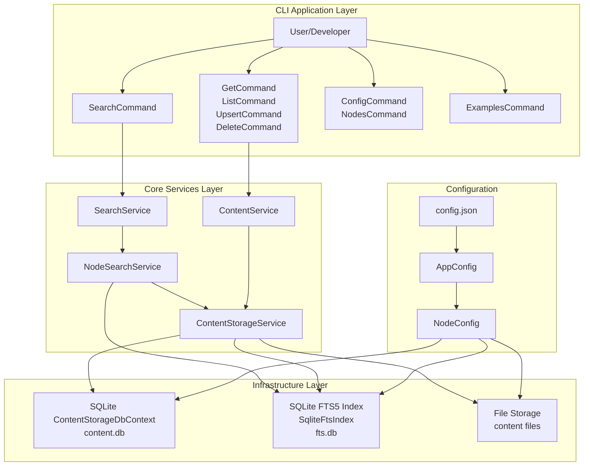
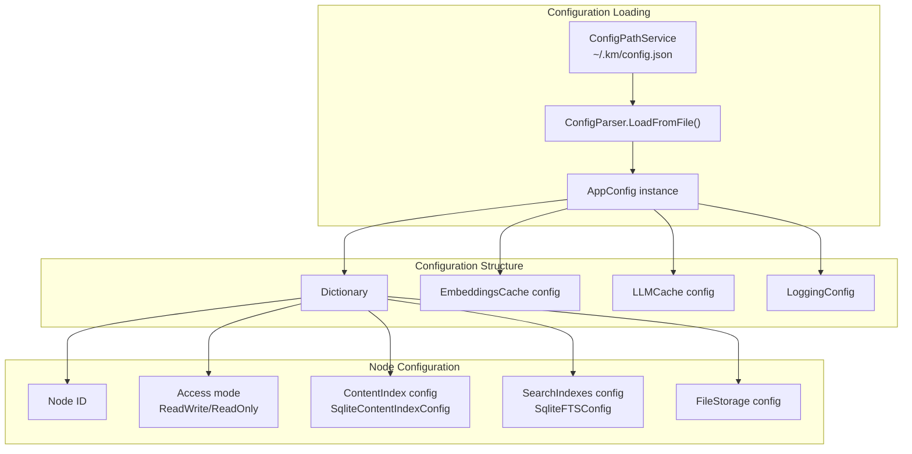
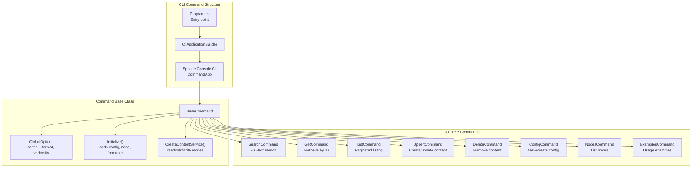
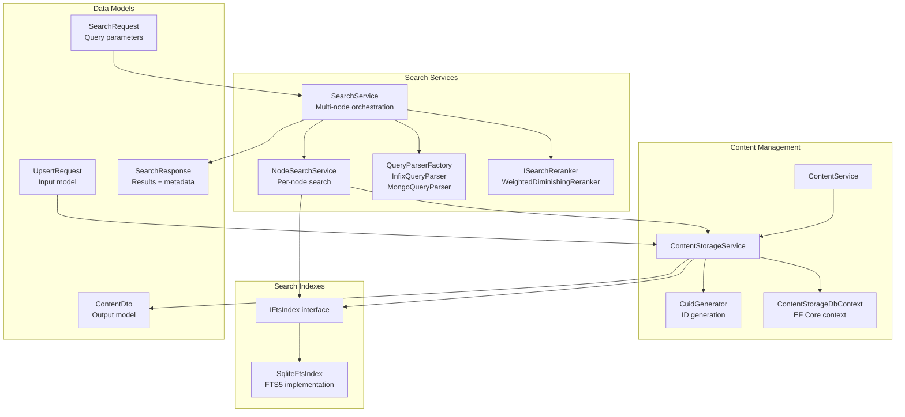

<!-- source: DeepWiki mcp.deepwiki.com · repo microsoft/kernel-memory · page 3 Architecture · fetched 2026-10-26 -->

# Architecture

<details>
<summary>Relevant source files</summary>

The following files were used as context for generating this wiki page:

- [.gitignore](.gitignore)
- [.gitmodules](.gitmodules)
- [KNOWN-ISSUES.md](KNOWN-ISSUES.md)
- [README.md](README.md)
- [src/Core/Search/NodeSearchService.cs](src/Core/Search/NodeSearchService.cs)
- [src/Core/Search/Query/Parsers/InfixQueryParser.cs](src/Core/Search/Query/Parsers/InfixQueryParser.cs)
- [src/Core/Search/SearchService.cs](src/Core/Search/SearchService.cs)
- [src/Core/Search/SqliteFtsIndex.cs](src/Core/Search/SqliteFtsIndex.cs)
- [src/Main/CLI/CliApplicationBuilder.cs](src/Main/CLI/CliApplicationBuilder.cs)
- [src/Main/CLI/Commands/BaseCommand.cs](src/Main/CLI/Commands/BaseCommand.cs)
- [src/Main/CLI/Commands/ConfigCommand.cs](src/Main/CLI/Commands/ConfigCommand.cs)
- [src/Main/CLI/Commands/DeleteCommand.cs](src/Main/CLI/Commands/DeleteCommand.cs)
- [src/Main/CLI/Commands/ExamplesCommand.cs](src/Main/CLI/Commands/ExamplesCommand.cs)
- [src/Main/CLI/Commands/GetCommand.cs](src/Main/CLI/Commands/GetCommand.cs)
- [src/Main/CLI/Commands/ListCommand.cs](src/Main/CLI/Commands/ListCommand.cs)
- [src/Main/CLI/Commands/SearchCommand.cs](src/Main/CLI/Commands/SearchCommand.cs)
- [src/Main/CLI/Commands/UpsertCommand.cs](src/Main/CLI/Commands/UpsertCommand.cs)
- [tests/Core.Tests/Search/FtsQueryExtractionTest.cs](tests/Core.Tests/Search/FtsQueryExtractionTest.cs)
- [tests/Core.Tests/Search/NodeSearchServiceIndexIdTests.cs](tests/Core.Tests/Search/NodeSearchServiceIndexIdTests.cs)
- [tests/Core.Tests/Search/Query/InfixQueryParserTests.cs](tests/Core.Tests/Search/Query/InfixQueryParserTests.cs)
- [tests/Core.Tests/Search/SearchEndToEndTests.cs](tests/Core.Tests/Search/SearchEndToEndTests.cs)
- [tests/Core.Tests/Search/SearchServiceIndexWeightsTests.cs](tests/Core.Tests/Search/SearchServiceIndexWeightsTests.cs)
- [tests/Main.Tests/Integration/CliIntegrationTests.cs](tests/Main.Tests/Integration/CliIntegrationTests.cs)
- [tests/Main.Tests/Integration/CommandExecutionTests.cs](tests/Main.Tests/Integration/CommandExecutionTests.cs)
- [tests/Main.Tests/Integration/ConfigCommandTests.cs](tests/Main.Tests/Integration/ConfigCommandTests.cs)
- [tests/Main.Tests/Integration/ExamplesCommandE2ETests.cs](tests/Main.Tests/Integration/ExamplesCommandE2ETests.cs)
- [tests/Main.Tests/Integration/ReadonlyCommandTests.cs](tests/Main.Tests/Integration/ReadonlyCommandTests.cs)

</details>


KM² (Kernel Memory squared) is a full rewrite of the initial research prototype, built as an active research project to explore AI memory concepts. The architecture follows a three-layer design with a command-line interface for user interaction, core services for search and content management, and SQLite-based infrastructure for persistence.

The system is designed as a CLI application with multi-node support, full-text search capabilities, and configurable storage backends. It is explicitly experimental software with rapid evolution and no stability guarantees.

## System Overview

KM² uses a three-layer architecture: a CLI application layer for user commands, a core services layer for search and content operations, and an infrastructure layer for data persistence using SQLite.



**KM² Three-Layer Architecture**

The architecture separates concerns into three distinct layers:

- **CLI Application Layer**: User-facing commands implemented using Spectre.Console.Cli framework
- **Core Services Layer**: Business logic for search orchestration and content management
- **Infrastructure Layer**: SQLite-based persistence with FTS5 for full-text search

Sources: [README.md:1-34](), [src/Main/CLI/Commands/BaseCommand.cs:1-191](), [src/Main/CLI/CliApplicationBuilder.cs:1-262]()

## Project Status and Design Philosophy

KM² is explicitly an active research project, not production software. The system evolves rapidly with no stability or compatibility guarantees. Users should pin specific commits if consistency is needed.

### Design Characteristics

- **Experimental Software**: Expect things to break with rapid iteration
- **Metacognitive AI Engineering**: Built using AI and Amplifier concepts
- **No External Services**: Self-contained with SQLite for all persistence
- **CLI-First**: Command-line interface as the primary interaction mode
- **Multi-Node Support**: Logical partitioning of content into separate nodes

### Configuration Management

KM² uses a JSON configuration file (`config.json`) that defines nodes, caches, and logging settings. The configuration system provides:

- **Default Location**: `~/.km/config.json`
- **Override Support**: `--config` flag to specify alternate configuration
- **Node-Based**: Each node has independent storage and search indexes
- **Auto-Initialization**: Databases and directories created on first write operation



**Configuration System Structure**

The configuration system is loaded once at application startup and injected into all commands via dependency injection.

Sources: [README.md:6-33](), [src/Main/CLI/CliApplicationBuilder.cs:62-104](), [src/Core/Config/AppConfig.cs]()

## CLI Application Layer

The CLI application layer provides the user-facing interface, implemented using the Spectre.Console.Cli framework. All commands inherit from `BaseCommand<TSettings>` which provides shared initialization logic.



**CLI Command Hierarchy**

### `BaseCommand<TSettings>`

The base class for all commands provides shared functionality:

- **Configuration Loading**: Config loaded once at startup and injected via DI
- **Node Selection**: Determines which node to operate on based on settings
- **Readonly/Write Modes**: Controls whether databases are created or must exist
- **Output Formatting**: Supports JSON, YAML, and human-readable output
- **Error Handling**: Standardized exit codes and error messages

### Command Categories

**Content Management Commands**:
- `GetCommand` - Retrieve content by ID (readonly mode)
- `ListCommand` - Paginated listing of all content (readonly mode)
- `UpsertCommand` - Create or update content (write mode)
- `DeleteCommand` - Remove content by ID (write mode)

**Search Commands**:
- `SearchCommand` - Full-text search with query parsing and result ranking

**Configuration Commands**:
- `ConfigCommand` - View or create configuration files
- `NodesCommand` - List all configured nodes

**Utility Commands**:
- `ExamplesCommand` - Display usage examples for all commands

Sources: [src/Main/CLI/Commands/BaseCommand.cs:1-191](), [src/Main/CLI/CliApplicationBuilder.cs:196-262](), [src/Main/CLI/Commands/SearchCommand.cs:1-540]()

## Core Services Layer

The core services layer implements the business logic for content management and search operations. The layer is organized around two main service types: `ContentService` and `SearchService`.



**Core Services Architecture**

### ContentService

The `ContentService` class provides high-level content operations and manages the lifecycle of search indexes. It wraps `ContentStorageService` and ensures indexes are properly disposed.

Key operations:
- `GetAsync(id)` - Retrieve content by ID
- `ListAsync(skip, take)` - Paginated content listing
- `UpsertAsync(request)` - Create or update content with automatic indexing
- `DeleteAsync(id)` - Remove content and FTS index entries
- `CountAsync()` - Get total content count

### ContentStorageService

The `ContentStorageService` class manages the SQLite content database using Entity Framework Core. It coordinates between content storage and search index updates.

Key responsibilities:
- CRUD operations on `ContentStorageDbContext`
- Automatic FTS index synchronization on insert/update/delete
- CUID generation for content IDs
- Transaction management for consistency

### SearchService

The `SearchService` class orchestrates multi-node searches. It parses queries, dispatches searches to multiple nodes in parallel, and merges/reranks results.

Key responsibilities:
- Query parsing via `QueryParserFactory`
- Parallel node search execution
- Result merging and reranking with configurable weights
- Pagination and relevance filtering
- Query validation

### NodeSearchService

The `NodeSearchService` class executes searches within a single node. It converts query ASTs to FTS queries and applies post-filtering for NOT terms.

Key responsibilities:
- AST to FTS5 query translation
- FTS query execution via `SqliteFtsIndex`
- NOT term post-filtering (SQLite FTS5 limitation workaround)
- Result loading from `ContentStorageService`

Sources: [src/Core/Storage/ContentService.cs](), [src/Core/Storage/ContentStorageService.cs](), [src/Core/Search/SearchService.cs:1-260](), [src/Core/Search/NodeSearchService.cs:1-459]()

## Extension Architecture

Kernel Memory's modular design enables extensive customization through a well-defined extension system that supports pluggable AI services, storage backends, and processing components.

```mermaid
graph TB
    subgraph "AI Service Extensions"
        OPENAI["OpenAI<br/>extensions/OpenAI"]
        AZUREOAI["AzureOpenAI<br/>extensions/AzureOpenAI"] 
        OLLAMA["Ollama<br/>extensions/Ollama"]
        ANTHROPIC["Anthropic<br/>extensions/Anthropic"]
        LLAMA["LlamaSharp<br/>extensions/LlamaSharp"]
    end
    
    subgraph "Storage Extensions"
        POSTGRES["PostgreSQL<br/>extensions/Postgres"]
        SQLSERVER["SQL Server<br/>extensions/SQLServer"]
        QDRANT["Qdrant<br/>extensions/Qdrant"]
        AZSEARCH["Azure AI Search<br/>extensions/AzureAISearch"]
        REDIS["Redis<br/>extensions/Redis"]
        MONGO["MongoDB Atlas<br/>extensions/MongoDbAtlas"]
    end
    
    subgraph "Infrastructure Extensions"
        AZBLOB["Azure Blob Storage<br/>extensions/AzureBlobs"]
        S3["AWS S3<br/>extensions/AWS/S3"]
        AZQUEUE["Azure Queues<br/>extensions/AzureQueues"]
        RABBIT["RabbitMQ<br/>extensions/RabbitMQ"]
    end
    
    subgraph "Core Interfaces"
        ITG2["ITextGenerator"]
        IEG2["ITextEmbeddingGenerator"]
        IMD2["IMemoryDb"]
        IFS2["IContentStorage"]
        IQ2["IQueue"]
    end
    
    OPENAI --> ITG2
    AZUREOAI --> ITG2
    OLLAMA --> ITG2
    ANTHROPIC --> ITG2
    LLAMA --> ITG2
    
    OPENAI --> IEG2
    AZUREOAI --> IEG2
    
    POSTGRES --> IMD2
    SQLSERVER --> IMD2
    QDRANT --> IMD2
    AZSEARCH --> IMD2
    REDIS --> IMD2
    MONGO --> IMD2
    
    AZBLOB --> IFS2
    S3 --> IFS2
    
    AZQUEUE --> IQ2
    RABBIT --> IQ2
```



**Extension System Architecture**

### Extension Categories

The extension system is organized into several categories, each implementing specific interfaces:

- **AI Services**: Text generation and embedding services implementing `ITextGenerator` and `ITextEmbeddingGenerator`
- **Vector Databases**: Storage backends implementing `IMemoryDb` for vector search capabilities
- **File Storage**: Content storage services implementing `IContentStorage`
- **Message Queues**: Async processing queues implementing `IQueue`

### Configuration Integration

Extensions are registered through the `KernelMemoryBuilder` using extension methods:

```csharp
var builder = new KernelMemoryBuilder()
    .WithOpenAI(config)           // AI service extension
    .WithQdrant(config)           // Vector DB extension  
    .WithAzureBlobs(config);      // File storage extension
```

### Custom Extensions

The interface-based design allows for custom extensions by implementing the core interfaces. Custom pipeline handlers can be added using `IPipelineHandler`.

Sources: [extensions/OpenAI/OpenAI/OpenAI.csproj:1-33](), [extensions/Anthropic/Anthropic.csproj:1-32](), [Directory.Packages.props:1-124](), [KernelMemory.sln:1-583]()

---

