<!-- source: DeepWiki mcp.deepwiki.com · repo microsoft/kernel-memory · page 3.1 System Layers and Components · fetched 2026-10-26 -->

# System Layers and Components

Relevant source files

The following files were used as context for generating this wiki page:

- [.gitignore](.gitignore)
- [.gitmodules](.gitmodules)
- [README.md](README.md)
- [src/Main/CLI/CliApplicationBuilder.cs](src/Main/CLI/CliApplicationBuilder.cs)
- [src/Main/CLI/Commands/BaseCommand.cs](src/Main/CLI/Commands/BaseCommand.cs)
- [src/Main/CLI/Commands/ConfigCommand.cs](src/Main/CLI/Commands/ConfigCommand.cs)
- [src/Main/CLI/Commands/DeleteCommand.cs](src/Main/CLI/Commands/DeleteCommand.cs)
- [src/Main/CLI/Commands/GetCommand.cs](src/Main/CLI/Commands/GetCommand.cs)
- [src/Main/CLI/Commands/ListCommand.cs](src/Main/CLI/Commands/ListCommand.cs)
- [src/Main/CLI/Commands/UpsertCommand.cs](src/Main/CLI/Commands/UpsertCommand.cs)
- [tests/Main.Tests/Integration/CliIntegrationTests.cs](tests/Main.Tests/Integration/CliIntegrationTests.cs)
- [tests/Main.Tests/Integration/CommandExecutionTests.cs](tests/Main.Tests/Integration/CommandExecutionTests.cs)
- [tests/Main.Tests/Integration/ConfigCommandTests.cs](tests/Main.Tests/Integration/ConfigCommandTests.cs)
- [tests/Main.Tests/Integration/ReadonlyCommandTests.cs](tests/Main.Tests/Integration/ReadonlyCommandTests.cs)

## Purpose and Scope

This document details the three-layer architectural design of KM², describing the responsibilities and key components within each layer. It explains how the CLI application layer, core services layer, and infrastructure layer interact to provide content management and search capabilities. 

For configuration structure details, see [Configuration System](#6). For the multi-node architecture design, see [Multi-Node Architecture](#3.3). For technology stack details including frameworks and dependencies, see [Technology Stack](#3.2).

## Architectural Overview

KM² follows a three-tier architecture that separates user interaction, business logic, and data persistence concerns:

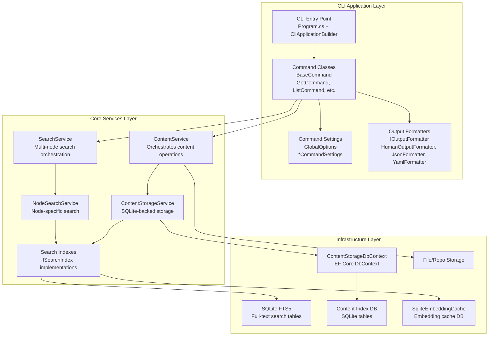

**Sources:** [src/Main/CLI/CliApplicationBuilder.cs:1-268](), [src/Main/CLI/Commands/BaseCommand.cs:1-192](), [README.md:1-80]()

## CLI Application Layer

The CLI application layer handles user interaction through a command-line interface built with Spectre.Console.Cli. It parses arguments, validates inputs, and formats outputs.

### Command Execution Flow

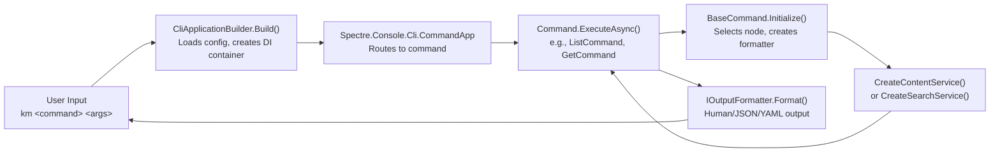

**Sources:** [src/Main/CLI/CliApplicationBuilder.cs:62-105](), [src/Main/CLI/Commands/BaseCommand.cs:52-79]()

### Command Class Hierarchy

All CLI commands inherit from `BaseCommand<TSettings>` which provides shared initialization logic:

| Command Class | Settings Class | Purpose | Readonly Mode |
|--------------|----------------|---------|---------------|
| `ConfigCommand` | `ConfigCommandSettings` | View/create configuration | Yes (no node selection) |
| `GetCommand` | `GetCommandSettings` | Retrieve content by ID | Yes |
| `ListCommand` | `ListCommandSettings` | Paginate through content | Yes |
| `UpsertCommand` | `UpsertCommandSettings` | Create/update content | No (write mode) |
| `DeleteCommand` | `DeleteCommandSettings` | Delete content by ID | No (write mode) |
| `SearchCommand` | `SearchCommandSettings` | Full-text search | Yes |
| `NodesCommand` | `NodesCommandSettings` | List configured nodes | Yes (no node selection) |

**Sources:** [src/Main/CLI/Commands/ConfigCommand.cs:16-189](), [src/Main/CLI/Commands/GetCommand.cs:14-126](), [src/Main/CLI/Commands/ListCommand.cs:14-138](), [src/Main/CLI/Commands/UpsertCommand.cs:14-131](), [src/Main/CLI/Commands/DeleteCommand.cs:11-91]()

### Command Settings and Global Options

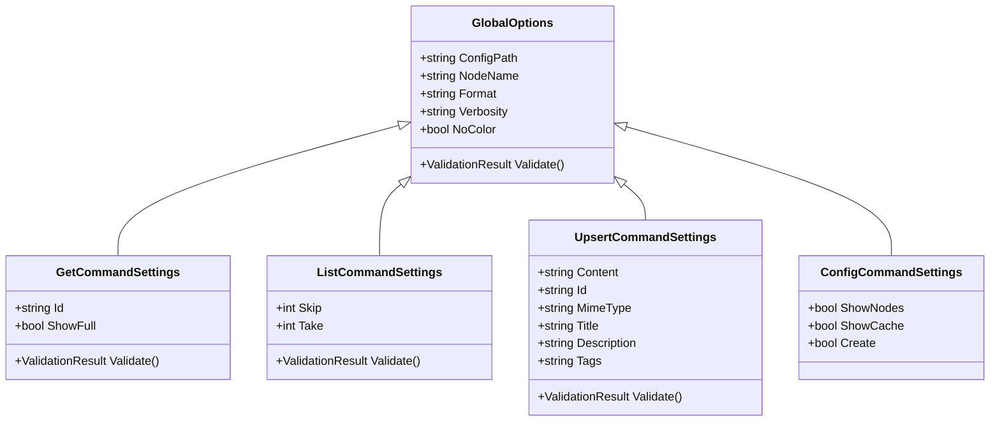

The `GlobalOptions` base class provides options common to all commands: `--config`, `--node`, `--format`, `--verbosity`, and `--no-color`. Each command extends this with command-specific options.

**Sources:** [src/Main/CLI/Commands/ConfigCommand.cs:21-34](), [src/Main/CLI/Commands/GetCommand.cs:18-43](), [src/Main/CLI/Commands/ListCommand.cs:18-50](), [src/Main/CLI/Commands/UpsertCommand.cs:17-59]()

### Dependency Injection and Bootstrap

The `CliApplicationBuilder` creates the DI container early in the application lifecycle:

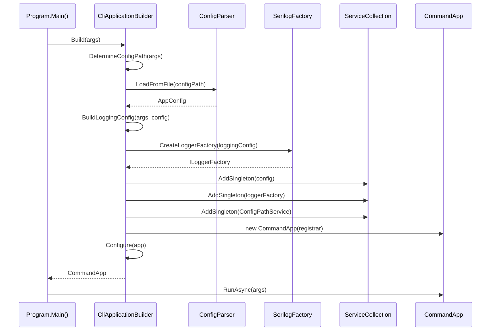

The configuration file is loaded **once** at startup before any command executes. Both `AppConfig` and `ILoggerFactory` are registered as singletons and injected into all command instances.

**Sources:** [src/Main/CLI/CliApplicationBuilder.cs:62-105](), [src/Main/CLI/CliApplicationBuilder.cs:90-104]()

### Output Formatting

The CLI supports three output formats controlled by the `--format` flag:

- **Human** (default): Uses `Spectre.Console` for rich terminal output with colors and tables
- **JSON**: Machine-readable JSON via `System.Text.Json`
- **YAML**: YAML format via `YamlDotNet`

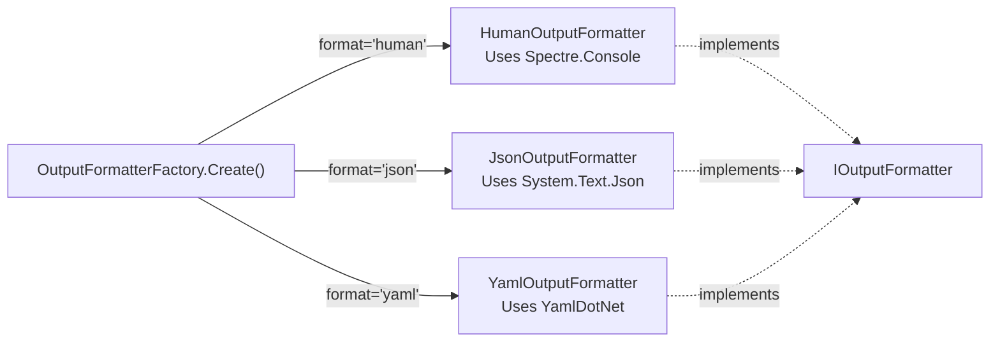

**Sources:** [src/Main/CLI/Commands/BaseCommand.cs:75-77]()

## Core Services Layer

The core services layer implements business logic for content management and search operations. Services are instantiated by CLI commands and operate on data through the infrastructure layer.

### Content Management Service Architecture

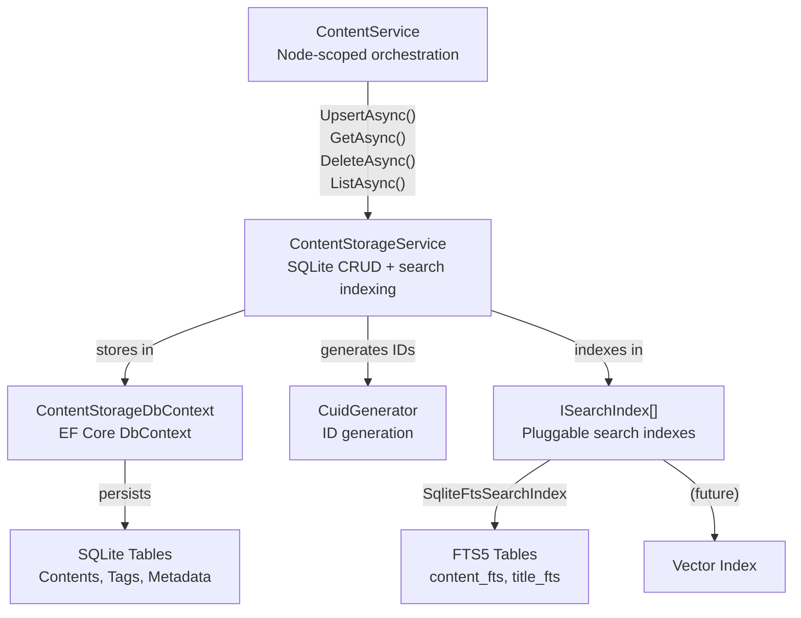

The `ContentService` is node-scoped and owns a `ContentStorageService` instance. Each write operation (upsert/delete) triggers automatic indexing across all configured search indexes.

**Sources:** [src/Main/CLI/Commands/BaseCommand.cs:82-170]()

### Service Creation in BaseCommand

The `BaseCommand.CreateContentService()` method demonstrates how services are instantiated with proper lifecycle management:

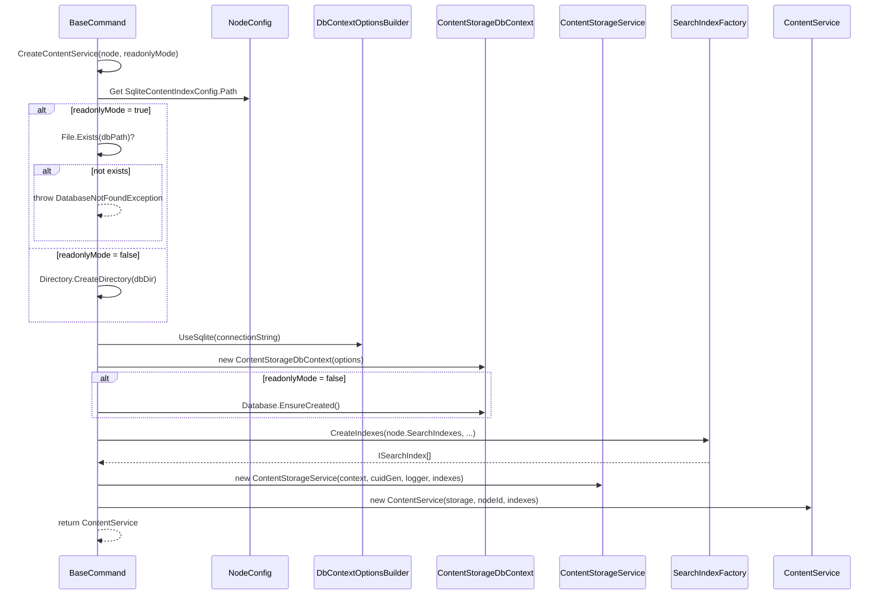

The `readonlyMode` parameter controls whether the service can create directories and databases. Read operations (`get`, `list`) use readonly mode and fail gracefully if no database exists (first-run scenario). Write operations (`put`, `delete`) use write mode and create the database automatically.

**Sources:** [src/Main/CLI/Commands/BaseCommand.cs:82-170]()

### Readonly vs Write Mode Distinction

The distinction between readonly and write modes prevents readonly commands from accidentally creating files or databases:

| Mode | Directory Creation | Database Creation | First-Run Behavior |
|------|-------------------|-------------------|-------------------|
| **Readonly** | No | No | Throws `DatabaseNotFoundException` |
| **Write** | Yes | Yes (via `EnsureCreated()`) | Creates database automatically |

Commands that only read data (`get`, `list`, `search`, `config`, `nodes`) should never create databases. This prevents unexpected side effects like creating empty databases in the user's home directory.

**Sources:** [src/Main/CLI/Commands/BaseCommand.cs:100-116](), [tests/Main.Tests/Integration/ReadonlyCommandTests.cs:63-98]()

### Search Index Factory

The `SearchIndexFactory.CreateIndexes()` method instantiates search indexes based on configuration:

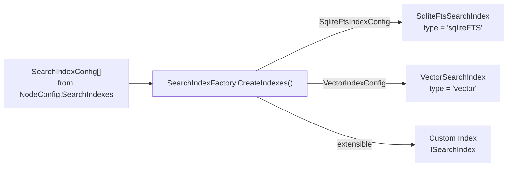

Each search index implements the `ISearchIndex` interface, enabling polymorphic search operations. The factory pattern allows the system to support multiple index types simultaneously.

**Sources:** [src/Main/CLI/Commands/BaseCommand.cs:158-163]()

## Infrastructure Layer

The infrastructure layer provides data persistence through SQLite databases and file storage. It has no business logic—only data access and storage concerns.

### SQLite Database Architecture

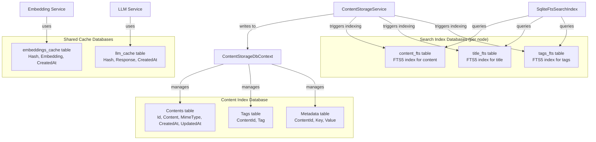

Each node has its own content index database and search indexes. Embedding and LLM caches are shared across all nodes to avoid redundant API calls.

**Sources:** [src/Main/CLI/Commands/BaseCommand.cs:93-98](), [src/Main/CLI/Commands/BaseCommand.cs:139-156]()

### Entity Framework Core Integration

The `ContentStorageDbContext` is a standard EF Core `DbContext` used for content storage:

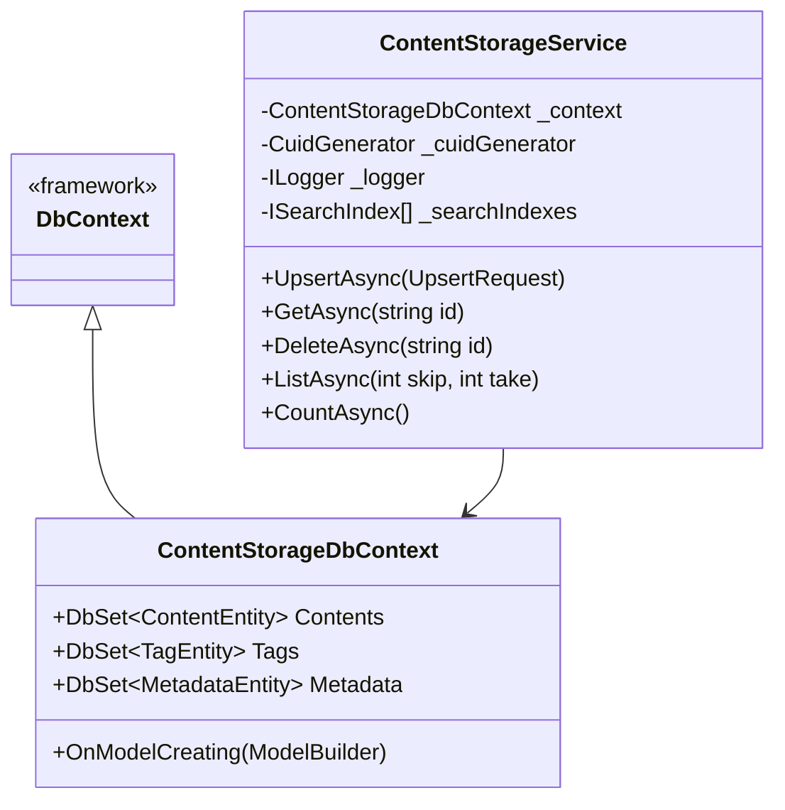

The `ContentStorageService` wraps the `DbContext` and adds search indexing logic. Every upsert and delete operation triggers reindexing across all configured search indexes.

**Sources:** [src/Main/CLI/Commands/BaseCommand.cs:122-131]()

### Embedding Cache Implementation

The `SqliteEmbeddingCache` provides a persistent cache for embedding vectors:

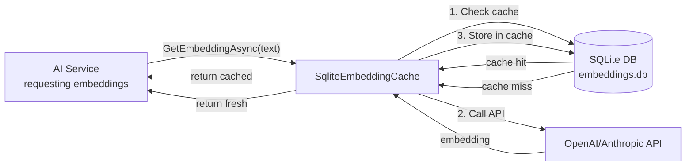

The cache uses a content hash as the key, ensuring deterministic lookups. The `CacheModes` enum controls whether the cache is `ReadOnly`, `WriteOnly`, or `ReadWrite`.

**Sources:** [src/Main/CLI/Commands/BaseCommand.cs:139-156]()

## Cross-Layer Communication Patterns

### Command to Service Flow

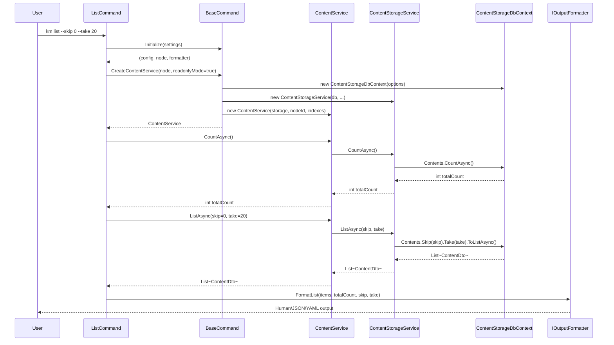

This sequence demonstrates the typical flow for a read operation. Write operations follow a similar pattern but include search indexing after the database write.

**Sources:** [src/Main/CLI/Commands/ListCommand.cs:66-102](), [src/Main/CLI/Commands/BaseCommand.cs:52-79](), [src/Main/CLI/Commands/BaseCommand.cs:82-170]()

### Error Handling and Exit Codes

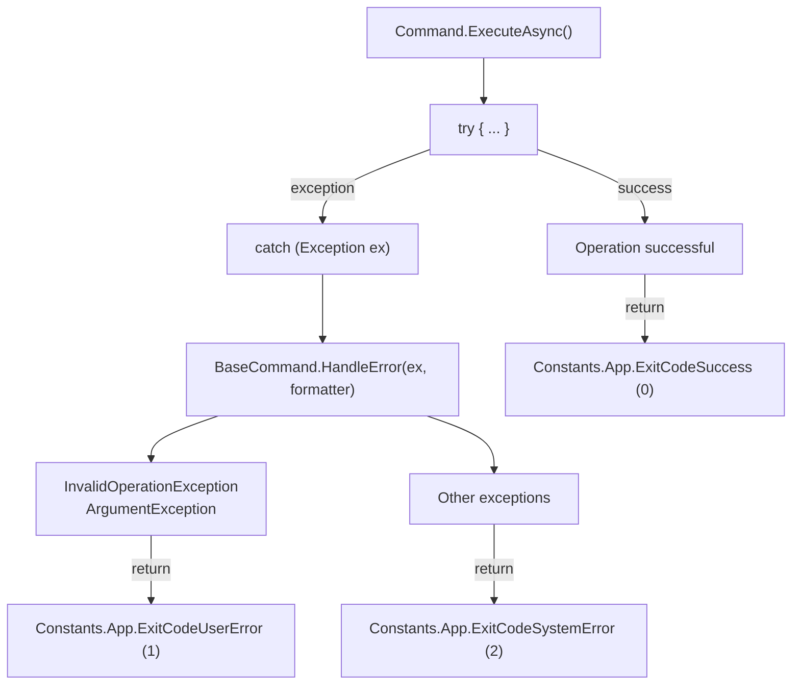

All commands use standardized exit codes:
- **0**: Success
- **1**: User error (invalid input, ID not found, validation failure)
- **2**: System error (database failure, network error, unexpected exception)

**Sources:** [src/Main/CLI/Commands/BaseCommand.cs:172-191](), [src/Main/CLI/Commands/GetCommand.cs:59-95]()

### First-Run User Experience

The system provides friendly messages when no database exists yet (first-run scenario):

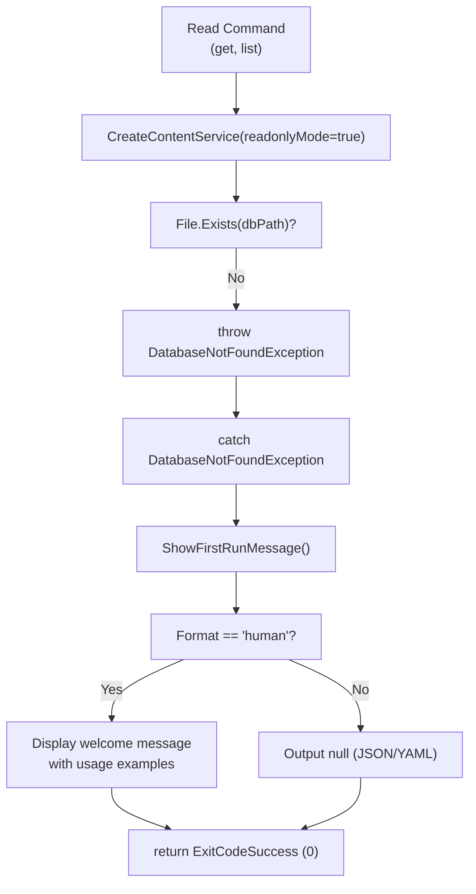

This design treats the absence of a database as an expected state (not an error), providing guidance to new users while maintaining machine-readable output for scripts.

**Sources:** [src/Main/CLI/Commands/GetCommand.cs:84-124](), [src/Main/CLI/Commands/ListCommand.cs:92-136](), [tests/Main.Tests/Integration/ReadonlyCommandTests.cs:63-98]()

## Dependency Lifecycle Management

The following table summarizes the lifecycle of key dependencies across the three layers:

| Component | Scope | Created By | Disposed By | Notes |
|-----------|-------|-----------|-------------|-------|
| `AppConfig` | Application | `CliApplicationBuilder` | N/A (immutable) | Loaded once at startup |
| `ILoggerFactory` | Application | `CliApplicationBuilder` | Process exit | Serilog flushes on exit |
| `CommandApp` | Application | `CliApplicationBuilder` | N/A | Spectre.Console.Cli manages lifecycle |
| `ContentStorageDbContext` | Command | `BaseCommand.CreateContentService()` | `ContentService.Dispose()` | EF Core context per command |
| `ContentService` | Command | `BaseCommand.CreateContentService()` | `using` statement in command | Wraps storage + indexes |
| `ISearchIndex[]` | Command | `SearchIndexFactory.CreateIndexes()` | `ContentService.Dispose()` | Array of indexes per node |
| `SqliteEmbeddingCache` | Command | `BaseCommand.CreateContentService()` | Managed by `ISearchIndex` | Shared cache instance |

**Sources:** [src/Main/CLI/CliApplicationBuilder.cs:60-61](), [src/Main/CLI/Commands/BaseCommand.cs:82-170](), [src/Main/CLI/Commands/GetCommand.cs:67-68]()

## Summary

The three-layer architecture provides clear separation of concerns:

1. **CLI Application Layer** handles user interaction, argument parsing, and output formatting via Spectre.Console.Cli
2. **Core Services Layer** implements business logic for content management (`ContentService`, `ContentStorageService`) and search orchestration (`SearchService`, `NodeSearchService`)
3. **Infrastructure Layer** provides data persistence through Entity Framework Core and SQLite, with support for multiple index types

The readonly vs write mode distinction prevents side effects in read operations, while the first-run experience provides friendly guidance to new users without breaking machine-readable output formats.

---

