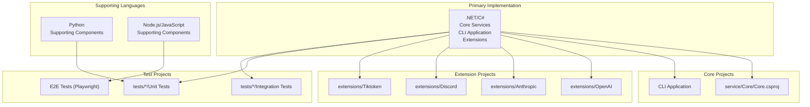
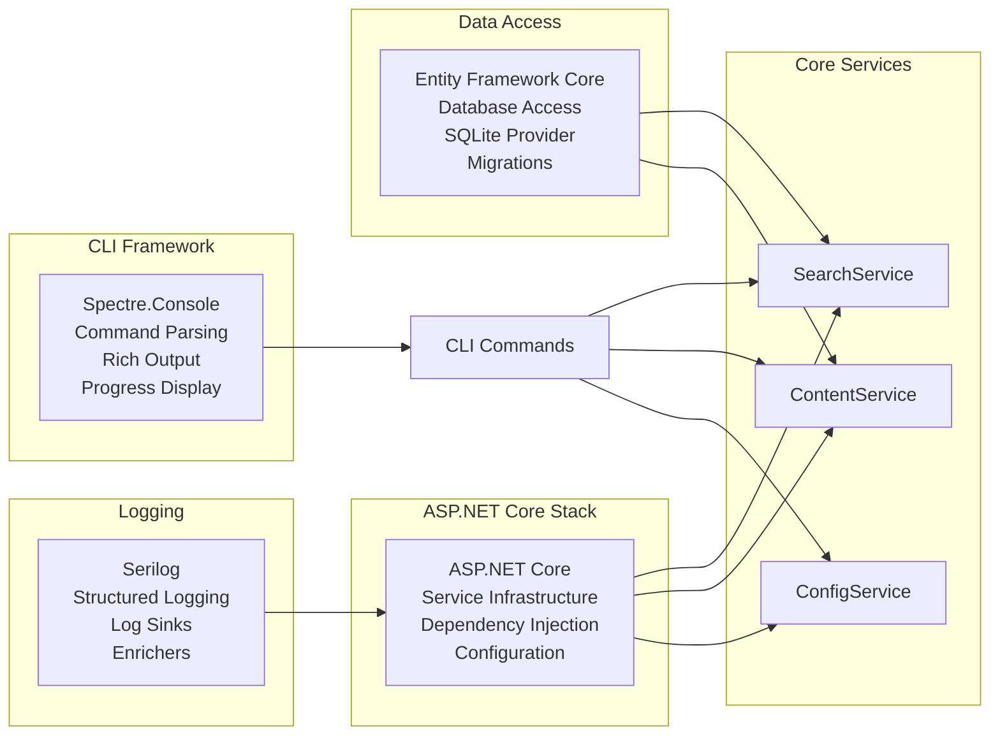
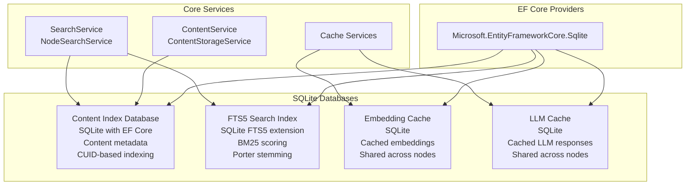
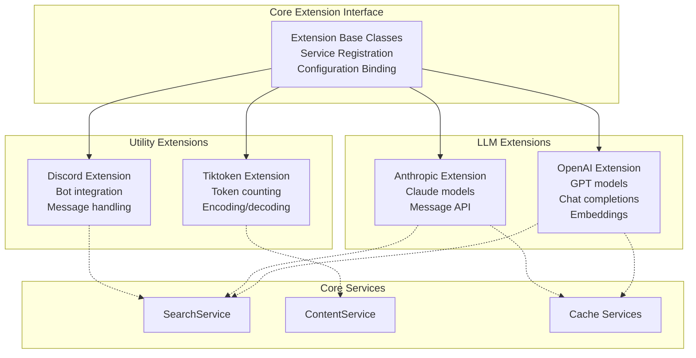
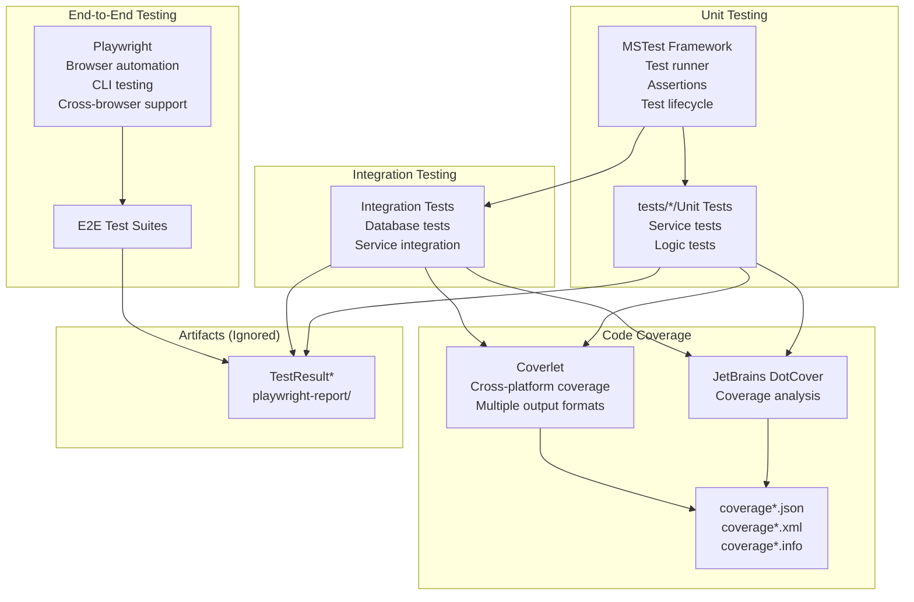
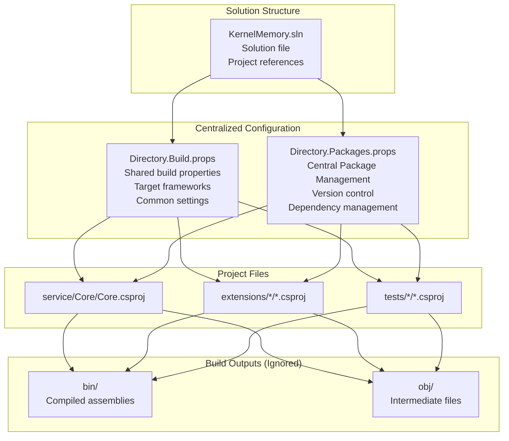
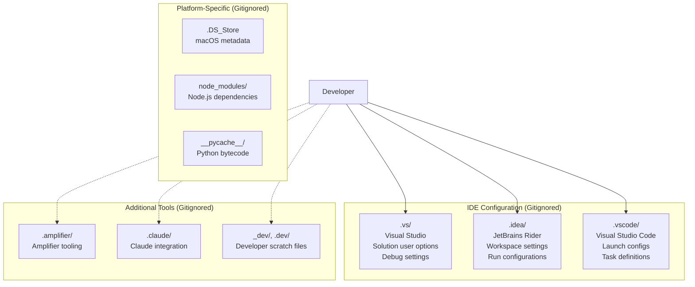
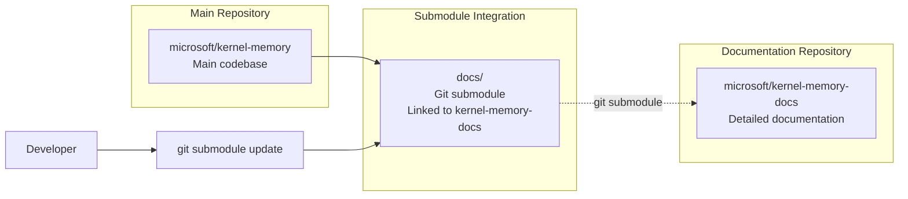
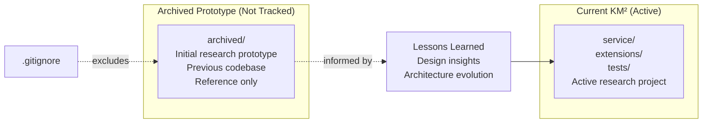

<!-- source: DeepWiki mcp.deepwiki.com · repo microsoft/kernel-memory · page 3.2 Technology Stack · fetched 2026-10-26 -->

# Technology Stack

Relevant source files

The following files were used as context for generating this wiki page:

- [.gitignore](.gitignore)
- [.gitmodules](.gitmodules)
- [README.md](README.md)

## Purpose and Scope

This page documents the complete technology stack used in KM² (Kernel Memory squared), including programming languages, frameworks, libraries, and development tools. It provides a technical overview of the multi-language architecture and the specific technologies employed across different layers of the system.

For information about how these technologies are organized into system layers, see [System Layers and Components](#3.1). For build system specifics and development workflows, see [Build System](#9.2).

---

## Core Language Stack

KM² is a polyglot system with .NET/C# as the primary language, supplemented by Python and Node.js components for specific subsystems and tooling.

### Language Distribution

**Sources:** [README.md:1-34](), [.gitignore:1-73]()

### .NET Target Framework

The system uses modern .NET, leveraging:
- **C# language version**: Latest stable version with modern language features
- **Target framework**: .NET 6.0 or later
- **Runtime**: Cross-platform support (Windows, Linux, macOS)

**Sources:** [.gitignore:28-42]()

---

## .NET Framework and Libraries

The core .NET stack provides the foundation for all primary services and the CLI application.

### Primary Framework Components

**Key Framework Dependencies:**

| Framework | Purpose | Used By |
|-----------|---------|---------|
| **ASP.NET Core** | Service infrastructure, DI container, configuration system | Core services, extensions |
| **Entity Framework Core** | Database access layer, SQLite provider | Content storage, search indexing |
| **Spectre.Console** | CLI framework with rich terminal UI | All CLI commands |
| **Serilog** | Structured logging with multiple sinks | All components |

**Sources:** [.gitignore:1-73]()

---

## Storage and Database Layer

KM² uses SQLite extensively for multiple storage purposes, with a file-based storage system for content artifacts.

### SQLite Usage Patterns

### SQLite FTS5 Configuration

The search index uses SQLite's Full-Text Search version 5 (FTS5) extension with specific configuration:
- **Tokenizer**: Porter stemming algorithm for English text
- **Scoring**: BM25 ranking algorithm
- **Index structure**: Multiple field-specific indexes for optimized searching
- **Performance**: In-memory caching and query optimization

**Storage Architecture:**

| Database Type | Technology | Purpose | Location |
|---------------|-----------|---------|----------|
| **Content Index** | SQLite + EF Core | Content metadata, CUID mapping | Per-node database file |
| **Search Index** | SQLite FTS5 | Full-text search with BM25 scoring | Per-node FTS database |
| **Embedding Cache** | SQLite | Cached vector embeddings | Shared cache database |
| **LLM Cache** | SQLite | Cached LLM API responses | Shared cache database |
| **File Storage** | File System | Content artifacts, binaries | Configurable directory |

**Sources:** [.gitignore:1-73]()

---

## AI/ML Extensions

KM² provides a modular extension system for integrating with various AI and ML services.

### Extension Architecture

### Available Extensions

| Extension | Package Location | Purpose | Key Dependencies |
|-----------|-----------------|---------|------------------|
| **OpenAI** | `extensions/OpenAI/*.csproj` | GPT model integration, embeddings | OpenAI SDK |
| **Anthropic** | `extensions/Anthropic/*.csproj` | Claude model integration | Anthropic SDK |
| **Discord** | `extensions/Discord/*.csproj` | Discord bot functionality | Discord.Net |
| **Tiktoken** | `extensions/Tiktoken/*.csproj` | Token counting for LLMs | Tiktoken library |

**Extension Registration:**
Extensions are registered through ASP.NET Core's dependency injection system and configured via the application configuration system. Each extension provides service collection extensions for registration.

**Sources:** [.gitignore:1-73]()

---

## Testing and Quality Infrastructure

KM² employs a comprehensive testing strategy with multiple frameworks and code coverage tools.

### Testing Framework Stack

### Testing Tools

| Tool | Purpose | Output |
|------|---------|--------|
| **MSTest** | Unit and integration testing framework | Test results, assertions |
| **Playwright** | End-to-end testing with browser automation | Test reports, screenshots |
| **DotCover** | Code coverage analysis (JetBrains) | Coverage reports |
| **Coverlet** | Cross-platform code coverage | JSON, XML, Info formats |

**Test Artifacts (Gitignored):**
- `TestResult*` - MSTest output directories
- `playwright-report/` - Playwright test reports
- `coverage*.json`, `coverage*.xml`, `coverage*.info` - Coverage data files

**Sources:** [.gitignore:43-56]()

---

## Build and Package Management

KM² uses a centralized build configuration system with modern .NET project management practices.

### Build System Architecture

### Build Configuration Files

**Directory.Build.props:**
- Shared MSBuild properties across all projects
- Target framework definitions
- Common compiler settings
- Nullable reference type configuration

**Directory.Packages.props:**
- Central Package Management (CPM) for NuGet packages
- Single source of truth for package versions
- Prevents version conflicts across projects
- Simplifies dependency updates

**Gitignored Build Artifacts:**

| Pattern | Type | Description |
|---------|------|-------------|
| `bin/`, `obj/` | Directories | Compiled outputs and intermediate files |
| `[Dd]ebug/`, `[Rr]elease/` | Directories | Build configuration outputs |
| `x64/`, `x86/`, `[Aa][Rr][Mm]/`, `[Aa][Rr][Mm]64/` | Directories | Platform-specific builds |
| `bld/`, `[Ll]og/`, `[Ll]ogs/` | Directories | Build logs and temporary files |
| `*.user`, `*.orig` | Files | User-specific and merge artifacts |

**Sources:** [.gitignore:7-42]()

---

## Development Tools and IDE Support

KM² supports multiple development environments with appropriate configuration for each.

### Supported IDEs

### Environment Configuration (Gitignored)

**Local Development Settings:**

| Pattern | Purpose | Security |
|---------|---------|----------|
| `.env` | Environment variables | Contains credentials |
| `*.development.*` | Development-specific configs | May contain sensitive data |
| `appsettings.*.json` | Environment-specific settings | Contains connection strings |
| `*.devis.*`, `*.devis` | Developer-specific files | Personal configurations |

**Secrets and Certificates (Gitignored):**

| Pattern | Type | Description |
|---------|------|-------------|
| `*.cer`, `*.crt` | Certificates | SSL/TLS certificates |
| `*.key`, `*.pem` | Keys | Private keys and PEM files |
| `certs/` | Directory | Certificate storage |

**Sources:** [.gitignore:1-73]()

---

## Documentation Infrastructure

### Documentation Submodule

The documentation is maintained as a separate Git repository and linked as a submodule at `docs/`. This allows:
- Independent versioning of documentation
- Separate contribution workflows
- Focused repository size management
- Documentation updates without code changes

**Submodule Configuration:**
- **Path:** `docs`
- **URL:** `https://github.com/microsoft/kernel-memory-docs`
- **Purpose:** Detailed user and developer documentation

**Sources:** [.gitmodules:1-4](), [README.md:1-34]()

---

## Archive and Legacy Code

### Archived Prototype

The `archived/` directory contains the initial research prototype. This directory is:
- **Not tracked in Git** (excluded via `.gitignore`)
- **Read-only reference material** for historical context
- **Superseded by KM²** which is a complete rewrite
- **Source of lessons learned** that informed the current architecture

**Sources:** [.gitignore:1](), [README.md:9-13]()

---

## Temporary and Development Files (Gitignored)

### Development Artifacts

| Pattern | Category | Description |
|---------|----------|-------------|
| `*.tmp` | Temporary | Temporary files |
| `*.log` | Logs | Log files |
| `*.bck` | Backups | Backup files |
| `*.tgz`, `*.tar`, `*.zip` | Archives | Compressed archives |

These files are excluded from version control to:
- Reduce repository size
- Prevent accidental commits of sensitive data
- Keep the repository clean and focused on source code
- Support local development workflows

**Sources:** [.gitignore:61-72]()

---

## Technology Stack Summary

### Primary Technologies

| Layer | Technology | Version/Notes |
|-------|-----------|---------------|
| **Language** | C# | Primary language, latest stable |
| **Runtime** | .NET | 6.0 or later |
| **Framework** | ASP.NET Core | Service infrastructure |
| **Database** | SQLite | Content, search (FTS5), caching |
| **ORM** | Entity Framework Core | SQLite provider |
| **CLI** | Spectre.Console | Rich terminal UI |
| **Logging** | Serilog | Structured logging |
| **Testing** | MSTest, Playwright | Unit, integration, E2E |
| **Coverage** | DotCover, Coverlet | Code coverage analysis |

### Supporting Technologies

| Component | Technology | Purpose |
|-----------|-----------|---------|
| **Node.js** | JavaScript runtime | E2E tests, supporting tools |
| **Python** | Python 3.x | Supporting components, tests |
| **Git Submodules** | Git | Documentation management |
| **Central Package Management** | NuGet CPM | Dependency management |

**Sources:** [README.md:1-34](), [.gitignore:1-73](), [.gitmodules:1-4]()

---

