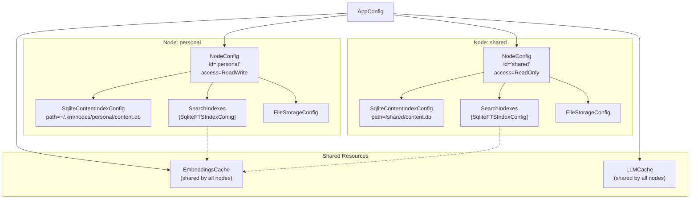
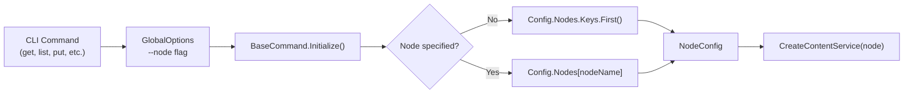
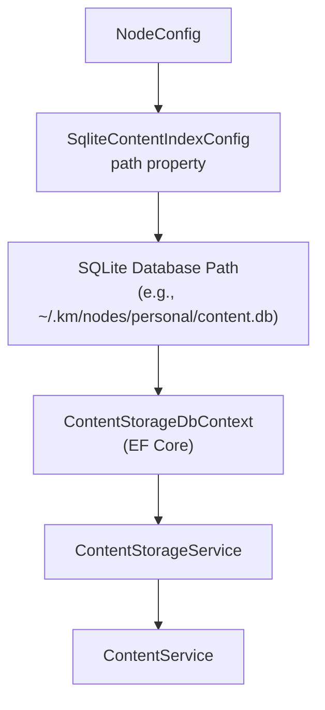
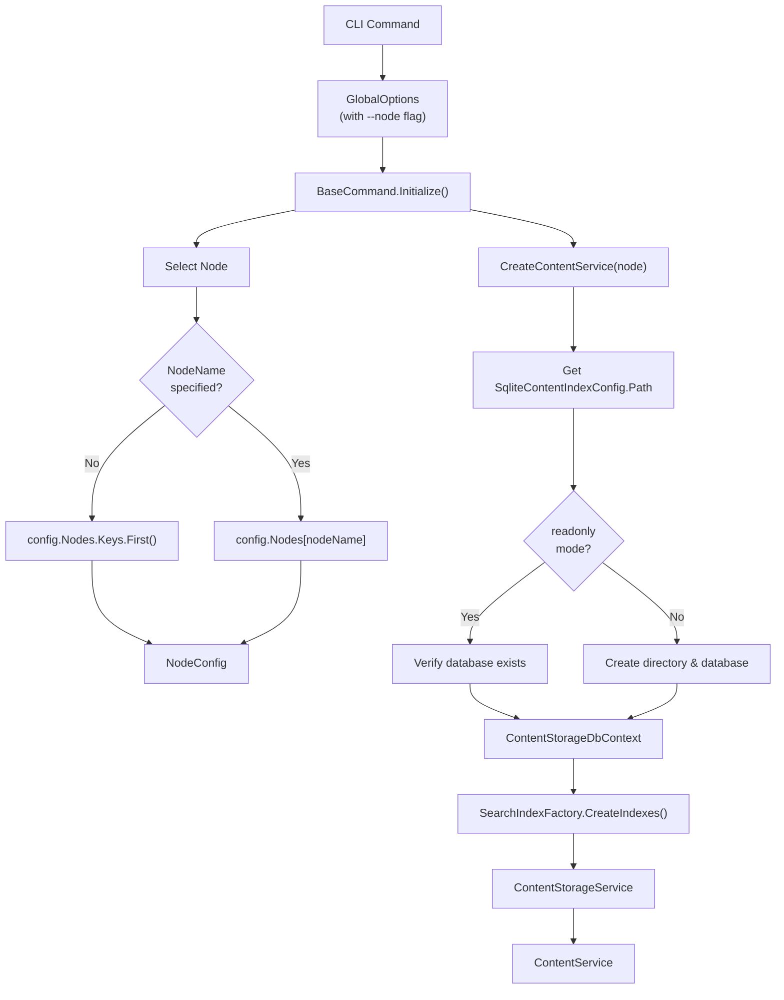

<!-- source: DeepWiki mcp.deepwiki.com · repo microsoft/kernel-memory · page 3.3 Multi-Node Architecture · fetched 2026-10-26 -->

# Multi-Node Architecture

<details>
<summary>Relevant source files</summary>

The following files were used as context for generating this wiki page:

- [src/Main/CLI/CliApplicationBuilder.cs](src/Main/CLI/CliApplicationBuilder.cs)
- [src/Main/CLI/Commands/BaseCommand.cs](src/Main/CLI/Commands/BaseCommand.cs)
- [src/Main/CLI/Commands/ConfigCommand.cs](src/Main/CLI/Commands/ConfigCommand.cs)
- [src/Main/CLI/Commands/DeleteCommand.cs](src/Main/CLI/Commands/DeleteCommand.cs)
- [src/Main/CLI/Commands/GetCommand.cs](src/Main/CLI/Commands/GetCommand.cs)
- [src/Main/CLI/Commands/ListCommand.cs](src/Main/CLI/Commands/ListCommand.cs)
- [src/Main/CLI/Commands/UpsertCommand.cs](src/Main/CLI/Commands/UpsertCommand.cs)
- [tests/Main.Tests/Integration/CliIntegrationTests.cs](tests/Main.Tests/Integration/CliIntegrationTests.cs)
- [tests/Main.Tests/Integration/CommandExecutionTests.cs](tests/Main.Tests/Integration/CommandExecutionTests.cs)
- [tests/Main.Tests/Integration/ConfigCommandTests.cs](tests/Main.Tests/Integration/ConfigCommandTests.cs)
- [tests/Main.Tests/Integration/ReadonlyCommandTests.cs](tests/Main.Tests/Integration/ReadonlyCommandTests.cs)

</details>


This page explains KM²'s node-based architecture, which allows users to partition content into independent logical units with separate storage, indexing, and access controls. For information about the overall system architecture, see [Architecture](#3). For configuration file structure details, see [Configuration System](#6). For storage implementation details, see [Storage and Indexing](#7).

## Node Concept

A **node** in KM² is a logical partition that represents an independent content repository. Each node maintains its own:

- **Content Index** - SQLite database storing content metadata
- **Search Indexes** - One or more search indexes (FTS5, vector, etc.)
- **File Storage** - Optional file storage for content artifacts
- **Repository Storage** - Optional repository storage configuration
- **Access Mode** - ReadWrite or ReadOnly permission level

Nodes enable use cases such as:
- A personal writable node for individual work
- A shared read-only node for team content
- Separate nodes for different projects or contexts
- Isolation of test data from production data



**Sources:** [src/Main/CLI/Commands/BaseCommand.cs:56-78](), [src/Main/CLI/Commands/ConfigCommand.cs:99-107]()

## Node Configuration Structure

Nodes are defined in the `AppConfig.Nodes` dictionary, where the key is the node ID and the value is a `NodeConfig` object.

**Configuration Properties:**

| Property | Type | Description |
|----------|------|-------------|
| `Id` | `string` | Unique identifier for the node |
| `Access` | `NodeAccessMode` | `ReadWrite` or `ReadOnly` |
| `ContentIndex` | `ContentIndexConfig` | Content storage configuration (typically `SqliteContentIndexConfig`) |
| `SearchIndexes` | `List<SearchIndexConfig>` | List of search index configurations |
| `FileStorage` | `FileStorageConfig?` | Optional file storage configuration |
| `RepoStorage` | `RepoStorageConfig?` | Optional repository storage configuration |

Example configuration structure:

```json
{
  "nodes": {
    "personal": {
      "id": "personal",
      "access": "ReadWrite",
      "contentIndex": {
        "type": "sqlite",
        "path": "~/.km/nodes/personal/content.db"
      },
      "searchIndexes": [
        {
          "type": "sqliteFTS",
          "path": "~/.km/nodes/personal/search.db"
        }
      ]
    },
    "shared": {
      "id": "shared",
      "access": "ReadOnly",
      "contentIndex": {
        "type": "sqlite",
        "path": "/team/shared/content.db"
      },
      "searchIndexes": [
        {
          "type": "sqliteFTS",
          "path": "/team/shared/search.db"
        }
      ]
    }
  }
}
```

**Sources:** [tests/Main.Tests/Integration/ConfigCommandTests.cs:38-43](), [tests/Main.Tests/Integration/CliIntegrationTests.cs:32-42]()

## Node Selection in CLI Commands

The CLI provides node selection through the `--node` flag available on all commands via `GlobalOptions`. When no node is specified, the system uses the **first node** in the `Config.Nodes` dictionary.



**Implementation in `BaseCommand.Initialize()`:**

```csharp
// From BaseCommand.cs:64-73
var nodeName = settings.NodeName ?? config.Nodes.Keys.First();
if (!config.Nodes.TryGetValue(nodeName, out var node))
{
    throw new InvalidOperationException($"Node '{nodeName}' not found in configuration.");
}
```

**CLI Usage Examples:**

```bash
# Use default node (first in config)
km list

# Explicitly specify node
km list --node personal
km list --node shared

# All commands support --node flag
km put "content" --node work
km get abc123 --node shared
km search "query" --node personal
```

**Sources:** [src/Main/CLI/Commands/BaseCommand.cs:64-73](), [src/Main/CLI/Commands/ListCommand.cs:122-123]()

## Per-Node Resources

Each node maintains completely independent resources. There is no sharing of content or indexes between nodes unless explicitly configured through storage backends.

### Content Index

Each node has its own `ContentIndex`, typically a SQLite database specified by `SqliteContentIndexConfig.Path`. This database stores:

- Content metadata (ID, title, description, tags)
- MIME types and content timestamps
- CUID-based identifiers
- Relationships to file storage

The content index is accessed through `ContentStorageService` which is created per-node in `BaseCommand.CreateContentService()`:



**Sources:** [src/Main/CLI/Commands/BaseCommand.cs:90-131]()

### Search Indexes

Each node can have multiple search indexes configured in `NodeConfig.SearchIndexes`. The most common is `SqliteFTSIndexConfig` for full-text search, but nodes support multiple index types simultaneously.

Search indexes are created by `SearchIndexFactory.CreateIndexes()` and registered with the node's `ContentStorageService`:

```csharp
// From BaseCommand.cs:159-166
var searchIndexes = SearchIndexFactory.CreateIndexes(
    node.SearchIndexes,
    httpClient,
    embeddingCache,
    this._loggerFactory);

var storage = new ContentStorageService(context, cuidGenerator, logger, searchIndexes);
```

Multiple indexes per node enable:
- Full-text search via SQLite FTS5
- Vector search for semantic queries
- Hybrid search strategies
- Custom index implementations

**Sources:** [src/Main/CLI/Commands/BaseCommand.cs:159-169]()

### File and Repository Storage

Nodes optionally include:

- **`FileStorage`** - Configuration for storing content files
- **`RepoStorage`** - Configuration for repository-based storage

These are independent per node, allowing different nodes to use different storage backends (local filesystem, network shares, cloud storage, etc.).

**Sources:** [src/Main/CLI/Commands/ConfigCommand.cs:104-105]()

## Shared Resources

While nodes maintain independent content and indexes, certain resources are shared across all nodes for efficiency:

### Embeddings Cache

The `AppConfig.EmbeddingsCache` is shared by all nodes. This cache stores computed embeddings to avoid redundant computation when the same content appears in multiple nodes or when rebuilding indexes.

```csharp
// From BaseCommand.cs:139-156
IEmbeddingCache? embeddingCache = null;
if (this._config.EmbeddingsCache != null)
{
    var cachePath = this._config.EmbeddingsCache.Path;
    var cacheLogger = this._loggerFactory.CreateLogger<SqliteEmbeddingCache>();
    
    var cacheMode = (this._config.EmbeddingsCache.AllowRead, this._config.EmbeddingsCache.AllowWrite) switch
    {
        (true, true) => CacheModes.ReadWrite,
        (true, false) => CacheModes.ReadOnly,
        (false, true) => CacheModes.WriteOnly,
        (false, false) => throw new InvalidOperationException("...")
    };
    
    embeddingCache = new SqliteEmbeddingCache(cachePath, cacheMode, cacheLogger);
}
```

The cache supports different modes (`ReadWrite`, `ReadOnly`, `WriteOnly`) via the `AllowRead` and `AllowWrite` configuration flags.

### LLM Cache

Similar to embeddings cache, `AppConfig.LLMCache` is shared across nodes to cache LLM responses and reduce API costs.

**Sources:** [src/Main/CLI/Commands/BaseCommand.cs:139-156](), [tests/Main.Tests/Integration/ConfigCommandTests.cs:44-45]()

## Access Modes

Nodes support two access modes via `NodeConfig.Access`:

| Mode | Value | Behavior |
|------|-------|----------|
| Read-Write | `NodeAccessMode.ReadWrite` | Allows all operations (get, list, put, delete) |
| Read-Only | `NodeAccessMode.ReadOnly` | Allows only read operations (get, list, search) |

### Read-Only vs Write Operations

The CLI distinguishes between readonly and write operations through the `readonlyMode` parameter in `CreateContentService()`:

**Readonly Commands** (`readonlyMode: true`):
- `get` - Retrieve content by ID
- `list` - List content with pagination  
- `search` - Search across nodes
- `nodes` - List configured nodes
- `config` - View configuration

These commands **never create databases or directories**. If the database doesn't exist, they return gracefully with appropriate first-run messages.

**Write Commands** (`readonlyMode: false`):
- `put` - Create or update content
- `delete` - Delete content

These commands create directories and initialize databases on first use.

```csharp
// From BaseCommand.cs:100-116
if (readonlyMode)
{
    if (!File.Exists(dbPath))
    {
        throw new DatabaseNotFoundException(dbPath);
    }
}
else
{
    // Write mode: Ensure directory exists
    var dbDir = Path.GetDirectoryName(dbPath);
    if (!string.IsNullOrEmpty(dbDir) && !Directory.Exists(dbDir))
    {
        Directory.CreateDirectory(dbDir);
    }
}
```

**First-Run Experience:**

When readonly commands encounter a non-existent database, they display friendly messages instead of errors:

```csharp
// From ListCommand.cs:109-136
private void ShowFirstRunMessage(ListCommandSettings settings, string nodeId)
{
    var formatter = OutputFormatterFactory.Create(settings);
    
    if (!settings.Format.Equals("human", StringComparison.OrdinalIgnoreCase))
    {
        formatter.FormatList(Array.Empty<ContentDto>(), 0, 0, settings.Take);
        return;
    }
    
    AnsiConsole.MarkupLine("[bold green]Welcome to Kernel Memory! 🚀[/]");
    AnsiConsole.MarkupLine($"[dim]No content found in node '{nodeId}' yet.[/]");
    AnsiConsole.MarkupLine("[bold]To get started:[/]");
    AnsiConsole.MarkupLine($"  [cyan]km put \"Your content here\"{nodeParam}[/]");
}
```

**Sources:** [src/Main/CLI/Commands/BaseCommand.cs:100-116](), [src/Main/CLI/Commands/ListCommand.cs:109-136](), [src/Main/CLI/Commands/GetCommand.cs:100-124](), [tests/Main.Tests/Integration/ReadonlyCommandTests.cs:64-98]()

## Multi-Node Use Cases

### Personal and Shared Nodes

A common pattern is combining personal writable nodes with shared read-only nodes:

```json
{
  "nodes": {
    "personal": {
      "id": "personal",
      "access": "ReadWrite",
      "contentIndex": {
        "type": "sqlite",
        "path": "~/.km/nodes/personal/content.db"
      }
    },
    "team": {
      "id": "team",
      "access": "ReadOnly",
      "contentIndex": {
        "type": "sqlite",
        "path": "/shared/team/content.db"
      }
    }
  }
}
```

Usage:
```bash
# Write to personal node
km put "My notes" --node personal

# Read from shared team node
km list --node team
km search "project requirements" --node team

# Search across default (personal) node
km search "my notes"
```

### Project-Based Isolation

Separate nodes for different projects or contexts:

```json
{
  "nodes": {
    "project-a": {
      "id": "project-a",
      "access": "ReadWrite",
      "contentIndex": {
        "type": "sqlite",
        "path": "~/projects/project-a/.km/content.db"
      }
    },
    "project-b": {
      "id": "project-b",
      "access": "ReadWrite",
      "contentIndex": {
        "type": "sqlite",
        "path": "~/projects/project-b/.km/content.db"
      }
    }
  }
}
```

### Test and Production Separation

Isolate test data from production:

```json
{
  "nodes": {
    "production": {
      "id": "production",
      "access": "ReadWrite",
      "contentIndex": {
        "type": "sqlite",
        "path": "~/.km/production/content.db"
      }
    },
    "test": {
      "id": "test",
      "access": "ReadWrite",
      "contentIndex": {
        "type": "sqlite",
        "path": "/tmp/km-test/content.db"
      }
    }
  }
}
```

**Sources:** [tests/Main.Tests/Integration/ConfigCommandTests.cs:38-46]()

## Implementation Details

### Node Configuration Loading

Node configuration is loaded once at application startup in `CliApplicationBuilder.Build()`:

```csharp
// From CliApplicationBuilder.cs:66-70
string configPath = this.DetermineConfigPath(actualArgs);
AppConfig config = ConfigParser.LoadFromFile(configPath);
```

The `AppConfig` is then registered as a singleton in the DI container:

```csharp
// From CliApplicationBuilder.cs:92-93
ServiceCollection services = new();
services.AddSingleton(config);
```

All commands receive the same `AppConfig` instance through constructor injection, ensuring consistent node configuration across all operations.

### Node Selection and Service Creation

The `BaseCommand<TSettings>` base class provides the `Initialize()` method that selects the appropriate node:



**Key Code Flow:**

1. **Node Selection** [src/Main/CLI/Commands/BaseCommand.cs:64-73]()
   - Use `settings.NodeName` if provided
   - Otherwise use first node from `config.Nodes.Keys.First()`
   - Throw `InvalidOperationException` if node not found

2. **Service Creation** [src/Main/CLI/Commands/BaseCommand.cs:90-170]()
   - Extract `SqliteContentIndexConfig.Path` from node
   - In readonly mode: verify database exists
   - In write mode: create directory and initialize database
   - Create `DbContext` with connection string
   - Create search indexes from `node.SearchIndexes`
   - Create `ContentStorageService` with indexes
   - Return `ContentService` wrapping the storage

### Configuration Validation

The `ConfigCommand` can inspect node configuration:

```bash
# Show all nodes summary
km config --show-nodes

# Output shows node summary
{
  "id": "personal",
  "access": "ReadWrite",
  "contentIndex": "Sqlite",
  "hasFileStorage": true,
  "hasRepoStorage": false,
  "searchIndexCount": 1
}
```

The implementation iterates over all nodes:

```csharp
// From ConfigCommand.cs:96-108
if (settings.ShowNodes)
{
    output = this.Config.Nodes.Select(kvp => new NodeSummaryDto
    {
        Id = kvp.Key,
        Access = kvp.Value.Access.ToString(),
        ContentIndex = kvp.Value.ContentIndex.Type.ToString(),
        HasFileStorage = kvp.Value.FileStorage != null,
        HasRepoStorage = kvp.Value.RepoStorage != null,
        SearchIndexCount = kvp.Value.SearchIndexes.Count
    }).ToList();
}
```

**Sources:** [src/Main/CLI/Commands/BaseCommand.cs:56-170](), [src/Main/CLI/Commands/ConfigCommand.cs:96-108](), [src/Main/CLI/CliApplicationBuilder.cs:66-96]()

### Database Initialization

Database initialization follows a strict pattern:

**For Readonly Operations:**
- Check if database file exists using `File.Exists(dbPath)`
- If not exists, throw `DatabaseNotFoundException`
- Never call `context.Database.EnsureCreated()`

**For Write Operations:**
- Ensure directory exists using `Directory.CreateDirectory(dbDir)`
- Create `DbContext` with connection string
- Call `context.Database.EnsureCreated()` to initialize schema

This ensures readonly commands never have side effects on the filesystem.

**Sources:** [src/Main/CLI/Commands/BaseCommand.cs:100-131](), [tests/Main.Tests/Integration/ReadonlyCommandTests.cs:64-169]()

## Default Node Behavior

When the `--node` flag is omitted, the system selects the first node from the configuration dictionary. The order is determined by the order in the JSON configuration file:

```json
{
  "nodes": {
    "personal": { ... },  // ← This is the default
    "work": { ... },
    "shared": { ... }
  }
}
```

This behavior is implemented in `BaseCommand.Initialize()`:

```csharp
var nodeName = settings.NodeName ?? config.Nodes.Keys.First();
```

For user-friendly messages, commands check if the default node is being used:

```csharp
// From ListCommand.cs:122-123
var isDefaultNode = nodeId == this.Config.Nodes.Keys.First();
var nodeParam = isDefaultNode ? "" : $" --node {nodeId}";
```

This allows first-run messages to omit the `--node` flag when suggesting commands if the default node is being used.

**Sources:** [src/Main/CLI/Commands/BaseCommand.cs:69](), [src/Main/CLI/Commands/ListCommand.cs:122-123]()

---

