<!-- source: DeepWiki mcp.deepwiki.com · repo microsoft/kernel-memory · page 4 CLI Application · fetched 2026-10-26 -->

# CLI Application

<details>
<summary>Relevant source files</summary>

The following files were used as context for generating this wiki page:

- [src/Main/CLI/CliApplicationBuilder.cs](src/Main/CLI/CliApplicationBuilder.cs)
- [src/Main/CLI/Commands/BaseCommand.cs](src/Main/CLI/Commands/BaseCommand.cs)
- [src/Main/CLI/Commands/ConfigCommand.cs](src/Main/CLI/Commands/ConfigCommand.cs)
- [src/Main/CLI/Commands/DeleteCommand.cs](src/Main/CLI/Commands/DeleteCommand.cs)
- [src/Main/CLI/Commands/GetCommand.cs](src/Main/CLI/Commands/GetCommand.cs)
- [src/Main/CLI/Commands/ListCommand.cs](src/Main/CLI/Commands/ListCommand.cs)
- [src/Main/CLI/Commands/UpsertCommand.cs](src/Main/CLI/Commands/UpsertCommand.cs)
- [tests/Main.Tests/Integration/CliIntegrationTests.cs](tests/Main.Tests/Integration/CliIntegrationTests.cs)
- [tests/Main.Tests/Integration/CommandExecutionTests.cs](tests/Main.Tests/Integration/CommandExecutionTests.cs)
- [tests/Main.Tests/Integration/ConfigCommandTests.cs](tests/Main.Tests/Integration/ConfigCommandTests.cs)
- [tests/Main.Tests/Integration/ReadonlyCommandTests.cs](tests/Main.Tests/Integration/ReadonlyCommandTests.cs)

</details>


The CLI application provides the primary user interface to KM² (Kernel Memory). This document covers the command-line tool (`km`), its available commands, execution architecture, and usage patterns. For information about the underlying configuration system, see [Configuration System](#6). For search functionality details, see [Search System](#5).

## Command Overview

The CLI application exposes multiple commands for content management, configuration inspection, and system diagnostics. All commands are built using the Spectre.Console.Cli framework and share a common base class with dependency injection support.

### Available Commands

| Command | Purpose | Read-Only |
|---------|---------|-----------|
| `put` | Upload or update content (HTTP-style naming for upsert) | No |
| `get` | Fetch content by ID | Yes |
| `delete` | Delete content by ID | No |
| `list` | List all content with pagination | Yes |
| `nodes` | List all configured nodes | Yes |
| `config` | Query and create configuration files | Yes |
| `search` | Search content across nodes and indexes | Yes |
| `examples` | Show usage examples for commands | Yes |
| `doctor` | Validate configuration and check system health | Yes |

Sources: [src/Main/CLI/CliApplicationBuilder.cs:204-263]()

### Command Registration

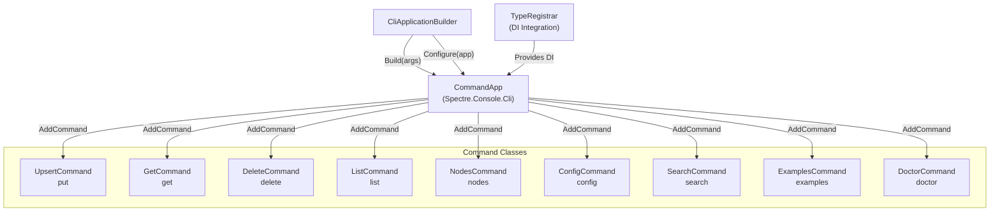

Sources: [src/Main/CLI/CliApplicationBuilder.cs:19-105](), [src/Main/CLI/CliApplicationBuilder.cs:198-267]()

## Command Execution Architecture

The CLI application uses a layered architecture with early configuration loading, dependency injection, and a shared base command class.

### Initialization Flow

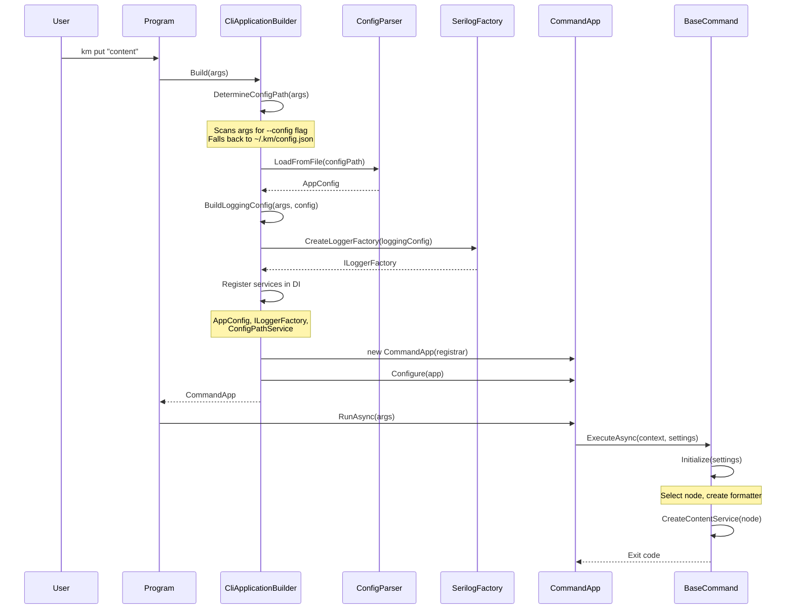

Sources: [src/Main/CLI/CliApplicationBuilder.cs:62-105](), [src/Main/CLI/Commands/BaseCommand.cs:51-79]()

### BaseCommand Class Hierarchy

All commands inherit from `BaseCommand<TSettings>` which provides shared initialization logic:

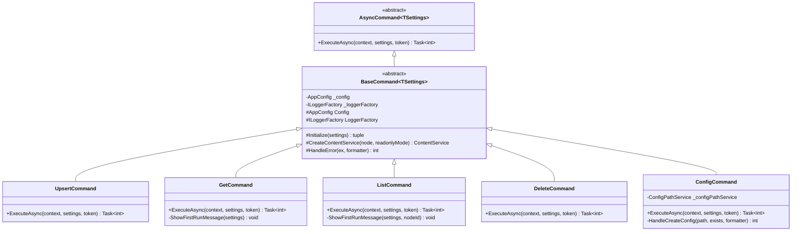

Sources: [src/Main/CLI/Commands/BaseCommand.cs:24-191](), [src/Main/CLI/Commands/ConfigCommand.cs:39-188]()

### Dependency Injection and Service Creation

The `BaseCommand.Initialize()` method selects the appropriate node and creates an output formatter. The `CreateContentService()` method instantiates all required services:

```mermaid
graph TB
    Initialize["BaseCommand.Initialize(settings)"]
    CreateContentService["BaseCommand.CreateContentService(node, readonlyMode)"]
    
    subgraph "Services Created"
        DbContext["ContentStorageDbContext<br/>(Entity Framework)"]
        CuidGenerator["CuidGenerator"]
        HttpClient["HttpClient"]
        EmbeddingCache["SqliteEmbeddingCache<br/>(optional)"]
        SearchIndexes["ISearchIndex[]<br/>(from node config)"]
        ContentStorageService["ContentStorageService"]
        ContentService["ContentService"]
    end
    
    Initialize -->|"Select node from config"| NodeConfig
    Initialize -->|"Create output formatter"| IOutputFormatter
    
    CreateContentService -->|"Get SQLite path"| NodeConfig
    CreateContentService -->|"Check file exists in readonly mode"| FileSystem
    CreateContentService -->|"Create directory in write mode"| FileSystem
    CreateContentService -->|"Build connection string"| DbContext
    CreateContentService -->|"EnsureCreated() in write mode"| DbContext
    CreateContentService -->|"Instantiate"| CuidGenerator
    CreateContentService -->|"Instantiate"| HttpClient
    CreateContentService -->|"Create if configured"| EmbeddingCache
    CreateContentService -->|"Create from node.SearchIndexes"| SearchIndexes
    CreateContentService -->|"Instantiate with context"| ContentStorageService
    CreateContentService -->|"Instantiate with storage"| ContentService
    CreateContentService -->|"Return"| ContentService
```

Sources: [src/Main/CLI/Commands/BaseCommand.cs:51-170]()

## Global Options and Output Formatting

All commands support a common set of global options defined in the `GlobalOptions` base settings class.

### Global Options

| Option | Short | Type | Default | Description |
|--------|-------|------|---------|-------------|
| `--config` | `-c` | string | `~/.km/config.json` | Path to configuration file |
| `--node` | `-n` | string | First node in config | Node to operate on |
| `--format` | `-f` | string | `human` | Output format (human, json, yaml) |
| `--verbosity` | `-v` | string | `normal` | Verbosity level (silent, quiet, normal, verbose) |
| `--log-file` | | string | null | Path to log file |
| `--no-color` | | bool | false | Disable colored output |

Sources: [src/Main/CLI/Commands/BaseCommand.cs:51-79]() (GlobalOptions inheritance)

### Output Formatting System

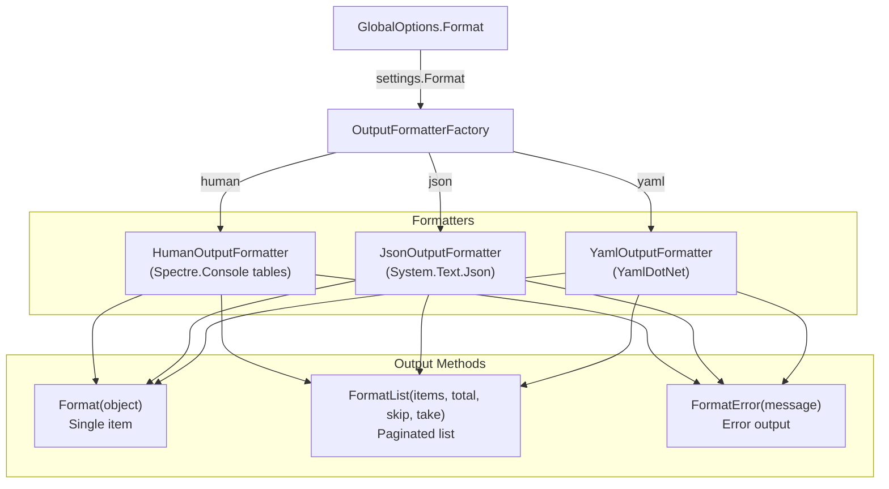

Sources: [src/Main/CLI/OutputFormatters/OutputFormatterFactory.cs]() (inferred from usage), [src/Main/CLI/Commands/BaseCommand.cs:75-77]()

## Content Management Commands

Content management commands provide CRUD operations for content stored in nodes.

### UpsertCommand (put)

The `UpsertCommand` creates or updates content:

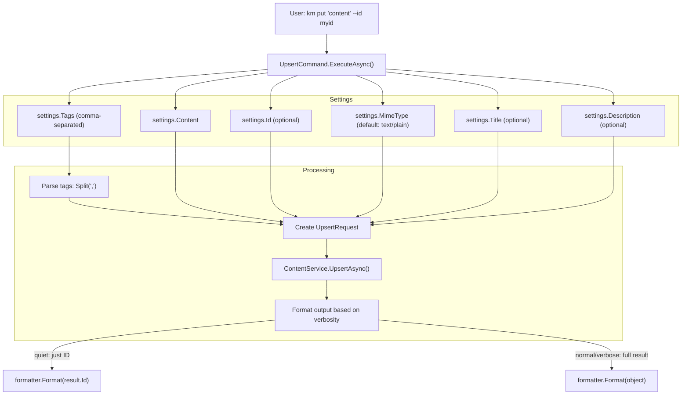

**Command Options:**
- `<content>` (required): Content to upload
- `--id`: Custom content ID (auto-generated if omitted)
- `--mime-type`: MIME type (default: `text/plain`)
- `--title`: Optional title
- `--description`: Optional description
- `--tags`: Comma-separated tags

**Examples:**
```bash
km put "Hello, world!"
km put "Some content" --id my-id-123
km put "Tagged content" --tags important,todo
```

Sources: [src/Main/CLI/Commands/UpsertCommand.cs:14-130](), [src/Main/CLI/CliApplicationBuilder.cs:205-209]()

### GetCommand

The `GetCommand` retrieves content by ID:

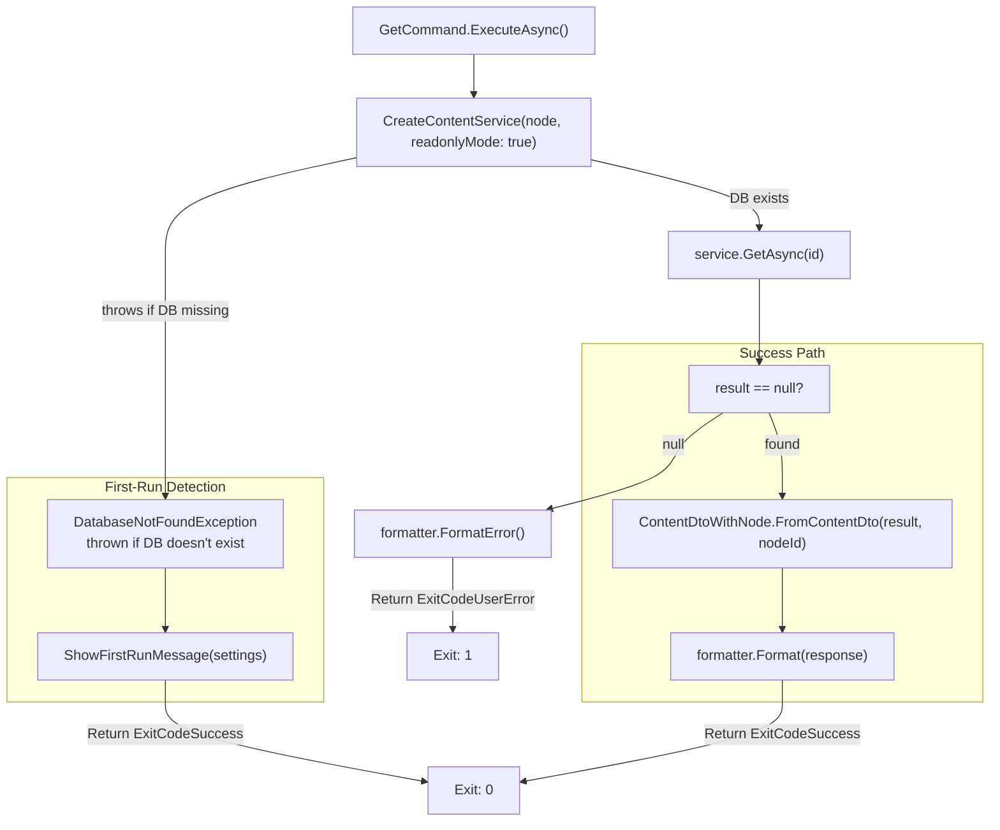

**Command Options:**
- `<id>` (required): Content ID to retrieve
- `--full`: Show all internal details

**First-Run Behavior:**  
If the database doesn't exist (first run), the command displays a friendly message suggesting how to create content instead of showing an error. This is a deliberate UX decision to make the first-run experience smooth.

Sources: [src/Main/CLI/Commands/GetCommand.cs:48-125](), [tests/Main.Tests/Integration/ReadonlyCommandTests.cs:100-134]()

### ListCommand

The `ListCommand` lists content with pagination:

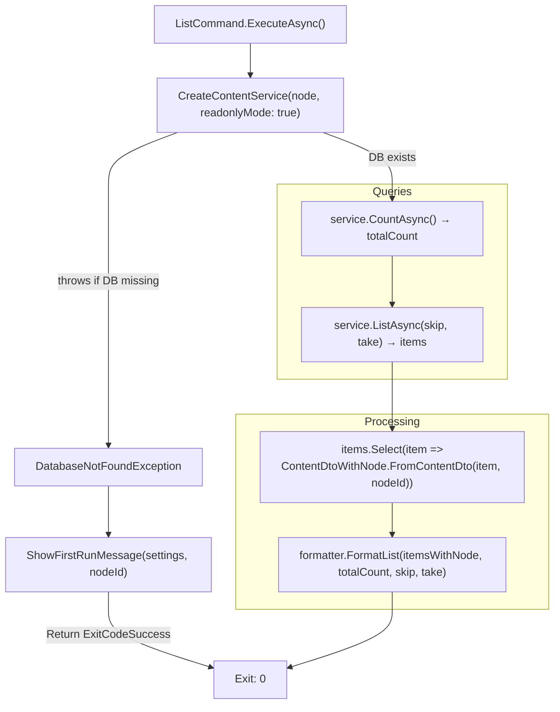

**Command Options:**
- `--skip`: Number of items to skip (default: 0)
- `--take`: Number of items to take (default: 20)

**Pagination Information:**  
The output includes total count, current page position, and page size. The `FormatList()` method in each formatter handles the pagination display appropriately for that format.

Sources: [src/Main/CLI/Commands/ListCommand.cs:55-137]()

### DeleteCommand

The `DeleteCommand` deletes content by ID:

**Idempotent Behavior:**  
Delete operations are idempotent - deleting a non-existent ID returns success, not an error. This is a deliberate design choice to match HTTP DELETE semantics.

**Command Options:**
- `<id>` (required): Content ID to delete

**Verbosity Levels:**
- `quiet`: Output just the ID
- `silent`: No output at all
- `normal`/`verbose`: Output operation result with completion status

Sources: [src/Main/CLI/Commands/DeleteCommand.cs:42-90]()

## Configuration and Inspection Commands

### ConfigCommand

The `ConfigCommand` queries and creates configuration files. Unlike other commands, it does not initialize a node-specific service since it operates on the entire configuration.

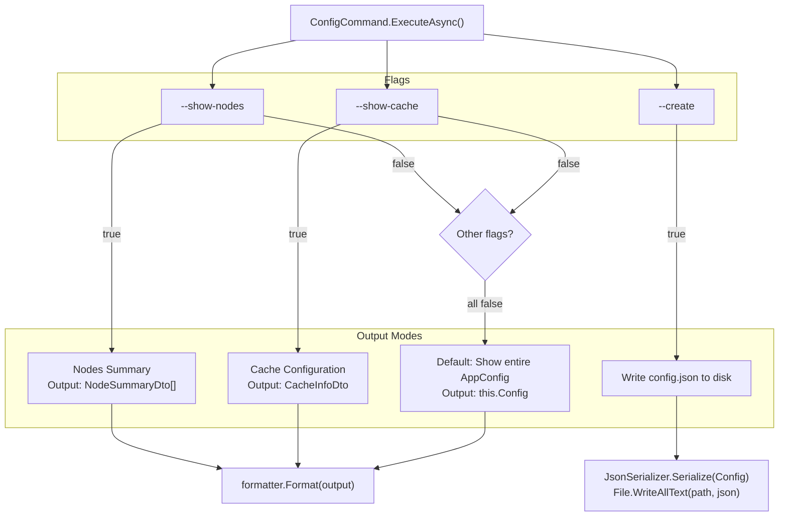

**Important Design Decision:**  
The default output (no flags) shows the entire `AppConfig` structure serialized as JSON. This allows users to copy/paste the output directly into their configuration file. The output is formatted with `WriteIndented = true` and `DefaultIgnoreCondition = JsonIgnoreCondition.WhenWritingNull` to produce clean, usable JSON.

**Command Options:**
- `--show-nodes`: Show summary of all configured nodes
- `--show-cache`: Show cache configuration (embeddings and LLM caches)
- `--create`: Create configuration file on disk (fails if file already exists)

**Output DTOs:**
- `NodeSummaryDto`: Contains `Id`, `Access`, `ContentIndex` type, storage flags, and search index count
- `CacheInfoDto`: Contains `EmbeddingsCache` and `LlmCache` configurations

Sources: [src/Main/CLI/Commands/ConfigCommand.cs:21-188](), [tests/Main.Tests/Integration/ConfigCommandTests.cs:72-121]()

### NodesCommand

The `NodesCommand` lists all configured nodes with their details. It reads only from the configuration and does not access any databases.

Sources: [src/Main/CLI/CliApplicationBuilder.cs:232-235]() (command registration)

## Read-Only vs Write Operations

The CLI distinguishes between read-only and write operations to prevent unintended side effects:

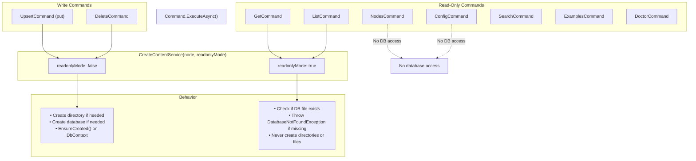

**Key Implementation Details:**

When `readonlyMode: true`:
```
if (!File.Exists(dbPath))
{
    throw new DatabaseNotFoundException(dbPath);
}
```

When `readonlyMode: false`:
```
var dbDir = Path.GetDirectoryName(dbPath);
if (!string.IsNullOrEmpty(dbDir) && !Directory.Exists(dbDir))
{
    Directory.CreateDirectory(dbDir);
}
context.Database.EnsureCreated();
```

Sources: [src/Main/CLI/Commands/BaseCommand.cs:90-132](), [tests/Main.Tests/Integration/ReadonlyCommandTests.cs:64-98]()

## Error Handling and Exit Codes

The CLI uses standard exit codes to indicate success or failure:

| Exit Code | Constant | Meaning | Example Scenarios |
|-----------|----------|---------|-------------------|
| 0 | `Constants.App.ExitCodeSuccess` | Success | Command completed successfully, including first-run scenarios with missing DB |
| 1 | `Constants.App.ExitCodeUserError` | User Error | Invalid ID provided, content not found in existing DB, validation failure |
| 2 | `Constants.App.ExitCodeSystemError` | System Error | Database connection failure, permission denied, unexpected exceptions |

### Error Handling Flow

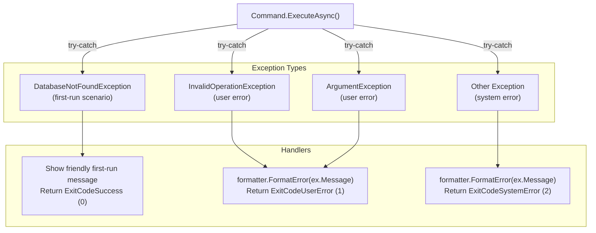

**BaseCommand.HandleError() Implementation:**

The `HandleError()` method categorizes exceptions:

```
if (ex is InvalidOperationException or ArgumentException)
{
    return Constants.App.ExitCodeUserError; // 1
}
return Constants.App.ExitCodeSystemError; // 2
```

Sources: [src/Main/CLI/Commands/BaseCommand.cs:172-191](), [src/Main/CLI/Commands/GetCommand.cs:84-94]()

## First-Run Experience

The CLI provides a friendly first-run experience when users run read-only commands before creating any content.

### First-Run Detection

Read-only commands like `get` and `list` detect first-run scenarios when the database doesn't exist:

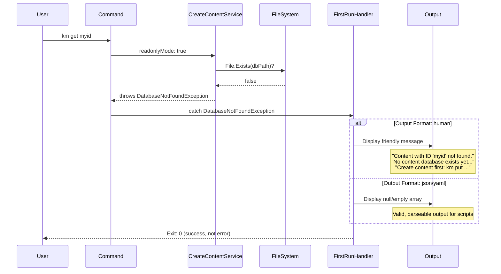

**Design Rationale:**

1. **Exit Code 0 (Success)**: First-run is not an error condition; it's an expected state. Returning success allows scripts to handle this gracefully.

2. **Format-Aware Messages**: 
   - Human format: Displays helpful getting-started messages
   - JSON/YAML format: Returns valid, parseable empty output (null or empty array)

3. **Command-Specific Guidance**: Each command provides contextually appropriate suggestions:
   - `get`: Suggests `km put` with specific ID
   - `list`: Provides welcome message with basic usage examples

Sources: [src/Main/CLI/Commands/GetCommand.cs:96-124](), [src/Main/CLI/Commands/ListCommand.cs:104-136](), [tests/Main.Tests/Integration/ReadonlyCommandTests.cs:64-134]()

### Example First-Run Messages

For `km get myid` (human format):
```
Content with ID 'myid' not found.

No content database exists yet. This is your first run.

Create content first:
  km put "Your content here" --id myid

Or list available content:
  km list
```

For `km list` (human format):
```
Welcome to Kernel Memory! 🚀

No content found in node 'personal' yet.

To get started:
  km put "Your content here"

Example:
  km put "Hello, world!" --id greeting
```

Sources: [src/Main/CLI/Commands/GetCommand.cs:113-123](), [src/Main/CLI/Commands/ListCommand.cs:125-135]()

---

