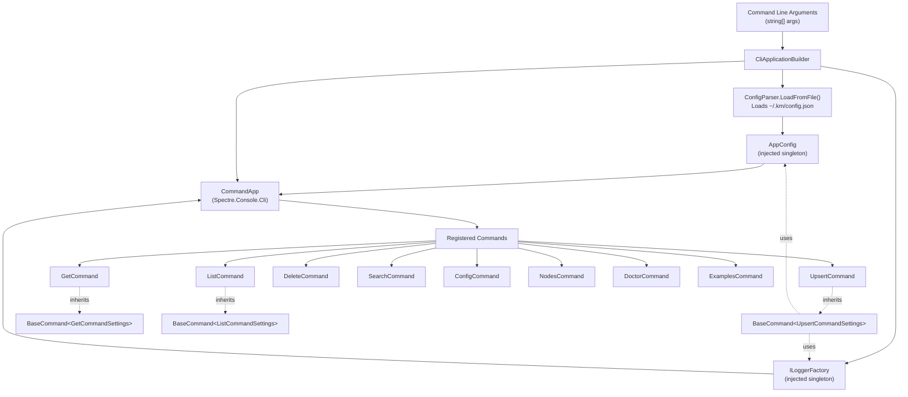
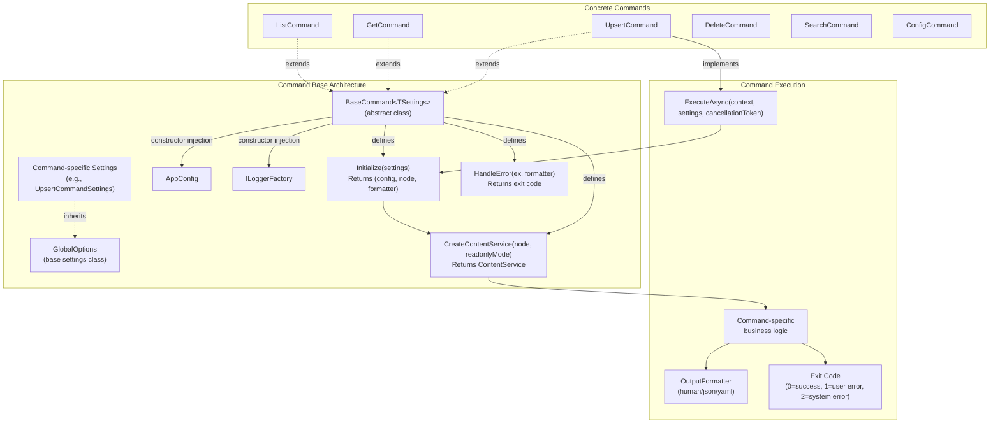
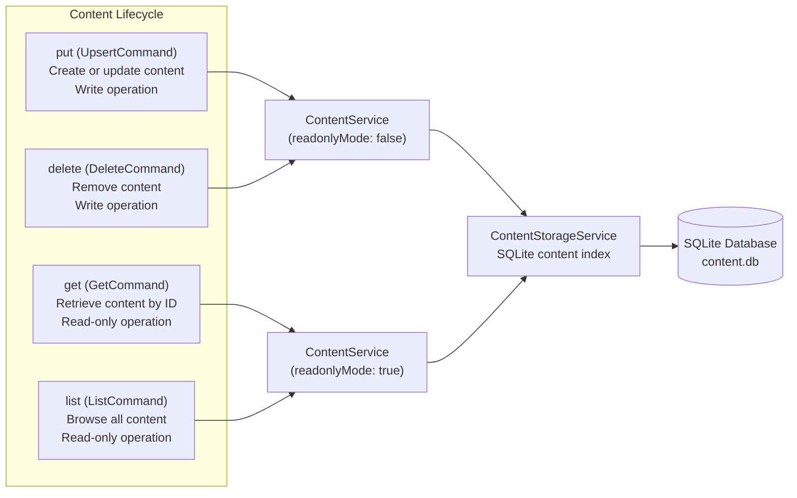
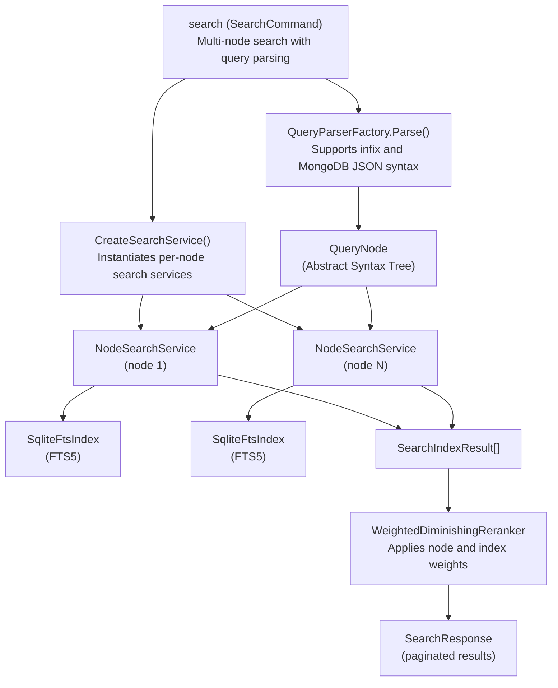
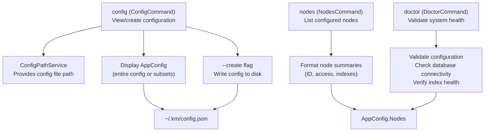
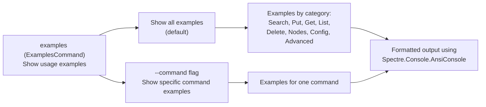
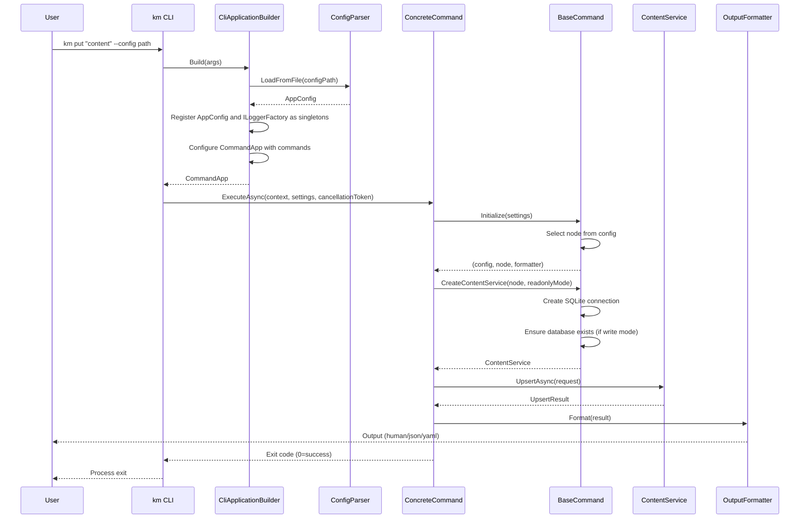
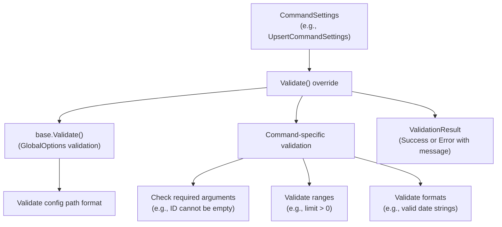
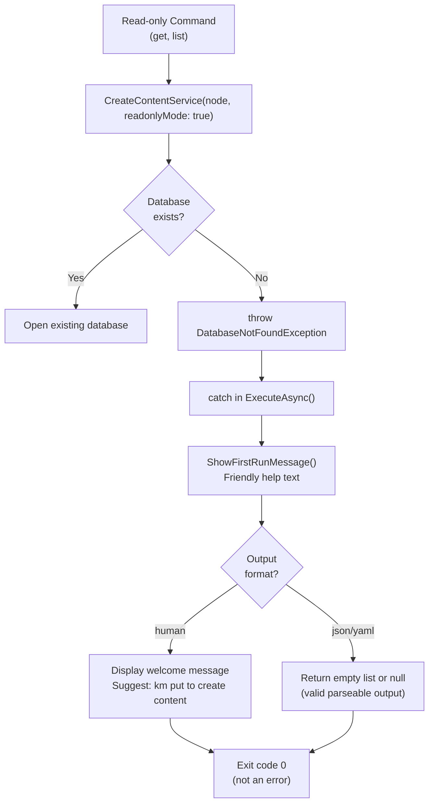

<!-- source: DeepWiki mcp.deepwiki.com · repo microsoft/kernel-memory · page 4.1 Command Overview · fetched 2026-10-26 -->

# Command Overview

Relevant source files

The following files were used as context for generating this wiki page:

- [KNOWN-ISSUES.md](KNOWN-ISSUES.md)
- [src/Core/Search/NodeSearchService.cs](src/Core/Search/NodeSearchService.cs)
- [src/Core/Search/Query/Parsers/InfixQueryParser.cs](src/Core/Search/Query/Parsers/InfixQueryParser.cs)
- [src/Core/Search/SearchService.cs](src/Core/Search/SearchService.cs)
- [src/Core/Search/SqliteFtsIndex.cs](src/Core/Search/SqliteFtsIndex.cs)
- [src/Main/CLI/CliApplicationBuilder.cs](src/Main/CLI/CliApplicationBuilder.cs)
- [src/Main/CLI/Commands/BaseCommand.cs](src/Main/CLI/Commands/BaseCommand.cs)
- [src/Main/CLI/Commands/ConfigCommand.cs](src/Main/CLI/Commands/ConfigCommand.cs)
- [src/Main/CLI/Commands/DeleteCommand.cs](src/Main/CLI/Commands/DeleteCommand.cs)
- [src/Main/CLI/Commands/ExamplesCommand.cs](src/Main/CLI/Commands/ExamplesCommand.cs)
- [src/Main/CLI/Commands/GetCommand.cs](src/Main/CLI/Commands/GetCommand.cs)
- [src/Main/CLI/Commands/ListCommand.cs](src/Main/CLI/Commands/ListCommand.cs)
- [src/Main/CLI/Commands/SearchCommand.cs](src/Main/CLI/Commands/SearchCommand.cs)
- [src/Main/CLI/Commands/UpsertCommand.cs](src/Main/CLI/Commands/UpsertCommand.cs)
- [tests/Core.Tests/Search/FtsQueryExtractionTest.cs](tests/Core.Tests/Search/FtsQueryExtractionTest.cs)
- [tests/Core.Tests/Search/NodeSearchServiceIndexIdTests.cs](tests/Core.Tests/Search/NodeSearchServiceIndexIdTests.cs)
- [tests/Core.Tests/Search/Query/InfixQueryParserTests.cs](tests/Core.Tests/Search/Query/InfixQueryParserTests.cs)
- [tests/Core.Tests/Search/SearchEndToEndTests.cs](tests/Core.Tests/Search/SearchEndToEndTests.cs)
- [tests/Core.Tests/Search/SearchServiceIndexWeightsTests.cs](tests/Core.Tests/Search/SearchServiceIndexWeightsTests.cs)
- [tests/Main.Tests/Integration/CliIntegrationTests.cs](tests/Main.Tests/Integration/CliIntegrationTests.cs)
- [tests/Main.Tests/Integration/CommandExecutionTests.cs](tests/Main.Tests/Integration/CommandExecutionTests.cs)
- [tests/Main.Tests/Integration/ConfigCommandTests.cs](tests/Main.Tests/Integration/ConfigCommandTests.cs)
- [tests/Main.Tests/Integration/ExamplesCommandE2ETests.cs](tests/Main.Tests/Integration/ExamplesCommandE2ETests.cs)
- [tests/Main.Tests/Integration/ReadonlyCommandTests.cs](tests/Main.Tests/Integration/ReadonlyCommandTests.cs)

## Purpose and Scope

This page provides an overview of all CLI commands available in the KM² system. It describes the purpose of each command, how they are organized, and the common architecture they share. For detailed usage of individual commands, see [Content Management Commands](#4.2) and [Configuration Command](#4.3). For command-line options and output formats, see [Command Options and Output Formats](#4.4).

The KM² CLI provides nine commands organized into four categories: content management, search operations, configuration & inspection, and documentation.

## Available Commands

The following table lists all commands registered in the CLI application:

| Command | Class | Purpose | Category |
|---------|-------|---------|----------|
| `put` | `UpsertCommand` | Upload or update content | Content Management |
| `get` | `GetCommand` | Fetch content by ID | Content Management |
| `list` | `ListCommand` | List all content with pagination | Content Management |
| `delete` | `DeleteCommand` | Delete content by ID | Content Management |
| `search` | `SearchCommand` | Search content across nodes and indexes | Search Operations |
| `config` | `ConfigCommand` | Query and create configuration | Configuration & Inspection |
| `nodes` | `NodesCommand` | List all configured nodes | Configuration & Inspection |
| `doctor` | `DoctorCommand` | Validate configuration and check system health | Configuration & Inspection |
| `examples` | `ExamplesCommand` | Show usage examples for all commands | Documentation |

**Sources:** [src/Main/CLI/CliApplicationBuilder.cs:198-267](), [src/Main/CLI/Commands/]()

## Command Registration and Execution Flow

**Command Registration Flow:**
1. `CliApplicationBuilder.Build()` determines config path from CLI arguments
2. `ConfigParser.LoadFromFile()` loads configuration once
3. `AppConfig` and `ILoggerFactory` are registered as singletons in DI container
4. `CommandApp` is configured with all command registrations
5. Commands receive injected `AppConfig` and `ILoggerFactory` via constructor

**Sources:** [src/Main/CLI/CliApplicationBuilder.cs:62-105](), [src/Main/CLI/CliApplicationBuilder.cs:198-267]()

## Command Architecture

All commands share a common architecture based on the `BaseCommand<TSettings>` abstract class. This ensures consistent behavior for configuration loading, error handling, and output formatting.

**Key architectural patterns:**

- **Dependency Injection**: `AppConfig` and `ILoggerFactory` are injected once during application startup and shared across all commands
- **Template Method**: `BaseCommand<TSettings>.Initialize()` provides common initialization logic
- **Readonly vs Write Modes**: Commands specify `readonlyMode` parameter when creating services to prevent unintended database creation
- **Consistent Error Handling**: All commands return standardized exit codes via `HandleError()`

**Sources:** [src/Main/CLI/Commands/BaseCommand.cs:24-191](), [src/Main/CLI/Commands/GlobalOptions.cs]()

## Command Categories

### Content Management Commands

Commands that create, read, update, and delete content stored in the system.

**Read-only vs Write Operations:**
- **Read-only commands** (`get`, `list`): Set `readonlyMode: true` when creating `ContentService`. This prevents database creation if it doesn't exist, showing a friendly first-run message instead.
- **Write commands** (`put`, `delete`): Set `readonlyMode: false` to allow database initialization on first write.

**Sources:** [src/Main/CLI/Commands/GetCommand.cs:67](), [src/Main/CLI/Commands/ListCommand.cs:75](), [src/Main/CLI/Commands/UpsertCommand.cs:83](), [src/Main/CLI/Commands/DeleteCommand.cs:61]()

### Search Operations

Command for executing full-text searches across nodes and indexes.

The `SearchCommand` is the most complex command, orchestrating searches across multiple nodes, parsing query syntax, and reranking results. It does not directly use `ContentService`; instead, it creates `NodeSearchService` instances for each configured node.

**Sources:** [src/Main/CLI/Commands/SearchCommand.cs:143-534](), [src/Core/Search/SearchService.cs:14-38](), [src/Core/Search/NodeSearchService.cs:33-57]()

### Configuration & Inspection Commands

Commands for viewing and validating system configuration and health.

**Special characteristics:**
- `ConfigCommand` does **not** call `BaseCommand.Initialize()` because it operates on the entire configuration, not a specific node
- `NodesCommand` and `DoctorCommand` are read-only inspection commands that do not create databases
- These commands are primarily informational and do not modify system state (except `config --create`)

**Sources:** [src/Main/CLI/Commands/ConfigCommand.cs:39-188](), [src/Main/CLI/Commands/NodesCommand.cs](), [src/Main/CLI/Commands/DoctorCommand.cs]()

### Documentation Commands

Command for displaying usage examples and help information.

The `ExamplesCommand` is a synchronous command (not `async`) that displays helpful usage examples. It does not interact with the database or configuration system beyond basic DI.

**Sources:** [src/Main/CLI/Commands/ExamplesCommand.cs:12-413]()

## Global Options

All commands inherit settings from `GlobalOptions`, which provides common command-line flags:

| Option | Short | Type | Purpose |
|--------|-------|------|---------|
| `--config` | `-c` | string | Path to configuration file (default: `~/.km/config.json`) |
| `--node` | | string | Node to operate on (default: first node in config) |
| `--format` | `-f` | string | Output format: `human`, `json`, or `yaml` (default: `human`) |
| `--verbosity` | `-v` | string | Logging verbosity: `silent`, `quiet`, `normal`, `verbose` |
| `--no-color` | | bool | Disable colored output |
| `--log-file` | | string | Path to log file for persistent logging |

These options are parsed before command execution and affect command behavior consistently across all commands. Detailed documentation is available in [Command Options and Output Formats](#4.4).

**Sources:** [src/Main/CLI/Commands/GlobalOptions.cs](), [src/Main/CLI/CliApplicationBuilder.cs:132-164]()

## Command Execution Lifecycle

The typical lifecycle for a command execution follows this pattern:

**Key points:**
1. Configuration is loaded **once** during `CliApplicationBuilder.Build()`
2. Commands receive `AppConfig` and `ILoggerFactory` via constructor injection
3. `Initialize()` provides common setup: node selection, formatter creation
4. `CreateContentService()` handles database initialization based on readonly mode
5. Commands execute their specific business logic
6. Results are formatted according to `--format` flag
7. Exit codes are standardized: 0 (success), 1 (user error), 2 (system error)

**Sources:** [src/Main/CLI/CliApplicationBuilder.cs:62-105](), [src/Main/CLI/Commands/BaseCommand.cs:52-170]()

## Command Settings Validation

All command settings classes inherit from `GlobalOptions` and implement validation logic:

**Validation examples:**
- `GetCommandSettings`: Ensures `Id` is not empty ([src/Main/CLI/Commands/GetCommand.cs:28-42]())
- `ListCommandSettings`: Validates `Skip >= 0` and `Take > 0` ([src/Main/CLI/Commands/ListCommand.cs:30-49]())
- `SearchCommandSettings`: Checks `Limit > 0`, `Offset >= 0`, `MinRelevance` in range 0.0-1.0 ([src/Main/CLI/Commands/SearchCommand.cs:92-136]())

Validation occurs **before** command execution, providing immediate feedback for invalid input.

**Sources:** [src/Main/CLI/Commands/GetCommand.cs:28-42](), [src/Main/CLI/Commands/ListCommand.cs:30-49](), [src/Main/CLI/Commands/SearchCommand.cs:92-136]()

## First-Run Experience

Read-only commands (`get`, `list`) detect when the database doesn't exist and provide friendly first-run messages instead of errors:

**Design rationale:**
- First-run is a normal, expected state, not an error
- Human format shows helpful guidance for new users
- JSON/YAML formats return valid, empty data structures for scripting compatibility
- Exit code is 0 (success) because missing data is not a user or system error

**Sources:** [src/Main/CLI/Commands/GetCommand.cs:84-124](), [src/Main/CLI/Commands/ListCommand.cs:92-137](), [src/Main/CLI/Commands/SearchCommand.cs:186-189](), [src/Main/CLI/Exceptions/DatabaseNotFoundException.cs]()

---

