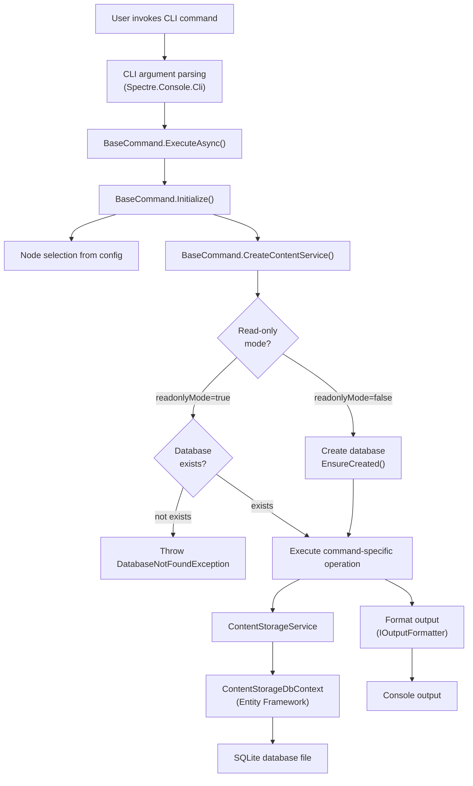
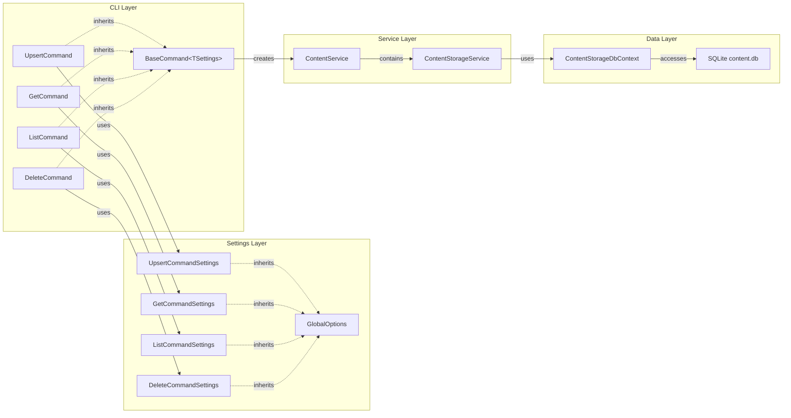
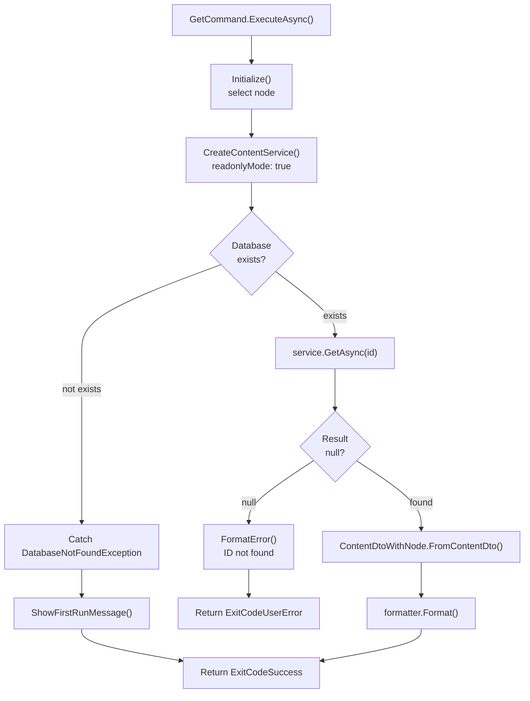
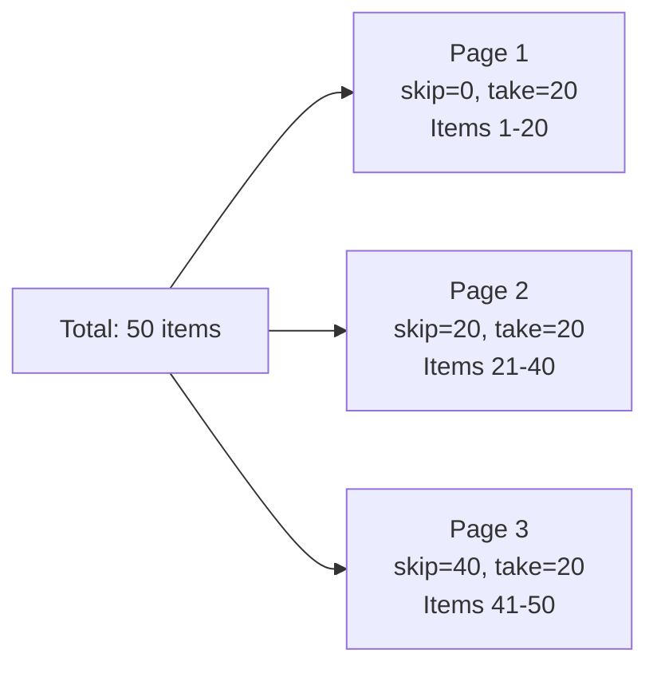
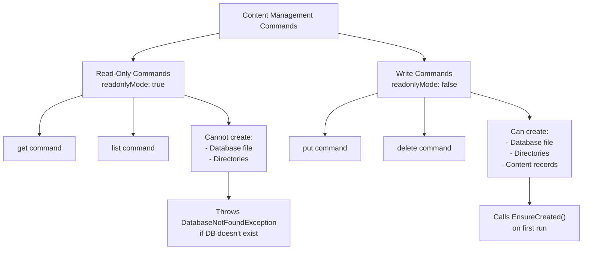
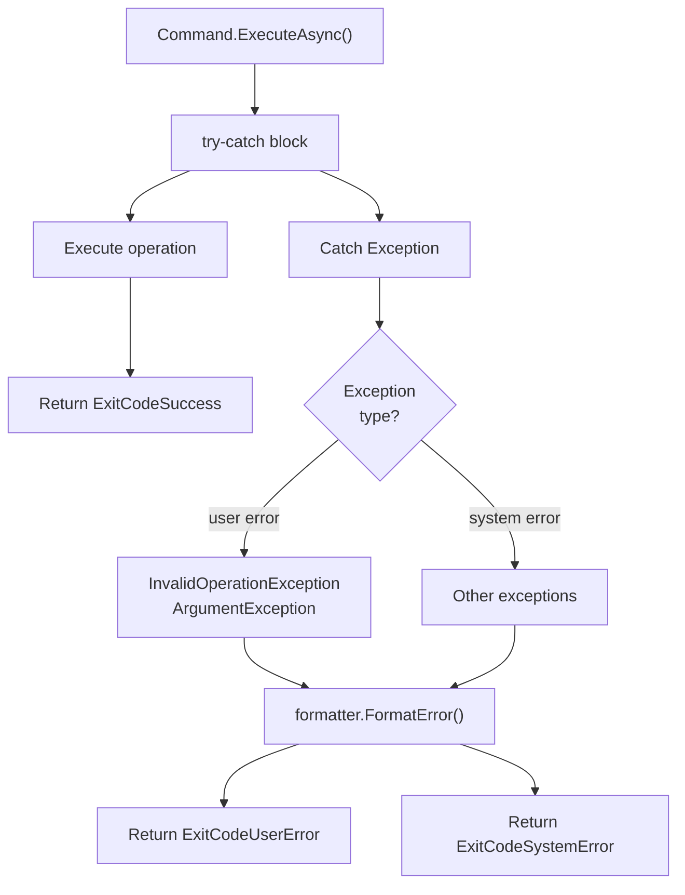
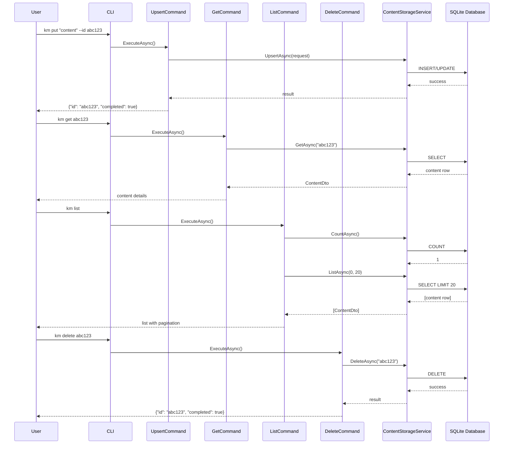

<!-- source: DeepWiki mcp.deepwiki.com · repo microsoft/kernel-memory · page 4.2 Content Management Commands · fetched 2026-10-26 -->

# Content Management Commands

<details>
<summary>Relevant source files</summary>

The following files were used as context for generating this wiki page:

- [src/Main/CLI/CliApplicationBuilder.cs](src/Main/CLI/CliApplicationBuilder.cs)
- [src/Main/CLI/Commands/BaseCommand.cs](src/Main/CLI/Commands/BaseCommand.cs)
- [src/Main/CLI/Commands/ConfigCommand.cs](src/Main/CLI/Commands/ConfigCommand.cs)
- [src/Main/CLI/Commands/DeleteCommand.cs](src/Main/CLI/Commands/DeleteCommand.cs)
- [src/Main/CLI/Commands/GetCommand.cs](src/Main/CLI/Commands/GetCommand.cs)
- [src/Main/CLI/Commands/ListCommand.cs](src/Main/CLI/Commands/ListCommand.cs)
- [src/Main/CLI/Commands/UpsertCommand.cs](src/Main/CLI/Commands/UpsertCommand.cs)
- [tests/Main.Tests/Integration/CliIntegrationTests.cs](tests/Main.Tests/Integration/CliIntegrationTests.cs)
- [tests/Main.Tests/Integration/CommandExecutionTests.cs](tests/Main.Tests/Integration/CommandExecutionTests.cs)
- [tests/Main.Tests/Integration/ConfigCommandTests.cs](tests/Main.Tests/Integration/ConfigCommandTests.cs)
- [tests/Main.Tests/Integration/ReadonlyCommandTests.cs](tests/Main.Tests/Integration/ReadonlyCommandTests.cs)

</details>


## Purpose and Scope

This document details the four core content management commands in the KM² CLI: `put`, `get`, `list`, and `delete`. These commands provide CRUD (Create, Read, Update, Delete) operations for content stored in a node's content index.

For information about the search command, see [Search System](#5). For the configuration command, see [Configuration Command](#4.3). For details on global command options and output formatting, see [Command Options and Output Formats](#4.4).

---

## Content Management Architecture

Content management commands interact with the storage layer through a consistent architecture. All commands inherit from `BaseCommand<TSettings>`, which provides shared initialization logic, node selection, and service creation.

### Command Execution Flow



**Sources:**
- [src/Main/CLI/Commands/BaseCommand.cs:24-191]()
- [src/Main/CLI/Commands/GetCommand.cs:59-95]()
- [src/Main/CLI/Commands/UpsertCommand.cs:75-129]()

### Code Entity Mapping



**Sources:**
- [src/Main/CLI/Commands/BaseCommand.cs:24-25]()
- [src/Main/CLI/Commands/UpsertCommand.cs:14-59]()
- [src/Main/CLI/Commands/GetCommand.cs:14-43]()
- [src/Main/CLI/Commands/ListCommand.cs:14-50]()
- [src/Main/CLI/Commands/DeleteCommand.cs:14-37]()

---

## Upsert Command (put)

The `put` command creates new content or updates existing content. It is the only write operation among content management commands.

### Command Syntax

```bash
km put "<content>" [options]
```

### Command Options

| Option | Type | Description | Default |
|--------|------|-------------|---------|
| `<content>` | string (required) | Content text to store | - |
| `--id` | string | Content ID (auto-generated if omitted) | CUID |
| `--mime-type` | string | MIME type of content | text/plain |
| `--title` | string | Optional title | empty |
| `--description` | string | Optional description | empty |
| `--tags` | string | Comma-separated tags | empty |
| `--node` | string | Target node name | first node in config |

### Implementation Details

The `UpsertCommand` class executes the following workflow:

1. **Initialize**: Select node and create formatter via `BaseCommand.Initialize()` [src/Main/CLI/Commands/UpsertCommand.cs:82]()
2. **Create Service**: Call `CreateContentService(node, readonlyMode: false)` to ensure database exists [src/Main/CLI/Commands/UpsertCommand.cs:83]()
3. **Parse Tags**: Split comma-separated tags string [src/Main/CLI/Commands/UpsertCommand.cs:86-88]()
4. **Build Request**: Create `UpsertRequest` with content and metadata [src/Main/CLI/Commands/UpsertCommand.cs:91-100]()
5. **Execute**: Call `service.UpsertAsync()` [src/Main/CLI/Commands/UpsertCommand.cs:103]()
6. **Format Output**: Output ID only (quiet mode) or full details [src/Main/CLI/Commands/UpsertCommand.cs:106-120]()

### Database Initialization

The upsert command automatically initializes the database on first run because it uses `readonlyMode: false`. The `BaseCommand.CreateContentService()` method ensures the database directory exists and calls `context.Database.EnsureCreated()` [src/Main/CLI/Commands/BaseCommand.cs:127-131]().

### Examples

```bash
# Minimal: auto-generated ID
km put "Hello, world!"

# With custom ID
km put "Some content" --id my-id-123

# With metadata
km put "Tagged content" --tags important,todo --title "My Title"

# With MIME type
km put "# Markdown" --mime-type text/markdown

# Target specific node
km put "Content" --node shared
```

**Sources:**
- [src/Main/CLI/Commands/UpsertCommand.cs:1-131]()
- [src/Main/CLI/CliApplicationBuilder.cs:204-209]()
- [tests/Main.Tests/Integration/CliIntegrationTests.cs:62-145]()

---

## Get Command

The `get` command retrieves a single content item by ID. It operates in read-only mode and does not create or modify files.

### Command Syntax

```bash
km get <id> [options]
```

### Command Options

| Option | Type | Description | Default |
|--------|------|-------------|---------|
| `<id>` | string (required) | Content ID to retrieve | - |
| `--full` | flag | Show all internal details | false |
| `--node` | string | Target node name | first node in config |

### Implementation Details



**Sources:**
- [src/Main/CLI/Commands/GetCommand.cs:59-95]()

### Read-Only Mode

The `get` command uses `readonlyMode: true` when creating the `ContentService` [src/Main/CLI/Commands/GetCommand.cs:67](). This ensures:

1. Database file must exist before the command runs
2. No directories are created [src/Main/CLI/Commands/BaseCommand.cs:100-106]()
3. `DatabaseNotFoundException` is thrown if database doesn't exist

### First-Run Behavior

When the database doesn't exist (first-run scenario), the `get` command displays a friendly message guiding the user to create content first [src/Main/CLI/Commands/GetCommand.cs:101-124]():

- **JSON/YAML format**: Returns `null` (valid, parseable output)
- **Human format**: Shows welcome message with example commands

### Error Handling

| Scenario | Exit Code | Output |
|----------|-----------|--------|
| Database doesn't exist (first run) | 0 (Success) | First-run message |
| ID not found in existing database | 1 (User Error) | "Content with ID '...' not found" |
| System error | 2 (System Error) | Error message |

**Sources:**
- [src/Main/CLI/Commands/GetCommand.cs:1-126]()
- [tests/Main.Tests/Integration/ReadonlyCommandTests.cs:100-134]()

---

## List Command

The `list` command retrieves all content with pagination support. It operates in read-only mode.

### Command Syntax

```bash
km list [options]
```

### Command Options

| Option | Type | Description | Default |
|--------|------|-------------|---------|
| `--skip` | int | Number of items to skip | 0 |
| `--take` | int | Number of items to return | 20 |
| `--node` | string | Target node name | first node in config |

### Implementation Details

The `ListCommand` executes two database queries:

1. **Count Query**: `service.CountAsync()` to get total items [src/Main/CLI/Commands/ListCommand.cs:78]()
2. **Page Query**: `service.ListAsync(skip, take)` to get the current page [src/Main/CLI/Commands/ListCommand.cs:81]()

Results are wrapped with node information and formatted with pagination metadata [src/Main/CLI/Commands/ListCommand.cs:84-88]().

### Pagination



### Output Format

The `formatter.FormatList()` method includes pagination information in the output:

- **Total count**: Total number of items in the database
- **Current page**: Items returned in this query
- **Skip/Take values**: For navigation to next page

### First-Run Behavior

Similar to the `get` command, `list` displays a friendly first-run message when the database doesn't exist [src/Main/CLI/Commands/ListCommand.cs:109-136]():

- **JSON/YAML format**: Returns empty list with total count of 0
- **Human format**: Shows welcome message with example commands

The message adapts based on whether using the default node or a specified node [src/Main/CLI/Commands/ListCommand.cs:122-124]().

### Validation

The command validates pagination parameters [src/Main/CLI/Commands/ListCommand.cs:30-49]():

- `skip` must be >= 0
- `take` must be > 0

### Examples

```bash
# First page (default)
km list

# Skip first 20, take next 10
km list --skip 20 --take 10

# JSON format
km list -f json

# Specific node
km list --node shared
```

**Sources:**
- [src/Main/CLI/Commands/ListCommand.cs:1-138]()
- [tests/Main.Tests/Integration/CliIntegrationTests.cs:342-404]()

---

## Delete Command

The `delete` command removes content by ID. It operates in write mode and is idempotent (succeeds even if ID doesn't exist).

### Command Syntax

```bash
km delete <id> [options]
```

### Command Options

| Option | Type | Description | Default |
|--------|------|-------------|---------|
| `<id>` | string (required) | Content ID to delete | - |
| `--node` | string | Target node name | first node in config |

### Implementation Details

The `DeleteCommand` executes the following workflow:

1. **Initialize**: Select node and create formatter [src/Main/CLI/Commands/DeleteCommand.cs:60]()
2. **Create Service**: Use write mode (`readonlyMode: false`) [src/Main/CLI/Commands/DeleteCommand.cs:61]()
3. **Delete**: Call `service.DeleteAsync(id)` [src/Main/CLI/Commands/DeleteCommand.cs:64]()
4. **Format Output**: Show ID only (quiet) or full details [src/Main/CLI/Commands/DeleteCommand.cs:67-80]()

### Idempotent Behavior

The delete operation always succeeds, even if the content ID doesn't exist [tests/Main.Tests/Integration/CommandExecutionTests.cs:105-121]():

```bash
# Delete non-existent ID - still returns success
km delete nonexistent-id-12345
# Exit code: 0 (Success)
```

This idempotent behavior ensures that scripts can safely call delete without checking if content exists first.

### Verbosity Levels

The delete command respects the `--verbosity` flag:

| Verbosity | Output |
|-----------|--------|
| `quiet` | ID only |
| `normal` | Full details (id, completed, queued, error) |
| `silent` | No output |

[src/Main/CLI/Commands/DeleteCommand.cs:67-80]()

### Examples

```bash
# Delete with default verbosity
km delete abc123

# Quiet mode (ID only)
km delete abc123 -v quiet

# Silent mode (no output)
km delete abc123 -v silent

# JSON format
km delete abc123 -f json
```

**Sources:**
- [src/Main/CLI/Commands/DeleteCommand.cs:1-91]()
- [tests/Main.Tests/Integration/CliIntegrationTests.cs:407-449]()

---

## Read-Only vs Write Operations

Content management commands are categorized by their access mode, which determines whether they can create or modify files.

### Command Classification



**Sources:**
- [src/Main/CLI/Commands/BaseCommand.cs:85-170]()

### BaseCommand.CreateContentService() Implementation

The `readonlyMode` parameter controls database initialization behavior:

```
Method: CreateContentService(NodeConfig node, bool readonlyMode = false)

if readonlyMode:
    if database file does NOT exist:
        throw DatabaseNotFoundException
    # Don't create any files
else:
    if database directory does NOT exist:
        Create directory
    Call context.Database.EnsureCreated()
```

[src/Main/CLI/Commands/BaseCommand.cs:100-131]()

### Testing Read-Only Behavior

The test suite includes specific tests to verify that read-only commands do not create files [tests/Main.Tests/Integration/ReadonlyCommandTests.cs:1-216]():

| Test | Verifies |
|------|----------|
| `BugA_ListCommand_NonExistentDatabase_ShouldNotCreateDirectory` | List doesn't create directories |
| `BugA_GetCommand_NonExistentDatabase_ShouldNotCreateDirectory` | Get doesn't create directories |

These tests ensure the fix for Bug A: "km list was creating ~/.km/nodes/personal/content.db when it shouldn't."

**Sources:**
- [tests/Main.Tests/Integration/ReadonlyCommandTests.cs:64-98]()

---

## Common Patterns and Error Handling

### Global Options

All content management commands inherit from `GlobalOptions` [src/Main/CLI/Commands/BaseCommand.cs:25](), which provides:

| Option | Description | Default |
|--------|-------------|---------|
| `--config` / `-c` | Configuration file path | ~/.km/config.json |
| `--node` / `-n` | Target node name | First node in config |
| `--format` / `-f` | Output format (human, json, yaml) | human |
| `--verbosity` / `-v` | Verbosity level (silent, quiet, normal, verbose) | normal |
| `--no-color` | Disable colored output | false |
| `--log-file` | Log file path | none |

### Exit Codes

All commands follow consistent exit code conventions defined in `Constants.App`:

| Exit Code | Constant | Meaning | Examples |
|-----------|----------|---------|----------|
| 0 | `ExitCodeSuccess` | Success or expected first-run | All successful operations, database doesn't exist on first run |
| 1 | `ExitCodeUserError` | User error | Invalid ID, validation failure |
| 2 | `ExitCodeSystemError` | System error | Database corruption, permission denied |

[src/Main/CLI/Commands/BaseCommand.cs:178-190]()

### Error Handling Flow



**Sources:**
- [src/Main/CLI/Commands/BaseCommand.cs:172-191]()

### Output Formatting

All commands use `OutputFormatterFactory.Create(settings)` to create the appropriate formatter based on the `--format` flag. The formatter handles:

- Single objects: `formatter.Format(object)`
- Lists with pagination: `formatter.FormatList(items, total, skip, take)`
- Errors: `formatter.FormatError(message)`

For details on output formatters, see [Command Options and Output Formats](#4.4).

### End-to-End Workflow

The following diagram illustrates a typical end-to-end workflow using all content management commands:



**Sources:**
- [tests/Main.Tests/Integration/CliIntegrationTests.cs:486-541]()

---

