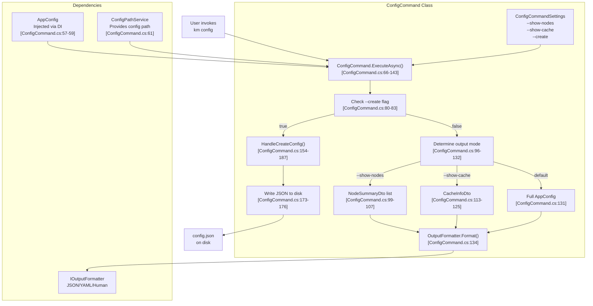
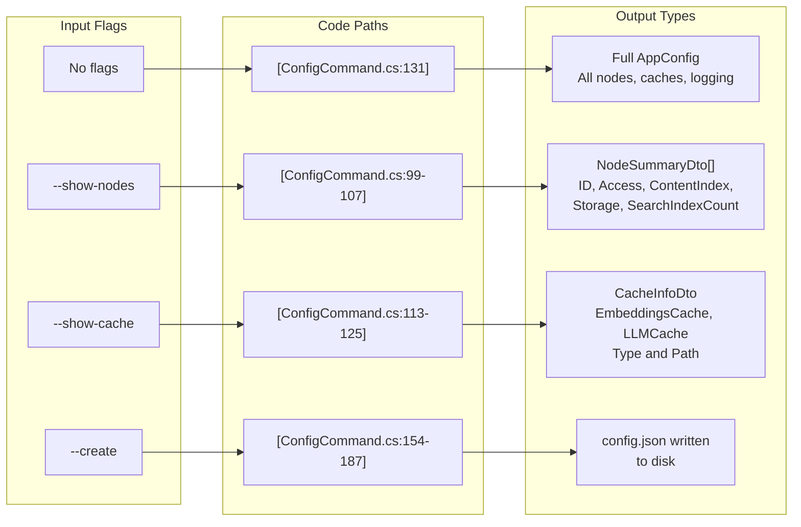
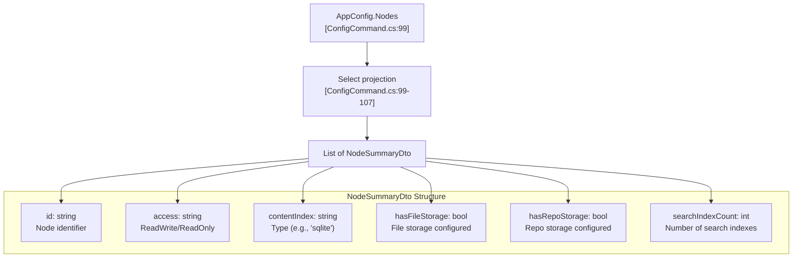
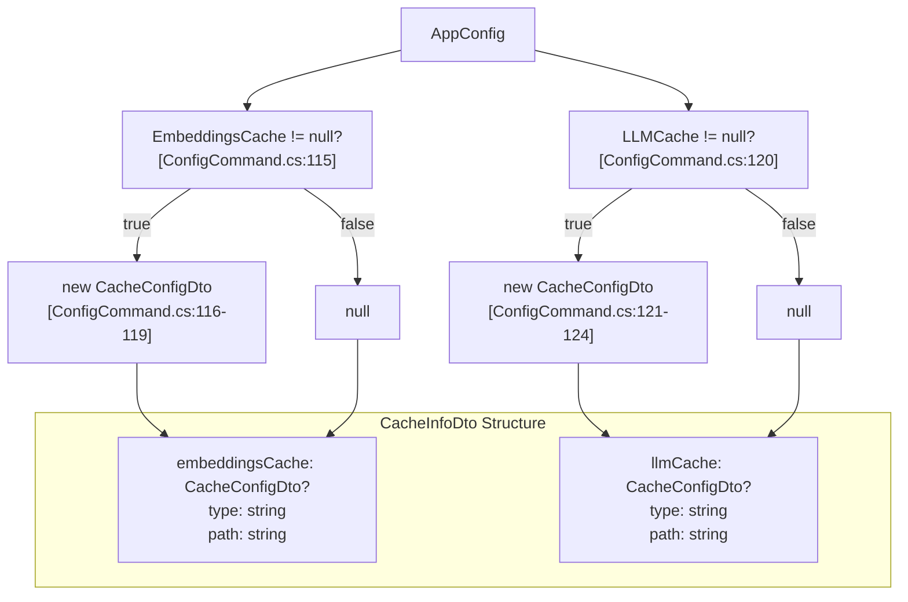
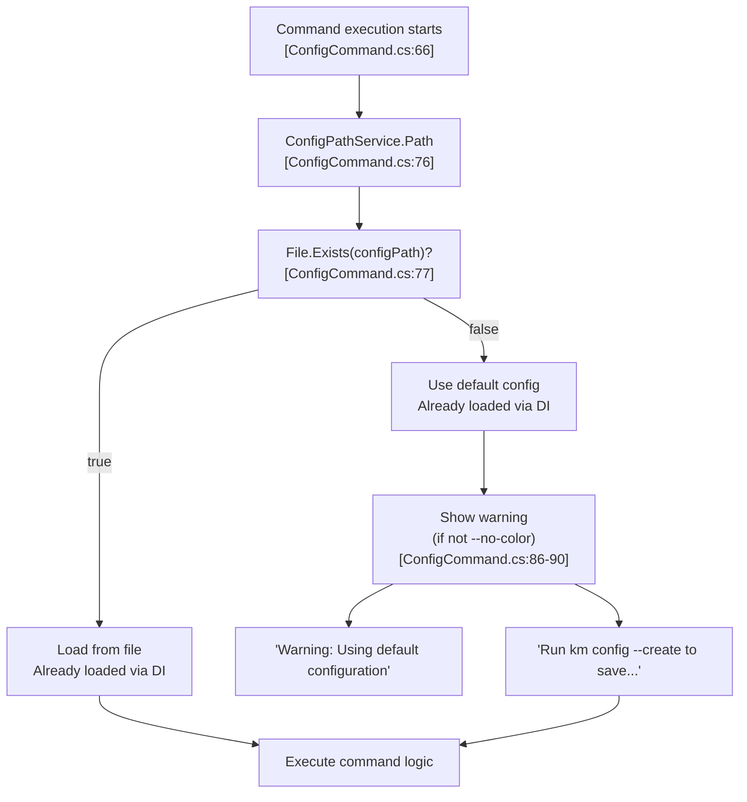
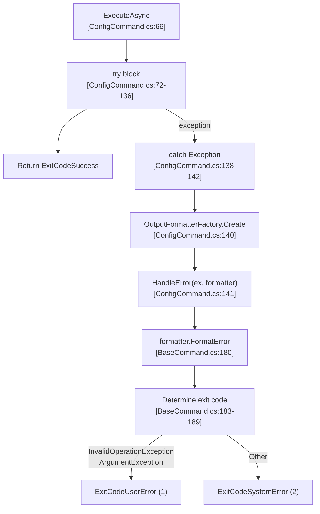

<!-- source: DeepWiki mcp.deepwiki.com · repo microsoft/kernel-memory · page 4.3 Configuration Command · fetched 2026-10-26 -->

# Configuration Command

<details>
<summary>Relevant source files</summary>

The following files were used as context for generating this wiki page:

- [src/Main/CLI/CliApplicationBuilder.cs](src/Main/CLI/CliApplicationBuilder.cs)
- [src/Main/CLI/Commands/BaseCommand.cs](src/Main/CLI/Commands/BaseCommand.cs)
- [src/Main/CLI/Commands/ConfigCommand.cs](src/Main/CLI/Commands/ConfigCommand.cs)
- [src/Main/CLI/Commands/DeleteCommand.cs](src/Main/CLI/Commands/DeleteCommand.cs)
- [src/Main/CLI/Commands/GetCommand.cs](src/Main/CLI/Commands/GetCommand.cs)
- [src/Main/CLI/Commands/ListCommand.cs](src/Main/CLI/Commands/ListCommand.cs)
- [src/Main/CLI/Commands/UpsertCommand.cs](src/Main/CLI/Commands/UpsertCommand.cs)
- [tests/Main.Tests/Integration/CliIntegrationTests.cs](tests/Main.Tests/Integration/CliIntegrationTests.cs)
- [tests/Main.Tests/Integration/CommandExecutionTests.cs](tests/Main.Tests/Integration/CommandExecutionTests.cs)
- [tests/Main.Tests/Integration/ConfigCommandTests.cs](tests/Main.Tests/Integration/ConfigCommandTests.cs)
- [tests/Main.Tests/Integration/ReadonlyCommandTests.cs](tests/Main.Tests/Integration/ReadonlyCommandTests.cs)

</details>


The `config` command is a CLI utility for viewing and managing the KM² application configuration. Unlike other commands that operate on specific nodes, the config command provides a global view of the entire configuration structure including all nodes, caches, and logging settings. This command also provides the ability to create a configuration file on disk for customization.

For information about the overall configuration structure and available settings, see [Configuration System](#6). For information about node-specific configuration, see [Node Configuration](#6.2).

## Purpose and Scope

The `config` command serves three primary purposes:

1. **Configuration Inspection**: Display the current effective configuration (either from file or default)
2. **Configuration Export**: Create a configuration file on disk for customization
3. **Configuration Validation**: Verify configuration structure and settings

This command does not require database access or node initialization, making it safe to run in any environment.

## Command Architecture



**Diagram: ConfigCommand execution flow showing main paths and code entities**

Sources: [src/Main/CLI/Commands/ConfigCommand.cs:1-189]()

## Command Settings

The `ConfigCommandSettings` class defines the command-line options:

| Option | Type | Description | Code Reference |
|--------|------|-------------|----------------|
| `--show-nodes` | bool | Display summary of all configured nodes | [ConfigCommand.cs:23-25]() |
| `--show-cache` | bool | Display cache configuration | [ConfigCommand.cs:27-29]() |
| `--create` | bool | Create configuration file on disk | [ConfigCommand.cs:31-33]() |

These options are mutually exclusive in practice. When multiple flags are provided, `--create` takes precedence, followed by `--show-nodes`, then `--show-cache`.

Sources: [src/Main/CLI/Commands/ConfigCommand.cs:21-34]()

## Operation Modes



**Diagram: Operation modes and their output types**

Sources: [src/Main/CLI/Commands/ConfigCommand.cs:66-143]()

### Default Mode (No Flags)

When invoked without flags, the command displays the complete `AppConfig` structure. This output is designed to be copy-pasteable into a configuration file.

The output includes:
- All node configurations (as a dictionary/object)
- Embeddings cache configuration (if configured)
- LLM cache configuration (if configured)
- Logging configuration

**JSON Serialization Settings** ([ConfigCommand.cs:41-46]()):
- `WriteIndented: true` - Pretty-printed JSON
- `PropertyNamingPolicy: JsonNamingPolicy.CamelCase` - camelCase property names
- `DefaultIgnoreCondition: JsonIgnoreCondition.WhenWritingNull` - Omits null fields

This ensures clean output without type names or null pollution.

Sources: [src/Main/CLI/Commands/ConfigCommand.cs:128-132](), [src/Main/CLI/Commands/ConfigCommand.cs:41-46](), [tests/Main.Tests/Integration/ConfigCommandTests.cs:124-181]()

### Show Nodes Mode (`--show-nodes`)

Displays a summary of all configured nodes using the `NodeSummaryDto` data structure:



**Diagram: NodeSummaryDto structure and construction**

Sources: [src/Main/CLI/Commands/ConfigCommand.cs:96-107](), [tests/Main.Tests/Integration/ConfigCommandTests.cs:183-228]()

### Show Cache Mode (`--show-cache`)

Displays cache configuration using the `CacheInfoDto` structure:



**Diagram: Cache configuration output construction**

Sources: [src/Main/CLI/Commands/ConfigCommand.cs:109-125](), [tests/Main.Tests/Integration/ConfigCommandTests.cs:213-230]()

### Create Mode (`--create`)

The `--create` flag writes the current effective configuration to disk. This is the primary way users customize their configuration.

**Creation Flow**:

1. Check if file already exists ([ConfigCommand.cs:159-163]())
   - If exists: Return `ExitCodeUserError` (1)
   - If not exists: Proceed

2. Ensure directory exists ([ConfigCommand.cs:166-170]())
   - Extract directory from config path
   - Create directory if missing

3. Serialize configuration ([ConfigCommand.cs:173]())
   - Uses same JSON options as display mode
   - Pretty-printed, camelCase, no nulls

4. Write to file ([ConfigCommand.cs:176]())
   - Atomic write using `File.WriteAllText`

5. Return success message ([ConfigCommand.cs:178]())

Sources: [src/Main/CLI/Commands/ConfigCommand.cs:154-187](), [tests/Main.Tests/Integration/ConfigCommandTests.cs:230-265]()

## Configuration File Detection



**Diagram: Configuration file detection and warning flow**

The config command shows a friendly warning when no configuration file exists, guiding users to create one with `km config --create`. This warning is suppressed in `--no-color` mode for machine-readable output.

Sources: [src/Main/CLI/Commands/ConfigCommand.cs:76-91](), [tests/Main.Tests/Integration/ConfigCommandTests.cs:317-365]()

## Output Format Compatibility

The config command supports all three output formats defined in `GlobalOptions`:

| Format | Behavior | Use Case |
|--------|----------|----------|
| `human` | Pretty-printed JSON via `HumanOutputFormatter` | Terminal viewing |
| `json` | Structured JSON | Scripting, automation |
| `yaml` | YAML format | Configuration management |

**Important**: Unlike other commands that format DTOs, the default config command output (full `AppConfig`) is already a well-structured object, so all formatters produce valid output.

Sources: [src/Main/CLI/Commands/ConfigCommand.cs:134](), [src/Main/CLI/Commands/BaseCommand.cs:76]()

## Unique Characteristics

The `ConfigCommand` has several unique characteristics compared to other CLI commands:

### No Node Selection

Unlike content management commands, `ConfigCommand` does not call `Initialize()` and does not require node selection:

```
// ConfigCommand doesn't need node selection - it queries the entire configuration
// So we skip Initialize() and just use the injected config directly
```
([ConfigCommand.cs:73-74]())

This means:
- The `--node` flag is ignored
- All nodes are visible regardless of selection
- No database access is performed
- No storage initialization occurs

Sources: [src/Main/CLI/Commands/ConfigCommand.cs:73-74](), [tests/Main.Tests/Integration/ReadonlyCommandTests.cs:172-205]()

### Configuration Injection

The configuration is loaded once by `CliApplicationBuilder` and injected via dependency injection ([CliApplicationBuilder.cs:70]()), not loaded per-command. This ensures:
- Fast command execution
- Consistent configuration view
- Single source of truth

Sources: [src/Main/CLI/Commands/ConfigCommand.cs:56-62](), [src/Main/CLI/CliApplicationBuilder.cs:62-105]()

## Error Handling

### File Already Exists Error

When `--create` is used but the file already exists:

**Exit Code**: `Constants.App.ExitCodeUserError` (1)  
**Error Message**: "Configuration file already exists: {path}"

This prevents accidental overwrites of customized configurations.

Sources: [src/Main/CLI/Commands/ConfigCommand.cs:159-163](), [tests/Main.Tests/Integration/ConfigCommandTests.cs:267-315]()

### File Write Errors

When file creation fails due to permissions or I/O errors:

**Exit Code**: `Constants.App.ExitCodeSystemError` (2)  
**Error Message**: "Failed to create configuration file: {exception message}"

Sources: [src/Main/CLI/Commands/ConfigCommand.cs:182-186]()

### General Exception Handling

All exceptions are caught and handled through the standard error handling pattern:



**Diagram: Exception handling flow**

Sources: [src/Main/CLI/Commands/ConfigCommand.cs:138-142](), [src/Main/CLI/Commands/BaseCommand.cs:178-191]()

## Usage Examples

### View Complete Configuration

```bash
km config
km config --format json
km config -f yaml
```

Displays the full `AppConfig` structure including all nodes, caches, and logging settings. Output can be copied directly into a configuration file.

### View Node Summary

```bash
km config --show-nodes
km config --show-nodes -f json
```

Displays a concise summary of all nodes showing their IDs, access modes, content index types, and search index counts.

### View Cache Configuration

```bash
km config --show-cache
```

Displays only the embeddings and LLM cache configurations, useful for verifying cache settings without viewing the entire config.

### Create Configuration File

```bash
km config --create
km config --create --config /custom/path/config.json
```

Creates a configuration file on disk with the current effective configuration. This is the recommended first step for customization.

Sources: [src/Main/CLI/CliApplicationBuilder.cs:235-243]()

## Implementation Details

### Data Transfer Objects

The command uses lightweight DTOs for summary views to avoid exposing full internal structures:

**NodeSummaryDto** (used by `--show-nodes`):
- `Id`: Node identifier
- `Access`: Access mode as string
- `ContentIndex`: Content index type as string
- `HasFileStorage`: Boolean indicating file storage configuration
- `HasRepoStorage`: Boolean indicating repo storage configuration  
- `SearchIndexCount`: Number of configured search indexes

**CacheInfoDto** (used by `--show-cache`):
- `EmbeddingsCache`: Optional `CacheConfigDto`
- `LlmCache`: Optional `CacheConfigDto`

**CacheConfigDto** (nested in `CacheInfoDto`):
- `Type`: Cache type as string
- `Path`: Cache file path

These DTOs provide a stable API surface while allowing internal implementation changes.

Sources: [src/Main/CLI/Models/NodeSummaryDto.cs:1-15](), [src/Main/CLI/Models/CacheInfoDto.cs:1-15]()

## Testing Strategy

The config command has comprehensive test coverage:

| Test Category | Tests | Purpose |
|---------------|-------|---------|
| Basic execution | [ConfigCommandTests.cs:177-192]() | Verify command runs successfully |
| Node summary | [ConfigCommandTests.cs:183-228]() | Verify `--show-nodes` output |
| Cache summary | [ConfigCommandTests.cs:213-230]() | Verify `--show-cache` output |
| File creation | [ConfigCommandTests.cs:230-265]() | Verify `--create` functionality |
| Duplicate creation | [ConfigCommandTests.cs:267-315]() | Verify error when file exists |
| Missing file | [ConfigCommandTests.cs:317-365]() | Verify default config fallback |
| Null handling | [ConfigCommandTests.cs:368-413]() | Verify null fields excluded |
| Discriminators | [ConfigCommandTests.cs:416-467]() | Verify correct type names in JSON |
| No DB creation | [ReadonlyCommandTests.cs:172-205]() | Verify no filesystem side effects |

Sources: [tests/Main.Tests/Integration/ConfigCommandTests.cs:1-478](), [tests/Main.Tests/Integration/ReadonlyCommandTests.cs:172-205]()

---

