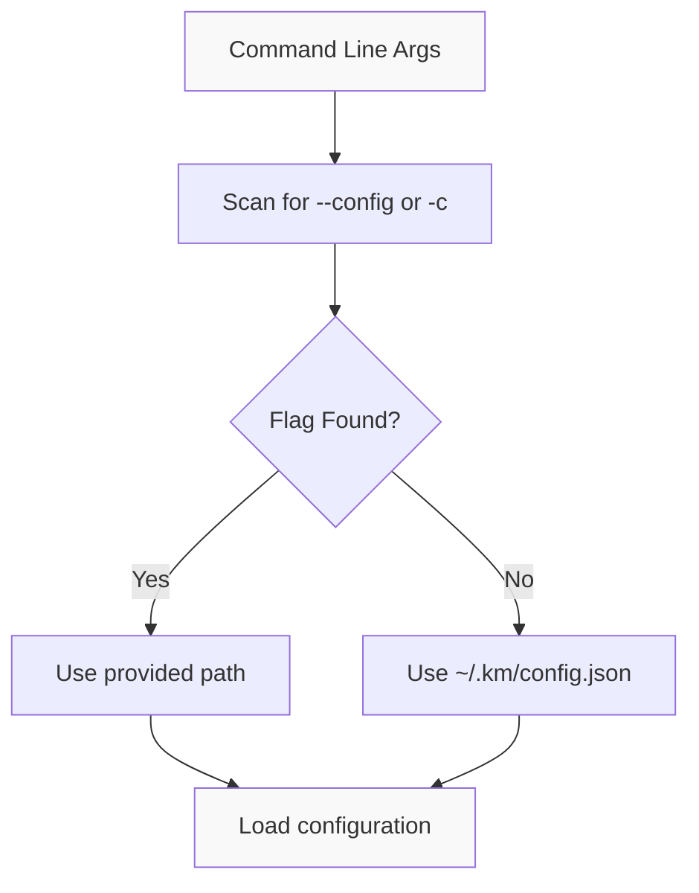
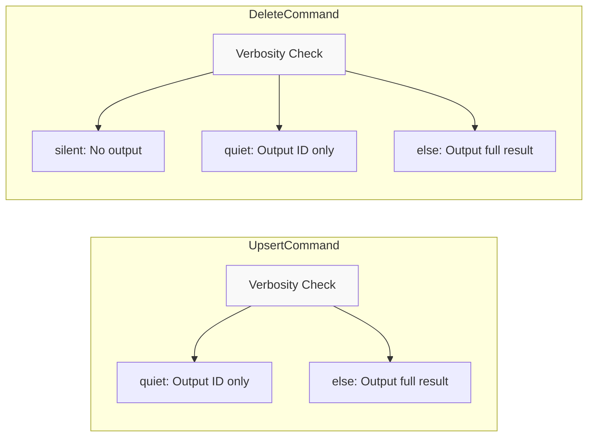
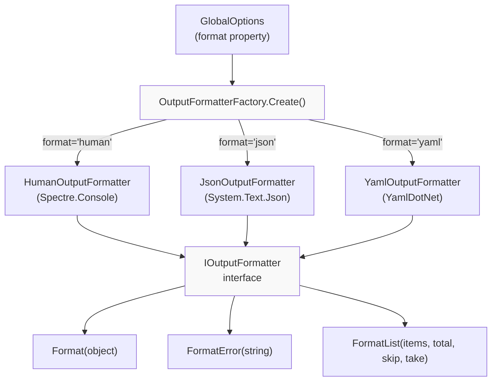
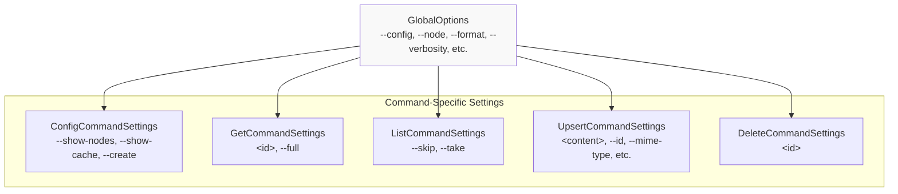
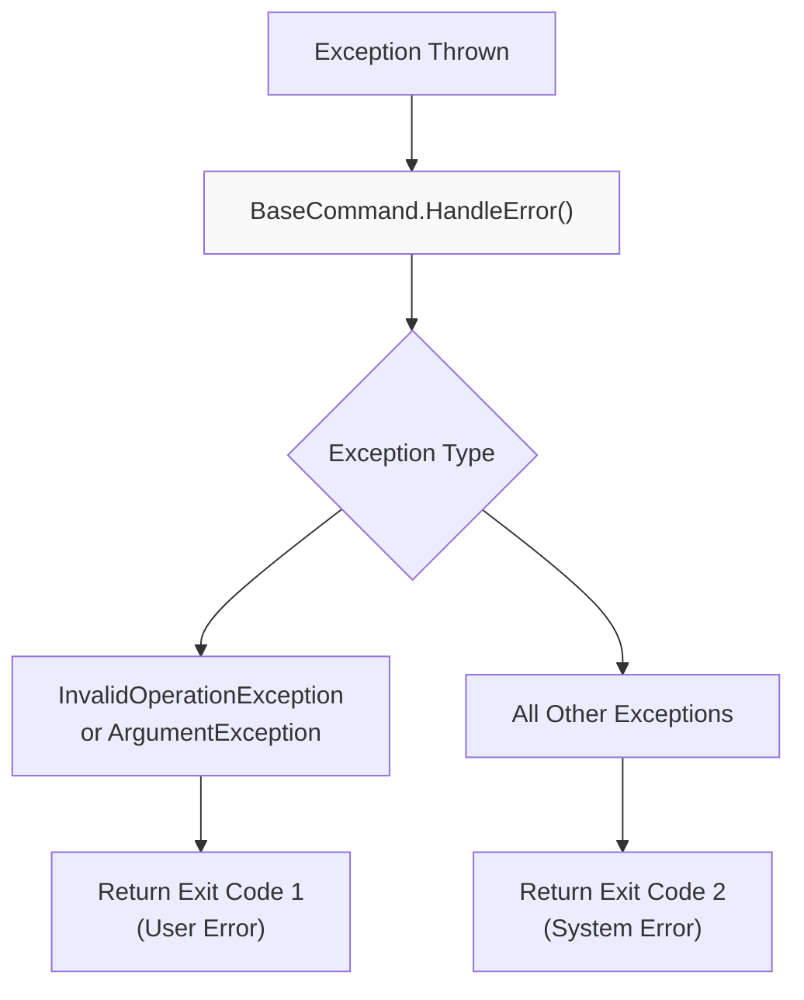
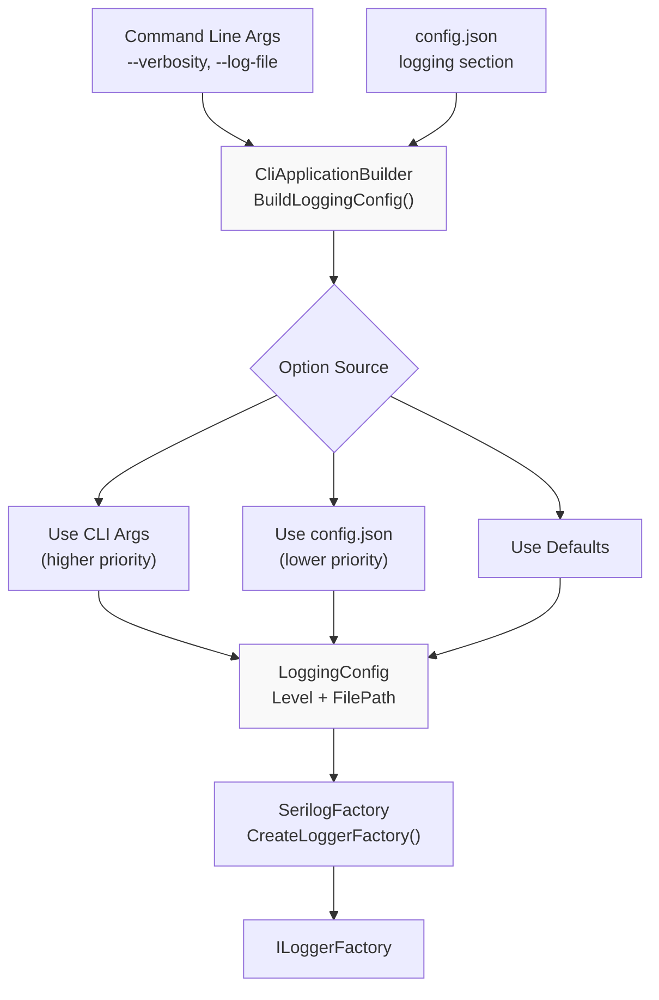

<!-- source: DeepWiki mcp.deepwiki.com · repo microsoft/kernel-memory · page 4.4 Command Options and Output Formats · fetched 2026-10-26 -->

# Command Options and Output Formats

<details>
<summary>Relevant source files</summary>

The following files were used as context for generating this wiki page:

- [src/Main/CLI/CliApplicationBuilder.cs](src/Main/CLI/CliApplicationBuilder.cs)
- [src/Main/CLI/Commands/BaseCommand.cs](src/Main/CLI/Commands/BaseCommand.cs)
- [src/Main/CLI/Commands/ConfigCommand.cs](src/Main/CLI/Commands/ConfigCommand.cs)
- [src/Main/CLI/Commands/DeleteCommand.cs](src/Main/CLI/Commands/DeleteCommand.cs)
- [src/Main/CLI/Commands/GetCommand.cs](src/Main/CLI/Commands/GetCommand.cs)
- [src/Main/CLI/Commands/ListCommand.cs](src/Main/CLI/Commands/ListCommand.cs)
- [src/Main/CLI/Commands/UpsertCommand.cs](src/Main/CLI/Commands/UpsertCommand.cs)
- [tests/Main.Tests/Integration/CliIntegrationTests.cs](tests/Main.Tests/Integration/CliIntegrationTests.cs)
- [tests/Main.Tests/Integration/CommandExecutionTests.cs](tests/Main.Tests/Integration/CommandExecutionTests.cs)
- [tests/Main.Tests/Integration/ConfigCommandTests.cs](tests/Main.Tests/Integration/ConfigCommandTests.cs)
- [tests/Main.Tests/Integration/ReadonlyCommandTests.cs](tests/Main.Tests/Integration/ReadonlyCommandTests.cs)

</details>


This page documents the global command-line options available to all KM² CLI commands and the output formatting capabilities. These options control configuration location, output format, verbosity, and logging behavior.

For information about specific commands and their individual options, see [CLI Application](#4). For configuration file structure and node settings, see [Configuration System](#6).

---

## Purpose and Scope

The KM² CLI provides a set of global options that apply across all commands. These options control:

- **Configuration source**: Which configuration file to load
- **Node selection**: Which logical partition to operate on
- **Output formatting**: How command results are displayed (human-readable, JSON, or YAML)
- **Verbosity**: How much detail to include in output
- **Visual presentation**: Color output and logging destination

All commands inherit from `GlobalOptions` ([src/Main/CLI/Commands/BaseCommand.cs:18-26]()) which defines these shared options.

---

## Global Options

### Configuration and Node Selection

| Option | Short | Description | Default |
|--------|-------|-------------|---------|
| `--config` | `-c` | Path to configuration file | `~/.km/config.json` |
| `--node` | `-n` | Node ID to operate on | First node in config |

**Configuration Path Resolution**

The configuration path is determined early in the application lifecycle through `CliApplicationBuilder.DetermineConfigPath()` ([src/Main/CLI/CliApplicationBuilder.cs:108-129]()):



**Node Selection**

When a command requires node selection, `BaseCommand.Initialize()` resolves the node ([src/Main/CLI/Commands/BaseCommand.cs:52-79]()):

1. If `--node` is specified, use that node ID
2. Otherwise, use the first node in `AppConfig.Nodes`
3. Throw `InvalidOperationException` if node not found

Sources: [src/Main/CLI/CliApplicationBuilder.cs:108-129](), [src/Main/CLI/Commands/BaseCommand.cs:52-79]()

### Output Formatting

| Option | Short | Values | Description | Default |
|--------|-------|--------|-------------|---------|
| `--format` | `-f` | `human`, `json`, `yaml` | Output format | `human` |
| `--no-color` | | Boolean flag | Disable ANSI colors | false |

**Output Format Behavior**

The output format is created by `OutputFormatterFactory.Create()` ([src/Main/CLI/OutputFormatters/OutputFormatterFactory.cs]() - referenced in [src/Main/CLI/Commands/ConfigCommand.cs:75]()):

- **human**: Human-readable format using Spectre.Console tables and styled text
- **json**: Machine-parseable JSON output
- **yaml**: Machine-parseable YAML output

Format selection affects how all command results are displayed. The same data structure is passed to all formatters, ensuring consistency.

**Color Output**

The `--no-color` flag disables ANSI color codes in human-readable output. This is useful for:
- Piping output to files
- Systems without ANSI support
- Automated scripts

When `NoColor` is true, warning messages in `ConfigCommand` skip ANSI markup ([src/Main/CLI/Commands/ConfigCommand.cs:86-91]()).

Sources: [src/Main/CLI/Commands/ConfigCommand.cs:75-77](), [src/Main/CLI/Commands/ConfigCommand.cs:86-91]()

### Verbosity and Logging

| Option | Short | Values | Description | Default |
|--------|-------|--------|-------------|---------|
| `--verbosity` | `-v` | `silent`, `quiet`, `normal`, `verbose` | Output detail level | `normal` |
| `--log-file` | | Path | Write logs to file | None |

**Verbosity Levels**

Verbosity controls both command output and logging level. Mapping to Serilog levels ([src/Main/CLI/CliApplicationBuilder.cs:146-154]()):

| Verbosity | Serilog Level | Command Output Behavior |
|-----------|---------------|------------------------|
| `silent` | Fatal | No output except ID (if applicable) |
| `quiet` | Warning | Minimal output (ID only) |
| `normal` | Information | Standard structured output |
| `verbose` | Debug | Detailed output with internal details |

**Verbosity Impact on Commands**

Different commands respect verbosity differently:



Example from `UpsertCommand` ([src/Main/CLI/Commands/UpsertCommand.cs:106-120]()):

- **quiet**: Returns only the content ID
- **normal/verbose**: Returns structured object with id, node, completion status, and any errors

Example from `DeleteCommand` ([src/Main/CLI/Commands/DeleteCommand.cs:67-80]()):

- **silent**: No output at all
- **quiet**: Returns only the content ID
- **normal/verbose**: Returns structured object with id, completion status, and errors

**Log File Configuration**

The `--log-file` option writes detailed logs to a file. This is processed early in `CliApplicationBuilder.BuildLoggingConfig()` ([src/Main/CLI/CliApplicationBuilder.cs:132-164]()):

1. Start with config file logging settings (if any)
2. Override with `--log-file` if provided on command line
3. Create logger factory via `SerilogFactory.CreateLoggerFactory()`
4. Log file captures all logging output according to verbosity level

Sources: [src/Main/CLI/Commands/UpsertCommand.cs:106-120](), [src/Main/CLI/Commands/DeleteCommand.cs:67-80](), [src/Main/CLI/CliApplicationBuilder.cs:132-164]()

---

## Output Formatter Architecture

The CLI uses a factory pattern to create formatters based on settings:



### Formatter Methods

All formatters implement `IOutputFormatter` with three primary methods:

| Method | Purpose | Used By |
|--------|---------|---------|
| `Format(object)` | Format single object or collection | Most commands |
| `FormatError(string)` | Format error message to stderr | All commands on error |
| `FormatList(items, total, skip, take)` | Format paginated list with metadata | `ListCommand` |

**Format Method Invocations**

Commands use formatters consistently ([src/Main/CLI/Commands/ConfigCommand.cs:134]()):

```
formatter.Format(output);
```

The formatter decides how to render based on:
1. Format type (human/json/yaml)
2. Object type (primitive, DTO, collection)
3. Verbosity settings (for conditional formatting)

Sources: [src/Main/CLI/Commands/ConfigCommand.cs:75-76](), [src/Main/CLI/Commands/ConfigCommand.cs:134]()

### Format-Specific Behaviors

**Human Format**

The human-readable formatter uses Spectre.Console features:
- Tables for lists ([src/Main/CLI/Commands/ListCommand.cs:88]())
- ANSI markup for colors and emphasis
- Structured layout for complex objects
- First-run messages with helpful examples ([src/Main/CLI/Commands/GetCommand.cs:98-124](), [src/Main/CLI/Commands/ListCommand.cs:104-137]())

**JSON Format**

JSON output uses `System.Text.Json` with specific serialization options ([src/Main/CLI/Commands/ConfigCommand.cs:41-46]()):

```
WriteIndented = true
PropertyNamingPolicy = JsonNamingPolicy.CamelCase
DefaultIgnoreCondition = JsonIgnoreCondition.WhenWritingNull
```

Key behaviors:
- Pretty-printed (indented) JSON
- camelCase property names
- Null fields omitted ([tests/Main.Tests/Integration/ConfigCommandTests.cs:402-408]())
- Correct type discriminators ([tests/Main.Tests/Integration/ConfigCommandTests.cs:416-467]())

**YAML Format**

YAML output provides human-readable structured data:
- Hierarchical indentation
- Lists with `-` prefix
- Key-value pairs
- Compatible with most YAML parsers

Sources: [src/Main/CLI/Commands/ConfigCommand.cs:41-46](), [tests/Main.Tests/Integration/ConfigCommandTests.cs:368-413]()

---

## Command-Specific Options

While global options apply to all commands, each command may define additional options:



### Examples by Command

**ConfigCommand Options** ([src/Main/CLI/Commands/ConfigCommand.cs:21-34]()):
- `--show-nodes`: Display summary of all nodes
- `--show-cache`: Display cache configuration
- `--create`: Write configuration to disk

**GetCommand Options** ([src/Main/CLI/Commands/GetCommand.cs:18-43]()):
- `<id>`: Required content ID argument
- `--full`: Show all internal details

**ListCommand Options** ([src/Main/CLI/Commands/ListCommand.cs:18-50]()):
- `--skip`: Number of items to skip (default: 0)
- `--take`: Number of items to return (default: 20)

**UpsertCommand Options** ([src/Main/CLI/Commands/UpsertCommand.cs:17-59]()):
- `<content>`: Required content argument
- `--id`: Custom content ID (auto-generated if omitted)
- `--mime-type`: MIME type (default: text/plain)
- `--title`: Optional title
- `--description`: Optional description
- `--tags`: Comma-separated tags

**DeleteCommand Options** ([src/Main/CLI/Commands/DeleteCommand.cs:16-37]()):
- `<id>`: Required content ID argument

Sources: [src/Main/CLI/Commands/ConfigCommand.cs:21-34](), [src/Main/CLI/Commands/GetCommand.cs:18-43](), [src/Main/CLI/Commands/ListCommand.cs:18-50](), [src/Main/CLI/Commands/UpsertCommand.cs:17-59](), [src/Main/CLI/Commands/DeleteCommand.cs:16-37]()

---

## Exit Codes

All commands return standard exit codes for automation and scripting:

| Exit Code | Constant | Meaning | Example Scenarios |
|-----------|----------|---------|-------------------|
| 0 | `ExitCodeSuccess` | Success | Command completed successfully |
| 1 | `ExitCodeUserError` | User error | Invalid arguments, content not found |
| 2 | `ExitCodeSystemError` | System error | I/O failure, database corruption |

**Exit Code Determination**

The `BaseCommand.HandleError()` method maps exceptions to exit codes ([src/Main/CLI/Commands/BaseCommand.cs:172-190]()):



**Special Cases**

- **First-run scenarios**: Missing database returns exit code 0 (success) with helpful message ([src/Main/CLI/Commands/GetCommand.cs:84-89](), [src/Main/CLI/Commands/ListCommand.cs:92-97]())
- **Config file creation**: Existing file returns exit code 1 (user error) ([src/Main/CLI/Commands/ConfigCommand.cs:158-163]())
- **Idempotent operations**: Delete always succeeds (exit 0) even if ID doesn't exist ([tests/Main.Tests/Integration/CommandExecutionTests.cs:105-121]())

Sources: [src/Main/CLI/Commands/BaseCommand.cs:172-190](), [src/Main/CLI/Commands/GetCommand.cs:84-89](), [src/Main/CLI/Commands/ConfigCommand.cs:152-187]()

---

## Configuration Integration

Global options integrate with the application configuration system:



**Priority Order**

1. **Command-line arguments** (highest priority)
2. **Configuration file** settings
3. **Application defaults** (lowest priority)

This is implemented in `CliApplicationBuilder.BuildLoggingConfig()` ([src/Main/CLI/CliApplicationBuilder.cs:132-164]()) where CLI args take precedence over config file settings.

Sources: [src/Main/CLI/CliApplicationBuilder.cs:62-105](), [src/Main/CLI/CliApplicationBuilder.cs:132-164]()

---

## Usage Examples

### Basic Command Invocation

```bash
# Use default format and config
km list

# Specify output format
km list --format json
km list -f yaml

# Select specific node
km get abc123 --node shared

# Combine options
km list --node personal --format json --verbosity quiet
```

### Configuration Commands

```bash
# Show current configuration
km config

# Show only nodes summary
km config --show-nodes

# Show only cache configuration
km config --show-cache

# Create configuration file
km config --create

# Use custom config location
km --config /path/to/config.json config
```

### Verbosity Control

```bash
# Silent mode (no output)
km delete abc123 --verbosity silent

# Quiet mode (ID only)
km put "content" -v quiet

# Verbose mode (detailed logging)
km list --verbosity verbose --log-file /tmp/km.log
```

### Format Comparison

```bash
# Human-readable table
km list

# Machine-parseable JSON
km list -f json | jq '.items[].id'

# YAML for configuration
km config -f yaml > my-config.yaml
```

Sources: [src/Main/CLI/CliApplicationBuilder.cs:22-46]()

---

## First-Run Experience

Commands handle the first-run scenario (no database exists yet) gracefully:

**Read-Only Commands** (get, list):
- Return exit code 0 (not an error)
- Show helpful getting-started message in human format
- Return valid empty/null JSON/YAML in machine formats
- Never create directories or files ([tests/Main.Tests/Integration/ReadonlyCommandTests.cs:64-98]())

**Write Commands** (put, delete):
- Automatically create necessary directories and databases
- Initialize database schema on first write
- Return exit code 0 after successful initialization

This design ensures that:
1. Readonly operations never have side effects
2. First-run users see helpful guidance
3. Automation tools receive predictable output

Sources: [src/Main/CLI/Commands/GetCommand.cs:98-124](), [src/Main/CLI/Commands/ListCommand.cs:104-137](), [tests/Main.Tests/Integration/ReadonlyCommandTests.cs:64-98]()

---

