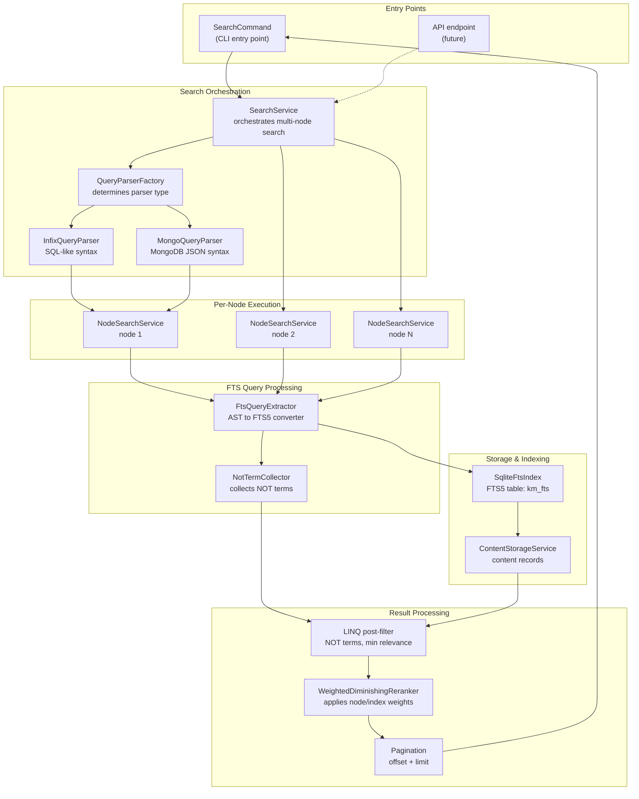
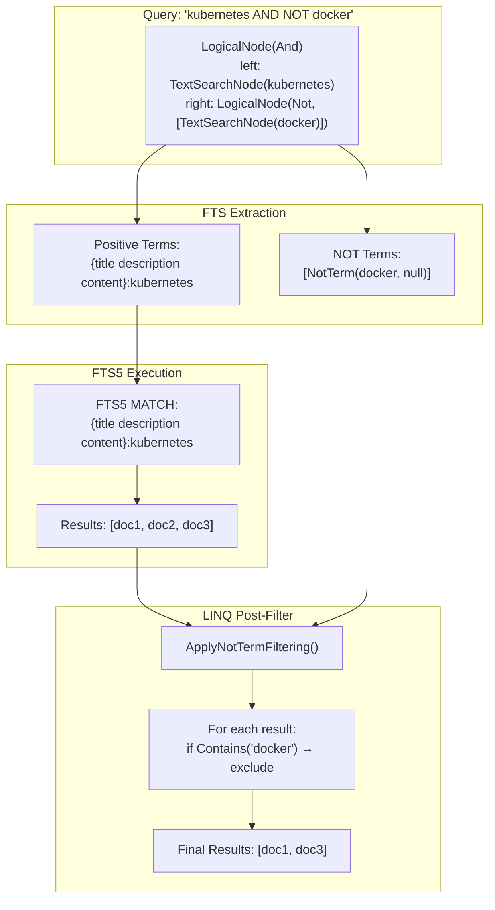
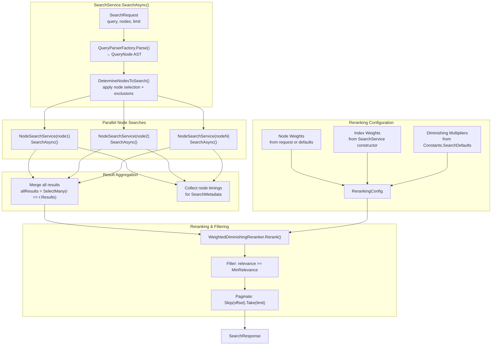

<!-- source: DeepWiki mcp.deepwiki.com · repo microsoft/kernel-memory · page 5 Search System · fetched 2026-10-26 -->

# Search System

<details>
<summary>Relevant source files</summary>

The following files were used as context for generating this wiki page:

- [KNOWN-ISSUES.md](KNOWN-ISSUES.md)
- [src/Core/Search/NodeSearchService.cs](src/Core/Search/NodeSearchService.cs)
- [src/Core/Search/Query/Parsers/InfixQueryParser.cs](src/Core/Search/Query/Parsers/InfixQueryParser.cs)
- [src/Core/Search/SearchService.cs](src/Core/Search/SearchService.cs)
- [src/Core/Search/SqliteFtsIndex.cs](src/Core/Search/SqliteFtsIndex.cs)
- [src/Main/CLI/Commands/ExamplesCommand.cs](src/Main/CLI/Commands/ExamplesCommand.cs)
- [src/Main/CLI/Commands/SearchCommand.cs](src/Main/CLI/Commands/SearchCommand.cs)
- [tests/Core.Tests/Search/FtsQueryExtractionTest.cs](tests/Core.Tests/Search/FtsQueryExtractionTest.cs)
- [tests/Core.Tests/Search/NodeSearchServiceIndexIdTests.cs](tests/Core.Tests/Search/NodeSearchServiceIndexIdTests.cs)
- [tests/Core.Tests/Search/Query/InfixQueryParserTests.cs](tests/Core.Tests/Search/Query/InfixQueryParserTests.cs)
- [tests/Core.Tests/Search/SearchEndToEndTests.cs](tests/Core.Tests/Search/SearchEndToEndTests.cs)
- [tests/Core.Tests/Search/SearchServiceIndexWeightsTests.cs](tests/Core.Tests/Search/SearchServiceIndexWeightsTests.cs)
- [tests/Main.Tests/Integration/ExamplesCommandE2ETests.cs](tests/Main.Tests/Integration/ExamplesCommandE2ETests.cs)

</details>


The Search System provides full-text search capabilities across indexed content in Kernel Memory. It supports complex query syntax (both infix notation and MongoDB JSON), multi-node search orchestration, result reranking, and relevance filtering. This document covers the query processing pipeline, SQLite FTS5 integration, multi-node orchestration, and known limitations.

For information about search configuration and index setup, see [Configuration System](#6). For details on how content is stored and indexed, see [Storage and Indexing](#7). For CLI usage examples, see [CLI Application](#4).

## System Architecture

The search system operates in layers: CLI commands accept queries, the `SearchService` orchestrates searches across nodes, `NodeSearchService` instances execute searches within individual nodes using FTS indexes, and results are merged, reranked, and filtered before returning to the user.



**Key Classes and Their Roles**

| Class | Location | Responsibility |
|-------|----------|----------------|
| `SearchService` | [src/Core/Search/SearchService.cs]() | Orchestrates searches across multiple nodes, manages reranking |
| `NodeSearchService` | [src/Core/Search/NodeSearchService.cs]() | Executes search within a single node, extracts FTS queries |
| `SqliteFtsIndex` | [src/Core/Search/SqliteFtsIndex.cs]() | FTS5 index implementation with BM25 scoring |
| `InfixQueryParser` | [src/Core/Search/Query/Parsers/InfixQueryParser.cs]() | Parses SQL-like query syntax (e.g., `content:kubernetes AND tags:AI`) |
| `FtsQueryExtractor` | [src/Core/Search/NodeSearchService.cs:230-457]() | Converts AST to SQLite FTS5 query syntax |
| `WeightedDiminishingReranker` | [src/Core/Search/Reranking/]() | Reranks results using node/index weights |

Sources: [src/Core/Search/SearchService.cs](), [src/Core/Search/NodeSearchService.cs](), [Diagram 5 from system overview]()

## Query Processing Pipeline

Queries flow through multiple stages: parsing to AST, FTS query extraction, FTS5 execution, NOT term filtering, reranking, relevance filtering, and pagination. The system supports two query formats that produce equivalent results.

```mermaid
graph LR
    subgraph "Input"
        Q1["Infix Query<br/>content:kubernetes AND tags:AI"]
        Q2["MongoDB JSON<br/>{$and: [{content: kubernetes}, {tags: AI}]}"]
    end
    
    subgraph "Stage 1: Parsing"
        IQP["InfixQueryParser.Parse()"]
        MQP["MongoQueryParser.Parse()"]
        AST["QueryNode AST<br/>LogicalNode, TextSearchNode, etc."]
    end
    
    subgraph "Stage 2: FTS Extraction"
        FQE["FtsQueryExtractor.Extract()"]
        POS["Positive Terms<br/>FTS query string"]
        NEG["NOT Terms<br/>NotTerm[]"]
    end
    
    subgraph "Stage 3: FTS5 Execution"
        FTS["SqliteFtsIndex.SearchAsync()"]
        BM25["BM25 Scoring<br/>raw scores -10 to 0"]
        NORM["Score Normalization<br/>exp(score / 5.0)"]
    end
    
    subgraph "Stage 4: Post-Processing"
        LOAD["Load ContentRecords<br/>from ContentStorageService"]
        NOTF["ApplyNotTermFiltering()<br/>LINQ Contains check"]
        MERGE["Merge results from all nodes"]
    end
    
    subgraph "Stage 5: Ranking & Filtering"
        RERANK["Rerank(nodeWeights, indexWeights)"]
        MINREL["MinRelevance filter<br/>default 0.3"]
        PAGE["Pagination<br/>offset + limit"]
    end
    
    Q1 --> IQP
    Q2 --> MQP
    IQP --> AST
    MQP --> AST
    AST --> FQE
    FQE --> POS
    FQE --> NEG
    POS --> FTS
    FTS --> BM25
    BM25 --> NORM
    NORM --> LOAD
    LOAD --> NOTF
    NEG --> NOTF
    NOTF --> MERGE
    MERGE --> RERANK
    RERANK --> MINREL
    MINREL --> PAGE
    PAGE --> Results["SearchResponse"]
```



**Query Format Examples**

| Format | Example | Description |
|--------|---------|-------------|
| Infix | `kubernetes` | Simple text search across all fields |
| Infix | `content:kubernetes` | Field-specific search |
| Infix | `kubernetes AND docker` | Boolean AND operator |
| Infix | `kubernetes OR docker` | Boolean OR operator |
| Infix | `kubernetes AND NOT docker` | Boolean NOT operator |
| Infix | `(tags:AI OR tags:ML) AND content:kubernetes` | Complex boolean with parentheses |
| MongoDB | `{"content": "kubernetes"}` | Simple field search |
| MongoDB | `{"$and": [{"content": "kubernetes"}, {"tags": "AI"}]}` | Boolean AND |
| MongoDB | `{"$text": {"$search": "kubernetes"}}` | Full-text search across all fields |
| MongoDB | `{"$not": {"content": "deprecated"}}` | NOT operator |

Sources: [src/Core/Search/NodeSearchService.cs:213-222](), [src/Core/Search/SearchService.cs:43-105](), [src/Core/Search/Query/Parsers/InfixQueryParser.cs](), [tests/Core.Tests/Search/SearchEndToEndTests.cs:111-333]()

## Query Syntax and Abstract Syntax Tree

The parser converts query strings into an Abstract Syntax Tree (AST) composed of typed nodes. This AST representation allows uniform processing regardless of input format.

**AST Node Types**

| Node Type | Purpose | Example AST |
|-----------|---------|-------------|
| `TextSearchNode` | Full-text search term | `{ SearchText: "kubernetes", Field: null }` |
| `ComparisonNode` | Field comparison | `{ Field: "content", Operator: Equal, Value: "kubernetes" }` |
| `LogicalNode` | Boolean operators | `{ Operator: And, Children: [node1, node2] }` |
| `FieldNode` | Field reference | `{ FieldPath: "content" }` |
| `LiteralNode` | Literal value | `{ Value: "kubernetes" }` |

**Supported Comparison Operators**

- `:` or `==` - Equal (uses FTS semantics for content/title/description)
- `!=` - Not equal
- `>=`, `<=`, `>`, `<` - Comparison operators
- `:~` - Contains (explicit substring match)
- `:[value1,value2]` - In array

**Supported Logical Operators**

- `AND` - All conditions must match
- `OR` - At least one condition must match
- `NOT` - Negation (handled via post-filtering, see limitations below)

Sources: [src/Core/Search/Query/Ast/](), [src/Core/Search/Query/Parsers/InfixQueryParser.cs:12-412](), [tests/Core.Tests/Search/Query/InfixQueryParserTests.cs]()

## SQLite FTS5 Integration

The system uses SQLite FTS5 (Full-Text Search version 5) with BM25 ranking and optional Porter stemming. The FTS index is stored in a separate SQLite database from content records.

**FTS5 Table Schema**

The `SqliteFtsIndex` class creates a virtual FTS5 table named `km_fts`:

```sql
CREATE VIRTUAL TABLE km_fts USING fts5(
    content_id UNINDEXED,
    title,
    description,
    content,
    tokenize='porter unicode61'
);
```

This schema enables field-specific searches like `title:kubernetes` or `content:docker`. The `content_id` field is marked `UNINDEXED` to avoid tokenizing record IDs.

**BM25 Scoring and Normalization**

SQLite FTS5's `bm25()` function returns negative scores where more negative = better match (typically -10 to 0). The system normalizes these to the 0-1 range using exponential normalization:

```
normalizedScore = exp(rawScore / 5.0)
```

This gives:
- Raw score -10 → normalized ~0.37
- Raw score -5 → normalized ~0.61
- Raw score -1 → normalized ~0.90
- Raw score 0 → normalized 1.0

Sources: [src/Core/Search/SqliteFtsIndex.cs:56-78](), [src/Core/Search/SqliteFtsIndex.cs:143-216](), [Constants.SearchDefaults.Bm25NormalizationDivisor]()

**FTS Query Generation**

The `FtsQueryExtractor` class converts AST nodes to FTS5 query syntax:

| AST Pattern | FTS5 Query | Notes |
|-------------|------------|-------|
| `TextSearchNode("kubernetes")` | `{title description content}:kubernetes` | Searches all FTS fields |
| `TextSearchNode("machine learning")` | `"machine learning"` | Phrase search (no field prefix) |
| `ComparisonNode(content, Equal, "docker")` | `content:docker` | Single-word field search |
| `ComparisonNode(content, Contains, "rest api")` | `"rest api"` | Phrase search (no field prefix) |
| `LogicalNode(And, [node1, node2])` | `(fts1) AND (fts2)` | Boolean AND |
| `LogicalNode(Or, [node1, node2])` | `(fts1) OR (fts2)` | Boolean OR |
| `LogicalNode(Not, [node])` | *(empty, collected separately)* | NOT terms filtered post-search |

**Reserved Word Handling**

FTS5 reserved words (`AND`, `OR`, `NOT`, `NEAR`) must be quoted to search them literally:

```
Query: "NOT"           → FTS5: "NOT"
Query: "Alice AND Bob" → FTS5: "Alice AND Bob"
Query: content:"NOT"   → FTS5: "NOT" (cannot use field prefix with quotes)
```

Sources: [src/Core/Search/NodeSearchService.cs:230-457](), [src/Core/Search/SqliteFtsIndex.cs:143-216](), [tests/Core.Tests/Search/FtsQueryExtractionTest.cs]()

## NOT Operator and Post-Filtering

SQLite FTS5 has limited NOT operator support - it requires a left operand (e.g., `foo NOT bar` works, but `NOT bar` alone fails). To work around this, the system uses a two-phase approach:

1. **FTS Phase**: Extract positive terms and generate FTS query
2. **LINQ Phase**: Collect NOT terms separately and filter results via LINQ



**NotTerm Structure**

The `NotTerm` record stores terms to exclude:

```csharp
public sealed record NotTerm(string Term, string? Field);
```

- `Term`: The text to exclude
- `Field`: Optional field to check (`title`, `description`, `content`). If null, checks all fields.

**Field-Specific NOT Filtering**

```
Query: content:kubernetes AND NOT content:deprecated
→ FTS: content:kubernetes
→ NOT terms: [NotTerm("deprecated", "content")]
→ Filter: Exclude if result.Content contains "deprecated"
```

Sources: [src/Core/Search/NodeSearchService.cs:10-26](), [src/Core/Search/NodeSearchService.cs:145-211](), [src/Core/Search/NodeSearchService.cs:303-377]()

## Multi-Node Search Orchestration

The `SearchService` orchestrates searches across multiple nodes, merges results, and applies reranking based on configurable weights.



**Node Selection Logic**

The `SearchService.DetermineNodesToSearch()` method applies this logic:

1. If `SearchRequest.Nodes` is specified → use those nodes minus `ExcludeNodes`
2. Otherwise → use all configured nodes minus `ExcludeNodes`
3. Validate all selected nodes exist in configuration

**Reranking Formula**

The `WeightedDiminishingReranker` calculates final relevance scores:

```
finalRelevance = baseRelevance × nodeWeight × indexWeight × diminishingMultiplier
```

Where:
- `baseRelevance`: BM25 score from FTS5 (0-1 range)
- `nodeWeight`: Per-node multiplier (default 1.0, configurable via `SearchRequest.NodeWeights`)
- `indexWeight`: Per-index multiplier (default 1.0, configured in `AppConfig.Nodes[].SearchIndexes[].Weight`)
- `diminishingMultiplier`: Reduces scores for duplicate results across indexes

Sources: [src/Core/Search/SearchService.cs:43-106](), [src/Core/Search/SearchService.cs:166-192](), [src/Core/Search/SearchService.cs:214-265](), [src/Main/CLI/Commands/SearchCommand.cs:456-534]()

## Search Request and Response Models

**SearchRequest Properties**

| Property | Type | Default | Description |
|----------|------|---------|-------------|
| `Query` | `string` | (required) | Query string in infix or MongoDB JSON format |
| `Nodes` | `string[]` | `[]` | Specific nodes to search (empty = all nodes) |
| `ExcludeNodes` | `string[]` | `[]` | Nodes to exclude from search |
| `SearchIndexes` | `string[]` | `[]` | Specific indexes to search |
| `ExcludeIndexes` | `string[]` | `[]` | Indexes to exclude from search |
| `Limit` | `int` | `20` | Maximum results to return |
| `Offset` | `int` | `0` | Pagination offset |
| `MinRelevance` | `float` | `0.3` | Minimum relevance threshold (0.0-1.0) |
| `MaxResultsPerNode` | `int?` | `1000` | Memory safety limit per node |
| `SnippetOnly` | `bool` | `false` | Return snippets instead of full content |
| `SnippetLength` | `int?` | `200` | Override snippet length |
| `Highlight` | `bool` | `false` | Wrap matched terms in highlight markers |
| `TimeoutSeconds` | `int?` | `30` | Search timeout per node |
| `NodeWeights` | `Dictionary<string, float>?` | `null` | Override node weights at query time |

**SearchResponse Structure**

```csharp
public class SearchResponse
{
    public string Query { get; set; }
    public int TotalResults { get; set; }  // After filtering, before pagination
    public SearchIndexResult[] Results { get; set; }
    public SearchMetadata Metadata { get; set; }
}

public class SearchIndexResult
{
    public string Id { get; set; }
    public string NodeId { get; set; }
    public string IndexId { get; set; }
    public float Relevance { get; set; }  // Final relevance after reranking
    public float BaseRelevance { get; set; }  // Original BM25 score
    public string Title { get; set; }
    public string Description { get; set; }
    public string Content { get; set; }
    public DateTime CreatedAt { get; set; }
    public string[] Tags { get; set; }
    public Dictionary<string, string> Metadata { get; set; }
}

public class SearchMetadata
{
    public int NodesSearched { get; set; }
    public int NodesRequested { get; set; }
    public TimeSpan ExecutionTime { get; set; }
    public NodeTiming[] NodeTimings { get; set; }
    public string[] Warnings { get; set; }
}
```

Sources: [src/Core/Search/Models/SearchRequest.cs](), [src/Core/Search/Models/SearchResponse.cs](), [src/Core/Search/Models/SearchIndexResult.cs]()

## CLI Search Command

The `SearchCommand` class provides the CLI interface for search operations. It accepts all search parameters as command-line flags.

**Command Syntax**

```bash
km search <query> [options]
```

**Command Options**

```bash
# Node selection
--nodes personal,work          # Search specific nodes
--exclude-nodes archive        # Exclude specific nodes

# Index selection
--indexes fts-main,vector-main     # Search specific indexes
--exclude-indexes experimental     # Exclude specific indexes

# Result control
--limit 20                     # Max results (default: 20)
--offset 0                     # Pagination offset (default: 0)
--min-relevance 0.3           # Min relevance (default: 0.3)
--max-results-per-node 1000   # Per-node limit (default: 1000)

# Content control
--snippet                      # Return snippets, not full content
--snippet-length 200          # Override snippet length
--highlight                    # Wrap matches in highlight markers

# Performance
--timeout 30                   # Per-node timeout in seconds
--node-weights personal:1.5,archive:0.3  # Override node weights

# Validation
--validate                     # Validate query without executing
```

**Command Implementation**

The `SearchCommand.ExecuteAsync()` method:

1. Calls `BuildSearchRequest()` to convert CLI flags to `SearchRequest`
2. Calls `CreateSearchService()` to instantiate `SearchService` with all nodes
3. Handles first-run scenario (no database) gracefully with friendly message
4. Formats results based on `--format` flag (human/json/yaml)

Sources: [src/Main/CLI/Commands/SearchCommand.cs](), [src/Main/CLI/Commands/SearchCommand.cs:21-137](), [src/Main/CLI/Commands/SearchCommand.cs:261-323]()

## Performance Characteristics

**Timeout Behavior**

Each node search has an independent timeout (default 30 seconds). If a node times out, it throws `SearchException` with `SearchErrorType.NodeTimeout`.

**Memory Safety**

The `MaxResultsPerNode` parameter (default 1000) limits results per node before merging. This prevents memory exhaustion when searching large indexes.

**BM25 Scoring Performance**

SQLite FTS5's BM25 ranking is computed during the FTS5 MATCH query. The `bm25()` function is called for each matching row, so scoring performance is O(n) where n = number of matches.

**Parallelization**

Node searches execute in parallel using `Task.WhenAll()`:

```csharp
var searchTasks = nodesToSearch.Select(nodeId =>
    this.SearchNodeAsync(nodeId, queryNode, request, cancellationToken));

var nodeResults = await Task.WhenAll(searchTasks);
```

This reduces total search time to `max(nodeSearchTimes)` rather than `sum(nodeSearchTimes)`.

Sources: [src/Core/Search/SearchService.cs:59-62](), [src/Core/Search/NodeSearchService.cs:75-78]()

## Known Limitations and Issues

### Issue 1: Field Queries with Quoted Values Fail

**Status**: Known bug, not yet fixed

**Problem**: Field-specific queries with quoted values containing special characters fail with SQLite error "unknown special query".

**Example**:
```bash
km put "user:password format"
km search 'content:"user:password"'
# Error: SQLite error "unknown special query"
```

**Root Cause**: The FTS5 syntax `field:"quoted value"` is not supported by SQLite FTS5. The `FtsQueryExtractor` cannot use field prefixes with quoted phrases.

**Workaround**: Search without field prefix or without quotes:
```bash
km search '"user:password"'      # Works (searches all fields)
km search 'content:user'         # Works (no quotes)
```

### Issue 2: NOT Operator Requires AND Context

**Problem**: The infix parser requires explicit AND between terms when using NOT.

**Incorrect Syntax**:
```bash
km search "foo NOT bar"          # Parser ignores NOT
km search "(foo OR baz) NOT bar" # Parser ignores NOT
```

**Correct Syntax**:
```bash
km search "foo AND NOT bar"              # Correct
km search "(foo OR baz) AND NOT bar"     # Correct
```

**Note**: This is a parser requirement, not an FTS5 limitation. The query must explicitly use AND before NOT.

### Issue 3: Reserved Words Must Be Quoted

**Problem**: FTS5 reserved words (`AND`, `OR`, `NOT`, `NEAR`) are treated as operators unless quoted.

**Solution**: Use double quotes to search for literal reserved words:

```bash
km search '"NOT"'               # Searches for the word "NOT"
km search '"Alice AND Bob"'     # Searches for exact phrase "Alice AND Bob"
km search '"NOT" AND kubernetes' # Literal "NOT" plus kubernetes
```

The system detects reserved words and automatically quotes them in the FTS5 query:
- Parser: `"NOT"` → `TextSearchNode("NOT")`
- FTS Extractor: Detects "NOT" is reserved → FTS5 query: `"NOT"`

Sources: [KNOWN-ISSUES.md:1-35](), [src/Core/Search/NodeSearchService.cs:238-241](), [tests/Core.Tests/Search/Query/InfixQueryParserTests.cs:348-486]()

## Testing Strategy

The search system has comprehensive test coverage at multiple levels:

**Unit Tests**
- Query parser tests ([tests/Core.Tests/Search/Query/InfixQueryParserTests.cs]())
- FTS query extraction tests ([tests/Core.Tests/Search/FtsQueryExtractionTest.cs]())
- Index weight configuration tests ([tests/Core.Tests/Search/SearchServiceIndexWeightsTests.cs]())
- Index ID configuration tests ([tests/Core.Tests/Search/NodeSearchServiceIndexIdTests.cs]())

**Integration Tests**
- End-to-end search tests with real SQLite databases ([tests/Core.Tests/Search/SearchEndToEndTests.cs]())
- Tests for both infix and MongoDB JSON formats
- Regression tests for known bugs (BM25 normalization, field-specific stemming)
- Reserved word search tests

**E2E Tests**
- CLI command tests executing actual `km` processes ([tests/Main.Tests/Integration/ExamplesCommandE2ETests.cs]())
- Tests for every example shown in `km examples`
- Ensures all documented examples actually work

Sources: [tests/Core.Tests/Search/](), [tests/Main.Tests/Integration/ExamplesCommandE2ETests.cs]()

---

