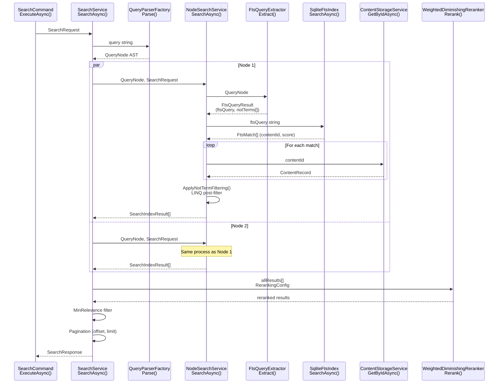
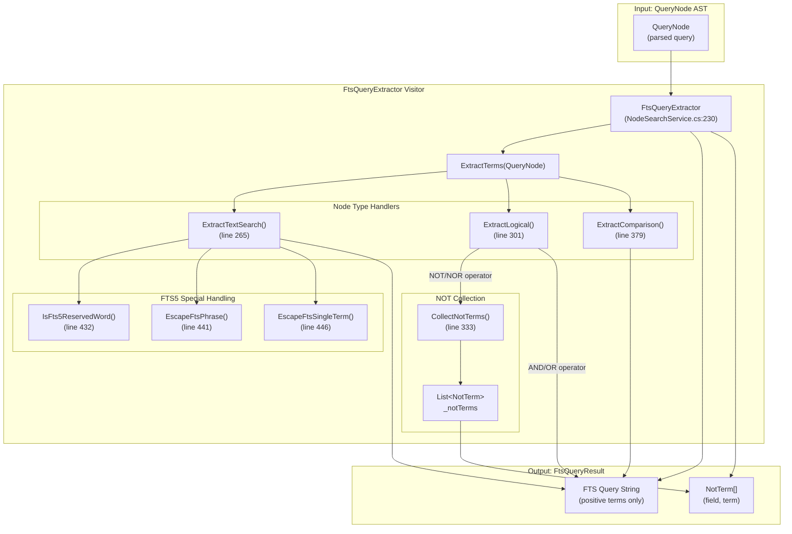
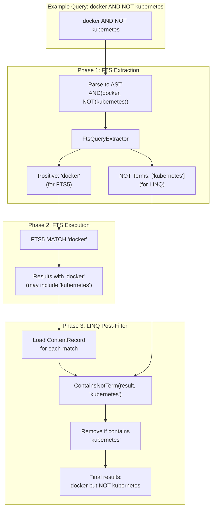
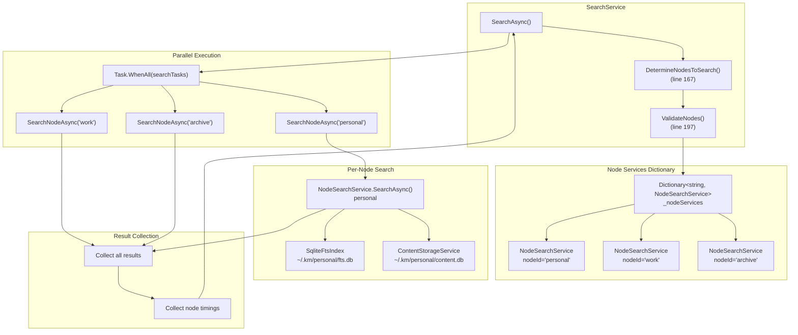

<!-- source: DeepWiki mcp.deepwiki.com · repo microsoft/kernel-memory · page 5.1 Search Architecture · fetched 2026-10-26 -->

# Search Architecture

<details>
<summary>Relevant source files</summary>

The following files were used as context for generating this wiki page:

- [KNOWN-ISSUES.md](KNOWN-ISSUES.md)
- [src/Core/Search/NodeSearchService.cs](src/Core/Search/NodeSearchService.cs)
- [src/Core/Search/Query/Parsers/InfixQueryParser.cs](src/Core/Search/Query/Parsers/InfixQueryParser.cs)
- [src/Core/Search/SearchService.cs](src/Core/Search/SearchService.cs)
- [src/Core/Search/SqliteFtsIndex.cs](src/Core/Search/SqliteFtsIndex.cs)
- [src/Main/CLI/Commands/ExamplesCommand.cs](src/Main/CLI/Commands/ExamplesCommand.cs)
- [src/Main/CLI/Commands/SearchCommand.cs](src/Main/CLI/Commands/SearchCommand.cs)
- [tests/Core.Tests/Search/FtsQueryExtractionTest.cs](tests/Core.Tests/Search/FtsQueryExtractionTest.cs)
- [tests/Core.Tests/Search/NodeSearchServiceIndexIdTests.cs](tests/Core.Tests/Search/NodeSearchServiceIndexIdTests.cs)
- [tests/Core.Tests/Search/Query/InfixQueryParserTests.cs](tests/Core.Tests/Search/Query/InfixQueryParserTests.cs)
- [tests/Core.Tests/Search/SearchEndToEndTests.cs](tests/Core.Tests/Search/SearchEndToEndTests.cs)
- [tests/Core.Tests/Search/SearchServiceIndexWeightsTests.cs](tests/Core.Tests/Search/SearchServiceIndexWeightsTests.cs)
- [tests/Main.Tests/Integration/ExamplesCommandE2ETests.cs](tests/Main.Tests/Integration/ExamplesCommandE2ETests.cs)

</details>


## Purpose and Scope

This page documents the architecture of the search system in Kernel Memory, including the request flow, query processing pipeline, and multi-node orchestration. For details on query syntax and parsing, see [Query Syntax and Parsing](#5.2). For information on SQLite FTS5 integration and scoring, see [SQLite FTS5 Integration](#5.3). For details on result ranking algorithms, see [Result Ranking and Filtering](#5.4).

The search system is the most complex subsystem in KM². It accepts queries in two formats (infix notation and MongoDB JSON), parses them into an Abstract Syntax Tree (AST), orchestrates searches across multiple nodes, and merges results with configurable weighting and filtering.

---

## System Overview

The search architecture consists of three primary layers: query processing, search execution, and result processing. Queries flow through parsers into an AST representation, which is then converted to SQLite FTS5 queries for execution. Results from multiple nodes are merged and reranked before being returned to the user.

**Diagram: Search System Architecture**

```mermaid
graph TB
    subgraph "CLI Layer"
        SearchCommand["SearchCommand<br/>(SearchCommand.cs:143)"]
    end
    
    subgraph "Service Layer"
        SearchService["SearchService<br/>(SearchService.cs:14)"]
        NodeSearchService1["NodeSearchService<br/>node 1<br/>(NodeSearchService.cs:33)"]
        NodeSearchService2["NodeSearchService<br/>node 2<br/>(NodeSearchService.cs:33)"]
    end
    
    subgraph "Query Processing"
        QueryParserFactory["QueryParserFactory"]
        InfixParser["InfixQueryParser<br/>(InfixQueryParser.cs:12)"]
        MongoParser["MongoQueryParser"]
        QueryAST["QueryNode AST<br/>(Ast/QueryNode.cs)"]
    end
    
    subgraph "FTS Execution"
        FtsExtractor["FtsQueryExtractor<br/>(NodeSearchService.cs:230)"]
        FtsQuery["FTS5 Query String"]
        NotTerms["NotTerm[]<br/>(NodeSearchService.cs:26)"]
        SqliteFts["SqliteFtsIndex<br/>(SqliteFtsIndex.cs:11)"]
    end
    
    subgraph "Storage"
        ContentStorage["ContentStorageService<br/>(Storage/)"]
    end
    
    subgraph "Result Processing"
        LinqFilter["LINQ NOT Filtering<br/>(NodeSearchService.cs:152)"]
        Reranker["WeightedDiminishingReranker<br/>(Reranking/)"]
        MinRelevance["MinRelevance Filter"]
        Pagination["Pagination<br/>Offset + Limit"]
    end
    
    SearchCommand -->|SearchRequest| SearchService
    SearchService -->|Parse query| QueryParserFactory
    QueryParserFactory --> InfixParser
    QueryParserFactory --> MongoParser
    InfixParser --> QueryAST
    MongoParser --> QueryAST
    
    SearchService -->|QueryNode| NodeSearchService1
    SearchService -->|QueryNode| NodeSearchService2
    
    NodeSearchService1 --> FtsExtractor
    FtsExtractor --> FtsQuery
    FtsExtractor --> NotTerms
    FtsQuery --> SqliteFts
    
    SqliteFts -->|FtsMatch[]| NodeSearchService1
    NodeSearchService1 --> ContentStorage
    ContentStorage -->|ContentRecord| NodeSearchService1
    
    NodeSearchService1 -->|Apply NOT| LinqFilter
    LinqFilter -->|Filtered results| SearchService
    NodeSearchService2 -->|Filtered results| SearchService
    
    SearchService --> Reranker
    Reranker --> MinRelevance
    MinRelevance --> Pagination
    Pagination -->|SearchResponse| SearchCommand
```

**Sources**: [src/Main/CLI/Commands/SearchCommand.cs:143-203](), [src/Core/Search/SearchService.cs:1-267](), [src/Core/Search/NodeSearchService.cs:1-459](), [src/Core/Search/SqliteFtsIndex.cs:1-320]()

---

## Request Flow

A search request flows through the following stages:

1. **Command Entry**: User invokes `km search "query"` via CLI
2. **Request Building**: `SearchCommand` constructs a `SearchRequest` object with query, limits, filters, and node selection
3. **Service Creation**: `CreateSearchService()` initializes `NodeSearchService` instances for each configured node
4. **Query Parsing**: `QueryParserFactory.Parse()` converts the query string into a `QueryNode` AST
5. **Node Search**: Each `NodeSearchService.SearchAsync()` executes in parallel
6. **FTS Extraction**: `FtsQueryExtractor` converts AST to FTS5 query and collects NOT terms
7. **FTS Execution**: `SqliteFtsIndex.SearchAsync()` executes the FTS5 query
8. **Content Loading**: Full `ContentRecord` objects are loaded from storage
9. **NOT Filtering**: LINQ post-filtering removes documents containing NOT terms
10. **Result Merging**: Results from all nodes are collected
11. **Reranking**: `WeightedDiminishingReranker` applies node and index weights
12. **Filtering**: Results below `MinRelevance` threshold are removed
13. **Pagination**: `Offset` and `Limit` are applied
14. **Response**: `SearchResponse` is returned to CLI for display

**Diagram: Detailed Request Flow with Code Entities**



**Sources**: [src/Main/CLI/Commands/SearchCommand.cs:157-203](), [src/Core/Search/SearchService.cs:43-106](), [src/Core/Search/NodeSearchService.cs:66-143]()

---

## Core Components

### SearchService

The `SearchService` class ([src/Core/Search/SearchService.cs:14]()) is the main orchestrator for multi-node searches. It is transport-agnostic and used by CLI, Web API, and RPC interfaces.

**Key Responsibilities**:
- Parse queries into AST using `QueryParserFactory`
- Determine which nodes to search based on `SearchRequest` configuration
- Execute searches in parallel across nodes using `Task.WhenAll`
- Merge results from all nodes
- Apply reranking with configurable node and index weights
- Filter results by `MinRelevance` threshold
- Apply pagination (`Offset`, `Limit`)

**Key Methods**:
- `SearchAsync(SearchRequest, CancellationToken)` - Main search execution
- `ValidateQueryAsync(string, CancellationToken)` - Query syntax validation
- `DetermineNodesToSearch(SearchRequest)` - Node selection logic
- `BuildRerankingConfig(SearchRequest, string[])` - Constructs reranking configuration with weights

**Constructor Parameters**:
```
Dictionary<string, NodeSearchService> nodeServices
Dictionary<string, Dictionary<string, float>>? indexWeights
ISearchReranker? reranker
```

The `indexWeights` parameter is a two-level dictionary: outer key is node ID, inner key is index ID, value is the weight multiplier for that index's scores.

**Sources**: [src/Core/Search/SearchService.cs:1-267]()

### NodeSearchService

The `NodeSearchService` class ([src/Core/Search/NodeSearchService.cs:33]()) handles search execution for a single node. Each node has its own `NodeSearchService` instance with its own FTS index and content storage.

**Key Responsibilities**:
- Convert AST to FTS5 query string using `FtsQueryExtractor`
- Separate NOT terms for post-filtering (workaround for FTS5 limitations)
- Execute FTS5 search via `IFtsIndex.SearchAsync()`
- Load full `ContentRecord` objects from storage
- Apply NOT term filtering via LINQ (`ApplyNotTermFiltering`)
- Return `SearchIndexResult[]` with relevance scores

**Key Methods**:
- `SearchAsync(QueryNode, SearchRequest, CancellationToken)` - Executes search for this node
- `ExtractFtsQuery(QueryNode)` - Converts AST to FTS query via `FtsQueryExtractor`
- `ApplyNotTermFiltering(List<SearchIndexResult>, NotTerm[])` - LINQ-based NOT filtering
- `ContainsNotTerm(SearchIndexResult, NotTerm)` - Check if result contains a NOT term

**Constructor Parameters**:
```
string nodeId
IFtsIndex ftsIndex
IContentStorage contentStorage
string indexId = Constants.SearchDefaults.DefaultFtsIndexId
```

Note: The `indexId` parameter is configurable, not hardcoded. Default is `"fts-main"` defined in `Constants.SearchDefaults.DefaultFtsIndexId`.

**Sources**: [src/Core/Search/NodeSearchService.cs:1-459]()

### SqliteFtsIndex

The `SqliteFtsIndex` class ([src/Core/Search/SqliteFtsIndex.cs:11]()) implements full-text search using SQLite FTS5 virtual tables. It provides BM25 scoring with optional Porter stemming.

**Key Responsibilities**:
- Create and manage FTS5 virtual table with separate `title`, `description`, `content` columns
- Index content with field-specific FTS indexing
- Execute FTS5 MATCH queries with BM25 scoring
- Normalize BM25 scores from negative range to 0-1 range
- Generate snippets from matched content
- Handle match-all queries (standalone NOT queries)

**Key Methods**:
- `InitializeAsync(CancellationToken)` - Creates FTS5 table if not exists
- `IndexAsync(string contentId, string? title, string? description, string content, CancellationToken)` - Indexes content with separate fields
- `SearchAsync(string query, int limit, CancellationToken)` - Executes FTS5 search
- `GetAllDocumentsAsync(int limit, CancellationToken)` - Returns all documents for standalone NOT queries

**FTS5 Table Schema**:
```sql
CREATE VIRTUAL TABLE km_fts USING fts5(
    content_id UNINDEXED,
    title,
    description,
    content,
    tokenize='porter unicode61'  -- or 'unicode61' if stemming disabled
);
```

**BM25 Score Normalization**:
FTS5 returns negative BM25 scores where more negative = better match. Scores are normalized to [0, 1] range using exponential function:
```
normalizedScore = exp(rawScore / Constants.SearchDefaults.Bm25NormalizationDivisor)
```

**Sources**: [src/Core/Search/SqliteFtsIndex.cs:1-320]()

---

## FTS Query Extraction

The `FtsQueryExtractor` class ([src/Core/Search/NodeSearchService.cs:230-457]()) is a visitor that traverses the query AST and extracts two outputs:

1. **FTS Query String**: Positive terms in SQLite FTS5 syntax
2. **NOT Terms**: Terms to exclude via LINQ post-filtering

This two-phase approach is necessary because SQLite FTS5 has limited NOT support. FTS5 NOT requires a left operand (`A NOT B` is valid, but `NOT B` alone is not). To work around this, NOT terms are collected separately and filtered after FTS returns results.

**Diagram: FTS Query Extraction Process**



**Sources**: [src/Core/Search/NodeSearchService.cs:218-457]()

### Text Search Extraction

For `TextSearchNode`, the extractor generates field-specific or default FTS queries:

**Single-word search**:
- With field: `content:kubernetes` → `content:kubernetes`
- Without field: `kubernetes` → `{title description content}:kubernetes`

**Phrase search** (contains spaces):
- Always uses quotes: `"machine learning"` → `"machine learning"`
- Field prefix not used for phrases (FTS5 limitation)

**Reserved words** (AND, OR, NOT):
- Must be quoted to search as literals: `"NOT"` → `"NOT"`
- Cannot use field prefix with quoted terms (FTS5 limitation)

**Implementation**: [src/Core/Search/NodeSearchService.cs:265-299]()

### Logical Operator Extraction

For `LogicalNode`:

**AND operator**:
- Joins child terms with FTS5 AND: `(term1) AND (term2)`

**OR operator**:
- Joins child terms with FTS5 OR: `(term1) OR (term2)`

**NOT operator**:
- Does NOT generate FTS query (returns empty string)
- Instead, collects terms into `_notTerms` list for LINQ post-filtering
- This applies to both `LogicalOperator.Not` and `LogicalOperator.Nor`

**Implementation**: [src/Core/Search/NodeSearchService.cs:301-377]()

### Comparison Operator Extraction

For `ComparisonNode`:

**Contains operator** (`content:~value`):
- Extracts as text search if FTS field

**Equal operator** (`content:value`):
- On FTS fields (title, description, content): extracts as text search with FTS semantics
- On non-FTS fields: skipped (filtered via LINQ later)

**Other operators** (`!=`, `>=`, `<`, etc.):
- Not supported in FTS, filtered via LINQ
- Return empty string from extraction

**Implementation**: [src/Core/Search/NodeSearchService.cs:379-415]()

---

## NOT Term Handling

SQLite FTS5 NOT support is limited: it requires a left operand. `A NOT B` is valid, but `NOT B` alone is invalid. This creates problems for queries like:

- `NOT deprecated` (standalone NOT)
- `(foo OR bar) AND NOT baz` (NOT on right side of AND)

To work around this, the search architecture uses a two-phase approach:

### Phase 1: FTS Execution

1. Extract only positive terms from the query
2. Execute FTS5 search with positive terms
3. If query contains ONLY NOT terms, use `"*"` to get all documents

### Phase 2: LINQ Post-Filtering

1. For each result from FTS, check if it contains any NOT terms
2. Use `ContainsNotTerm()` to check each `NotTerm` against the result
3. Remove results that match any NOT term

**Diagram: NOT Term Processing Flow**



**Sources**: [src/Core/Search/NodeSearchService.cs:117-211]()

### NotTerm Record

The `NotTerm` record ([src/Core/Search/NodeSearchService.cs:26]()) represents a term to exclude:

```csharp
public sealed record NotTerm(string Term, string? Field);
```

- `Term`: The text to exclude (e.g., "deprecated")
- `Field`: Optional field restriction (title, description, content). If null, checks all fields.

### Field-Specific NOT Filtering

When a `NotTerm` has a `Field`, only that field is checked:

```csharp
if (notTerm.Field != null)
{
    var fieldValue = notTerm.Field.ToLowerInvariant() switch
    {
        "title" => result.Title ?? string.Empty,
        "description" => result.Description ?? string.Empty,
        "content" => result.Content ?? string.Empty,
        _ => string.Empty
    };
    return fieldValue.Contains(term, StringComparison.OrdinalIgnoreCase);
}
```

**Implementation**: [src/Core/Search/NodeSearchService.cs:184-211]()

### Standalone NOT Queries

For queries containing only NOT terms (e.g., `NOT deprecated`), the FTS extraction returns `"*"` as the FTS query. The `SqliteFtsIndex` handles `"*"` specially by selecting all documents without FTS filtering:

```csharp
if (query == "*")
{
    return await this.GetAllDocumentsAsync(limit, cancellationToken).ConfigureAwait(false);
}
```

**Implementation**: [src/Core/Search/SqliteFtsIndex.cs:155-158](), [src/Core/Search/NodeSearchService.cs:247-249]()

---

## Multi-Node Orchestration

The search system supports searching across multiple nodes in parallel. Each node is independent with its own database, FTS index, and storage.

**Diagram: Multi-Node Search Execution**



**Sources**: [src/Core/Search/SearchService.cs:43-106]()

### Node Selection Logic

The `DetermineNodesToSearch()` method ([src/Core/Search/SearchService.cs:167-192]()) implements the following logic:

1. If `SearchRequest.Nodes` is specified: Use those nodes minus `ExcludeNodes`
2. Otherwise: Use all configured nodes minus `ExcludeNodes`
3. Validate that at least one node remains after exclusions

```csharp
if (request.Nodes.Length > 0)
{
    var nodes = request.Nodes.Except(request.ExcludeNodes).ToArray();
    if (nodes.Length == 0)
    {
        throw new SearchException("No nodes to search after applying exclusions");
    }
    return nodes;
}
```

### Parallel Search Execution

Searches across nodes execute in parallel using `Task.WhenAll`:

```csharp
var searchTasks = nodesToSearch.Select(nodeId =>
    this.SearchNodeAsync(nodeId, queryNode, request, cancellationToken));

var nodeResults = await Task.WhenAll(searchTasks).ConfigureAwait(false);
```

**Implementation**: [src/Core/Search/SearchService.cs:59-62]()

### Node Timing Collection

Each node search tracks its execution time, which is included in the response metadata:

```csharp
var nodeTimings = nodeResults.Select(r => new NodeTiming
{
    NodeId = r.NodeId,
    SearchTime = r.SearchTime
}).ToArray();
```

**Implementation**: [src/Core/Search/SearchService.cs:66-70]()

---

## Result Processing Pipeline

After all nodes complete their searches, results flow through the following pipeline:

1. **Result Merging**: All results from all nodes are collected into a single array
2. **Reranking**: `ISearchReranker.Rerank()` applies node and index weights
3. **MinRelevance Filtering**: Results below threshold are removed
4. **Pagination**: `Offset` and `Limit` are applied
5. **Metadata Construction**: Execution times, warnings, and node counts are recorded

**Diagram: Result Processing Pipeline**

```mermaid
graph LR
    subgraph "Input: Per-Node Results"
        N1["Node 1 results<br/>BaseRelevance scores"]
        N2["Node 2 results<br/>BaseRelevance scores"]
        N3["Node 3 results<br/>BaseRelevance scores"]
    end
    
    subgraph "Stage 1: Merge"
        Merge["SelectMany(r => r.Results)<br/>(line 65)"]
        AllResults["SearchIndexResult[]<br/>allResults"]
    end
    
    subgraph "Stage 2: Rerank"
        Config["BuildRerankingConfig()<br/>(line 214)"]
        Weights["NodeWeights + IndexWeights"]
        Reranker["_reranker.Rerank()<br/>(line 76)"]
        Reranked["Results with<br/>Relevance scores"]
    end
    
    subgraph "Stage 3: Filter"
        MinRel["Where(r => r.Relevance >= MinRelevance)<br/>(line 80)"]
        Filtered["filtered[]"]
    end
    
    subgraph "Stage 4: Paginate"
        Skip["Skip(Offset)<br/>(line 84)"]
        Take["Take(Limit)<br/>(line 85)"]
        Final["paginated[]"]
    end
    
    subgraph "Stage 5: Response"
        Response["SearchResponse<br/>TotalResults, Results, Metadata"]
    end
    
    N1 --> Merge
    N2 --> Merge
    N3 --> Merge
    Merge --> AllResults
    
    AllResults --> Config
    Config --> Weights
    Weights --> Reranker
    Reranker --> Reranked
    
    Reranked --> MinRel
    MinRel --> Filtered
    
    Filtered --> Skip
    Skip --> Take
    Take --> Final
    
    Final --> Response
```



**Sources**: [src/Core/Search/SearchService.cs:65-105]()

### Reranking Configuration

The `BuildRerankingConfig()` method ([src/Core/Search/SearchService.cs:214-265]()) constructs a `RerankingConfig` with:

**Node Weights**:
- Use `SearchRequest.NodeWeights` if specified (query-time override)
- Otherwise use `Constants.SearchDefaults.DefaultNodeWeight` (1.0)

**Index Weights**:
- Use configured `_indexWeights` from constructor if available
- Fall back to `Constants.SearchDefaults.DefaultIndexWeight` (1.0) for missing entries
- Ensures default FTS index always has a weight

```csharp
if (this._indexWeights?.TryGetValue(nodeId, out var configuredNodeIndexWeights) == true
    && configuredNodeIndexWeights.Count > 0)
{
    var nodeIndexWeights = new Dictionary<string, float>(configuredNodeIndexWeights);
    if (!nodeIndexWeights.ContainsKey(Constants.SearchDefaults.DefaultFtsIndexId))
    {
        nodeIndexWeights[Constants.SearchDefaults.DefaultFtsIndexId] = 
            Constants.SearchDefaults.DefaultIndexWeight;
    }
    indexWeights[nodeId] = nodeIndexWeights;
}
```

**Implementation**: [src/Core/Search/SearchService.cs:230-257]()

### Result Count Semantics

The `SearchResponse.TotalResults` field represents the total number of results **after MinRelevance filtering but before pagination**:

```csharp
return new SearchResponse
{
    TotalResults = filtered.Length,  // Not allResults.Length, not paginated.Length
    Results = paginated,
    Metadata = new SearchMetadata { ... }
};
```

This allows clients to implement pagination UI that shows "Showing 1-10 of 47 results".

**Implementation**: [src/Core/Search/SearchService.cs:92-105]()

---

## Known Limitations

### Field Queries with Quoted Values

Field-specific queries with quoted values containing special characters fail with SQLite error. This is documented in [KNOWN-ISSUES.md:5-24]().

**Example**:
```bash
km put "user:password format"
km search 'content:"user:password"'
# Error: unknown special query
```

**Root Cause**: Quoted values after field prefix generate invalid FTS5 queries. FTS5 may not support `field:"value"` syntax.

**Workaround**: Search without field prefix or without quotes.

### NOT Operator Requires Explicit AND

The infix query parser requires explicit AND between terms when using NOT:

- ✅ Correct: `foo AND NOT bar`
- ❌ Incorrect: `foo NOT bar` (ignores NOT)

This is documented in [KNOWN-ISSUES.md:30-34]().

---

## Data Structures

### FtsQueryResult

Returned by `FtsQueryExtractor.Extract()`:

```csharp
public sealed record FtsQueryResult(string FtsQuery, NotTerm[] NotTerms);
```

- `FtsQuery`: SQLite FTS5 query string for positive terms
- `NotTerms`: Terms to exclude via LINQ post-filtering

**Source**: [src/Core/Search/NodeSearchService.cs:18]()

### SearchIndexResult

Returned by `NodeSearchService.SearchAsync()`:

```csharp
public sealed class SearchIndexResult
{
    public string RecordId { get; set; }
    public string NodeId { get; set; }
    public string IndexId { get; set; }
    public string? ChunkId { get; set; }
    public float BaseRelevance { get; set; }
    public string Title { get; set; }
    public string Description { get; set; }
    public string Content { get; set; }
    public DateTime CreatedAt { get; set; }
    public string MimeType { get; set; }
    public string[] Tags { get; set; }
    public Dictionary<string, string> Metadata { get; set; }
}
```

Key fields:
- `BaseRelevance`: Raw relevance score from FTS (before reranking)
- `Relevance`: Final relevance score (set by reranker, not in this structure)
- `NodeId`, `IndexId`: Identify which node and index produced this result

**Source**: [src/Core/Search/Models/SearchIndexResult.cs]()

### SearchRequest

Input to `SearchService.SearchAsync()`:

```csharp
public sealed class SearchRequest
{
    public string Query { get; set; }
    public string[] Nodes { get; set; } = [];
    public string[] ExcludeNodes { get; set; } = [];
    public string[] SearchIndexes { get; set; } = [];
    public string[] ExcludeIndexes { get; set; } = [];
    public int Limit { get; set; } = 20;
    public int Offset { get; set; } = 0;
    public float MinRelevance { get; set; } = 0.3f;
    public int? MaxResultsPerNode { get; set; }
    public bool SnippetOnly { get; set; }
    public int? SnippetLength { get; set; }
    public bool Highlight { get; set; }
    public int? TimeoutSeconds { get; set; }
    public Dictionary<string, float>? NodeWeights { get; set; }
}
```

**Source**: [src/Core/Search/Models/SearchRequest.cs]()

### SearchResponse

Output from `SearchService.SearchAsync()`:

```csharp
public sealed class SearchResponse
{
    public string Query { get; set; }
    public int TotalResults { get; set; }
    public SearchResult[] Results { get; set; }
    public SearchMetadata Metadata { get; set; }
}

public sealed class SearchMetadata
{
    public int NodesSearched { get; set; }
    public int NodesRequested { get; set; }
    public TimeSpan ExecutionTime { get; set; }
    public NodeTiming[] NodeTimings { get; set; }
    public string[] Warnings { get; set; }
}
```

**Source**: [src/Core/Search/Models/SearchResponse.cs]()

---

## CLI Integration

The `SearchCommand` class ([src/Main/CLI/Commands/SearchCommand.cs:143]()) provides CLI access to the search system. It handles:

1. **Service Creation**: Initializes `SearchService` with configured nodes via `CreateSearchService()` ([line 463-534]())
2. **Request Building**: Converts CLI flags to `SearchRequest` via `BuildSearchRequest()` ([line 266-323]())
3. **Node Weight Parsing**: Parses `--node-weights` flag via `ParseNodeWeights()` ([line 330-358]())
4. **Result Formatting**: Displays results in human, JSON, or YAML format via `FormatSearchResults()` ([line 366-453]())
5. **First-Run Handling**: Shows friendly message when no database exists ([line 540-577]())
6. **Query Validation**: Supports `--validate` flag for syntax checking ([line 214-259]())

**Key CLI Flags**:
- `--nodes`: Specific nodes to search (overrides config)
- `--exclude-nodes`: Nodes to exclude
- `--limit`: Max results (default: 20)
- `--offset`: Pagination offset
- `--min-relevance`: Relevance threshold (default: 0.3)
- `--node-weights`: Query-time node weight overrides (e.g., `work:1.5,personal:0.8`)
- `--timeout`: Per-node timeout in seconds

**Sources**: [src/Main/CLI/Commands/SearchCommand.cs:1-579]()

---

