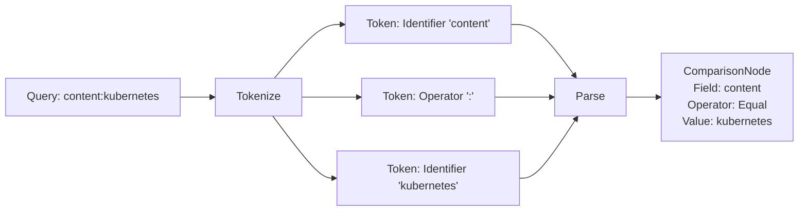
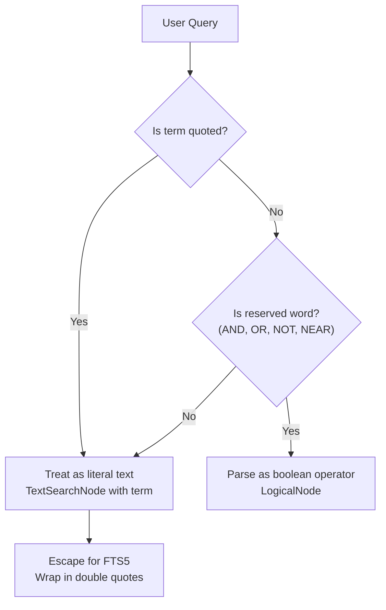
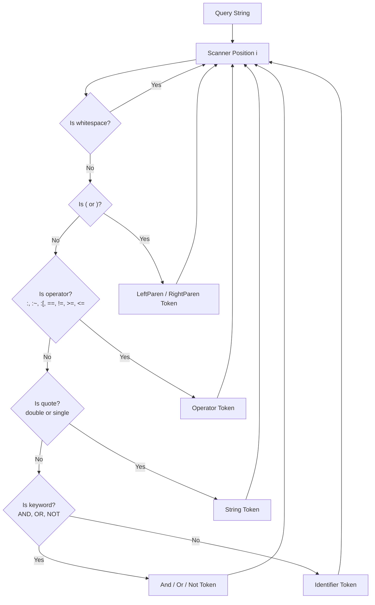
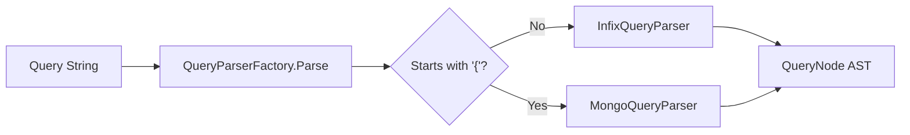
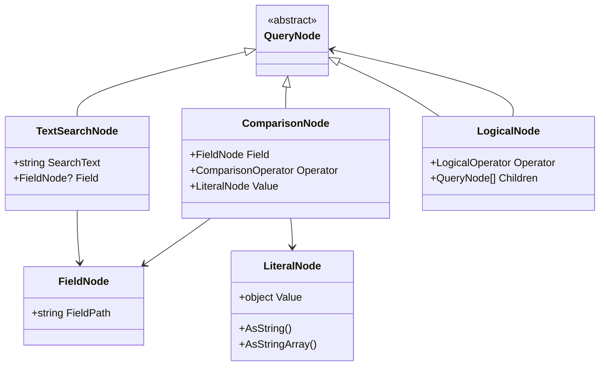
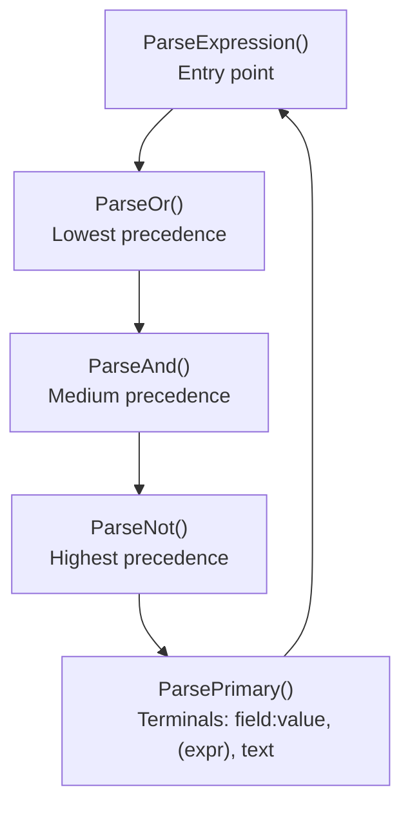
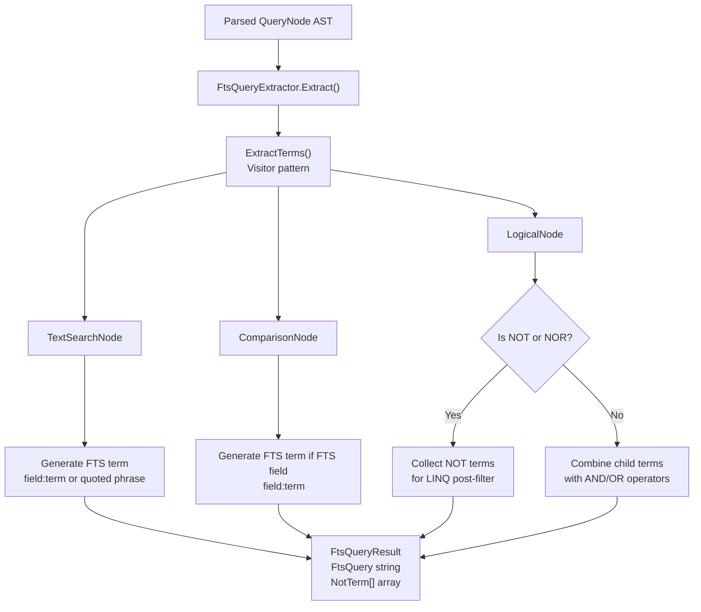
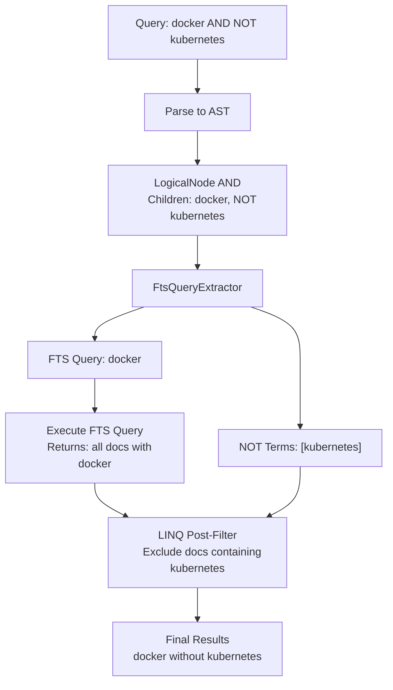
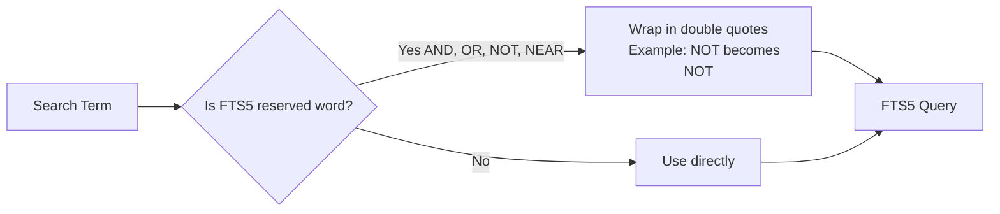

<!-- source: DeepWiki mcp.deepwiki.com · repo microsoft/kernel-memory · page 5.2 Query Syntax and Parsing · fetched 2026-10-26 -->

# Query Syntax and Parsing

<details>
<summary>Relevant source files</summary>

The following files were used as context for generating this wiki page:

- [KNOWN-ISSUES.md](KNOWN-ISSUES.md)
- [src/Core/Search/NodeSearchService.cs](src/Core/Search/NodeSearchService.cs)
- [src/Core/Search/Query/Parsers/InfixQueryParser.cs](src/Core/Search/Query/Parsers/InfixQueryParser.cs)
- [src/Core/Search/SearchService.cs](src/Core/Search/SearchService.cs)
- [src/Core/Search/SqliteFtsIndex.cs](src/Core/Search/SqliteFtsIndex.cs)
- [src/Main/CLI/Commands/ExamplesCommand.cs](src/Main/CLI/Commands/ExamplesCommand.cs)
- [src/Main/CLI/Commands/SearchCommand.cs](src/Main/CLI/Commands/SearchCommand.cs)
- [tests/Core.Tests/Search/FtsQueryExtractionTest.cs](tests/Core.Tests/Search/FtsQueryExtractionTest.cs)
- [tests/Core.Tests/Search/NodeSearchServiceIndexIdTests.cs](tests/Core.Tests/Search/NodeSearchServiceIndexIdTests.cs)
- [tests/Core.Tests/Search/Query/InfixQueryParserTests.cs](tests/Core.Tests/Search/Query/InfixQueryParserTests.cs)
- [tests/Core.Tests/Search/SearchEndToEndTests.cs](tests/Core.Tests/Search/SearchEndToEndTests.cs)
- [tests/Core.Tests/Search/SearchServiceIndexWeightsTests.cs](tests/Core.Tests/Search/SearchServiceIndexWeightsTests.cs)
- [tests/Main.Tests/Integration/ExamplesCommandE2ETests.cs](tests/Main.Tests/Integration/ExamplesCommandE2ETests.cs)

</details>


## Purpose and Scope

This page documents the query syntax supported by KM² and the parsing process that converts user queries into an Abstract Syntax Tree (AST) for execution. It covers two query formats (infix notation and MongoDB JSON), the tokenization and parsing process, and how parsed queries are converted to SQLite FTS5 syntax.

For information about how FTS5 executes these queries, see [SQLite FTS5 Integration](#5.3). For details on result ranking and filtering, see [Result Ranking and Filtering](#5.4). For known syntax limitations, see [Known Search Issues](#5.5).

---

## Query Format Overview

KM² supports two query syntaxes:

| Format | Description | Example |
|--------|-------------|---------|
| **Infix Notation** | SQL-like syntax with field prefixes and boolean operators | `content:kubernetes AND NOT deprecated` |
| **MongoDB JSON** | JSON query syntax inspired by MongoDB query language | `{"$and": [{"content": "kubernetes"}, {"$not": "deprecated"}]}` |

The query parser automatically detects which format is used based on whether the query string starts with `{` (JSON) or not (infix).

**Sources:** [src/Core/Search/Query/Parsers/QueryParserFactory.cs](), [tests/Core.Tests/Search/SearchEndToEndTests.cs:336-442]()

---

## Infix Notation Syntax

Infix notation is the primary query syntax, offering a concise SQL-like format for constructing queries.

### Basic Text Search

The simplest query is unqualified text, which searches across all FTS-indexed fields (title, description, content):

```
kubernetes
"machine learning"
```

When no field prefix is specified, the search applies to `{title description content}` in FTS5 syntax.

**Sources:** [tests/Core.Tests/Search/Query/InfixQueryParserTests.cs:14-24](), [src/Core/Search/NodeSearchService.cs:265-299]()

### Field-Specific Queries

Use the `:` operator to search within a specific field:

```
title:kubernetes          # Search in title field
content:docker           # Search in content field
description:api          # Search in description field
tags:production          # Search in tags field
metadata.author:John     # Search in metadata field
```

Field names are case-insensitive and normalized to lowercase during parsing.

**Diagram: Field Query Parsing Flow**



**Sources:** [src/Core/Search/Query/Parsers/InfixQueryParser.cs:327-375](), [tests/Core.Tests/Search/Query/InfixQueryParserTests.cs:36-44]()

### Comparison Operators

Beyond equality (`:` or `==`), queries support additional comparison operators:

| Operator | Meaning | Example |
|----------|---------|---------|
| `:` or `==` | Equal (FTS match for text fields) | `tags:AI` |
| `!=` | Not equal | `mimeType!=image/png` |
| `>=` | Greater than or equal | `createdAt>=2024-01-01` |
| `<=` | Less than or equal | `createdAt<=2024-12-31` |
| `>` | Greater than | `createdAt>2024-01-01` |
| `<` | Less than | `createdAt<2024-02-01` |
| `:~` | Contains | `content:~"machine learning"` |
| `:[...]` | In array | `tags:[AI,ML,research]` |

**Note:** For FTS fields (title, description, content), the `:` operator uses FTS semantics (substring match with stemming), not exact equality.

**Sources:** [src/Core/Search/Query/Parsers/InfixQueryParser.cs:391-405](), [tests/Core.Tests/Search/Query/InfixQueryParserTests.cs:47-114]()

### Boolean Operators

Combine queries using `AND`, `OR`, and `NOT` operators (case-insensitive):

```
kubernetes AND docker                    # Both terms must match
python OR javascript                     # Either term must match
kubernetes AND NOT deprecated            # Must have kubernetes, must not have deprecated
```

**Operator Precedence** (highest to lowest):
1. `NOT` (unary prefix)
2. `AND`
3. `OR`

Use parentheses to override precedence:

```
vacation AND (beach OR mountain)
(title:api OR description:api) AND content:rest
```

**Important:** The `NOT` operator requires an `AND` before it. Queries like `foo NOT bar` are invalid; use `foo AND NOT bar` instead.

**Sources:** [src/Core/Search/Query/Parsers/InfixQueryParser.cs:270-303](), [tests/Core.Tests/Search/Query/InfixQueryParserTests.cs:128-184](), [KNOWN-ISSUES.md:30-35]()

### Quoted Strings and Phrases

Enclose text in double or single quotes to:
- Preserve spaces in phrases: `"machine learning"`
- Search for reserved words literally: `"NOT"`, `"AND"`, `"OR"`
- Include special characters: `"user:password"`

```
"machine learning"                # Phrase search
"Alice AND Bob"                   # Literal phrase with reserved word
content:"kubernetes deployment"   # Field-specific phrase
```

**Diagram: Reserved Word Handling in Queries**



**Sources:** [src/Core/Search/Query/Parsers/InfixQueryParser.cs:164-181](), [tests/Core.Tests/Search/Query/InfixQueryParserTests.cs:349-486](), [src/Core/Search/NodeSearchService.cs:238-241]()

### Tokenization Process

**Diagram: InfixQueryParser Tokenization**



**Sources:** [src/Core/Search/Query/Parsers/InfixQueryParser.cs:67-216]()

---

## MongoDB JSON Syntax

MongoDB JSON syntax provides an alternative query format using JSON objects. This format is automatically detected when the query string starts with `{`.

### Field Queries

Simple field equality uses object notation:

```json
{"content": "kubernetes"}
{"title": "api"}
{"metadata.author": "John"}
```

This is equivalent to infix notation `content:kubernetes`, `title:api`, and `metadata.author:John`.

**Sources:** [tests/Core.Tests/Search/SearchEndToEndTests.cs:338-352]()

### Boolean Operators

MongoDB JSON uses operator prefixes (`$and`, `$or`, `$not`, `$nor`):

```json
{"$and": [{"content": "docker"}, {"content": "kubernetes"}]}
{"$or": [{"content": "python"}, {"content": "javascript"}]}
{"$not": {"content": "deprecated"}}
{"$nor": [{"content": "alpha"}, {"content": "beta"}]}
```

Operators can be nested:

```json
{
  "$and": [
    {"title": "api"},
    {
      "$or": [
        {"content": "rest"},
        {"content": "graphql"}
      ]
    }
  ]
}
```

**Sources:** [tests/Core.Tests/Search/SearchEndToEndTests.cs:355-387](), [src/Main/CLI/Commands/ExamplesCommand.cs:164-177]()

### Text Search Operator

Use `$text` with `$search` for full-text search across all fields:

```json
{"$text": {"$search": "full text query"}}
```

This is equivalent to unqualified infix notation `"full text query"`.

**Sources:** [tests/Core.Tests/Search/SearchEndToEndTests.cs:389-402](), [src/Main/CLI/Commands/ExamplesCommand.cs:168-170]()

### Equivalence with Infix

The two formats are semantically equivalent and produce identical AST structures:

| Infix | MongoDB JSON |
|-------|--------------|
| `kubernetes OR docker` | `{"$or": [{"content": "kubernetes"}, {"content": "docker"}]}` |
| `docker AND kubernetes` | `{"$and": [{"content": "docker"}, {"content": "kubernetes"}]}` |
| `title:api AND content:rest` | `{"$and": [{"title": "api"}, {"content": "rest"}]}` |

**Sources:** [tests/Core.Tests/Search/SearchEndToEndTests.cs:465-503]()

---

## Parsing Architecture

### QueryParserFactory

`QueryParserFactory` selects the appropriate parser based on query format:



**Sources:** [src/Core/Search/Query/Parsers/QueryParserFactory.cs]()

### AST Structure

All parsers produce an Abstract Syntax Tree using these node types:



**Node Type Descriptions:**

| Node Type | Purpose | Example Query | AST Representation |
|-----------|---------|---------------|-------------------|
| `TextSearchNode` | Unqualified text search | `kubernetes` | `SearchText="kubernetes", Field=null` |
| `ComparisonNode` | Field comparison | `content:docker` | `Field="content", Operator=Equal, Value="docker"` |
| `LogicalNode` | Boolean operations | `A AND B` | `Operator=And, Children=[NodeA, NodeB]` |

**Sources:** [src/Core/Search/Query/Ast/](), [tests/Core.Tests/Search/Query/InfixQueryParserTests.cs:14-44]()

### InfixQueryParser Implementation

`InfixQueryParser` uses recursive descent parsing with operator precedence:

**Diagram: Recursive Descent Parsing**



**Parsing Methods:**

- `ParseExpression()` - Entry point, delegates to `ParseOr()`
- `ParseOr()` - Handles OR operators (lowest precedence)
- `ParseAnd()` - Handles AND operators (medium precedence)
- `ParseNot()` - Handles NOT operators (highest precedence)
- `ParsePrimary()` - Handles terminals (field:value, quoted strings, parentheses)

**Sources:** [src/Core/Search/Query/Parsers/InfixQueryParser.cs:237-411](), [tests/Core.Tests/Search/Query/InfixQueryParserTests.cs:166-251]()

---

## FTS Query Extraction

After parsing into an AST, the query must be converted to SQLite FTS5 syntax. This process is handled by the `FtsQueryExtractor` visitor in `NodeSearchService`.

### Conversion Flow

**Diagram: AST to FTS5 Query Conversion**



**Sources:** [src/Core/Search/NodeSearchService.cs:213-222](), [src/Core/Search/NodeSearchService.cs:230-457]()

### Field Prefix Handling

Different query patterns generate different FTS5 syntax:

| Query Pattern | FTS5 Output | Notes |
|--------------|-------------|-------|
| `kubernetes` | `{title description content}:kubernetes` | Searches all FTS fields |
| `content:kubernetes` | `content:kubernetes` | Field-specific search |
| `title:docker` | `title:docker` | Field-specific search |
| `"machine learning"` | `"machine learning"` | Phrase search (no field prefix) |
| `content:"user:password"` | `"user:password"` | Quoted phrase (field prefix omitted) |

**Important:** FTS5 does not support field prefixes with quoted phrases (`content:"phrase"` is invalid). When a phrase is detected, the field prefix is omitted and the search applies to all fields.

**Sources:** [src/Core/Search/NodeSearchService.cs:265-299](), [KNOWN-ISSUES.md:5-25]()

### NOT Term Collection

SQLite FTS5 has limited NOT support (requires a left operand). To handle standalone NOT queries and complex NOT expressions, NOT terms are collected separately and applied via LINQ post-filtering:



**Key Logic:**

1. Positive terms (AND, OR, text) → FTS query string
2. NOT/NOR terms → `NotTerm[]` array for LINQ filtering
3. FTS returns initial results
4. LINQ filters out documents containing NOT terms

**Sources:** [src/Core/Search/NodeSearchService.cs:11-26](), [src/Core/Search/NodeSearchService.cs:303-377](), [src/Core/Search/NodeSearchService.cs:145-211]()

### Reserved Word Handling

FTS5 reserved words (AND, OR, NOT, NEAR) must be quoted when searched literally:



**Implementation Details:**

- Reserved words detected: `AND`, `OR`, `NOT`, `NEAR` (case-insensitive)
- When detected, term is wrapped in double quotes: `"NOT"`
- Field prefixes cannot be used with quoted terms (FTS5 limitation)
- Phrase searches automatically wrap in quotes

**Sources:** [src/Core/Search/NodeSearchService.cs:232-241](), [src/Core/Search/NodeSearchService.cs:278-285](), [tests/Core.Tests/Search/FtsQueryExtractionTest.cs:96-255]()

---

## Known Limitations

### Field Queries with Quoted Values

**Issue:** Field-specific queries with quoted values containing special characters fail with SQLite FTS5 errors.

```bash
km put "user:password format"
km search 'content:"user:password"'  # FAILS: SQLite error "unknown special query"
```

**Workaround:** Search without field prefix or without quotes.

**Root Cause:** FTS5 does not support field prefixes with quoted phrases (`field:"value"` is invalid syntax).

**Sources:** [KNOWN-ISSUES.md:5-25](), [tests/Main.Tests/Integration/ExamplesCommandE2ETests.cs:218-221]()

### NOT Operator Requirements

**Issue:** NOT operator must be preceded by AND. Queries like `foo NOT bar` are ignored.

```bash
km search "kubernetes NOT deprecated"   # INCORRECT - NOT ignored
km search "kubernetes AND NOT deprecated"  # CORRECT
```

**Workaround:** Always use explicit AND before NOT: `(foo OR baz) AND NOT bar`

**Sources:** [KNOWN-ISSUES.md:30-35]()

### Wildcard and Prefix Searches

**Issue:** FTS5 prefix search (`*`) and wildcards are not currently exposed in the query syntax.

**Status:** Not implemented in query parser. FTS5 supports these features, but the parser does not yet generate them.

---

## Query Validation

The search service provides a validation method to check query syntax without execution:

```bash
km search --validate "title:api AND (content:rest OR content:graphql)"
```

**Validation Process:**

1. Attempt to parse query using `QueryParserFactory`
2. If parsing succeeds → return `IsValid=true`
3. If `QuerySyntaxException` thrown → return `IsValid=false` with error details
4. Return list of available fields for reference

**Sources:** [src/Core/Search/SearchService.cs:109-148](), [src/Main/CLI/Commands/SearchCommand.cs:207-259]()

---

