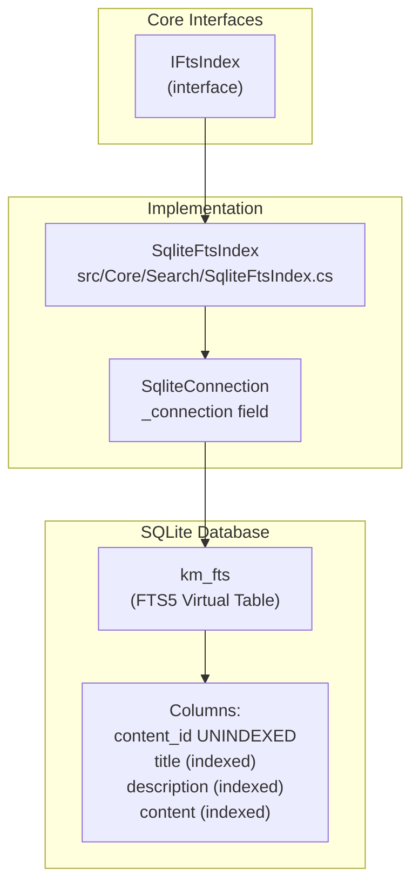
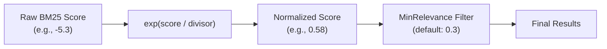
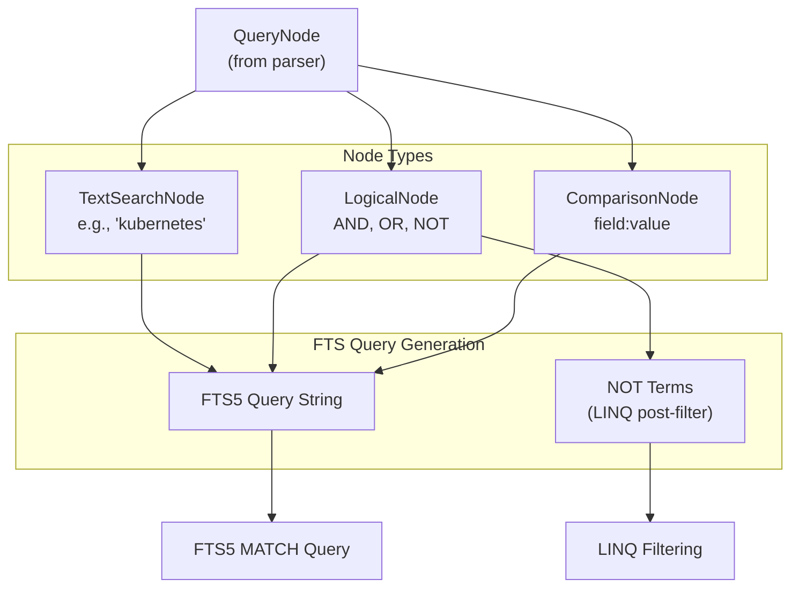
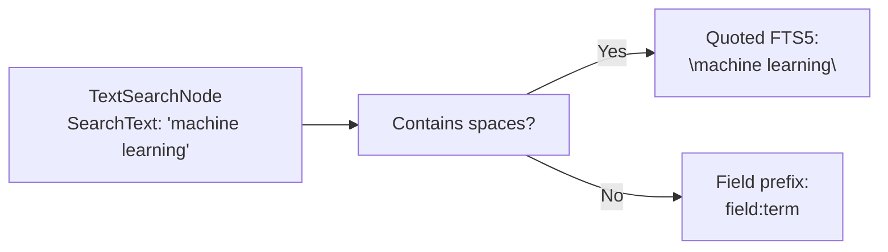
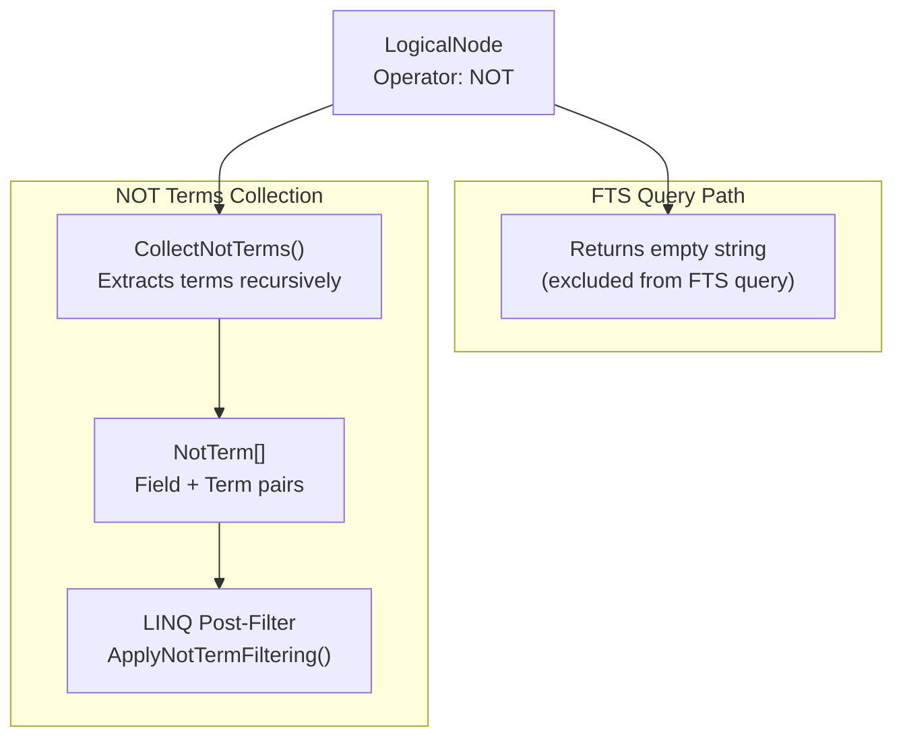
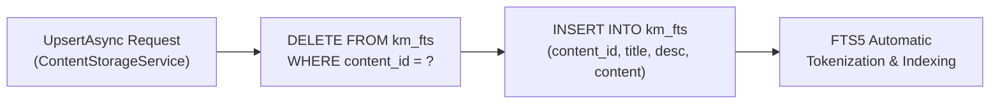
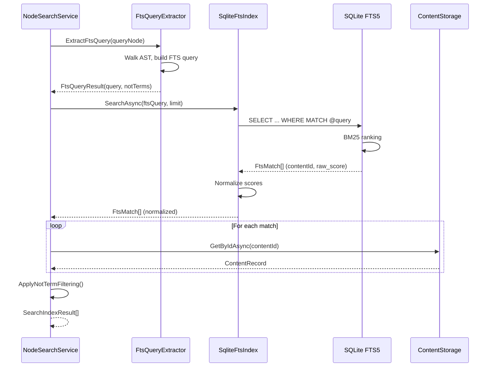
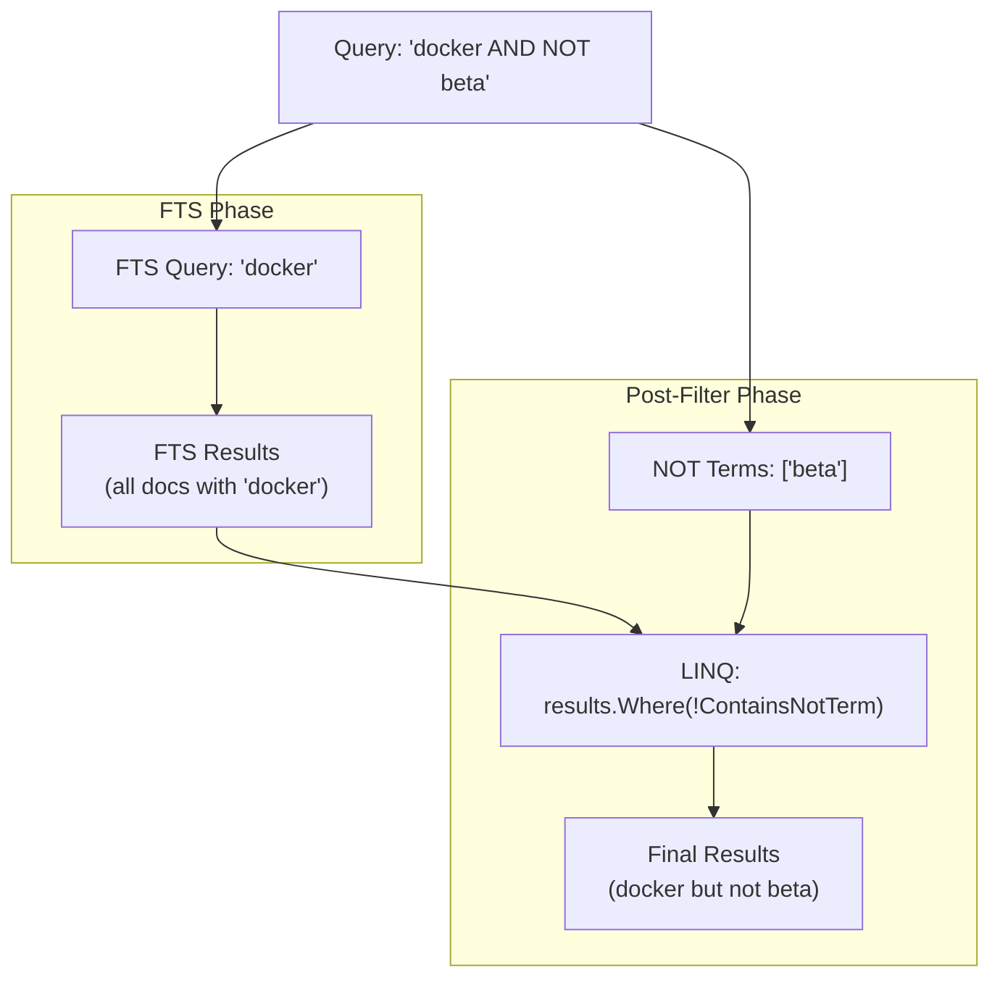
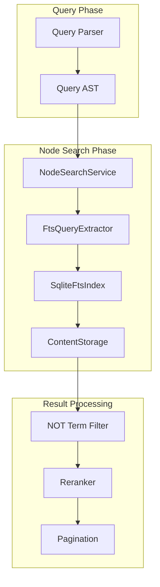

<!-- source: DeepWiki mcp.deepwiki.com · repo microsoft/kernel-memory · page 5.3 SQLite FTS5 Integration · fetched 2026-10-26 -->

# SQLite FTS5 Integration

<details>
<summary>Relevant source files</summary>

The following files were used as context for generating this wiki page:

- [KNOWN-ISSUES.md](KNOWN-ISSUES.md)
- [src/Core/Search/NodeSearchService.cs](src/Core/Search/NodeSearchService.cs)
- [src/Core/Search/Query/Parsers/InfixQueryParser.cs](src/Core/Search/Query/Parsers/InfixQueryParser.cs)
- [src/Core/Search/SearchService.cs](src/Core/Search/SearchService.cs)
- [src/Core/Search/SqliteFtsIndex.cs](src/Core/Search/SqliteFtsIndex.cs)
- [src/Main/CLI/Commands/ExamplesCommand.cs](src/Main/CLI/Commands/ExamplesCommand.cs)
- [src/Main/CLI/Commands/SearchCommand.cs](src/Main/CLI/Commands/SearchCommand.cs)
- [tests/Core.Tests/Search/FtsQueryExtractionTest.cs](tests/Core.Tests/Search/FtsQueryExtractionTest.cs)
- [tests/Core.Tests/Search/NodeSearchServiceIndexIdTests.cs](tests/Core.Tests/Search/NodeSearchServiceIndexIdTests.cs)
- [tests/Core.Tests/Search/Query/InfixQueryParserTests.cs](tests/Core.Tests/Search/Query/InfixQueryParserTests.cs)
- [tests/Core.Tests/Search/SearchEndToEndTests.cs](tests/Core.Tests/Search/SearchEndToEndTests.cs)
- [tests/Core.Tests/Search/SearchServiceIndexWeightsTests.cs](tests/Core.Tests/Search/SearchServiceIndexWeightsTests.cs)
- [tests/Main.Tests/Integration/ExamplesCommandE2ETests.cs](tests/Main.Tests/Integration/ExamplesCommandE2ETests.cs)

</details>


## Purpose and Scope

This page documents how Kernel Memory uses SQLite's FTS5 (Full-Text Search version 5) extension to provide fast, ranked full-text search across indexed content. The FTS5 integration handles query translation from the parsed AST to SQLite's FTS5 syntax, executes searches using BM25 ranking, and returns normalized relevance scores.

For information about query parsing and AST construction, see [Query Syntax and Parsing](#5.2). For details on result ranking and filtering after FTS5 returns results, see [Result Ranking and Filtering](#5.4).

---

## FTS5 Index Architecture

### SqliteFtsIndex Class

The `SqliteFtsIndex` class ([src/Core/Search/SqliteFtsIndex.cs:11-319]()) implements the `IFtsIndex` interface and provides the primary abstraction over SQLite's FTS5 functionality. It maintains a persistent connection to a SQLite database file and manages a single FTS5 virtual table.



Sources: [src/Core/Search/SqliteFtsIndex.cs:11-78]()

### Table Schema

The FTS5 table `km_fts` uses a multi-field schema that enables field-specific searches:

| Column | Indexed | Purpose |
|--------|---------|---------|
| `content_id` | No (UNINDEXED) | References the content storage record |
| `title` | Yes | Indexed for searches like `title:kubernetes` |
| `description` | Yes | Indexed for searches like `description:api` |
| `content` | Yes | Main content body, searched by default |

The table is created with this SQL ([src/Core/Search/SqliteFtsIndex.cs:60-68]()):

```sql
CREATE VIRTUAL TABLE IF NOT EXISTS km_fts USING fts5(
    content_id UNINDEXED,
    title,
    description,
    content,
    tokenize='porter unicode61'
);
```

Sources: [src/Core/Search/SqliteFtsIndex.cs:55-78]()

### Tokenization Configuration

The FTS5 index supports two tokenization modes controlled by the `enableStemming` parameter:

- **With stemming** (default): `tokenize='porter unicode61'` - Uses Porter stemmer for word normalization (e.g., "summaries" matches "summary")
- **Without stemming**: `tokenize='unicode61'` - Exact word matching only

Stemming is critical for natural language search as it allows queries like `content:summaries` to match documents containing "summary" ([tests/Core.Tests/Search/SearchEndToEndTests.cs:249-263]()).

Sources: [src/Core/Search/SqliteFtsIndex.cs:59](), [tests/Core.Tests/Search/SearchEndToEndTests.cs:249-263]()

---

## BM25 Scoring and Normalization

### BM25 Algorithm

SQLite FTS5 uses the BM25 (Best Matching 25) algorithm for relevance ranking. BM25 returns negative scores where more negative values indicate better matches. The `bm25()` function is called in the FTS5 query ([src/Core/Search/SqliteFtsIndex.cs:164-173]()):

```sql
SELECT
    content_id,
    bm25(km_fts) as raw_score,
    snippet(km_fts, 3, '', '', '...', 32) as snippet
FROM km_fts
WHERE km_fts MATCH @query
ORDER BY raw_score
LIMIT @limit
```

### Score Normalization

Raw BM25 scores (typically in range [-10, 0]) are exponentially normalized to [0, 1] using the formula ([src/Core/Search/SqliteFtsIndex.cs:199-211]()):

```
normalized_score = exp(raw_score / divisor)
```

Where `divisor` is defined as `Constants.SearchDefaults.Bm25NormalizationDivisor`. This produces:
- Raw score -10 → ~0.37
- Raw score -5 → ~0.61
- Raw score -1 → ~0.90
- Raw score 0 → 1.0

This normalization is critical because search requests default to `MinRelevance=0.3`, and without normalization, BM25's tiny raw scores would be filtered out entirely ([tests/Core.Tests/Search/SearchEndToEndTests.cs:570-588]()).



Sources: [src/Core/Search/SqliteFtsIndex.cs:199-211](), [tests/Core.Tests/Search/SearchEndToEndTests.cs:302-315]()

---

## Query Translation from AST to FTS5

### FtsQueryExtractor

The `FtsQueryExtractor` class ([src/Core/Search/NodeSearchService.cs:230-457]()) converts parsed query AST nodes into SQLite FTS5 query syntax. It handles three main node types:



Sources: [src/Core/Search/NodeSearchService.cs:213-222]()

### Field-Specific Query Syntax

For single-word searches with field specifications, FTS5 uses the `field:term` syntax without quotes:

| Query AST | FTS5 Output | Example |
|-----------|-------------|---------|
| `content:kubernetes` | `content:kubernetes` | Searches only content field |
| `title:api` | `title:api` | Searches only title field |
| Default search | `{title description content}:term` | Searches all FTS fields |

**Important**: FTS5 does NOT support quoted terms after field prefix. The pattern `content:"value"` is invalid and will cause SQLite errors ([KNOWN-ISSUES.md:19-23]()).

Sources: [src/Core/Search/NodeSearchService.cs:287-299](), [KNOWN-ISSUES.md:5-25]()

### Phrase Search Translation

Phrase searches (containing spaces) are translated to FTS5 quoted strings:



The `EscapeFtsPhrase` method ([src/Core/Search/NodeSearchService.cs:441-444]()) escapes internal quotes by doubling them (FTS5 syntax):

```
Input: user:password format
Output: "user:password format"  (quotes escaped to "")
```

Sources: [src/Core/Search/NodeSearchService.cs:265-299]()

### Reserved Words Handling

SQLite FTS5 reserves keywords AND, OR, NOT, NEAR. When these appear as search terms (not operators), they must be quoted ([src/Core/Search/NodeSearchService.cs:238-241]()):

| Input Query | FTS5 Query | Result |
|-------------|------------|--------|
| `"NOT"` | `"NOT"` | Finds literal word "NOT" |
| `"Alice AND Bob"` | `"Alice AND Bob"` | Finds exact phrase |
| `NOT important` | (collected for LINQ filter) | Boolean NOT operator |

The `IsFts5ReservedWord` method checks against a predefined set ([src/Core/Search/NodeSearchService.cs:238-241](), [src/Core/Search/NodeSearchService.cs:432-435]()):

```csharp
private static readonly HashSet<string> s_fts5ReservedWords = new(StringComparer.OrdinalIgnoreCase)
{
    "AND", "OR", "NOT", "NEAR"
};
```

Sources: [src/Core/Search/NodeSearchService.cs:238-241](), [src/Core/Search/NodeSearchService.cs:432-435](), [tests/Core.Tests/Search/Query/InfixQueryParserTests.cs:349-426]()

### Boolean Operators Translation

| AST Operator | FTS5 Translation | Example |
|--------------|------------------|---------|
| LogicalOperator.And | `(term1) AND (term2)` | docker AND kubernetes |
| LogicalOperator.Or | `(term1) OR (term2)` | python OR javascript |
| LogicalOperator.Not | (empty string) | Collected for LINQ post-filtering |

The NOT operator is handled specially ([src/Core/Search/NodeSearchService.cs:301-327]()): terms within NOT nodes are extracted and stored in the `NotTerm[]` array for LINQ-based post-filtering, because FTS5's NOT support is limited.



Sources: [src/Core/Search/NodeSearchService.cs:301-377]()

---

## Indexing Operations

### Index Initialization

The `InitializeAsync` method ensures the database and FTS5 table exist before any operations ([src/Core/Search/SqliteFtsIndex.cs:37-78]()):

1. Opens SQLite connection
2. Sets `PRAGMA synchronous=FULL` to ensure immediate disk writes (critical for CLI scenarios)
3. Creates FTS5 virtual table if not exists
4. Configures tokenizer based on `enableStemming`

Sources: [src/Core/Search/SqliteFtsIndex.cs:37-78]()

### Document Indexing

The `IndexAsync` method ([src/Core/Search/SqliteFtsIndex.cs:96-119]()) implements upsert semantics:

1. Remove existing entry for the `contentId` (if any)
2. Insert new entry with separate fields:
   - `content_id`: Reference to content storage (UNINDEXED)
   - `title`: Optional, empty string if null
   - `description`: Optional, empty string if null
   - `content`: Required main content



Sources: [src/Core/Search/SqliteFtsIndex.cs:96-119]()

### Index Removal

The `RemoveAsync` method ([src/Core/Search/SqliteFtsIndex.cs:122-140]()) deletes entries by `contentId`:

```sql
DELETE FROM km_fts WHERE content_id = @contentId
```

This is automatically called before re-indexing to ensure clean upsert semantics.

Sources: [src/Core/Search/SqliteFtsIndex.cs:122-140]()

---

## Search Operations

### Query Execution Flow



Sources: [src/Core/Search/NodeSearchService.cs:66-143]()

### Snippet Generation

FTS5's `snippet()` function generates highlighted text excerpts ([src/Core/Search/SqliteFtsIndex.cs:164-173]()):

```sql
snippet(km_fts, 3, '', '', '...', 32) as snippet
```

Parameters:
- Column `3` = content field (0-based: 0=content_id, 1=title, 2=description, 3=content)
- Start marker: `''` (empty)
- End marker: `''` (empty)
- Ellipsis: `'...'`
- Max tokens: `32`

The snippet provides context around matching terms without loading full content.

Sources: [src/Core/Search/SqliteFtsIndex.cs:164-173]()

### Match-All Query Handling

For standalone NOT queries (e.g., `NOT deprecated`), the system needs all documents for LINQ filtering. The special query `"*"` retrieves all documents ([src/Core/Search/SqliteFtsIndex.cs:152-158](), [src/Core/Search/SqliteFtsIndex.cs:227-262]()):

```sql
SELECT content_id, substr(content, 1, 200) as snippet 
FROM km_fts 
LIMIT @limit
```

All results get default score `1.0` since no FTS matching occurred.

Sources: [src/Core/Search/SqliteFtsIndex.cs:152-158](), [src/Core/Search/SqliteFtsIndex.cs:227-262]()

---

## NOT Operator Post-Filtering

### Why LINQ Post-Filtering?

SQLite FTS5's NOT operator requires a left operand (e.g., `term1 NOT term2`). Standalone NOT queries like `NOT deprecated` are not supported. To work around this limitation, the system ([src/Core/Search/NodeSearchService.cs:10-26]()):

1. Extracts NOT terms during FTS query generation
2. Executes FTS query with only positive terms (or `*` if none)
3. Applies LINQ filtering to exclude documents containing NOT terms



Sources: [src/Core/Search/NodeSearchService.cs:10-26]()

### NOT Term Filtering Implementation

The `ApplyNotTermFiltering` method ([src/Core/Search/NodeSearchService.cs:146-211]()) checks each result against NOT terms:

1. For field-specific NOT terms (e.g., `NOT title:deprecated`), check only that field
2. For general NOT terms (e.g., `NOT beta`), check all FTS fields (title, description, content)
3. Exclude any document that contains any NOT term (case-insensitive)

| NOT Term | Field | Matches Against |
|----------|-------|-----------------|
| `NotTerm("beta", null)` | All fields | title, description, content |
| `NotTerm("alpha", "title")` | Title only | title |
| `NotTerm("deprecated", "content")` | Content only | content |

Sources: [src/Core/Search/NodeSearchService.cs:146-211]()

---

## Known Limitations and Issues

### Issue 1: Field Queries with Quoted Values

**Status**: Known bug ([KNOWN-ISSUES.md:5-25]())

Field-specific queries with quoted values containing special characters fail:

```bash
# This FAILS with "unknown special query" error
km search 'content:"user:password"'
```

**Root Cause**: FTS5 does not support the syntax `field:"quoted value"`. The query extractor attempts to generate this, causing SQLite errors.

**Workaround**: 
- Search without field prefix: `km search "user:password"`
- Search without quotes: `km search content:userpassword` (single word only)

Sources: [KNOWN-ISSUES.md:5-25]()

### Issue 2: NOT Operator Limitations

**Status**: By design ([KNOWN-ISSUES.md:28-35]())

The infix query parser requires explicit AND before NOT:

```bash
# INCORRECT - NOT is ignored
km search "foo NOT bar"

# CORRECT - explicit AND operator
km search "foo AND NOT bar"
```

This is a parser precedence issue, not an FTS5 limitation. The parser treats `foo NOT bar` as two separate terms rather than a boolean expression.

Sources: [KNOWN-ISSUES.md:28-35]()

### FTS5 Synchronization

The `PRAGMA synchronous=FULL` setting ([src/Core/Search/SqliteFtsIndex.cs:47-53]()) ensures writes are immediately persisted to disk. This is critical for CLI scenarios where the process may exit immediately after writing, but it reduces write performance. Long-running services may benefit from relaxed synchronization modes.

Sources: [src/Core/Search/SqliteFtsIndex.cs:47-53]()

---

## Integration with Search Pipeline

The FTS5 index is one component in the larger search pipeline:



The FTS5 integration provides:
- Fast initial candidate retrieval via BM25
- Field-specific search capability
- Stemming for natural language queries
- Baseline relevance scores for reranking

For details on how these scores are combined with index weights and node weights, see [Result Ranking and Filtering](#5.4).

Sources: [src/Core/Search/NodeSearchService.cs:33-143](), [src/Core/Search/SearchService.cs:43-106]()

---

