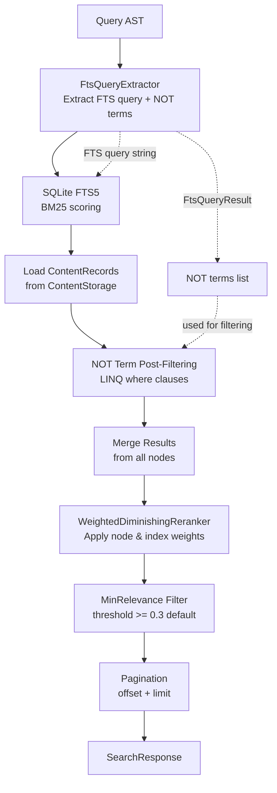
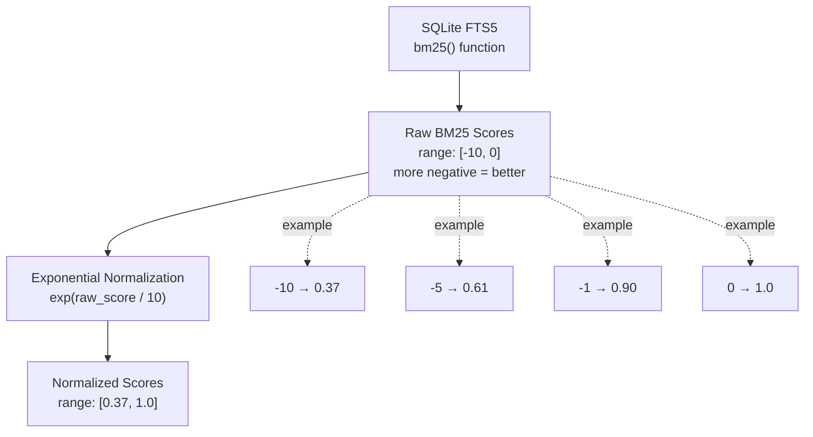
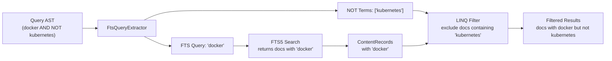
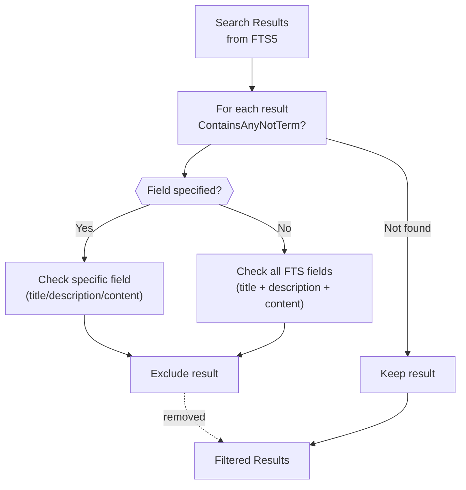
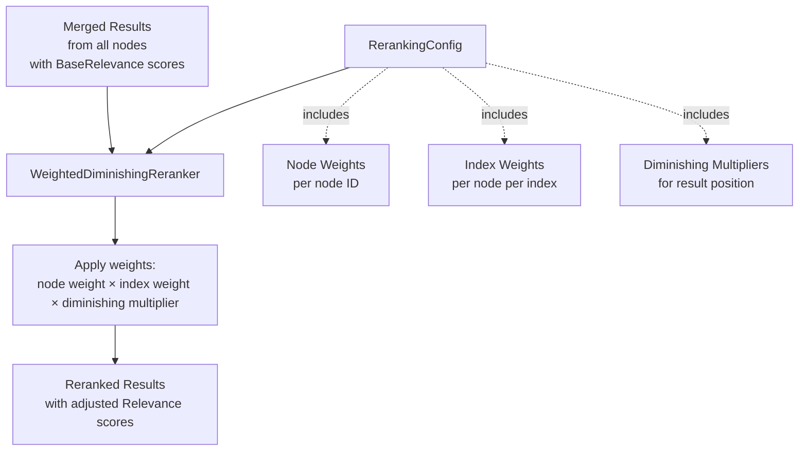
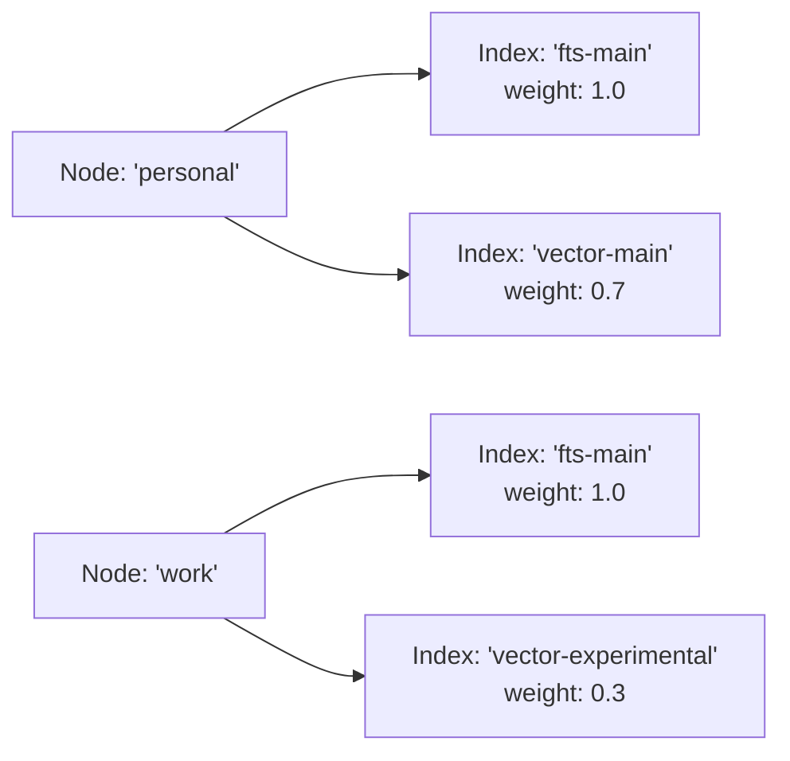
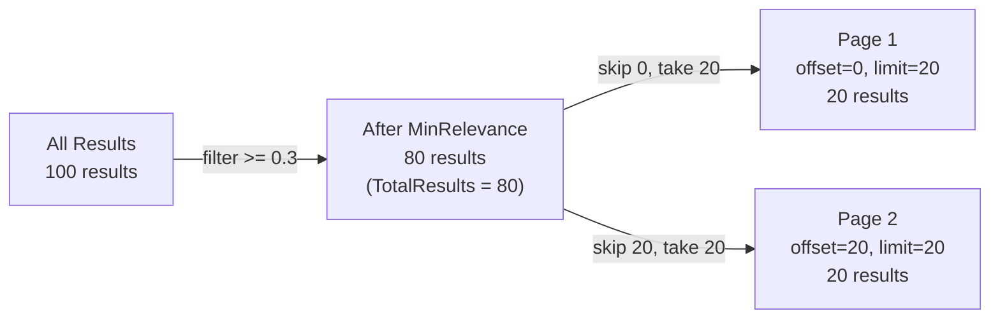
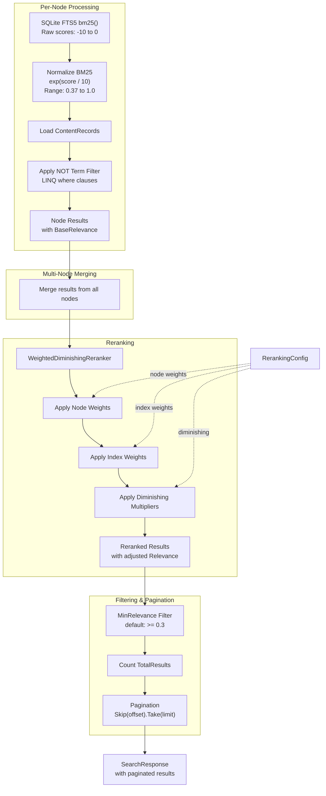

<!-- source: DeepWiki mcp.deepwiki.com · repo microsoft/kernel-memory · page 5.4 Result Ranking and Filtering · fetched 2026-10-26 -->

# Result Ranking and Filtering

<details>
<summary>Relevant source files</summary>

The following files were used as context for generating this wiki page:

- [KNOWN-ISSUES.md](KNOWN-ISSUES.md)
- [src/Core/Search/NodeSearchService.cs](src/Core/Search/NodeSearchService.cs)
- [src/Core/Search/Query/Parsers/InfixQueryParser.cs](src/Core/Search/Query/Parsers/InfixQueryParser.cs)
- [src/Core/Search/SearchService.cs](src/Core/Search/SearchService.cs)
- [src/Core/Search/SqliteFtsIndex.cs](src/Core/Search/SqliteFtsIndex.cs)
- [src/Main/CLI/Commands/ExamplesCommand.cs](src/Main/CLI/Commands/ExamplesCommand.cs)
- [src/Main/CLI/Commands/SearchCommand.cs](src/Main/CLI/Commands/SearchCommand.cs)
- [tests/Core.Tests/Search/FtsQueryExtractionTest.cs](tests/Core.Tests/Search/FtsQueryExtractionTest.cs)
- [tests/Core.Tests/Search/NodeSearchServiceIndexIdTests.cs](tests/Core.Tests/Search/NodeSearchServiceIndexIdTests.cs)
- [tests/Core.Tests/Search/Query/InfixQueryParserTests.cs](tests/Core.Tests/Search/Query/InfixQueryParserTests.cs)
- [tests/Core.Tests/Search/SearchEndToEndTests.cs](tests/Core.Tests/Search/SearchEndToEndTests.cs)
- [tests/Core.Tests/Search/SearchServiceIndexWeightsTests.cs](tests/Core.Tests/Search/SearchServiceIndexWeightsTests.cs)
- [tests/Main.Tests/Integration/ExamplesCommandE2ETests.cs](tests/Main.Tests/Integration/ExamplesCommandE2ETests.cs)

</details>


## Purpose and Scope

This document describes how search results are scored, ranked, filtered, and paginated after full-text search execution. It covers the complete pipeline from raw BM25 scores to the final ordered, filtered, and paginated results returned to users.

For information about query parsing and FTS query generation, see [Query Syntax and Parsing](#5.2). For SQLite FTS5 integration details, see [SQLite FTS5 Integration](#5.3). For the overall search architecture, see [Search Architecture](#5.1).

---

## Search Result Processing Pipeline

The result processing pipeline consists of five distinct stages that transform raw FTS matches into ranked, filtered, and paginated results:

**Pipeline: Raw FTS Results → Filtered Results → Ranked Results → Relevance-Filtered Results → Paginated Results**



**Sources:** [src/Core/Search/SearchService.cs:43-105](), [src/Core/Search/NodeSearchService.cs:66-143]()

---

## BM25 Scoring and Normalization

### Initial Scoring with SQLite FTS5

Search results are initially scored using SQLite FTS5's `bm25()` ranking function. BM25 (Best Matching 25) is a probabilistic relevance ranking function that considers term frequency, document frequency, and document length.

The `SqliteFtsIndex` executes FTS queries and retrieves raw BM25 scores:



**Sources:** [src/Core/Search/SqliteFtsIndex.cs:161-216]()

### Normalization Formula

BM25 returns negative scores where more negative values indicate better matches. These scores are normalized to a 0-1 range using exponential normalization:

**Formula:** `normalized_score = exp(raw_bm25_score / 10.0)`

This transformation maps typical BM25 scores to intuitive relevance values:
- `-10` (weak match) → `0.37`
- `-5` (moderate match) → `0.61`
- `-1` (strong match) → `0.90`
- `0` (exact match) → `1.0`

The divisor constant `10.0` is defined in `Constants.SearchDefaults.Bm25NormalizationDivisor`.

**Sources:** [src/Core/Search/SqliteFtsIndex.cs:199-211]()

### Critical Bug Fix: BM25 Normalization

Prior to normalization implementation, BM25 scores of ~0.000001 were being filtered out by the default `MinRelevance = 0.3` threshold, causing all search results to be discarded. This was a critical bug that prevented the search system from returning any results.

The normalization fix ensures scores are properly scaled to the 0-1 range before relevance filtering.

**Sources:** [tests/Core.Tests/Search/SearchEndToEndTests.cs:570-588](), [tests/Main.Tests/Integration/ExamplesCommandE2ETests.cs:365-382]()

---

## NOT Term Post-Filtering

### Why NOT Terms Are Filtered Separately

SQLite FTS5 has limited support for NOT operators. FTS5 requires NOT operators to have a left operand (e.g., `A AND NOT B` is valid, but `NOT B` alone is not). This limitation makes it difficult to reliably handle NOT terms within the FTS query syntax.

To work around this, the system uses a two-phase approach:

1. **FTS Query Extraction:** Positive terms are extracted into an FTS query; NOT terms are collected separately
2. **LINQ Post-Filtering:** After FTS returns results, NOT terms are applied via LINQ filtering on full ContentRecords



**Sources:** [src/Core/Search/NodeSearchService.cs:10-26](), [src/Core/Search/NodeSearchService.cs:303-377]()

### NOT Term Data Structures

The `FtsQueryResult` record encapsulates both the FTS query string and the list of NOT terms:

| Field | Type | Description |
|-------|------|-------------|
| `FtsQuery` | `string` | FTS5 query string containing positive terms only |
| `NotTerms` | `NotTerm[]` | Array of terms to exclude via LINQ post-filtering |

The `NotTerm` record represents a term to exclude:

| Field | Type | Description |
|-------|------|-------------|
| `Term` | `string` | The term to exclude |
| `Field` | `string?` | Optional field to check (title/description/content); if null, checks all fields |

**Sources:** [src/Core/Search/NodeSearchService.cs:10-26]()

### LINQ Filtering Implementation

NOT term filtering is implemented in the `ApplyNotTermFiltering` method, which uses case-insensitive substring matching:



The filtering uses `StringComparison.OrdinalIgnoreCase` for case-insensitive matching across field values.

**Sources:** [src/Core/Search/NodeSearchService.cs:145-211]()

---

## Result Reranking

### Reranking Architecture

After merging results from all nodes, the system applies a reranking algorithm to adjust relevance scores based on configurable weights. The default reranker is `WeightedDiminishingReranker`.



**Sources:** [src/Core/Search/SearchService.cs:16-18](), [src/Core/Search/SearchService.cs:73-76]()

### Reranking Configuration

The `RerankingConfig` object specifies all weight parameters:

| Configuration | Type | Default | Purpose |
|--------------|------|---------|---------|
| `NodeWeights` | `Dictionary<string, float>` | `1.0` per node | Weight multiplier per node ID |
| `IndexWeights` | `Dictionary<string, Dictionary<string, float>>` | `1.0` per index | Weight multiplier per node per index ID |
| `DiminishingMultipliers` | `float[]` | See Constants | Position-based relevance decay |

**Sources:** [src/Core/Search/Reranking/RerankingConfig.cs]() (referenced), [src/Core/Search/SearchService.cs:213-265]()

### Node Weights

Node weights allow prioritizing results from specific nodes. For example, a "work" node might have weight `1.5` while an "archive" node has weight `0.3`.

Node weights can be:
1. **Configured per-node** in the application configuration
2. **Overridden at query time** via `SearchRequest.NodeWeights`

**Sources:** [src/Core/Search/SearchService.cs:216-228]()

### Index Weights

Index weights allow prioritizing results from specific search indexes within a node. This is useful when multiple search strategies (FTS, vector search, etc.) are combined.

Index weights are configured per node in the application configuration. The default FTS index weight is `1.0`.



**Index Weight Resolution:**
1. Check if configured index weights exist for the node
2. If yes, use configured weights (with fallback to default for missing indexes)
3. If no, use default weight `1.0` for all indexes

**Sources:** [src/Core/Search/SearchService.cs:230-257](), [tests/Core.Tests/Search/SearchServiceIndexWeightsTests.cs:66-109]()

### Known Issue: Index Weights Configuration

Index weights are read from configuration during `SearchService` construction. The configuration structure expects:

```
indexWeights[nodeId][indexId] = weight_value
```

If index weights are not configured, the system falls back to `Constants.SearchDefaults.DefaultIndexWeight` (1.0).

**Sources:** [tests/Core.Tests/Search/SearchServiceIndexWeightsTests.cs]()

---

## MinRelevance Filtering

### Purpose and Default Threshold

After reranking, results are filtered to exclude low-relevance matches. The `MinRelevance` threshold determines the minimum acceptable relevance score.

| Parameter | Default Value | Range | Purpose |
|-----------|--------------|-------|---------|
| `MinRelevance` | `0.3` | `[0.0, 1.0]` | Minimum relevance score to include in results |

The default value of `0.3` was chosen to balance precision (excluding poor matches) with recall (including moderately relevant matches).

**Sources:** [src/Main/CLI/Commands/SearchCommand.cs:56-59](), [src/Core/Search/SearchService.cs:78-81]()

### Filtering Logic

The filtering is a simple threshold check:

```
filtered_results = results.Where(r => r.Relevance >= MinRelevance)
```

This filtering occurs **after** reranking but **before** pagination, ensuring that `TotalResults` reflects the count of results that meet the relevance threshold.

**Sources:** [src/Core/Search/SearchService.cs:78-81]()

### Configuring MinRelevance

Users can configure `MinRelevance` via the CLI `--min-relevance` flag:

```bash
# Return only high-confidence matches
km search "kubernetes" --min-relevance 0.7

# Include all matches (no filtering)
km search "docker" --min-relevance 0.0
```

**Sources:** [src/Main/CLI/Commands/SearchCommand.cs:56-59]()

---

## Pagination

### Pagination Parameters

Pagination is controlled by two parameters in `SearchRequest`:

| Parameter | Default | Purpose |
|-----------|---------|---------|
| `Offset` | `0` | Number of results to skip |
| `Limit` | `20` | Maximum results to return |

**Sources:** [src/Main/CLI/Commands/SearchCommand.cs:46-54]()

### Pagination Logic

Pagination is applied **after** all filtering stages:

```
paginated_results = filtered_results.Skip(Offset).Take(Limit)
```

The `TotalResults` field in `SearchResponse` reports the count **before** pagination but **after** MinRelevance filtering. This allows clients to compute total pages and show pagination UI.



**Sources:** [src/Core/Search/SearchService.cs:84-87](), [src/Core/Search/SearchService.cs:92-95]()

### CLI Usage Examples

```bash
# First page of results (1-20)
km search "kubernetes" --limit 20 --offset 0

# Second page of results (21-40)
km search "kubernetes" --limit 20 --offset 20

# Show results 51-60
km search "docker" --limit 10 --offset 50
```

**Sources:** [src/Main/CLI/Commands/ExamplesCommand.cs:125-128]()

---

## Complete Processing Pipeline

This diagram shows the complete flow from raw FTS matches to final paginated results with all intermediate transformations:



**Sources:** [src/Core/Search/SearchService.cs:43-105](), [src/Core/Search/NodeSearchService.cs:66-143]()

---

## Configuration Examples

### Setting Node Weights at Query Time

Node weights can be overridden at query time via the CLI:

```bash
# Prioritize work node, deprioritize archive
km search "project deadline" \
  --node-weights work:1.5,personal:1.0,archive:0.3
```

The format is `nodeId:weight` pairs separated by commas. Weights must be in the range `[0.0, 1.0]`.

**Sources:** [src/Main/CLI/Commands/SearchCommand.cs:83-86](), [src/Main/CLI/Commands/SearchCommand.cs:316-358]()

### Configuring Index Weights

Index weights are configured in `config.json` under each node's `searchIndexes` array:

```json
{
  "nodes": {
    "personal": {
      "searchIndexes": [
        {
          "id": "fts-main",
          "weight": 1.0
        },
        {
          "id": "vector-main",
          "weight": 0.7
        }
      ]
    }
  }
}
```

The `SearchService` reads these weights during construction and passes them to the reranker.

**Sources:** [src/Main/CLI/Commands/SearchCommand.cs:497-506]()

### Setting MinRelevance Threshold

The relevance threshold can be adjusted per query:

```bash
# High precision: only very relevant matches
km search "emergency contacts" --min-relevance 0.7

# High recall: include even weak matches
km search "meeting notes" --min-relevance 0.1

# No filtering: show all matches
km search "documents" --min-relevance 0.0
```

**Sources:** [src/Main/CLI/Commands/SearchCommand.cs:56-59](), [src/Main/CLI/Commands/ExamplesCommand.cs:130-133]()

---

## Key Constants

| Constant | Value | Location | Purpose |
|----------|-------|----------|---------|
| `DefaultMinRelevance` | `0.3f` | CLI SearchCommand defaults | Default relevance threshold |
| `DefaultNodeWeight` | `1.0f` | Constants.SearchDefaults | Default node weight multiplier |
| `DefaultIndexWeight` | `1.0f` | Constants.SearchDefaults | Default index weight multiplier |
| `DefaultFtsIndexId` | `"fts-main"` | Constants.SearchDefaults | Default FTS index identifier |
| `Bm25NormalizationDivisor` | `10.0` | Constants.SearchDefaults | BM25 exponential normalization divisor |

**Sources:** [src/Main/CLI/Commands/SearchCommand.cs:56-59](), [src/Core/Constants.cs]() (referenced)

---

