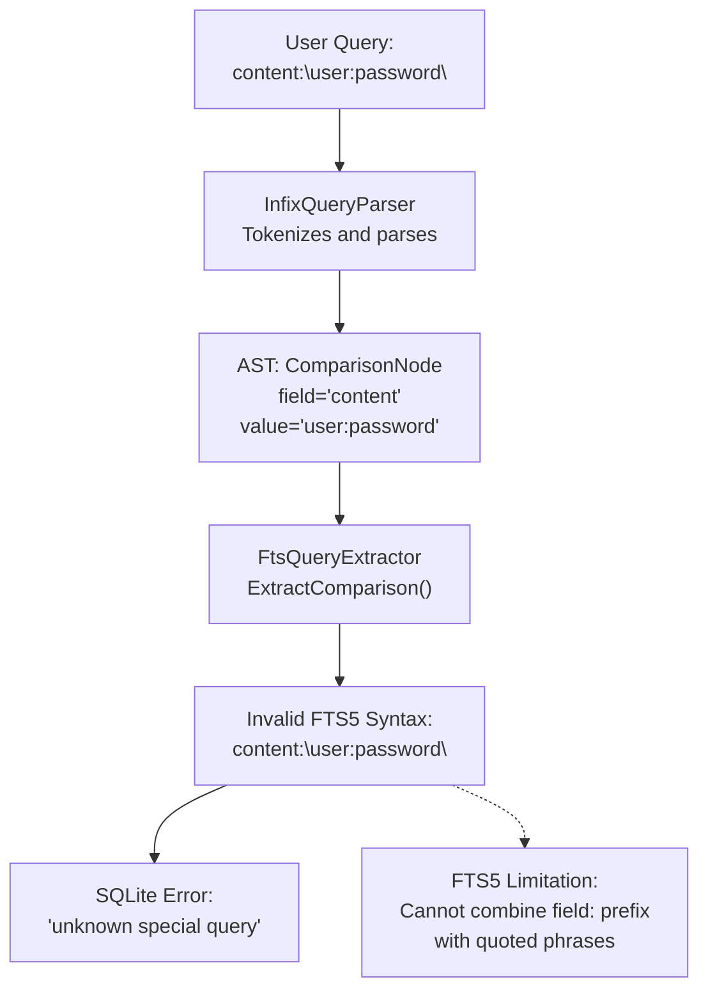
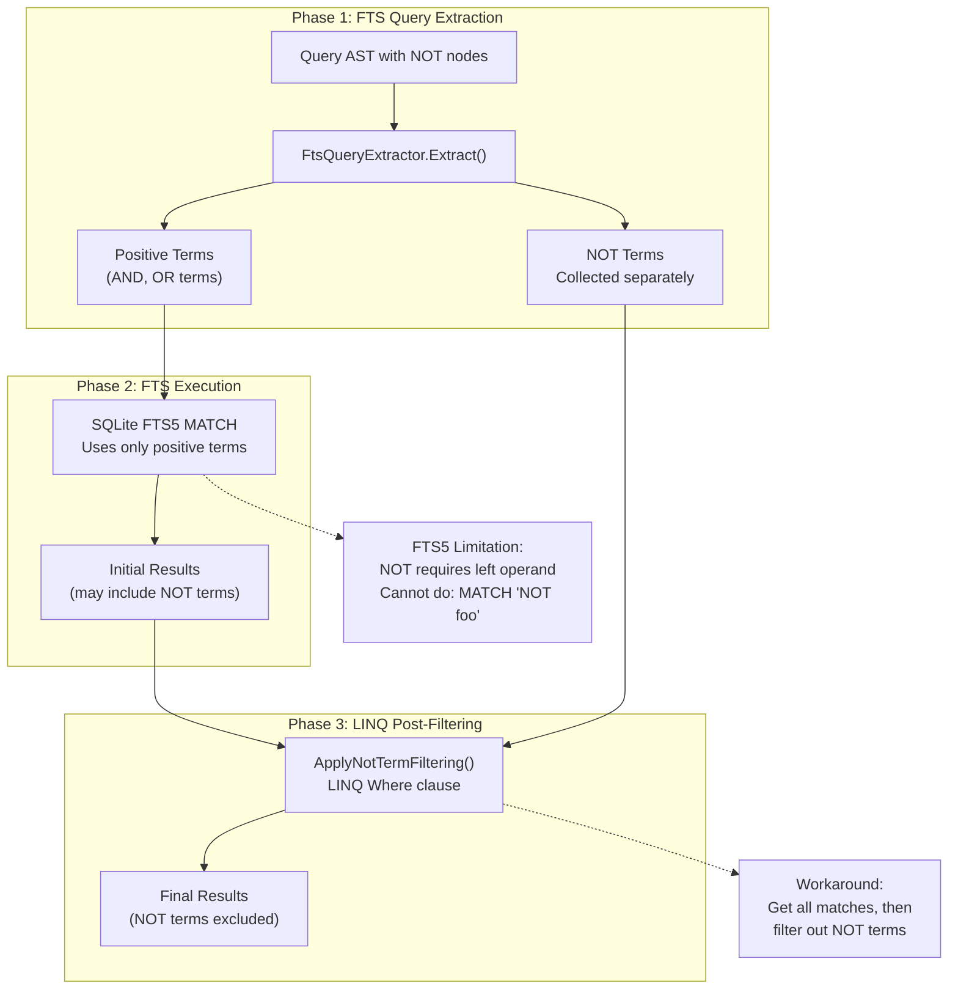

<!-- source: DeepWiki mcp.deepwiki.com · repo microsoft/kernel-memory · page 5.5 Known Search Issues · fetched 2026-10-26 -->

# Known Search Issues

<details>
<summary>Relevant source files</summary>

The following files were used as context for generating this wiki page:

- [KNOWN-ISSUES.md](KNOWN-ISSUES.md)
- [src/Core/Search/NodeSearchService.cs](src/Core/Search/NodeSearchService.cs)
- [src/Core/Search/Query/Parsers/InfixQueryParser.cs](src/Core/Search/Query/Parsers/InfixQueryParser.cs)
- [src/Core/Search/SearchService.cs](src/Core/Search/SearchService.cs)
- [src/Core/Search/SqliteFtsIndex.cs](src/Core/Search/SqliteFtsIndex.cs)
- [src/Main/CLI/Commands/ExamplesCommand.cs](src/Main/CLI/Commands/ExamplesCommand.cs)
- [src/Main/CLI/Commands/SearchCommand.cs](src/Main/CLI/Commands/SearchCommand.cs)
- [tests/Core.Tests/Search/FtsQueryExtractionTest.cs](tests/Core.Tests/Search/FtsQueryExtractionTest.cs)
- [tests/Core.Tests/Search/NodeSearchServiceIndexIdTests.cs](tests/Core.Tests/Search/NodeSearchServiceIndexIdTests.cs)
- [tests/Core.Tests/Search/Query/InfixQueryParserTests.cs](tests/Core.Tests/Search/Query/InfixQueryParserTests.cs)
- [tests/Core.Tests/Search/SearchEndToEndTests.cs](tests/Core.Tests/Search/SearchEndToEndTests.cs)
- [tests/Core.Tests/Search/SearchServiceIndexWeightsTests.cs](tests/Core.Tests/Search/SearchServiceIndexWeightsTests.cs)
- [tests/Main.Tests/Integration/ExamplesCommandE2ETests.cs](tests/Main.Tests/Integration/ExamplesCommandE2ETests.cs)

</details>


This page documents known limitations and bugs in the search system that users should be aware of. These issues affect query syntax and search behavior. For general search architecture and query syntax, see [Search System](#5) and [Query Syntax and Parsing](#5.2).

## Overview

The Kernel Memory search system uses SQLite FTS5 for full-text search with custom query parsing and extraction. While the system handles most search scenarios correctly, there are several known limitations primarily related to SQLite FTS5 constraints and edge cases in query syntax. These issues are documented here to help users write working queries and understand unexpected behavior.

---

## Issue 1: Field-Specific Queries with Quoted Values

**Status:** Known bug, not yet fixed

### Description

Field-specific queries that use quoted values containing special characters fail with a SQLite error. This affects queries where you want to search for an exact phrase within a specific field.

### Failing Examples

```bash
# These queries fail with "unknown special query" error
km search 'content:"user:password"'
km search 'title:"API: REST"'
km search 'description:"version 2.0: stable"'
```

The error occurs because the FTS query extractor in `NodeSearchService` generates invalid SQLite FTS5 query syntax when combining field prefixes with quoted phrases.

### Root Cause

The issue occurs during FTS query extraction in the `FtsQueryExtractor` class. When processing field-specific searches with quoted values:

1. The query parser correctly creates a `ComparisonNode` with the field and quoted value
2. The FTS extractor attempts to generate `field:"quoted value"` syntax
3. SQLite FTS5 does not support this pattern - field prefixes cannot be used with quoted phrases

**Technical Details:**



**Sources:** [KNOWN-ISSUES.md:5-25](), [src/Core/Search/NodeSearchService.cs:379-415]()

The FTS extraction logic is in `NodeSearchService.FtsQueryExtractor.ExtractComparison()`. For phrase searches (containing spaces), the code removes the field prefix:

```csharp
if (isPhrase)
{
    // Phrase searches: use quotes and no field prefix
    // FTS5 doesn't support field:phrase syntax well, so just search all fields
    var escapedPhrase = this.EscapeFtsPhrase(searchText);
    return $"\"{escapedPhrase}\"";
}
```

However, when the phrase contains special characters like colons, the resulting FTS query still fails.

### Workaround

**Option 1: Remove field prefix**
```bash
# Instead of: km search 'content:"user:password"'
km search '"user:password"'
```

**Option 2: Remove quotes (single-word search)**
```bash
# Instead of: km search 'content:"stable"'
km search 'content:stable'
```

**Option 3: Use phrase without special characters**
```bash
# Instead of: km search 'content:"version 2.0: stable"'
km search 'content:"version stable"'
```

**Sources:** [KNOWN-ISSUES.md:24](), [src/Core/Search/NodeSearchService.cs:268-299]()

---

## Issue 2: NOT Operator Syntax Requirements

**Status:** Known limitation, workaround documented

### Description

The infix query parser requires explicit `AND` before `NOT` operators due to SQLite FTS5 limitations. Omitting `AND` causes the `NOT` term to be ignored, returning results that should have been excluded.

### Correct vs Incorrect Syntax

| Correct Syntax | Incorrect Syntax | Result |
|----------------|------------------|---------|
| `foo AND NOT bar` | `foo NOT bar` | `NOT` ignored, finds "foo" and "bar" |
| `(foo OR baz) AND NOT bar` | `(foo OR baz) NOT bar` | `NOT` ignored |
| `NOT deprecated` | n/a | Works (standalone NOT) |

### Examples

```bash
# CORRECT - NOT excludes results
km search "docker AND NOT kubernetes"
km search "(python OR javascript) AND NOT deprecated"

# INCORRECT - NOT is ignored  
km search "docker NOT kubernetes"        # Finds docker AND kubernetes
km search "(python OR javascript) NOT deprecated"  # Finds all three terms
```

**Sources:** [KNOWN-ISSUES.md:30-34](), [tests/Core.Tests/Search/SearchEndToEndTests.cs:171-174]()

### Technical Details: NOT Operator Implementation

SQLite FTS5 has limited NOT support - it requires a left operand (cannot start a query with NOT). The Kernel Memory search system works around this limitation using a two-phase approach:



**Sources:** [src/Core/Search/NodeSearchService.cs:9-27](), [src/Core/Search/NodeSearchService.cs:117-122](), [src/Core/Search/NodeSearchService.cs:302-327]()

The implementation details:

1. **FtsQueryExtractor** collects NOT terms separately:
   ```csharp
   // From NodeSearchService.cs:230-232
   private sealed class FtsQueryExtractor
   {
       private readonly List<NotTerm> _notTerms = [];
   ```

2. **FTS Query Generation** omits NOT terms:
   ```csharp
   // From NodeSearchService.cs:303-309
   if (node.Operator == LogicalOperator.Not || node.Operator == LogicalOperator.Nor)
   {
       this.CollectNotTerms(node);
       // Return empty string - NOT terms are not included in FTS query
       return string.Empty;
   }
   ```

3. **LINQ Post-Filtering** applies NOT exclusions:
   ```csharp
   // From NodeSearchService.cs:117-122
   if (queryResult.NotTerms.Length > 0)
   {
       results = this.ApplyNotTermFiltering(results, queryResult.NotTerms);
   }
   ```

**Sources:** [src/Core/Search/NodeSearchService.cs:213-222](), [src/Core/Search/NodeSearchService.cs:146-157]()

### Why AND is Required Before NOT

The parser processes operators with precedence: `NOT` > `AND` > `OR`. When you write `foo NOT bar`:

1. Parser sees: `foo` (identifier), `NOT` (operator), `bar` (identifier)
2. Parser tries to apply NOT to `bar`, creating: `foo` and `NOT(bar)`
3. But without explicit AND, the parser treats them as separate expressions
4. The NOT term gets collected but the AND relationship is lost
5. Result: Search finds `foo`, ignores the NOT entirely

With explicit AND: `foo AND NOT bar`
1. Parser sees: `foo` (identifier), `AND` (operator), `NOT` (operator), `bar` (identifier)
2. Parser creates: `AND(foo, NOT(bar))`
3. FTS query: `foo` (positive term)
4. NOT terms: `bar` (excluded via LINQ)
5. Result: Correct filtering

**Sources:** [src/Core/Search/Query/Parsers/InfixQueryParser.cs:287-303]()

### Workaround

Always use explicit `AND` before `NOT`:

```bash
# General pattern
km search "positive_term AND NOT excluded_term"

# Multiple NOT terms
km search "docker AND NOT deprecated AND NOT experimental"

# With parentheses
km search "(python OR javascript) AND NOT deprecated"

# Standalone NOT (special case - works without AND)
km search "NOT deprecated"
```

**Sources:** [KNOWN-ISSUES.md:30-34](), [src/Main/CLI/Commands/ExamplesCommand.cs:142-147]()

---

## Query Syntax Edge Cases

### Reserved Words in Literal Text

**Status:** Working correctly (as of recent fixes)

The system now correctly handles searching for literal reserved words (`AND`, `OR`, `NOT`) when they appear in quoted strings:

```bash
# Search for the literal word "NOT"
km search '"NOT"'

# Search for phrases containing reserved words
km search '"Alice AND Bob"'
km search '"this OR that"'
```

The `FtsQueryExtractor` detects FTS5 reserved words and automatically quotes them for literal search:

```csharp
// From NodeSearchService.cs:278-285
if (this.IsFts5ReservedWord(node.SearchText))
{
    // Reserved words must be quoted to be treated as literal search terms
    // We cannot use field prefix with quoted terms in FTS5
    var escapedTerm = this.EscapeFtsPhrase(node.SearchText);
    return $"\"{escapedTerm}\"";
}
```

**Sources:** [src/Core/Search/NodeSearchService.cs:238-241](), [src/Core/Search/NodeSearchService.cs:278-285](), [tests/Core.Tests/Search/SearchEndToEndTests.cs:609-689]()

### FTS5 Reserved Words

The following words have special meaning in FTS5 and are automatically escaped when used as literal search terms:

```csharp
// From NodeSearchService.cs:238-241
private static readonly HashSet<string> s_fts5ReservedWords = new(StringComparer.OrdinalIgnoreCase)
{
    "AND", "OR", "NOT", "NEAR"
};
```

**Sources:** [src/Core/Search/NodeSearchService.cs:238-241]()

---

## Field-Specific Query Limitations

### Single-Word Field Queries Work Correctly

```bash
# These work fine
km search "content:kubernetes"
km search "title:api"
km search "description:tutorial"
```

### Phrase Field Queries Have Limitations

```bash
# Works: Phrase without special characters
km search "content:docker"

# Fails: Phrase with special characters after field prefix
km search 'content:"user:password"'  # ERROR

# Workaround: Search without field prefix
km search '"user:password"'  # OK - searches all fields
```

**Sources:** [KNOWN-ISSUES.md:5-25](), [src/Core/Search/NodeSearchService.cs:268-299]()

---

## Query Processing Flow with Known Issues

```mermaid
graph TB
    subgraph "User Input"
        Q1["Simple Query:<br/>\"docker AND NOT kubernetes\""]
        Q2["Problematic Query:<br/>content:\"user:password\""]
    end
    
    subgraph "Parse Phase"
        P1["InfixQueryParser"]
        AST1["Valid AST"]
        AST2["Valid AST<br/>(ComparisonNode)"]
    end
    
    subgraph "FTS Extraction Phase"
        E1["FtsQueryExtractor"]
        FTS1["FTS: \"docker\"<br/>NOT: [\"kubernetes\"]"]
        FTS2["Invalid FTS5 Syntax<br/>content:\"user:password\""]
    end
    
    subgraph "Execution Phase"
        Ex1["SQLite FTS5 Search"]
        Ex2["SQLite Error"]
        R1["Initial Results"]
    end
    
    subgraph "Post-Processing"
        PP1["LINQ NOT Filtering<br/>ApplyNotTermFiltering()"]
        Final1["Correct Results"]
    end
    
    Q1 --> P1
    Q2 --> P1
    P1 --> AST1
    P1 --> AST2
    
    AST1 --> E1
    AST2 --> E1
    E1 --> FTS1
    E1 --> FTS2
    
    FTS1 --> Ex1
    FTS2 --> Ex2
    Ex1 --> R1
    
    R1 --> PP1
    PP1 --> Final1
    
    Issue1["Issue 1:<br/>Field prefix + quotes<br/>generates invalid FTS5"]
    Issue2["Workaround:<br/>NOT via LINQ filtering<br/>due to FTS5 limitation"]
    
    FTS2 -.-> Issue1
    PP1 -.-> Issue2
```

**Sources:** [src/Core/Search/NodeSearchService.cs:66-143](), [src/Core/Search/NodeSearchService.cs:213-222](), [src/Core/Search/NodeSearchService.cs:379-415]()

---

## Summary of Current Limitations

| Issue | Severity | Status | Workaround Available? |
|-------|----------|--------|----------------------|
| Field-specific queries with quoted values | High | Open | Yes - remove field prefix or quotes |
| NOT operator requires explicit AND | Medium | Documented | Yes - always use `AND NOT` |
| Reserved words in literal text | Low | Fixed | n/a - works correctly |

**Sources:** [KNOWN-ISSUES.md:1-35](), [tests/Core.Tests/Search/SearchEndToEndTests.cs:171-174](), [tests/Main.Tests/Integration/ExamplesCommandE2ETests.cs:158-161]()

---

