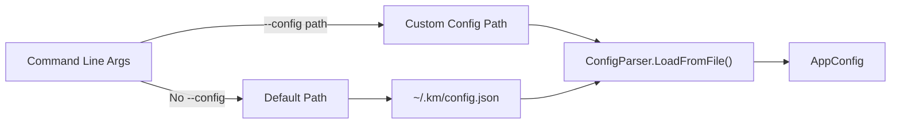
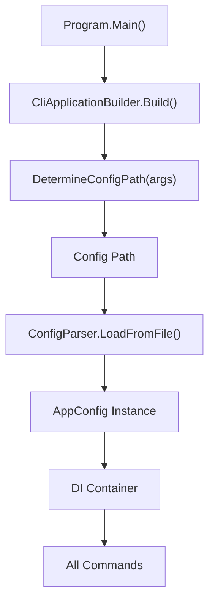
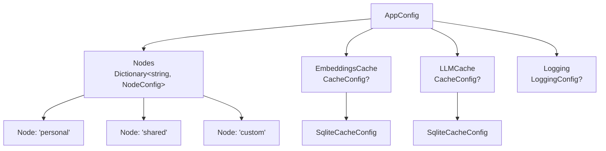
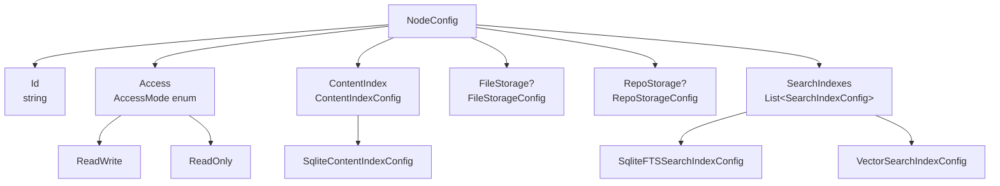
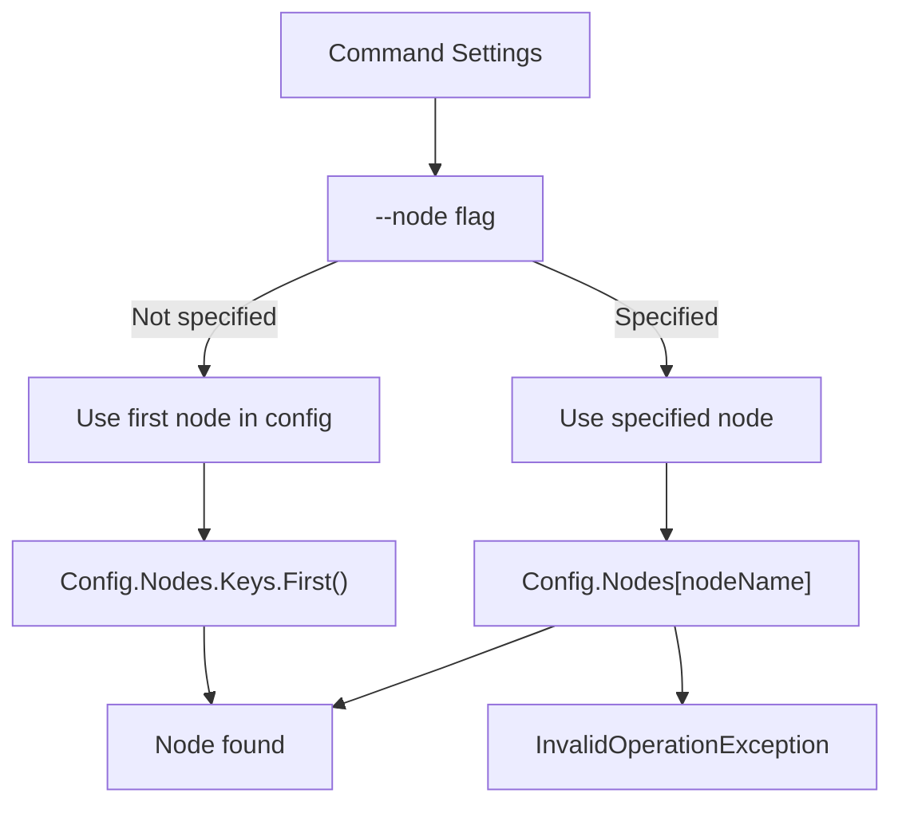
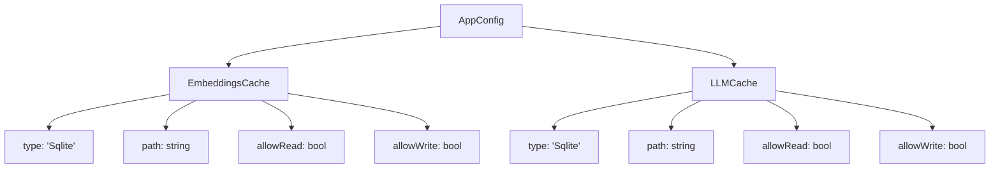
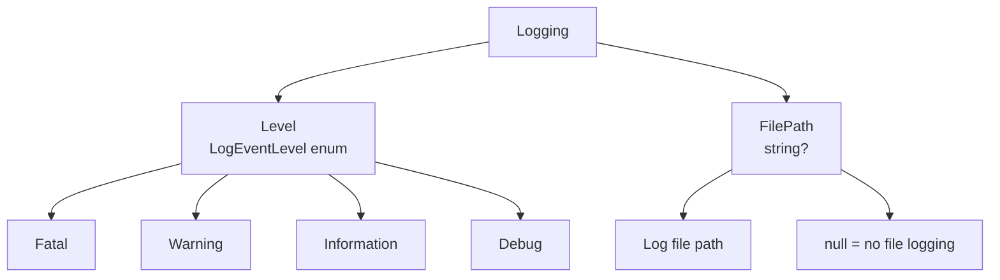
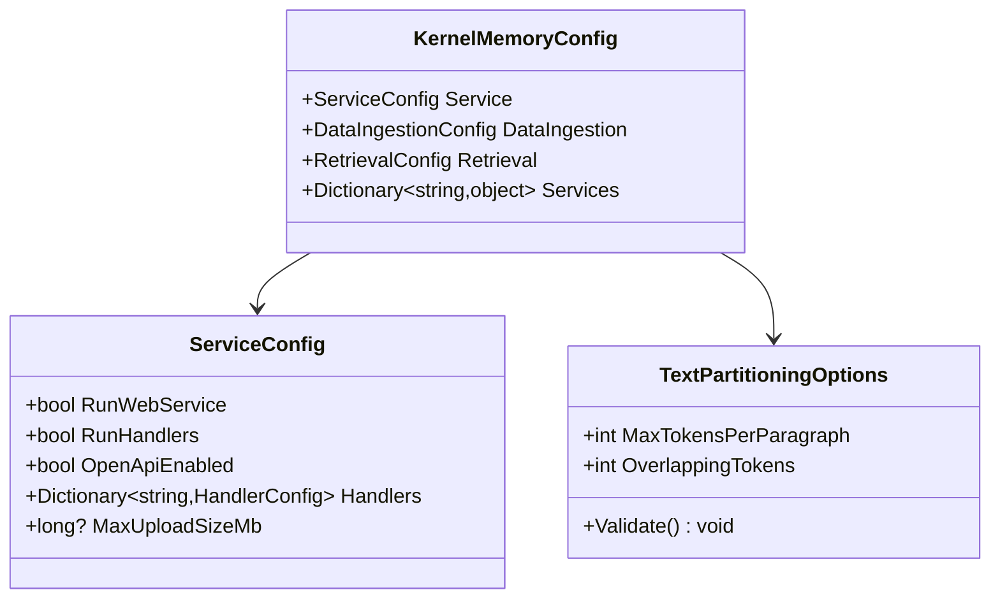

<!-- source: DeepWiki mcp.deepwiki.com · repo microsoft/kernel-memory · page 6 Configuration System · fetched 2026-10-26 -->

# Configuration System

<details>
<summary>Relevant source files</summary>

The following files were used as context for generating this wiki page:

- [.gitignore](.gitignore)
- [.gitmodules](.gitmodules)
- [README.md](README.md)
- [src/Main/CLI/CliApplicationBuilder.cs](src/Main/CLI/CliApplicationBuilder.cs)
- [src/Main/CLI/Commands/BaseCommand.cs](src/Main/CLI/Commands/BaseCommand.cs)
- [src/Main/CLI/Commands/ConfigCommand.cs](src/Main/CLI/Commands/ConfigCommand.cs)
- [src/Main/CLI/Commands/DeleteCommand.cs](src/Main/CLI/Commands/DeleteCommand.cs)
- [src/Main/CLI/Commands/GetCommand.cs](src/Main/CLI/Commands/GetCommand.cs)
- [src/Main/CLI/Commands/ListCommand.cs](src/Main/CLI/Commands/ListCommand.cs)
- [src/Main/CLI/Commands/UpsertCommand.cs](src/Main/CLI/Commands/UpsertCommand.cs)
- [tests/Main.Tests/Integration/CliIntegrationTests.cs](tests/Main.Tests/Integration/CliIntegrationTests.cs)
- [tests/Main.Tests/Integration/CommandExecutionTests.cs](tests/Main.Tests/Integration/CommandExecutionTests.cs)
- [tests/Main.Tests/Integration/ConfigCommandTests.cs](tests/Main.Tests/Integration/ConfigCommandTests.cs)
- [tests/Main.Tests/Integration/ReadonlyCommandTests.cs](tests/Main.Tests/Integration/ReadonlyCommandTests.cs)

</details>


The Kernel Memory CLI uses a JSON-based configuration system stored in `~/.km/config.json`. This configuration defines nodes (logical data partitions), caches, search indexes, and logging settings. The configuration is loaded once at startup and shared across all CLI commands.

## Configuration File Location

The CLI searches for configuration in the following order:

1. Path specified by `--config` or `-c` flag
2. Default location: `~/.km/config.json`

If no configuration file exists, the CLI uses a default configuration with a single "personal" node.


**Configuration File Resolution**

Sources: [src/Main/CLI/CliApplicationBuilder.cs:108-129]()

### Creating Configuration Files

Use the `km config --create` command to generate a configuration file from the current (default or loaded) configuration:

```bash
km config --create                    # Create at default location
km config --config /path/to/config.json --create  # Create at specific location
```

Sources: [src/Main/CLI/Commands/ConfigCommand.cs:79-187]()

### Configuration Loading Implementation

Configuration is loaded early in the CLI startup process, before any commands execute:


**Configuration Loading Flow**

The configuration is loaded once and injected into all commands via dependency injection. This ensures consistent configuration across all operations.

Sources: [src/Main/CLI/CliApplicationBuilder.cs:62-105]()

## AppConfig Structure

The root configuration object is `AppConfig`, which contains all application-level settings:


**AppConfig Object Structure**

### AppConfig Properties

| Property | Type | Required | Description |
|----------|------|----------|-------------|
| `Nodes` | `Dictionary<string, NodeConfig>` | Yes | Named node configurations |
| `EmbeddingsCache` | `CacheConfig?` | No | Shared embedding cache configuration |
| `LLMCache` | `CacheConfig?` | No | Shared LLM response cache configuration |
| `Logging` | `LoggingConfig?` | No | Logging configuration |

Each node in the `Nodes` dictionary represents a logical partition of content with independent storage and indexing. The first node defined is used as the default when `--node` is not specified.

Sources: [tests/Main.Tests/Integration/ConfigCommandTests.cs:36-46](), [tests/Main.Tests/Integration/CliIntegrationTests.cs:32-45]()

### Example Configuration

```json
{
  "nodes": {
    "personal": {
      "id": "personal",
      "access": "ReadWrite",
      "contentIndex": {
        "type": "sqlite",
        "path": "~/.km/nodes/personal/content.db"
      },
      "searchIndexes": [
        {
          "type": "sqliteFTS",
          "path": "~/.km/nodes/personal/search.db"
        }
      ]
    }
  },
  "embeddingsCache": {
    "type": "Sqlite",
    "path": "~/.km/embeddings-cache.db"
  }
}
```

Sources: [tests/Main.Tests/Integration/ConfigCommandTests.cs:36-46]()

## NodeConfig Structure

Each node in the configuration has the following structure:


**NodeConfig Structure**

### NodeConfig Properties

| Property | Type | Required | Description |
|----------|------|----------|-------------|
| `Id` | `string` | Yes | Unique identifier for the node |
| `Access` | `AccessMode` | Yes | `ReadWrite` or `ReadOnly` |
| `ContentIndex` | `ContentIndexConfig` | Yes | Content storage configuration |
| `FileStorage` | `FileStorageConfig?` | No | File storage configuration |
| `RepoStorage` | `RepoStorageConfig?` | No | Repository storage configuration |
| `SearchIndexes` | `List<SearchIndexConfig>` | Yes | Search index configurations |

### Access Modes

- **ReadWrite**: Node supports both read and write operations (default)
- **ReadOnly**: Node only supports read operations (useful for shared content)

Write operations (upsert, delete) on a ReadOnly node will fail. Read operations (get, list, search) work on both access modes.

Sources: [src/Main/CLI/Commands/BaseCommand.cs:57-79](), [tests/Main.Tests/Integration/ConfigCommandTests.cs:38-42]()

### Content Index Configuration

The `ContentIndex` property specifies where content metadata is stored. Currently, only SQLite is supported:

```json
{
  "contentIndex": {
    "type": "sqlite",
    "path": "~/.km/nodes/personal/content.db"
  }
}
```

The CLI automatically creates the database and directory structure on first write operation.

Sources: [src/Main/CLI/Commands/BaseCommand.cs:92-116](), [tests/Main.Tests/Integration/CliIntegrationTests.cs:37-40]()

### Search Index Configuration

The `SearchIndexes` property is a list of search indexes for the node. Multiple indexes can be configured:

```json
{
  "searchIndexes": [
    {
      "type": "sqliteFTS",
      "path": "~/.km/nodes/personal/search.db",
      "weight": 1.0
    },
    {
      "type": "vector",
      "path": "~/.km/nodes/personal/vectors.db",
      "weight": 0.8
    }
  ]
}
```

Each index has a `weight` parameter used in multi-index search result reranking. See page [5.4](#5.4) for details on result ranking.

Sources: [src/Main/CLI/Commands/BaseCommand.cs:158-169]()

### Node Selection in Commands

Commands select nodes using the `--node` flag. If not specified, the first node in the configuration is used:


**Node Selection Logic**

Sources: [src/Main/CLI/Commands/BaseCommand.cs:64-73]()

## Cache Configuration

Caches are shared across all nodes and are optional. Two types of caches are supported:

### Cache Types


**Cache Configuration Structure**

### Cache Properties

| Property | Type | Default | Description |
|----------|------|---------|-------------|
| `type` | `string` | - | Cache type (currently only `"Sqlite"`) |
| `path` | `string` | - | Path to SQLite database file |
| `allowRead` | `bool` | `true` | Enable reading from cache |
| `allowWrite` | `bool` | `true` | Enable writing to cache |

### Cache Modes

The `allowRead` and `allowWrite` flags control cache behavior:

| allowRead | allowWrite | Mode | Behavior |
|-----------|------------|------|----------|
| `true` | `true` | ReadWrite | Normal caching (default) |
| `true` | `false` | ReadOnly | Only read from cache, never write |
| `false` | `true` | WriteOnly | Only write to cache, never read |
| `false` | `false` | Invalid | Error - cache must allow at least one operation |

Sources: [src/Main/CLI/Commands/BaseCommand.cs:139-156](), [tests/Main.Tests/Integration/ConfigCommandTests.cs:44-45]()

### Example Cache Configuration

```json
{
  "embeddingsCache": {
    "type": "Sqlite",
    "path": "~/.km/embeddings-cache.db",
    "allowRead": true,
    "allowWrite": true
  },
  "llmCache": {
    "type": "Sqlite",
    "path": "~/.km/llm-cache.db",
    "allowRead": true,
    "allowWrite": false
  }
}
```

Sources: [tests/Main.Tests/Integration/ConfigCommandTests.cs:44-45]()

## Logging Configuration

Logging is configured through the `Logging` section of the configuration:


**Logging Configuration**

### Logging Properties

| Property | Type | Description |
|----------|------|-------------|
| `Level` | `LogEventLevel` | Minimum log level (Fatal, Error, Warning, Information, Debug, Verbose) |
| `FilePath` | `string?` | Optional path to log file |

### Command-Line Override

Logging can be overridden via command-line flags:

```bash
km list --verbosity verbose        # Debug level logging
km list --verbosity quiet          # Warning level logging
km list --verbosity silent         # Fatal level only
km list --log-file /path/to/log    # Write logs to file
```

Command-line flags take precedence over configuration file settings.

Sources: [src/Main/CLI/CliApplicationBuilder.cs:132-164]()

## Service Configuration Classes

The configuration system uses strongly-typed classes to represent configuration sections:

### Key Configuration Classes

| Class | Purpose | Key Properties |
|-------|---------|----------------|
| `KernelMemoryConfig` | Root configuration | All major sections |
| `ServiceConfig` | Web service settings | `RunWebService`, `RunHandlers`, `Handlers` |
| `TextPartitioningOptions` | Text chunking | `MaxTokensPerParagraph`, `OverlappingTokens` |
| `SearchClientConfig` | Search behavior | RAG and search parameters |


**Configuration Class Relationships**

Sources: [service/Core/Configuration/ServiceConfig.cs:8-56](), [service/Abstractions/Configuration/TextPartitioningOptions.cs:8-41]()

---

