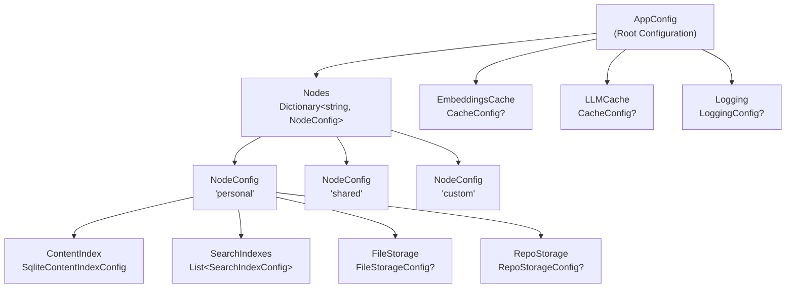
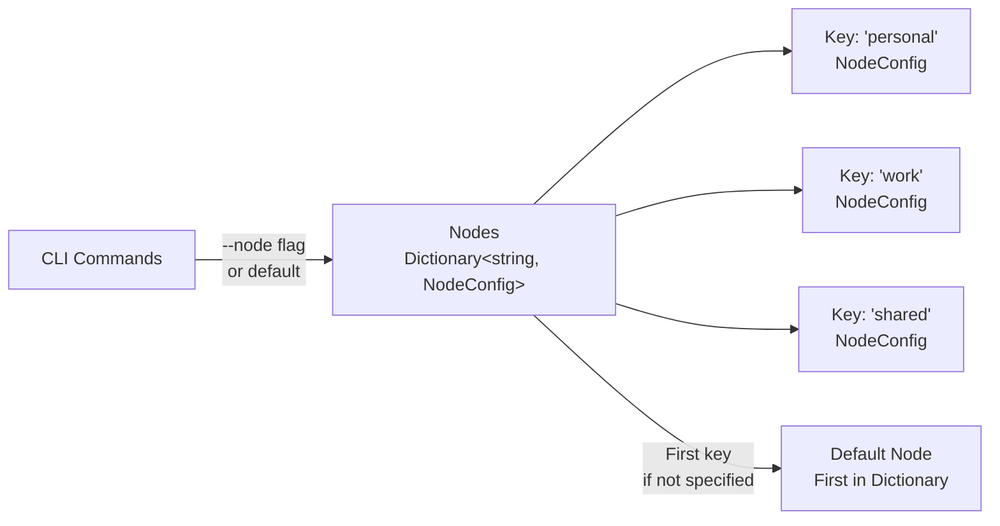
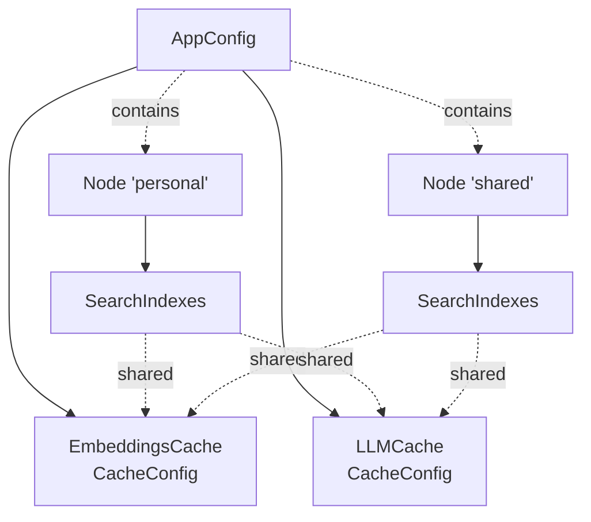
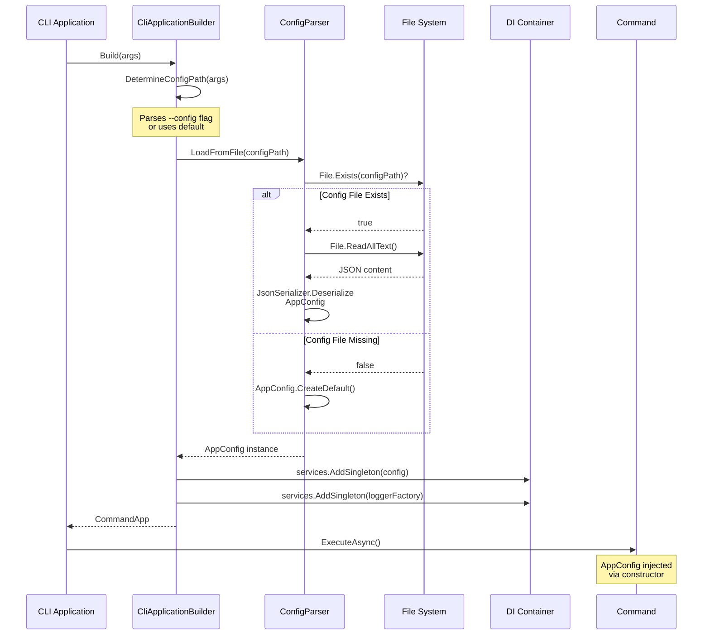
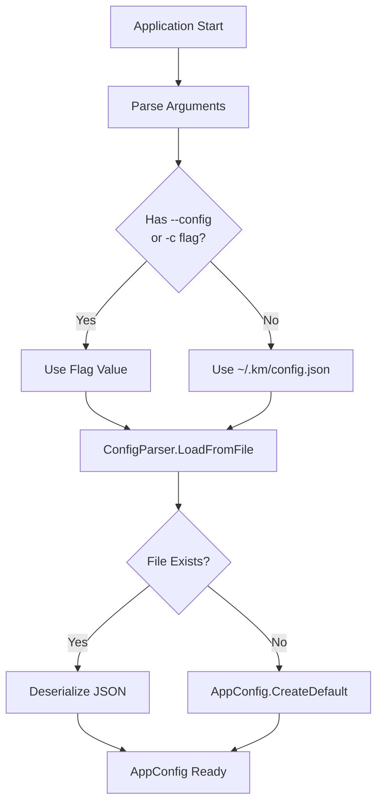
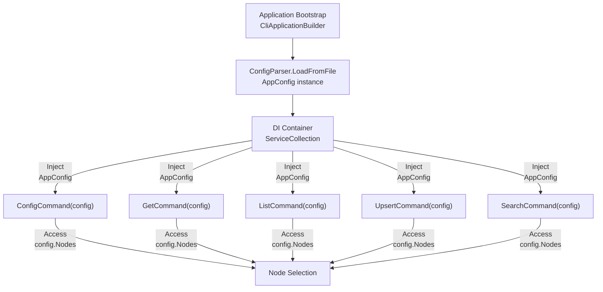
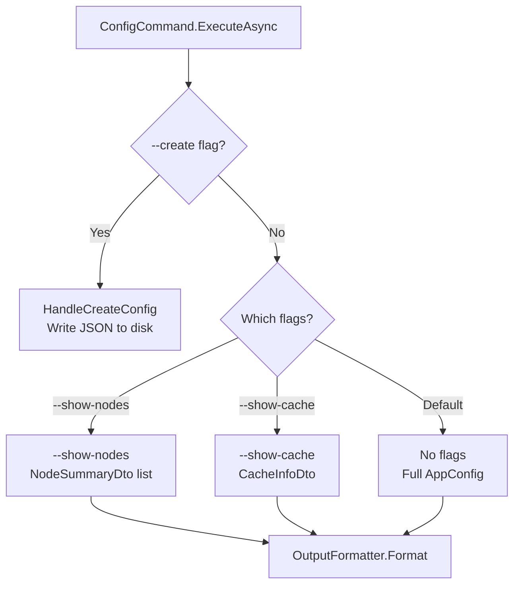

<!-- source: DeepWiki mcp.deepwiki.com · repo microsoft/kernel-memory · page 6.1 AppConfig Structure · fetched 2026-10-26 -->

# AppConfig Structure

<details>
<summary>Relevant source files</summary>

The following files were used as context for generating this wiki page:

- [src/Main/CLI/CliApplicationBuilder.cs](src/Main/CLI/CliApplicationBuilder.cs)
- [src/Main/CLI/Commands/BaseCommand.cs](src/Main/CLI/Commands/BaseCommand.cs)
- [src/Main/CLI/Commands/ConfigCommand.cs](src/Main/CLI/Commands/ConfigCommand.cs)
- [src/Main/CLI/Commands/DeleteCommand.cs](src/Main/CLI/Commands/DeleteCommand.cs)
- [src/Main/CLI/Commands/GetCommand.cs](src/Main/CLI/Commands/GetCommand.cs)
- [src/Main/CLI/Commands/ListCommand.cs](src/Main/CLI/Commands/ListCommand.cs)
- [src/Main/CLI/Commands/UpsertCommand.cs](src/Main/CLI/Commands/UpsertCommand.cs)
- [tests/Main.Tests/Integration/CliIntegrationTests.cs](tests/Main.Tests/Integration/CliIntegrationTests.cs)
- [tests/Main.Tests/Integration/CommandExecutionTests.cs](tests/Main.Tests/Integration/CommandExecutionTests.cs)
- [tests/Main.Tests/Integration/ConfigCommandTests.cs](tests/Main.Tests/Integration/ConfigCommandTests.cs)
- [tests/Main.Tests/Integration/ReadonlyCommandTests.cs](tests/Main.Tests/Integration/ReadonlyCommandTests.cs)

</details>


This document describes the top-level configuration structure (`AppConfig`) used by the KM² CLI application. The `AppConfig` class defines all application-wide settings including node configurations, caches, and logging behavior.

For information about individual node configuration, see [Node Configuration](#6.2). For details on cache configuration, see [Cache Configuration](#6.3). For search index configuration within nodes, see [Search Index Configuration](#6.4).

## Overview

`AppConfig` is the root configuration object for the entire KM² application. It is loaded once at application startup, injected into all commands via dependency injection, and remains immutable throughout command execution. The configuration can be loaded from a JSON file (typically `~/.km/config.json`) or use built-in defaults.



**Sources:** [src/Main/CLI/Commands/ConfigCommand.cs:94-132](), [tests/Main.Tests/Integration/ConfigCommandTests.cs:36-46]()

## Top-Level Properties

The `AppConfig` class contains four primary properties that define the application's configuration:

| Property | Type | Required | Description |
|----------|------|----------|-------------|
| `Nodes` | `Dictionary<string, NodeConfig>` | Yes | Collection of node configurations keyed by node ID |
| `EmbeddingsCache` | `CacheConfig?` | No | Shared embedding cache configuration |
| `LLMCache` | `CacheConfig?` | No | Shared LLM response cache configuration |
| `Logging` | `LoggingConfig?` | No | Application logging configuration |

**Sources:** [src/Main/CLI/Commands/ConfigCommand.cs:99-125](), [src/Main/CLI/Commands/BaseCommand.cs:27-49]()

### Nodes Dictionary

The `Nodes` property is a dictionary that maps node IDs (strings) to `NodeConfig` objects. Each node represents an independent logical partition with its own content index, search indexes, and storage configuration.



**Sources:** [src/Main/CLI/Commands/BaseCommand.cs:64-73](), [tests/Main.Tests/Integration/ConfigCommandTests.cs:38-43]()

Commands select nodes using the `--node` flag. If not specified, the first node in the dictionary is used as the default. The order of nodes in the dictionary matters for this default behavior.

**Sources:** [src/Main/CLI/Commands/BaseCommand.cs:69](), [src/Main/CLI/Commands/ListCommand.cs:122]()

### Cache Properties

The `EmbeddingsCache` and `LLMCache` properties define application-wide caching behavior. These caches are shared across all nodes to avoid redundant AI service calls.

- **EmbeddingsCache**: Caches embedding vectors to avoid re-computing embeddings for identical content
- **LLMCache**: Caches LLM responses to reduce API costs and latency

Both properties are nullable. When `null`, caching is disabled for that feature.



**Sources:** [src/Main/CLI/Commands/ConfigCommand.cs:113-125](), [src/Main/CLI/Commands/BaseCommand.cs:139-156]()

### Logging Configuration

The `Logging` property defines application-wide logging behavior including log levels, output destinations, and file paths. This is optional and defaults to `Information` level console logging if not specified.

**Sources:** [src/Main/CLI/CliApplicationBuilder.cs:138-163]()

## Configuration Loading Flow

The configuration loading process occurs during application bootstrap, before any command executes. This ensures configuration is loaded only once and shared across all commands.



**Sources:** [src/Main/CLI/CliApplicationBuilder.cs:62-105](), [src/Main/CLI/CliApplicationBuilder.cs:113-128]()

### Configuration Path Resolution

The configuration file path is determined with the following precedence:

1. **Command-line flag**: `--config` or `-c` flag value
2. **Default location**: `~/.km/config.json`



**Sources:** [src/Main/CLI/CliApplicationBuilder.cs:113-128]()

## JSON Serialization Format

The `AppConfig` is serialized to JSON using specific formatting rules to ensure readability and compatibility.

### Serialization Options

The JSON serialization uses the following options:

```
- WriteIndented: true (pretty-print with indentation)
- PropertyNamingPolicy: JsonNamingPolicy.CamelCase (lowercase first letter)
- DefaultIgnoreCondition: JsonIgnoreCondition.WhenWritingNull (omit null fields)
```

**Sources:** [src/Main/CLI/Commands/ConfigCommand.cs:41-46]()

### Example Structure

A typical `AppConfig` JSON file has this structure:

```json
{
  "nodes": {
    "personal": {
      "id": "personal",
      "access": "ReadWrite",
      "contentIndex": {
        "type": "sqlite",
        "path": "/path/to/content.db"
      },
      "searchIndexes": [
        {
          "type": "sqliteFTS",
          "path": "/path/to/search.db"
        }
      ]
    }
  },
  "embeddingsCache": {
    "type": "Sqlite",
    "path": "/path/to/embeddings-cache.db",
    "allowRead": true,
    "allowWrite": true
  },
  "llmCache": null,
  "logging": {
    "level": "Information",
    "filePath": null
  }
}
```

**Sources:** [tests/Main.Tests/Integration/ConfigCommandTests.cs:36-49](), [src/Main/CLI/Commands/ConfigCommand.cs:173]()

### Type Discriminators

Configuration objects use type discriminator fields to enable polymorphic deserialization:

| Configuration Type | Discriminator Field | Values |
|-------------------|---------------------|---------|
| ContentIndex | `type` | `"sqlite"` |
| SearchIndex | `type` | `"sqliteFTS"`, `"vector"`, etc. |
| Cache | `type` | `"Sqlite"` |
| FileStorage | `type` | `"local"`, `"s3"`, etc. |

These discriminators allow the JSON deserializer to instantiate the correct concrete class implementations.

**Sources:** [tests/Main.Tests/Integration/ConfigCommandTests.cs:451-461]()

## Usage in Commands

All commands receive `AppConfig` through constructor injection, ensuring consistent access to configuration throughout the application.



**Sources:** [src/Main/CLI/Commands/BaseCommand.cs:35-49](), [src/Main/CLI/CliApplicationBuilder.cs:90-105]()

### BaseCommand Integration

All command classes inherit from `BaseCommand<TSettings>`, which receives `AppConfig` in its constructor:

- **Constructor injection**: `AppConfig config, ILoggerFactory loggerFactory`
- **Protected property**: `this.Config` provides access to injected configuration
- **Initialize method**: Returns tuple `(AppConfig config, NodeConfig node, IOutputFormatter formatter)`

**Sources:** [src/Main/CLI/Commands/BaseCommand.cs:35-79]()

### Node Selection Logic

Commands that operate on nodes use this selection logic:

1. Check if `--node` flag is provided in command settings
2. If not, use `config.Nodes.Keys.First()` as default
3. Validate that the selected node exists in `config.Nodes`
4. Throw `InvalidOperationException` if node not found

**Sources:** [src/Main/CLI/Commands/BaseCommand.cs:64-73]()

## ConfigCommand Behavior

The `ConfigCommand` provides special handling for displaying configuration:



**Sources:** [src/Main/CLI/Commands/ConfigCommand.cs:66-143]()

### Output Modes

The `ConfigCommand` supports three output modes:

1. **Default (no flags)**: Outputs the complete `AppConfig` structure, allowing users to copy/paste into their config file
2. **--show-nodes**: Outputs a summary of all nodes with key properties (ID, access mode, content index type, storage status, index count)
3. **--show-cache**: Outputs cache configuration (embeddings and LLM cache settings)

**Sources:** [src/Main/CLI/Commands/ConfigCommand.cs:94-132]()

### Creating Configuration Files

The `--create` flag writes the current (in-memory) configuration to disk:

- Fails with `ExitCodeUserError` if file already exists
- Creates parent directories if needed
- Writes formatted JSON with proper indentation
- Uses same serialization options as runtime configuration

**Sources:** [src/Main/CLI/Commands/ConfigCommand.cs:154-187]()

## Default Configuration

When no configuration file exists, `AppConfig.CreateDefault()` provides sensible defaults:

- Creates a single `"personal"` node
- Points to `~/.km/nodes/personal/` directory
- Uses SQLite for content index and FTS search
- No cache configuration (caching disabled)
- Information-level logging to console

**Sources:** [src/Main/CLI/CliApplicationBuilder.cs:70](), [tests/Main.Tests/Integration/ConfigCommandTests.cs:324]()

## Null Handling

The JSON serialization explicitly omits null fields (`JsonIgnoreCondition.WhenWritingNull`), which means:

- Optional properties like `LLMCache` are not included in output when `null`
- Optional node properties like `FileStorage` are omitted when `null`
- This creates cleaner configuration files
- When deserializing, missing properties default to `null`

**Sources:** [src/Main/CLI/Commands/ConfigCommand.cs:45](), [tests/Main.Tests/Integration/ConfigCommandTests.cs:400-412]()

---

