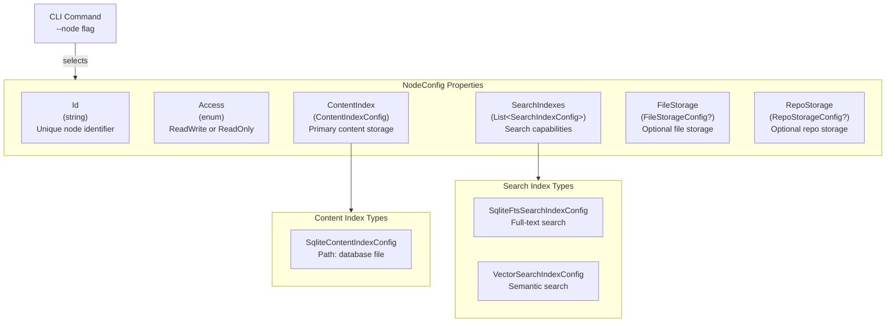
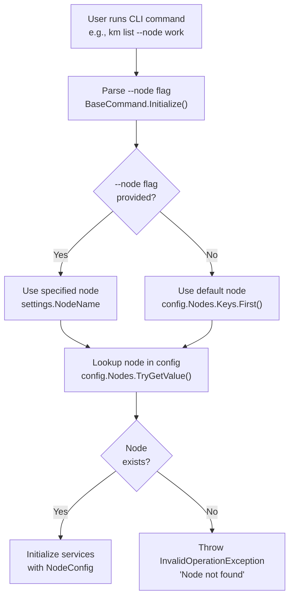
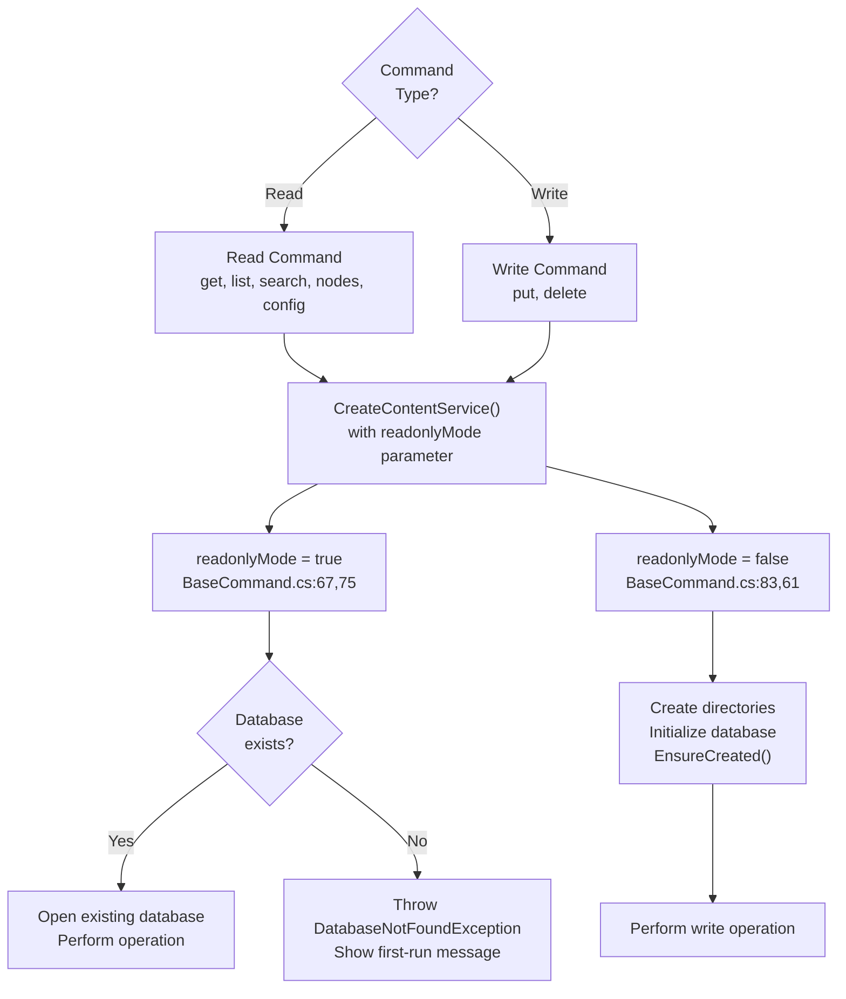
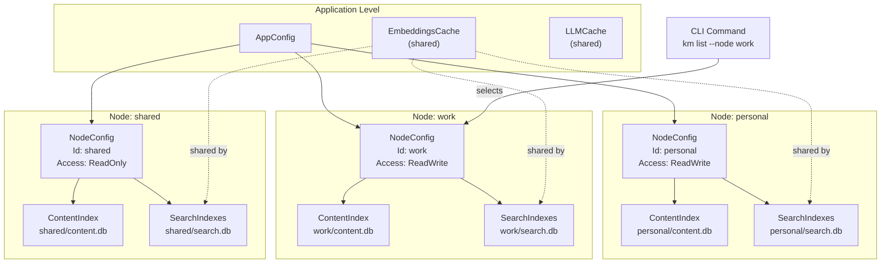

<!-- source: DeepWiki mcp.deepwiki.com · repo microsoft/kernel-memory · page 6.2 Node Configuration · fetched 2026-10-26 -->

# Node Configuration

<details>
<summary>Relevant source files</summary>

The following files were used as context for generating this wiki page:

- [src/Main/CLI/CliApplicationBuilder.cs](src/Main/CLI/CliApplicationBuilder.cs)
- [src/Main/CLI/Commands/BaseCommand.cs](src/Main/CLI/Commands/BaseCommand.cs)
- [src/Main/CLI/Commands/ConfigCommand.cs](src/Main/CLI/Commands/ConfigCommand.cs)
- [src/Main/CLI/Commands/DeleteCommand.cs](src/Main/CLI/Commands/DeleteCommand.cs)
- [src/Main/CLI/Commands/GetCommand.cs](src/Main/CLI/Commands/GetCommand.cs)
- [src/Main/CLI/Commands/ListCommand.cs](src/Main/CLI/Commands/ListCommand.cs)
- [src/Main/CLI/Commands/UpsertCommand.cs](src/Main/CLI/Commands/UpsertCommand.cs)
- [tests/Main.Tests/Integration/CliIntegrationTests.cs](tests/Main.Tests/Integration/CliIntegrationTests.cs)
- [tests/Main.Tests/Integration/CommandExecutionTests.cs](tests/Main.Tests/Integration/CommandExecutionTests.cs)
- [tests/Main.Tests/Integration/ConfigCommandTests.cs](tests/Main.Tests/Integration/ConfigCommandTests.cs)
- [tests/Main.Tests/Integration/ReadonlyCommandTests.cs](tests/Main.Tests/Integration/ReadonlyCommandTests.cs)

</details>


This page documents the `NodeConfig` structure, which defines logical partitions within KM². Each node represents an independent content index with its own storage, search indexes, and access controls. For information about the top-level configuration structure that contains nodes, see [AppConfig Structure](#6.1). For information about search index configuration within nodes, see [Search Index Configuration](#6.4).

## What is a Node?

A **node** is a logical partition in KM² that encapsulates a complete content management subsystem. Each node maintains:
- An independent content index (typically SQLite)
- One or more search indexes (e.g., FTS5, vector)
- Optional file and repository storage
- Access mode controls (ReadWrite or ReadOnly)

Nodes enable multiple use cases:
- **Personal vs shared content**: A `personal` node for individual work and a `shared` read-only node for team content
- **Environment separation**: Development, staging, and production nodes
- **Content categorization**: Different nodes for different projects or topics
- **Access control**: Read-only nodes for archived or reference content

Sources: [src/Main/CLI/Commands/BaseCommand.cs:52-79](), [tests/Main.Tests/Integration/ConfigCommandTests.cs:38-46]()

## Node Structure



Sources: [src/Main/CLI/Commands/ConfigCommand.cs:99-107](), [src/Main/CLI/Commands/BaseCommand.cs:63-78]()

## Core Properties

### Node ID

The `Id` property uniquely identifies the node within the configuration. This identifier is used in CLI commands via the `--node` flag.

```json
{
  "nodes": {
    "personal": {
      "id": "personal",
      ...
    }
  }
}
```

**Key characteristics:**
- Must be unique within the configuration
- Used as the dictionary key in `AppConfig.Nodes`
- Defaults to the first node if not specified in CLI commands

Sources: [src/Main/CLI/Commands/BaseCommand.cs:69](), [tests/Main.Tests/Integration/ConfigCommandTests.cs:40-42]()

### Access Mode

The `Access` property controls whether the node allows write operations.

| Mode | Description | Use Cases |
|------|-------------|-----------|
| `ReadWrite` | Allows all operations (get, list, upsert, delete, search) | Personal nodes, development environments |
| `ReadOnly` | Allows only read operations (get, list, search) | Shared reference content, archived data, production replicas |

**Important behaviors:**
- Write commands (`put`, `delete`) will fail on ReadOnly nodes
- Database initialization only occurs for ReadWrite nodes
- Read operations never create database files

Sources: [src/Main/CLI/Commands/ConfigCommand.cs:102](), [src/Main/CLI/Commands/BaseCommand.cs:85-116]()

### Content Index Configuration

The `ContentIndex` property defines the primary storage backend for content. Currently, only SQLite is supported.

```json
{
  "contentIndex": {
    "type": "sqlite",
    "path": "/path/to/content.db"
  }
}
```

**SqliteContentIndexConfig properties:**
- `Type`: Must be `"sqlite"`
- `Path`: Absolute or relative path to the SQLite database file

The content index stores:
- Content metadata (ID, title, description, tags)
- Content body (text, MIME type)
- Timestamps (created, modified)
- Internal state (CUID generation state)

Sources: [src/Main/CLI/Commands/BaseCommand.cs:92-98](), [tests/Main.Tests/Integration/CliIntegrationTests.cs:36-40]()

### Search Indexes

The `SearchIndexes` property is a collection of search index configurations. Each node can have multiple search indexes with different capabilities.

```json
{
  "searchIndexes": [
    {
      "type": "sqliteFTS",
      "path": "/path/to/search.db",
      "weight": 1.0
    }
  ]
}
```

Common search index types:
- **sqliteFTS**: Full-text search using SQLite FTS5 with BM25 ranking
- **vector**: Semantic search using embeddings (requires embedding provider)

For detailed search index configuration, see [Search Index Configuration](#6.4).

Sources: [src/Main/CLI/Commands/ConfigCommand.cs:106](), [src/Main/CLI/Commands/BaseCommand.cs:158-169]()

### File and Repository Storage

The `FileStorage` and `RepoStorage` properties are optional configurations for storing file artifacts and repository data.

**FileStorage** (optional):
```json
{
  "fileStorage": {
    "type": "local",
    "path": "/path/to/files"
  }
}
```

**RepoStorage** (optional):
```json
{
  "repoStorage": {
    "type": "local",
    "path": "/path/to/repos"
  }
}
```

These properties are `null` by default and not required for basic content operations.

Sources: [src/Main/CLI/Commands/ConfigCommand.cs:104-105]()

## Node Selection in CLI Commands



**Node selection rules:**

1. **Explicit selection**: If `--node <name>` is specified, use that node
2. **Default selection**: If no `--node` flag, use the first node in the configuration dictionary
3. **Validation**: If the specified node doesn't exist, the command fails with an error

**Example commands:**
```bash
# Use explicit node
km list --node work

# Use default node (first in config)
km list

# Search in specific node
km search "kubernetes" --node production
```

Sources: [src/Main/CLI/Commands/BaseCommand.cs:63-78](), [tests/Main.Tests/Integration/ListCommand.cs:122-123]()

## Configuration Example

Here is a complete configuration example showing multiple nodes with different purposes:

```json
{
  "nodes": {
    "personal": {
      "id": "personal",
      "access": "ReadWrite",
      "contentIndex": {
        "type": "sqlite",
        "path": "~/.km/nodes/personal/content.db"
      },
      "searchIndexes": [
        {
          "type": "sqliteFTS",
          "path": "~/.km/nodes/personal/search.db",
          "weight": 1.0
        }
      ]
    },
    "work": {
      "id": "work",
      "access": "ReadWrite",
      "contentIndex": {
        "type": "sqlite",
        "path": "~/.km/nodes/work/content.db"
      },
      "searchIndexes": [
        {
          "type": "sqliteFTS",
          "path": "~/.km/nodes/work/search.db",
          "weight": 1.0
        }
      ]
    },
    "shared": {
      "id": "shared",
      "access": "ReadOnly",
      "contentIndex": {
        "type": "sqlite",
        "path": "/mnt/shared/km/content.db"
      },
      "searchIndexes": [
        {
          "type": "sqliteFTS",
          "path": "/mnt/shared/km/search.db",
          "weight": 1.0
        }
      ]
    }
  }
}
```

This configuration defines:
- **personal**: Read-write node for individual work
- **work**: Read-write node for work-related content
- **shared**: Read-only node accessing shared team content

Sources: [tests/Main.Tests/Integration/ConfigCommandTests.cs:36-46]()

## Default Node Creation

The `NodeConfig.CreateDefaultPersonalNode()` factory method creates a standard personal node configuration:

```csharp
NodeConfig.CreateDefaultPersonalNode(string basePath)
```

This creates a node with:
- ID: `"personal"`
- Access: `ReadWrite`
- ContentIndex: SQLite database at `{basePath}/content.db`
- SearchIndexes: SQLite FTS5 at `{basePath}/search.db`
- FileStorage: `null`
- RepoStorage: `null`

The default configuration file (created with `km config --create`) typically includes a single personal node at `~/.km/nodes/personal`.

Sources: [tests/Main.Tests/Integration/ConfigCommandTests.cs:40](), [tests/Main.Tests/Integration/CommandExecutionTests.cs:31]()

## Database Initialization Behavior

The database initialization behavior differs between read and write operations:



**Read operations** (`get`, `list`, `search`, `nodes`, `config`):
- Use `readonlyMode = true`
- **Never create** directories or database files
- If database doesn't exist, throw `DatabaseNotFoundException`
- Show friendly first-run message instead of error
- Return success exit code (0) for better UX

**Write operations** (`put`, `delete`):
- Use `readonlyMode = false`
- **Always create** directories and database if they don't exist
- Call `context.Database.EnsureCreated()` to initialize schema
- Proceed with write operation

Sources: [src/Main/CLI/Commands/BaseCommand.cs:85-131](), [src/Main/CLI/Commands/GetCommand.cs:67](), [src/Main/CLI/Commands/UpsertCommand.cs:83](), [tests/Main.Tests/Integration/ReadonlyCommandTests.cs:64-98]()

## Multi-Node Architecture



**Key architectural points:**

1. **Isolation**: Each node has independent content and search indexes
2. **Shared resources**: Embedding and LLM caches are shared across all nodes for efficiency
3. **Dictionary access**: Nodes are stored in `AppConfig.Nodes` dictionary, keyed by node ID
4. **CLI selection**: The `--node` flag determines which node services are instantiated
5. **Default node**: The first node in the dictionary is used when `--node` is not specified

Sources: [src/Main/CLI/Commands/BaseCommand.cs:63-78](), [src/Main/CLI/Commands/BaseCommand.cs:138-156](), [src/Main/CLI/CliApplicationBuilder.cs:92-96]()

## Node Configuration Commands

### View all nodes

```bash
# Show summary of all nodes
km config --show-nodes

# Output (JSON format):
[
  {
    "id": "personal",
    "access": "ReadWrite",
    "contentIndex": "sqlite",
    "hasFileStorage": false,
    "hasRepoStorage": false,
    "searchIndexCount": 1
  },
  ...
]
```

### View specific node details

```bash
# View entire configuration (includes all nodes)
km config

# List nodes in human-readable format
km nodes
```

### Create configuration file

```bash
# Create default config with personal node
km config --create
```

Sources: [src/Main/CLI/Commands/ConfigCommand.cs:96-108](), [src/Main/CLI/CliApplicationBuilder.cs:231-235]()

## Common Configuration Patterns

### Pattern 1: Single Personal Node

**Use case**: Individual user, all content in one place

```json
{
  "nodes": {
    "personal": {
      "id": "personal",
      "access": "ReadWrite",
      "contentIndex": {
        "type": "sqlite",
        "path": "~/.km/nodes/personal/content.db"
      },
      "searchIndexes": [...]
    }
  }
}
```

### Pattern 2: Development and Production

**Use case**: Separate environments for testing and production use

```json
{
  "nodes": {
    "dev": {
      "id": "dev",
      "access": "ReadWrite",
      "contentIndex": {
        "type": "sqlite",
        "path": "~/.km/nodes/dev/content.db"
      },
      "searchIndexes": [...]
    },
    "prod": {
      "id": "prod",
      "access": "ReadOnly",
      "contentIndex": {
        "type": "sqlite",
        "path": "/mnt/prod/km/content.db"
      },
      "searchIndexes": [...]
    }
  }
}
```

### Pattern 3: Per-Project Organization

**Use case**: Different nodes for different projects or topics

```json
{
  "nodes": {
    "project-a": {
      "id": "project-a",
      "access": "ReadWrite",
      "contentIndex": {
        "type": "sqlite",
        "path": "~/projects/a/.km/content.db"
      },
      "searchIndexes": [...]
    },
    "project-b": {
      "id": "project-b",
      "access": "ReadWrite",
      "contentIndex": {
        "type": "sqlite",
        "path": "~/projects/b/.km/content.db"
      },
      "searchIndexes": [...]
    }
  }
}
```

Sources: [tests/Main.Tests/Integration/ConfigCommandTests.cs:36-46]()

## Validation and Error Handling

**No nodes configured:**
```
Error: No nodes configured. Please create a configuration file.
Exit code: 1 (user error)
```

**Node not found:**
```
Error: Node 'invalid-node' not found in configuration.
Exit code: 1 (user error)
```

**Wrong content index type:**
```
Error: Node 'test' does not use SQLite content index.
Exit code: 2 (system error)
```

Sources: [src/Main/CLI/Commands/BaseCommand.cs:64-73](), [src/Main/CLI/Commands/BaseCommand.cs:92-96]()

---

