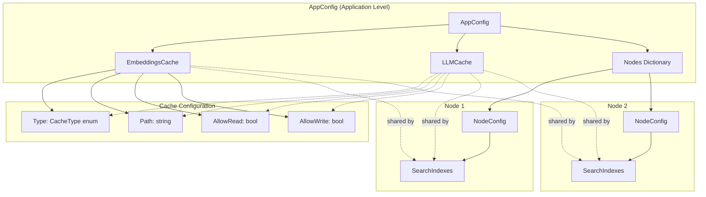
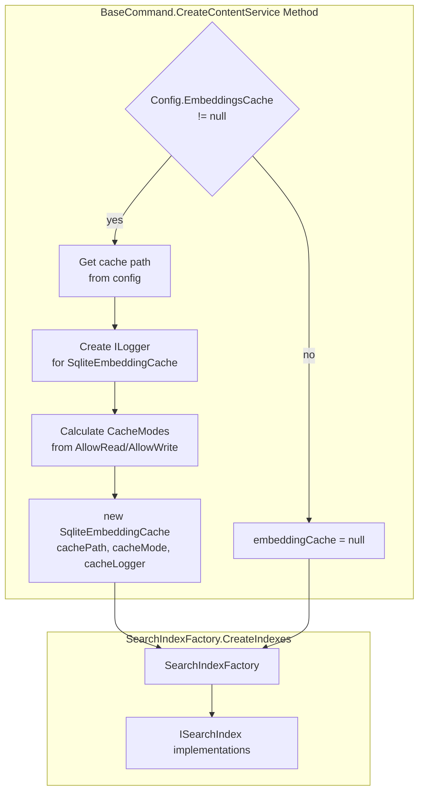
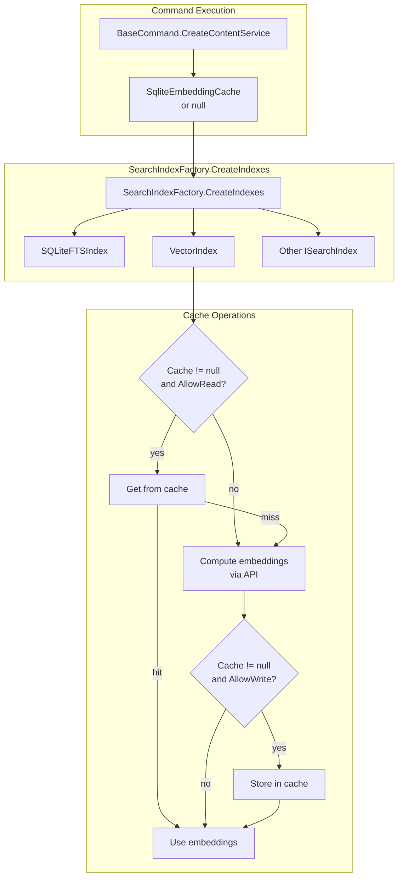

<!-- source: DeepWiki mcp.deepwiki.com · repo microsoft/kernel-memory · page 6.3 Cache Configuration · fetched 2026-10-26 -->

# Cache Configuration

<details>
<summary>Relevant source files</summary>

The following files were used as context for generating this wiki page:

- [src/Main/CLI/CliApplicationBuilder.cs](src/Main/CLI/CliApplicationBuilder.cs)
- [src/Main/CLI/Commands/BaseCommand.cs](src/Main/CLI/Commands/BaseCommand.cs)
- [src/Main/CLI/Commands/ConfigCommand.cs](src/Main/CLI/Commands/ConfigCommand.cs)
- [src/Main/CLI/Commands/DeleteCommand.cs](src/Main/CLI/Commands/DeleteCommand.cs)
- [src/Main/CLI/Commands/GetCommand.cs](src/Main/CLI/Commands/GetCommand.cs)
- [src/Main/CLI/Commands/ListCommand.cs](src/Main/CLI/Commands/ListCommand.cs)
- [src/Main/CLI/Commands/UpsertCommand.cs](src/Main/CLI/Commands/UpsertCommand.cs)
- [tests/Main.Tests/Integration/CliIntegrationTests.cs](tests/Main.Tests/Integration/CliIntegrationTests.cs)
- [tests/Main.Tests/Integration/CommandExecutionTests.cs](tests/Main.Tests/Integration/CommandExecutionTests.cs)
- [tests/Main.Tests/Integration/ConfigCommandTests.cs](tests/Main.Tests/Integration/ConfigCommandTests.cs)
- [tests/Main.Tests/Integration/ReadonlyCommandTests.cs](tests/Main.Tests/Integration/ReadonlyCommandTests.cs)

</details>


This page documents the cache configuration system in KM², including embeddings and LLM caches. Caches are application-level resources shared across all nodes for efficiency. For information about node-specific configuration, see [Node Configuration](#6.2). For general application configuration, see [AppConfig Structure](#6.1).

## Overview

KM² supports two types of caches at the application level: **embeddings cache** and **LLM cache**. Both are optional and configured in the top-level `AppConfig` object. Caches are shared across all nodes and search indexes, avoiding redundant embedding computations and LLM API calls.

Key characteristics:
- **Shared across nodes**: All nodes use the same cache instances
- **Optional**: Both caches can be null
- **SQLite-backed**: Current implementation uses SQLite databases
- **Configurable modes**: Support read-only, write-only, and read-write modes

Sources: [src/Main/CLI/Commands/ConfigCommand.cs:109-126](), [src/Main/CLI/Commands/BaseCommand.cs:139-156]()

## Cache Types and Configuration

### Embeddings Cache

The embeddings cache stores embedding vectors to avoid recomputing them for the same content. This is particularly useful when multiple nodes or search indexes process the same content with the same embedding model.

**Configuration Properties:**
- `Type`: The cache implementation type (currently "Sqlite")
- `Path`: Path to the SQLite database file
- `AllowRead`: Boolean flag enabling read operations
- `AllowWrite`: Boolean flag enabling write operations

### LLM Cache

The LLM cache stores language model responses to avoid redundant API calls for identical prompts. This cache is optional and follows the same configuration pattern as the embeddings cache.

**Configuration Properties:**
- Same as embeddings cache: `Type`, `Path`, `AllowRead`, `AllowWrite`

Sources: [src/Main/CLI/Commands/ConfigCommand.cs:113-125](), [tests/Main.Tests/Integration/ConfigCommandTests.cs:44-46]()

## Configuration Structure



**Application-Level Cache Sharing**

The above diagram shows how caches are configured at the `AppConfig` level and shared across all nodes and their search indexes. This design avoids duplicate cache instances and ensures consistent caching behavior.

Sources: [src/Main/CLI/Commands/BaseCommand.cs:139-156](), [tests/Main.Tests/Integration/ConfigCommandTests.cs:36-46]()

## Cache Modes

Cache modes are determined by the combination of `AllowRead` and `AllowWrite` flags. The `BaseCommand.CreateContentService` method [src/Main/CLI/Commands/BaseCommand.cs:146-153]() translates these flags into `CacheModes` enum values:

| AllowRead | AllowWrite | Mode | Description |
|-----------|------------|------|-------------|
| `true` | `true` | `CacheModes.ReadWrite` | Full cache operations enabled |
| `true` | `false` | `CacheModes.ReadOnly` | Only read from cache, never write |
| `false` | `true` | `CacheModes.WriteOnly` | Only write to cache, never read |
| `false` | `false` | Invalid | Must allow at least one operation |

**Common Use Cases:**
- **ReadWrite**: Default mode for most scenarios
- **ReadOnly**: When using a shared cache that should not be modified (e.g., read-only shared node)
- **WriteOnly**: When populating a cache without affecting current operations

Sources: [src/Main/CLI/Commands/BaseCommand.cs:146-153]()

## Cache Instantiation and Lifecycle

```mermaid
graph LR
    subgraph "Configuration Loading"
        CL[ConfigParser.LoadFromFile]
        AC[AppConfig instance]
        EC[EmbeddingsCache config]
    end
    
    subgraph "Command Execution"
        CMD[BaseCommand.CreateContentService]
        CacheCheck{EmbeddingsCache<br/>!= null?}
        CacheCreate[Create SqliteEmbeddingCache]
        CacheSkip[embeddingCache = null]
        ModeCalc[Calculate CacheModes<br/>from AllowRead/AllowWrite]
    end
    
    subgraph "Search Index Creation"
        SIF[SearchIndexFactory.CreateIndexes]
        SI[Search indexes created<br/>with cache reference]
    end
    
    subgraph "Service Layer"
        CSS[ContentStorageService]
        CS[ContentService]
    end
    
    CL --> AC
    AC --> EC
    EC --> CMD
    
    CMD --> CacheCheck
    CacheCheck -->|"yes"| ModeCalc
    CacheCheck -->|"no"| CacheSkip
    ModeCalc --> CacheCreate
    
    CacheCreate --> SIF
    CacheSkip --> SIF
    SIF --> SI
    
    SI --> CSS
    CSS --> CS
```



**Cache Instantiation Flow**

This diagram shows the code path from configuration loading to cache instantiation. The cache is created in `BaseCommand.CreateContentService` and passed to search indexes via `SearchIndexFactory.CreateIndexes`.

Sources: [src/Main/CLI/Commands/BaseCommand.cs:90-170](), [src/Main/CLI/CliApplicationBuilder.cs:62-104]()

## SQLite Cache Implementation

The current cache implementation uses SQLite databases. The `SqliteEmbeddingCache` class is instantiated with:
- **Cache path**: Full path to the SQLite database file
- **Cache mode**: One of the `CacheModes` enum values
- **Logger**: For diagnostic output



**SqliteEmbeddingCache Instantiation**

The diagram maps the code path in `BaseCommand.CreateContentService` showing how the cache configuration is translated into a `SqliteEmbeddingCache` instance.

Sources: [src/Main/CLI/Commands/BaseCommand.cs:139-156]()

### Cache File Location

Cache database files are typically stored separately from node databases. The default configuration pattern places them at:
- Embeddings cache: `~/.km/embeddings-cache.db`
- LLM cache: `~/.km/llm-cache.db` (if configured)

The path is fully configurable and can point to any valid SQLite database location, including shared network paths for multi-user scenarios.

Sources: [tests/Main.Tests/Integration/ConfigCommandTests.cs:44]()

## Viewing Cache Configuration

The `config` command supports displaying cache configuration using the `--show-cache` flag:

```bash
km config --show-cache
```

This outputs the cache configuration in the selected format (human, json, yaml):

```json
{
  "embeddingsCache": {
    "type": "Sqlite",
    "path": "/home/user/.km/embeddings-cache.db"
  },
  "llmCache": null
}
```

The command is implemented in `ConfigCommand.ExecuteAsync` [src/Main/CLI/Commands/ConfigCommand.cs:109-126]() and creates a `CacheInfoDto` object containing both cache configurations.

Sources: [src/Main/CLI/Commands/ConfigCommand.cs:23-29](), [src/Main/CLI/Commands/ConfigCommand.cs:109-126](), [tests/Main.Tests/Integration/CommandExecutionTests.cs:213-230]()

## Configuration Example

Here is a complete example of cache configuration in `config.json`:

```json
{
  "embeddingsCache": {
    "type": "Sqlite",
    "path": "/home/user/.km/caches/embeddings.db",
    "allowRead": true,
    "allowWrite": true
  },
  "llmCache": {
    "type": "Sqlite",
    "path": "/home/user/.km/caches/llm.db",
    "allowRead": true,
    "allowWrite": true
  },
  "nodes": {
    "personal": { ... },
    "shared": { ... }
  }
}
```

### Creating Default Cache Configuration

The test code shows creation of default SQLite cache using `CacheConfig.CreateDefaultSqliteCache(path)` [tests/Main.Tests/Integration/ConfigCommandTests.cs:44]():

```csharp
EmbeddingsCache = CacheConfig.CreateDefaultSqliteCache(
    Path.Combine(tempDir, "embeddings-cache.db"))
```

This creates a cache configuration with default settings (both read and write enabled).

Sources: [tests/Main.Tests/Integration/ConfigCommandTests.cs:44-46]()

## Cache Usage in Search Indexes

Search indexes receive the embedding cache reference during instantiation and use it to:
1. **Check cache before computing embeddings**: Avoid redundant embedding API calls
2. **Store computed embeddings**: Populate cache for future use
3. **Respect cache mode**: Only read if `AllowRead`, only write if `AllowWrite`

The cache is passed to `SearchIndexFactory.CreateIndexes` [src/Main/CLI/Commands/BaseCommand.cs:159-163]() which distributes it to all search index implementations that support embedding caching.



**Embedding Cache Flow in Search Indexes**

This diagram illustrates how search indexes use the shared embedding cache during query processing and indexing operations.

Sources: [src/Main/CLI/Commands/BaseCommand.cs:159-166]()

## Null Cache Handling

When `EmbeddingsCache` is `null` in the configuration, the system operates without caching:
- Embeddings are computed on every request
- No cache reads or writes occur
- Search indexes function normally but with higher latency

The null check occurs in `BaseCommand.CreateContentService` [src/Main/CLI/Commands/BaseCommand.cs:140]():

```csharp
IEmbeddingCache? embeddingCache = null;
if (this._config.EmbeddingsCache != null)
{
    // Create cache instance
}
```

This design allows running KM² without caching for testing or low-volume scenarios.

Sources: [src/Main/CLI/Commands/BaseCommand.cs:139-156]()

## Configuration Validation

The configuration system enforces cache validation rules:

1. **At least one operation must be allowed**: Both `AllowRead` and `AllowWrite` cannot be `false` simultaneously
2. **Path is required**: When cache is configured, `Path` property must be set
3. **Invalid mode throws**: The code throws `InvalidOperationException` when both flags are false [src/Main/CLI/Commands/BaseCommand.cs:152]()

The validation occurs during service creation, providing immediate feedback on configuration errors.

Sources: [src/Main/CLI/Commands/BaseCommand.cs:150-153]()

## Related Commands

| Command | Description |
|---------|-------------|
| `km config --show-cache` | Display current cache configuration |
| `km config` | View full configuration including caches |
| `km config --create` | Create configuration file with default cache settings |

Sources: [src/Main/CLI/Commands/ConfigCommand.cs:23-34](), [tests/Main.Tests/Integration/CommandExecutionTests.cs:213-230](), [tests/Main.Tests/Integration/CliIntegrationTests.cs:630-651]()

---

