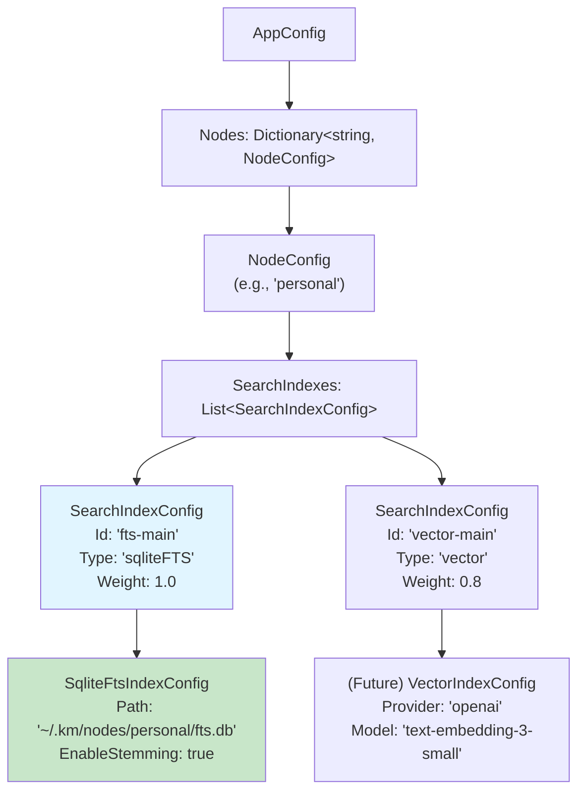
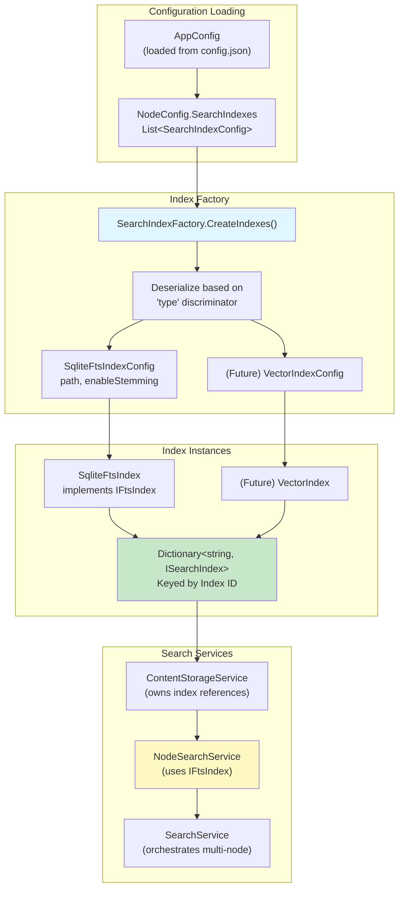

<!-- source: DeepWiki mcp.deepwiki.com · repo microsoft/kernel-memory · page 6.4 Search Index Configuration · fetched 2026-10-26 -->

# Search Index Configuration

<details>
<summary>Relevant source files</summary>

The following files were used as context for generating this wiki page:

- [KNOWN-ISSUES.md](KNOWN-ISSUES.md)
- [src/Core/Search/NodeSearchService.cs](src/Core/Search/NodeSearchService.cs)
- [src/Core/Search/Query/Parsers/InfixQueryParser.cs](src/Core/Search/Query/Parsers/InfixQueryParser.cs)
- [src/Core/Search/SearchService.cs](src/Core/Search/SearchService.cs)
- [src/Core/Search/SqliteFtsIndex.cs](src/Core/Search/SqliteFtsIndex.cs)
- [src/Main/CLI/CliApplicationBuilder.cs](src/Main/CLI/CliApplicationBuilder.cs)
- [src/Main/CLI/Commands/BaseCommand.cs](src/Main/CLI/Commands/BaseCommand.cs)
- [src/Main/CLI/Commands/ConfigCommand.cs](src/Main/CLI/Commands/ConfigCommand.cs)
- [src/Main/CLI/Commands/DeleteCommand.cs](src/Main/CLI/Commands/DeleteCommand.cs)
- [src/Main/CLI/Commands/ExamplesCommand.cs](src/Main/CLI/Commands/ExamplesCommand.cs)
- [src/Main/CLI/Commands/GetCommand.cs](src/Main/CLI/Commands/GetCommand.cs)
- [src/Main/CLI/Commands/ListCommand.cs](src/Main/CLI/Commands/ListCommand.cs)
- [src/Main/CLI/Commands/SearchCommand.cs](src/Main/CLI/Commands/SearchCommand.cs)
- [src/Main/CLI/Commands/UpsertCommand.cs](src/Main/CLI/Commands/UpsertCommand.cs)
- [tests/Core.Tests/Search/FtsQueryExtractionTest.cs](tests/Core.Tests/Search/FtsQueryExtractionTest.cs)
- [tests/Core.Tests/Search/NodeSearchServiceIndexIdTests.cs](tests/Core.Tests/Search/NodeSearchServiceIndexIdTests.cs)
- [tests/Core.Tests/Search/Query/InfixQueryParserTests.cs](tests/Core.Tests/Search/Query/InfixQueryParserTests.cs)
- [tests/Core.Tests/Search/SearchEndToEndTests.cs](tests/Core.Tests/Search/SearchEndToEndTests.cs)
- [tests/Core.Tests/Search/SearchServiceIndexWeightsTests.cs](tests/Core.Tests/Search/SearchServiceIndexWeightsTests.cs)
- [tests/Main.Tests/Integration/CliIntegrationTests.cs](tests/Main.Tests/Integration/CliIntegrationTests.cs)
- [tests/Main.Tests/Integration/CommandExecutionTests.cs](tests/Main.Tests/Integration/CommandExecutionTests.cs)
- [tests/Main.Tests/Integration/ConfigCommandTests.cs](tests/Main.Tests/Integration/ConfigCommandTests.cs)
- [tests/Main.Tests/Integration/ExamplesCommandE2ETests.cs](tests/Main.Tests/Integration/ExamplesCommandE2ETests.cs)
- [tests/Main.Tests/Integration/ReadonlyCommandTests.cs](tests/Main.Tests/Integration/ReadonlyCommandTests.cs)

</details>


## Purpose and Scope

This document describes how search indexes are configured in Kernel Memory nodes. Search indexes provide the underlying search capabilities (full-text search, vector search, etc.) that enable content discovery. Each node can have multiple search indexes with different types, weights, and configurations.

For information about the overall configuration structure, see [AppConfig Structure](#6.1). For node-level configuration, see [Node Configuration](#6.2). For details about SQLite FTS5 implementation specifics, see [SQLite FTS5 Integration](#5.3).

## Search Index Overview

Search indexes are registered components within a node that enable different search strategies. Each search index:

- Has a unique ID within its node
- Implements a specific search technology (FTS5, vector embeddings, etc.)
- Maintains its own data structures (database files, index files)
- Has a configurable weight for relevance scoring during result merging

The `SearchIndexes` property in `NodeConfig` is a collection where each index is configured independently.

**Sources:** [src/Core/Config/NodeConfig.cs](), [src/Main/CLI/Commands/BaseCommand.cs:158-170]()

## Configuration Structure



**Diagram: Search Index Configuration Hierarchy**

Search indexes are configured as a list within each `NodeConfig`. The base `SearchIndexConfig` class provides common properties (`Id`, `Type`, `Weight`), and concrete implementations add type-specific properties.

**Sources:** [src/Core/Config/NodeConfig.cs](), [src/Core/Config/SearchIndex/SearchIndexConfig.cs](), [tests/Main.Tests/Integration/ConfigCommandTests.cs:452-458]()

## Search Index Types

### SqliteFTS Index

The SQLite FTS5 index type is currently the primary search implementation in KM². It provides full-text search capabilities using SQLite's FTS5 virtual tables with BM25 scoring.

**Configuration Properties:**

| Property | Type | Required | Default | Description |
|----------|------|----------|---------|-------------|
| `Id` | string | Yes | "fts-main" | Unique identifier within the node |
| `Type` | string | Yes | "sqliteFTS" | Discriminator (must be "sqliteFTS") |
| `Weight` | float | No | 1.0 | Relevance multiplier for reranking |
| `Path` | string | Yes | - | File path to SQLite database |
| `EnableStemming` | bool | No | true | Enable Porter stemming for better matching |

**Example Configuration:**

```json
{
  "nodes": {
    "personal": {
      "searchIndexes": [
        {
          "id": "fts-main",
          "type": "sqliteFTS",
          "weight": 1.0,
          "path": "~/.km/nodes/personal/fts.db",
          "enableStemming": true
        }
      ]
    }
  }
}
```

**Sources:** [src/Core/Config/SearchIndex/SqliteFtsIndexConfig.cs](), [src/Core/Search/SqliteFtsIndex.cs:26-31](), [tests/Main.Tests/Integration/ConfigCommandTests.cs:455-457]()

### Future Index Types

The architecture supports additional index types through the `SearchIndexConfig` base class. Potential future types include:

- **Vector/Embedding Index**: Semantic search using vector embeddings
- **Hybrid Index**: Combines FTS and vector search
- **External Index**: Integration with external search services

The `Type` discriminator property determines which concrete configuration class is used during deserialization.

**Sources:** [src/Core/Config/SearchIndex/SearchIndexConfig.cs]()

## Index Identification

### Index ID

Each search index must have a unique `Id` within its node. This ID is used for:

- Runtime index selection (`--indexes` flag in search commands)
- Result attribution (tracking which index produced which results)
- Index weight configuration (per-index relevance multipliers)

The default FTS index ID is defined in `Constants.SearchDefaults.DefaultFtsIndexId` as `"fts-main"`.

**Example: Custom Index IDs**

```json
{
  "nodes": {
    "work": {
      "searchIndexes": [
        {
          "id": "fts-code",
          "type": "sqliteFTS",
          "path": "~/.km/nodes/work/fts-code.db",
          "enableStemming": false
        },
        {
          "id": "fts-docs",
          "type": "sqliteFTS",
          "path": "~/.km/nodes/work/fts-docs.db",
          "enableStemming": true
        }
      ]
    }
  }
}
```

This configuration creates two separate FTS indexes within the same node, allowing different stemming configurations for code vs. documentation.

**Sources:** [src/Core/Search/NodeSearchService.cs:46-51](), [tests/Core.Tests/Search/NodeSearchServiceIndexIdTests.cs:64-98](), [src/Core/Constants.cs]()

## Index Weights for Reranking

Search index weights control how results from different indexes are scored during result merging and reranking. Higher weights boost relevance scores from that index.

### Weight Configuration

Weights are configured at two levels:

1. **Static Weights** (in config file): Set via `SearchIndexConfig.Weight` property
2. **Runtime Weights** (per-query): Override via `SearchService` constructor or `--node-weights` CLI flag

**Weight Range:** 0.0 to 1.0 (values outside this range are invalid)

**Default Weight:** 1.0 (defined in `Constants.SearchDefaults.DefaultIndexWeight`)

### How Weights Affect Relevance

During reranking, each result's relevance score is multiplied by its index weight:

```
FinalRelevance = BaseRelevance × NodeWeight × IndexWeight
```

The `SearchService` constructor accepts an `indexWeights` parameter:

```
Dictionary<string, Dictionary<string, float>>
  ^nodeId           ^indexId      ^weight
```

**Sources:** [src/Core/Search/SearchService.cs:22-38](), [tests/Core.Tests/Search/SearchServiceIndexWeightsTests.cs:77-109](), [src/Core/Constants.cs]()

## Index Creation and Lifecycle



**Diagram: Search Index Creation Flow**

The `SearchIndexFactory.CreateIndexes()` method instantiates search indexes based on configuration. This happens once during `ContentService` creation in `BaseCommand.CreateContentService()`.

**Key Code Locations:**

- Index factory: [src/Main/Services/SearchIndexFactory.cs]()
- Index creation in CLI: [src/Main/CLI/Commands/BaseCommand.cs:158-170]()
- Index registration: ContentStorageService constructor receives `IReadOnlyDictionary<string, ISearchIndex>`

**Sources:** [src/Main/CLI/Commands/BaseCommand.cs:158-170](), [src/Core/Storage/ContentStorageService.cs]()

## Runtime Index Selection

### Selecting Specific Indexes

During search, you can limit which indexes are queried using the `--indexes` flag:

```bash
# Search only the FTS index
km search "kubernetes" --indexes fts-main

# Search multiple indexes (future: when vector search is added)
km search "kubernetes" --indexes fts-main,vector-main

# Node-specific index selection (nodeId:indexId syntax)
km search "kubernetes" --indexes work:fts-code,personal:fts-main
```

### Excluding Indexes

Use `--exclude-indexes` to skip specific indexes:

```bash
# Exclude experimental indexes
km search "kubernetes" --exclude-indexes experimental-fts

# Exclude slow indexes during quick queries
km search "kubernetes" --exclude-indexes vector-large
```

### Index Selection in SearchRequest

The `SearchRequest` model has two properties for index selection:

```csharp
public string[] SearchIndexes { get; set; } = [];  // Include these
public string[] ExcludeIndexes { get; set; } = []; // Exclude these
```

If `SearchIndexes` is empty, all indexes are used (minus exclusions). The syntax supports both simple index IDs and qualified `nodeId:indexId` format.

**Sources:** [src/Main/CLI/Commands/SearchCommand.cs:36-43](), [src/Main/CLI/Commands/SearchCommand.cs:289-298](), [src/Core/Search/Models/SearchRequest.cs]()

## SQLite FTS5 Index Details

### Database Schema

The SQLite FTS5 index creates a virtual table with the following structure:

```sql
CREATE VIRTUAL TABLE km_fts USING fts5(
    content_id UNINDEXED,
    title,
    description,
    content,
    tokenize='porter unicode61'  -- or 'unicode61' if stemming disabled
);
```

**Column Descriptions:**

| Column | Indexed | Purpose |
|--------|---------|---------|
| `content_id` | No | Reference to ContentRecord.Id (unindexed for efficiency) |
| `title` | Yes | FTS-searchable title field |
| `description` | Yes | FTS-searchable description field |
| `content` | Yes | FTS-searchable main content field |

**Sources:** [src/Core/Search/SqliteFtsIndex.cs:55-75]()

### Tokenization and Stemming

When `EnableStemming` is `true`, the Porter stemming algorithm is enabled via the `porter` tokenizer. This improves search recall by matching word variations:

- "running" matches "run", "runs", "ran"
- "connection" matches "connect", "connected", "connecting"

**Stemming Trade-offs:**

| Stemming Enabled | Pros | Cons |
|------------------|------|------|
| Yes (default) | Better recall, finds word variations | Can match unintended words |
| No | Exact matching, precise for code/identifiers | Misses valid variations |

**Recommendation:** Enable stemming for natural language content, disable for code or technical identifiers.

**Sources:** [src/Core/Search/SqliteFtsIndex.cs:59](), [tests/Core.Tests/Search/SearchEndToEndTests.cs:249-263]()

### BM25 Scoring and Normalization

SQLite FTS5 uses the BM25 algorithm for relevance scoring. Raw BM25 scores are negative values (more negative = better match). KM² normalizes these to the 0.0-1.0 range using exponential normalization:

```csharp
normalizedScore = Math.Exp(rawScore / divisor)
```

The divisor is `Constants.SearchDefaults.Bm25NormalizationDivisor` (default: 10.0).

**Score Mapping Examples:**

| Raw BM25 Score | Normalized Score | Interpretation |
|----------------|------------------|----------------|
| 0.0 | 1.0 | Perfect match |
| -1.0 | 0.90 | Excellent match |
| -5.0 | 0.61 | Good match |
| -10.0 | 0.37 | Weak match |

**Sources:** [src/Core/Search/SqliteFtsIndex.cs:195-212](), [src/Core/Constants.cs]()

## Configuration Examples

### Single Node, Single Index (Default)

```json
{
  "nodes": {
    "personal": {
      "id": "personal",
      "contentIndex": {
        "type": "sqlite",
        "path": "~/.km/nodes/personal/content.db"
      },
      "searchIndexes": [
        {
          "id": "fts-main",
          "type": "sqliteFTS",
          "weight": 1.0,
          "path": "~/.km/nodes/personal/fts.db",
          "enableStemming": true
        }
      ]
    }
  }
}
```

### Multiple Indexes per Node

```json
{
  "nodes": {
    "work": {
      "id": "work",
      "searchIndexes": [
        {
          "id": "fts-general",
          "type": "sqliteFTS",
          "weight": 1.0,
          "path": "~/.km/nodes/work/fts-general.db",
          "enableStemming": true
        },
        {
          "id": "fts-code",
          "type": "sqliteFTS",
          "weight": 0.8,
          "path": "~/.km/nodes/work/fts-code.db",
          "enableStemming": false
        }
      ]
    }
  }
}
```

This configuration allows searching general documentation (with stemming) separately from code (without stemming), or querying both with different relevance weights.

### Weighted Indexes Across Nodes

```json
{
  "nodes": {
    "current-project": {
      "searchIndexes": [
        {
          "id": "fts-main",
          "type": "sqliteFTS",
          "weight": 1.0,
          "path": "~/.km/nodes/current/fts.db",
          "enableStemming": true
        }
      ]
    },
    "archive": {
      "searchIndexes": [
        {
          "id": "fts-main",
          "type": "sqliteFTS",
          "weight": 0.5,
          "path": "~/.km/nodes/archive/fts.db",
          "enableStemming": true
        }
      ]
    }
  }
}
```

With this setup, results from the current project are weighted twice as high as archived results, making recent work appear more relevant.

**Sources:** [src/Core/Config/NodeConfig.cs](), [tests/Main.Tests/Integration/ConfigCommandTests.cs:36-46]()

## Viewing Index Configuration

### Via CLI

```bash
# Show all nodes and their search index counts
km config --show-nodes

# View full configuration including index details
km config

# Export as JSON for inspection
km config --format json > my-config.json
```

### Via NodesCommand

The `NodesCommand` displays search index information for each node:

```bash
km nodes --format json
```

Output includes `searchIndexCount` per node.

**Sources:** [src/Main/CLI/Commands/ConfigCommand.cs:96-108](), [src/Main/CLI/Commands/NodesCommand.cs]()

## Known Limitations

### Index Type Support

Currently, only `sqliteFTS` index type is implemented. Vector and hybrid search indexes are planned for future releases.

### Index-Level Access Control

Search indexes inherit access control from their parent node (`ReadOnly` vs `ReadWrite`). There is no per-index access control.

### Index Synchronization

All search indexes in a node are updated synchronously during content upsert/delete operations. There is no selective index update mechanism.

**Sources:** [src/Core/Storage/ContentStorageService.cs](), [KNOWN-ISSUES.md:1-35]()

---

