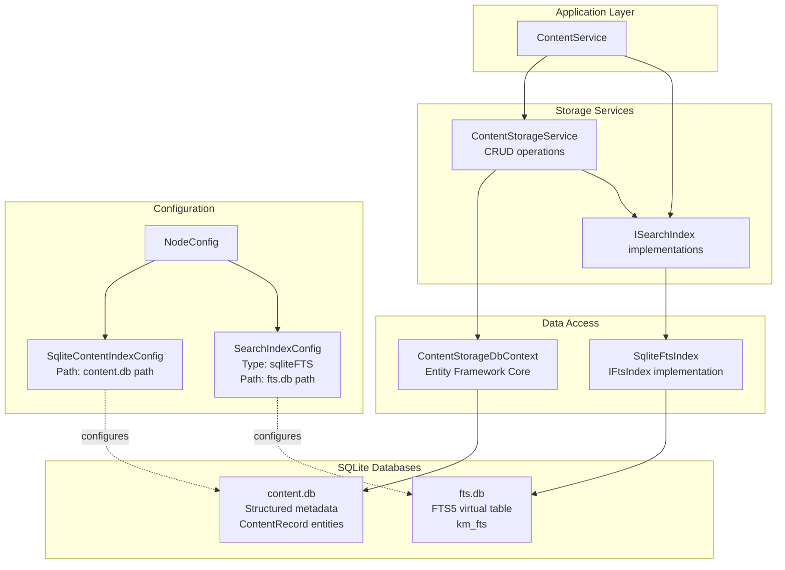
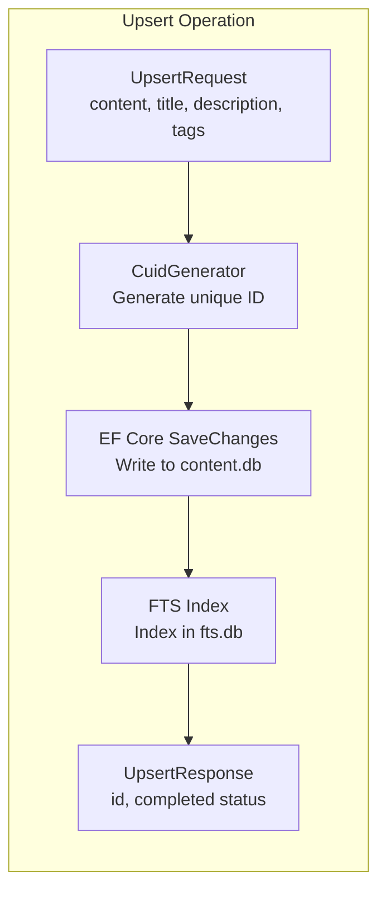
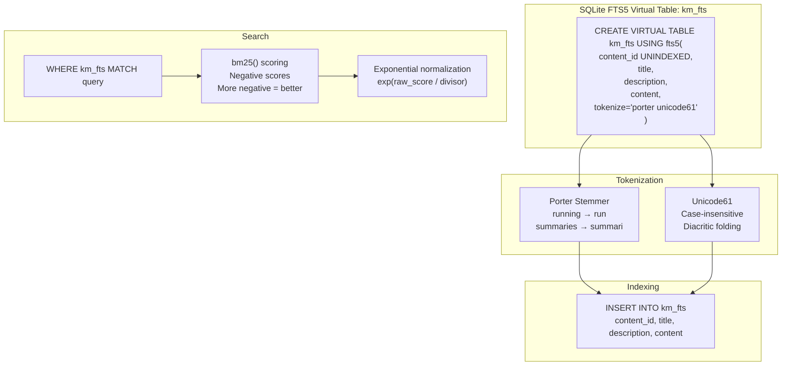
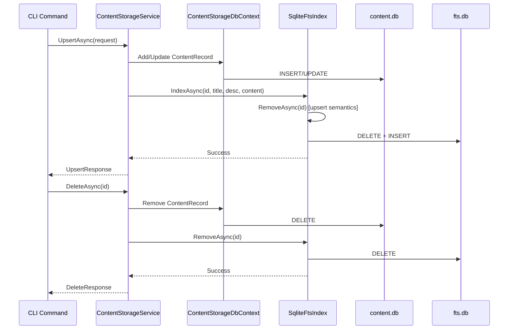
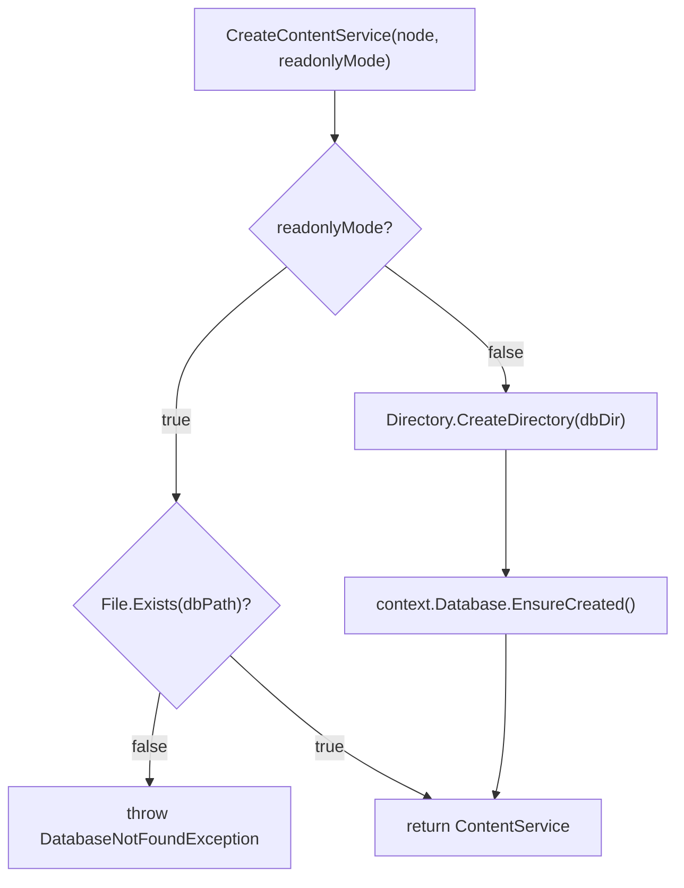

<!-- source: DeepWiki mcp.deepwiki.com · repo microsoft/kernel-memory · page 7 Storage and Indexing · fetched 2026-10-26 -->

# Storage and Indexing

<details>
<summary>Relevant source files</summary>

The following files were used as context for generating this wiki page:

- [KNOWN-ISSUES.md](KNOWN-ISSUES.md)
- [src/Core/Search/NodeSearchService.cs](src/Core/Search/NodeSearchService.cs)
- [src/Core/Search/Query/Parsers/InfixQueryParser.cs](src/Core/Search/Query/Parsers/InfixQueryParser.cs)
- [src/Core/Search/SearchService.cs](src/Core/Search/SearchService.cs)
- [src/Core/Search/SqliteFtsIndex.cs](src/Core/Search/SqliteFtsIndex.cs)
- [src/Main/CLI/CliApplicationBuilder.cs](src/Main/CLI/CliApplicationBuilder.cs)
- [src/Main/CLI/Commands/BaseCommand.cs](src/Main/CLI/Commands/BaseCommand.cs)
- [src/Main/CLI/Commands/ConfigCommand.cs](src/Main/CLI/Commands/ConfigCommand.cs)
- [src/Main/CLI/Commands/DeleteCommand.cs](src/Main/CLI/Commands/DeleteCommand.cs)
- [src/Main/CLI/Commands/ExamplesCommand.cs](src/Main/CLI/Commands/ExamplesCommand.cs)
- [src/Main/CLI/Commands/GetCommand.cs](src/Main/CLI/Commands/GetCommand.cs)
- [src/Main/CLI/Commands/ListCommand.cs](src/Main/CLI/Commands/ListCommand.cs)
- [src/Main/CLI/Commands/SearchCommand.cs](src/Main/CLI/Commands/SearchCommand.cs)
- [src/Main/CLI/Commands/UpsertCommand.cs](src/Main/CLI/Commands/UpsertCommand.cs)
- [tests/Core.Tests/Search/FtsQueryExtractionTest.cs](tests/Core.Tests/Search/FtsQueryExtractionTest.cs)
- [tests/Core.Tests/Search/NodeSearchServiceIndexIdTests.cs](tests/Core.Tests/Search/NodeSearchServiceIndexIdTests.cs)
- [tests/Core.Tests/Search/Query/InfixQueryParserTests.cs](tests/Core.Tests/Search/Query/InfixQueryParserTests.cs)
- [tests/Core.Tests/Search/SearchEndToEndTests.cs](tests/Core.Tests/Search/SearchEndToEndTests.cs)
- [tests/Core.Tests/Search/SearchServiceIndexWeightsTests.cs](tests/Core.Tests/Search/SearchServiceIndexWeightsTests.cs)
- [tests/Main.Tests/Integration/CliIntegrationTests.cs](tests/Main.Tests/Integration/CliIntegrationTests.cs)
- [tests/Main.Tests/Integration/CommandExecutionTests.cs](tests/Main.Tests/Integration/CommandExecutionTests.cs)
- [tests/Main.Tests/Integration/ConfigCommandTests.cs](tests/Main.Tests/Integration/ConfigCommandTests.cs)
- [tests/Main.Tests/Integration/ExamplesCommandE2ETests.cs](tests/Main.Tests/Integration/ExamplesCommandE2ETests.cs)
- [tests/Main.Tests/Integration/ReadonlyCommandTests.cs](tests/Main.Tests/Integration/ReadonlyCommandTests.cs)

</details>


## Purpose and Scope

This page documents the data persistence layer of KM², including the SQLite-based content storage system, the FTS5 full-text search index, and file storage mechanisms. This covers how content records are stored, indexed for search, and retrieved.

For information about how search queries are executed and results are ranked, see [Search System](#5). For details about configuration of storage paths and index settings, see [Configuration System](#6).

---

## Storage Architecture Overview

KM² uses a dual-database architecture: one SQLite database for structured content metadata and another for full-text search indexing.

**High-Level Storage Architecture**



**Sources:** [src/Main/CLI/Commands/BaseCommand.cs:83-170](), [src/Core/Search/SqliteFtsIndex.cs:11-26]()

---

## Content Storage Implementation

### ContentStorageService

The `ContentStorageService` class provides CRUD operations for content records and coordinates with search indexes to keep them synchronized.

**ContentStorageService Responsibilities**

| Responsibility | Method | Description |
|---------------|--------|-------------|
| Create/Update | `UpsertAsync()` | Insert or update content, auto-index in FTS |
| Retrieve | `GetByIdAsync()` | Fetch content by ID |
| List | `ListAsync()` | Paginated content listing |
| Count | `CountAsync()` | Get total content count |
| Delete | `DeleteAsync()` | Remove content and FTS entries |

**Content Storage Flow**



**Sources:** [src/Main/CLI/Commands/BaseCommand.cs:83-170](), [src/Core/Search/NodeSearchService.cs:92-115]()

### ContentStorageDbContext

Entity Framework Core context for managing `ContentRecord` entities. The schema includes:

| Column | Type | Description |
|--------|------|-------------|
| `Id` | string | Primary key, CUID format |
| `Title` | string | Optional title |
| `Description` | string | Optional description |
| `Content` | string | Main content body |
| `MimeType` | string | Content type (e.g., "text/plain") |
| `Tags` | string[] | Array of tags |
| `Metadata` | Dictionary | Key-value metadata |
| `ContentCreatedAt` | DateTime | Creation timestamp |
| `ContentUpdatedAt` | DateTime | Last update timestamp |

**Sources:** [src/Main/CLI/Commands/BaseCommand.cs:122-131]()

### CUID Generation

Content IDs are generated using the `CuidGenerator` class, which produces collision-resistant identifiers like `clqjc8xbr0000qz8g9y5x2w7k`.

**Sources:** [src/Main/CLI/Commands/BaseCommand.cs:134]()

---

## Search Index Architecture

### SqliteFtsIndex Implementation

The `SqliteFtsIndex` class implements full-text search using SQLite's FTS5 extension. It maintains a separate database from the content storage.

**FTS5 Table Schema**



**Sources:** [src/Core/Search/SqliteFtsIndex.cs:56-75](), [src/Core/Search/SqliteFtsIndex.cs:143-217]()

### Field-Specific Indexing

FTS5 indexes three separate fields, enabling field-specific queries like `title:kubernetes` or `content:docker`.

**Field Indexing Strategy**

| Field | FTS Indexed | Purpose | Example Query |
|-------|-------------|---------|---------------|
| `content_id` | No (UNINDEXED) | Primary key reference | N/A |
| `title` | Yes | Search in titles | `title:API` |
| `description` | Yes | Search in descriptions | `description:tutorial` |
| `content` | Yes | Search in main content | `content:kubernetes` |

**Sources:** [src/Core/Search/SqliteFtsIndex.cs:56-75]()

### Tokenization and Stemming

The FTS5 index uses Porter stemming for English language support:

**Stemming Examples**

```
running → run
summaries → summary
connection → connect
developing → develop
```

This allows queries for "summaries" to match documents containing "summary".

**Sources:** [src/Core/Search/SqliteFtsIndex.cs:59](), [tests/Core.Tests/Search/SearchEndToEndTests.cs:248-263]()

### BM25 Scoring and Normalization

SQLite FTS5 uses BM25 (Best Matching 25) algorithm for relevance scoring:

1. **Raw BM25 scores** are negative numbers (more negative = better match)
2. **Normalization** converts to 0-1 range using exponential function:
   ```
   normalized_score = exp(raw_score / divisor)
   ```
3. **Default divisor** is defined in `Constants.SearchDefaults.Bm25NormalizationDivisor`

**Score Distribution Example**

| Raw BM25 Score | Normalized Score | Meaning |
|----------------|------------------|---------|
| -10 | 0.37 | Poor match |
| -5 | 0.61 | Fair match |
| -1 | 0.90 | Good match |
| 0 | 1.00 | Excellent match |

**Sources:** [src/Core/Search/SqliteFtsIndex.cs:196-213]()

---

## Index Synchronization

Content storage and FTS index are kept synchronized automatically during CRUD operations.

**Index Synchronization Flow**



**Sources:** [src/Core/Search/SqliteFtsIndex.cs:96-119](), [src/Core/Search/SqliteFtsIndex.cs:122-140]()

---

## Database Initialization and Modes

### Readonly vs Write Modes

The `BaseCommand.CreateContentService()` method supports two modes:

**Mode Comparison**

| Aspect | Readonly Mode | Write Mode |
|--------|---------------|------------|
| **Database existence** | Must exist | Created if missing |
| **Directory creation** | No | Yes (via `Directory.CreateDirectory()`) |
| **EF Core call** | None | `context.Database.EnsureCreated()` |
| **Use cases** | `get`, `list`, `search` | `put`, `delete` |
| **Error on missing DB** | `DatabaseNotFoundException` | Creates DB |

**Database Mode Decision Logic**



**Sources:** [src/Main/CLI/Commands/BaseCommand.cs:90-131](), [tests/Main.Tests/Integration/ReadonlyCommandTests.cs:64-98]()

### First-Run Experience

When a readonly command runs before any content exists:

1. **Detection**: `DatabaseNotFoundException` is caught
2. **Friendly message**: CLI displays helpful instructions instead of error
3. **Exit code**: Success (0) not error - this is expected first-run state
4. **User guidance**: Suggests using `put` command to create content

**Sources:** [src/Main/CLI/Commands/GetCommand.cs:84-124](), [src/Main/CLI/Commands/ListCommand.cs:92-136]()

---

## Search Index Types and Configuration

### ISearchIndex Interface

The system supports multiple search index implementations through the `ISearchIndex` interface. Currently implemented:

| Index Type | Config Type | Implementation | Purpose |
|-----------|-------------|----------------|---------|
| `sqliteFTS` | `SqliteFtsIndexConfig` | `SqliteFtsIndex` | Full-text search with BM25 |
| (Future) | `VectorIndexConfig` | (Not yet implemented) | Semantic/embedding search |

**Sources:** [src/Core/Search/SqliteFtsIndex.cs:11](), [src/Main/CLI/Commands/BaseCommand.cs:159-163]()

### Index Registration

Search indexes are registered per-node in `NodeConfig`:

```json
{
  "nodes": {
    "personal": {
      "searchIndexes": [
        {
          "id": "fts-main",
          "type": "sqliteFTS",
          "path": "~/.km/nodes/personal/fts.db",
          "weight": 1.0,
          "enableStemming": true
        }
      ]
    }
  }
}
```

**Index Configuration Properties**

| Property | Type | Default | Description |
|----------|------|---------|-------------|
| `id` | string | `"fts-main"` | Index identifier |
| `type` | string | Required | Index type discriminator |
| `path` | string | Required | Database file path |
| `weight` | float | `1.0` | Relevance weight multiplier |
| `enableStemming` | bool | `true` | Porter stemming on/off |

**Sources:** [src/Core/Search/SqliteFtsIndex.cs:22-31](), [tests/Core.Tests/Search/SearchServiceIndexWeightsTests.cs:68-109]()

---

## Storage Configuration

### SQLite Content Index Configuration

Content storage path is configured via `SqliteContentIndexConfig`:

**Configuration Example**

```json
{
  "nodes": {
    "personal": {
      "contentIndex": {
        "type": "sqlite",
        "path": "~/.km/nodes/personal/content.db"
      }
    }
  }
}
```

**Sources:** [src/Main/CLI/Commands/BaseCommand.cs:92-96](), [tests/Main.Tests/Integration/CliIntegrationTests.cs:32-45]()

### File Storage Configuration

Nodes can optionally configure file storage for binary content (not yet implemented in current codebase):

```json
{
  "nodes": {
    "personal": {
      "fileStorage": {
        "type": "local",
        "path": "~/.km/nodes/personal/files"
      }
    }
  }
}
```

**Sources:** Referenced in configuration but implementation pending

### Connection String Format

SQLite connection strings use simple data source format:

```csharp
var connectionString = "Data Source=" + dbPath;
```

**Sources:** [src/Main/CLI/Commands/BaseCommand.cs:119]()

---

## Known Issues and Limitations

### FTS5 Reserved Words

SQLite FTS5 reserved words (`AND`, `OR`, `NOT`, `NEAR`) require special handling:

**Problem**: Field queries with quoted reserved words fail
```bash
# This fails:
km search 'content:"AND"'  # FTS5 error

# Workaround - use quotes without field:
km search '"AND"'  # Works
```

**Implementation**: Reserved words are detected and quoted for search, but cannot use field prefix with quoted terms.

**Sources:** [src/Core/Search/NodeSearchService.cs:238-285](), [KNOWN-ISSUES.md:1-35]()

### NOT Operator Limitations

FTS5 `NOT` operator requires left operand, so standalone `NOT` queries are handled via post-filtering:

1. **FTS Query**: Use `*` to get all documents
2. **LINQ Filter**: Apply NOT terms via `ContainsAnyNotTerm()` check

**Sources:** [src/Core/Search/NodeSearchService.cs:145-176](), [src/Core/Search/SqliteFtsIndex.cs:152-158]()

---

## Database Persistence and Durability

### Synchronous Mode

SQLite FTS index uses `PRAGMA synchronous=FULL` to ensure writes are immediately persisted:

```sql
PRAGMA synchronous=FULL;
```

This prevents data loss when connections are disposed quickly (common in CLI scenarios).

**Sources:** [src/Core/Search/SqliteFtsIndex.cs:47-53]()

### WAL Checkpoint on Disposal

The `SqliteFtsIndex.Dispose()` method executes a WAL checkpoint to flush pending writes:

```sql
PRAGMA wal_checkpoint(TRUNCATE);
```

**Sources:** [src/Core/Search/SqliteFtsIndex.cs:285-318]()

---

## Performance Considerations

### Index Size

- **Content database**: Stores full content + metadata (larger)
- **FTS database**: Stores tokenized terms only (smaller, optimized for search)

### Search Performance

FTS5 provides O(log n) search time using inverted index:
- **Small datasets** (<10K docs): <10ms typical
- **Large datasets** (100K+ docs): <100ms typical
- **BM25 scoring**: Adds minimal overhead

### Index Maintenance

No manual maintenance required:
- `UPSERT` operations: Automatic remove + insert
- `DELETE` operations: FTS5 handles cleanup
- No need for `OPTIMIZE` or `VACUUM` in normal use

**Sources:** [src/Core/Search/SqliteFtsIndex.cs:96-140]()

---

