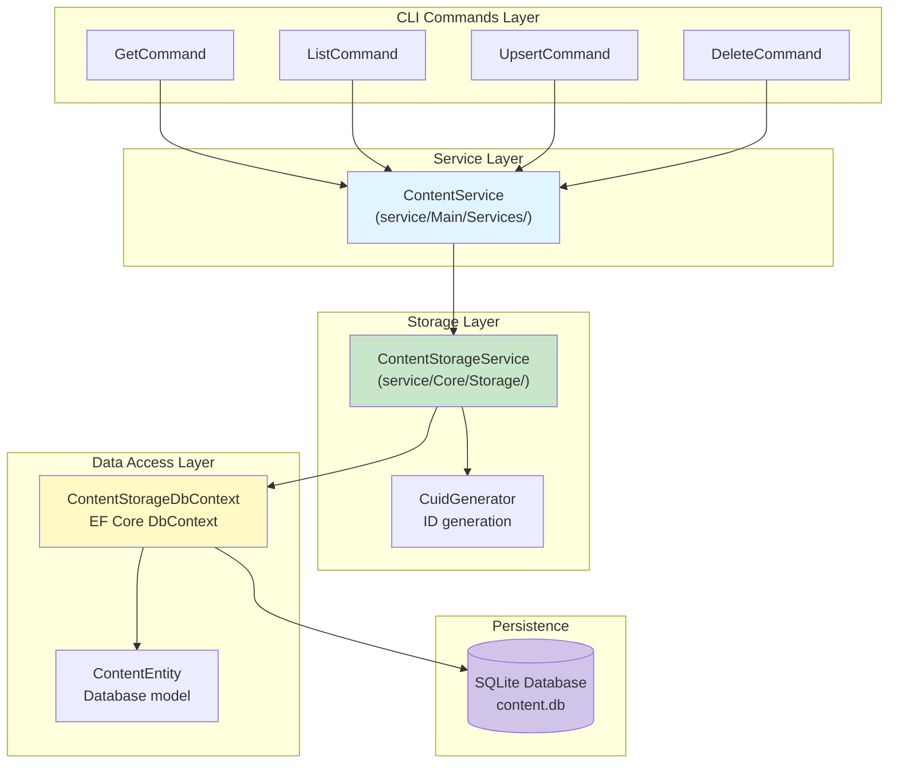
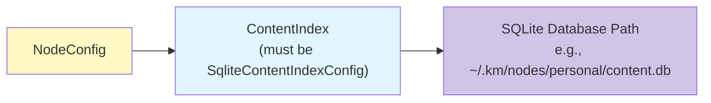
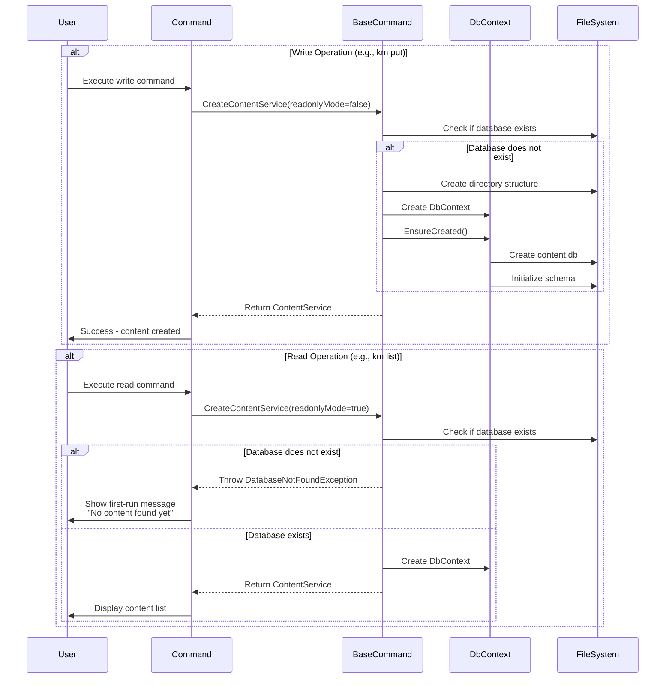
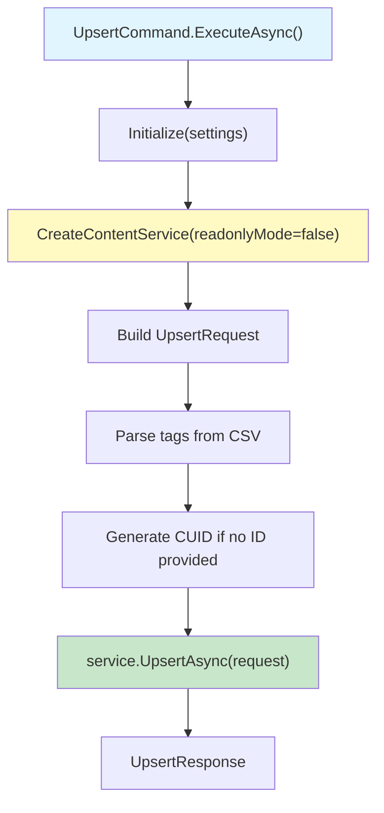
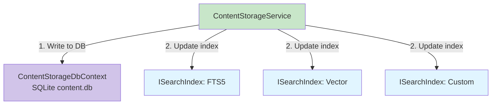

<!-- source: DeepWiki mcp.deepwiki.com · repo microsoft/kernel-memory · page 7.1 Content Storage · fetched 2026-10-26 -->

# Content Storage

<details>
<summary>Relevant source files</summary>

The following files were used as context for generating this wiki page:

- [src/Main/CLI/CliApplicationBuilder.cs](src/Main/CLI/CliApplicationBuilder.cs)
- [src/Main/CLI/Commands/BaseCommand.cs](src/Main/CLI/Commands/BaseCommand.cs)
- [src/Main/CLI/Commands/ConfigCommand.cs](src/Main/CLI/Commands/ConfigCommand.cs)
- [src/Main/CLI/Commands/DeleteCommand.cs](src/Main/CLI/Commands/DeleteCommand.cs)
- [src/Main/CLI/Commands/GetCommand.cs](src/Main/CLI/Commands/GetCommand.cs)
- [src/Main/CLI/Commands/ListCommand.cs](src/Main/CLI/Commands/ListCommand.cs)
- [src/Main/CLI/Commands/UpsertCommand.cs](src/Main/CLI/Commands/UpsertCommand.cs)
- [tests/Main.Tests/Integration/CliIntegrationTests.cs](tests/Main.Tests/Integration/CliIntegrationTests.cs)
- [tests/Main.Tests/Integration/CommandExecutionTests.cs](tests/Main.Tests/Integration/CommandExecutionTests.cs)
- [tests/Main.Tests/Integration/ConfigCommandTests.cs](tests/Main.Tests/Integration/ConfigCommandTests.cs)
- [tests/Main.Tests/Integration/ReadonlyCommandTests.cs](tests/Main.Tests/Integration/ReadonlyCommandTests.cs)

</details>


This page documents the content storage subsystem, which provides persistent storage for content items in KM². This includes the `ContentService` API, the `ContentStorageService` storage layer, SQLite database schema, CUID generation for content IDs, and the distinction between readonly and write modes.

For information about search indexing on top of stored content, see [Search Indexing](#7.2). For file and repository storage, see [File and Repository Storage](#7.3). For configuration of content indexes, see [Node Configuration](#6.2).

## Architecture Overview

The content storage system uses a layered architecture with clear separation between the service API, storage implementation, and database access:



**Sources:** [src/Main/CLI/Commands/BaseCommand.cs:90-169](), [src/Main/CLI/Commands/GetCommand.cs:67-69](), [src/Main/CLI/Commands/UpsertCommand.cs:83-103]()

## Core Components

### ContentService

`ContentService` is the primary API for content operations. It provides high-level methods for creating, reading, updating, and deleting content items.

**Location:** `service/Main/Services/ContentService.cs` (referenced in code but not in provided files)

**Key Responsibilities:**
- Content lifecycle management (CRUD operations)
- Node-level content isolation
- Integration with search indexes
- Coordination with storage layer

**API Methods:**
- `GetAsync(string id)` - Retrieve content by ID
- `ListAsync(int skip, int take)` - List content with pagination
- `CountAsync()` - Get total content count
- `UpsertAsync(UpsertRequest request)` - Create or update content
- `DeleteAsync(string id)` - Delete content by ID

**Sources:** [src/Main/CLI/Commands/GetCommand.cs:67-69](), [src/Main/CLI/Commands/ListCommand.cs:75-81](), [src/Main/CLI/Commands/UpsertCommand.cs:83-103](), [src/Main/CLI/Commands/DeleteCommand.cs:61-64]()

### ContentStorageService

`ContentStorageService` implements the storage layer, handling direct database access and transaction management.

**Created in:** [src/Main/CLI/Commands/BaseCommand.cs:166]()

**Constructor Dependencies:**
- `ContentStorageDbContext` - Entity Framework Core database context
- `CuidGenerator` - Content ID generator
- `ILogger<ContentStorageService>` - Logger instance
- `ISearchIndex[]` - Array of search indexes to update

The service coordinates database operations with search index updates to maintain consistency between the content store and search indexes.

**Sources:** [src/Main/CLI/Commands/BaseCommand.cs:159-169]()

### ContentStorageDbContext

`ContentStorageDbContext` is the Entity Framework Core database context that defines the SQLite database schema.

**Creation:** [src/Main/CLI/Commands/BaseCommand.cs:119-124]()

```
Connection String Format: "Data Source=" + dbPath
Database Provider: SQLite
```

The context is configured with a connection string pointing to the SQLite database file specified in the node's `SqliteContentIndexConfig.Path`.

**Sources:** [src/Main/CLI/Commands/BaseCommand.cs:119-124]()

### CuidGenerator

`CuidGenerator` generates collision-resistant unique identifiers (CUIDs) for content items when no explicit ID is provided.

**Created in:** [src/Main/CLI/Commands/BaseCommand.cs:134]()

CUIDs provide:
- Sortable timestamps
- Collision resistance
- URL-safe format
- Human-readable prefixes

**Sources:** [src/Main/CLI/Commands/BaseCommand.cs:134]()

## Database Schema and Location

### Database Path Resolution

The SQLite database path is determined by the node's `ContentIndex` configuration:



**Configuration Check:** [src/Main/CLI/Commands/BaseCommand.cs:94-98]()

```csharp
if (node.ContentIndex is not SqliteContentIndexConfig sqliteConfig)
{
    throw new InvalidOperationException($"Node '{node.Id}' does not use SQLite content index.");
}

var dbPath = sqliteConfig.Path;
```

### Database Schema

The `ContentStorageDbContext` defines tables for:

| Table | Purpose | Key Fields |
|-------|---------|-----------|
| `ContentEntity` | Main content storage | `Id`, `Content`, `MimeType`, `Title`, `Description`, `Tags`, `Metadata`, `CreatedAt`, `UpdatedAt` |

The schema is created automatically via Entity Framework Core migrations or `EnsureCreated()`.

**Sources:** [src/Main/CLI/Commands/BaseCommand.cs:94-98](), [src/Main/CLI/Commands/BaseCommand.cs:128-130]()

## Readonly vs Write Modes

Content storage operations are classified into two modes with different initialization behavior:

### Readonly Mode

**Used by:** `GetCommand`, `ListCommand`, `NodesCommand`, `ConfigCommand`

**Behavior:**
1. Verifies database file exists before attempting access
2. Does NOT create directories or database files
3. Throws `DatabaseNotFoundException` if database doesn't exist
4. Commands catch this exception to provide friendly first-run messages

**Code:** [src/Main/CLI/Commands/BaseCommand.cs:100-106]()

```csharp
// In readonly mode, verify database exists without creating it
if (readonlyMode)
{
    if (!File.Exists(dbPath))
    {
        throw new DatabaseNotFoundException(dbPath);
    }
}
```

### Write Mode

**Used by:** `UpsertCommand`, `DeleteCommand`

**Behavior:**
1. Creates directory structure if needed
2. Creates database via `EnsureCreated()` if it doesn't exist
3. Initializes schema on first run
4. Safe for first-time usage

**Code:** [src/Main/CLI/Commands/BaseCommand.cs:108-130]()

```csharp
// Write mode: Ensure directory exists
var dbDir = Path.GetDirectoryName(dbPath);
if (!string.IsNullOrEmpty(dbDir) && !Directory.Exists(dbDir))
{
    Directory.CreateDirectory(dbDir);
}

// ... create context ...

// In write mode, ensure database is created
if (!readonlyMode)
{
    context.Database.EnsureCreated();
}
```

**Sources:** [src/Main/CLI/Commands/BaseCommand.cs:100-130](), [tests/Main.Tests/Integration/ReadonlyCommandTests.cs:64-98]()

## Database Initialization Flow

The first-run experience varies by operation type:



**Sources:** [src/Main/CLI/Commands/BaseCommand.cs:100-130](), [src/Main/CLI/Commands/GetCommand.cs:84-124](), [src/Main/CLI/Commands/ListCommand.cs:92-136]()

## Content Operations

### Get Operation

Retrieves a single content item by ID.

**Implementation:** [src/Main/CLI/Commands/GetCommand.cs:59-95]()


**Exit Codes:**
- `0` (Success) - Content found or first-run scenario
- `1` (User Error) - Content not found in existing database

**Sources:** [src/Main/CLI/Commands/GetCommand.cs:59-95]()

### List Operation

Lists content with pagination support.

**Implementation:** [src/Main/CLI/Commands/ListCommand.cs:66-102]()

**Steps:**
1. Create service in readonly mode
2. Call `CountAsync()` to get total count
3. Call `ListAsync(skip, take)` to get page of items
4. Format results with pagination info

**Parameters:**
- `--skip` - Number of items to skip (default: 0)
- `--take` - Number of items to return (default: 20)

**Sources:** [src/Main/CLI/Commands/ListCommand.cs:66-102]()

### Upsert Operation

Creates new content or updates existing content.

**Implementation:** [src/Main/CLI/Commands/UpsertCommand.cs:75-129]()



**UpsertRequest Fields:**
- `Id` - Content ID (generated if empty)
- `Content` - Content text
- `MimeType` - MIME type (default: "text/plain")
- `Title` - Optional title
- `Description` - Optional description
- `Tags` - Array of tags
- `Metadata` - Additional key-value metadata

**Sources:** [src/Main/CLI/Commands/UpsertCommand.cs:75-129]()

### Delete Operation

Deletes content by ID. The operation is idempotent - deleting non-existent content succeeds.

**Implementation:** [src/Main/CLI/Commands/DeleteCommand.cs:53-89]()

**Idempotent Behavior:**
- Deleting non-existent content returns success
- No error thrown if ID doesn't exist
- Consistent with HTTP DELETE semantics

**Sources:** [src/Main/CLI/Commands/DeleteCommand.cs:53-89](), [tests/Main.Tests/Integration/CommandExecutionTests.cs:105-121]()

## Integration with Search Indexes

The storage layer coordinates with search indexes to maintain consistency:



**Index Creation:** [src/Main/CLI/Commands/BaseCommand.cs:159-163]()

```csharp
// Create all search indexes from node configuration
var searchIndexes = SearchIndexFactory.CreateIndexes(
    node.SearchIndexes,
    httpClient,
    embeddingCache,
    this._loggerFactory);
```

When content is upserted or deleted:
1. `ContentStorageService` updates the SQLite database
2. All configured search indexes are notified and updated
3. Transaction consistency is maintained

**Sources:** [src/Main/CLI/Commands/BaseCommand.cs:159-169]()

## Embedding Cache Integration

The content storage system integrates with optional embedding caches to improve performance:

**Cache Configuration:** [src/Main/CLI/Commands/BaseCommand.cs:139-156]()

```csharp
IEmbeddingCache? embeddingCache = null;
if (this._config.EmbeddingsCache != null)
{
    var cachePath = this._config.EmbeddingsCache.Path;
    var cacheLogger = this._loggerFactory.CreateLogger<SqliteEmbeddingCache>();

    // Determine cache mode from allowRead/allowWrite flags
    var cacheMode = (this._config.EmbeddingsCache.AllowRead, this._config.EmbeddingsCache.AllowWrite) switch
    {
        (true, true) => CacheModes.ReadWrite,
        (true, false) => CacheModes.ReadOnly,
        (false, true) => CacheModes.WriteOnly,
        (false, false) => throw new InvalidOperationException("...")
    };

    embeddingCache = new SqliteEmbeddingCache(cachePath, cacheMode, cacheLogger);
}
```

The embedding cache is shared across all nodes in the configuration and passed to search indexes for vector storage optimization.

**Cache Modes:**

| Mode | AllowRead | AllowWrite | Use Case |
|------|-----------|------------|----------|
| ReadWrite | ✓ | ✓ | Normal operation |
| ReadOnly | ✓ | ✗ | Shared read-only cache |
| WriteOnly | ✗ | ✓ | Cache population only |

**Sources:** [src/Main/CLI/Commands/BaseCommand.cs:139-156]()

## Error Handling and First-Run UX

The storage system provides friendly error handling for first-run scenarios:

### DatabaseNotFoundException

**Definition:** [src/Main/CLI/Exceptions/DatabaseNotFoundException.cs]() (referenced but not provided)

**Thrown by:** [src/Main/CLI/Commands/BaseCommand.cs:105]()

**Caught by:**
- [src/Main/CLI/Commands/GetCommand.cs:84-88]()
- [src/Main/CLI/Commands/ListCommand.cs:92-96]()

### First-Run Messages

When readonly commands encounter a missing database, they display helpful guidance:

**GetCommand first-run message:** [src/Main/CLI/Commands/GetCommand.cs:99-124]()
```
Content with ID 'xyz' not found.

No content database exists yet. This is your first run.

Create content first:
  km put "Your content here" --id xyz

Or list available content:
  km list
```

**ListCommand first-run message:** [src/Main/CLI/Commands/ListCommand.cs:104-136]()
```
Welcome to Kernel Memory! 🚀

No content found in node 'personal' yet.

To get started:
  km put "Your content here"

Example:
  km put "Hello, world!" --id greeting
```

**Sources:** [src/Main/CLI/Commands/GetCommand.cs:99-124](), [src/Main/CLI/Commands/ListCommand.cs:104-136]()

## Testing Strategy

The content storage system has comprehensive test coverage:

### Integration Tests

**File:** [tests/Main.Tests/Integration/CliIntegrationTests.cs]()

**Test Categories:**
- End-to-end workflows (upsert → get → list → delete)
- Pagination behavior
- Custom ID handling
- Metadata storage
- First-run scenarios

**Example:** [tests/Main.Tests/Integration/CliIntegrationTests.cs:486-541]()

### Readonly Behavior Tests

**File:** [tests/Main.Tests/Integration/ReadonlyCommandTests.cs]()

**Purpose:** Verify readonly commands never create files or directories

**Test Cases:**
- `BugA_ListCommand_NonExistentDatabase_ShouldNotCreateDirectory` [tests/Main.Tests/Integration/ReadonlyCommandTests.cs:64-98]()
- `BugA_GetCommand_NonExistentDatabase_ShouldNotCreateDirectory` [tests/Main.Tests/Integration/ReadonlyCommandTests.cs:100-134]()
- `BugA_NodesCommand_NonExistentDatabase_ShouldNotCreateDirectory` [tests/Main.Tests/Integration/ReadonlyCommandTests.cs:136-169]()

**Key Assertion:**
```csharp
Assert.False(Directory.Exists(dbDir),
    $"BUG: ListCommand (readonly) should NOT create directory: {dbDir}");
Assert.False(File.Exists(this._dbPath),
    $"BUG: ListCommand (readonly) should NOT create database: {this._dbPath}");
```

**Sources:** [tests/Main.Tests/Integration/ReadonlyCommandTests.cs:64-205]()

## Configuration Examples

### Default Personal Node

```json
{
  "nodes": {
    "personal": {
      "id": "personal",
      "contentIndex": {
        "type": "sqlite",
        "path": "~/.km/nodes/personal/content.db"
      }
    }
  }
}
```

### Multi-Node Configuration

```json
{
  "nodes": {
    "personal": {
      "id": "personal",
      "contentIndex": {
        "type": "sqlite",
        "path": "~/.km/nodes/personal/content.db"
      }
    },
    "work": {
      "id": "work",
      "contentIndex": {
        "type": "sqlite",
        "path": "~/.km/nodes/work/content.db"
      }
    },
    "shared": {
      "id": "shared",
      "access": "ReadOnly",
      "contentIndex": {
        "type": "sqlite",
        "path": "/shared/content.db"
      }
    }
  }
}
```

Each node has its own isolated SQLite database for content storage.

**Sources:** [tests/Main.Tests/Integration/ConfigCommandTests.cs:36-46](), [src/Main/CLI/Commands/BaseCommand.cs:94-98]()

---

