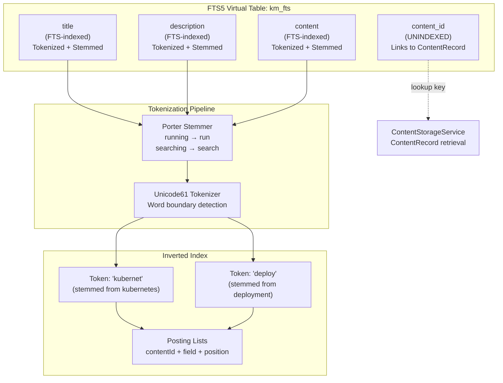
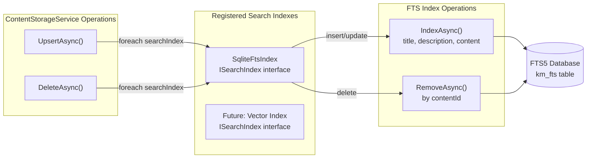
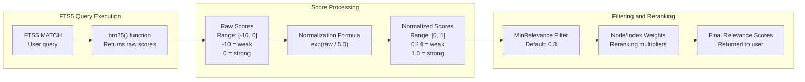
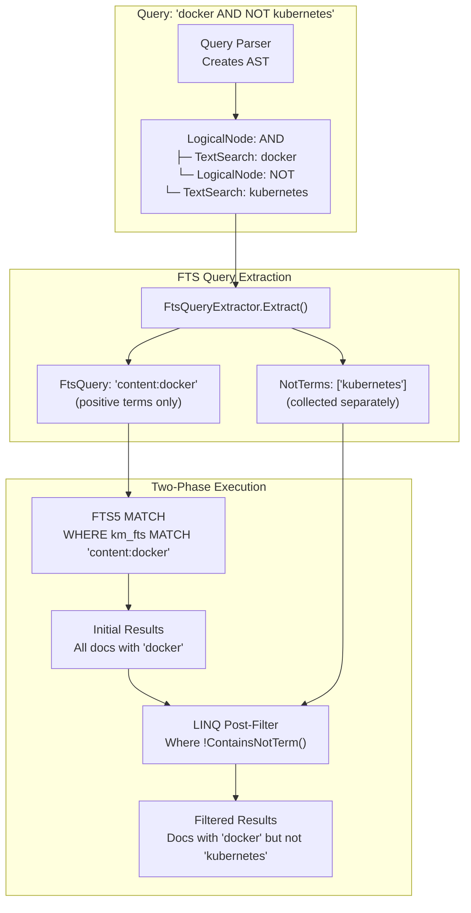

<!-- source: DeepWiki mcp.deepwiki.com · repo microsoft/kernel-memory · page 7.2 Search Indexing · fetched 2026-10-26 -->

# Search Indexing

<details>
<summary>Relevant source files</summary>

The following files were used as context for generating this wiki page:

- [KNOWN-ISSUES.md](KNOWN-ISSUES.md)
- [src/Core/Search/NodeSearchService.cs](src/Core/Search/NodeSearchService.cs)
- [src/Core/Search/Query/Parsers/InfixQueryParser.cs](src/Core/Search/Query/Parsers/InfixQueryParser.cs)
- [src/Core/Search/SearchService.cs](src/Core/Search/SearchService.cs)
- [src/Core/Search/SqliteFtsIndex.cs](src/Core/Search/SqliteFtsIndex.cs)
- [src/Main/CLI/Commands/ExamplesCommand.cs](src/Main/CLI/Commands/ExamplesCommand.cs)
- [src/Main/CLI/Commands/SearchCommand.cs](src/Main/CLI/Commands/SearchCommand.cs)
- [tests/Core.Tests/Search/FtsQueryExtractionTest.cs](tests/Core.Tests/Search/FtsQueryExtractionTest.cs)
- [tests/Core.Tests/Search/NodeSearchServiceIndexIdTests.cs](tests/Core.Tests/Search/NodeSearchServiceIndexIdTests.cs)
- [tests/Core.Tests/Search/Query/InfixQueryParserTests.cs](tests/Core.Tests/Search/Query/InfixQueryParserTests.cs)
- [tests/Core.Tests/Search/SearchEndToEndTests.cs](tests/Core.Tests/Search/SearchEndToEndTests.cs)
- [tests/Core.Tests/Search/SearchServiceIndexWeightsTests.cs](tests/Core.Tests/Search/SearchServiceIndexWeightsTests.cs)
- [tests/Main.Tests/Integration/ExamplesCommandE2ETests.cs](tests/Main.Tests/Integration/ExamplesCommandE2ETests.cs)

</details>


This page explains how KM² implements full-text search indexing using SQLite FTS5. It covers the FTS5 virtual table structure, field-specific indexing, tokenization, stemming, and index maintenance operations.

For information about query parsing and execution, see [Search System](#5). For content storage operations, see [Content Storage](#7.1).

---

## Overview

Search indexing in KM² is implemented through `SqliteFtsIndex`, which wraps SQLite's FTS5 (Full-Text Search version 5) extension. The index maintains a separate database file from content storage and supports:

- **Field-specific indexing**: `title`, `description`, and `content` fields are indexed separately for targeted searches
- **Porter stemming**: Optional word stemming for better match recall (e.g., "running" matches "run")
- **BM25 scoring**: Relevance ranking based on term frequency and document frequency
- **Contentless mode**: Previously used, but now stores full content to support snippet generation

The indexing system is tightly integrated with `ContentStorageService`, which automatically keeps the FTS index synchronized when content is created, updated, or deleted.

Sources: [src/Core/Search/SqliteFtsIndex.cs:1-320]()

---

## FTS5 Virtual Table Structure

### Schema Definition

The FTS5 virtual table is created with the following schema:

```sql
CREATE VIRTUAL TABLE IF NOT EXISTS km_fts USING fts5(
    content_id UNINDEXED,
    title,
    description,
    content,
    tokenize='porter unicode61'
);
```

**Field Breakdown:**

| Field | Type | Purpose |
|-------|------|---------|
| `content_id` | UNINDEXED | Links to content record, not searchable |
| `title` | FTS-indexed | Enables queries like `title:kubernetes` |
| `description` | FTS-indexed | Enables queries like `description:guide` |
| `content` | FTS-indexed | Main text body for full-text search |

The `UNINDEXED` qualifier on `content_id` means it's stored but not tokenized, since it's only used for lookups after FTS matching.



Sources: [src/Core/Search/SqliteFtsIndex.cs:55-75](), [src/Core/Search/SqliteFtsIndex.cs:96-119]()

---

## Indexing Operations

### Index Initialization

The `SqliteFtsIndex` lazily initializes the database and FTS5 table on first use:

```csharp
public async Task InitializeAsync(CancellationToken cancellationToken = default)
{
    if (this._connection != null) return;
    
    this._connection = new SqliteConnection(this._connectionString);
    await this._connection.OpenAsync(cancellationToken);
    
    // Set synchronous=FULL to ensure writes are immediately persisted
    // Prevents data loss when connections are disposed quickly (CLI scenario)
    using (var pragmaCmd = this._connection.CreateCommand())
    {
        pragmaCmd.CommandText = "PRAGMA synchronous=FULL;";
        await pragmaCmd.ExecuteNonQueryAsync(cancellationToken);
    }
    
    // Create FTS5 virtual table...
}
```

The `PRAGMA synchronous=FULL` setting is critical for CLI scenarios where connections are short-lived. Without it, writes might not be flushed to disk before the process exits.

Sources: [src/Core/Search/SqliteFtsIndex.cs:36-78]()

### Upsert Semantics

The `IndexAsync` method implements upsert semantics by removing existing entries before insertion:

```csharp
public async Task IndexAsync(string contentId, string? title, string? description, 
                             string content, CancellationToken cancellationToken = default)
{
    await this.InitializeAsync(cancellationToken);
    
    // Remove existing entry first (upsert semantics)
    await this.RemoveAsync(contentId, cancellationToken);
    
    // Insert new entry with separate fields
    var insertSql = $"INSERT INTO {TableName}(content_id, title, description, content) " +
                    "VALUES (@contentId, @title, @description, @content)";
    // ... parameter binding and execution
}
```

This two-step process ensures that updating content properly re-indexes all fields without creating duplicate entries.

Sources: [src/Core/Search/SqliteFtsIndex.cs:96-119]()

### Integration with Content Storage

`ContentStorageService` automatically maintains the FTS index when content changes:



The `ISearchIndex` interface allows multiple search indexes (FTS, vector, etc.) to be notified when content changes. Each node can have multiple search indexes registered, and all are kept in sync automatically.

Sources: [src/Core/Search/SqliteFtsIndex.cs:81-119](), [src/Core/Storage/ContentStorageService.cs:100-150]()

---

## Tokenization and Stemming

### Porter Stemming

When `enableStemming` is true, the FTS5 table uses the Porter stemmer:

```
tokenize='porter unicode61'
```

**Stemming Examples:**

| Original | Stemmed | Benefit |
|----------|---------|---------|
| searching | search | Matches "search", "searches", "searched" |
| connections | connect | Matches "connect", "connecting", "connector" |
| summaries | summari | Matches "summary", "summarize" |
| kubernetes | kubernet | (Porter may over-stem technical terms) |

The `unicode61` tokenizer handles Unicode characters correctly and splits on word boundaries.

**Trade-offs:**
- **Pros**: Better recall - searching "summaries" finds "summary"
- **Cons**: May match unintended words, especially with technical terminology
- **Configuration**: Set per-index at creation time via `SqliteFtsIndex` constructor

Sources: [src/Core/Search/SqliteFtsIndex.cs:59](), [tests/Core.Tests/Search/SearchEndToEndTests.cs:249-263]()

### Reserved Word Handling

FTS5 has reserved words (`AND`, `OR`, `NOT`, `NEAR`) that receive special handling in query extraction. The `FtsQueryExtractor` detects these and wraps them in quotes when used as literal search terms:

```csharp
private static readonly HashSet<string> s_fts5ReservedWords = 
    new(StringComparer.OrdinalIgnoreCase)
{
    "AND", "OR", "NOT", "NEAR"
};

private bool IsFts5ReservedWord(string term)
{
    return s_fts5ReservedWords.Contains(term);
}
```

When a user searches for `"NOT"` (quoted), the parser creates a `TextSearchNode`, and the FTS query extractor wraps it in quotes for FTS5: `"NOT"`. This allows users to search for documents containing these literal words.

Sources: [src/Core/Search/NodeSearchService.cs:236-285](), [tests/Core.Tests/Search/FtsQueryExtractionTest.cs:97-148]()

---

## Search Query Execution

### FTS5 MATCH Syntax

The `SearchAsync` method executes FTS5 queries using the `MATCH` operator:

```sql
SELECT
    content_id,
    bm25(km_fts) as raw_score,
    snippet(km_fts, 3, '', '', '...', 32) as snippet
FROM km_fts
WHERE km_fts MATCH @query
ORDER BY raw_score
LIMIT @limit
```

**Query Syntax Examples:**

| User Query | FTS5 Query | Explanation |
|------------|-----------|-------------|
| `kubernetes` | `{title description content}:kubernetes` | Search all fields |
| `content:docker` | `content:docker` | Search only content field |
| `docker AND kubernetes` | `(content:docker) AND (content:kubernetes)` | Boolean AND |
| `"machine learning"` | `"machine learning"` | Phrase search (exact order) |
| `"NOT"` | `"NOT"` | Literal reserved word (quoted) |

The `snippet()` function extracts highlighted text excerpts from the `content` field (column index 3), showing up to 32 words around the match.

Sources: [src/Core/Search/SqliteFtsIndex.cs:143-217](), [src/Core/Search/NodeSearchService.cs:267-299]()

### Field-Specific Query Generation

The `FtsQueryExtractor` converts AST nodes to FTS5 syntax with field prefixes:

```mermaid
graph TB
    subgraph "Query AST"
        Text["TextSearchNode<br/>SearchText: 'kubernetes'<br/>Field: 'content'"]
        Comparison["ComparisonNode<br/>Field: 'title'<br/>Operator: Equal<br/>Value: 'api'"]
    end
    
    subgraph "FTS Query Extraction"
        Visitor["FtsQueryExtractor<br/>ExtractTerms()"]
        Reserved["IsFts5ReservedWord()<br/>Check AND, OR, NOT, NEAR"]
        Escape["EscapeFtsPhrase()<br/>Double internal quotes"]
    end
    
    subgraph "Generated FTS5 Queries"
        Q1["content:kubernetes<br/>(single word with field)"]
        Q2["title:api<br/>(field-specific)"]
        Q3["\"{title description content}:term\"<br/>(quoted reserved word)"]
        Q4["\"machine learning\"<br/>(phrase without field)"]
    end
    
    Text --> Visitor
    Comparison --> Visitor
    Visitor --> Reserved
    Reserved -->|not reserved| Q1
    Reserved -->|reserved| Q3
    Visitor --> Escape
    Escape --> Q4
    Visitor --> Q2
```

**Field Resolution Logic:**

1. **With field**: `content:kubernetes` → `content:kubernetes`
2. **Without field**: `kubernetes` → `{title description content}:kubernetes`
3. **Phrase**: `"machine learning"` → `"machine learning"` (no field prefix)
4. **Reserved word**: `NOT` → `"NOT"` (must quote, no field prefix)

FTS5 limitation: Quoted terms cannot use field prefixes. The syntax `content:"value"` is invalid in FTS5, so phrases and reserved words search all fields.

Sources: [src/Core/Search/NodeSearchService.cs:265-299](), [src/Core/Search/NodeSearchService.cs:379-415]()

---

## BM25 Score Normalization

### Raw BM25 Scores

SQLite FTS5's `bm25()` function returns negative scores where more negative = better match:

```
Typical range: [-10, 0]
Perfect match: ~0
Poor match: ~-10
```

These raw scores are unsuitable for user-facing relevance values (0.0 to 1.0).

### Exponential Normalization

The normalization formula converts BM25 scores to the [0, 1] range:

```csharp
var normalizedScore = Math.Exp(rawScore / Constants.SearchDefaults.Bm25NormalizationDivisor);
```

Where `Bm25NormalizationDivisor` is typically `5.0`:

| Raw BM25 | Normalized Score | Interpretation |
|----------|------------------|----------------|
| 0.0 | 1.0 | Perfect match |
| -1.0 | 0.82 | Excellent match |
| -5.0 | 0.37 | Good match |
| -10.0 | 0.14 | Weak match |

This exponential curve ensures that top results have high scores while still distinguishing between match qualities.



**Critical Bug Fix:** Before normalization was implemented, all searches returned 0 results because raw BM25 scores (~0.000001) were filtered out by the default `MinRelevance=0.3`. The exponential normalization ensures scores are in the expected range.

Sources: [src/Core/Search/SqliteFtsIndex.cs:195-212](), [tests/Core.Tests/Search/SearchEndToEndTests.cs:571-588]()

---

## Special Query Handling

### Match-All Queries

When a query contains only `NOT` terms (e.g., `NOT deprecated`), the FTS query extractor returns `"*"` as the positive query. Since FTS5 doesn't support `*` as a match-all operator, `SqliteFtsIndex` has special handling:

```csharp
if (query == "*")
{
    return await this.GetAllDocumentsAsync(limit, cancellationToken);
}
```

This returns all documents with a default score of 1.0, allowing the `NodeSearchService` to apply NOT filtering via LINQ post-processing.

Sources: [src/Core/Search/SqliteFtsIndex.cs:152-158](), [src/Core/Search/SqliteFtsIndex.cs:227-262]()

### NOT Term Post-Filtering

FTS5's `NOT` operator has limitations (requires left operand), so KM² uses a two-phase approach:

1. **FTS Phase**: Extract positive terms only, execute FTS query
2. **LINQ Phase**: Apply NOT term filtering on results



The `NotTerm` record includes optional field information for field-specific exclusions:

```csharp
public sealed record NotTerm(string Term, string? Field);
```

Sources: [src/Core/Search/NodeSearchService.cs:14-26](), [src/Core/Search/NodeSearchService.cs:303-340](), [src/Core/Search/NodeSearchService.cs:145-211]()

---

## Index Lifecycle Management

### Database Initialization

Index initialization is lazy and happens on first operation:

```csharp
public async Task InitializeAsync(CancellationToken cancellationToken = default)
{
    if (this._connection != null) return; // Already initialized
    
    this._connection = new SqliteConnection(this._connectionString);
    await this._connection.OpenAsync(cancellationToken);
    
    // Set PRAGMA synchronous=FULL for data safety
    // Create FTS5 virtual table if not exists
}
```

For readonly operations (search-only), the database must already exist. For write operations (indexing), the database and table are created automatically.

Sources: [src/Core/Search/SqliteFtsIndex.cs:36-78]()

### Disposal and WAL Checkpoint

Proper disposal ensures pending writes are flushed to disk:

```csharp
public void Dispose()
{
    if (this._disposed) return;
    
    if (this._connection != null)
    {
        try
        {
            // Execute a checkpoint to flush WAL to disk (if WAL mode is enabled)
            using var cmd = this._connection.CreateCommand();
            cmd.CommandText = "PRAGMA wal_checkpoint(TRUNCATE);";
            cmd.ExecuteNonQuery();
        }
        catch (SqliteException ex)
        {
            this._logger.LogWarning(ex, "Failed to checkpoint WAL");
        }
        
        this._connection.Close();
        this._connection.Dispose();
    }
    
    this._disposed = true;
}
```

The WAL (Write-Ahead Logging) checkpoint is critical for ensuring all writes are persisted before the connection closes. This is especially important in CLI scenarios where the process exits immediately after indexing.

Sources: [src/Core/Search/SqliteFtsIndex.cs:285-319]()

### Clear Operation

The `ClearAsync` method deletes all entries from the FTS index:

```csharp
public async Task ClearAsync(CancellationToken cancellationToken = default)
{
    await this.InitializeAsync(cancellationToken);
    
    var deleteSql = $"DELETE FROM {TableName}";
    // ... execute deletion
}
```

This is typically used during testing or when rebuilding the index from scratch.

Sources: [src/Core/Search/SqliteFtsIndex.cs:265-279]()

---

## Configuration and Extension

### Index Configuration Options

`SqliteFtsIndex` is configured at construction time:

```csharp
public SqliteFtsIndex(
    string dbPath,           // Path to SQLite database file
    bool enableStemming,     // Enable Porter stemmer
    ILogger<SqliteFtsIndex> logger)
```

**Stemming Trade-off:**
- **Enabled**: Better recall, may match unintended words
- **Disabled**: Exact matching only, better precision

Per the test suite, stemming is enabled by default in most scenarios:

```csharp
var ftsIndex = new SqliteFtsIndex(ftsDbPath, enableStemming: true, logger);
```

Sources: [src/Core/Search/SqliteFtsIndex.cs:20-31](), [tests/Core.Tests/Search/SearchEndToEndTests.cs:41-43]()

### Node-Specific Index IDs

Each `NodeSearchService` can specify a custom index ID:

```csharp
public NodeSearchService(
    string nodeId,
    IFtsIndex ftsIndex,
    IContentStorage contentStorage,
    string indexId = Constants.SearchDefaults.DefaultFtsIndexId)
```

This allows multiple nodes to use different index IDs for weighted reranking. The default is `"fts-main"`.

Sources: [src/Core/Search/NodeSearchService.cs:47-57](), [tests/Core.Tests/Search/NodeSearchServiceIndexIdTests.cs:63-99]()

---

## Known Limitations

### Quoted Values in Field Queries

FTS5 does not support field-specific phrase searches:

```
INVALID: content:"user:password"  ← FTS5 syntax error
VALID:   "user:password"          ← Searches all fields
VALID:   content:user             ← Single word with field
```

This is a limitation of SQLite FTS5 syntax. When quotes are needed (phrases or reserved words), the field prefix must be omitted.

Sources: [KNOWN-ISSUES.md:1-35](), [src/Core/Search/NodeSearchService.cs:267-299]()

### NOT Operator Limitations

FTS5's native `NOT` requires a left operand:

```
INVALID: NOT foo        ← FTS5 requires left operand
VALID:   * NOT foo      ← But FTS5 doesn't support * operator
WORKAROUND: Get all docs, filter via LINQ
```

KM² works around this by extracting NOT terms separately and filtering results using LINQ after FTS execution. This means NOT filtering happens in-memory rather than at the database level.

Sources: [src/Core/Search/NodeSearchService.cs:303-377](), [tests/Core.Tests/Search/SearchEndToEndTests.cs:171-174]()

---

## Summary

The search indexing system provides:

- **Field-specific indexing** via FTS5 with separate `title`, `description`, `content` fields
- **Porter stemming** for better match recall (configurable)
- **BM25 scoring** with exponential normalization to [0, 1] range
- **Automatic synchronization** with content storage operations
- **Workarounds** for FTS5 limitations (NOT operators, quoted field values)

The `SqliteFtsIndex` class encapsulates all FTS5 interactions and is integrated into the content management pipeline through the `ISearchIndex` interface, allowing multiple search indexes per node.

Sources: [src/Core/Search/SqliteFtsIndex.cs:1-320](), [src/Core/Search/NodeSearchService.cs:1-459]()

---

