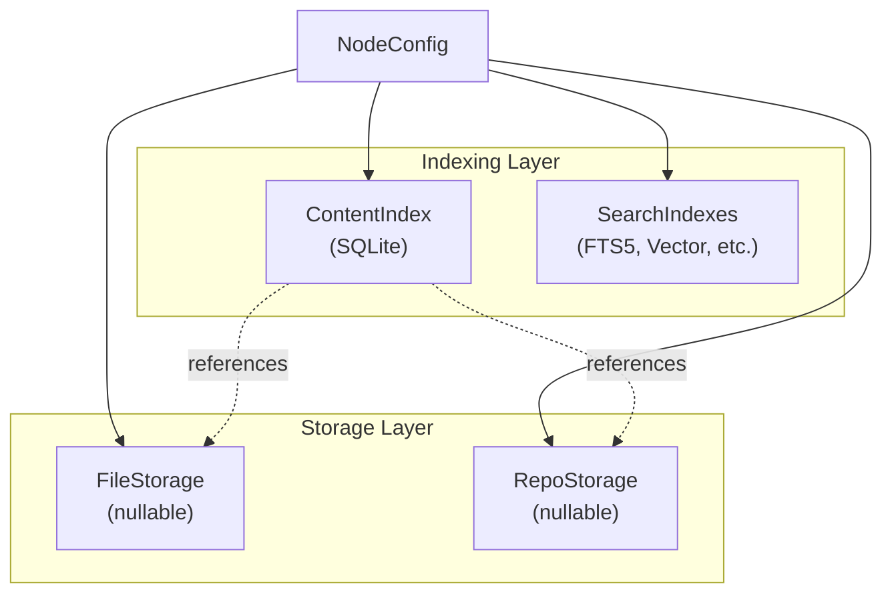
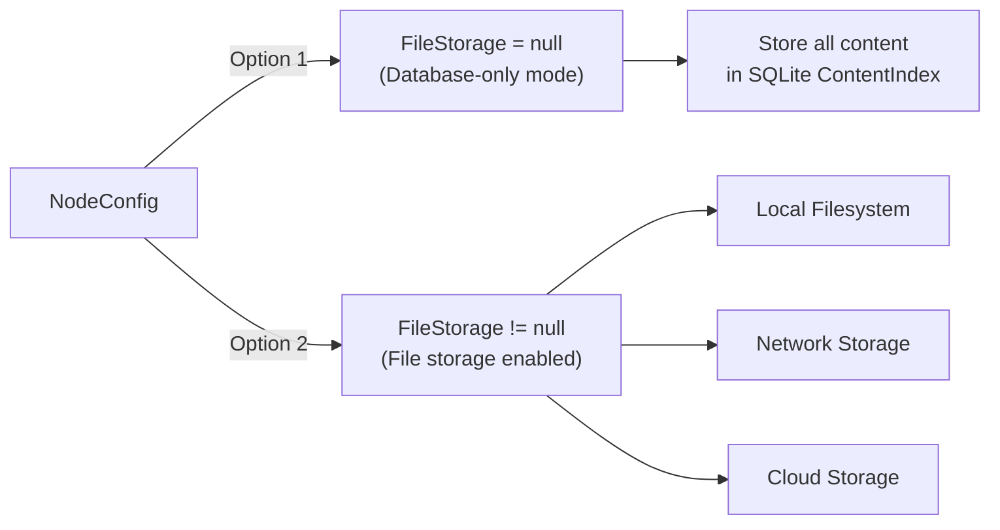
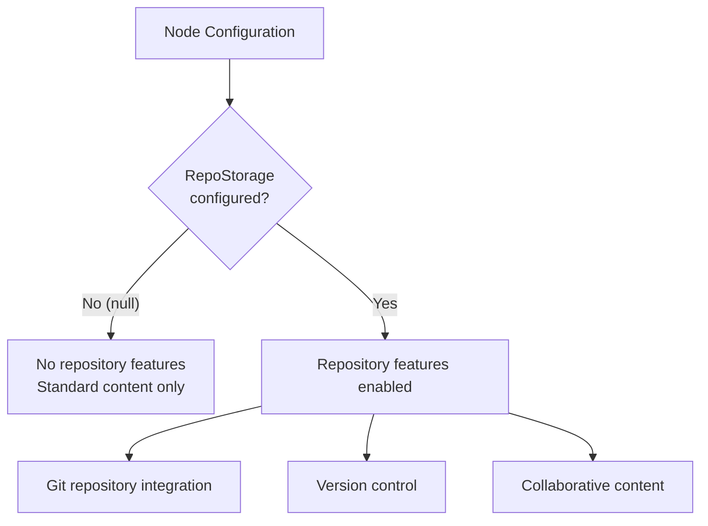
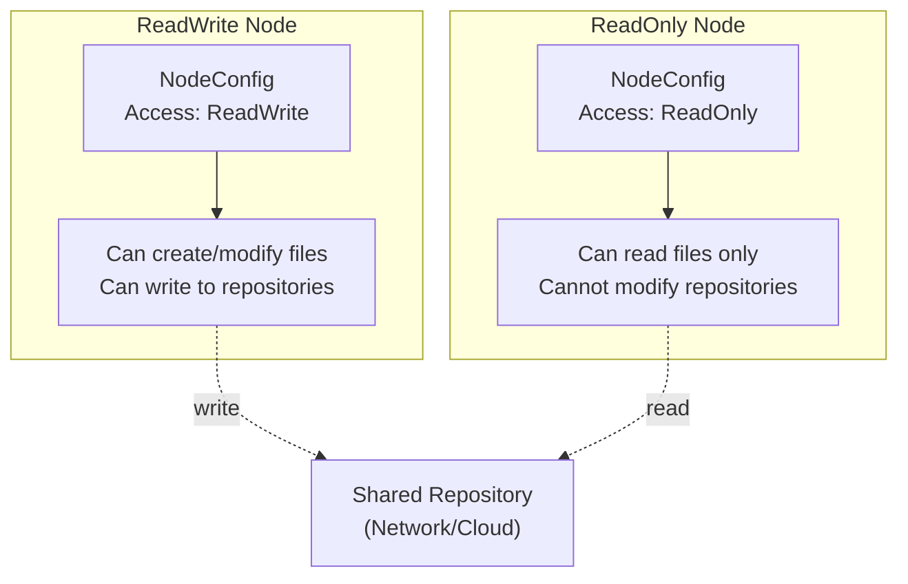
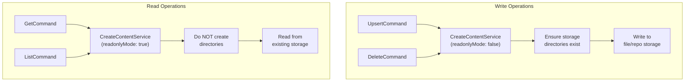
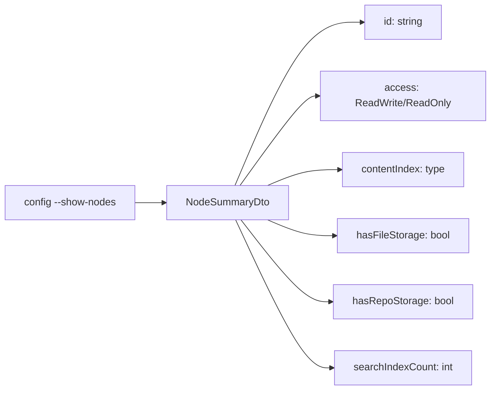
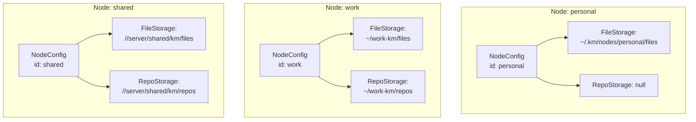
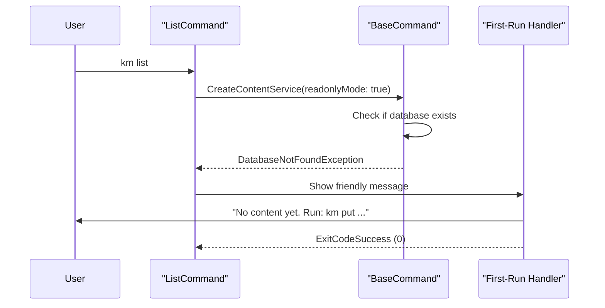
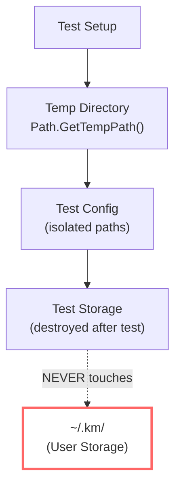

<!-- source: DeepWiki mcp.deepwiki.com · repo microsoft/kernel-memory · page 7.3 File and Repository Storage · fetched 2026-10-26 -->

# File and Repository Storage

<details>
<summary>Relevant source files</summary>

The following files were used as context for generating this wiki page:

- [src/Main/CLI/CliApplicationBuilder.cs](src/Main/CLI/CliApplicationBuilder.cs)
- [src/Main/CLI/Commands/BaseCommand.cs](src/Main/CLI/Commands/BaseCommand.cs)
- [src/Main/CLI/Commands/ConfigCommand.cs](src/Main/CLI/Commands/ConfigCommand.cs)
- [src/Main/CLI/Commands/DeleteCommand.cs](src/Main/CLI/Commands/DeleteCommand.cs)
- [src/Main/CLI/Commands/GetCommand.cs](src/Main/CLI/Commands/GetCommand.cs)
- [src/Main/CLI/Commands/ListCommand.cs](src/Main/CLI/Commands/ListCommand.cs)
- [src/Main/CLI/Commands/UpsertCommand.cs](src/Main/CLI/Commands/UpsertCommand.cs)
- [tests/Main.Tests/Integration/CliIntegrationTests.cs](tests/Main.Tests/Integration/CliIntegrationTests.cs)
- [tests/Main.Tests/Integration/CommandExecutionTests.cs](tests/Main.Tests/Integration/CommandExecutionTests.cs)
- [tests/Main.Tests/Integration/ConfigCommandTests.cs](tests/Main.Tests/Integration/ConfigCommandTests.cs)
- [tests/Main.Tests/Integration/ReadonlyCommandTests.cs](tests/Main.Tests/Integration/ReadonlyCommandTests.cs)

</details>


This page documents the file storage and repository storage systems in KM², which handle persistent storage of content artifacts separate from the SQLite-based content index. These storage mechanisms allow nodes to store files, documents, and other binary content alongside their indexed metadata.

For information about the SQLite content index that stores content metadata and records, see [Content Storage](#7.1). For search-specific indexing, see [Search Indexing](#7.2).

---

## Overview and Purpose

KM² separates content metadata from content artifacts using a two-tier storage architecture:

1. **Content Index** (SQLite) - Stores content records, metadata, tags, and relationships
2. **File/Repository Storage** - Stores actual file artifacts and binary content

Each node can independently configure its file storage and repository storage locations, enabling flexible deployment scenarios such as local-only storage, network-attached storage, or cloud-based repositories.

Sources: [src/Main/CLI/Commands/ConfigCommand.cs:104-106]()

---

## Storage Types in Node Configuration

### Node Storage Architecture



**Node Storage Configuration Structure**

Each `NodeConfig` contains three independent storage configurations:

| Storage Component | Purpose | Required |
|-------------------|---------|----------|
| `ContentIndex` | Metadata and content records | Yes |
| `FileStorage` | File artifacts and documents | No (nullable) |
| `RepoStorage` | Repository and version-controlled content | No (nullable) |

Sources: [src/Main/CLI/Commands/ConfigCommand.cs:103-106]()

---

## File Storage Configuration

### Purpose and Use Cases

File storage handles persistent storage of content artifacts that are too large or unsuitable for direct database storage:

- Document files (PDF, DOCX, etc.)
- Media files (images, audio, video)
- Binary attachments
- Raw text files
- Archived content

### Configuration Structure

The `FileStorage` property on `NodeConfig` is nullable, allowing nodes to operate with database-only storage when file storage is not needed.



**File Storage Detection**

The system detects whether a node has file storage configured:

```
HasFileStorage = nodeConfig.FileStorage != null
```

This boolean flag is used throughout the system to determine whether file-based operations are available for a given node.

Sources: [src/Main/CLI/Commands/ConfigCommand.cs:104]()

### File Storage Scenarios

| Scenario | FileStorage Value | Behavior |
|----------|-------------------|----------|
| Database-only node | `null` | All content stored in SQLite, no file artifacts |
| Local storage node | Configured with local path | Files stored in local filesystem directory |
| Network storage node | Configured with network path | Files stored on network-attached storage |
| Cloud storage node | Configured with cloud path | Files stored in cloud storage service |

---

## Repository Storage Configuration

### Purpose and Use Cases

Repository storage is designed for version-controlled and repository-based content:

- Git repositories
- Source code trees
- Version-controlled documentation
- Collaborative content repositories
- Shared knowledge bases

### Configuration Structure

Like file storage, `RepoStorage` is a nullable property on `NodeConfig`, allowing nodes to operate without repository features when not needed.



**Repository Storage Detection**

The system checks for repository storage availability:

```
HasRepoStorage = nodeConfig.RepoStorage != null
```

Sources: [src/Main/CLI/Commands/ConfigCommand.cs:105]()

---

## Storage and Node Access Modes

Storage configuration interacts with node access modes to control read/write permissions:

### Access Mode Impact on Storage



| Node Access | File Storage | Repository Storage |
|-------------|--------------|-------------------|
| `ReadWrite` | Full read/write to files | Can commit/push to repositories |
| `ReadOnly` | Read-only file access | Read-only repository access |

This enables scenarios like:
- Personal node (ReadWrite) for individual work with local file storage
- Shared node (ReadOnly) accessing team repository storage
- Archive node (ReadOnly) pointing to read-only file storage

Sources: [src/Main/CLI/Commands/ConfigCommand.cs:102](), High-level architecture Diagram 6

---

## Storage in Command Operations

### Content Management Operations

Content management commands interact with storage differently based on operation type:



**Write Mode Behavior**

When creating a `ContentService` in write mode (`readonlyMode: false`):
1. Storage directories are created if they don't exist
2. File storage paths are initialized
3. Repository storage is made writable (if configured)

**Read-Only Mode Behavior**

When creating a `ContentService` in read-only mode (`readonlyMode: true`):
1. No directories are created
2. Storage must already exist
3. Operations fail gracefully if storage is missing (first-run scenario)

Sources: [src/Main/CLI/Commands/BaseCommand.cs:86-116](), [src/Main/CLI/Commands/GetCommand.cs:67](), [src/Main/CLI/Commands/UpsertCommand.cs:83]()

### Command Storage Requirements

| Command | Storage Mode | Directory Creation | Storage Required |
|---------|--------------|-------------------|------------------|
| `put` (upsert) | Write | Yes | Created if missing |
| `delete` | Write | Yes | Created if missing |
| `get` | Read-only | No | Fails gracefully if missing |
| `list` | Read-only | No | Fails gracefully if missing |
| `search` | Read-only | No | Fails gracefully if missing |
| `config` | N/A | No | Not accessed |
| `nodes` | N/A | No | Not accessed |

Sources: [src/Main/CLI/Commands/GetCommand.cs:67](), [src/Main/CLI/Commands/ListCommand.cs:75](), [src/Main/CLI/Commands/UpsertCommand.cs:83]()

---

## Configuration Inspection

### Viewing Storage Configuration

The `config` command provides visibility into storage configuration:

**Show Node Storage Summary**

```bash
km config --show-nodes
```

Output includes for each node:
- `HasFileStorage`: Boolean indicating file storage presence
- `HasRepoStorage`: Boolean indicating repository storage presence

**Node Summary Structure**



Sources: [src/Main/CLI/Commands/ConfigCommand.cs:96-108]()

### Storage Configuration DTO

The system uses `NodeSummaryDto` to present storage configuration:

```
{
  "id": "personal",
  "access": "ReadWrite",
  "contentIndex": "Sqlite",
  "hasFileStorage": true,
  "hasRepoStorage": false,
  "searchIndexCount": 1
}
```

This structure clearly indicates which storage types are configured for each node without exposing sensitive path information.

Sources: [src/Main/CLI/Commands/ConfigCommand.cs:99-107]()

---

## Storage and Multi-Node Architecture

### Per-Node Storage Isolation

Each node maintains independent storage configuration, enabling:



**Storage Isolation Benefits**

| Benefit | Description |
|---------|-------------|
| **Path Independence** | Each node can point to different storage locations |
| **Permission Control** | Storage permissions managed per-node |
| **Storage Type Mixing** | Some nodes with file storage, others without |
| **Backup Strategies** | Different backup policies per storage location |
| **Performance Tuning** | Local vs network storage per node requirements |

Sources: High-level architecture Diagram 6, [tests/Main.Tests/Integration/ConfigCommandTests.cs:38-43]()

---

## Storage Initialization and First-Run Behavior

### Database-Only First Run

When no storage directories exist, the system handles gracefully:



**First-Run Behavior by Command**

| Command | No Storage Exists | Exit Code | User Experience |
|---------|-------------------|-----------|-----------------|
| `get` | Shows first-run help | 0 (success) | Friendly message with examples |
| `list` | Shows welcome message | 0 (success) | Getting started guidance |
| `put` | Creates storage | 0 (success) | Storage initialized automatically |

This design ensures that users are not confronted with errors on first run, but instead receive helpful guidance.

Sources: [src/Main/CLI/Commands/GetCommand.cs:84-124](), [src/Main/CLI/Commands/ListCommand.cs:92-136](), [tests/Main.Tests/Integration/ReadonlyCommandTests.cs:64-98]()

### Write Command Storage Initialization

When a write command runs and storage doesn't exist:

1. `BaseCommand.CreateContentService(readonlyMode: false)` is called
2. Storage directory path is extracted from configuration
3. Directory creation logic executes: `Directory.CreateDirectory(dbDir)`
4. Database and storage structures are initialized
5. Command proceeds with write operation

Sources: [src/Main/CLI/Commands/BaseCommand.cs:108-116](), [src/Main/CLI/Commands/UpsertCommand.cs:83]()

---

## Testing and Development Considerations

### Test Isolation from User Storage

Integration tests ensure storage operations never touch user data:



**Test Storage Path Rules**

Tests must:
- Create storage paths under `Path.GetTempPath()`
- Never use `~/.km` or user home directory
- Clean up storage directories after test completion
- Verify no user data contamination

Sources: [tests/Main.Tests/Integration/CliIntegrationTests.cs:654-673](), [tests/Main.Tests/Integration/ReadonlyCommandTests.cs:24-31]()

### Readonly Command Testing

Tests verify that read-only commands never create storage:

```
// ARRANGE: Non-existent storage directory
Assert.False(Directory.Exists(dbDir));

// ACT: Run readonly command
await command.ExecuteAsync(context, settings, cancellationToken);

// ASSERT: Storage still does not exist
Assert.False(Directory.Exists(dbDir),
    "BUG: ListCommand (readonly) should NOT create directory");
```

This testing pattern ensures the readonly mode contract is enforced.

Sources: [tests/Main.Tests/Integration/ReadonlyCommandTests.cs:64-98]()

---

## Storage Configuration Best Practices

### Recommended Storage Patterns

| Scenario | File Storage | Repository Storage | Access Mode |
|----------|--------------|-------------------|-------------|
| Personal workspace | Local path under `~/.km` | Optional local Git | ReadWrite |
| Team shared content | Network share path | Team Git repository | ReadOnly (for most users) |
| Archive/reference | Network/cloud storage | Archived repository | ReadOnly |
| Development/testing | Temp directory | Not configured | ReadWrite |

### Storage Path Conventions

While KM² does not enforce storage path conventions, the default configuration uses:

```
~/.km/
  ├── nodes/
  │   ├── personal/
  │   │   ├── content.db          (ContentIndex)
  │   │   ├── search.db           (SearchIndex)
  │   │   ├── files/              (FileStorage - if configured)
  │   │   └── repos/              (RepoStorage - if configured)
  │   └── shared/
  │       ├── content.db
  │       └── ...
  └── config.json
```

This structure keeps storage organized by node while maintaining flexibility for custom paths.

Sources: [tests/Main.Tests/Integration/ConfigCommandTests.cs:40-43](), [src/Main/CLI/CliApplicationBuilder.cs:124-128]()

---

## Summary

File and repository storage in KM² provide flexible, node-specific artifact storage separate from the SQLite content index:

- **File Storage** (`FileStorage`): Nullable per-node configuration for file artifacts
- **Repository Storage** (`RepoStorage`): Nullable per-node configuration for version-controlled content
- **Storage Detection**: `HasFileStorage` and `HasRepoStorage` flags indicate availability
- **Access Control**: Storage respects node access modes (ReadWrite vs ReadOnly)
- **Graceful Degradation**: Read commands handle missing storage with friendly first-run messages
- **Automatic Initialization**: Write commands create storage directories when needed
- **Independent Configuration**: Each node can have different storage locations and types

This architecture enables diverse deployment scenarios from single-user local storage to multi-user network-shared repositories while maintaining data isolation and security.

---

