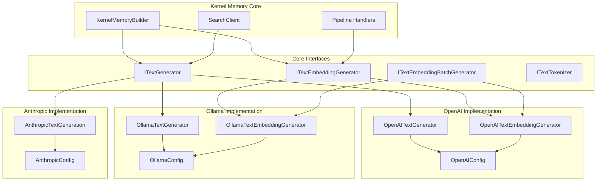
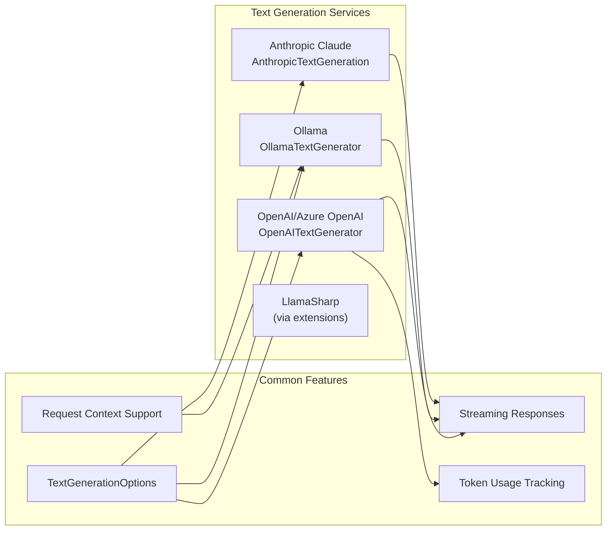
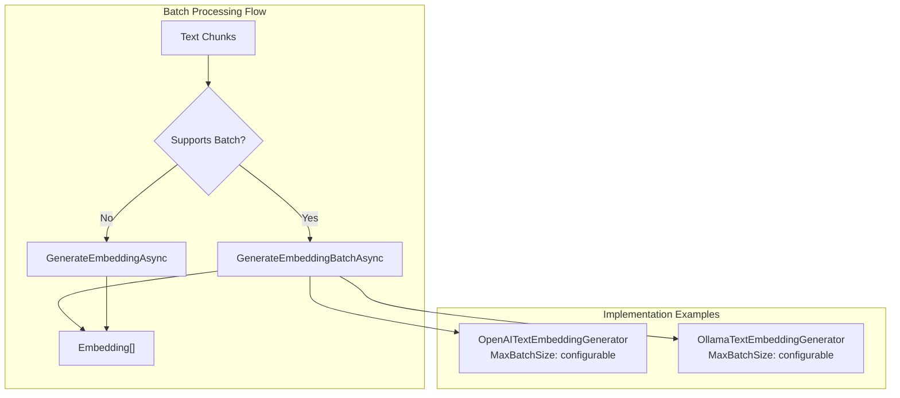
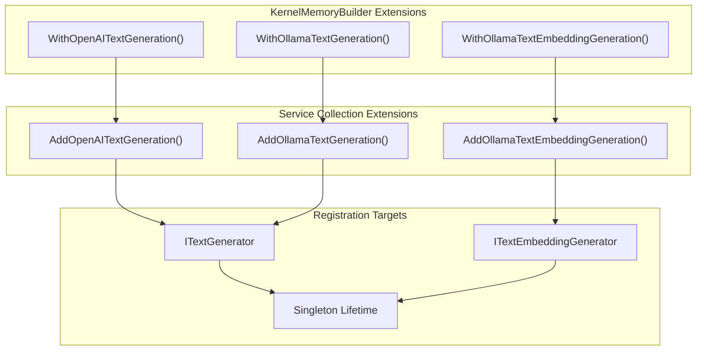
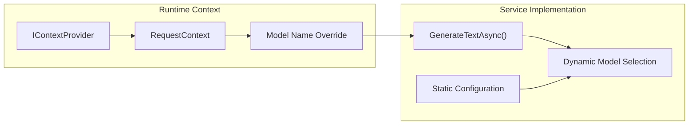

<!-- source: DeepWiki mcp.deepwiki.com · repo microsoft/kernel-memory · page 8 AI Service Integrations · fetched 2026-10-26 -->

# AI Service Integrations

Relevant source files

The following files were used as context for generating this wiki page:

- [.gitignore](.gitignore)
- [.gitmodules](.gitmodules)
- [README.md](README.md)

This document covers the AI service integrations within Kernel Memory, including text generation and embedding generation services. It explains the abstraction layer that allows Kernel Memory to work with multiple AI providers, configuration patterns, and integration mechanisms.

For detailed information about specific text generation implementations, see [Text Generation Services](#5.1). For embedding generation details, see [Embedding Generation Services](#5.2).

## AI Service Architecture

Kernel Memory uses a pluggable architecture for AI services, allowing multiple providers to be integrated through common interfaces. The system supports both text generation for RAG responses and embedding generation for semantic search.

Sources: [extensions/OpenAI/OpenAI/OpenAITextGenerator.cs:28](), [extensions/OpenAI/OpenAI/OpenAITextEmbeddingGenerator.cs:27](), [extensions/Ollama/Ollama/OllamaTextGenerator.cs:17](), [extensions/Ollama/Ollama/OllamaTextEmbeddingGenerator.cs:17](), [extensions/Anthropic/AnthropicTextGeneration.cs:19]()

## Text Generation Service Integration

Text generation services implement the `ITextGenerator` interface and are used primarily for answering questions in the RAG system. Each implementation provides streaming text generation with configurable parameters.

### Common Interface Pattern

| Method | Purpose | Return Type |
|--------|---------|-------------|
| `GenerateTextAsync` | Stream text generation with options | `IAsyncEnumerable<GeneratedTextContent>` |
| `CountTokens` | Count tokens in input text | `int` |
| `GetTokens` | Tokenize input text | `IReadOnlyList<string>` |
| `MaxTokenTotal` | Maximum context window size | `int` |

### Supported Text Generation Services

Sources: [extensions/OpenAI/OpenAI/OpenAITextGenerator.cs:127-195](), [extensions/Ollama/Ollama/OllamaTextGenerator.cs:94-151](), [extensions/Anthropic/AnthropicTextGeneration.cs:100-131]()

## Embedding Generation Service Integration

Embedding generation services implement `ITextEmbeddingGenerator` and optionally `ITextEmbeddingBatchGenerator` for efficient batch processing during document ingestion.

### Batch Processing Support

The `ITextEmbeddingBatchGenerator` interface enables efficient processing of multiple text chunks in a single API call:

Sources: [service/Abstractions/AI/ITextEmbeddingBatchGenerator.cs:13-31](), [extensions/OpenAI/OpenAI/OpenAITextEmbeddingGenerator.cs:143-156](), [extensions/Ollama/Ollama/OllamaTextEmbeddingGenerator.cs:110-148]()

## Configuration and Dependency Injection

AI services are configured through strongly-typed configuration classes and registered via dependency injection extensions.

### Configuration Pattern

Each AI service provider uses a dedicated configuration class:

| Provider | Configuration Class | Key Properties |
|----------|-------------------|----------------|
| OpenAI | `OpenAIConfig` | `ApiKey`, `TextModel`, `EmbeddingModel`, `MaxTokenTotal` |
| Ollama | `OllamaConfig` | `Endpoint`, `TextModel`, `EmbeddingModel` |
| Anthropic | `AnthropicConfig` | `ApiKey`, `TextModelName`, `MaxTokenOut` |

### Dependency Injection Extensions

Sources: [extensions/Ollama/Ollama/DependencyInjection.cs:20-56](), [extensions/Ollama/Ollama/DependencyInjection.cs:64-124]()

## Token Management and Context Handling

All AI service implementations include sophisticated token management and context handling capabilities.

### Tokenization Support

Each service uses appropriate tokenizers for accurate token counting:

- **OpenAI**: `O200KTokenizer` for GPT-4, `CL100KTokenizer` for GPT-3.5 and embeddings
- **Ollama**: Configurable tokenizer via `OllamaModelConfig.Tokenizer`  
- **Anthropic**: `CL100KTokenizer` as default fallback

### Context Provider Integration

Services support runtime configuration overrides through `IContextProvider`:

Sources: [extensions/Ollama/Ollama/OllamaTextGenerator.cs:99](), [extensions/Ollama/Ollama/OllamaTextEmbeddingGenerator.cs:116](), [extensions/Anthropic/AnthropicTextGeneration.cs:105]()

## Error Handling and Resilience

AI service implementations include comprehensive error handling for HTTP operations and service-specific exceptions.

### Exception Types

- **OpenAI**: `OpenAIException` with transient error detection via `HttpOperationException`
- **Ollama**: Standard HTTP client exceptions with retry logic
- **Anthropic**: Custom exception handling through `RawAnthropicClient`

The implementations distinguish between transient errors (suitable for retry) and permanent failures using status code analysis.

Sources: [extensions/OpenAI/OpenAI/OpenAITextGenerator.cs:160-163](), [extensions/OpenAI/OpenAI/OpenAITextEmbeddingGenerator.cs:136-139]()

---

