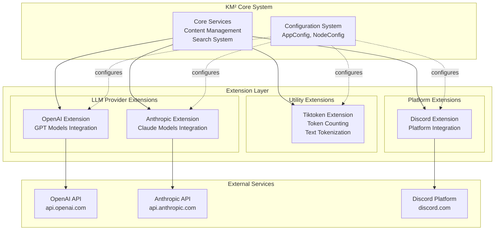
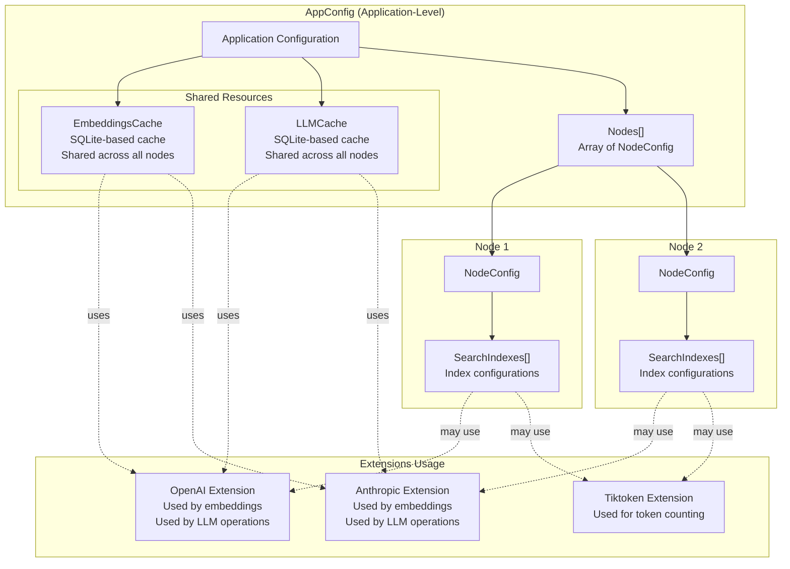
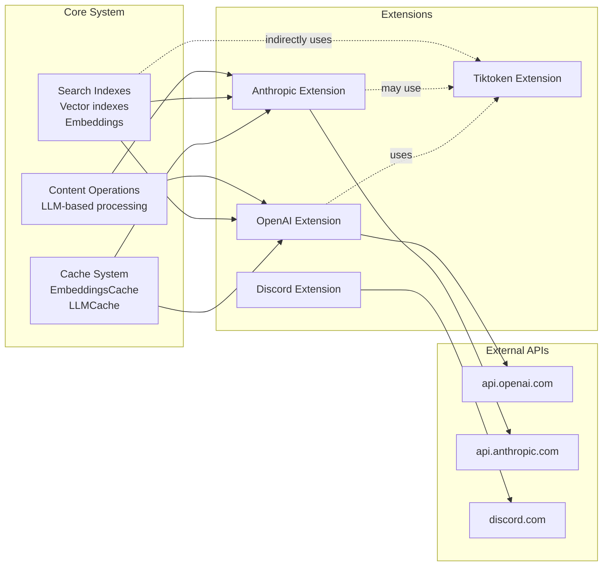

<!-- source: DeepWiki mcp.deepwiki.com · repo microsoft/kernel-memory · page 8.2 Available Extensions · fetched 2026-10-26 -->

# Available Extensions

Relevant source files

The following files were used as context for generating this wiki page:

- [.gitignore](.gitignore)
- [.gitmodules](.gitmodules)
- [README.md](README.md)

## Purpose and Scope

This page documents the available extensions in the KM² (Kernel Memory squared) system. Extensions provide integration with external AI services, platforms, and utilities. Each extension adds specific capabilities to the core system, such as LLM integration, token counting, or platform-specific features.

For information about how extensions are architecturally integrated into the core system, see [Extension Architecture](#8.1). For details on configuring these extensions in your nodes, see [Configuration System](#6).

**Sources:** High-level system architecture diagrams, README.md

---

## Extension Overview

KM² provides a modular extension system that allows integration with various AI services and platforms. Extensions are organized into categories based on their function:

### Extension Categories

| Category | Purpose | Examples |
|----------|---------|----------|
| **LLM Providers** | Integration with large language model services | OpenAI, Anthropic |
| **Token Management** | Token counting and text processing utilities | Tiktoken |
| **Platform Integrations** | Integration with external platforms and services | Discord |

**Sources:** High-level system architecture diagrams (Diagram 3: Technology Stack)

---

## Extension Ecosystem

The following diagram shows how extensions fit into the KM² architecture:

**Extension Integration Pattern**: Extensions are configured through the configuration system and called by core services. Each extension encapsulates communication with its respective external service, providing a clean abstraction layer.

**Sources:** High-level system architecture diagrams (Diagram 3: Technology Stack, Diagram 6: Configuration and Node Architecture)

---

## LLM Provider Extensions

### OpenAI Extension

The OpenAI extension provides integration with OpenAI's GPT models and services.

**Capabilities:**
- Access to GPT model family (GPT-3.5, GPT-4, etc.)
- Text generation and completion
- Embedding generation for semantic search
- Integration with OpenAI's API endpoints

**Use Cases:**
- Generating embeddings for content indexing
- LLM-based content analysis
- Natural language understanding tasks
- Cached LLM responses (configured via `LLMCache` in AppConfig)

**Configuration:** LLM cache configuration can be specified at the application level, allowing multiple nodes to share cached responses. See [Cache Configuration](#6.3) for details.

**Sources:** High-level system architecture diagrams (Diagram 3: Technology Stack, Diagram 6: Configuration and Node Architecture)

---

### Anthropic Extension

The Anthropic extension provides integration with Anthropic's Claude models.

**Capabilities:**
- Access to Claude model family
- Claude-specific API features
- Alternative LLM provider option
- Text generation with Claude's capabilities

**Use Cases:**
- Using Claude models as an alternative or complement to OpenAI
- Leveraging Claude's specific strengths (e.g., longer context windows)
- Multi-provider LLM strategies

**Configuration:** Like OpenAI, Anthropic can be configured with shared LLM caching at the application level.

**Sources:** High-level system architecture diagrams (Diagram 3: Technology Stack)

---

## Utility Extensions

### Tiktoken Extension

The Tiktoken extension provides token counting and text tokenization capabilities.

**Capabilities:**
- Accurate token counting for various models
- Text tokenization according to model-specific tokenizers
- Token usage estimation and management

**Use Cases:**
- Estimating token usage before API calls
- Managing context window limits
- Optimizing text chunking for embeddings
- Cost estimation for LLM operations

**Integration:** Tiktoken is often used internally by LLM provider extensions to ensure accurate token counting before making API calls.

**Sources:** High-level system architecture diagrams (Diagram 3: Technology Stack)

---

## Platform Extensions

### Discord Extension

The Discord extension provides integration with the Discord platform.

**Capabilities:**
- Discord platform-specific features
- Integration with Discord services
- Platform communication channels

**Use Cases:**
- Building Discord bots that leverage KM² capabilities
- Integrating memory and search features into Discord workflows
- Platform-specific content management

**Sources:** High-level system architecture diagrams (Diagram 3: Technology Stack)

---

## Extension Configuration Pattern

The following diagram illustrates how extensions are configured within the multi-node architecture:

**Configuration Levels:**
- **Application Level**: Shared caches (embeddings, LLM) are configured once and used by all nodes
- **Node Level**: Individual nodes can configure their own search indexes, which may use different extensions
- **Extension Selection**: Extensions are selected based on the configured providers in caches and indexes

**Sources:** High-level system architecture diagrams (Diagram 6: Configuration and Node Architecture)

---

## Extension Summary Table

| Extension | Category | Primary Purpose | Key Features | Configuration Level |
|-----------|----------|-----------------|--------------|---------------------|
| **OpenAI** | LLM Provider | GPT model integration | Text generation, embeddings, completions | Application (cache) + Node (indexes) |
| **Anthropic** | LLM Provider | Claude model integration | Claude-specific capabilities, alternative LLM | Application (cache) + Node (indexes) |
| **Tiktoken** | Utility | Token counting | Model-specific tokenization, usage estimation | Used internally by other extensions |
| **Discord** | Platform | Discord platform integration | Platform-specific features, bot integration | Platform-specific configuration |

**Sources:** High-level system architecture diagrams (Diagram 3: Technology Stack)

---

## Extension Dependencies

The following diagram shows how extensions depend on each other and external services:

**Dependency Notes:**
- LLM provider extensions (OpenAI, Anthropic) typically use Tiktoken for accurate token counting
- Cache system and search indexes depend on LLM provider extensions for embeddings
- Content operations may use LLM providers for text analysis and generation
- Platform extensions (Discord) operate independently but can leverage core system features

**Sources:** High-level system architecture diagrams (Diagram 3: Technology Stack, Diagram 6: Configuration and Node Architecture)

---

## Adding New Extensions

While KM² is currently in active research phase and does not accept external contributions, understanding the extension pattern is valuable for learning purposes.

**Extension Requirements:**
1. **Encapsulation**: Extensions should encapsulate all communication with external services
2. **Configuration**: Extensions should be configurable through the AppConfig/NodeConfig system
3. **Error Handling**: Extensions must handle API errors and rate limits appropriately
4. **Caching**: Where applicable, extensions should support caching to reduce API calls and costs

**Common Extension Patterns:**
- **Provider Pattern**: LLM extensions follow a provider pattern with consistent interfaces
- **Dependency Injection**: Extensions are typically registered and injected via the service container
- **Configuration Binding**: Extensions bind to configuration sections in `config.json`

**Sources:** High-level system architecture diagrams (Diagram 6: Configuration and Node Architecture), README.md:27-33

---

## Extension Limitations and Considerations

### Research Project Status

> [!IMPORTANT]
> KM² is an active research project. Extension APIs and configurations may change without notice.

**Key Considerations:**
- **No Stability Guarantees**: Extension interfaces may evolve rapidly
- **Breaking Changes**: Updates may require reconfiguration of extensions
- **Experimental Features**: Extensions may include experimental capabilities
- **API Changes**: External service API changes may affect extension behavior

### Performance and Cost

**Caching Importance:**
- Embeddings cache reduces redundant API calls to LLM providers
- LLM cache stores responses for repeated queries
- Both caches use SQLite for efficient storage and retrieval

**Token Management:**
- Use Tiktoken to estimate costs before making LLM calls
- Monitor token usage to control API expenses
- Configure appropriate context window limits

**Rate Limiting:**
- Extensions should respect API rate limits
- Implement retry logic with exponential backoff
- Consider caching strategies to minimize API calls

**Sources:** High-level system architecture diagrams (Diagram 6: Configuration and Node Architecture), README.md:6-33

---

## Related Documentation

- **[Extension Architecture](#8.1)**: Detailed information on how extensions are structured and integrated
- **[Configuration System](#6)**: Complete configuration reference for all extension settings
- **[Cache Configuration](#6.3)**: Specific guidance on configuring embeddings and LLM caches
- **[Search Index Configuration](#6.4)**: How to configure search indexes that use extensions
- **[Node Configuration](#6.2)**: Node-level configuration that may reference extensions

**Sources:** Table of contents structure

---

