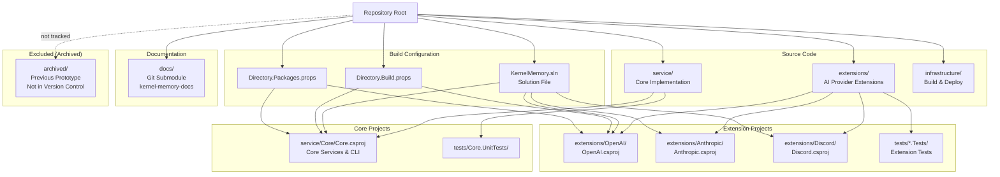
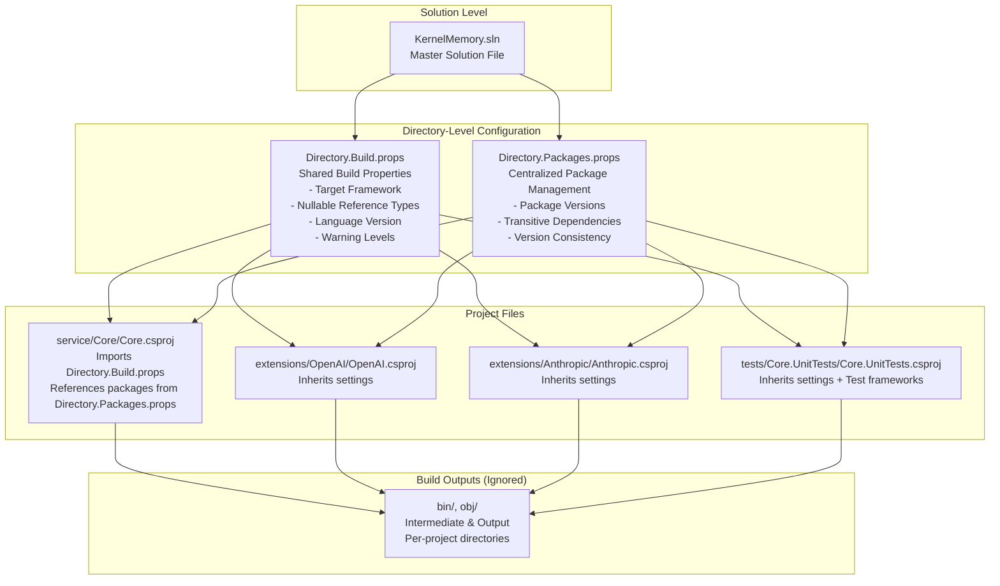
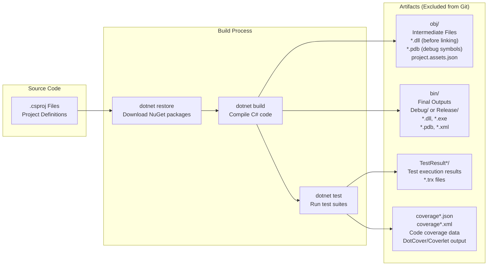
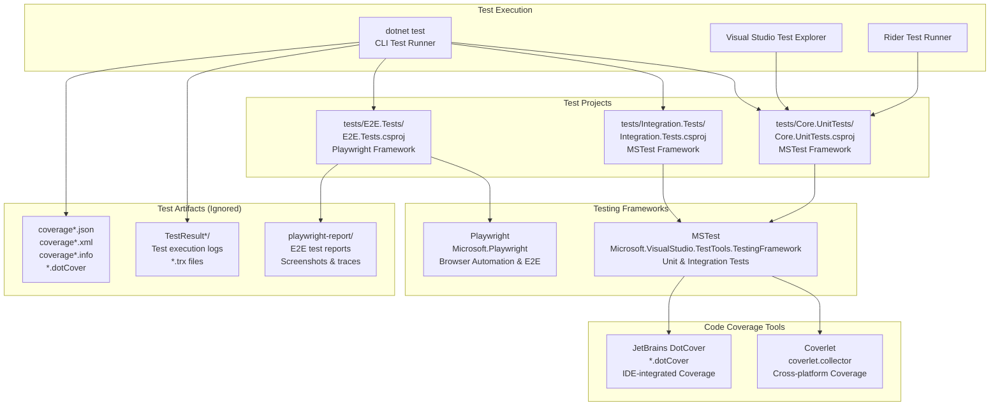
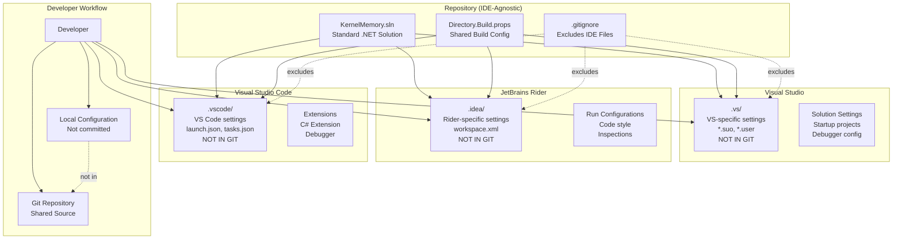
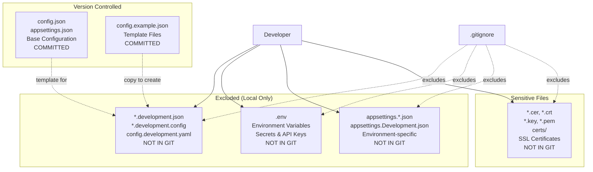

<!-- source: DeepWiki mcp.deepwiki.com · repo microsoft/kernel-memory · page 9 Development Guide · fetched 2026-10-26 -->

# Development Guide

<details>
<summary>Relevant source files</summary>

The following files were used as context for generating this wiki page:

- [.gitignore](.gitignore)
- [.gitmodules](.gitmodules)
- [README.md](README.md)

</details>


This document provides technical guidance for developers working with the Kernel Memory (KM²) codebase. It covers repository structure, build configuration, testing infrastructure, and development environment setup. For information about system architecture and runtime components, see [Architecture](#3). For information about configuration files used at runtime, see [Configuration System](#6).

**Important Note**: KM² is an active research project with no stability guarantees. The codebase evolves rapidly, and breaking changes are expected. See [Project Status and Warnings](#1.1) for details.

---

## Development Prerequisites

KM² is a polyglot system with the following technology requirements:

| Technology | Purpose | Requirement |
|------------|---------|-------------|
| .NET SDK | Primary development language | .NET 8.0 or later (C# 12) |
| Python | Supporting scripts and components | Python 3.8+ |
| Node.js | Supporting components | Node.js 16+ |
| SQLite | Data persistence | Included via NuGet packages |
| Git | Version control | Git 2.30+ with submodule support |

The codebase uses modern C# language features and requires a recent .NET SDK for compilation.

**Mermaid: Development Technology Stack**

```mermaid
graph TB
    Developer["Developer"]
    
    subgraph "Primary Development"
        DotNet[".NET SDK 8.0+<br/>C# 12<br/>Primary Language"]
        Solution["KernelMemory.sln<br/>Solution File"]
    end
    
    subgraph "Supporting Languages"
        Python["Python 3.8+<br/>Scripts & Components"]
        Node["Node.js 16+<br/>Supporting Components"]
    end
    
    subgraph "Build Configuration"
        DirProps["Directory.Build.props<br/>Shared Build Settings"]
        DirPkg["Directory.Packages.props<br/>Centralized Package Versions"]
    end
    
    subgraph "Data & Storage"
        SQLite["SQLite<br/>Microsoft.Data.Sqlite NuGet"]
        FileSystem["File System<br/>Local/Network Storage"]
    end
    
    subgraph "Version Control"
        Git["Git Repository<br/>github.com/microsoft/kernel-memory"]
        Submodule["docs/ Submodule<br/>kernel-memory-docs"]
    end
    
    Developer --> DotNet
    Developer --> Python
    Developer --> Node
    
    DotNet --> Solution
    Solution --> DirProps
    Solution --> DirPkg
    
    DotNet --> SQLite
    DotNet --> FileSystem
    
    Developer --> Git
    Git --> Submodule
    
    DirProps --> "Core.csproj"
    DirProps --> "Extensions/*.csproj"
    DirProps --> "Tests/*.csproj"
```

Sources: [README.md:1-80](), [.gitmodules:1-4]()

---

## Repository Structure

The KM² repository follows a standard .NET solution structure with centralized build configuration. The organization separates core functionality, extensions, tests, and infrastructure concerns.

### Solution and Project Organization



Sources: [README.md:9-12](), [.gitmodules:1-4](), [.gitignore:1-2]()

### Key Directories

| Directory | Purpose | Tracked in Git |
|-----------|---------|----------------|
| `service/` | Core services, CLI application, domain logic | ✓ |
| `extensions/` | AI provider integrations (OpenAI, Anthropic, Discord, etc.) | ✓ |
| `tests/` | Unit tests, integration tests, E2E tests | ✓ |
| `infrastructure/` | Build scripts, deployment configurations | ✓ |
| `docs/` | Documentation (separate Git submodule) | ✓ (submodule) |
| `archived/` | Previous prototype codebase | ✗ (excluded) |
| `bin/`, `obj/` | Build outputs | ✗ (excluded) |
| `.vs/`, `.idea/`, `.vscode/` | IDE-specific settings | ✗ (excluded) |

The `archived/` directory contains the previous prototype mentioned in [README.md:9-12]() but is explicitly excluded from version control via [.gitignore:1]().

Sources: [.gitignore:1-73](), [.gitmodules:1-4]()

### Documentation Submodule

Documentation is maintained as a separate Git submodule pointing to the `kernel-memory-docs` repository. This allows independent versioning and contribution workflows for documentation.

**Initializing the documentation submodule:**

```bash
git submodule init
git submodule update
```

Sources: [.gitmodules:1-4]()

---

## Build System

KM² uses modern .NET build practices with centralized configuration to ensure consistency across all projects in the solution.

### Centralized Build Configuration

**Mermaid: Build Configuration Hierarchy**



Sources: [.gitignore:7-41]()

### Directory.Build.props

This file contains shared MSBuild properties inherited by all `.csproj` files in the solution. It typically defines:

- Target framework (e.g., `net8.0`)
- C# language version (C# 12)
- Nullable reference type configuration
- Warning levels and treatment
- Common compiler flags

All projects automatically inherit these settings without explicit configuration in individual project files.

### Directory.Packages.props

This file enables Centralized Package Management (CPM), a .NET feature that centralizes NuGet package version definitions. Benefits include:

- Single source of truth for package versions
- Prevents version conflicts across projects
- Simplifies dependency updates
- Enforces consistent transitive dependency versions

Project files reference packages without specifying versions, which are resolved from `Directory.Packages.props`.

### Build Outputs and Artifacts

The following build artifacts are generated during compilation and explicitly excluded from version control:

**Mermaid: Build Artifact Generation**



Sources: [.gitignore:7-9, 28-53]()

**Build artifact patterns excluded via .gitignore:**

| Pattern | Purpose |
|---------|---------|
| `bin/`, `obj/` | Compiler intermediate and output files |
| `[Dd]ebug/`, `[Rr]elease/` | Configuration-specific build outputs |
| `[Tt]est[Rr]esult*/` | MSTest execution results |
| `coverage*.json`, `coverage*.xml` | Code coverage reports |
| `*.dotCover` | JetBrains DotCover coverage data |
| `playwright-report/` | Playwright E2E test reports |

Sources: [.gitignore:7-9, 28-56]()

### Building the Solution

**Standard build commands:**

```bash
# Restore NuGet packages
dotnet restore

# Build all projects in Debug configuration
dotnet build

# Build in Release configuration
dotnet build -c Release

# Clean build artifacts
dotnet clean
```

The centralized configuration ensures all projects build consistently with the same settings and package versions.

---

## Testing Infrastructure

KM² employs a comprehensive testing strategy using multiple frameworks to ensure code quality and functionality.

**Mermaid: Testing Framework Architecture**



Sources: [.gitignore:43-56]()

### MSTest Framework

MSTest is used for unit and integration tests. Test projects reference the following packages (versions managed via `Directory.Packages.props`):

- `Microsoft.VisualStudio.TestTools.TestingFramework` - Core MSTest framework
- `MSTest.TestAdapter` - Test adapter for test execution
- `MSTest.TestFramework` - Framework utilities

**Running unit tests:**

```bash
# Run all tests
dotnet test

# Run tests with detailed output
dotnet test --logger "console;verbosity=detailed"

# Run tests in a specific project
dotnet test tests/Core.UnitTests/Core.UnitTests.csproj
```

### Playwright Framework

Playwright is used for end-to-end testing, particularly for scenarios involving browser automation or complex interaction flows.

**Playwright test artifacts:**

The `playwright-report/` directory contains test execution reports, including screenshots, traces, and video recordings. These artifacts are excluded from version control via [.gitignore:56]().

Sources: [.gitignore:55-56]()

### Code Coverage

Two code coverage tools are supported:

**Coverlet (Cross-platform):**
- NuGet package: `coverlet.collector`
- Outputs: `coverage*.json`, `coverage*.xml`, `coverage*.info`
- Formats: Cobertura XML, JSON, LCOV

**JetBrains DotCover (IDE-integrated):**
- IDE: JetBrains Rider
- Outputs: `*.dotCover`
- Format: Proprietary binary

**Generating coverage reports:**

```bash
# Generate coverage with Coverlet (Cobertura format)
dotnet test --collect:"XPlat Code Coverage" --results-directory ./coverage

# Coverage files are generated in ./coverage directory
# Excluded from Git via .gitignore patterns
```

All coverage output files are excluded from version control via [.gitignore:47-53]().

Sources: [.gitignore:47-53]()

### Test Result Artifacts

Test execution generates the following artifacts:

| Pattern | Purpose | Excluded |
|---------|---------|----------|
| `TestResult*/` | MSTest execution logs and results | ✓ |
| `*.trx` | Visual Studio Test Results format | ✓ |
| `[Bb]uild[Ll]og.*` | Build logs during test runs | ✓ |
| `playwright-report/` | Playwright E2E test reports | ✓ |

All test artifacts are excluded from version control to prevent repository bloat.

Sources: [.gitignore:43-56]()

---

## IDE Setup and Development Environment

KM² maintains IDE-agnostic build configuration, allowing developers to use their preferred development environment. All IDE-specific settings are excluded from version control.

**Mermaid: IDE Support and Configuration**



Sources: [.gitignore:3-5, 12-16]()

### Excluded IDE Files

The following IDE-specific files and directories are excluded from version control:

| Pattern | IDE | Purpose |
|---------|-----|---------|
| `.vs/` | Visual Studio | Solution user options, cache |
| `.idea/` | JetBrains Rider | Workspace settings, cache |
| `.vscode/` | Visual Studio Code | Launch configurations, settings |
| `*.user` | Visual Studio | User-specific project settings |
| `.DS_Store` | macOS Finder | macOS directory metadata |

Sources: [.gitignore:3-5, 12, 15]()

### Visual Studio Setup

**Requirements:**
- Visual Studio 2022 (version 17.8 or later)
- Workload: .NET desktop development
- Workload: ASP.NET and web development (for web components)

**First-time setup:**
1. Open `KernelMemory.sln`
2. Visual Studio automatically creates `.vs/` directory (ignored by Git)
3. Restore NuGet packages (automatic on first build)
4. Set startup project to desired CLI or service project

**Visual Studio-specific features:**
- Test Explorer integration for MSTest
- Built-in code coverage via Enterprise edition
- Solution-wide search and refactoring

### JetBrains Rider Setup

**Requirements:**
- JetBrains Rider 2023.3 or later
- .NET SDK detected automatically

**First-time setup:**
1. Open `KernelMemory.sln`
2. Rider automatically creates `.idea/` directory (ignored by Git)
3. Restore NuGet packages (automatic)
4. Configure run configurations for CLI projects

**Rider-specific features:**
- DotCover code coverage integration
- Advanced code inspections and quick-fixes
- Built-in decompiler for dependencies

### Visual Studio Code Setup

**Requirements:**
- Visual Studio Code 1.85 or later
- Extensions:
  - C# (ms-dotnettools.csharp)
  - C# Dev Kit (ms-dotnettools.csdevkit) - optional

**First-time setup:**
1. Open repository root folder in VS Code
2. Install recommended C# extension
3. VS Code creates `.vscode/` directory for settings (ignored by Git)
4. Use integrated terminal for `dotnet` commands

**VS Code workflow:**
```bash
# Build from integrated terminal
dotnet build

# Run tests
dotnet test

# Run CLI application
dotnet run --project service/Core/Core.csproj
```

VS Code is lightweight but requires more manual configuration compared to full IDEs.

Sources: [.gitignore:3-5, 12-16]()

---

## Configuration File Management

Development configuration files containing sensitive data or environment-specific settings are excluded from version control.

**Mermaid: Configuration File Patterns**



Sources: [.gitignore:19-26, 68-72]()

### Excluded Configuration Patterns

| Pattern | Purpose | Example |
|---------|---------|---------|
| `.env` | Environment variables, API keys | Database connection strings |
| `*.development.*` | Development environment config | Local node configurations |
| `*.development.json*` | JSON development config | API keys for local testing |
| `config.development.yaml` | YAML development config | Custom service endpoints |
| `appsettings.*.json` | ASP.NET environment settings | Logging levels, connection strings |

These patterns ensure that sensitive configuration (API keys, connection strings, credentials) never gets committed to the repository.

Sources: [.gitignore:19-26]()

### Certificate and Key Files

SSL/TLS certificates and private keys are excluded from version control:

```
*.cer      # Certificate files
*.crt      # Certificate files (alternative extension)
*.key      # Private key files
*.pem      # Privacy-enhanced mail (certificate/key format)
certs/     # Certificate directory
```

Developers must maintain these files locally and ensure they are never committed.

Sources: [.gitignore:68-72]()

---

## Additional Development Files

### Temporary and Build Files

The following patterns exclude temporary files generated during development:

| Pattern | Purpose |
|---------|---------|
| `*.tmp` | Temporary files |
| `*.log` | Log files |
| `*.bck` | Backup files |
| `*.orig` | Merge conflict originals |
| `*.devis`, `*.devis.*` | Development/testing artifacts |

Sources: [.gitignore:13-16, 62-64]()

### Node.js and Python Artifacts

For Python and Node.js components:

| Pattern | Language | Purpose |
|---------|----------|---------|
| `node_modules/` | Node.js | NPM package installations |
| `__pycache__/` | Python | Compiled Python bytecode |

These are regenerated via `npm install` or Python's import system and should never be committed.

Sources: [.gitignore:6, 9]()

### Custom Development Directories

| Pattern | Purpose |
|---------|---------|
| `_dev/` | Custom development workspace |
| `.dev/` | Alternative development workspace |

These directories provide personal workspace for developers without cluttering the repository structure.

Sources: [.gitignore:10-11]()

---

## Version Control Best Practices

### Submodule Management

The `docs/` directory is a Git submodule. When working with submodules:

```bash
# Clone repository with submodules
git clone --recursive https://github.com/microsoft/kernel-memory

# Update submodules to latest
git submodule update --remote

# Commit submodule reference changes
git add docs
git commit -m "Update documentation submodule"
```

Sources: [.gitmodules:1-4]()

### Ignored Archive Content

The `archived/` directory contains the previous prototype codebase but is not tracked in Git ([.gitignore:1]()). This content exists in the repository for reference purposes but does not participate in version control. Any changes to archived content will not be detected by Git.

Sources: [.gitignore:1](), [README.md:9-12]()

### Amplifier and Claude Integration Directories

The following directories are excluded and may contain AI-assisted development artifacts:

```
.amplifier/     # Amplifier platform artifacts
.claude/        # Claude AI integration artifacts
```

These directories may contain metadata, context, or artifacts related to the metacognitive AI engineering approach described in [Relationship to Amplifier](#1.2).

Sources: [.gitignore:2-3]()

---

## Summary

The KM² development environment emphasizes:

1. **Centralized Configuration**: `Directory.Build.props` and `Directory.Packages.props` ensure consistent builds
2. **IDE Independence**: All major IDEs supported; IDE-specific files excluded from Git
3. **Comprehensive Testing**: MSTest for unit/integration tests, Playwright for E2E tests, multiple coverage tools
4. **Security-First**: All sensitive configuration, certificates, and credentials excluded from version control
5. **Clean Repository**: Build artifacts, test results, and temporary files never committed

For specific subsystem details:
- Repository structure: [Repository Structure](#9.1)
- Build system: [Build System](#9.2)
- Testing: [Testing Infrastructure](#9.3)
- IDE setup: [IDE Setup and Development Environment](#9.4)

Sources: [README.md:1-80](), [.gitignore:1-73](), [.gitmodules:1-4]()

---

