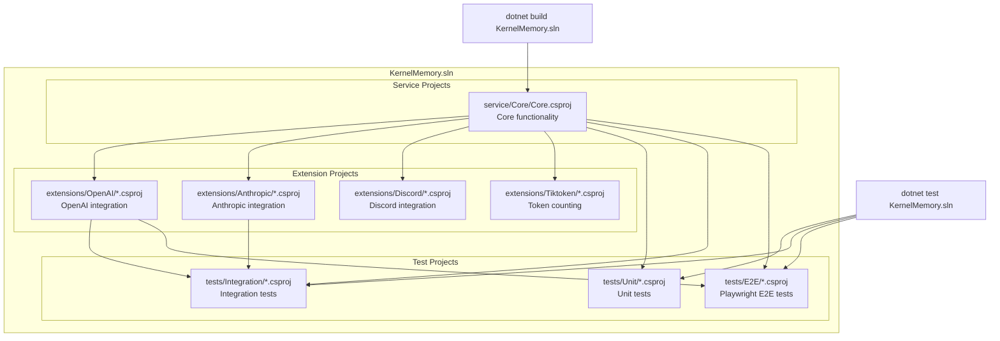
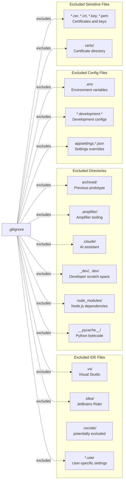
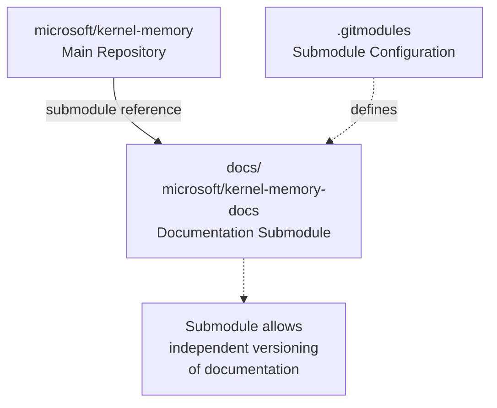
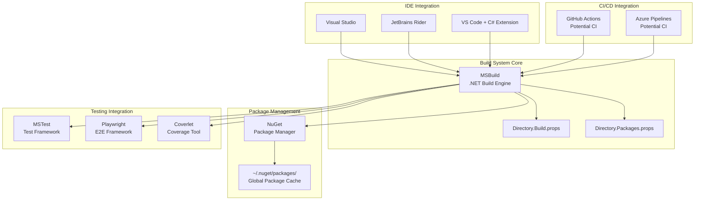

<!-- source: DeepWiki mcp.deepwiki.com · repo microsoft/kernel-memory · page 9.2 Build System · fetched 2026-10-26 -->

# Build System

<details>
<summary>Relevant source files</summary>

The following files were used as context for generating this wiki page:

- [.gitignore](.gitignore)
- [.gitmodules](.gitmodules)
- [README.md](README.md)

</details>


This document describes the build system configuration for KM² (Kernel Memory), including centralized build properties, package management, solution structure, and build artifact handling. For information about the repository structure and project organization, see [Repository Structure](#9.1). For testing infrastructure and frameworks, see [Testing Infrastructure](#9.3).

---

## Overview

KM² uses a modern .NET build system with centralized configuration through MSBuild property files. The build system supports multiple project types (.NET/C#, Python, Node.js) and employs centralized package management to ensure version consistency across all projects in the solution.

The build configuration is structured to:
- Centralize build settings across all projects
- Manage NuGet package versions in a single location
- Exclude build artifacts and sensitive files from version control
- Support multi-language development workflows

**Sources:** [README.md:1-80](), [.gitignore:1-73](), [.gitmodules:1-4]()

---

## Build Configuration Architecture

The build system uses a hierarchical configuration approach with centralized property files at the root of the repository:

```mermaid
graph TB
    subgraph "Repository Root"
        Sln["KernelMemory.sln<br/>Solution File"]
        DirBuild["Directory.Build.props<br/>Build Properties"]
        DirPkgs["Directory.Packages.props<br/>Package Versions"]
    end
    
    subgraph "service/Core"
        CoreProj["Core.csproj"]
        CoreBin["bin/"]
        CoreObj["obj/"]
    end
    
    subgraph "extensions/OpenAI"
        OpenAIProj["OpenAI.csproj"]
        OpenAIBin["bin/"]
        OpenAIObj["obj/"]
    end
    
    subgraph "extensions/Anthropic"
        AnthropicProj["Anthropic.csproj"]
        AnthropicBin["bin/"]
        AnthropicObj["obj/"]
    end
    
    subgraph "tests/Unit"
        TestProj["Unit.csproj"]
        TestBin["bin/"]
        TestObj["obj/"]
        TestResults["TestResult*/"]
    end
    
    Sln --> CoreProj
    Sln --> OpenAIProj
    Sln --> AnthropicProj
    Sln --> TestProj
    
    DirBuild -.->|"inherited by"| CoreProj
    DirBuild -.->|"inherited by"| OpenAIProj
    DirBuild -.->|"inherited by"| AnthropicProj
    DirBuild -.->|"inherited by"| TestProj
    
    DirPkgs -.->|"package versions"| CoreProj
    DirPkgs -.->|"package versions"| OpenAIProj
    DirPkgs -.->|"package versions"| AnthropicProj
    DirPkgs -.->|"package versions"| TestProj
    
    CoreProj --> CoreBin
    CoreProj --> CoreObj
    OpenAIProj --> OpenAIBin
    OpenAIProj --> OpenAIObj
    AnthropicProj --> AnthropicBin
    AnthropicProj --> AnthropicObj
    TestProj --> TestBin
    TestProj --> TestObj
    TestProj --> TestResults
    
    GitIgnore[".gitignore"]
    GitIgnore -.->|"excludes"| CoreBin
    GitIgnore -.->|"excludes"| CoreObj
    GitIgnore -.->|"excludes"| OpenAIBin
    GitIgnore -.->|"excludes"| OpenAIObj
    GitIgnore -.->|"excludes"| AnthropicBin
    GitIgnore -.->|"excludes"| AnthropicObj
    GitIgnore -.->|"excludes"| TestBin
    GitIgnore -.->|"excludes"| TestObj
    GitIgnore -.->|"excludes"| TestResults
```



**Build Configuration Hierarchy**

MSBuild automatically discovers and applies `Directory.Build.props` and `Directory.Packages.props` from the repository root to all child projects. This eliminates the need to duplicate configuration in individual project files.

**Sources:** [README.md:1-80](), [.gitignore:7-41]()

---

## Directory.Build.props

The `Directory.Build.props` file is located at the repository root and defines shared build properties that apply to all projects in the solution. This file is automatically imported by MSBuild before any project file is evaluated.

**Common Properties Managed:**
- Target framework versions
- Language version (C# version)
- Nullable reference type settings
- Warning levels and treat warnings as errors
- Code analysis settings
- Assembly metadata (company, copyright, product name)
- Signing configurations
- Output paths

Individual projects inherit these settings but can override them when necessary by defining the same property in their `.csproj` files.

**Sources:** [README.md:1-80]()

---

## Directory.Packages.props

The `Directory.Packages.props` file enables **Central Package Management (CPM)**, a feature that centralizes NuGet package version specifications. All projects reference packages by name only, with versions defined in this central file.

### Benefits of Centralized Package Management

| Benefit | Description |
|---------|-------------|
| **Version Consistency** | All projects use the same version of each package |
| **Simplified Updates** | Update package versions in one location |
| **Reduced Merge Conflicts** | Individual project files don't contain version numbers |
| **Easier Dependency Analysis** | Single source of truth for all package versions |
| **Security** | Centralized location for addressing security vulnerabilities |

### Package Reference Syntax

With CPM enabled, project files reference packages without versions:

```xml
<!-- In Core.csproj -->
<PackageReference Include="Microsoft.Extensions.Logging" />
<PackageReference Include="Spectre.Console" />
```

The actual versions are defined in `Directory.Packages.props`:

```xml
<!-- In Directory.Packages.props -->
<ItemGroup>
  <PackageVersion Include="Microsoft.Extensions.Logging" Version="8.0.0" />
  <PackageVersion Include="Spectre.Console" Version="0.49.1" />
</ItemGroup>
```

### Package Categories in KM²

Based on the technology stack documented in the system overview, KM² manages several categories of packages:

| Category | Examples |
|----------|----------|
| **Core Framework** | ASP.NET Core, Entity Framework Core |
| **Logging** | Serilog and Serilog sinks |
| **CLI Framework** | Spectre.Console |
| **Database** | SQLite drivers, Entity Framework SQLite provider |
| **AI/ML Integration** | OpenAI SDK, Anthropic SDK, Tiktoken |
| **Testing** | MSTest, Playwright |
| **Code Coverage** | Coverlet, DotCover |

**Sources:** [README.md:1-80]()

---

## Solution File Structure

The `KernelMemory.sln` solution file at the repository root organizes all projects and defines the build order. The solution typically contains:



**Project Dependencies**

The Core project is the foundation that all extensions and tests depend on. Extensions provide additional functionality and depend on Core. Test projects reference both Core and the extensions they test.

**Sources:** [README.md:1-80]()

---

## Build Artifacts and Output

The build system generates various artifacts during compilation and testing. All build artifacts are excluded from version control to keep the repository clean and reduce repository size.

### Build Output Directories

The following directories contain build artifacts and are excluded via [.gitignore:1-73]():

| Directory Pattern | Contents | Excluded |
|-------------------|----------|----------|
| `bin/` | Compiled assemblies, executables | ✓ |
| `obj/` | Intermediate build files, compiler output | ✓ |
| `Debug/`, `Release/` | Configuration-specific build outputs | ✓ |
| `x64/`, `x86/`, `ARM/`, `ARM64/` | Platform-specific outputs | ✓ |
| `publish/` | Click-Once publishing directory | ✓ |

### Test Artifacts

Test execution generates several types of artifacts, all excluded from version control:

| Artifact Pattern | Purpose | Excluded |
|------------------|---------|----------|
| `TestResult*/` | MSTest results | ✓ |
| `BuildLog.*` | Test build logs | ✓ |
| `coverage*.json`, `coverage*.xml`, `coverage*.info` | Coverlet coverage reports | ✓ |
| `*.dotCover` | DotCover coverage data | ✓ |
| `playwright-report/` | Playwright test reports | ✓ |

### Temporary and Log Files

Various temporary files and logs are generated during development and excluded:

| Pattern | Type | Excluded |
|---------|------|----------|
| `*.tmp` | Temporary files | ✓ |
| `*.log` | Log files | ✓ |
| `*.bck` | Backup files | ✓ |
| `*.orig` | Merge conflict originals | ✓ |

**Sources:** [.gitignore:7-64]()

---

## Version Control Exclusions

The `.gitignore` file defines what is excluded from version control beyond build artifacts:

### Development Environment Files



**Key Exclusions:**

### Development Tools
- `.vs/` - Visual Studio user-specific files and caches
- `.idea/` - JetBrains Rider project files
- `.DS_Store` - macOS Finder metadata
- `*.user` - MSBuild user-specific settings
- `*.devis` - Development-specific files

### Research and Tooling Artifacts
- `archived/` - Previous prototype codebase (kept for reference but not tracked)
- `.amplifier/` - Amplifier platform tooling artifacts
- `.claude/` - AI assistant interaction data
- `_dev/`, `.dev/` - Developer scratch directories

### Language-Specific
- `node_modules/` - Node.js package dependencies
- `__pycache__/` - Python compiled bytecode

### Configuration and Secrets
- `.env` - Environment variables (may contain secrets)
- `*.development.*` - Development-specific configurations
- `appsettings.*.json` - Application settings overrides
- `*.cer`, `*.crt`, `*.key`, `*.pem` - Certificates and private keys
- `certs/` - Certificate storage directory

**Sources:** [.gitignore:1-73]()

---

## Multi-Language Build Support

While .NET/C# is the primary language, the build system accommodates Python and Node.js components:

### Python Components

Python files are scattered throughout the repository for scripts and tooling. Build artifacts:
- `__pycache__/` - Compiled Python bytecode (excluded)

### Node.js Components

Node.js/JavaScript files support web interfaces or tooling:
- `node_modules/` - NPM package dependencies (excluded)

### Build Coordination

The centralized build configuration in `Directory.Build.props` can coordinate multi-language builds through custom MSBuild targets that invoke:
- `python` commands for Python scripts
- `npm` or `node` commands for Node.js tooling

**Sources:** [README.md:1-80](), [.gitignore:6-9]()

---

## Git Submodules

The repository uses Git submodules to manage external dependencies:



**Submodule Configuration:**

The `.gitmodules` file defines the documentation submodule:

```ini
[submodule "docs"]
    path = docs
    url = https://github.com/microsoft/kernel-memory-docs
```

This allows the documentation to:
- Be versioned independently from the main codebase
- Be contributed to separately
- Have its own release cycle
- Be included at specific commits/tags in the main repository

**Working with Submodules:**

```bash
# Clone repository with submodules
git clone --recurse-submodules https://github.com/microsoft/kernel-memory

# Initialize submodules in existing clone
git submodule init
git submodule update

# Update submodule to latest commit
git submodule update --remote docs
```

**Sources:** [.gitmodules:1-4]()

---

## Build Commands

### Standard Build Operations

```bash
# Restore NuGet packages
dotnet restore KernelMemory.sln

# Build entire solution
dotnet build KernelMemory.sln

# Build specific configuration
dotnet build KernelMemory.sln --configuration Release

# Clean build artifacts
dotnet clean KernelMemory.sln

# Build and run tests
dotnet test KernelMemory.sln
```

### Project-Specific Builds

```bash
# Build only Core project
dotnet build service/Core/Core.csproj

# Build specific extension
dotnet build extensions/OpenAI/OpenAI.csproj

# Run tests for specific project
dotnet test tests/Unit/Unit.csproj
```

### Advanced Build Options

```bash
# Verbose build output
dotnet build --verbosity detailed

# Parallel builds (default on multi-core systems)
dotnet build --no-incremental

# Skip restore step
dotnet build --no-restore

# Generate NuGet packages
dotnet pack --configuration Release
```

**Sources:** [README.md:1-80]()

---

## Build System Integration Points



**Integration Points:**

| Component | Integration Method | Configuration |
|-----------|-------------------|---------------|
| **MSBuild** | Native .NET build engine | `Directory.Build.props` |
| **NuGet** | Package restore via MSBuild | `Directory.Packages.props` |
| **MSTest** | Test execution via `dotnet test` | Project references |
| **Playwright** | E2E test execution via MSBuild | Extension packages |
| **Coverlet** | Code coverage collection | MSBuild targets |
| **IDEs** | Project file and solution parsing | `.sln`, `.csproj` files |
| **CI/CD** | `dotnet` CLI commands | Build scripts |

**Sources:** [README.md:1-80]()

---

## Best Practices

### For Developers

1. **Never commit build artifacts** - The `.gitignore` is comprehensive; respect it
2. **Never specify package versions in project files** - Use `Directory.Packages.props`
3. **Run clean builds** - Use `dotnet clean` before important commits
4. **Keep submodules updated** - Run `git submodule update` regularly
5. **Don't commit sensitive files** - Environment configs and certificates are excluded for a reason

### For Build Configuration

1. **Centralize shared properties** - Use `Directory.Build.props` for all common settings
2. **Version packages consistently** - Update versions in `Directory.Packages.props` only
3. **Document custom MSBuild targets** - If adding custom build logic, document it
4. **Test configuration changes** - Build all projects after modifying build files
5. **Use configuration-specific settings** - Debug vs Release configurations for different purposes

### Version Control

1. **Commit `.gitignore` changes carefully** - They affect all developers
2. **Don't modify archived directory** - It's intentionally excluded and frozen
3. **Keep `.gitmodules` synchronized** - Ensure submodule URLs are accessible

**Sources:** [README.md:1-80](), [.gitignore:1-73]()

---

## Troubleshooting

### Common Build Issues

| Issue | Cause | Solution |
|-------|-------|----------|
| Package restore fails | Network issues or corrupted cache | Run `dotnet nuget locals all --clear` then `dotnet restore` |
| Version conflicts | Mismatched package versions | Check `Directory.Packages.props` for consistency |
| Build succeeds but tests fail | Stale artifacts in `bin/obj` | Run `dotnet clean` then `dotnet build` |
| Submodule empty | Not initialized | Run `git submodule update --init` |
| IDE shows errors but build succeeds | IDE cache out of sync | Restart IDE or rebuild solution |

### Build Artifact Issues

If build artifacts are accidentally committed:

```bash
# Remove from index but keep locally
git rm -r --cached bin/ obj/

# Remove from repository history (advanced)
git filter-branch --tree-filter 'rm -rf bin obj' HEAD
```

### Package Management Issues

If packages aren't resolving correctly:

```bash
# Clear all NuGet caches
dotnet nuget locals all --clear

# Restore with verbose output
dotnet restore --verbosity detailed

# Force re-evaluation of project assets
dotnet build --no-incremental
```

**Sources:** [README.md:1-80](), [.gitignore:1-73]()

---

