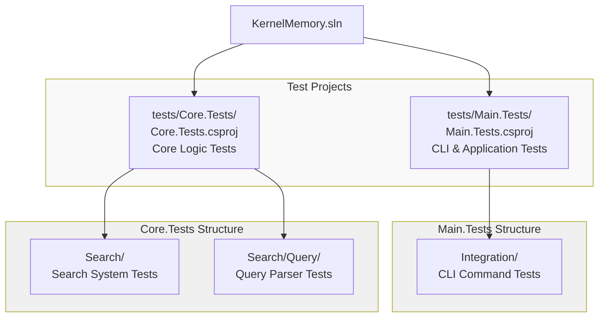
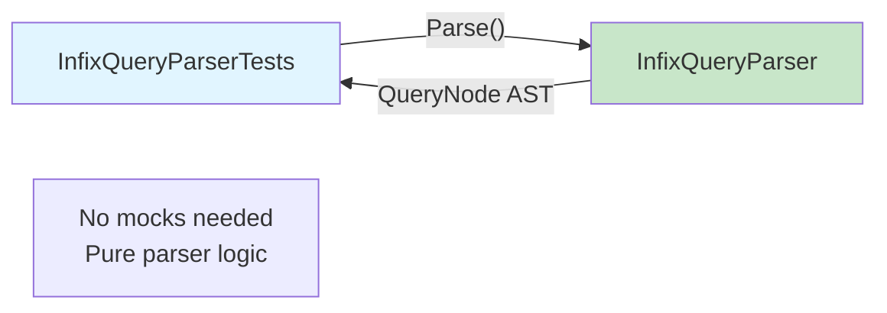
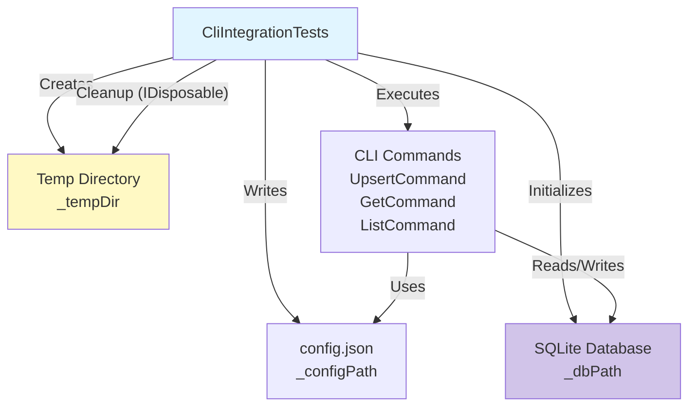
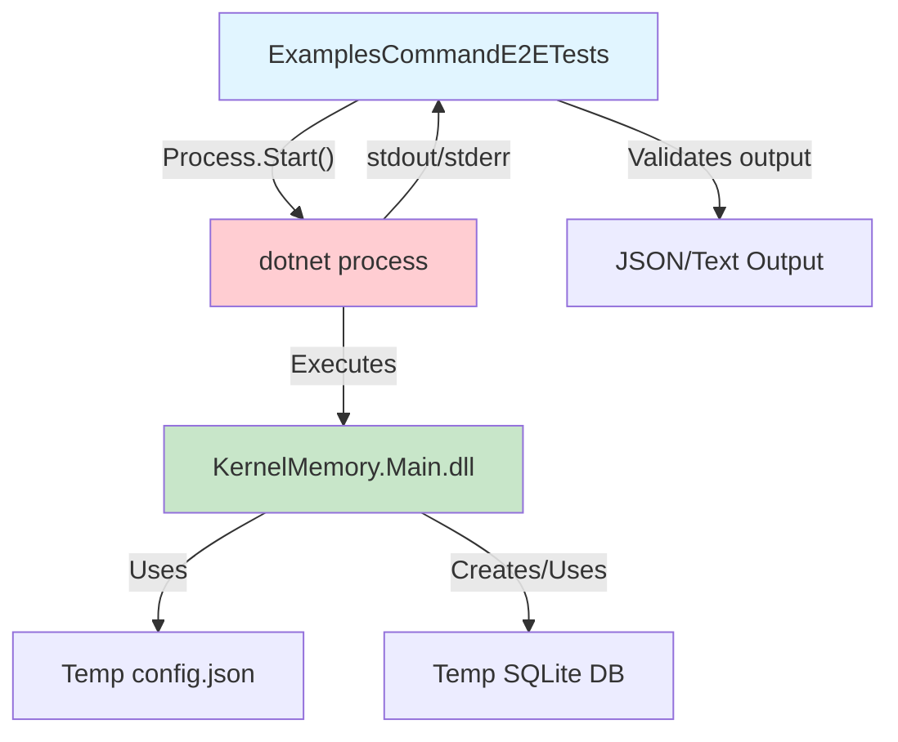
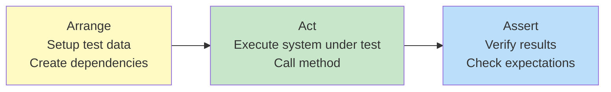
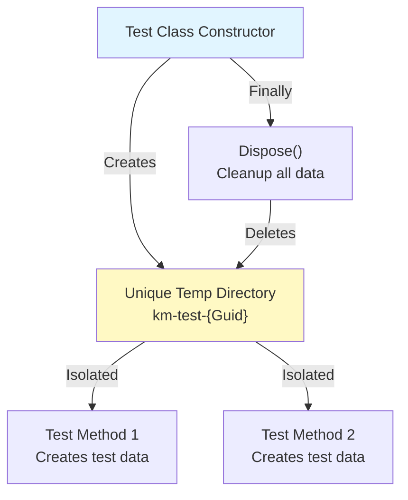
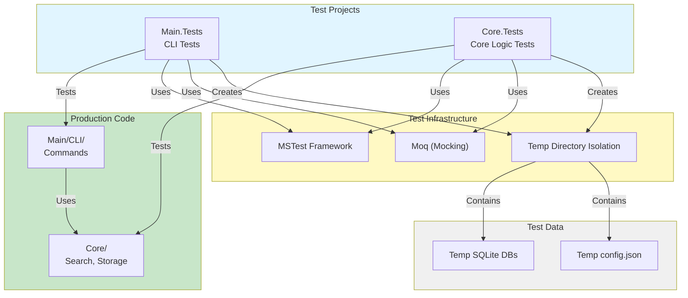

<!-- source: DeepWiki mcp.deepwiki.com · repo microsoft/kernel-memory · page 9.3 Testing Infrastructure · fetched 2026-10-26 -->

# Testing Infrastructure

<details>
<summary>Relevant source files</summary>

The following files were used as context for generating this wiki page:

- [.gitignore](.gitignore)
- [.gitmodules](.gitmodules)
- [KNOWN-ISSUES.md](KNOWN-ISSUES.md)
- [README.md](README.md)
- [src/Core/Search/NodeSearchService.cs](src/Core/Search/NodeSearchService.cs)
- [src/Core/Search/Query/Parsers/InfixQueryParser.cs](src/Core/Search/Query/Parsers/InfixQueryParser.cs)
- [src/Core/Search/SearchService.cs](src/Core/Search/SearchService.cs)
- [src/Core/Search/SqliteFtsIndex.cs](src/Core/Search/SqliteFtsIndex.cs)
- [src/Main/CLI/CliApplicationBuilder.cs](src/Main/CLI/CliApplicationBuilder.cs)
- [src/Main/CLI/Commands/BaseCommand.cs](src/Main/CLI/Commands/BaseCommand.cs)
- [src/Main/CLI/Commands/ConfigCommand.cs](src/Main/CLI/Commands/ConfigCommand.cs)
- [src/Main/CLI/Commands/DeleteCommand.cs](src/Main/CLI/Commands/DeleteCommand.cs)
- [src/Main/CLI/Commands/ExamplesCommand.cs](src/Main/CLI/Commands/ExamplesCommand.cs)
- [src/Main/CLI/Commands/GetCommand.cs](src/Main/CLI/Commands/GetCommand.cs)
- [src/Main/CLI/Commands/ListCommand.cs](src/Main/CLI/Commands/ListCommand.cs)
- [src/Main/CLI/Commands/SearchCommand.cs](src/Main/CLI/Commands/SearchCommand.cs)
- [src/Main/CLI/Commands/UpsertCommand.cs](src/Main/CLI/Commands/UpsertCommand.cs)
- [tests/Core.Tests/Search/FtsQueryExtractionTest.cs](tests/Core.Tests/Search/FtsQueryExtractionTest.cs)
- [tests/Core.Tests/Search/NodeSearchServiceIndexIdTests.cs](tests/Core.Tests/Search/NodeSearchServiceIndexIdTests.cs)
- [tests/Core.Tests/Search/Query/InfixQueryParserTests.cs](tests/Core.Tests/Search/Query/InfixQueryParserTests.cs)
- [tests/Core.Tests/Search/SearchEndToEndTests.cs](tests/Core.Tests/Search/SearchEndToEndTests.cs)
- [tests/Core.Tests/Search/SearchServiceIndexWeightsTests.cs](tests/Core.Tests/Search/SearchServiceIndexWeightsTests.cs)
- [tests/Main.Tests/Integration/CliIntegrationTests.cs](tests/Main.Tests/Integration/CliIntegrationTests.cs)
- [tests/Main.Tests/Integration/CommandExecutionTests.cs](tests/Main.Tests/Integration/CommandExecutionTests.cs)
- [tests/Main.Tests/Integration/ConfigCommandTests.cs](tests/Main.Tests/Integration/ConfigCommandTests.cs)
- [tests/Main.Tests/Integration/ExamplesCommandE2ETests.cs](tests/Main.Tests/Integration/ExamplesCommandE2ETests.cs)
- [tests/Main.Tests/Integration/ReadonlyCommandTests.cs](tests/Main.Tests/Integration/ReadonlyCommandTests.cs)

</details>


This page documents the testing frameworks, test organization, and testing infrastructure used in the Kernel Memory (KM²) codebase. It covers test project structure, test types, testing patterns, and how to run tests effectively.

For information about the build system that compiles test projects, see [Build System](#9.2). For guidance on setting up development environments that include test runners, see [IDE Setup and Development Environment](#9.4).

## Test Frameworks and Tools

KM² uses a combination of testing frameworks and tools to ensure code quality:

| Framework/Tool | Purpose | Evidence in Codebase |
|---------------|---------|---------------------|
| **MSTest** | Unit and integration testing framework | [tests/Main.Tests/Integration/ConfigCommandTests.cs:1-477]() |
| **Playwright** | End-to-end browser/UI testing | [.gitignore:55-56]() (`playwright-report/`) |
| **Moq** | Mocking framework for dependencies | [tests/Core.Tests/Search/SearchEndToEndTests.cs:38-39]() |
| **DotCover** | Code coverage analysis (JetBrains) | [.gitignore:47-48]() (`*.dotCover`) |
| **Coverlet** | Cross-platform code coverage tool | [.gitignore:50-53]() (`coverage*.json`, `coverage*.xml`) |

**Sources:** [.gitignore:44-56](), [tests/Main.Tests/Integration/ConfigCommandTests.cs:1-10](), [tests/Core.Tests/Search/SearchEndToEndTests.cs:1-10]()

## Test Project Structure



**Sources:** [tests/Main.Tests/Integration/ConfigCommandTests.cs:9](), [tests/Core.Tests/Search/SearchEndToEndTests.cs:9](), [tests/Core.Tests/Search/Query/InfixQueryParserTests.cs:4]()

## Test Types and Organization

### Unit Tests

Unit tests verify individual components in isolation using mocks for dependencies.

**Example:** `InfixQueryParserTests` tests query parsing logic without database dependencies:

- **File:** [tests/Core.Tests/Search/Query/InfixQueryParserTests.cs:10-300]()
- **Pattern:** Single component under test, no external dependencies
- **Isolation:** Pure logic testing with no I/O



**Key Unit Test Classes:**
- `InfixQueryParserTests` - Query parsing validation
- `SearchServiceIndexWeightsTests` - Index weight configuration
- `NodeSearchServiceIndexIdTests` - Index ID configuration

**Sources:** [tests/Core.Tests/Search/Query/InfixQueryParserTests.cs:1-350](), [tests/Core.Tests/Search/SearchServiceIndexWeightsTests.cs:1-180](), [tests/Core.Tests/Search/NodeSearchServiceIndexIdTests.cs:1-200]()

### Integration Tests

Integration tests verify multiple components working together with real databases but isolated temporary directories.

**Example:** `CliIntegrationTests` executes full CLI command workflows with real SQLite:



**Key Integration Test Classes:**
- `CliIntegrationTests` - Full CLI command workflows [tests/Main.Tests/Integration/CliIntegrationTests.cs:15-400]()
- `ConfigCommandTests` - Configuration command behavior [tests/Main.Tests/Integration/ConfigCommandTests.cs:23-477]()
- `CommandExecutionTests` - Command execution paths [tests/Main.Tests/Integration/CommandExecutionTests.cs:14-271]()
- `ReadonlyCommandTests` - Readonly operation validation [tests/Main.Tests/Integration/ReadonlyCommandTests.cs:15-240]()

**Sources:** [tests/Main.Tests/Integration/CliIntegrationTests.cs:15-73](), [tests/Main.Tests/Integration/ConfigCommandTests.cs:23-69](), [tests/Main.Tests/Integration/CommandExecutionTests.cs:14-55]()

### End-to-End Tests

End-to-end tests execute complete workflows by launching the actual CLI application as a separate process.

**Example:** `ExamplesCommandE2ETests` validates all documented examples:



**Key E2E Test Classes:**
- `ExamplesCommandE2ETests` - Validates every example in `km examples` [tests/Main.Tests/Integration/ExamplesCommandE2ETests.cs:13-300]()
- `SearchEndToEndTests` - Full search pipeline validation [tests/Core.Tests/Search/SearchEndToEndTests.cs:16-500]()

**Sources:** [tests/Main.Tests/Integration/ExamplesCommandE2ETests.cs:13-73](), [tests/Core.Tests/Search/SearchEndToEndTests.cs:16-69]()

## Test Infrastructure Components

### Test Fixtures with Temporary Isolation

Most test classes implement `IDisposable` and create isolated temporary directories to avoid test interference:

**Pattern in CliIntegrationTests:**

[tests/Main.Tests/Integration/CliIntegrationTests.cs:22-53]()

```
Constructor:
  1. Create unique temp directory: Path.GetTempPath() + Guid.NewGuid()
  2. Create config file in temp directory
  3. Set database path within temp directory
  
Dispose():
  1. Delete temp directory recursively
  2. Ignore cleanup errors (files may be locked)
```

### Mock Objects

The codebase uses Moq for mocking dependencies, primarily for loggers:

**Common Mock Pattern:**

[tests/Core.Tests/Search/SearchEndToEndTests.cs:38-40]()

```csharp
var mockStorageLogger = new Mock<ILogger<ContentStorageService>>();
var mockFtsLogger = new Mock<ILogger<SqliteFtsIndex>>();
```

Loggers are mocked because:
- Tests don't need actual log output
- Reduces test verbosity
- Allows tests to verify logging calls if needed

### Test Context Helpers

Integration tests use helper methods to create consistent test contexts:

**Example from CliIntegrationTests:**

[tests/Main.Tests/Integration/CliIntegrationTests.cs:56-59]()

```csharp
private static CommandContext CreateTestContext(string commandName)
{
    return new CommandContext([], new EmptyRemainingArguments(), commandName, null);
}
```

The `EmptyRemainingArguments` helper implements `IRemainingArguments` for Spectre.Console.Cli compatibility [tests/Main.Tests/Integration/CommandExecutionTests.cs:266-270]().

**Sources:** [tests/Main.Tests/Integration/CliIntegrationTests.cs:22-59](), [tests/Core.Tests/Search/SearchEndToEndTests.cs:24-69](), [tests/Main.Tests/Integration/CommandExecutionTests.cs:266-270]()

### Test Collections for Serial Execution

Some tests must run serially because they share global resources (like `Console.Out`). These use `[Collection]` attributes:

[tests/Main.Tests/Integration/ConfigCommandTests.cs:22]()

```csharp
[Collection("ConsoleOutputTests")]
public sealed class ConfigCommandTests : IDisposable
```

**Purpose:** Prevents parallel execution that would cause output contamination between tests.

**Sources:** [tests/Main.Tests/Integration/ConfigCommandTests.cs:16-23]()

## Test Patterns and Conventions

### Arrange-Act-Assert Pattern

All tests follow the standard AAA pattern:



**Example Structure:**

[tests/Main.Tests/Integration/CliIntegrationTests.cs:61-82]()

```
[Fact]
public async Task TestName()
{
    // Arrange - Setup
    var config = ...;
    var settings = ...;
    
    // Act - Execute
    var result = await command.ExecuteAsync(...);
    
    // Assert - Verify
    Assert.Equal(expected, result);
}
```

### Test Naming Convention

Test method names follow the pattern: `MethodName_Scenario_ExpectedBehavior`

**Examples:**
- `UpsertCommand_WithMinimalOptions_CreatesContent`
- `GetCommand_NonExistentId_ReturnsUserError`
- `SearchAsync_WithCustomIndexId_ResultsContainThatIndexId`

**Sources:** [tests/Main.Tests/Integration/CliIntegrationTests.cs:61-82](), [tests/Core.Tests/Search/NodeSearchServiceIndexIdTests.cs:64-99]()

### Test Data Management

Tests create isolated data that doesn't interfere with other tests:



**Sources:** [tests/Main.Tests/Integration/CliIntegrationTests.cs:22-53](), [tests/Core.Tests/Search/SearchEndToEndTests.cs:24-69]()

## Running Tests

### Using dotnet CLI

```bash
# Run all tests
dotnet test

# Run tests in specific project
dotnet test tests/Main.Tests/Main.Tests.csproj
dotnet test tests/Core.Tests/Core.Tests.csproj

# Run tests with detailed output
dotnet test --verbosity detailed

# Run specific test
dotnet test --filter "FullyQualifiedName~ConfigCommandTests"
```

### Test Output Artifacts

Tests generate temporary artifacts that are excluded from version control:

| Artifact Pattern | Purpose | Location in .gitignore |
|-----------------|---------|----------------------|
| `TestResult*/` | MSTest results directory | [.gitignore:44-45]() |
| `coverage*.json` | Coverlet JSON coverage | [.gitignore:51]() |
| `coverage*.xml` | Coverlet XML coverage | [.gitignore:52]() |
| `coverage*.info` | Coverlet LCOV coverage | [.gitignore:53]() |
| `playwright-report/` | Playwright test reports | [.gitignore:56]() |
| `*.dotCover` | DotCover coverage files | [.gitignore:48]() |

**Sources:** [.gitignore:44-56]()

## Code Coverage Configuration

### Coverlet Configuration

Coverlet is used for cross-platform code coverage. Configuration is typically in the test project file or via command line:

```bash
# Generate coverage report
dotnet test /p:CollectCoverage=true /p:CoverletOutputFormat=json
```

### DotCover (JetBrains)

DotCover is used for IDE-integrated coverage in JetBrains Rider. Coverage files are excluded from version control [.gitignore:48]().

**Sources:** [.gitignore:47-53]()

## Test Architecture: Component Relationships



**Sources:** [tests/Main.Tests/Integration/CliIntegrationTests.cs:1-10](), [tests/Core.Tests/Search/SearchEndToEndTests.cs:1-10](), [tests/Core.Tests/Search/Query/InfixQueryParserTests.cs:1-10]()

## Test Categories by Functional Area

### CLI Command Tests

Located in `tests/Main.Tests/Integration/`:

| Test Class | Functionality Tested | Key Files |
|-----------|---------------------|-----------|
| `ConfigCommandTests` | Configuration viewing/creation | [tests/Main.Tests/Integration/ConfigCommandTests.cs:23-477]() |
| `CliIntegrationTests` | Full command workflows | [tests/Main.Tests/Integration/CliIntegrationTests.cs:15-400]() |
| `CommandExecutionTests` | Command execution paths | [tests/Main.Tests/Integration/CommandExecutionTests.cs:14-271]() |
| `ReadonlyCommandTests` | Readonly operation validation | [tests/Main.Tests/Integration/ReadonlyCommandTests.cs:15-240]() |
| `ExamplesCommandE2ETests` | All documented examples | [tests/Main.Tests/Integration/ExamplesCommandE2ETests.cs:13-300]() |

### Search System Tests

Located in `tests/Core.Tests/Search/`:

| Test Class | Functionality Tested | Key Files |
|-----------|---------------------|-----------|
| `SearchEndToEndTests` | Full search pipeline | [tests/Core.Tests/Search/SearchEndToEndTests.cs:16-500]() |
| `SearchServiceIndexWeightsTests` | Index weight configuration | [tests/Core.Tests/Search/SearchServiceIndexWeightsTests.cs:16-180]() |
| `NodeSearchServiceIndexIdTests` | Index ID configuration | [tests/Core.Tests/Search/NodeSearchServiceIndexIdTests.cs:18-200]() |
| `FtsQueryExtractionTest` | FTS query generation | [tests/Core.Tests/Search/FtsQueryExtractionTest.cs:15-300]() |

### Query Parser Tests

Located in `tests/Core.Tests/Search/Query/`:

| Test Class | Functionality Tested | Key Files |
|-----------|---------------------|-----------|
| `InfixQueryParserTests` | Infix syntax parsing | [tests/Core.Tests/Search/Query/InfixQueryParserTests.cs:10-350]() |

**Sources:** [tests/Main.Tests/Integration/ConfigCommandTests.cs:1](), [tests/Core.Tests/Search/SearchEndToEndTests.cs:1](), [tests/Core.Tests/Search/Query/InfixQueryParserTests.cs:1]()

## Testing Best Practices in the Codebase

### 1. Test Isolation

Every test creates isolated temporary directories to prevent interference:

[tests/Main.Tests/Integration/CliIntegrationTests.cs:22-25]()

```csharp
this._tempDir = Path.Combine(Path.GetTempPath(), $"km-test-{Guid.NewGuid()}");
Directory.CreateDirectory(this._tempDir);
```

### 2. Resource Cleanup

All test classes implement `IDisposable` for proper cleanup:

[tests/Main.Tests/Integration/CliIntegrationTests.cs:48-54]()

```csharp
public void Dispose()
{
    if (Directory.Exists(this._tempDir))
    {
        Directory.Delete(this._tempDir, recursive: true);
    }
}
```

### 3. Explicit Assertions

Tests use descriptive assertion messages:

[tests/Main.Tests/Integration/ReadonlyCommandTests.cs:94-97]()

```csharp
Assert.False(Directory.Exists(dbDir),
    $"BUG: ListCommand (readonly) should NOT create directory: {dbDir}");
```

### 4. Test Documentation

Complex tests include comments explaining the scenario:

[tests/Main.Tests/Integration/ReadonlyCommandTests.cs:64-68]()

```csharp
// BUG A: Readonly operations like "km list" should NEVER create files/directories
// Expected: Should fail with appropriate error if database doesn't exist
// Actual: Creates the database directory and file
```

**Sources:** [tests/Main.Tests/Integration/CliIntegrationTests.cs:22-54](), [tests/Main.Tests/Integration/ReadonlyCommandTests.cs:64-97]()

## Known Testing Issues and Workarounds

### Console Output Contamination

**Issue:** Tests that capture `Console.Out` interfere with each other when run in parallel.

**Solution:** Use `[Collection("ConsoleOutputTests")]` attribute to force serial execution [tests/Main.Tests/Integration/ConfigCommandTests.cs:22]().

### Process-based E2E Test Reliability

**Issue:** E2E tests that launch processes may fail if the build output location changes.

**Solution:** Tests dynamically locate the built DLL [tests/Main.Tests/Integration/ExamplesCommandE2ETests.cs:25-33]():

```csharp
var testAssemblyPath = typeof(ExamplesCommandE2ETests).Assembly.Location;
var testBinDir = Path.GetDirectoryName(testAssemblyPath)!;
var solutionRoot = Path.GetFullPath(Path.Combine(testBinDir, "../../../../.."));
this._kmPath = Path.Combine(solutionRoot, "src/Main/bin/Debug/net10.0/KernelMemory.Main.dll");
```

### Temporary File Cleanup Errors

**Issue:** Cleanup may fail if files are locked by SQLite or other processes.

**Solution:** Ignore cleanup exceptions [tests/Main.Tests/Integration/CliIntegrationTests.cs:48-54]():

```csharp
catch (IOException)
{
    // Ignore cleanup errors
}
```

**Sources:** [tests/Main.Tests/Integration/ConfigCommandTests.cs:16-23](), [tests/Main.Tests/Integration/ExamplesCommandE2ETests.cs:25-49](), [tests/Main.Tests/Integration/CliIntegrationTests.cs:48-54]()

---

