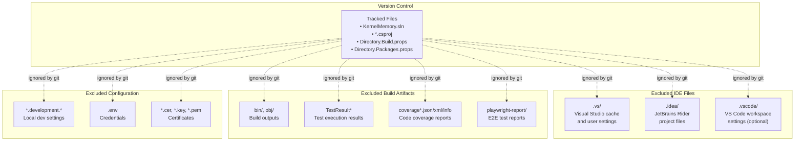
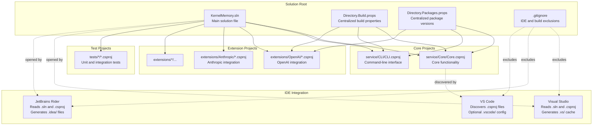
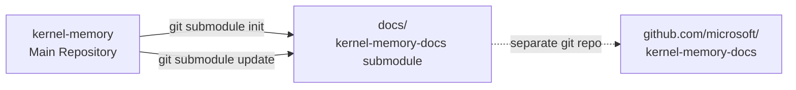
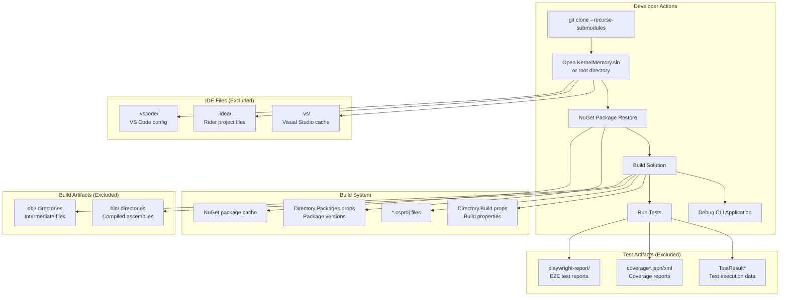

<!-- source: DeepWiki mcp.deepwiki.com · repo microsoft/kernel-memory · page 9.4 IDE Setup and Development Environment · fetched 2026-10-26 -->

# IDE Setup and Development Environment

<details>
<summary>Relevant source files</summary>

The following files were used as context for generating this wiki page:

- [.gitignore](.gitignore)
- [.gitmodules](.gitmodules)
- [README.md](README.md)

</details>


## Purpose and Scope

This document provides guidance for developers setting up their development environment to work on the Kernel Memory (KM²) codebase. It covers IDE configuration, required tools, build system integration, and debugging setup for the three officially supported development environments: Visual Studio, JetBrains Rider, and Visual Studio Code.

For information about the repository structure and project organization, see [Repository Structure](#9.1). For details about the build system and package management, see [Build System](#9.2). For installation and setup from a user perspective, see [Installation and Setup](#2.1).

**Sources**: [README.md:1-34](), [.gitignore:1-73]()

---

## Supported Development Environments

KM² maintains IDE-agnostic build configurations, allowing developers to use their preferred development environment. The following IDEs are supported and tested:

| IDE | Version Requirements | Platform Support | Notes |
|-----|---------------------|------------------|-------|
| Visual Studio | 2022 or later | Windows, macOS | Full-featured experience |
| JetBrains Rider | 2023.1 or later | Windows, macOS, Linux | Cross-platform support |
| Visual Studio Code | Latest stable | Windows, macOS, Linux | Lightweight option with extensions |

All IDE-specific configuration files are excluded from version control to prevent conflicts and maintain a clean repository.

**Sources**: [.gitignore:4-12]()

---

## IDE-Specific Files and Git Exclusions

The repository's `.gitignore` configuration explicitly excludes IDE-specific files to maintain a clean working directory:



**Sources**: [.gitignore:1-73]()

---

## Prerequisites

### Required Tools

The following tools must be installed before setting up any IDE:

| Tool | Version | Purpose | Download |
|------|---------|---------|----------|
| .NET SDK | 8.0 or later | Primary development platform | https://dotnet.microsoft.com/download |
| Git | 2.30 or later | Version control with submodule support | https://git-scm.com/downloads |

### Optional Tools

These tools are required only if working on specific components:

| Tool | Required For | Notes |
|------|-------------|--------|
| Python 3.10+ | Python supporting components | If modifying Python extensions |
| Node.js 18+ | JavaScript supporting components | If modifying Node.js extensions |
| SQLite CLI | Database inspection | For manual database debugging |

**Verification Commands**:
```bash
dotnet --version
git --version
python --version  # Optional
node --version    # Optional
```

**Sources**: [README.md:1-34]()

---

## Solution Structure and IDE Integration



**Sources**: [.gitignore:1-73](), [README.md:1-34]()

---

## Visual Studio Setup

### Installation and Configuration

**Minimum Version**: Visual Studio 2022 (version 17.0 or later)

**Required Workloads**:
- .NET desktop development
- ASP.NET and web development (for service components)

**Recommended Extensions**:
- ReSharper or CodeMaid (code quality)
- GitHub Copilot or IntelliCode (AI assistance)
- Markdown Editor (for documentation)

### Opening the Solution

1. Clone the repository with submodules:
   ```bash
   git clone --recurse-submodules https://github.com/microsoft/kernel-memory
   ```

2. Open `KernelMemory.sln` in Visual Studio

3. Visual Studio will automatically:
   - Restore NuGet packages via `Directory.Packages.props`
   - Apply build configurations from `Directory.Build.props`
   - Generate `.vs/` directory for caching (excluded from git)

### Build Configuration

Visual Studio automatically detects and uses the centralized build configuration:

- **Directory.Build.props** - Applied to all projects in the solution
- **Directory.Packages.props** - Centralized package version management
- Standard build configurations: Debug, Release

**Build Commands**:
- Build Solution: `Ctrl+Shift+B`
- Rebuild Solution: Right-click solution → Rebuild Solution
- Clean Solution: Right-click solution → Clean Solution

### Debugging

**CLI Application Debugging**:

1. Set `CLI` project as startup project
2. Right-click CLI project → Properties → Debug
3. Configure launch profiles with command-line arguments:
   - `search "query text"`
   - `get <document-id>`
   - `config --show`

**Breakpoint Debugging**:
- Set breakpoints in `service/CLI/` for CLI commands
- Set breakpoints in `service/Core/` for core services
- Use conditional breakpoints for complex scenarios

### Running Tests

**Test Explorer**:
1. View → Test Explorer
2. Visual Studio automatically discovers MSTest projects
3. Run all tests: `Ctrl+R, A`
4. Run selected tests: `Ctrl+R, T`
5. Debug tests: Right-click → Debug

**Code Coverage**:
Visual Studio Enterprise includes built-in code coverage:
1. Test → Analyze Code Coverage
2. Results appear in Code Coverage Results window
3. Coverage reports are generated in excluded directories

**Sources**: [.gitignore:27-45](), [.gitignore:47-53]()

---

## JetBrains Rider Setup

### Installation and Configuration

**Minimum Version**: Rider 2023.1 or later

**Required Plugins**:
- Built-in .NET support (pre-installed)
- Git integration (pre-installed)

**Recommended Plugins**:
- GitHub Copilot
- Markdown support
- GitToolBox

### Opening the Solution

1. Clone the repository with submodules:
   ```bash
   git clone --recurse-submodules https://github.com/microsoft/kernel-memory
   ```

2. Open `KernelMemory.sln` in Rider or open the root directory

3. Rider will automatically:
   - Restore NuGet packages
   - Index the solution
   - Generate `.idea/` directory (excluded from git)

### Build Configuration

Rider uses the same centralized configuration as Visual Studio:

- Reads `Directory.Build.props` and `Directory.Packages.props`
- Build configurations appear in Build menu
- NuGet package management integrated in UI

**Build Commands**:
- Build Solution: `Ctrl+Shift+F9` (Windows/Linux) or `⌘+Shift+F9` (macOS)
- Rebuild Solution: Build → Rebuild Solution
- Clean Solution: Build → Clean Solution

### Debugging

**CLI Application Debugging**:

1. Edit Configurations → Add New Configuration → .NET Project
2. Select `CLI` project
3. Add program arguments in "Program arguments" field:
   - `search "test query"`
   - `config --show`
   - `get abc123`

**Breakpoint Management**:
- Toggle breakpoint: `Ctrl+F8` (Windows/Linux) or `⌘+F8` (macOS)
- Conditional breakpoints: Right-click breakpoint → Add condition
- Exception breakpoints: Run → View Breakpoints → Add Exception Breakpoint

### Running Tests

**Unit Tests Window**:
1. View → Tool Windows → Unit Tests
2. Rider automatically discovers MSTest projects
3. Run all tests: `Ctrl+U, L` (Windows/Linux) or `⌘+U, L` (macOS)
4. Run under cursor: `Ctrl+U, R` (Windows/Linux) or `⌘+U, R` (macOS)
5. Debug tests: `Ctrl+U, D` (Windows/Linux) or `⌘+U, D` (macOS)

**Code Coverage**:
Rider includes dotCover integration:
1. Run → Cover All Tests
2. Coverage results appear in Coverage window
3. Coverage reports: `coverage*.json`, `coverage*.xml` (excluded from git)

**Playwright E2E Tests**:
- Rider can execute Playwright tests through .NET test framework
- Test results appear in `playwright-report/` (excluded from git)

**Sources**: [.gitignore:4](), [.gitignore:47-56]()

---

## Visual Studio Code Setup

### Installation and Configuration

**Required Version**: Latest stable release of Visual Studio Code

**Required Extensions**:

| Extension | ID | Purpose |
|-----------|-----|---------|
| C# Dev Kit | `ms-dotnettools.csdevkit` | .NET development support |
| C# | `ms-dotnettools.csharp` | IntelliSense and debugging |

**Recommended Extensions**:

| Extension | ID | Purpose |
|-----------|-----|---------|
| NuGet Package Manager | `jmrog.vscode-nuget-package-manager` | Package management UI |
| GitLens | `eamodio.gitlens` | Enhanced Git integration |
| Markdown All in One | `yzhang.markdown-all-in-one` | Documentation editing |
| GitHub Copilot | `github.copilot` | AI code assistance |

### Opening the Project

1. Clone the repository with submodules:
   ```bash
   git clone --recurse-submodules https://github.com/microsoft/kernel-memory
   cd kernel-memory
   ```

2. Open the root directory in VS Code:
   ```bash
   code .
   ```

3. VS Code will:
   - Prompt to install recommended extensions
   - Discover .NET projects automatically
   - Offer to restore packages

### Build Configuration

VS Code uses the .NET CLI for build operations, respecting `Directory.Build.props` and `Directory.Packages.props`:

**Command Palette Tasks** (`Ctrl+Shift+P` or `⌘+Shift+P`):
- `.NET: Build` - Build solution
- `.NET: Clean` - Clean build artifacts
- `.NET: Restore` - Restore NuGet packages

**Terminal Commands**:
```bash
# Build entire solution
dotnet build KernelMemory.sln

# Build specific project
dotnet build service/CLI/CLI.csproj

# Clean build artifacts
dotnet clean KernelMemory.sln

# Restore packages
dotnet restore KernelMemory.sln
```

### Debugging

**Launch Configuration** (`.vscode/launch.json`):

```json
{
  "version": "0.2.0",
  "configurations": [
    {
      "name": ".NET Core Launch (CLI)",
      "type": "coreclr",
      "request": "launch",
      "preLaunchTask": "build",
      "program": "${workspaceFolder}/service/CLI/bin/Debug/net8.0/CLI.dll",
      "args": ["search", "test query"],
      "cwd": "${workspaceFolder}",
      "stopAtEntry": false,
      "console": "integratedTerminal"
    }
  ]
}
```

**Debugging Workflow**:
1. Set breakpoints by clicking left margin or pressing `F9`
2. Start debugging: `F5`
3. Use Debug Console for expression evaluation
4. Step through code: `F10` (step over), `F11` (step into)

**Note**: `.vscode/` directory is optionally excluded from git. Developers can commit shared configurations or keep them local.

### Running Tests

**Test Explorer**:
1. Install C# Dev Kit extension
2. Test Explorer appears in Activity Bar
3. Tests are automatically discovered from MSTest projects
4. Run tests via Test Explorer UI or Command Palette

**Terminal Commands**:
```bash
# Run all tests
dotnet test KernelMemory.sln

# Run tests with verbosity
dotnet test --verbosity normal

# Run specific test project
dotnet test tests/UnitTests/UnitTests.csproj

# Generate code coverage
dotnet test --collect:"XPlat Code Coverage"
```

**Code Coverage with Coverlet**:
```bash
# Install coverlet.collector (if not already in project)
dotnet add package coverlet.collector

# Run tests with coverage
dotnet test --collect:"XPlat Code Coverage"

# Coverage reports generated as coverage*.json, coverage*.xml (excluded from git)
```

**Playwright Tests**:
```bash
# Run Playwright E2E tests (if applicable)
dotnet test --filter "Category=E2E"

# Reports generated in playwright-report/ (excluded from git)
```

**Sources**: [.gitignore:43-56]()

---

## Git Submodules Setup

The repository includes a documentation submodule that must be initialized:



**Initial Setup**:
```bash
# Clone with submodules
git clone --recurse-submodules https://github.com/microsoft/kernel-memory

# Or initialize after cloning
git submodule init
git submodule update
```

**Updating Submodules**:
```bash
# Update to latest commit
git submodule update --remote

# Update specific submodule
git submodule update --remote docs
```

**IDE Integration**:
- **Visual Studio**: Automatically handles submodules, shows in Team Explorer
- **Rider**: Built-in submodule support in Git tool window
- **VS Code**: GitLens extension provides submodule management

**Sources**: [.gitmodules:1-4]()

---

## Build and Debug Workflow



**Sources**: [.gitignore:1-73](), [.gitmodules:1-4]()

---

## Environment-Specific Configuration

Developers can create local configuration files that are automatically excluded from version control:

| Pattern | Purpose | Example |
|---------|---------|---------|
| `*.development.*` | Development-specific settings | `config.development.json` |
| `*.development.json` | CLI configuration | `appsettings.development.json` |
| `.env` | Environment variables and secrets | API keys, connection strings |
| `appsettings.*.json` | ASP.NET Core settings | `appsettings.Development.json` |

**Example Development Configuration**:

```bash
# .env (excluded from git)
OPENAI_API_KEY=sk-...
ANTHROPIC_API_KEY=sk-ant-...
```

**Security Note**: Never commit credentials or API keys. Use `.env` files or environment-specific configuration files that are excluded by `.gitignore`.

**Sources**: [.gitignore:19-26]()

---

## Code Coverage Tools

KM² supports multiple code coverage tools depending on the IDE:

| Tool | IDE | Configuration | Output Format |
|------|-----|---------------|---------------|
| DotCover | Visual Studio Enterprise, Rider | Built-in integration | `*.dotCover` files |
| Coverlet | All IDEs (CLI-based) | NuGet package | `coverage*.json`, `coverage*.xml`, `coverage*.info` |
| Visual Studio Coverage | Visual Studio Enterprise | Built-in | Binary format |

**Running Coverage with Coverlet (Cross-platform)**:
```bash
# Install coverlet.collector
dotnet add tests/UnitTests/UnitTests.csproj package coverlet.collector

# Run tests with coverage collection
dotnet test --collect:"XPlat Code Coverage"

# Generate HTML report (requires ReportGenerator)
dotnet tool install -g dotnet-reportgenerator-globaltool
reportgenerator -reports:coverage*.xml -targetdir:coverage-report
```

**Coverage artifacts are excluded from git**:
- `*.dotCover` - DotCover cache files
- `coverage*.json`, `coverage*.xml`, `coverage*.info` - Coverlet output

**Sources**: [.gitignore:47-53]()

---

## Common Issues and Troubleshooting

### Issue: Submodule Not Initialized

**Symptom**: `docs/` directory is empty after cloning

**Solution**:
```bash
git submodule init
git submodule update
```

### Issue: NuGet Package Restore Failures

**Symptom**: Build errors about missing packages

**Solution**:
```bash
# Clear NuGet cache
dotnet nuget locals all --clear

# Restore packages
dotnet restore KernelMemory.sln
```

### Issue: IDE Not Recognizing Projects

**Symptom**: IntelliSense not working, projects shown as unloaded

**Solution**:
- **Visual Studio**: Right-click solution → Reload Solution
- **Rider**: File → Invalidate Caches / Restart
- **VS Code**: Restart OmniSharp server (Command Palette → "OmniSharp: Restart OmniSharp")

### Issue: Build Artifacts Polluting Git Status

**Symptom**: `git status` shows many untracked files in `bin/`, `obj/`, etc.

**Solution**: These should be automatically excluded by `.gitignore`. If not:
```bash
# Verify .gitignore is present
cat .gitignore

# Remove ignored files from git tracking
git rm -r --cached bin/ obj/
git commit -m "Remove tracked build artifacts"
```

### Issue: Tests Not Discovered

**Symptom**: Test Explorer shows no tests

**Solution**:
- Ensure test projects reference MSTest packages
- Build the test projects
- Restart the IDE or test discovery process
- For VS Code: Reload window (Command Palette → "Developer: Reload Window")

**Sources**: [.gitignore:1-73](), [.gitmodules:1-4]()

---

## Development Workflow Best Practices

### Recommended Workflow

1. **Start with Clean State**:
   ```bash
   git pull origin main
   git submodule update --remote
   dotnet clean
   dotnet restore
   dotnet build
   ```

2. **Before Committing**:
   ```bash
   dotnet build
   dotnet test
   git status  # Verify no IDE-specific files are staged
   ```

3. **Keep IDE Files Local**:
   - Do not commit `.vs/`, `.idea/`, or `.vscode/` directories
   - Use `.gitignore` to automatically exclude these
   - Share build configurations via `Directory.Build.props` instead

4. **Handle Sensitive Data**:
   - Use `.env` files for local credentials (excluded from git)
   - Use `*.development.*` patterns for local configuration
   - Never commit API keys or certificates

### Multi-IDE Collaboration

The project's IDE-agnostic design allows team members to use different IDEs:

- **Centralized Configuration**: `Directory.Build.props` and `Directory.Packages.props` work across all IDEs
- **Standard Build System**: All IDEs use the same .NET CLI under the hood
- **Excluded IDE Files**: Each developer's IDE-specific files don't conflict
- **Consistent Test Framework**: MSTest runs identically across all IDEs

**Sources**: [.gitignore:1-73](), [README.md:24-34]()

---

## Additional Resources

### Official Documentation
- [.NET SDK Documentation](https://docs.microsoft.com/dotnet)
- [MSTest Framework](https://docs.microsoft.com/visualstudio/test/using-microsoft-visualstudio-testtools-unittesting)
- [Coverlet Coverage Tool](https://github.com/coverlet-coverage/coverlet)

### IDE Documentation
- [Visual Studio Documentation](https://docs.microsoft.com/visualstudio)
- [JetBrains Rider Documentation](https://www.jetbrains.com/help/rider)
- [VS Code C# Documentation](https://code.visualstudio.com/docs/languages/csharp)

### Related KM² Documentation
- [Repository Structure](#9.1) - Understanding the codebase organization
- [Build System](#9.2) - Centralized build configuration details
- [Testing Infrastructure](#9.3) - Comprehensive testing guide
- [Installation and Setup](#2.1) - User-focused setup guide

**Sources**: [README.md:1-34]()

---

