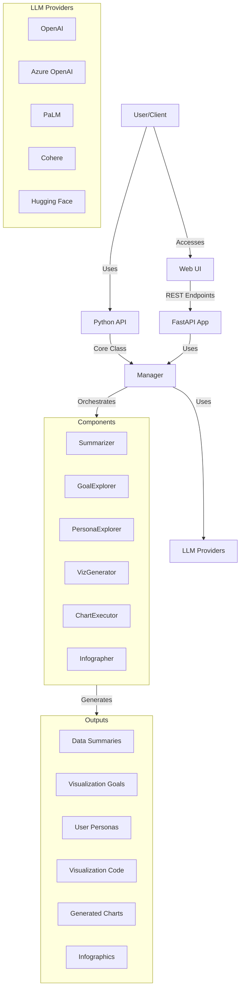
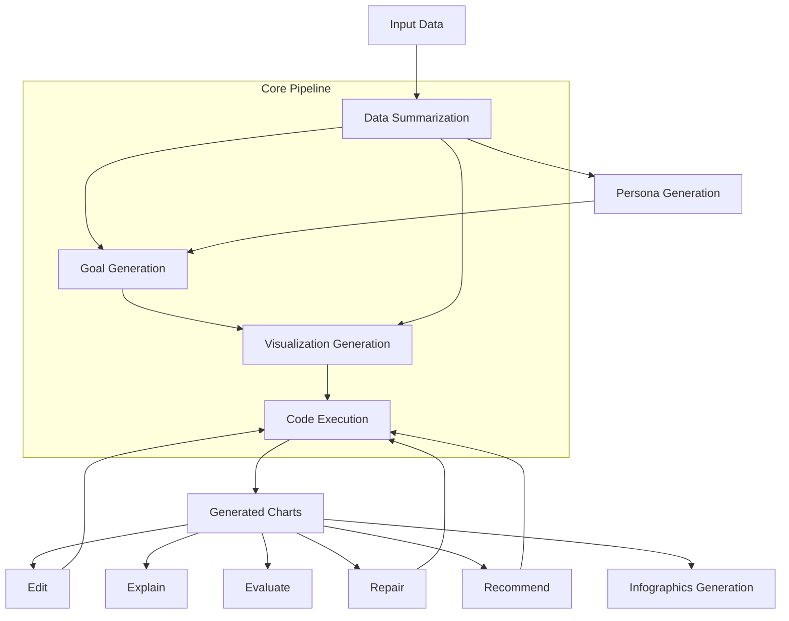
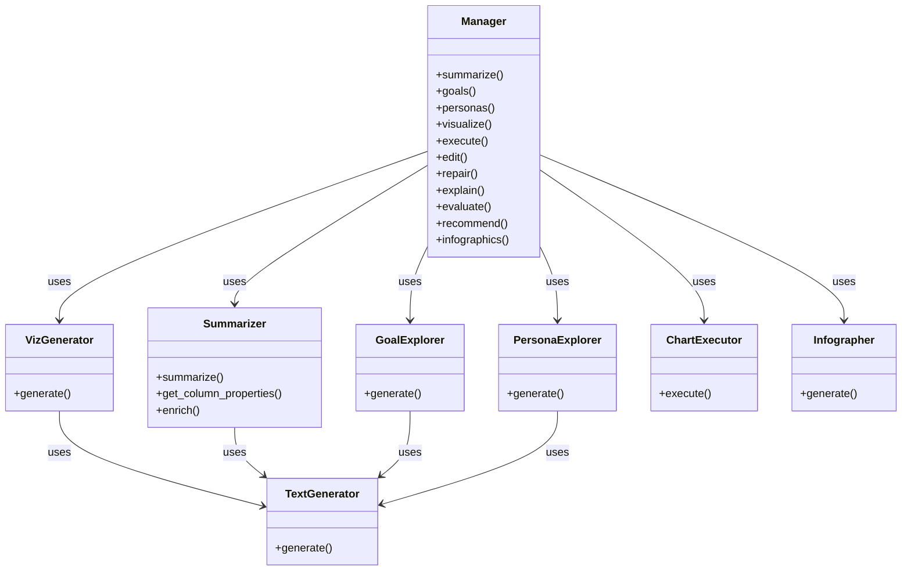
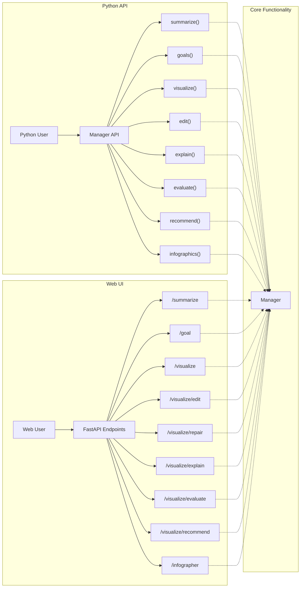

<!-- source: DeepWiki mcp.deepwiki.com · repo microsoft/lida · page 1 Overview · fetched 2026-10-26 -->

# Overview

<details>
<summary>Relevant source files</summary>

The following files were used as context for generating this wiki page:

- [.dockerignore](.dockerignore)
- [CITATION.cff](CITATION.cff)
- [README.md](README.md)
- [docker-compose.yml](docker-compose.yml)
- [dockerfile](dockerfile)
- [lida/version.py](lida/version.py)
- [notebooks/tutorial.ipynb](notebooks/tutorial.ipynb)

</details>


This page provides a comprehensive introduction to LIDA (Language-based Interactive Data Analytics), a library for automatic generation of visualizations and infographics using Large Language Models (LLMs). LIDA enables data visualization through natural language by leveraging LLMs to generate, execute, and refine visualization code in various grammar formats.

For detailed information about individual components, see [Architecture](#2) and [Core Components](#2.1). For usage instructions, see [Python API](#3) and [Web UI](#4).

## What is LIDA?

LIDA is a grammar-agnostic library that works with multiple programming languages and visualization libraries (matplotlib, seaborn, altair, d3, etc.) and integrates with various LLM providers (OpenAI, Azure OpenAI, PaLM, Cohere, Hugging Face). LIDA treats **visualizations as code** and provides a clean API for generating, executing, editing, explaining, evaluating, and repairing visualization code.

LIDA is currently at version `0.0.14` according to [lida/version.py:1-2]().

Sources: [README.md:1-23](), [lida/version.py:1-2]()

## System Architecture

### High-Level Architecture

LIDA follows a modular architecture centered around a core `Manager` class that orchestrates the entire visualization generation process.



Sources: [README.md:17-33](), [notebooks/tutorial.ipynb:1-24](), [notebooks/tutorial.ipynb:25-81]()

### Data Flow

The LIDA pipeline follows a progressive data-to-visualization flow, where each step builds upon the outputs of previous steps:



Sources: [README.md:82-158](), [notebooks/tutorial.ipynb:104-108](), [notebooks/tutorial.ipynb:222-223]()

## Key Features

LIDA provides a comprehensive set of features for data visualization:

1. **Data Summarization**: Generates compact summaries of datasets
2. **Goal Generation**: Creates visualization goals based on data summaries
3. **Visualization Generation**: Converts goals into executable visualization code
4. **Visualization Editing**: Modifies visualizations using natural language instructions
5. **Visualization Explanation**: Provides natural language explanations of visualization code
6. **Visualization Evaluation and Repair**: Identifies issues and repairs visualizations
7. **Visualization Recommendation**: Suggests visualizations based on data
8. **Infographic Generation**: Creates data-faithful infographics from visualizations

Sources: [README.md:19-32](), [README.md:82-158]()

## Components and Relationships

LIDA's architecture consists of several components that work together to create visualizations:



Sources: [README.md:34-158]()

## User Interaction

Users can interact with LIDA through either the Python API or Web UI:



Sources: [README.md:44-65](), [README.md:66-77](), [notebooks/tutorial.ipynb:31-37]()

## Basic Usage Example

The following is a simple usage example of LIDA's Python API:

```python
from lida import Manager, llm

lida = Manager(text_gen = llm("openai"))  # palm, cohere, etc.
summary = lida.summarize("data/cars.csv")
goals = lida.goals(summary, n=2)  # exploratory data analysis
charts = lida.visualize(summary=summary, goal=goals[0])
```

Sources: [README.md:34-42]()

## Installation and Setup

LIDA requires Python 3.10 or higher and can be installed via pip:

```bash
pip install -U lida
```

For the infographics functionality, additional dependencies are required:

```bash
pip install lida[infographics]
```

LIDA depends on various LLM providers that require API keys. These can be set as environment variables:

```bash
export OPENAI_API_KEY=<your key>
```

Sources: [README.md:44-64](), [notebooks/tutorial.ipynb:1-24](), [notebooks/tutorial.ipynb:88-91]()

## Deployment Options

LIDA can be deployed in several ways:

1. **Python Package**: Import and use in Python code
2. **Web UI**: Run the built-in web interface and API
3. **Docker**: Deploy using Docker and docker-compose

The Web UI can be started with:

```bash
lida ui --port=8080 --docs
```

Docker deployment can be done with:

```bash
docker compose up
```

Sources: [README.md:66-77](), [README.md:78-84](), [dockerfile:1-18](), [docker-compose.yml:1-11]()

## Important Considerations

When working with LIDA, keep in mind:

- LIDA generates and executes code, so ensure it runs in a secure environment
- It works best with datasets that have a small number of columns (≤10) due to LLM context limitations
- LIDA assumes the dataset exists and is in a format loadable into a pandas dataframe
- Smaller LLMs may have limited instruction-following capabilities
- The current version has an error rate of <3.5% on over 2200 visualizations generated

Sources: [README.md:192-201]()

## Related Publications

LIDA is described in a paper accepted at ACL 2023 Conference:

```
@inproceedings{dibia2023lida,
    title = "LIDA: A Tool for Automatic Generation of Grammar-Agnostic Visualizations and Infographics using Large Language Models",
    author = "Dibia, Victor",
    booktitle = "Proceedings of the 61st Annual Meeting of the Association for Computational Linguistics (Volume 3: System Demonstrations)",
    month = jul,
    year = "2023",
    address = "Toronto, Canada",
    publisher = "Association for Computational Linguistics",
    url = "https://aclanthology.org/2023.acl-demo.11",
    doi = "10.18653/v1/2023.acl-demo.11",
    pages = "113--126",
}
```

Sources: [README.md:208-225](), [CITATION.cff:1-17]()

---

