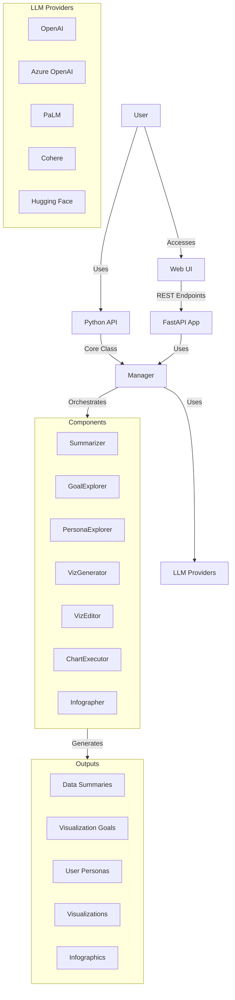
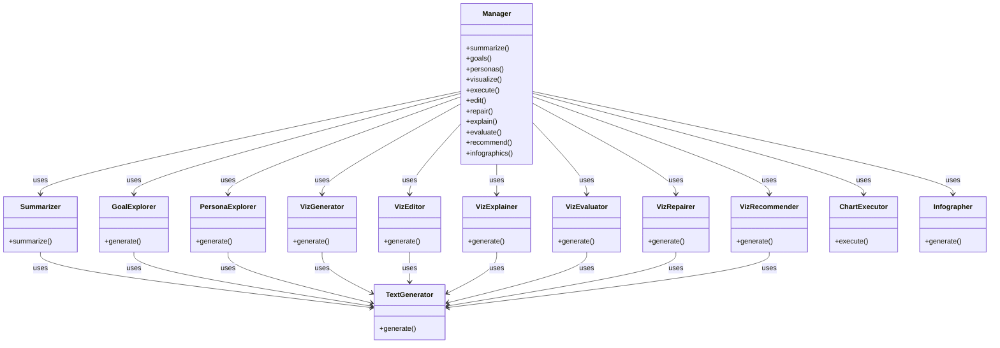
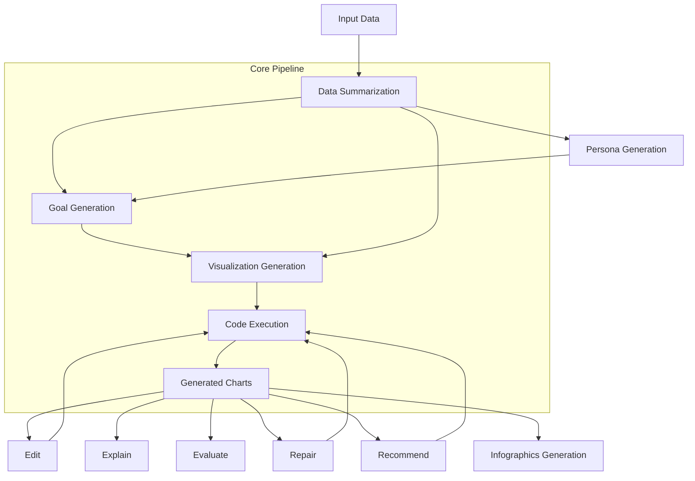
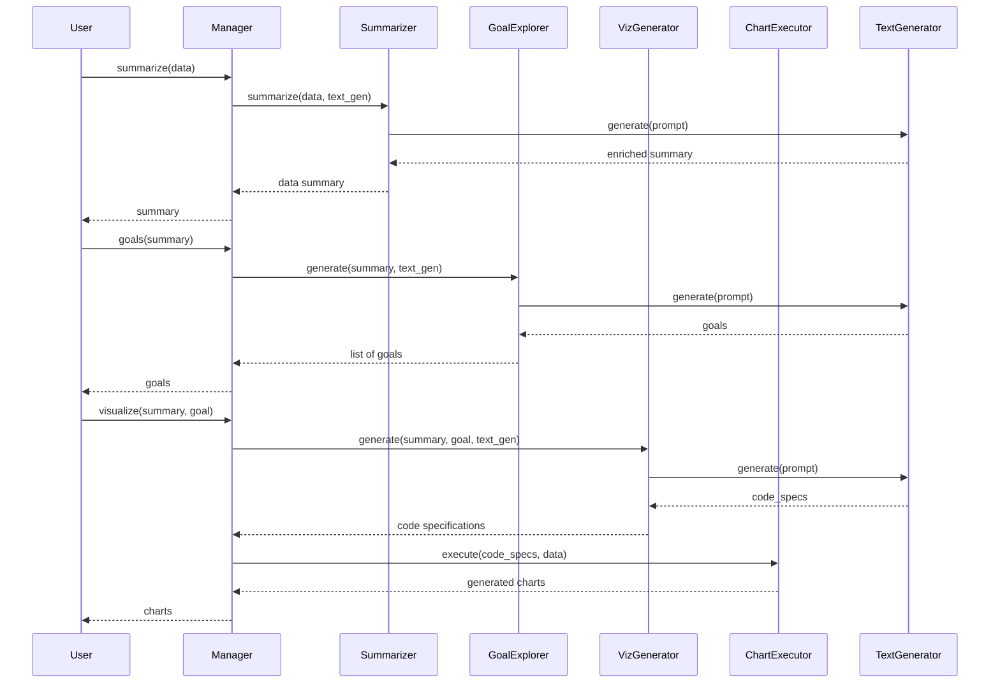
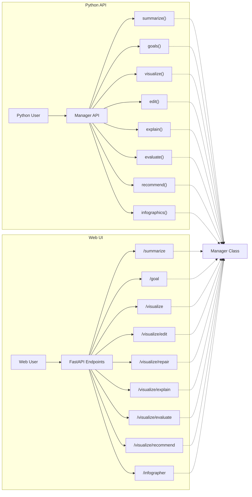
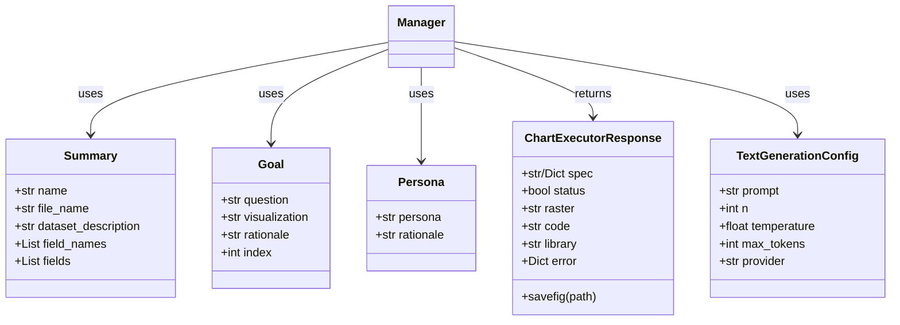
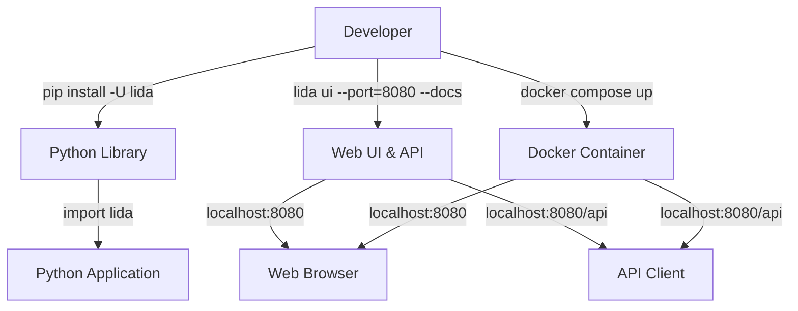
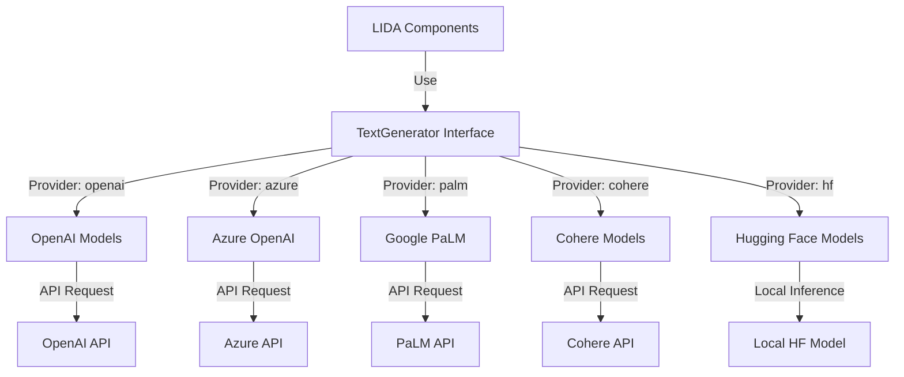

<!-- source: DeepWiki mcp.deepwiki.com · repo microsoft/lida · page 2 Architecture · fetched 2026-10-26 -->

# Architecture

Relevant source files

The following files were used as context for generating this wiki page:

- [.dockerignore](.dockerignore)
- [CITATION.cff](CITATION.cff)
- [README.md](README.md)
- [docker-compose.yml](docker-compose.yml)
- [dockerfile](dockerfile)
- [lida/components/manager.py](lida/components/manager.py)
- [lida/datamodel.py](lida/datamodel.py)
- [lida/web/app.py](lida/web/app.py)

This document provides a detailed overview of LIDA's architecture, components, and data flow. It explains how LIDA's various parts interact to enable automated visualization generation through Large Language Models (LLMs). For information about using the Python API, see [Python API](#3), and for details on the Web UI, see [Web UI](#4).

## High-Level Architecture Overview

LIDA (Language-based Interactive Data Analytics) is structured as a modular system with several key components that work together to transform data into visualizations and infographics.

Sources:
- [lida/components/manager.py:1-431]()
- [README.md:19-33]()
- [lida/web/app.py:1-311]()

## Core Components and Their Responsibilities

The LIDA architecture centers around the `Manager` class which orchestrates all operations by delegating specific tasks to specialized components. Each component has a well-defined responsibility within the visualization generation pipeline.

Sources:
- [lida/components/manager.py:28-50]()
- [lida/components/manager.py:72-431]()

### Component Responsibilities

| Component | Responsibility |
|-----------|----------------|
| **Manager** | Central orchestrator that provides the main API and coordinates all components |
| **Summarizer** | Analyzes datasets to create concise summaries of their structure and content |
| **GoalExplorer** | Generates potential visualization goals based on the data summary |
| **PersonaExplorer** | Creates user personas to contextualize visualization goals |
| **VizGenerator** | Generates visualization code based on summary and goal |
| **VizEditor** | Modifies existing visualization code based on natural language instructions |
| **VizExplainer** | Generates natural language explanations of visualization code |
| **VizEvaluator** | Evaluates visualizations for effectiveness and adherence to goals |
| **VizRepairer** | Fixes issues in visualization code based on feedback |
| **VizRecommender** | Suggests alternative visualizations for a dataset |
| **ChartExecutor** | Executes visualization code to produce the actual visual output |
| **Infographer** | Generates stylized infographics from visualizations |

Sources:
- [lida/components/manager.py:38-50]()
- [README.md:25-32]()

## Data Flow Through the System

LIDA follows a sequential data flow where outputs from one component become inputs to the next. The flowchart below illustrates how data progresses through the system to generate visualizations.

Sources:
- [lida/components/manager.py:72-134]() - Summarization
- [lida/components/manager.py:135-186]() - Goal and Persona Generation
- [lida/components/manager.py:188-212]() - Visualization Generation
- [lida/components/manager.py:214-238]() - Execution
- [lida/components/manager.py:240-431]() - Edit/Repair/Explain/Evaluate/Recommend/Infographics

## Visualization Generation Process

The diagram below shows the sequence of operations that occur during the visualization generation process, from data input to chart output.

Sources:
- [lida/components/manager.py:72-134]() - Summarize method
- [lida/components/manager.py:135-186]() - Goals and Personas methods
- [lida/components/manager.py:188-212]() - Visualize method
- [lida/components/manager.py:214-238]() - Execute method

## API and User Interaction

LIDA provides two primary interfaces for user interaction: a Python API and a Web UI with REST endpoints. The diagram below shows how these interfaces connect to the core functionality.

Sources:
- [lida/components/manager.py:28-50]() - Manager class definition
- [lida/components/manager.py:72-431]() - Manager methods
- [lida/web/app.py:51-303]() - Web API endpoints
- [README.md:66-76]() - Web UI information

### Web API Endpoints

The following table maps the FastAPI endpoints to their corresponding Manager methods:

| Endpoint | HTTP Method | Manager Method | Description |
|----------|------------|----------------|-------------|
| `/summarize` | POST | `summarize()` | Generate data summary from uploaded file |
| `/summarize/url` | POST | `summarize()` | Generate data summary from URL |
| `/goal` | POST | `goals()` | Generate visualization goals |
| `/visualize` | POST | `visualize()` | Generate visualizations |
| `/visualize/edit` | POST | `edit()` | Edit visualizations |
| `/visualize/repair` | POST | `repair()` | Repair visualizations |
| `/visualize/explain` | POST | `explain()` | Explain visualizations |
| `/visualize/evaluate` | POST | `evaluate()` | Evaluate visualizations |
| `/visualize/recommend` | POST | `recommend()` | Recommend visualizations |
| `/infographer` | POST | `infographics()` | Generate infographics |
| `/models` | GET | - | List supported LLM models |
| `/text/generate` | POST | - | Direct text generation |

Sources:
- [lida/web/app.py:51-303]()

## Data Models and Request Objects

LIDA uses several data models to represent the various entities and requests in the system. The key data models are defined in `datamodel.py`.

Sources:
- [lida/datamodel.py:10-235]()

## Deployment Options

LIDA supports multiple deployment options, including:

1. **Python Library**: Use as a Python library in your own applications
2. **Web UI**: Run the bundled web UI and API server
3. **Docker**: Deploy using the provided Docker configuration

Sources:
- [README.md:44-50]() - Installation
- [README.md:67-76]() - Web UI
- [README.md:78-84]() - Docker
- [docker-compose.yml:1-11]()
- [dockerfile:1-18]()

## LLM Integration

LIDA works with multiple LLM providers through the `llmx` library. It supports:

1. **OpenAI** (GPT models)
2. **Azure OpenAI**
3. **Google PaLM**
4. **Cohere**
5. **Hugging Face** (local models)

The `TextGenerator` class from `llmx` serves as an abstraction layer for all LLM interactions, allowing LIDA components to use different LLM providers interchangeably.

Sources:
- [lida/components/manager.py:37-37]() - TextGenerator initialization
- [lida/components/manager.py:52-70]() - TextGenerator configuration
- [README.md:160-190]() - Local LLM usage

## Security Considerations

LIDA generates and executes code to create visualizations, which has important security implications:

1. **Code Execution**: LIDA generates and executes Python code, which could potentially execute harmful operations if used with malicious data or prompts.
2. **Environment Isolation**: Users should run LIDA in a secure environment with appropriate permissions.
3. **API Keys**: When using LLM providers, API keys need to be handled securely.

Sources:
- [README.md:15-17]() - Note on code execution
- [README.md:192-197]() - Important notes/caveats

## Summary

LIDA's architecture follows these key design principles:

1. **Centralized Orchestration**: The `Manager` class serves as the central orchestrator.
2. **Component-based Design**: The system is composed of focused components with single responsibilities.
3. **LLM Integration**: All components leverage LLMs through a consistent `TextGenerator` interface.
4. **Dual Interface**: Users can interact through either a Python API or a web UI.
5. **Progressive Generation**: Outputs from one component feed into the next in a pipeline fashion.
6. **Extensibility**: The architecture supports optional components and can be extended.

This modular design makes LIDA adaptable to different visualization needs while maintaining a consistent interface for LLM-powered generation and editing.

Sources:
- [lida/components/manager.py:1-431]()
- [README.md:19-33]()

---

