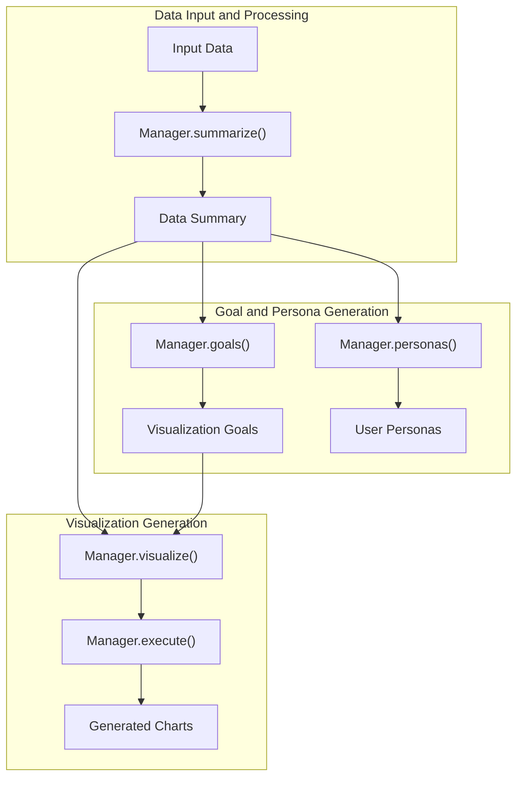
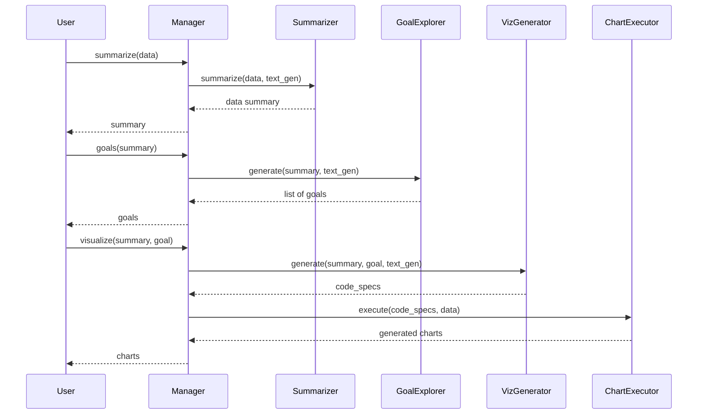
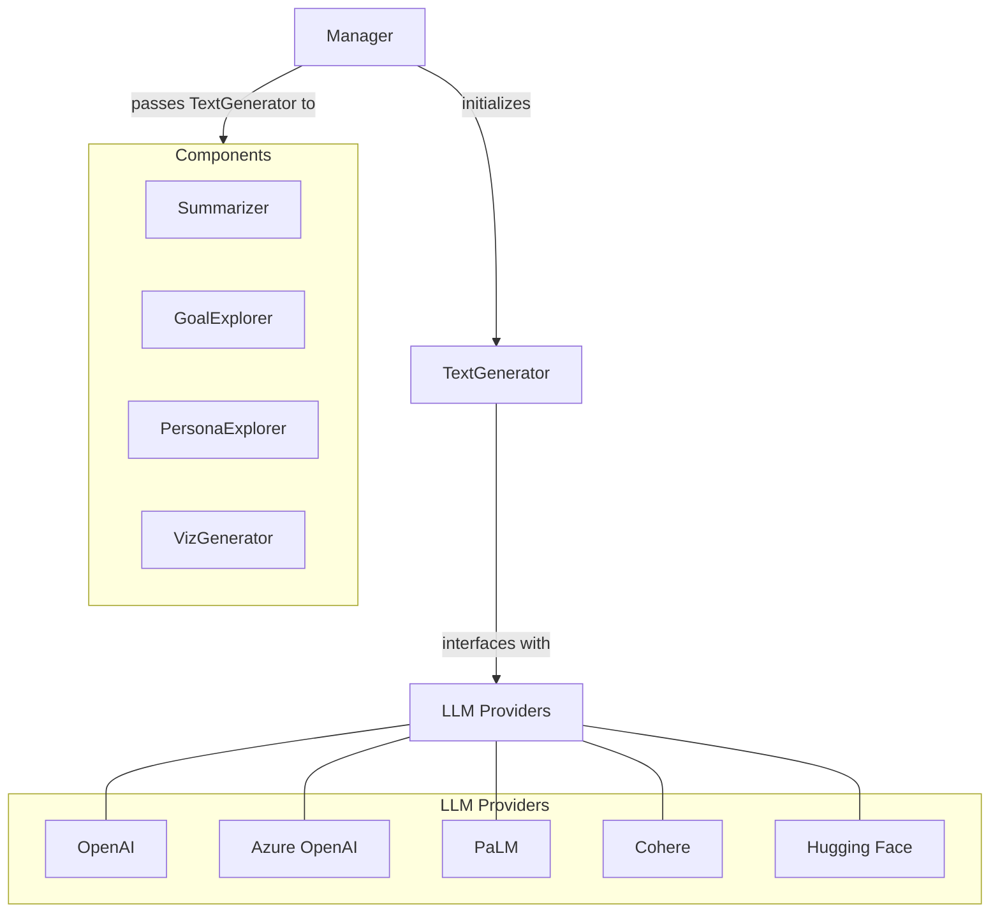

<!-- source: DeepWiki mcp.deepwiki.com · repo microsoft/lida · page 2.1 Core Components · fetched 2026-10-26 -->

# Core Components

<details>
<summary>Relevant source files</summary>

The following files were used as context for generating this wiki page:

- [lida/__init__.py](lida/__init__.py)
- [lida/components/goal.py](lida/components/goal.py)
- [lida/components/manager.py](lida/components/manager.py)
- [lida/components/scaffold.py](lida/components/scaffold.py)
- [lida/components/summarizer.py](lida/components/summarizer.py)
- [lida/utils.py](lida/utils.py)
- [tests/test_components.py](tests/test_components.py)

</details>


This page documents the core components of LIDA (Language-based Interactive Data Analytics), explaining their structure, responsibilities, and interactions. These components form the foundation of LIDA's architecture and enable its data visualization capabilities. For visualization-specific components, see [Visualization Components](#2.2), and for infographics generation, see [Infographics Generation](#2.3).

## Overview of Core Components

LIDA follows a modular, component-based architecture where specialized components handle different stages of the data visualization pipeline. The Manager acts as a central orchestrator, coordinating the workflow between various components.

```mermaid
classDiagram
    class "Manager" {
        +summarize()
        +goals()
        +personas()
        +visualize()
        +execute()
    }
    
    class "Summarizer" {
        +summarize()
        +get_column_properties()
        +enrich()
    }
    
    class "GoalExplorer" {
        +generate()
    }
    
    class "PersonaExplorer" {
        +generate()
    }
    
    class "TextGenerator" {
        +generate()
    }
    
    class "ChartExecutor" {
        +execute()
    }
    
    "Manager" --> "Summarizer" : uses
    "Manager" --> "GoalExplorer" : uses
    "Manager" --> "PersonaExplorer" : uses
    "Manager" --> "ChartExecutor" : uses
    "Summarizer" --> "TextGenerator" : uses
    "GoalExplorer" --> "TextGenerator" : uses
    "PersonaExplorer" --> "TextGenerator" : uses
```

Sources: [lida/components/manager.py:27-50](), [lida/components/summarizer.py:21-22](), [lida/components/goal.py:25-26]()

## Manager Component

The Manager is the central orchestrator that exposes LIDA's functionality through a unified API. It initializes and coordinates all other components, providing methods that correspond to each step of the data visualization pipeline.

### Key Responsibilities

- Initialize and manage all other components
- Provide a unified API for data summarization, goal generation, visualization creation, and more
- Handle data loading and preprocessing
- Execute visualization code
- Coordinate the workflow between components

The Manager provides these primary methods:
- `summarize()`: Generate a summary of the input data
- `goals()`: Generate visualization goals based on a data summary
- `personas()`: Generate user personas based on a data summary
- `visualize()`: Create visualizations based on a goal and summary
- `execute()`: Execute visualization code
- Additional methods for visualization modification and explanation

Sources: [lida/components/manager.py:28-51](), [lida/__init__.py:1-5]()

## Data Flow Through Components

The following diagram illustrates how data flows through LIDA's core components:



Sources: [lida/components/manager.py:72-133](), [lida/components/manager.py:135-178](), [lida/components/manager.py:188-212]()

## Core Component Details

### Summarizer

The Summarizer component analyzes input data and generates a structured summary containing information about the dataset and its fields.

**Key Methods:**
- `summarize()`: Generate a summary from input data
- `get_column_properties()`: Extract properties from each column in a dataframe
- `enrich()`: Enhance the summary with LLM-generated descriptions

**Data Summary Structure:**
```
{
  "name": "filename.csv",
  "file_name": "filename.csv",
  "dataset_description": "...",
  "fields": [
    {
      "column": "column_name",
      "properties": {
        "dtype": "string|number|date|category|boolean",
        "samples": [...],
        "num_unique_values": 123,
        "semantic_type": "...",
        "description": "..."
      }
    },
    ...
  ],
  "field_names": ["column1", "column2", ...]
}
```

Sources: [lida/components/summarizer.py:21-159](), [lida/utils.py:23-33](), [lida/utils.py:45-104]()

### GoalExplorer

The GoalExplorer component generates visualization goals based on a data summary. Each goal consists of a question to answer, a visualization type, and a rationale for why this visualization would be informative.

**Key Methods:**
- `generate()`: Create visualization goals based on a data summary

**Goal Structure:**
```
{
  "index": 0,
  "question": "What is the distribution of X?",
  "visualization": "histogram of X",
  "rationale": "This shows the frequency distribution..."
}
```

Sources: [lida/components/goal.py:25-65]()

### PersonaExplorer

The PersonaExplorer component generates user personas that represent potential users with specific interests and perspectives. These personas can be used to customize the generated goals and visualizations.

**Key Methods:**
- `generate()`: Create user personas based on a data summary

Sources: [lida/components/manager.py:180-186]()

### ChartScaffold

The ChartScaffold component provides code templates for different visualization libraries. These templates form the structure that the VizGenerator fills with specific visualization code.

**Key Methods:**
- `get_template()`: Get a code template for a specific visualization library

**Supported Libraries:**
- Matplotlib
- Seaborn
- ggplot
- Altair
- Plotly

Sources: [lida/components/scaffold.py:10-115]()

### ChartExecutor

The ChartExecutor component executes the visualization code generated by the VizGenerator, producing the actual visual output.

**Key Methods:**
- `execute()`: Execute visualization code with the provided data

Sources: [lida/components/manager.py:214-238]()

## Component Interaction Sequence

The following sequence diagram illustrates how components interact during a typical LIDA workflow:



Sources: [lida/components/manager.py:72-212](), [tests/test_components.py:10-72]()

## Component API Reference

### Manager API

| Method | Parameters | Description |
|--------|------------|-------------|
| `summarize` | `data`, `file_name`, `n_samples`, `summary_method`, `textgen_config` | Summarizes input data (DataFrame or file path) |
| `goals` | `summary`, `textgen_config`, `n`, `persona` | Generates visualization goals based on a summary |
| `personas` | `summary`, `textgen_config`, `n` | Generates user personas based on a summary |
| `visualize` | `summary`, `goal`, `textgen_config`, `library`, `return_error` | Creates visualizations based on a goal and summary |
| `execute` | `code_specs`, `data`, `summary`, `library`, `return_error` | Executes visualization code |
| `edit` | `code`, `summary`, `instructions`, `textgen_config`, `library`, `return_error` | Edits a visualization based on instructions |
| `repair` | `code`, `goal`, `summary`, `feedback`, `textgen_config`, `library`, `return_error` | Repairs a visualization based on feedback |
| `explain` | `code`, `textgen_config`, `library` | Explains a visualization |
| `evaluate` | `code`, `goal`, `textgen_config`, `library` | Evaluates a visualization against a goal |
| `recommend` | `code`, `summary`, `n`, `textgen_config`, `library`, `return_error` | Recommends alternative visualizations |
| `infographics` | `visualization`, `n`, `style_prompt`, `return_pil` | Generates infographics from a visualization |

Sources: [lida/components/manager.py:72-430]()

## Core Component Integration with LLMs

LIDA components integrate with Large Language Models (LLMs) through a common TextGenerator interface. The Manager initializes a TextGenerator and passes it to other components as needed. This design enables:

1. Consistent LLM access across all components
2. Support for multiple LLM providers (OpenAI, Azure OpenAI, PaLM, Cohere, HuggingFace)
3. Configuration of generation parameters through TextGenerationConfig



Sources: [lida/components/manager.py:29-38](), [lida/components/manager.py:52-70]()

For more details on LLM integration and configuration, see [LLM Integration](#5).

---

