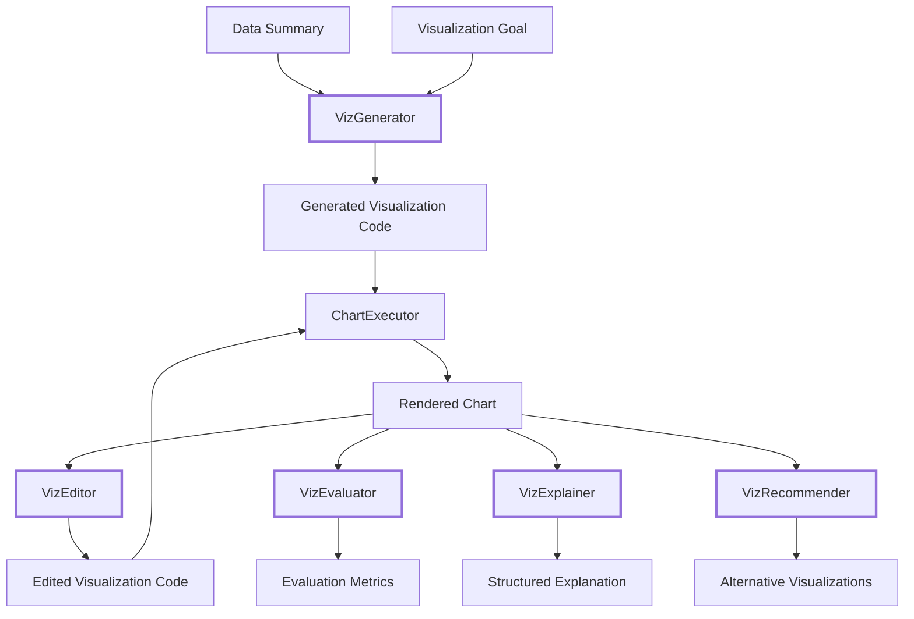
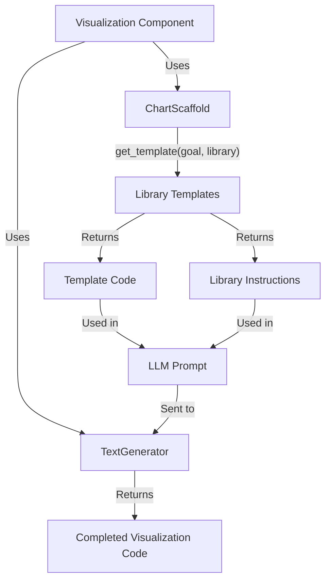
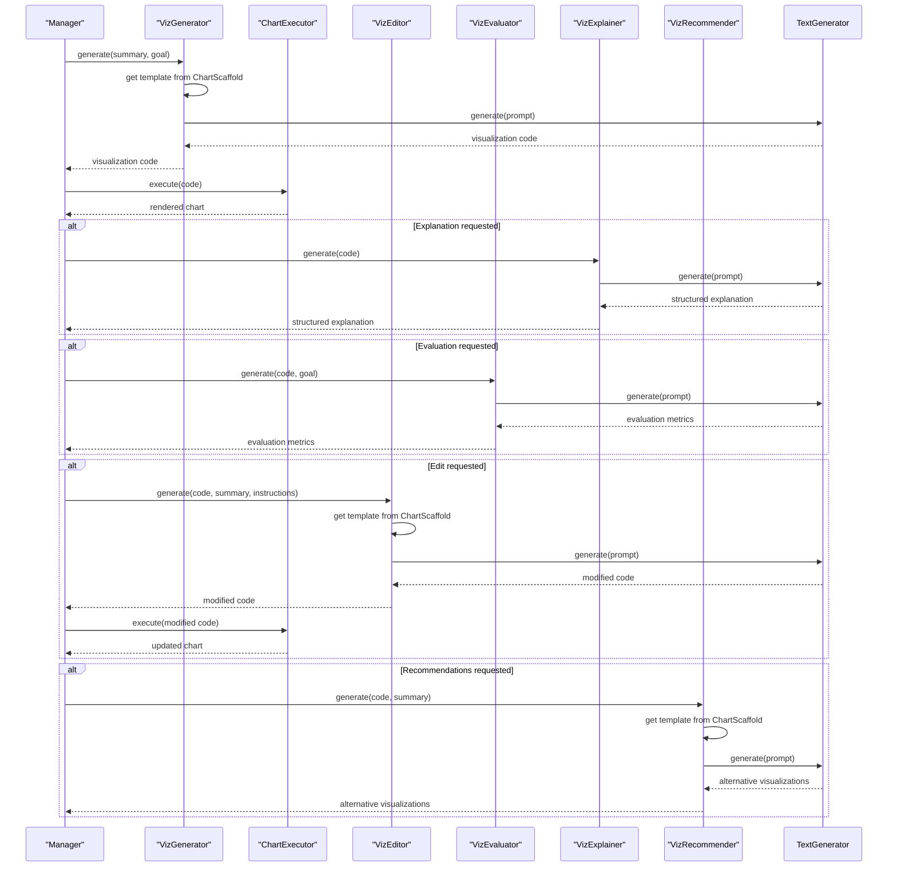

<!-- source: DeepWiki mcp.deepwiki.com · repo microsoft/lida · page 2.2 Visualization Components · fetched 2026-10-26 -->

# Visualization Components

Relevant source files

The following files were used as context for generating this wiki page:

- [lida/components/viz/vizeditor.py](lida/components/viz/vizeditor.py)
- [lida/components/viz/vizevaluator.py](lida/components/viz/vizevaluator.py)
- [lida/components/viz/vizexplainer.py](lida/components/viz/vizexplainer.py)
- [lida/components/viz/vizgenerator.py](lida/components/viz/vizgenerator.py)
- [lida/components/viz/vizrecommender.py](lida/components/viz/vizrecommender.py)

This document details the components responsible for visualization generation, editing, evaluation, and execution within the LIDA system. These components form the core visualization pipeline that transforms data summaries and goals into visualizations, provides explanations, and offers refinement capabilities.

For information about the Infographics Generation system, which builds upon visualizations, see [Infographics Generation](#2.3).

## Overview of Visualization Components

LIDA's visualization system is composed of multiple specialized components that work together to enable the complete visualization lifecycle. Each component is designed with a specific responsibility in the pipeline, from initial generation to evaluation and recommendation.

Sources: [lida/components/viz/vizgenerator.py](), [lida/components/viz/vizeditor.py](), [lida/components/viz/vizevaluator.py](), [lida/components/viz/vizexplainer.py](), [lida/components/viz/vizrecommender.py]()

## Visualization Component Architecture

The visualization components are implemented as Python classes that follow a common pattern. Each component:

1. Utilizes an LLM via the `TextGenerator` interface
2. Employs carefully crafted prompts to guide the LLM
3. Returns structured outputs for further processing

```mermaid
classDiagram
    class VizGenerator {
        +scaffold: ChartScaffold
        +generate(summary, goal, textgen_config, text_gen, library): string[]
    }
    
    class VizEditor {
        +scaffold: ChartScaffold
        +generate(code, summary, instructions, textgen_config, text_gen, library): string[]
    }
    
    class VizEvaluator {
        +generate(code, goal, textgen_config, text_gen, library): list
    }
    
    class VizExplainer {
        +scaffold: ChartScaffold
        +generate(code, textgen_config, text_gen, library): list
    }
    
    class VizRecommender {
        +scaffold: ChartScaffold
        +generate(code, summary, textgen_config, text_gen, n, library): string[]
    }
    
    class ChartScaffold {
        +get_template(goal, library): tuple
    }
    
    class TextGenerator {
        +generate(messages, config): TextGenerationResponse
    }
    
    VizGenerator --> ChartScaffold: uses
    VizEditor --> ChartScaffold: uses
    VizExplainer --> ChartScaffold: uses
    VizRecommender --> ChartScaffold: uses
    
    VizGenerator --> TextGenerator: uses
    VizEditor --> TextGenerator: uses
    VizEvaluator --> TextGenerator: uses
    VizExplainer --> TextGenerator: uses
    VizRecommender --> TextGenerator: uses
```

Sources: [lida/components/viz/vizgenerator.py:14-40](), [lida/components/viz/vizeditor.py:11-44](), [lida/components/viz/vizevaluator.py:28-58](), [lida/components/viz/vizexplainer.py:28-60](), [lida/components/viz/vizrecommender.py:41-86]()

## Core Visualization Components

### VizGenerator

The `VizGenerator` component creates visualization code based on a data summary and a visualization goal. It uses the `ChartScaffold` to get templates for different visualization libraries and generates code that follows best practices.

**Key Features:**
- Takes a data summary and goal as input
- Uses templates for different visualization libraries (like Altair or Seaborn)
- Produces full runnable Python code for visualizations

**Implementation:**
The `generate` method in `VizGenerator` constructs a prompt with the data summary, goal, and library-specific template, then uses the LLM to generate the visualization code.

Sources: [lida/components/viz/vizgenerator.py:14-40]()

### VizEditor

The `VizEditor` component modifies existing visualization code based on user instructions. It takes the current code, dataset summary, and a list of modification instructions as input.

**Key Features:**
- Takes existing code and modification instructions as input
- Applies changes while maintaining correct syntax and following best practices
- Outputs modified code that still follows the appropriate template structure

**Implementation:**
The `generate` method in `VizEditor` formats the instructions and passes them to the LLM along with the existing code and library template to produce modified code.

Sources: [lida/components/viz/vizeditor.py:11-44]()

### VizEvaluator

The `VizEvaluator` component assesses the quality of visualization code across multiple dimensions such as bugs, data transformation, goal compliance, visualization type, data encoding, and aesthetics.

**Key Features:**
- Evaluates visualizations on six dimensions
- Provides a numerical score (1-10) for each dimension
- Includes a detailed rationale for each score

**Evaluation Dimensions:**

| Dimension | Description |
|-----------|-------------|
| Bugs | Presence of bugs, logic errors, syntax errors, or typos |
| Transformation | Appropriate data transformation for the visualization type |
| Compliance | How well the code meets the specified visualization goals |
| Type | Appropriateness of the visualization type for the data and intent |
| Encoding | Appropriate data encoding for the visualization type |
| Aesthetics | Appropriateness of the visualization aesthetics |

**Implementation:**
The `generate` method in `VizEvaluator` prompts the LLM to assess the visualization code on each dimension and returns a structured JSON output with scores and rationales.

Sources: [lida/components/viz/vizevaluator.py:28-58]()

### VizExplainer

The `VizExplainer` component provides structured explanations of visualization code across three key dimensions: accessibility, transformation, and visualization.

**Key Features:**
- Divides code explanations into three sections
- Provides code-to-explanation mapping for each section
- Enhances understanding of the visualization's purpose and implementation

**Explanation Dimensions:**

| Section | Description |
|---------|-------------|
| Accessibility | Describes the physical appearance, goal, and main insights |
| Transformation | Explains data transformation aspects (filtering, aggregation, etc.) |
| Visualization | Provides step-by-step description of the visualization creation |

**Implementation:**
The `generate` method in `VizExplainer` prompts the LLM to provide explanations for each section and returns a structured JSON output.

Sources: [lida/components/viz/vizexplainer.py:28-60]()

### VizRecommender

The `VizRecommender` component suggests additional visualizations based on an existing visualization, the dataset summary, and visualization goals.

**Key Features:**
- Takes an existing visualization as a starting point
- Recommends alternative visualizations that provide different perspectives
- Considers different aggregations, chart types, and variables

**Implementation:**
The `generate` method in `VizRecommender` takes an existing code snippet and data summary, then prompts the LLM to generate multiple alternative visualization code snippets.

Sources: [lida/components/viz/vizrecommender.py:41-86]()

## Prompt-Driven Visualization Generation

Each visualization component utilizes carefully crafted system prompts to guide the LLM in generating appropriate outputs. These prompts define the task, output format, and best practices to follow.

**Example System Prompts:**

| Component | Prompt Focus |
|-----------|--------------|
| VizGenerator | Writing perfect visualization code following best practices |
| VizEditor | Modifying visualization code based on specific instructions |
| VizEvaluator | Evaluating visualization quality across multiple dimensions |
| VizExplainer | Providing structured explanations of visualization code |
| VizRecommender | Recommending diverse alternative visualizations |

The prompt design is critical to achieving high-quality outputs from the LLMs. For example, the VizGenerator's system prompt explicitly instructs the LLM to:
- Follow visualization best practices
- Apply correct transformations
- Use appropriate visualization types
- Ensure proper data encoding
- Maintain legible aesthetics

Sources: [lida/components/viz/vizgenerator.py:9-11](), [lida/components/viz/vizeditor.py:6-8](), [lida/components/viz/vizevaluator.py:8-25](), [lida/components/viz/vizexplainer.py:8-14](), [lida/components/viz/vizrecommender.py:10-35]()

## Integration with Visualization Libraries

The visualization components support multiple visualization libraries through the `ChartScaffold` system, which provides templates and instructions for each library.

**Supported Libraries:**
- Altair (default for VizGenerator)
- Seaborn (default for VizRecommender)
- Others as supported by ChartScaffold

Each visualization component accepts a `library` parameter that determines which visualization library templates and instructions to use.

Sources: [lida/components/viz/vizgenerator.py:23-24](), [lida/components/viz/vizeditor.py:21-22](), [lida/components/viz/vizevaluator.py:36-37](), [lida/components/viz/vizexplainer.py:37-38](), [lida/components/viz/vizrecommender.py:54]()

## Visualization Generation Process

The typical flow for visualization generation and refinement involves multiple components working together:

1. **Initial Visualization Generation:**
   - `VizGenerator` creates visualization code based on data summary and goal
   - Code is executed through a `ChartExecutor` to produce the actual visualization

2. **Visualization Enhancement and Analysis:**
   - `VizExplainer` provides explanations of the generated visualization
   - `VizEvaluator` assesses visualization quality and identifies potential improvements
   - `VizEditor` applies specific modifications to the visualization code
   - `VizRecommender` suggests alternative visualizations

Sources: [lida/components/viz/vizgenerator.py](), [lida/components/viz/vizeditor.py](), [lida/components/viz/vizevaluator.py](), [lida/components/viz/vizexplainer.py](), [lida/components/viz/vizrecommender.py]()

## Summary

The visualization components in LIDA provide a comprehensive system for generating, editing, evaluating, explaining, and recommending data visualizations. These components:

1. Use LLMs to generate and manipulate visualization code
2. Support multiple visualization libraries through templating
3. Provide structured evaluation and explanation of visualizations
4. Offer recommendations for alternative visualization approaches

Together, these components enable a flexible and powerful visualization pipeline that supports the complete visualization lifecycle from initial generation to refinement and optimization.

---

