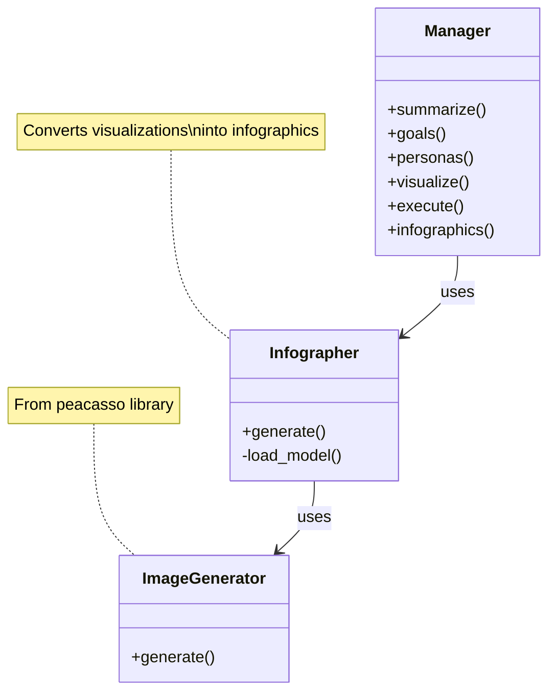
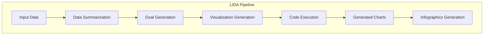
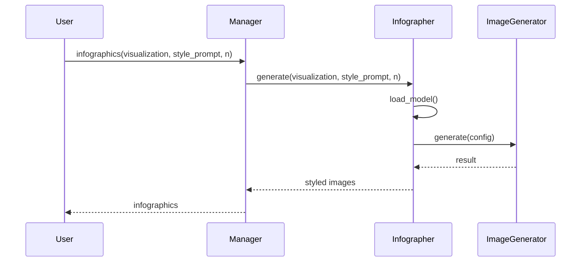
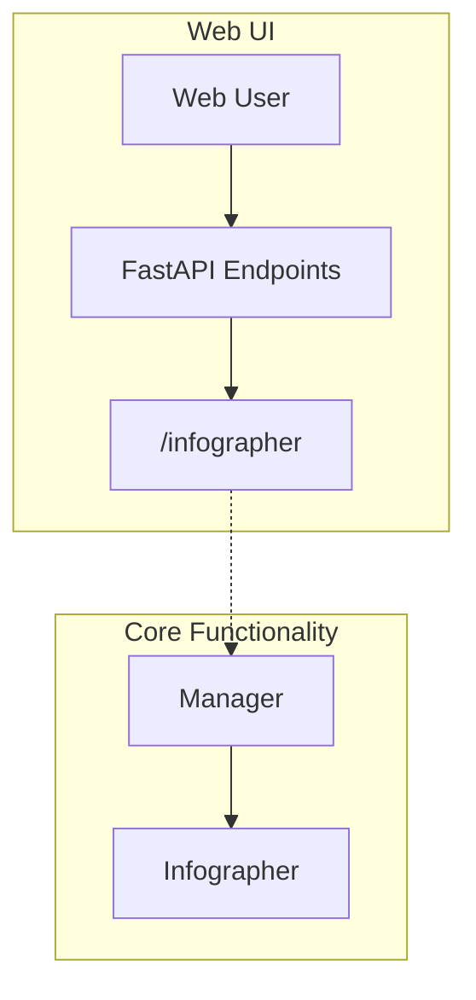

<!-- source: DeepWiki mcp.deepwiki.com · repo microsoft/lida · page 2.3 Infographics Generation · fetched 2026-10-26 -->

# Infographics Generation

<details>
<summary>Relevant source files</summary>

The following files were used as context for generating this wiki page:

- [.dockerignore](.dockerignore)
- [CITATION.cff](CITATION.cff)
- [README.md](README.md)
- [docker-compose.yml](docker-compose.yml)
- [dockerfile](dockerfile)
- [lida/components/infographer.py](lida/components/infographer.py)
- [lida/version.py](lida/version.py)
- [notebooks/tutorial.ipynb](notebooks/tutorial.ipynb)

</details>


This document describes the Infographics Generation feature of LIDA, which transforms data visualizations into styled infographics using stable diffusion models. The infographics generation functionality is currently in beta.

## Overview

The Infographics Generation feature in LIDA allows users to take existing data visualizations and convert them into aesthetically styled infographics while preserving the data representation. This component uses stable diffusion models to stylize visualizations based on user-provided style prompts.

The feature is implemented through the `Infographer` class, which serves as a bridge between LIDA's visualization pipeline and image generation models from the `peacasso` library.

```mermaid
flowchart TD
    subgraph "Infographics Generation Process"
        vis["Visualization Image"] --> infographer["Infographer"]
        style["Style Prompt"] --> infographer
        infographer --> sd["Stable Diffusion Model"]
        sd --> output["Styled Infographics"]
    end
```

Sources: [lida/components/infographer.py:13-62](), [README.md:152-158]()

## Installation

The infographics generation feature requires additional dependencies beyond the base LIDA package. To install LIDA with infographics support:

```bash
pip install lida[infographics]
```

This installs the necessary dependencies including the `peacasso` library, which provides the stable diffusion models used for image generation.

Sources: [README.md:152-153](), [notebooks/tutorial.ipynb:90]()

## Architecture

The Infographics Generation component fits into the broader LIDA architecture as an optional extension to the visualization pipeline. The `Infographer` class is one of the specialized components orchestrated by the central `Manager` class.



In the data flow of LIDA, infographics generation is typically the final step after creating and executing visualization code:



Sources: [lida/components/infographer.py:13-62]()

## Usage

The infographics generation feature can be accessed through the LIDA Python API via the `infographics()` method of the `Manager` class. Here is a basic example:

```python
from lida import Manager, llm

lida = Manager(text_gen=llm("openai"))
summary = lida.summarize("data/cars.csv")
goals = lida.goals(summary, n=2)
charts = lida.visualize(summary=summary, goal=goals[0])

# Generate infographics from the first chart
infographics = lida.infographics(visualization=charts[0].raster, n=3, style_prompt="line art")
```

The `infographics()` method takes the following parameters:

| Parameter | Type | Description |
|-----------|------|-------------|
| visualization | Image/str | The visualization to convert (raster image or base64 string) |
| n | int | Number of infographic variants to generate |
| style_prompt | str/List[str] | Style description for the infographic (e.g., "line art", "watercolor") |
| return_pil | bool | Whether to return PIL images (True) or base64 strings (False) |

Sources: [README.md:152-158](), [lida/components/infographer.py:28-62]()

## Implementation Details

### Infographer Class

The `Infographer` class is the main implementation of the infographics generation feature. It wraps around the `peacasso` library's `ImageGenerator` class to provide a simplified interface for LIDA users.

Key methods:
- `load_model()`: Loads the stable diffusion model 
- `generate()`: Generates infographics based on input visualization and style prompts

### Behind the Scenes

When generating infographics, the following process occurs:

1. The input visualization (either a PIL Image or base64 string) is converted to a format usable by the stable diffusion model
2. The model is loaded if it hasn't been already
3. Generation parameters are configured, including style prompt, image dimensions, and guidance scale
4. The stable diffusion model performs image-to-image transformation, preserving the essential visual elements while applying the requested style
5. The resulting images are returned either as PIL Image objects or base64 strings



Sources: [lida/components/infographer.py:24-62]()

## Model Configuration

The infographics generation uses the Stable Diffusion v1.5 model by default. The model configuration can be customized when initializing the `Infographer` class:

```python
from lida import Manager, llm
from peacasso.datamodel import ModelConfig
from lida.components.infographer import Infographer

# Custom model configuration
model_config = ModelConfig(
    device="cuda",  # or "cpu" for machines without GPU
    model="runwayml/stable-diffusion-v1-5",
    revision="main"
)

# Initialize with custom infographer
infographer = Infographer(model_config=model_config)
lida = Manager(text_gen=llm("openai"), infographer=infographer)
```

The generation process can be customized through several parameters:

| Parameter | Default Value | Description |
|-----------|---------------|-------------|
| width | 512 | Width of generated images |
| height | 512 | Height of generated images |
| guidance_scale | 7.5 | Controls how closely the image follows the prompt |
| num_inference_steps | 50 | Number of denoising steps (more = higher quality but slower) |
| strength | 0.6 | How much to transform the original image (0-1) |
| negative_prompt | "text, background shapes..." | Elements to avoid in the generated image |

Sources: [lida/components/infographer.py:16-22](), [lida/components/infographer.py:44-57]()

## Limitations and Best Practices

The infographics generation feature has some limitations to be aware of:

1. It requires significant computational resources, especially GPU memory
2. The quality of the output depends on the input visualization and style prompt
3. Text from the original visualization may be distorted or removed in the generated infographics
4. It's currently in beta, so expect potential changes or improvements in future versions

Best practices for generating high-quality infographics:

- Use clear, high-contrast visualizations as input
- Experiment with different style prompts (e.g., "watercolor", "line art", "digital illustration")
- Generate multiple variants (using the `n` parameter) to choose from
- If using GPU, ensure you have sufficient VRAM (at least 4GB recommended)

Sources: [README.md:152-158](), [lida/components/infographer.py:44-57]()

## Integration with the Web UI

The infographics generation feature is also available through LIDA's web UI via the `/infographer` endpoint.



To use the web UI with infographics support, ensure you've installed the infographics dependencies:

```bash
pip install lida[infographics]
lida ui --port=8080 --docs
```

Then navigate to http://localhost:8080/ in your browser and use the infographics generation interface.

Sources: [README.md:152-158](), [docker-compose.yml:1-11](), [dockerfile:1-18]()

---

