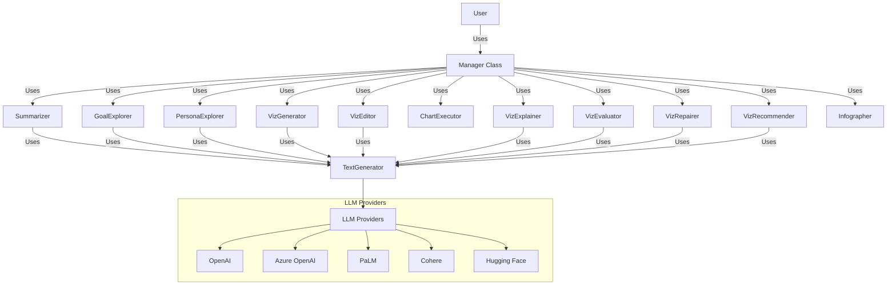
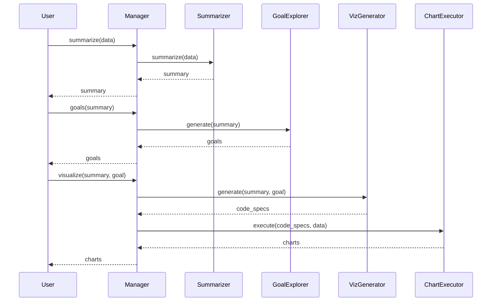
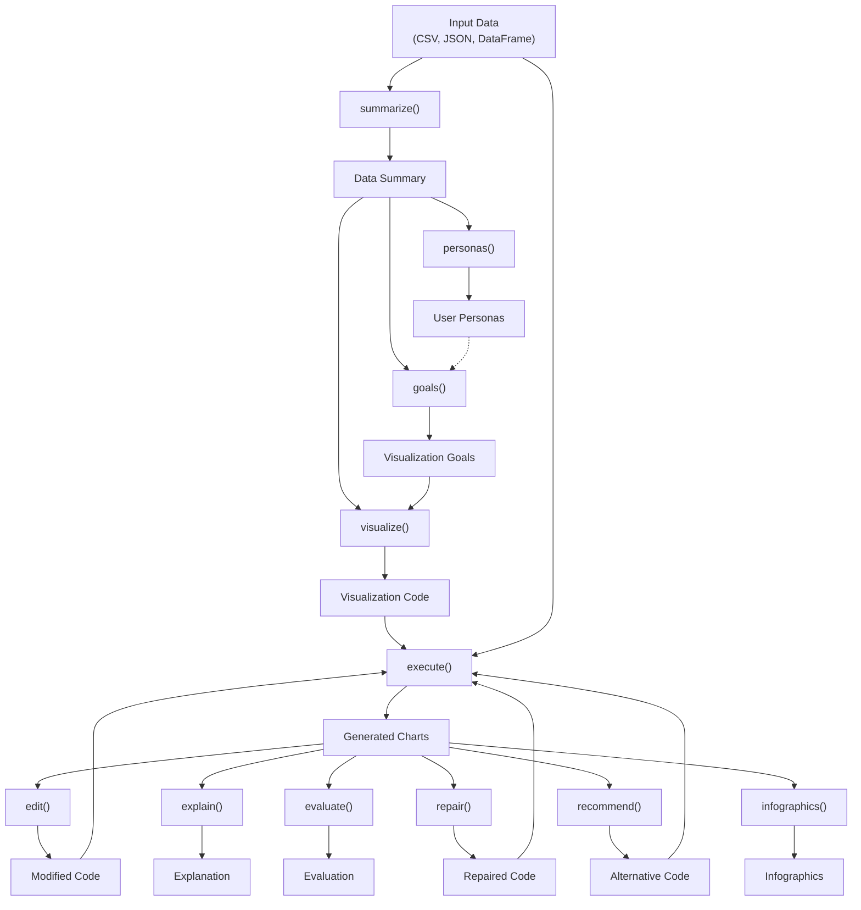

<!-- source: DeepWiki mcp.deepwiki.com · repo microsoft/lida · page 3 Python API · fetched 2026-10-26 -->

# Python API

<details>
<summary>Relevant source files</summary>

The following files were used as context for generating this wiki page:

- [.dockerignore](.dockerignore)
- [CITATION.cff](CITATION.cff)
- [README.md](README.md)
- [docker-compose.yml](docker-compose.yml)
- [dockerfile](dockerfile)
- [lida/components/manager.py](lida/components/manager.py)
- [lida/version.py](lida/version.py)
- [notebooks/tutorial.ipynb](notebooks/tutorial.ipynb)

</details>


This document provides comprehensive documentation for LIDA's Python API, which is the primary programmatic interface for interacting with LIDA's visualization generation capabilities. The Python API enables developers to integrate LIDA's functionality into their own applications and workflows.

For information about the Web UI, see [Web UI](#4).

## Installation and Setup

Before using the Python API, you need to install LIDA:

```bash
pip install -U lida
```

If you plan to use the infographics generation feature, install with:

```bash
pip install lida[infographics]
```

## Core Concepts

LIDA's Python API is structured around a central `Manager` class that orchestrates all visualization generation processes. The `Manager` class handles the following functionalities:

- Data summarization
- Goal generation
- Persona generation
- Visualization generation
- Visualization editing, explanation, evaluation, and repair
- Infographics generation

### API Architecture

The Python API interacts with various components coordinated by the `Manager` class:



Sources: [lida/components/manager.py:27-51]()

## The Manager Class

The `Manager` class is the primary interface for interacting with LIDA. It coordinates all components and provides methods for each stage of the visualization pipeline.

### Initialization

```python
from lida import Manager, llm

# Initialize with default LLM provider (OpenAI)
lida = Manager()

# Initialize with specific LLM provider
lida = Manager(text_gen=llm("openai"))
```

Sources: [lida/components/manager.py:28-51]()

### Typical Workflow

The following diagram illustrates the typical workflow when using LIDA's Python API:



Sources: [lida/components/manager.py:72-134](), [lida/components/manager.py:135-178](), [lida/components/manager.py:188-212](), [lida/components/manager.py:214-238]()

## API Methods

### Data Summarization

The `summarize()` method generates a summary of a dataset, which includes statistical information and, optionally, enriched descriptions using an LLM.

```python
summary = lida.summarize(
    data="data/cars.csv",  # Path to data file or pandas DataFrame
    file_name="",          # Optional file name if data is a DataFrame
    n_samples=3,           # Number of samples to include in the summary
    summary_method="default",  # Summary method: "default" or "llm"
    textgen_config=TextGenerationConfig(n=1, temperature=0)  # LLM configuration
)
```

**Parameters:**
- `data`: A pandas DataFrame or path to a data file (CSV, JSON, etc.)
- `file_name`: Name of the file if data is loaded from a file path (optional)
- `n_samples`: Number of samples to include in the summary (default: 3)
- `summary_method`: Method for generating the summary, either "default" or "llm" (default: "default")
- `textgen_config`: Configuration for the text generation model

**Returns:**
- `Summary` object containing dataset information, column properties, and statistics

Sources: [lida/components/manager.py:72-134]()

### Goal Generation

The `goals()` method generates visualization goals based on a data summary.

```python
goals = lida.goals(
    summary=summary,  # Data summary from summarize()
    textgen_config=TextGenerationConfig(n=1, temperature=0.5),  # LLM configuration
    n=5,  # Number of goals to generate
    persona="data scientist exploring correlations"  # Optional persona
)
```

**Parameters:**
- `summary`: Summary object from `summarize()`
- `textgen_config`: Configuration for the text generation model
- `n`: Number of goals to generate (default: 5)
- `persona`: Optional persona information to guide goal generation

**Returns:**
- List of `Goal` objects, each containing a question, visualization type, and rationale

Sources: [lida/components/manager.py:135-178]()

### Persona Generation

The `personas()` method generates user personas relevant to the data.

```python
personas = lida.personas(
    summary=summary,  # Data summary from summarize()
    textgen_config=TextGenerationConfig(n=1, temperature=0.5),  # LLM configuration
    n=5  # Number of personas to generate
)
```

**Parameters:**
- `summary`: Summary object from `summarize()`
- `textgen_config`: Configuration for the text generation model
- `n`: Number of personas to generate (default: 5)

**Returns:**
- List of `Persona` objects

Sources: [lida/components/manager.py:180-186]()

### Visualization Generation

The `visualize()` method generates visualizations based on a data summary and goal.

```python
charts = lida.visualize(
    summary=summary,  # Data summary from summarize()
    goal=goals[0],    # Visualization goal from goals()
    textgen_config=TextGenerationConfig(n=1, temperature=0.2),  # LLM configuration
    library="seaborn",  # Visualization library to use
    return_error=False  # Whether to return error information
)
```

**Parameters:**
- `summary`: Summary object from `summarize()`
- `goal`: Goal object from `goals()` or dict/string representing a goal
- `textgen_config`: Configuration for the text generation model
- `library`: Visualization library to use (e.g., "matplotlib", "seaborn", "plotly")
- `return_error`: Whether to return error information (default: False)

**Returns:**
- List of generated chart objects, each containing code, raster image, and other metadata

Sources: [lida/components/manager.py:188-212]()

### Visualization Execution

The `execute()` method executes visualization code.

```python
charts = lida.execute(
    code_specs=code_specs,  # Code specifications
    data=data,              # Dataset
    summary=summary,        # Data summary
    library="seaborn",      # Visualization library
    return_error=False      # Whether to return error information
)
```

**Parameters:**
- `code_specs`: Visualization code specifications
- `data`: Dataset to use for visualization
- `summary`: Summary object from `summarize()`
- `library`: Visualization library to use
- `return_error`: Whether to return error information (default: False)

**Returns:**
- List of chart objects with executed visualizations

Sources: [lida/components/manager.py:214-238]()

### Visualization Editing

The `edit()` method modifies visualizations using natural language instructions.

```python
edited_charts = lida.edit(
    code=charts[0].code,    # Original visualization code
    summary=summary,        # Data summary
    instructions=["convert to bar chart", "change color to red"],  # Edit instructions
    textgen_config=TextGenerationConfig(n=1, temperature=0.2),  # LLM configuration
    library="matplotlib",   # Visualization library
    return_error=False      # Whether to return error information
)
```

**Parameters:**
- `code`: Original visualization code to edit
- `summary`: Summary object from `summarize()`
- `instructions`: List of natural language edit instructions
- `textgen_config`: Configuration for the text generation model
- `library`: Visualization library to use
- `return_error`: Whether to return error information (default: False)

**Returns:**
- List of chart objects with edited visualizations

Sources: [lida/components/manager.py:240-280]()

### Visualization Repair

The `repair()` method fixes visualization code based on feedback.

```python
repaired_charts = lida.repair(
    code=charts[0].code,    # Original visualization code
    goal=goals[0],          # Visualization goal
    summary=summary,        # Data summary
    feedback="The x-axis label is missing",  # Feedback for repair
    textgen_config=TextGenerationConfig(n=1, temperature=0.2),  # LLM configuration
    library="matplotlib",   # Visualization library
    return_error=False      # Whether to return error information
)
```

**Parameters:**
- `code`: Visualization code to repair
- `goal`: Goal object associated with the visualization
- `summary`: Summary object from `summarize()`
- `feedback`: Feedback describing issues to fix
- `textgen_config`: Configuration for the text generation model
- `library`: Visualization library to use
- `return_error`: Whether to return error information (default: False)

**Returns:**
- List of chart objects with repaired visualizations

Sources: [lida/components/manager.py:282-310]()

### Visualization Explanation

The `explain()` method generates explanations for visualization code.

```python
explanation = lida.explain(
    code=charts[0].code,    # Visualization code to explain
    textgen_config=TextGenerationConfig(n=1, temperature=0.2),  # LLM configuration
    library="matplotlib"    # Visualization library
)
```

**Parameters:**
- `code`: Visualization code to explain
- `textgen_config`: Configuration for the text generation model
- `library`: Visualization library used in the code

**Returns:**
- Explanation object with details about the visualization code

Sources: [lida/components/manager.py:312-333]()

### Visualization Evaluation

The `evaluate()` method evaluates visualization code against a goal.

```python
evaluation = lida.evaluate(
    code=charts[0].code,    # Visualization code to evaluate
    goal=goals[0],          # Visualization goal
    textgen_config=TextGenerationConfig(n=1, temperature=0.2),  # LLM configuration
    library="matplotlib"    # Visualization library
)
```

**Parameters:**
- `code`: Visualization code to evaluate
- `goal`: Goal object to evaluate against
- `textgen_config`: Configuration for the text generation model
- `library`: Visualization library used in the code

**Returns:**
- Evaluation object with assessment of how well the visualization meets the goal

Sources: [lida/components/manager.py:335-360]()

### Visualization Recommendation

The `recommend()` method generates alternative visualization recommendations.

```python
recommendations = lida.recommend(
    code=charts[0].code,    # Original visualization code
    summary=summary,        # Data summary
    n=4,                    # Number of recommendations to generate
    textgen_config=TextGenerationConfig(n=1, temperature=0.5),  # LLM configuration
    library="matplotlib",   # Visualization library
    return_error=False      # Whether to return error information
)
```

**Parameters:**
- `code`: Original visualization code
- `summary`: Summary object from `summarize()`
- `n`: Number of recommendations to generate (default: 4)
- `textgen_config`: Configuration for the text generation model
- `library`: Visualization library to use
- `return_error`: Whether to return error information (default: False)

**Returns:**
- List of chart objects with recommended visualizations

Sources: [lida/components/manager.py:362-398]()

### Infographics Generation

The `infographics()` method generates stylized infographics from visualizations.

```python
infographics = lida.infographics(
    visualization=charts[0].raster,  # Visualization image
    n=3,                             # Number of infographics to generate
    style_prompt="line art",         # Style prompt for the infographic
    return_pil=False                 # Whether to return PIL images
)
```

**Parameters:**
- `visualization`: Visualization image to convert to an infographic
- `n`: Number of infographics to generate (default: 1)
- `style_prompt`: Style prompt for the infographic generation
- `return_pil`: Whether to return PIL images (default: False)

**Returns:**
- List of generated infographic objects

Note: Requires installation of additional dependencies: `pip install lida[infographics]`

Sources: [lida/components/manager.py:400-430]()

## LLM Integration

LIDA supports multiple LLM providers, configured through the `llm` function from the `llmx` library.

### Supported LLM Providers

| Provider | Configuration Example |
|----------|------------------------|
| OpenAI | `lida = Manager(text_gen=llm("openai"))` |
| Azure OpenAI | `lida = Manager(text_gen=llm(provider="openai", api_type="azure", azure_endpoint=os.environ["AZURE_OPENAI_BASE"], api_key=os.environ["AZURE_OPENAI_API_KEY"], api_version="2023-07-01-preview"))` |
| PaLM | `lida = Manager(text_gen=llm("palm"))` |
| Cohere | `lida = Manager(text_gen=llm("cohere"))` |
| Hugging Face | `lida = Manager(text_gen=llm(provider="hf", model="uukuguy/speechless-llama2-hermes-orca-platypus-13b", device_map="auto"))` |

### API Key Configuration

LLM-specific API keys can be set as environment variables:

```bash
export OPENAI_API_KEY=<your key>
export COHERE_API_KEY=<your key>
# for PaLM
export PALM_SERVICE_ACCOUNT_KEY_FILE=<path to gcp service account key file>
export PALM_PROJECT_ID=<your gcp project id>
```

Sources: [notebooks/tutorial.ipynb:30-75]()

## Complete Workflow Example

This example demonstrates a typical workflow using LIDA's Python API:

```python
from lida import Manager, llm, TextGenerationConfig

# Initialize LIDA
lida = Manager(text_gen=llm("openai"))
textgen_config = TextGenerationConfig(n=1, temperature=0.5, model="gpt-3.5-turbo-0301", use_cache=True)

# Step 1: Summarize dataset
summary = lida.summarize("data/cars.csv", summary_method="default", textgen_config=textgen_config)

# Step 2: Generate goals
goals = lida.goals(summary, n=2, textgen_config=textgen_config)
# Optional: Generate goals with a specific persona
persona_goals = lida.goals(summary, n=2, 
                          persona="a mechanic who wants to buy a car that is cheap but has good gas mileage", 
                          textgen_config=textgen_config)

# Step 3: Generate visualizations
charts = lida.visualize(summary=summary, goal=goals[0], library="matplotlib", textgen_config=textgen_config)

# Step 4: Edit visualizations
instructions = ["convert to bar chart", "change color to red", "add title 'Car Analysis'"]
edited_charts = lida.edit(code=charts[0].code, summary=summary, instructions=instructions, 
                         textgen_config=textgen_config)

# Step 5: Explain visualization
explanation = lida.explain(code=charts[0].code, textgen_config=textgen_config)

# Step 6: Evaluate visualization
evaluation = lida.evaluate(code=charts[0].code, goal=goals[0], textgen_config=textgen_config)

# Step 7: Generate recommendations
recommendations = lida.recommend(code=charts[0].code, summary=summary, n=2, 
                                textgen_config=textgen_config)

# Step 8: Generate infographics (requires lida[infographics])
# infographics = lida.infographics(visualization=charts[0].raster, n=2, style_prompt="line art")
```

Sources: [notebooks/tutorial.ipynb:86-166](), [README.md:84-158]()

## Data Flow in the Python API

The following diagram shows how data flows through LIDA's Python API from input to visualization:



Sources: [lida/components/manager.py:27-430]()

## Important Notes and Limitations

- LIDA generates and executes code based on provided input. Ensure that you run LIDA in a secure environment with appropriate permissions.
- LIDA currently works best with datasets that have a small number of columns (<= 10). This is mainly due to the limited context size for most models.
- Smaller LLMs (e.g., OSS LLMs on Huggingface) have limited instruction following capabilities and may not work well with LIDA. LIDA works best with larger LLMs (e.g., OpenAI GPT 3.5, GPT 4).
- For better performance, you can use caching by setting `use_cache=True` in the `TextGenerationConfig`.

Sources: [README.md:192-200](), [notebooks/tutorial.ipynb:74-81]()

---

