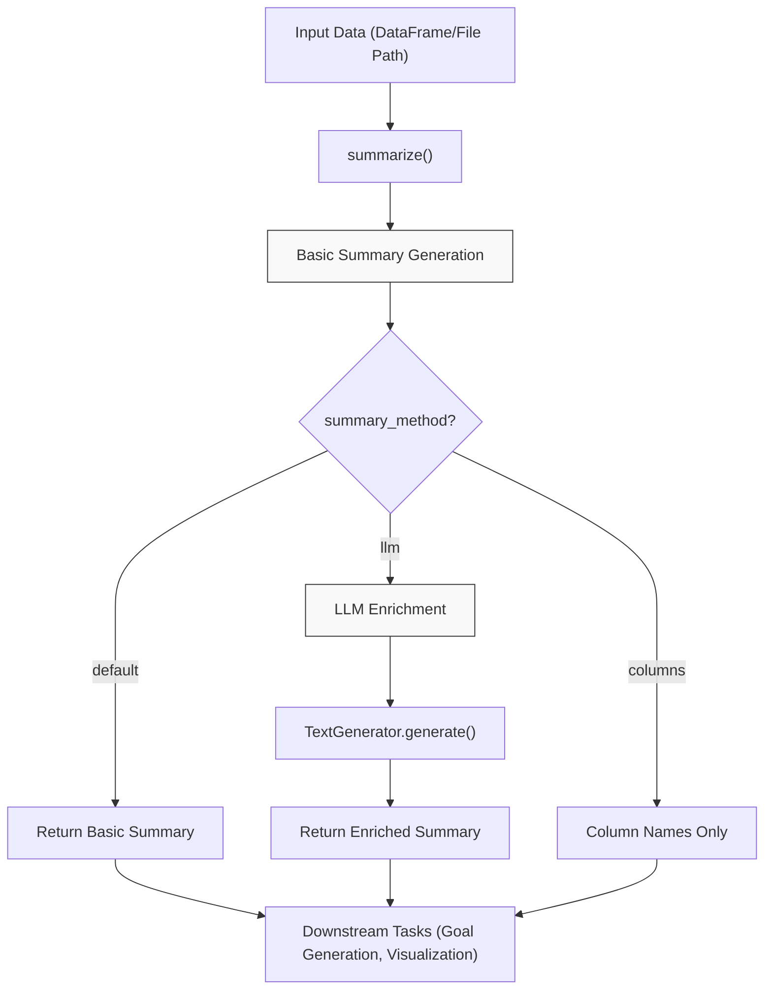
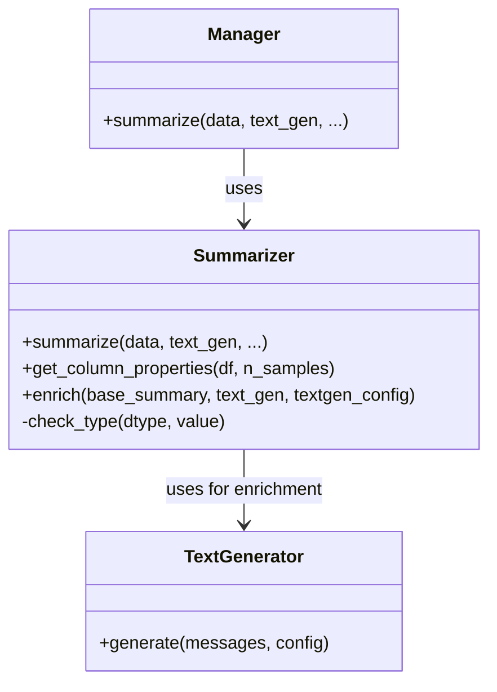
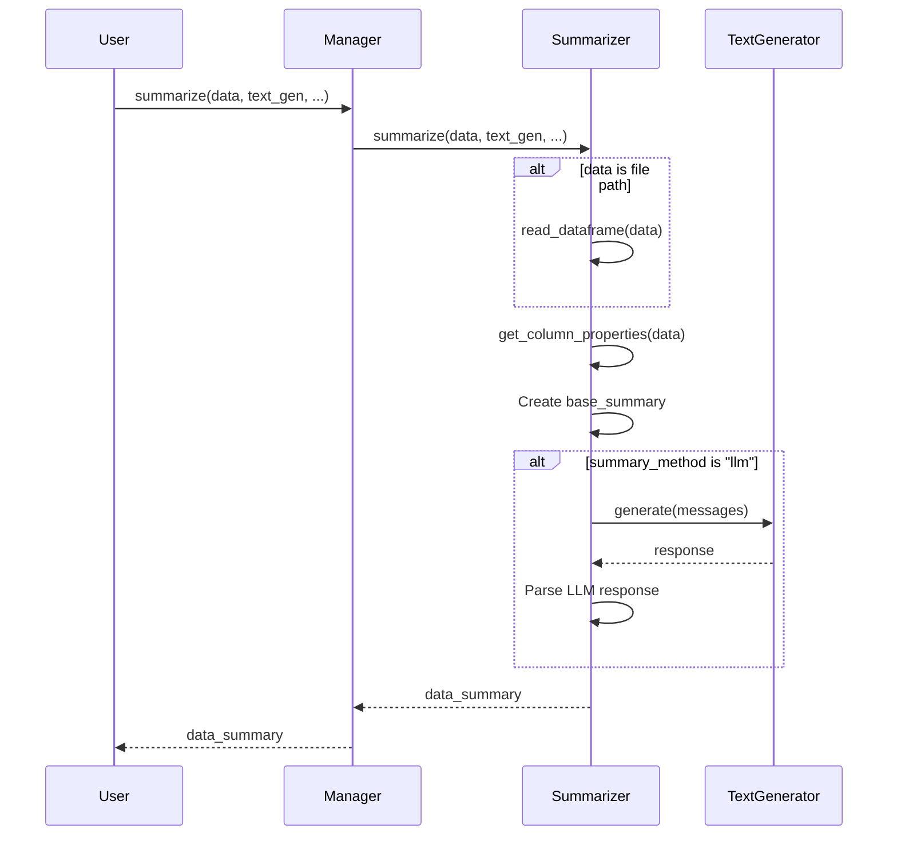

<!-- source: DeepWiki mcp.deepwiki.com · repo microsoft/lida · page 3.1 Data Summarization API · fetched 2026-10-26 -->

# Data Summarization API

<details>
<summary>Relevant source files</summary>

The following files were used as context for generating this wiki page:

- [lida/__init__.py](lida/__init__.py)
- [lida/components/summarizer.py](lida/components/summarizer.py)
- [lida/utils.py](lida/utils.py)
- [lida/version.py](lida/version.py)
- [notebooks/tutorial.ipynb](notebooks/tutorial.ipynb)
- [tests/test_components.py](tests/test_components.py)

</details>


## Purpose and Scope

The Data Summarization API is a core component of the LIDA (Language-based Interactive Data Analytics) system that analyzes and summarizes datasets before visualization. This document explains how to use the API, the available summarization methods, and the structure of the generated summaries. This API serves as the first step in LIDA's visualization pipeline, providing the foundation for visualization goal generation and chart creation.

For information about generating visualization goals from a summary, see [Goal Generation API](#3.2).

## Overview

The Data Summarization API analyzes datasets to extract their structure, properties, and statistics, optionally enriching this information with natural language descriptions using Large Language Models (LLMs). The resulting summaries provide a comprehensive understanding of the dataset that serves as input for downstream visualization tasks.



Sources: [lida/components/summarizer.py:118-159]()

## Architecture and Components

The Data Summarization API is implemented by the `Summarizer` class and exposed through the `Manager.summarize()` method. This design allows for centralized control while separating the specific summarization logic.



Sources: [lida/components/summarizer.py:21-159](), [lida/components/manager.py]()

## API Reference

### Manager.summarize()

The primary entry point for data summarization is the `Manager.summarize()` method:

```python
def summarize(
    self, data: Union[pd.DataFrame, str],
    text_gen: TextGenerator, file_name="", n_samples: int = 3,
    textgen_config=TextGenerationConfig(n=1),
    summary_method: str = "default", encoding: str = 'utf-8'
) -> dict:
    # ...
```

Sources: [lida/components/summarizer.py:118-159]()

#### Parameters

| Parameter | Type | Description |
|-----------|------|-------------|
| `data` | `pd.DataFrame` or `str` | DataFrame or path to a data file |
| `text_gen` | `TextGenerator` | Text generator for LLM enrichment |
| `file_name` | `str` | Optional name for the dataset (default: "") |
| `n_samples` | `int` | Number of sample values per column (default: 3) |
| `textgen_config` | `TextGenerationConfig` | Configuration for text generation |
| `summary_method` | `str` | Summarization method: "default", "llm", or "columns" |
| `encoding` | `str` | Character encoding for file reading (default: 'utf-8') |

Sources: [lida/components/summarizer.py:118-124]()

#### Summarization Methods

The API supports three summarization methods:

1. **default**: Generates a basic statistical summary without LLM enrichment
2. **llm**: Enriches the basic summary with LLM-generated descriptions of the dataset and columns
3. **columns**: Provides only column names without detailed properties

Sources: [lida/components/summarizer.py:140-154]()

## Summary Process

The summarization process follows these steps:

1. If `data` is a file path, read it into a DataFrame using appropriate functions
2. Extract column properties using `get_column_properties()`
3. Create a basic summary with structural information
4. If using "llm" method, enrich the summary with LLM-generated descriptions
5. Add column names to the summary
6. Return the summary dictionary



Sources: [lida/components/summarizer.py:118-159]()

## Column Property Extraction

The `get_column_properties()` method analyzes each column in a DataFrame to determine:

- Data type classification (`number`, `string`, `date`, `category`, `boolean`)
- Statistical information for numeric columns (`min`, `max`, `std`)
- Date range for date columns
- Sample values (controlled by `n_samples` parameter)
- Number of unique values

The method automatically detects date columns by attempting to convert string columns to datetime objects.

Sources: [lida/components/summarizer.py:34-91]()

## LLM Enrichment

When using the "llm" summary method, the `enrich()` method:

1. Sends the base summary to the LLM with a system prompt that guides the model to:
   - Generate a dataset name and description
   - Generate column descriptions
   - Identify semantic types for each column

2. Processes the LLM response to extract the enriched information

3. Handles errors if the LLM response cannot be parsed

Sources: [lida/components/summarizer.py:93-116]()

## Summary Output Structure

The output is a dictionary with the following structure:

```
{
  "name": "dataset_name",
  "file_name": "file_name.csv",
  "dataset_description": "Description of the dataset",
  "fields": [
    {
      "column": "column_name",
      "properties": {
        "dtype": "number|string|date|category|boolean",
        "min": minimum_value,         # for numeric and date columns
        "max": maximum_value,         # for numeric and date columns
        "std": standard_deviation,    # for numeric columns
        "samples": ["sample1", "sample2", "sample3"],
        "num_unique_values": count,
        "semantic_type": "semantic type of the column",
        "description": "Description of the column"
      }
    },
    # Additional columns...
  ],
  "field_names": ["column1", "column2", ...]
}
```

The `semantic_type` and `description` fields are populated only when using the "llm" method.

Sources: [lida/components/summarizer.py:133-157]()

## Usage Examples

### Basic Usage

```python
from lida import Manager, TextGenerationConfig, llm

# Initialize the Manager with a text generator
lida = Manager(text_gen=llm("openai"))

# Generate a basic summary
summary = lida.summarize("path/to/data.csv", summary_method="default")
```

### Enriched Summary with LLM

```python
from lida import Manager, TextGenerationConfig, llm

# Initialize with text generator
lida = Manager(text_gen=llm("openai"))

# Configure text generation
textgen_config = TextGenerationConfig(
    n=1, 
    temperature=0.5, 
    model="gpt-3.5-turbo",
    use_cache=True
)

# Generate an enriched summary
summary = lida.summarize(
    "https://raw.githubusercontent.com/uwdata/draco/master/data/cars.csv",
    textgen_config=textgen_config,
    summary_method="llm"
)
```

Sources: [notebooks/tutorial.ipynb:155-156]()

### With Different LLM Providers

The API supports multiple LLM backends:

```python
# OpenAI
text_gen = llm("openai")

# Azure OpenAI
text_gen = llm(
    provider="openai",
    api_type="azure",
    azure_endpoint=os.environ["AZURE_OPENAI_BASE"],
    api_key=os.environ["AZURE_OPENAI_API_KEY"],
    api_version="2023-07-01-preview"
)

# Cohere
text_gen = llm("cohere")

# PaLM
text_gen = llm("palm")

# Hugging Face
text_gen = llm(
    provider="hf", 
    model="uukuguy/speechless-llama2-hermes-orca-platypus-13b", 
    device_map="auto"
)
```

Sources: [notebooks/tutorial.ipynb:40-48]()

## Performance Considerations

1. **Large Datasets**: For datasets with more than 4500 rows, the system automatically samples down to 4500 rows to improve performance.

2. **Caching**: Use `use_cache=True` in `TextGenerationConfig` to cache LLM requests for faster repeated execution.

3. **Column Names**: The API automatically cleans column names to ensure they are valid Python identifiers, replacing special characters with underscores.

4. **Error Handling**: The API may raise `ValueError` if the LLM returns invalid JSON during enrichment. Consider using try/except blocks to handle these errors.

Sources: [lida/utils.py:45-104](), [notebooks/tutorial.ipynb:77-79]()

## Implementation Details

The Data Summarization API leverages several utility functions from the `lida.utils` module:

- `read_dataframe()`: Reads data from various file formats (CSV, JSON, Excel, Parquet, Feather, TSV)
- `clean_column_names()`: Sanitizes column names by replacing special characters with underscores
- `clean_code_snippet()`: Extracts code from text that may contain Markdown formatting

Sources: [lida/utils.py:23-227]()

---

