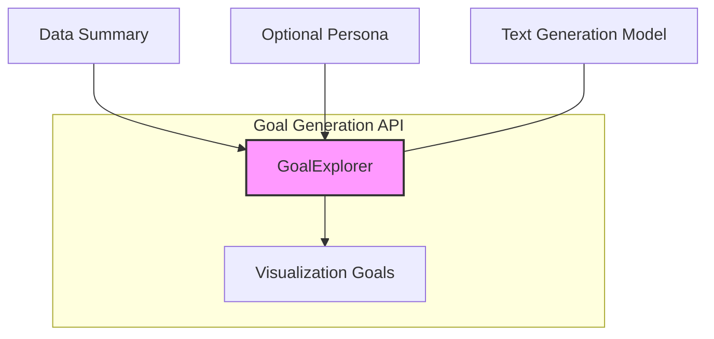
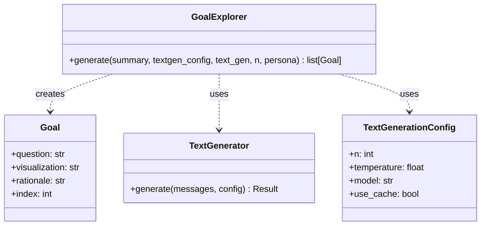
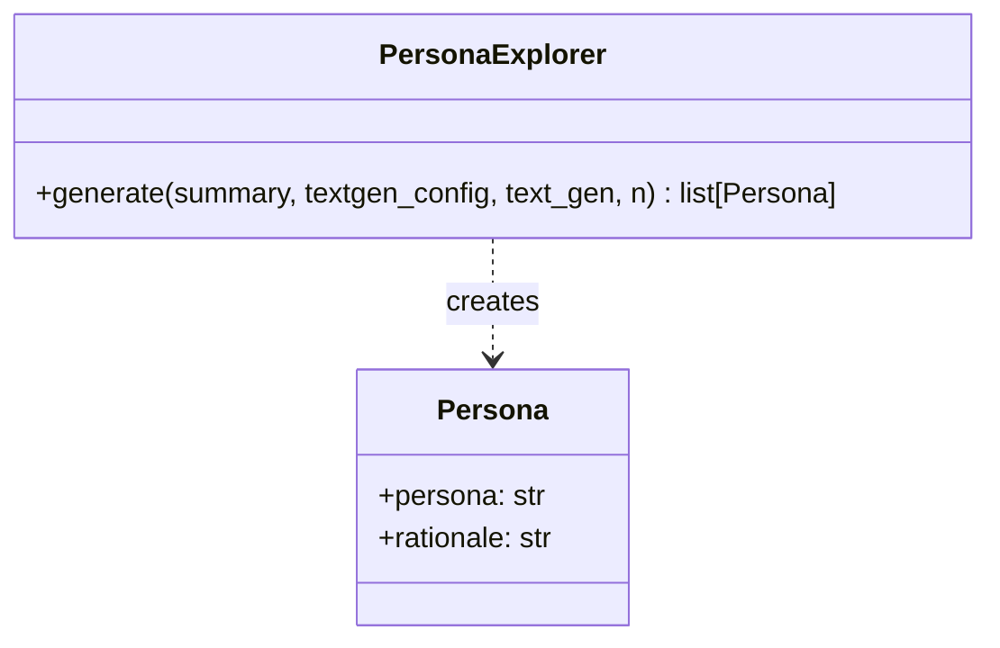
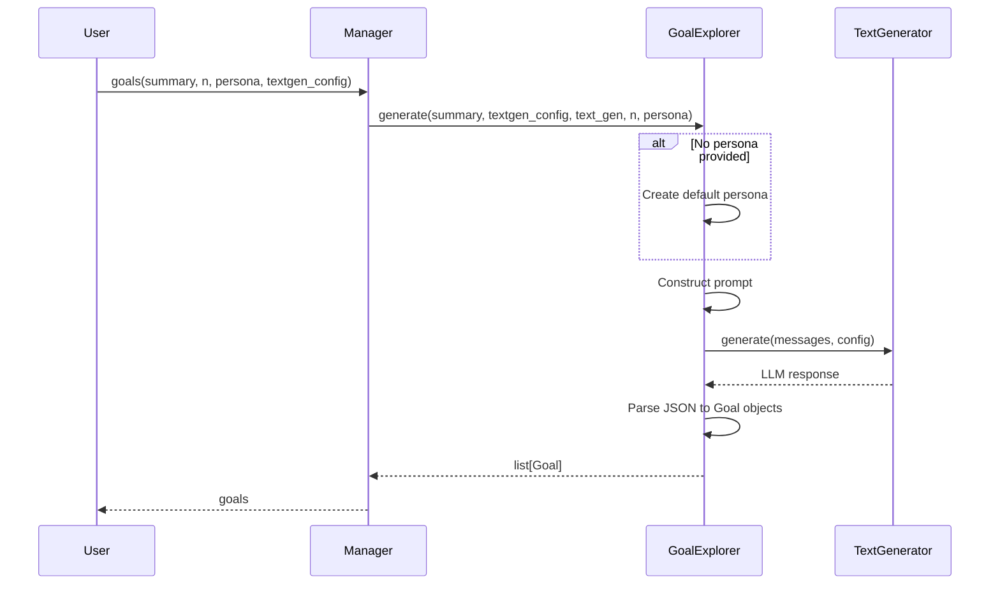

<!-- source: DeepWiki mcp.deepwiki.com · repo microsoft/lida · page 3.2 Goal Generation API · fetched 2026-10-26 -->

# Goal Generation API

<details>
<summary>Relevant source files</summary>

The following files were used as context for generating this wiki page:

- [lida/components/goal.py](lida/components/goal.py)
- [lida/components/persona.py](lida/components/persona.py)
- [lida/version.py](lida/version.py)
- [notebooks/tutorial.ipynb](notebooks/tutorial.ipynb)

</details>


The Goal Generation API in LIDA provides functionality to automatically generate visualization goals based on data summaries. A goal is a structured recommendation for what kind of visualization might be insightful for a given dataset, including a specific question to answer, a visualization type, and a rationale. This page documents how to use the Goal Explorer component, which leverages LLMs to generate these visualization goals.

For information about creating visualizations based on these goals, see [Visualization API](#3.3). For summarizing data before generating goals, see [Data Summarization API](#3.1).

## Overview

The Goal Generation API takes a data summary as input and generates meaningful visualization goals that can be used to guide the creation of visualizations. Each goal includes:

- A **question** to be answered
- A **visualization** type recommendation
- A **rationale** explaining why this visualization would be useful

The API can also incorporate user **personas** to tailor goals to specific stakeholder needs and interests.



*Diagram: Goal Generation API components and data flow*

Sources: [lida/components/goal.py:25-65](), [notebooks/tutorial.ipynb:154-162]()

## Core Components

### GoalExplorer

The `GoalExplorer` class is the main component responsible for generating visualization goals. It takes a data summary, constructs a prompt for a large language model, and parses the response into structured goal objects.



*Diagram: GoalExplorer class and its relationships*

Sources: [lida/components/goal.py:25-65]()

### PersonaExplorer

The `PersonaExplorer` class generates user personas that can be used to tailor goals to specific stakeholder needs. Personas help contextualize visualization goals for different audiences.



*Diagram: PersonaExplorer class and its relationships*

Sources: [lida/components/persona.py:17-52]()

## API Usage

### Basic Usage

The Goal Generation API is primarily accessed through the `Manager` class, which provides a high-level interface to LIDA's functionality:

```python
# First get a data summary
summary = lida.summarize("data.csv", summary_method="default", textgen_config=textgen_config)

# Generate goals based on the summary
goals = lida.goals(summary, n=2, textgen_config=textgen_config)

# Display the generated goals
for goal in goals:
    display(goal)
```

Each generated goal contains:
- A **question** to be answered by the visualization
- A **visualization** type that specifies what type of chart to create and which columns to use
- A **rationale** explaining why this visualization is useful

Sources: [notebooks/tutorial.ipynb:154-163]()

### Using with Personas

You can also generate goals tailored to specific personas:

```python
# Define a persona
persona = "a mechanic who wants to buy a car that is cheap but has good gas mileage"

# Generate goals based on the persona
personal_goals = lida.goals(summary, n=2, persona=persona, textgen_config=textgen_config)

# Display the persona-specific goals
for goal in personal_goals:
    display(goal)
```

Persona-based goals focus on aspects of the data that would be most relevant to the specified persona.

Sources: [notebooks/tutorial.ipynb:210-215]()

## Goal Generation Process

The following sequence diagram illustrates the goal generation process:



*Diagram: Sequence of goal generation process*

Sources: [lida/components/goal.py:31-65]()

## Implementation Details

### Goal Format

Each goal is a structured object with the following properties:

| Property | Description |
|----------|-------------|
| question | A question about the data that the visualization aims to answer |
| visualization | A description of the visualization type and which columns to use |
| rationale | An explanation of why this visualization is useful and what insights it might provide |
| index | A numeric identifier for the goal |

### Prompt Engineering

The `GoalExplorer` uses carefully crafted prompts to guide the LLM:

1. **System Instructions**: Directs the LLM to act as an experienced data analyst and follow visualization best practices
2. **User Prompt**: Contains the data summary, number of goals to generate, and optional persona information
3. **Format Instructions**: Specifies that the output should be a valid JSON list of goal objects

Sources: [lida/components/goal.py:8-20]()

### Error Handling

The implementation includes error handling for JSON parsing failures. If the LLM doesn't return a valid JSON response, it raises a `ValueError` with a helpful message suggesting using a larger model or increasing the max token length.

Sources: [lida/components/goal.py:53-65]()

## Integration with Other Components

The Goal Generation API is part of LIDA's end-to-end visualization generation pipeline:

```mermaid
flowchart TD
    Data["Input Data"]
    Summary["Data Summary"]
    Goals["Visualization Goals"]
    Visualization["Visualization Specs"]
    Charts["Generated Charts"]
    
    Data -->|summarize()| Summary
    Summary -->|goals()| Goals
    Goals -->|visualize()| Visualization
    Visualization -->|execute()| Charts
    
    style Summary fill:#f9f,stroke:#333,stroke-width:2px
    style Goals fill:#f9f,stroke:#333,stroke-width:2px
```

*Diagram: Goal Generation in LIDA's Pipeline*

Sources: High-Level System Architecture diagrams

## Practical Examples

### Example Goal Output

```
Question: What is the relationship between engine size and horsepower?

Visualization: scatter plot of Engine_Size__l_ vs Horsepower_HP_

Rationale: This visualization will help us understand if there is a correlation between engine size and horsepower. By plotting the two variables against each other, we can see if there is a positive or negative correlation, and how strong it is. This information will be useful for understanding the performance of different cars and for making decisions about engine size and horsepower in future car models.
```

### Example Persona-based Goal

```
Question: What is the relationship between Retail Price and City Miles Per Gallon for cars?

Visualization: scatter plot of Retail Price vs City Miles Per Gallon

Rationale: This visualization will help the mechanic identify which cars are both cheap and have good gas mileage. By plotting the Retail Price against the City Miles Per Gallon, we can see if there is a trend in the data that shows which cars offer the best value for money.
```

Sources: [notebooks/tutorial.ipynb:112-163](), [notebooks/tutorial.ipynb:171-216]()

## Configuration Options

The Goal Generation API accepts several configuration parameters:

| Parameter | Description | Default |
|-----------|-------------|---------|
| summary | The data summary to use as input | Required |
| n | Number of goals to generate | 5 |
| persona | A description of the target user | None (uses default) |
| textgen_config | Configuration for the text generation model | Required |

The `textgen_config` parameter allows configuration of the underlying LLM, including:
- `n`: Number of completions to generate
- `temperature`: Controls randomness (higher = more creative)
- `model`: The specific LLM to use
- `use_cache`: Whether to cache results for faster repeated runs

Sources: [lida/components/goal.py:31-37](), [notebooks/tutorial.ipynb:156]()

## Best Practices

1. **Start with a good summary**: The quality of goals depends on the quality of the data summary
2. **Use specific personas**: More specific personas lead to more focused and relevant goals
3. **Generate multiple goals**: Request more goals than needed to get a variety of perspectives
4. **Adjust temperature**: Higher temperature (0.7-0.9) for more creative goals, lower (0.2-0.5) for more consistent ones
5. **Enable caching**: Set `use_cache=True` in `textgen_config` to speed up development and avoid hitting API limits

---

