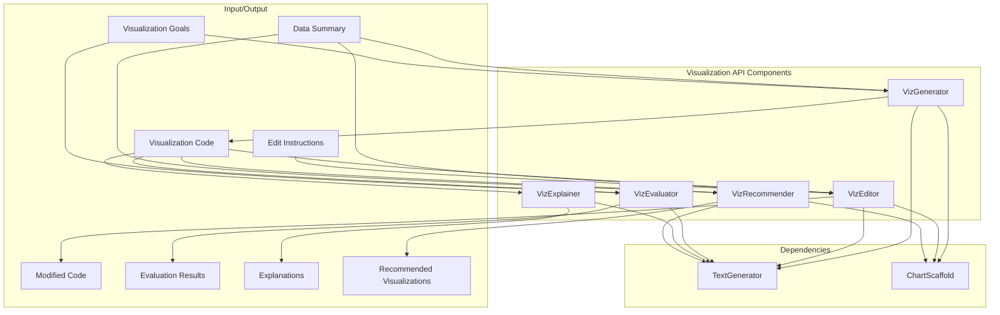
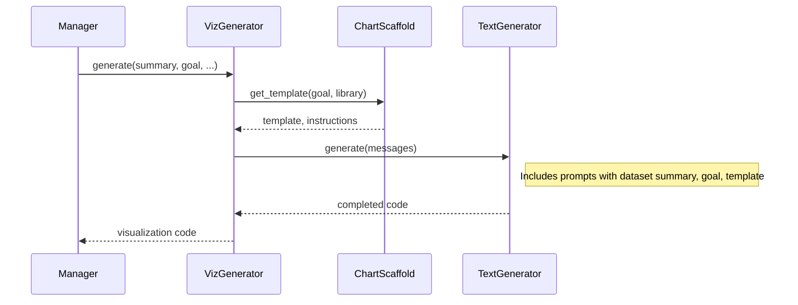
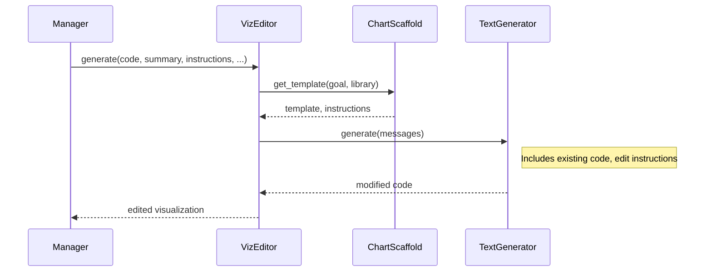
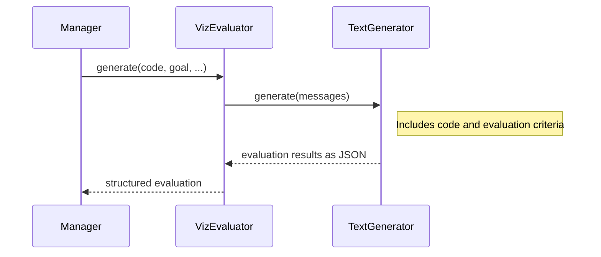
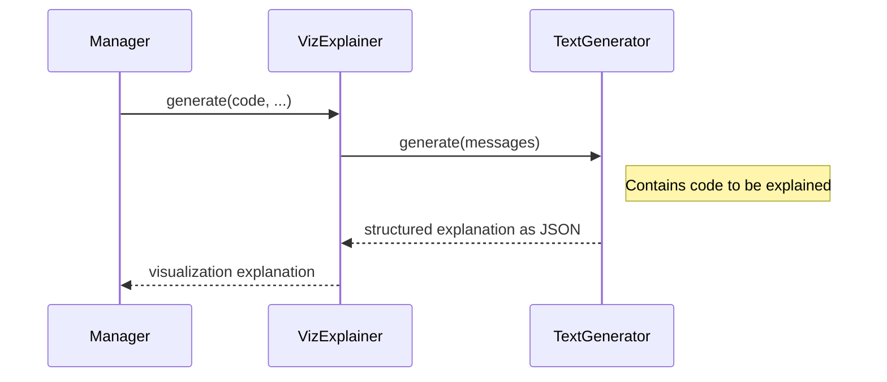
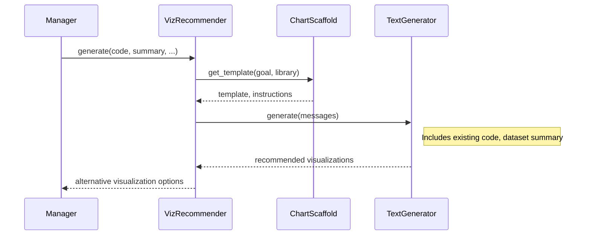
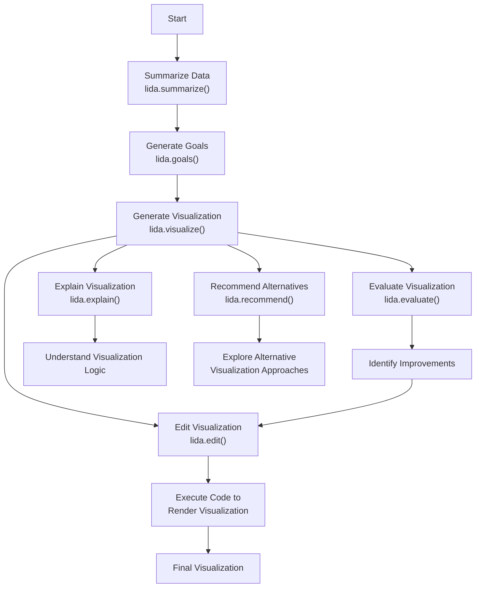

<!-- source: DeepWiki mcp.deepwiki.com · repo microsoft/lida · page 3.3 Visualization API · fetched 2026-10-26 -->

# Visualization API

<details>
<summary>Relevant source files</summary>

The following files were used as context for generating this wiki page:

- [lida/components/viz/vizeditor.py](lida/components/viz/vizeditor.py)
- [lida/components/viz/vizevaluator.py](lida/components/viz/vizevaluator.py)
- [lida/components/viz/vizexplainer.py](lida/components/viz/vizexplainer.py)
- [lida/components/viz/vizgenerator.py](lida/components/viz/vizgenerator.py)
- [lida/components/viz/vizrecommender.py](lida/components/viz/vizrecommender.py)
- [lida/version.py](lida/version.py)
- [notebooks/tutorial.ipynb](notebooks/tutorial.ipynb)

</details>


This document provides a comprehensive guide to LIDA's Visualization API, which enables users to generate, edit, evaluate, explain, and recommend data visualizations using Large Language Models (LLMs). The API is part of LIDA's Python interface for creating data visualizations and infographics.

For information about generating visualization goals, see [Goal Generation API](#3.2). For data summarization capabilities, see [Data Summarization API](#3.1).

## Overview

The Visualization API provides methods for the complete visualization lifecycle, from initial generation to refinement and evaluation. These capabilities are exposed through the central `Manager` class, which serves as the orchestrator for all visualization operations.



Sources: [lida/components/viz/vizgenerator.py](), [lida/components/viz/vizeditor.py](), [lida/components/viz/vizevaluator.py](), [lida/components/viz/vizexplainer.py](), [lida/components/viz/vizrecommender.py]()

## Core Components

The Visualization API consists of five main components that each handle different aspects of the visualization process:

### VizGenerator

`VizGenerator` transforms natural language goals into executable visualization code. It uses templates specific to visualization libraries (like Matplotlib, Seaborn, or Altair) and leverages LLMs to complete these templates based on the dataset summary and visualization goal.



Sources: [lida/components/viz/vizgenerator.py:23-40]()

### VizEditor

`VizEditor` modifies existing visualization code based on natural language instructions. This allows for iterative refinement of visualizations without requiring manual code editing.



Sources: [lida/components/viz/vizeditor.py:19-44]()

### VizEvaluator

`VizEvaluator` assesses visualization code quality across multiple dimensions, providing structured feedback on aspects like bugs, data transformation, goal compliance, visualization type, data encoding, and aesthetics.



Sources: [lida/components/viz/vizevaluator.py:36-58]()

### VizExplainer

`VizExplainer` provides explanations for visualization code by breaking it down into sections (accessibility, transformation, visualization) and explaining each section in natural language.



Sources: [lida/components/viz/vizexplainer.py:36-60]()

### VizRecommender

`VizRecommender` suggests alternative visualizations based on an existing visualization, dataset summary, and goals, enabling exploration of different visualization approaches.



Sources: [lida/components/viz/vizrecommender.py:49-86]()

## API Methods

The Visualization API is exposed through the `Manager` class, which provides the following key methods:

### visualize()

Generates visualization code based on a dataset summary and a goal.

```python
def visualize(self, summary, goal, library='altair', textgen_config=None):
    """
    Generates a visualization based on a summary and a goal.
    
    Parameters:
    - summary: Data summary object or string
    - goal: Goal object with question, visualization, and rationale
    - library: Visualization library to use (default: 'altair')
    - textgen_config: Configuration for text generation
    
    Returns:
    - List of visualization code strings
    """
```

### edit()

Modifies existing visualization code based on natural language instructions.

```python
def edit(self, code, summary, instructions, library='altair', textgen_config=None):
    """
    Edits a visualization based on instructions.
    
    Parameters:
    - code: Existing visualization code
    - summary: Data summary object or string
    - instructions: List of edit instructions in natural language
    - library: Visualization library to use (default: 'altair')
    - textgen_config: Configuration for text generation
    
    Returns:
    - List of modified visualization code strings
    """
```

### evaluate()

Evaluates the quality of a visualization across multiple dimensions.

```python
def evaluate(self, code, goal, library='altair', textgen_config=None):
    """
    Evaluates a visualization against a goal.
    
    Parameters:
    - code: Visualization code to evaluate
    - goal: Goal object with question, visualization, and rationale
    - library: Visualization library used (default: 'altair')
    - textgen_config: Configuration for text generation
    
    Returns:
    - List of evaluation results as dictionaries
    """
```

### explain()

Provides explanations for visualization code.

```python
def explain(self, code, library='altair', textgen_config=None):
    """
    Explains a visualization code.
    
    Parameters:
    - code: Visualization code to explain
    - library: Visualization library used (default: 'altair')
    - textgen_config: Configuration for text generation
    
    Returns:
    - List of explanation sections as dictionaries
    """
```

### recommend()

Suggests alternative visualizations based on an existing visualization.

```python
def recommend(self, code, summary, n=3, library='altair', textgen_config=None):
    """
    Recommends alternative visualizations.
    
    Parameters:
    - code: Existing visualization code
    - summary: Data summary object or string
    - n: Number of recommendations to generate (default: 3)
    - library: Visualization library to use (default: 'altair')
    - textgen_config: Configuration for text generation
    
    Returns:
    - List of recommended visualization code strings
    """
```

## Usage Examples

Below are examples demonstrating how to use the Visualization API with the LIDA Manager:

### Basic Visualization Generation

```python
from lida import Manager, TextGenerationConfig, llm

# Initialize LIDA with your preferred LLM provider
lida = Manager(text_gen=llm("openai"))

# Generate a summary of the dataset
summary = lida.summarize("https://raw.githubusercontent.com/mwaskom/seaborn-data/master/tips.csv")

# Generate visualization goals
goals = lida.goals(summary, n=2)

# Configure text generation
textgen_config = TextGenerationConfig(n=1, temperature=0.2)

# Generate a visualization using the first goal
visualizations = lida.visualize(summary, goals[0], library="seaborn", textgen_config=textgen_config)

# The first visualization code
visualization_code = visualizations[0]
```

### Editing a Visualization

```python
# Edit the visualization with specific instructions
instructions = [
    "Change the color palette to blues",
    "Add a title 'Restaurant Tips Analysis'",
    "Show data points as small circles"
]

edited_visualizations = lida.edit(
    visualization_code, 
    summary, 
    instructions, 
    library="seaborn", 
    textgen_config=textgen_config
)

edited_code = edited_visualizations[0]
```

### Evaluating a Visualization

```python
# Evaluate the visualization against the original goal
evaluations = lida.evaluate(
    visualization_code, 
    goals[0], 
    library="seaborn", 
    textgen_config=textgen_config
)

# Example evaluation structure:
# [
#   {"dimension": "bugs", "score": 9, "rationale": "The code is free of bugs..."},
#   {"dimension": "transformation", "score": 8, "rationale": "The data is appropriately..."},
#   ...
# ]
```

### Explaining a Visualization

```python
# Get an explanation of the visualization code
explanations = lida.explain(
    visualization_code, 
    library="seaborn", 
    textgen_config=textgen_config
)

# Example explanation structure:
# [
#   {"section": "accessibility", "code": "None", "explanation": "This visualization is a scatter plot..."},
#   {"section": "transformation", "code": "...", "explanation": "The code filters the dataset..."},
#   {"section": "visualization", "code": "...", "explanation": "The plot is created using seaborn's..."}
# ]
```

### Recommending Alternative Visualizations

```python
# Get recommendations for alternative visualizations
recommendations = lida.recommend(
    visualization_code, 
    summary, 
    n=2, 
    library="seaborn", 
    textgen_config=textgen_config
)

# First recommended alternative
alternative_viz = recommendations[0]
```

## Customization

The Visualization API can be customized in several ways:

### Visualization Libraries

LIDA supports multiple visualization libraries:

| Library | Description | Default |
|---------|-------------|---------|
| `altair` | Declarative visualization based on Vega-Lite | ✓ |
| `matplotlib` | Comprehensive plotting library | |
| `seaborn` | Statistical data visualization based on matplotlib | |
| `plotly` | Interactive, browser-based visualizations | |

You can specify which library to use in the API methods:

```python
viz = lida.visualize(summary, goals[0], library='seaborn', textgen_config=textgen_config)
```

### Text Generation Configuration

You can configure the LLM text generation process by passing a `TextGenerationConfig` object:

```python
from lida import TextGenerationConfig

textgen_config = TextGenerationConfig(
    n=1,                      # Number of completions to generate
    temperature=0.2,          # Lower = more deterministic
    model="gpt-3.5-turbo",    # LLM model to use
    use_cache=True            # Enable caching to avoid redundant API calls
)

viz = lida.visualize(summary, goals[0], textgen_config=textgen_config)
```

## Best Practices

For effective use of the Visualization API:

1. **Start with a quality data summary**: A comprehensive data summary improves visualization accuracy. Use `lida.summarize()` with `summary_method="llm"` for enhanced summaries.

2. **Generate specific goals**: Clear, specific visualization goals lead to better visualizations. Use `lida.goals()` to generate visualization goals that address specific questions.

3. **Iterate with edits**: Rather than regenerating visualizations from scratch, use `lida.edit()` to refine existing visualizations with natural language instructions.

4. **Validate with evaluation**: Use `lida.evaluate()` to assess visualization quality across multiple dimensions and identify areas for improvement.

5. **Explore alternatives**: Use `lida.recommend()` to explore different visualization approaches for the same data and goal.

6. **Understand the code**: Use `lida.explain()` to get detailed explanations of visualization code to understand how it works and how to modify it.

7. **Control temperature**: For more consistent results, use a lower temperature (0.1-0.3). For more creative visualizations, use a higher temperature (0.7-0.9).

8. **Enable caching**: Set `use_cache=True` in your `TextGenerationConfig` to avoid redundant API calls when using the same inputs.

Sources: [notebooks/tutorial.ipynb:1-215]()

## Visualization Process Flow

The complete visualization process in LIDA typically follows this sequence:



Sources: [notebooks/tutorial.ipynb:103-163]()

---

