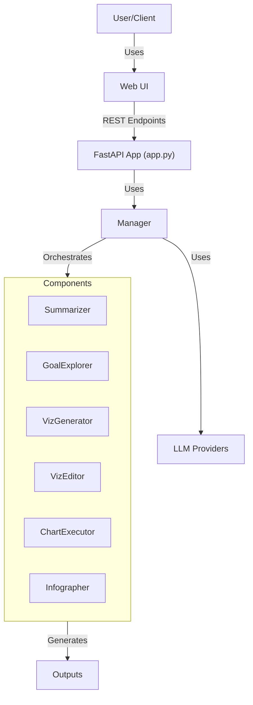
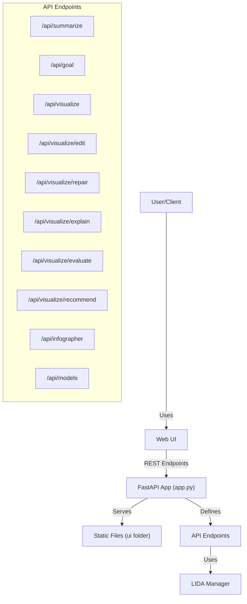
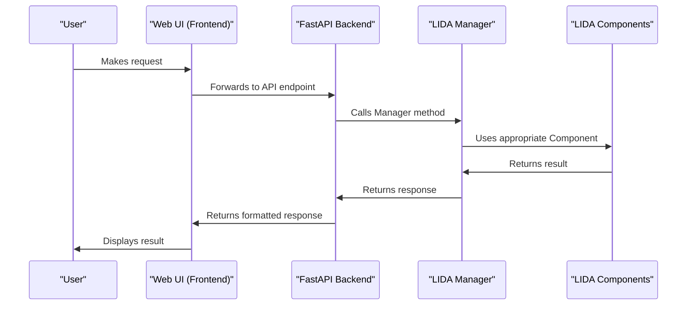
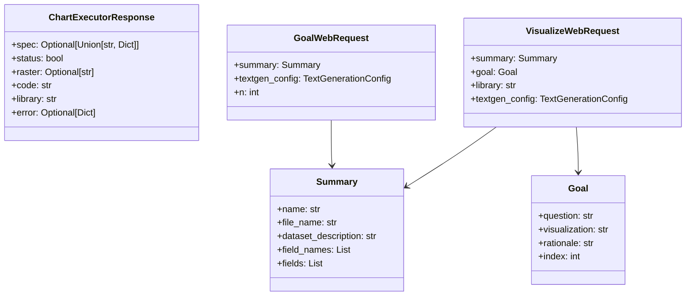

<!-- source: DeepWiki mcp.deepwiki.com · repo microsoft/lida · page 4 Web UI · fetched 2026-10-26 -->

# Web UI

<details>
<summary>Relevant source files</summary>

The following files were used as context for generating this wiki page:

- [.dockerignore](.dockerignore)
- [CITATION.cff](CITATION.cff)
- [README.md](README.md)
- [docker-compose.yml](docker-compose.yml)
- [dockerfile](dockerfile)
- [lida/cli.py](lida/cli.py)
- [lida/datamodel.py](lida/datamodel.py)
- [lida/web/app.py](lida/web/app.py)

</details>


The Web UI is a user interface and API layer that provides access to LIDA's data visualization and infographics generation capabilities. It offers both a graphical interface for interactive use and a REST API for programmatic integration. This page documents the architecture, components, and usage of the Web UI system.

For information about the Python API, see [Python API](#3).

## Architecture

The LIDA Web UI consists of a FastAPI backend that serves both API endpoints and a static frontend interface. The Web UI layer integrates with the core LIDA components and provides a user-friendly interface for performing operations such as data summarization, goal generation, visualization creation, and infographics generation.

### Web UI in LIDA System Context



Sources: [lida/web/app.py:1-32](), [README.md:66-77]()

### Web UI Components



Sources: [lida/web/app.py:31-46](), [lida/web/app.py:51-310]()

## Request Flow

The following sequence diagram illustrates how requests flow through the Web UI system:



Sources: [lida/web/app.py:51-310]()

## Data Models

The Web UI uses a set of data models defined in `datamodel.py` to structure requests and responses. These models utilize Pydantic for validation and serialization.



Sources: [lida/datamodel.py:10-235]()

## API Endpoints

The Web UI exposes the following REST API endpoints:

| Endpoint | Method | Description |
|----------|--------|-------------|
| `/api/summarize` | POST | Upload a file and get a summary of the data |
| `/api/goal` | POST | Generate visualization goals based on a dataset summary |
| `/api/visualize` | POST | Generate visualizations based on a dataset summary and a goal |
| `/api/visualize/edit` | POST | Edit a visualization using natural language instructions |
| `/api/visualize/repair` | POST | Repair a visualization based on feedback |
| `/api/visualize/explain` | POST | Get an explanation of a visualization |
| `/api/visualize/evaluate` | POST | Evaluate a visualization based on a goal |
| `/api/visualize/recommend` | POST | Get visualization recommendations |
| `/api/text/generate` | POST | Generate text using the configured LLM |
| `/api/models` | GET | List supported LLM models |
| `/api/infographer` | POST | Generate infographics from a visualization |

Sources: [lida/web/app.py:51-310]()

### Key Endpoint Details

#### `/api/summarize`

Uploads a file and returns a summary of the dataset.

**Request:**
- File upload (CSV, Excel, or JSON)

**Response:**
```json
{
  "status": true,
  "summary": {
    "name": "Cars Dataset",
    "file_name": "cars.csv",
    "dataset_description": "...",
    "field_names": ["mpg", "cylinders", "displacement", "..."],
    "fields": ["Numeric, average 23.4", "Numeric, 4-8", "..."]
  },
  "data_filename": "cars.csv"
}
```

Sources: [lida/web/app.py:227-257]()

#### `/api/goal`

Generates visualization goals based on a dataset summary.

**Request Body:**
```json
{
  "summary": {
    "name": "Cars Dataset",
    "file_name": "cars.csv",
    "dataset_description": "...",
    "field_names": ["mpg", "cylinders", "displacement", "..."],
    "fields": ["Numeric, average 23.4", "Numeric, 4-8", "..."]
  },
  "n": 5,
  "textgen_config": {
    "temperature": 0.7
  }
}
```

**Response:**
```json
{
  "status": true,
  "data": [
    {
      "question": "What is the relationship between MPG and horsepower?",
      "visualization": "Scatter plot",
      "rationale": "To understand how fuel efficiency is affected by engine power",
      "index": 0
    },
    "..."
  ],
  "message": "Successfully generated 5 goals"
}
```

Sources: [lida/web/app.py:203-224]()

#### `/api/visualize`

Generates visualizations based on a dataset summary and goal.

**Request Body:**
```json
{
  "summary": {...},
  "goal": {
    "question": "What is the relationship between MPG and horsepower?",
    "visualization": "Scatter plot",
    "rationale": "To understand how fuel efficiency is affected by engine power",
    "index": 0
  },
  "library": "seaborn",
  "textgen_config": {
    "temperature": 0.7
  }
}
```

**Response:**
```json
{
  "status": true,
  "charts": [
    {
      "spec": null,
      "status": true,
      "raster": "base64_encoded_image",
      "code": "import seaborn as sns\nimport matplotlib.pyplot as plt\n...",
      "library": "seaborn",
      "error": null
    }
  ],
  "message": "Successfully generated charts."
}
```

Sources: [lida/web/app.py:51-70]()

## Running the Web UI

### Via CLI

LIDA includes a CLI command for launching the Web UI:

```bash
lida ui --port=8080 --docs
```

Parameters:
- `--host`: Host to run the server on (default: 127.0.0.1)
- `--port`: Port to run the server on (default: 8081)
- `--workers`: Number of worker processes (default: 1)
- `--reload`: Enable auto-reload during development (default: True)
- `--docs`: Enable API documentation at `/api/docs` (default: False)

Sources: [lida/cli.py:12-30](), [README.md:66-77]()

### Via Docker

You can also run the Web UI using Docker:

```bash
docker compose up
```

This builds and starts a Docker container running the Web UI on port 8080.

Sources: [docker-compose.yml:1-11](), [dockerfile:1-18](), [README.md:78-85]()

## API Usage Examples

### Example: Summarizing a Dataset

```python
import requests

# Upload a dataset
with open('data/cars.csv', 'rb') as f:
    response = requests.post('http://localhost:8080/api/summarize', files={'file': f})

summary = response.json()['summary']
```

### Example: Generating Visualization Goals

```python
import requests

# Generate visualization goals
response = requests.post('http://localhost:8080/api/goal', json={
    'summary': summary,
    'n': 5
})

goals = response.json()['data']
```

### Example: Generating Visualizations

```python
import requests

# Generate visualizations
response = requests.post('http://localhost:8080/api/visualize', json={
    'summary': summary,
    'goal': goals[0],
    'library': 'seaborn'
})

charts = response.json()['charts']
```

## Web UI Workflow

The typical workflow for using the Web UI involves:

1. Uploading a dataset to get a summary
2. Generating visualization goals based on the summary
3. Creating visualizations based on selected goals
4. Optionally editing, repairing, or enhancing visualizations
5. Optionally creating infographics from visualizations

This workflow mirrors the programmatic workflow available in the Python API but provides a user-friendly interface for non-programmers.

Sources: [README.md:66-77](), [lida/web/app.py:51-310]()

---

