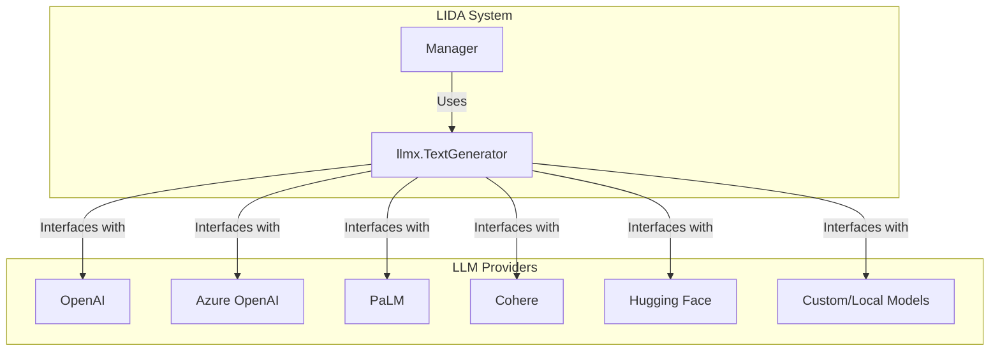
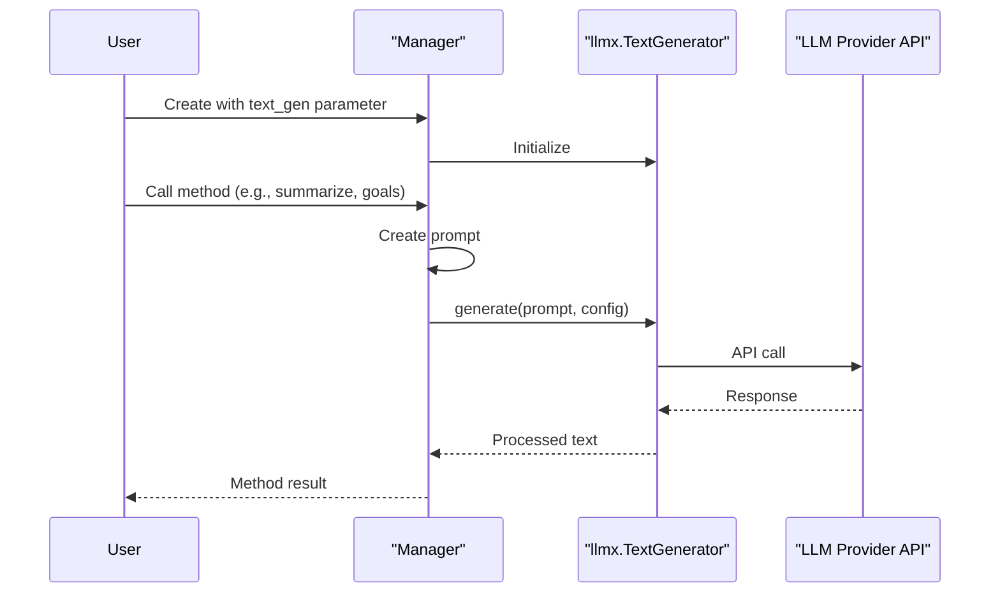
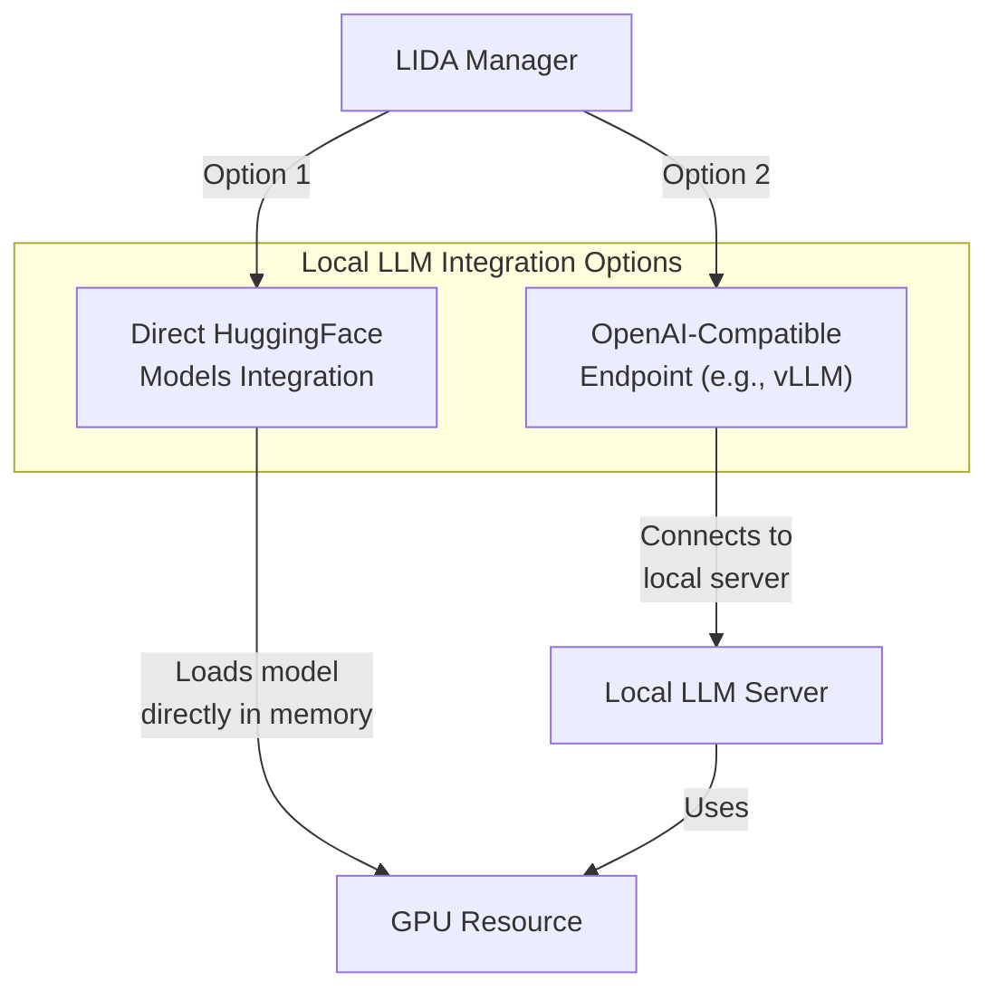

<!-- source: DeepWiki mcp.deepwiki.com · repo microsoft/lida · page 5 LLM Integration · fetched 2026-10-26 -->

# LLM Integration

<details>
<summary>Relevant source files</summary>

The following files were used as context for generating this wiki page:

- [.dockerignore](.dockerignore)
- [CITATION.cff](CITATION.cff)
- [README.md](README.md)
- [docker-compose.yml](docker-compose.yml)
- [dockerfile](dockerfile)
- [lida/version.py](lida/version.py)
- [notebooks/tutorial.ipynb](notebooks/tutorial.ipynb)
- [pyproject.toml](pyproject.toml)

</details>


This document explains how LIDA integrates with different Large Language Model (LLM) providers and how to configure them for use with the system. LIDA's architecture is designed to work with multiple LLM backends, allowing flexibility in choosing which provider to use for text generation tasks that power visualization and infographics creation.

## Overview of LLM Integration

LIDA uses the `llmx` library as an abstraction layer for communicating with various LLM providers. This design allows LIDA to remain provider-agnostic, supporting commercial APIs like OpenAI and Azure OpenAI as well as locally-hosted open-source models.



Sources: [README.md:36-38](), [notebooks/tutorial.ipynb:40-47]()

## Supported LLM Providers

LIDA currently supports the following LLM providers:

| Provider      | Description                                    | API Key Environment Variable |
|---------------|------------------------------------------------|------------------------------|
| OpenAI        | Default provider using GPT models              | `OPENAI_API_KEY`             |
| Azure OpenAI  | Microsoft's Azure-hosted OpenAI models         | `AZURE_OPENAI_API_KEY`       |
| PaLM          | Google's PaLM models                           | `PALM_SERVICE_ACCOUNT_KEY_FILE` and `PALM_PROJECT_ID` |
| Cohere        | Cohere's language models                       | `COHERE_API_KEY`             |
| Hugging Face  | Open-source models from Hugging Face           | Varies by model              |

Sources: [README.md:61-62](), [notebooks/tutorial.ipynb:52-60]()

## LLM Integration Architecture

The following diagram illustrates how LIDA components interact with LLM providers:



The `Manager` class serves as the central orchestrator that coordinates interactions with the LLM providers through the `TextGenerator` interface from the `llmx` library. This architecture allows LIDA to remain flexible with respect to which LLM provider is used.

Sources: [README.md:36-42](), [notebooks/tutorial.ipynb:31-47]()

## Basic LLM Configuration

### Initializing with Default Provider (OpenAI)

The simplest way to initialize LIDA with an LLM provider is:

```python
from lida import Manager, llm

# Initialize with OpenAI (default)
lida = Manager(text_gen=llm("openai"))
```

Before running this code, you need to set your OpenAI API key as an environment variable:

```bash
export OPENAI_API_KEY=<your key>
```

Sources: [README.md:61-62](), [notebooks/tutorial.ipynb:155]()

## Configuring Different LLM Providers

### Azure OpenAI

```python
from lida import Manager, llm
import os

text_gen = llm(
    provider="openai",
    api_type="azure",
    azure_endpoint=os.environ["AZURE_OPENAI_BASE"],
    api_key=os.environ["AZURE_OPENAI_API_KEY"],
    api_version="2023-07-01-preview"
)
lida = Manager(text_gen=text_gen)
```

Environment variables required:
- `AZURE_OPENAI_BASE`: Your Azure OpenAI endpoint
- `AZURE_OPENAI_API_KEY`: Your Azure OpenAI API key

Sources: [notebooks/tutorial.ipynb:64-72]()

### Cohere

```python
from lida import Manager, llm

text_gen = llm("cohere")
lida = Manager(text_gen=text_gen)
```

Environment variable required:
- `COHERE_API_KEY`: Your Cohere API key

Sources: [notebooks/tutorial.ipynb:43-44]()

### PaLM (Google)

```python
from lida import Manager, llm

text_gen = llm("palm")
lida = Manager(text_gen=text_gen)
```

Environment variables required:
- `PALM_SERVICE_ACCOUNT_KEY_FILE`: Path to your GCP service account key file
- `PALM_PROJECT_ID`: Your GCP project ID

Sources: [notebooks/tutorial.ipynb:45-57]()

## Using Local LLMs

LIDA supports two main approaches for using locally-hosted models:



### Option 1: Using Hugging Face Models Directly

This method loads the model directly into memory, requiring sufficient GPU resources:

```python
from lida import Manager
from llmx import llm

# Note: Requires pip install lida[transformers]
text_gen = llm(
    provider="hf", 
    model="uukuguy/speechless-llama2-hermes-orca-platypus-13b", 
    device_map="auto"
)
lida = Manager(text_gen=text_gen)
```

Sources: [README.md:160-177](), [notebooks/tutorial.ipynb:46]()

### Option 2: Using OpenAI-Compatible Endpoint

This method connects to a server running locally (e.g., using vLLM) that exposes an OpenAI-compatible API:

```python
from lida import Manager, TextGenerationConfig, llm

model_name = "uukuguy/speechless-llama2-hermes-orca-platypus-13b"
model_details = [{'name': model_name, 'max_tokens': 2596, 'model': {'provider': 'openai', 'parameters': {'model': model_name}}}]

# Assuming your vLLM endpoint is running on localhost:8000
text_gen = llm(
    provider="openai", 
    api_base="http://localhost:8000/v1", 
    api_key="EMPTY", 
    models=model_details
)
lida = Manager(text_gen=text_gen)
```

Sources: [README.md:182-189]()

## Advanced LLM Configuration

### Text Generation Configuration

LIDA allows you to configure the text generation process using the `TextGenerationConfig` class:

```python
from lida import TextGenerationConfig

textgen_config = TextGenerationConfig(
    n=1,                      # Number of completions
    temperature=0.5,          # Controls randomness (0-1)
    model="gpt-3.5-turbo",    # Specific model to use
    use_cache=True            # Enable caching of responses
)

# Use in any LIDA method
summary = lida.summarize("data.csv", textgen_config=textgen_config)
```

This configuration can be passed to any LIDA method that interacts with LLMs.

Sources: [notebooks/tutorial.ipynb:156]()

### Model Selection and Parameters

When initializing the text generator, you can specify which model to use:

```python
from lida import llm

# OpenAI with specific model
text_gen = llm("openai", model="gpt-4")

# PaLM with specific model
text_gen = llm("palm", model="text-bison")

# Cohere with specific model
text_gen = llm("cohere", model="command")
```

### Caching LLM Responses

To improve performance and reduce API costs, LIDA supports caching of LLM responses:

```python
from lida import TextGenerationConfig

# Enable caching
textgen_config = TextGenerationConfig(use_cache=True)

# Use config in LIDA methods
summary = lida.summarize("data.csv", textgen_config=textgen_config)
```

Sources: [notebooks/tutorial.ipynb:79-80]()

## Using LIDA with Docker

If you're using LIDA with Docker, you can pass LLM API keys as environment variables when starting the container:

```bash
docker compose up
```

The Docker setup automatically uses the `OPENAI_API_KEY` environment variable from your host system.

Sources: [README.md:80-84](), [docker-compose.yml:10-11](), [Dockerfile:1-18]()

## Installation Requirements

LIDA depends on `llmx` for LLM integration. When installing LIDA, make sure you have the required dependencies:

```bash
pip install -U lida
pip install -U llmx openai
```

For using Hugging Face models directly, install the transformers extra:

```bash
pip install lida[transformers]
```

Sources: [README.md:49-56](), [pyproject.toml:20-42]()

## Troubleshooting

### API Key Issues

If you encounter authentication errors:
1. Verify your API key is correctly set in the environment variables
2. Check that your API key has the necessary permissions
3. Ensure you're using the correct environment variable name for your provider

### Model Compatibility

Not all models from a provider may be compatible with LIDA's prompts. If you encounter issues:
1. Start with recommended models (e.g., GPT-3.5-Turbo for OpenAI)
2. For open-source models, prefer larger models with good instruction-following capabilities
3. If a model produces incorrect output, try adjusting the temperature (higher for more creativity, lower for more deterministic outputs)

### Performance Considerations

- Smaller open-source models may struggle with LIDA's complex prompts
- For production use, consider implementing a caching strategy to reduce API calls
- Monitor token usage when using commercial providers to manage costs

## Limitations

- Smaller LLMs (e.g., some open-source models on Hugging Face) have limited instruction-following capabilities and may not work well with LIDA
- LIDA works best with larger LLMs like OpenAI GPT-3.5 and GPT-4
- Local models require substantial GPU resources depending on the model size

Sources: [README.md:196-197]()

---

