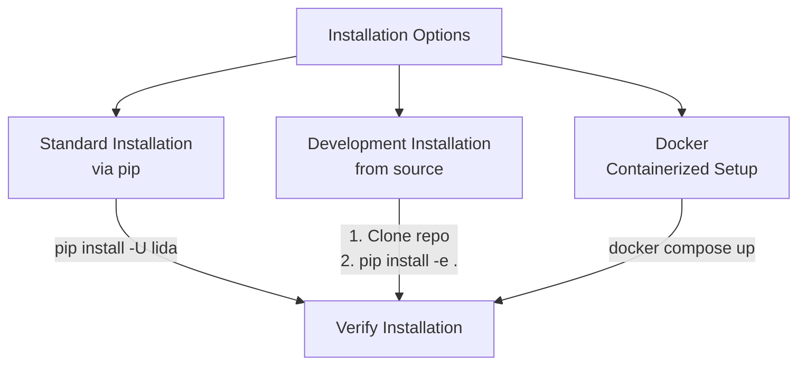

<!-- source: DeepWiki mcp.deepwiki.com · repo microsoft/lida · page 6 Installation and Setup · fetched 2026-10-26 -->

# Installation and Setup

<details>
<summary>Relevant source files</summary>

The following files were used as context for generating this wiki page:

- [.dockerignore](.dockerignore)
- [CITATION.cff](CITATION.cff)
- [README.md](README.md)
- [SUPPORT.md](SUPPORT.md)
- [docker-compose.yml](docker-compose.yml)
- [dockerfile](dockerfile)
- [pyproject.toml](pyproject.toml)
- [requirements.txt](requirements.txt)

</details>


This page provides comprehensive instructions for installing and configuring LIDA (Language-based Interactive Data Analytics), a library for generating data visualizations and infographics powered by Large Language Models. For information about using the Python API once installed, see [Python API](#3), and for information about the Web UI, see [Web UI](#4).

## System Requirements

Before installing LIDA, ensure your environment meets the following requirements:

- **Python**: 3.9 or higher (3.10+ recommended)
- **Operating System**: Cross-platform (Windows, macOS, Linux)
- **Dependencies**: Basic Python package management tools (pip)
- **API Keys**: Access to at least one supported LLM provider (OpenAI, Azure OpenAI, PaLM, Cohere, or Hugging Face)

Sources: [README.md:44-46](), [pyproject.toml:13]()

## Installation Options

LIDA offers multiple installation methods depending on your requirements and environment:



### Standard Installation (pip)

The recommended installation method is using pip:

```bash
pip install -U lida
```

For optimal performance, ensure related packages are up-to-date:

```bash
pip install -U llmx openai
```

Optional features can be installed with:

```bash
# For infographics support
pip install lida[infographics]

# For web UI support
pip install lida[web]

# For transformers support (local models)
pip install lida[transformers]

# For geographic visualization tools
pip install lida[tools]
```

Sources: [README.md:47-52](), [pyproject.toml:20-42]()

### Development Installation

For contributing to LIDA or customizing the source code:

```bash
# Clone the repository
git clone https://github.com/microsoft/lida.git

# Navigate to repository root
cd lida

# Install in development mode
pip install -e .
```

Sources: [README.md:64]()

### Docker Installation

LIDA can be run in a containerized environment using Docker:

1. Ensure Docker and Docker Compose are installed on your system
2. Create a docker-compose.yml file with the provided configuration
3. Run the following command:

```bash
docker compose up
```

This will build and start a container exposing the LIDA web UI on port 8080.

Sources: [README.md:78-84](), [dockerfile:1-18](), [docker-compose.yml:1-11]()

## LLM Configuration

LIDA requires configuration for at least one LLM provider to function. The setup varies by provider:

```mermaid
classDiagram
    class "TextGenerator" {
        +generate()
    }
    
    class "LLM Providers" {
        OpenAI
        Azure OpenAI
        PaLM
        Cohere
        Hugging Face
    }
    
    class "Manager" {
        +text_gen: TextGenerator
        +summarize()
        +goals()
        +visualize()
        +execute()
    }
    
    "Manager" --> "TextGenerator" : uses
    "TextGenerator" --> "LLM Providers" : implements
```

### OpenAI Setup

Set your OpenAI API key as an environment variable:

```bash
export OPENAI_API_KEY=<your key>
```

In your Python code:

```python
from lida import Manager, llm
lida = Manager(text_gen=llm("openai"))
```

### Azure OpenAI Setup

For Azure OpenAI:

```bash
export AZURE_OPENAI_API_KEY=<your key>
export AZURE_OPENAI_ENDPOINT=<your endpoint>
```

In your Python code:

```python
from lida import Manager, llm
lida = Manager(text_gen=llm("azure"))
```

### Local Models (Hugging Face)

For using locally hosted models:

```python
from lida import Manager, llm
text_gen = llm(provider="hf", model="uukuguy/speechless-llama2-hermes-orca-platypus-13b", device_map="auto")
lida = Manager(text_gen=text_gen)
```

Sources: [README.md:57-62](), [README.md:160-190]()

## Verifying Installation

To verify that LIDA is correctly installed and configured:

1. Start the web UI:

```bash
lida ui --port=8080 --docs
```

2. Navigate to http://localhost:8080/ in your browser
3. The API documentation can be accessed at http://localhost:8080/api/docs

Alternatively, run a simple LIDA operation in Python:

```python
from lida import Manager, llm
lida = Manager(text_gen=llm("openai"))  # Replace with your configured provider
summary = lida.summarize("path/to/your/data.csv")
print(summary)
```

Sources: [README.md:66-76]()

## Dependencies

LIDA relies on the following key dependencies:

| Category | Packages |
|----------|----------|
| **Core** | llmx, pydantic, uvicorn, typer, fastapi, python-multipart |
| **Data Processing** | pandas, numpy, scipy |
| **Visualization** | matplotlib, altair, seaborn, plotly, plotnine, networkx, geopandas, matplotlib-venn, wordcloud |
| **Optional** | peacasso (for infographics), geopy, basemap, basemap-data-hires (for geographic tools) |

Sources: [pyproject.toml:20-42]()

## Security Considerations

LIDA generates and executes code to create visualizations. Ensure that:

1. You run LIDA in a secure environment with appropriate permissions
2. You understand and trust the data sources being used
3. You review generated code before execution in production environments

Sources: [README.md:15-17](), [README.md:192-196]()

## Troubleshooting

Common installation issues and their solutions:

### Python Version Compatibility

If you encounter errors related to Python version:

```bash
# Check your Python version
python --version

# Install or upgrade Python if needed (platform-specific)
```

### Package Conflicts

For dependency conflicts:

```bash
# Create a clean virtual environment
python -m venv lida_env
source lida_env/bin/activate  # On Windows: lida_env\Scripts\activate

# Install LIDA in the clean environment
pip install -U lida
```

### API Key Issues

If experiencing authentication errors:

1. Verify your API key is correct and has the necessary permissions
2. Check that the environment variable is properly set
3. For persistent environment variables, add them to your shell profile (.bashrc, .zshrc, etc.)

For additional support, refer to the [project's GitHub issues](https://github.com/microsoft/lida/issues) or open a new issue following the guidelines in the SUPPORT.md file.

Sources: [SUPPORT.md:1-14]()

---

