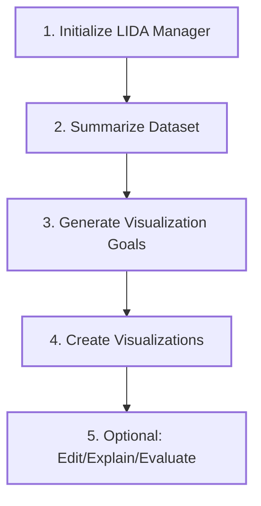
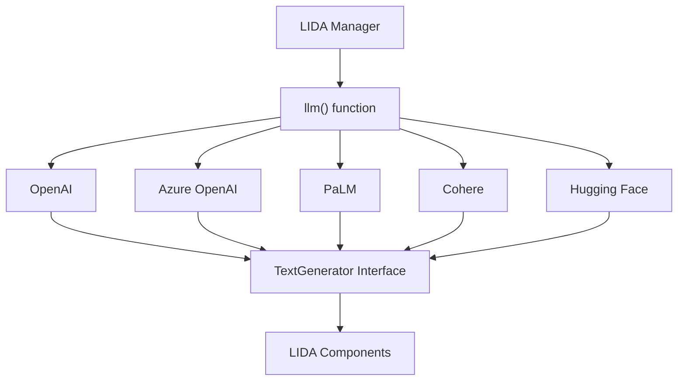
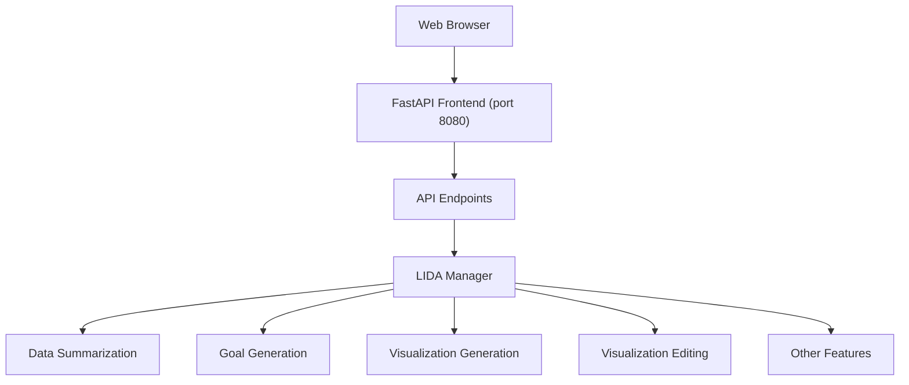

<!-- source: DeepWiki mcp.deepwiki.com · repo microsoft/lida · page 7 Tutorials and Examples · fetched 2026-10-26 -->

# Tutorials and Examples

<details>
<summary>Relevant source files</summary>

The following files were used as context for generating this wiki page:

- [.dockerignore](.dockerignore)
- [CITATION.cff](CITATION.cff)
- [README.md](README.md)
- [docker-compose.yml](docker-compose.yml)
- [dockerfile](dockerfile)
- [lida/version.py](lida/version.py)
- [notebooks/tutorial.ipynb](notebooks/tutorial.ipynb)

</details>


This page provides practical tutorials and examples for using LIDA (Language-based Interactive Data Analytics). It includes step-by-step guides for common workflows, code examples for using different LIDA features, and demonstrations of practical applications. For information about LIDA's architecture and components, see [Architecture](#2), and for detailed API documentation, see [Python API](#3).

## 1. Getting Started

Before working through these tutorials, ensure you have installed LIDA and have set up the necessary API keys for the LLM provider you plan to use.

### 1.1 Installing LIDA

LIDA requires Python 3.10 or higher. Install the library using pip:

```bash
pip install -U lida
```

For infographics support, install the additional dependencies:

```bash
pip install lida[infographics]
```

For using LIDA with local Hugging Face models, install the transformers dependencies:

```bash
pip install lida[transformers]
```

Sources: [README.md:44-56](https://github.com/microsoft/lida/blob/main/README.md), [notebooks/tutorial.ipynb:12-23]()

### 1.2 Setting Up API Keys

Set up your API keys for the desired LLM provider:

```bash
# For OpenAI
export OPENAI_API_KEY=<your key>

# For Cohere
export COHERE_API_KEY=<your key>

# For PaLM
export PALM_SERVICE_ACCOUNT_KEY_FILE=<path to gcp service account key file>
export PALM_PROJECT_ID=<your gcp project id>
```

Sources: [notebooks/tutorial.ipynb:52-59](), [README.md:58-62]()

## 2. Basic LIDA Workflow

This section covers the fundamental workflow for using LIDA to generate visualizations.

### 2.1 Workflow Overview



Sources: [README.md:20-33](), [notebooks/tutorial.ipynb:31-34]()

### 2.2 Initializing the LIDA Manager

The first step is to create a Manager instance with a configured LLM provider:

```python
from lida import Manager, llm

# Initialize with OpenAI
lida = Manager(text_gen = llm("openai"))

# Or with another provider (Cohere, PaLM, etc.)
lida = Manager(text_gen = llm("cohere"))
```

Sources: [README.md:36-38](), [notebooks/tutorial.ipynb:38-48]()

### 2.3 Summarizing Data

Data summarization creates a compact representation of your dataset:

```python
# Load data from a URL, CSV, or JSON file
summary = lida.summarize("data/cars.csv")

# Optionally, use LLM to enrich the summary
summary = lida.summarize("data/cars.csv", summary_method="llm")
```

LIDA supports two summarization methods:
- `default`: Generates basic statistics without using LLM
- `llm`: Enriches the base summary with LLM-generated insights

Sources: [README.md:87-95](), [notebooks/tutorial.ipynb:76-79]()

### 2.4 Generating Visualization Goals

Goals are high-level visualization objectives:

```python
# Generate multiple goals
goals = lida.goals(summary, n=2)

# Generate persona-based goals
persona = "a mechanic who wants to buy a car that is cheap but has good gas mileage"
personal_goals = lida.goals(summary, n=2, persona=persona)
```

Each goal contains:
- A question to answer
- A suggested visualization
- A rationale explaining why this visualization is useful

Sources: [README.md:98-103](), [notebooks/tutorial.ipynb:155-166](), [notebooks/tutorial.ipynb:210-214]()

### 2.5 Creating Visualizations

Generate visualizations based on a goal:

```python
# Generate charts for a specific goal
charts = lida.visualize(summary=summary, goal=goals[0], library="matplotlib")
```

You can specify different visualization libraries:
- matplotlib
- seaborn
- altair
- plotly
- ggplot
- And others

Sources: [README.md:112-114](), [notebooks/tutorial.ipynb:228-230]()

## 3. Advanced LIDA Features

### 3.1 Visualization Editing

Edit visualizations using natural language instructions:

```python
instructions = [
    "convert this to a bar chart", 
    "change the color to red", 
    "change y axes label to Fuel Efficiency",
    "translate the title to french"
]
edited_charts = lida.edit(code=charts[0].code, summary=summary, instructions=instructions)
```

Sources: [README.md:120-124]()

### 3.2 Visualization Explanation

Generate explanations for visualizations:

```python
explanation = lida.explain(code=charts[0].code, summary=summary)
```

Explanations include details about:
- Accessibility considerations
- Data transformations applied
- Visualization code structure

Sources: [README.md:132-134]()

### 3.3 Visualization Evaluation and Repair

Evaluate visualizations for potential improvements:

```python
evaluations = lida.evaluate(code=charts[0].code, goal=goals[0])
```

Based on evaluation results, you can repair issues:

```python
repaired_chart = lida.repair(code=charts[0].code, summary=summary, evaluation=evaluations[0])
```

Sources: [README.md:141-142]()

### 3.4 Visualization Recommendation

LIDA can recommend alternative visualizations:

```python
recommendations = lida.recommend(code=charts[0].code, summary=summary, n=2)
```

Sources: [README.md:149-150]()

### 3.5 Infographic Generation

Generate data-faithful infographics based on visualizations:

```python
# Requires lida[infographics] installation
infographics = lida.infographics(visualization=charts[0].raster, n=3, style_prompt="line art")
```

Sources: [README.md:156-158]()

## 4. Working with Different LLM Providers

LIDA supports multiple LLM providers through the `llm` function. Here's how to configure different providers:



Sources: [notebooks/tutorial.ipynb:36-75]()

### 4.1 OpenAI Configuration

```python
from lida import Manager, llm, TextGenerationConfig

# Basic configuration
text_gen = llm("openai")

# With configuration
textgen_config = TextGenerationConfig(n=1, temperature=0.5, model="gpt-3.5-turbo")
lida = Manager(text_gen=text_gen)
```

Sources: [notebooks/tutorial.ipynb:155-156](), [README.md:36-38]()

### 4.2 Azure OpenAI Configuration

```python
import os
from lida import Manager, llm

text_gen = llm(
    provider="openai",
    api_type="azure",
    azure_endpoint=os.environ["AZURE_OPENAI_BASE"],
    api_key=os.environ["AZURE_OPENAI_API_KEY"],
    api_version="2023-07-01-preview"
)
lida = Manager(text_gen=text_gen)
```

Sources: [notebooks/tutorial.ipynb:60-72]()

### 4.3 Using Local Hugging Face Models

```python
from lida import Manager, llm

# Direct usage with Hugging Face
text_gen = llm(
    provider="hf", 
    model="uukuguy/speechless-llama2-hermes-orca-platypus-13b", 
    device_map="auto"
)
lida = Manager(text_gen=text_gen)
```

You can also use an OpenAI-compatible endpoint (e.g., using vllm):

```python
from lida import Manager, llm

model_name = "uukuguy/speechless-llama2-hermes-orca-platypus-13b"
model_details = [{'name': model_name, 'max_tokens': 2596, 'model': {'provider': 'openai', 'parameters': {'model': model_name}}}]

# Assuming vllm endpoint running on localhost:8000
text_gen = llm(
    provider="openai",  
    api_base="http://localhost:8000/v1", 
    api_key="EMPTY", 
    models=model_details
)
lida = Manager(text_gen=text_gen)
```

Sources: [README.md:162-189]()

## 5. Using the Web UI

LIDA includes a web-based user interface for interactive visualization generation.

### 5.1 Starting the Web UI

To launch the web UI:

```bash
lida ui --port=8080 --docs
```

Then navigate to http://localhost:8080/ in your browser. Adding the `--docs` option enables API documentation at http://localhost:8080/api/docs.

Sources: [README.md:68-76]()

### 5.2 Using Docker for the Web UI

You can use Docker to run the web UI:

```bash
docker compose up
```

This will build and start the web UI using the configuration specified in the docker-compose.yml file.

Sources: [README.md:80-84](), [docker-compose.yml:1-11](), [dockerfile:1-18]()

### 5.3 Web UI Architecture



Sources: [docker-compose.yml:1-11](), [dockerfile:1-18]()

## 6. Practical Examples

### 6.1 Exploratory Data Analysis Example

This example demonstrates how to perform exploratory data analysis on a cars dataset.

```python
from lida import Manager, llm, TextGenerationConfig

# Initialize LIDA
lida = Manager(text_gen=llm("openai"))
textgen_config = TextGenerationConfig(n=1, temperature=0.5, use_cache=True)

# Load and summarize data
summary = lida.summarize("https://raw.githubusercontent.com/uwdata/draco/master/data/cars.csv")

# Generate visualization goals
goals = lida.goals(summary, n=2, textgen_config=textgen_config)

# Print the goals
for goal in goals:
    print(f"Question: {goal.question}")
    print(f"Visualization: {goal.visualization}")
    print(f"Rationale: {goal.rationale}")
    print("---")

# Generate visualization for the first goal
charts = lida.visualize(summary=summary, goal=goals[0], library="matplotlib")

# Display the first chart
charts[0].display()
```

Sources: [notebooks/tutorial.ipynb:99-166]()

### 6.2 Persona-Based Visualization Example

This example shows how to generate visualizations for a specific persona:

```python
# Define a persona
persona = "a mechanic who wants to buy a car that is cheap but has good gas mileage"

# Generate goals for this persona
persona_goals = lida.goals(summary, n=2, persona=persona, textgen_config=textgen_config)

# Print the persona-based goals
for goal in persona_goals:
    print(f"Question: {goal.question}")
    print(f"Visualization: {goal.visualization}")
    print(f"Rationale: {goal.rationale}")
    print("---")

# Generate visualization for the first persona-based goal
persona_charts = lida.visualize(summary=summary, goal=persona_goals[0], library="seaborn")
```

Sources: [notebooks/tutorial.ipynb:210-214]()

### 6.3 Complete Workflow with Visualization Editing

This example demonstrates a complete workflow including visualization editing and explanation:

```python
from lida import Manager, llm, TextGenerationConfig

# Initialize LIDA
lida = Manager(text_gen=llm("openai"))

# Load and summarize data
dataset_path = "data/sales_data.csv"
summary = lida.summarize(dataset_path)

# Generate goals
goals = lida.goals(summary, n=3)

# Generate visualization
charts = lida.visualize(summary=summary, goal=goals[0], library="matplotlib")

# Edit the visualization
edit_instructions = ["convert to horizontal bar chart", "add a title 'Monthly Sales'"]
edited_charts = lida.edit(code=charts[0].code, summary=summary, instructions=edit_instructions)

# Get explanation
explanation = lida.explain(code=edited_charts[0].code, summary=summary)
print(explanation)

# Evaluate the chart
evaluations = lida.evaluate(code=edited_charts[0].code, goal=goals[0])

# Get recommendations
recommendations = lida.recommend(code=edited_charts[0].code, summary=summary, n=2)
```

## 7. Community Examples

### 7.1 LIDA with Streamlit

The LIDA community has created integration examples with other popular frameworks. One notable example is the LIDA + Streamlit integration:

- [lida-streamlit](https://github.com/lida-project/lida-streamlit): An integration of LIDA with the Streamlit framework for interactive data applications.

Sources: [README.md:204-206]()

## 8. Key Considerations and Limitations

When working with the tutorials and examples, keep these points in mind:

1. **Security**: LIDA generates and executes code. Ensure you run it in a secure environment with appropriate permissions.

2. **Dataset Size**: LIDA works best with datasets that have a small number of columns (≤ 10) due to LLM context size limitations.

3. **Data Preparation**: LIDA assumes the dataset exists and is in a format that can be loaded into a pandas dataframe. You may need to preprocess your data.

4. **LLM Selection**: Smaller LLMs have limited instruction-following capabilities. LIDA works best with larger models like OpenAI GPT-3.5 or GPT-4.

5. **Error Rates**: With current versions of prompts and LLMs, LIDA has an error rate of <3.5% on over 2200 visualizations generated.

Sources: [README.md:192-200]()

## 9. Additional Resources

For more in-depth learning, see these resources:

1. **Tutorial Notebook**: A comprehensive tutorial is available in the [notebooks/tutorial.ipynb](https://github.com/microsoft/lida/blob/main/notebooks/tutorial.ipynb) file, which can be run in Google Colab.

2. **Research Paper**: The ACL 2023 paper describing LIDA is available at [arXiv](https://arxiv.org/abs/2303.02927).

3. **API Documentation**: For detailed API documentation, see the [Python API](#3) wiki page.

Sources: [README.md:7-13](), [README.md:209-224]()

---

