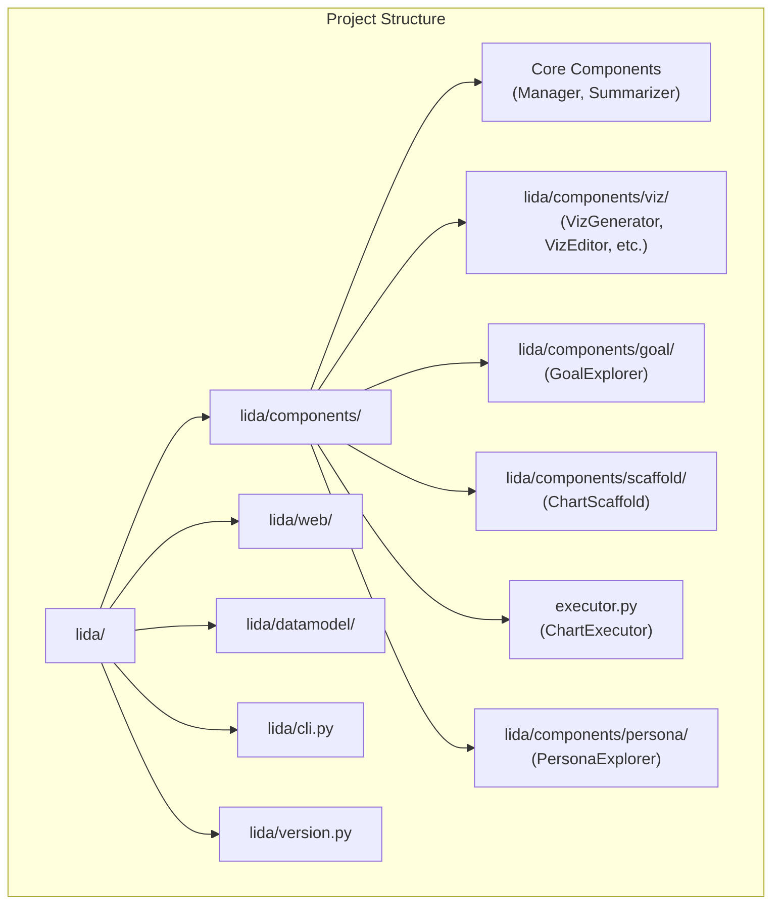
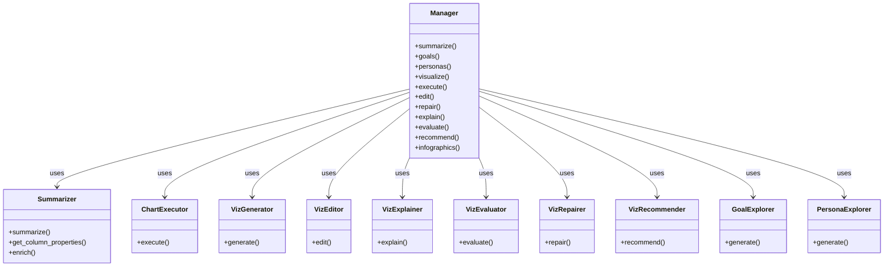
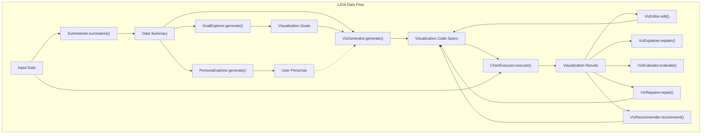
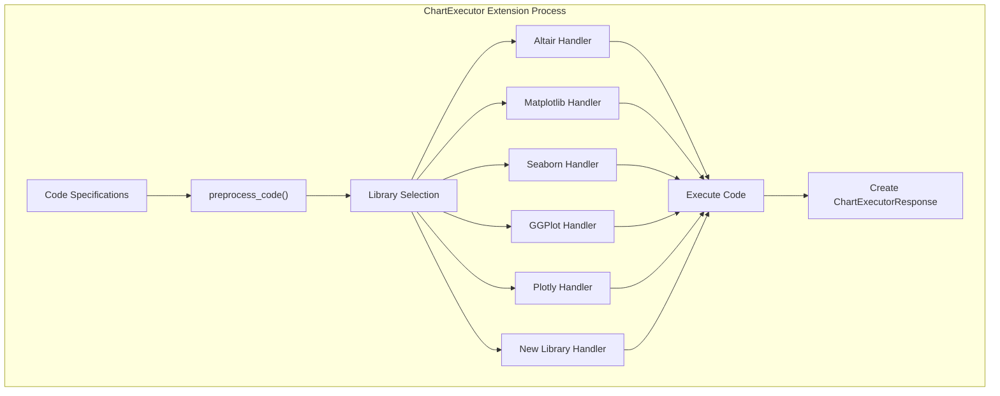
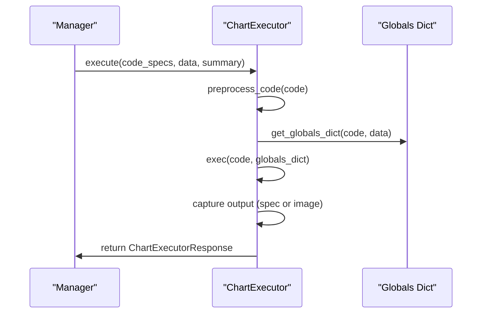

<!-- source: DeepWiki mcp.deepwiki.com · repo microsoft/lida · page 8 Developer Guide · fetched 2026-10-26 -->

# Developer Guide

<details>
<summary>Relevant source files</summary>

The following files were used as context for generating this wiki page:

- [.gitignore](.gitignore)
- [SUPPORT.md](SUPPORT.md)
- [lida/components/__init__.py](lida/components/__init__.py)
- [lida/components/executor.py](lida/components/executor.py)
- [lida/components/viz/__init__.py](lida/components/viz/__init__.py)
- [pyproject.toml](pyproject.toml)
- [requirements.txt](requirements.txt)

</details>


This guide provides essential information for developers who want to contribute to LIDA (Language-based Interactive Data Analytics). It covers the development environment setup, project architecture, contribution workflow, and extension points. For information about using LIDA as an end-user, please refer to the [Python API](#3) and [Web UI](#4) documentation.

## 1. Setting Up the Development Environment

### Prerequisites

- Python 3.9 or higher
- Git

### Clone and Install

```bash
# Clone the repository
git clone https://github.com/microsoft/lida.git
cd lida

# Create and activate a virtual environment (recommended)
python -m venv venv
source venv/bin/activate  # On Windows: venv\Scripts\activate

# Install in development mode
pip install -e .

# Install optional dependencies
pip install -e ".[web,transformers,tools,infographics]"
```

Sources: [pyproject.toml:1-66]()

### Project Dependencies

LIDA requires various Python libraries for its functionality:

- **Core Dependencies**: llmx, pydantic, pandas, numpy
- **Visualization Libraries**: matplotlib, altair, seaborn, plotly, plotnine
- **Web Interface**: fastapi, uvicorn, typer
- **Optional Dependencies**:
  - Web: fastapi, uvicorn
  - Transformers: llmx[transformers]
  - Tools: geopy, basemap, basemap-data-hires
  - Infographics: peacasso

Sources: [pyproject.toml:20-42]()

## 2. Project Structure

### Directory Organization



Sources: [lida/components/__init__.py:1-8](), [lida/components/viz/__init__.py:1-6]()

### Component Architecture

LIDA follows a modular architecture where specialized components handle different aspects of the data visualization pipeline:



Sources: [lida/components/__init__.py:1-8](), [lida/components/viz/__init__.py:1-6](), [lida/components/executor.py:82-282]()

## 3. Development Workflow

### Code Organization Principles

LIDA follows these key design principles:

1. **Centralized Orchestration**: The `Manager` class serves as the central orchestrator, providing a unified API for all system functionalities.

2. **Component-based Design**: The system is divided into focused components, each with a single responsibility in the visualization pipeline.

3. **LLM Integration**: Components leverage LLMs through a consistent `TextGenerator` interface, which abstracts away specific LLM providers.

4. **Progressive Generation**: The system follows a pipeline approach where outputs from one component feed into the next.

### Data Flow



Sources: [lida/components/executor.py:82-282]()

## 4. Contributing to LIDA

### Contribution Process

1. **Fork the Repository**: Create your own fork of the LIDA repository.
2. **Create a Feature Branch**: Make your changes in a new branch.
3. **Develop and Test**: Implement your changes and test them thoroughly.
4. **Submit a Pull Request**: Open a PR against the main branch.

### Code Standards

- Follow PEP 8 style guidelines
- Include docstrings for all functions, classes, and modules
- Write unit tests for new functionality
- Keep commits focused and descriptive

### Issue Reporting

When reporting issues:

1. Check existing issues to avoid duplicates
2. Use a clear and descriptive title
3. Provide detailed steps to reproduce
4. Include relevant environment information

Sources: [SUPPORT.md:1-14]()

## 5. Extending LIDA

LIDA is designed to be extensible. Here are the main ways to extend the system:

### Adding a New Visualization Library

The `ChartExecutor` class handles the execution of visualization code. To support a new visualization library:

1. Add the library to the dependencies in `pyproject.toml`
2. Extend the `execute` method in `ChartExecutor` to handle the new library



Sources: [lida/components/executor.py:82-282]()

### Adding a New Component

To add a new component:

1. Create a new module under the appropriate subdirectory in `lida/components/`
2. Implement the component's functionality
3. Update the appropriate `__init__.py` file to expose the component
4. Extend the `Manager` class to use the new component

### Supporting a New LLM Provider

LIDA uses the `llmx` library to abstract LLM providers. To add support for a new provider:

1. Ensure the provider is supported by `llmx` or extend `llmx` to support it
2. Configure the `TextGenerator` to use the new provider

## 6. Understanding Key Components

### ChartExecutor

The `ChartExecutor` is responsible for executing visualization code and returning chart objects:



Key features:
- Supports multiple visualization libraries (Altair, Matplotlib, Seaborn, GGPlot, Plotly)
- Preprocesses code to extract the visualization component
- Handles exceptions and provides meaningful error messages
- Returns standardized response objects with visualization specs or raster images

Sources: [lida/components/executor.py:17-48](), [lida/components/executor.py:51-79](), [lida/components/executor.py:82-282]()

## 7. Troubleshooting

### Common Issues

1. **Dependency Conflicts**: If you encounter package conflicts, try creating a fresh virtual environment.

2. **LLM Configuration**: Ensure your LLM API keys are properly configured.

3. **Code Execution Permission**: The `ChartExecutor` requires permission to execute code. Set the environment variable `LIDA_ALLOW_CODE_EVAL` to `1`.

### Getting Help

- Search existing issues on the GitHub repository
- Open a new issue with detailed information
- Consult the project README

Sources: [SUPPORT.md:1-14]()

## 8. Release Process

### Versioning

LIDA follows semantic versioning (SemVer):
- **Major version**: Breaking API changes
- **Minor version**: New features without breaking changes
- **Patch version**: Bug fixes and minor improvements

The version is defined in `lida/version.py` and referenced in `pyproject.toml`.

Sources: [pyproject.toml:49-50]()

### Package Distribution

LIDA is distributed as a Python package through PyPI. The package configuration is defined in `pyproject.toml`.

Sources: [pyproject.toml:5-19](), [pyproject.toml:46-50]()

## 9. Conclusion

This developer guide provides an overview of LIDA's architecture, development workflow, and extension points. By understanding these aspects, you can effectively contribute to the project and extend its functionality.

For further assistance, please refer to the project's GitHub repository and open issues for any questions or problems you encounter.

Sources: [SUPPORT.md:1-14]()