# Page: Overview

# Overview

<details>
<summary>Relevant source files</summary>

The following files were used as context for generating this wiki page:

- [.dockerignore](.dockerignore)
- [CITATION.cff](CITATION.cff)
- [README.md](README.md)
- [docker-compose.yml](docker-compose.yml)
- [dockerfile](dockerfile)
- [lida/version.py](lida/version.py)
- [notebooks/tutorial.ipynb](notebooks/tutorial.ipynb)

</details>


This page provides a comprehensive introduction to LIDA (Language-based Interactive Data Analytics), a library for automatic generation of visualizations and infographics using Large Language Models (LLMs). LIDA enables data visualization through natural language by leveraging LLMs to generate, execute, and refine visualization code in various grammar formats.

For detailed information about individual components, see [Architecture](#2) and [Core Components](#2.1). For usage instructions, see [Python API](#3) and [Web UI](#4).

## What is LIDA?

LIDA is a grammar-agnostic library that works with multiple programming languages and visualization libraries (matplotlib, seaborn, altair, d3, etc.) and integrates with various LLM providers (OpenAI, Azure OpenAI, PaLM, Cohere, Hugging Face). LIDA treats **visualizations as code** and provides a clean API for generating, executing, editing, explaining, evaluating, and repairing visualization code.

LIDA is currently at version `0.0.14` according to [lida/version.py:1-2]().

Sources: [README.md:1-23](), [lida/version.py:1-2]()

## System Architecture

### High-Level Architecture

LIDA follows a modular architecture centered around a core `Manager` class that orchestrates the entire visualization generation process.

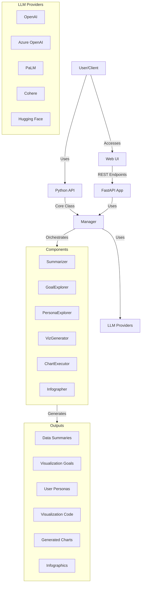

Sources: [README.md:17-33](), [notebooks/tutorial.ipynb:1-24](), [notebooks/tutorial.ipynb:25-81]()

### Data Flow

The LIDA pipeline follows a progressive data-to-visualization flow, where each step builds upon the outputs of previous steps:

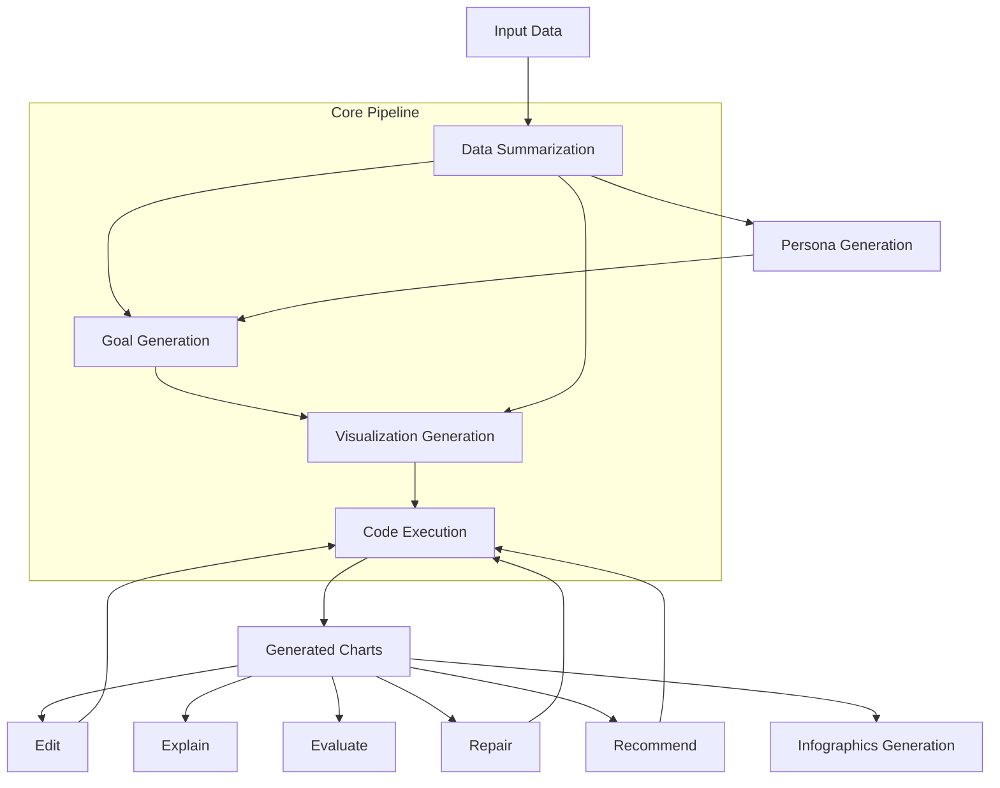

Sources: [README.md:82-158](), [notebooks/tutorial.ipynb:104-108](), [notebooks/tutorial.ipynb:222-223]()

## Key Features

LIDA provides a comprehensive set of features for data visualization:

1. **Data Summarization**: Generates compact summaries of datasets
2. **Goal Generation**: Creates visualization goals based on data summaries
3. **Visualization Generation**: Converts goals into executable visualization code
4. **Visualization Editing**: Modifies visualizations using natural language instructions
5. **Visualization Explanation**: Provides natural language explanations of visualization code
6. **Visualization Evaluation and Repair**: Identifies issues and repairs visualizations
7. **Visualization Recommendation**: Suggests visualizations based on data
8. **Infographic Generation**: Creates data-faithful infographics from visualizations

Sources: [README.md:19-32](), [README.md:82-158]()

## Components and Relationships

LIDA's architecture consists of several components that work together to create visualizations:

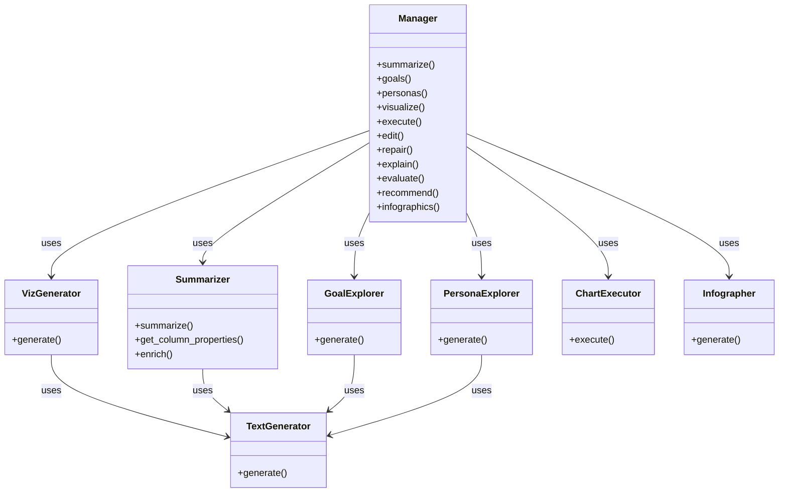

Sources: [README.md:34-158]()

## User Interaction

Users can interact with LIDA through either the Python API or Web UI:

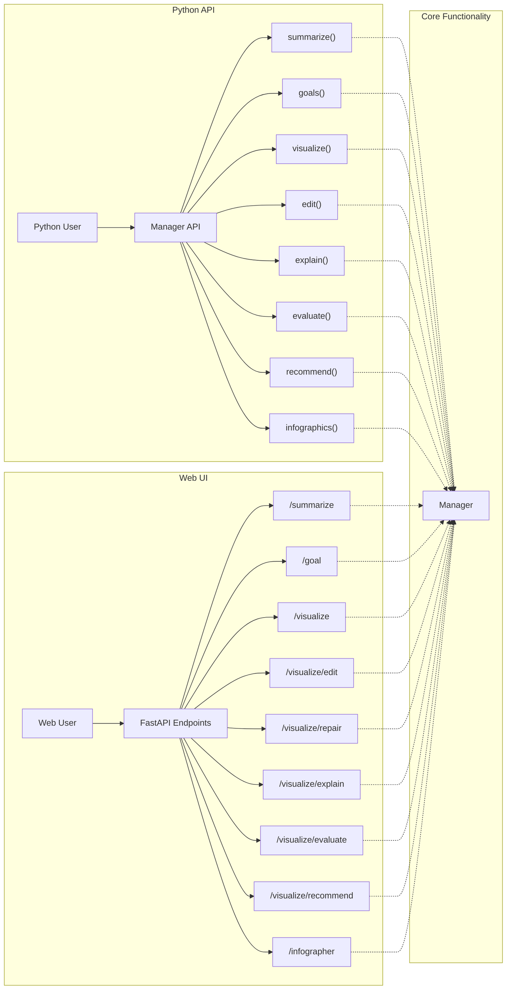

Sources: [README.md:44-65](), [README.md:66-77](), [notebooks/tutorial.ipynb:31-37]()

## Basic Usage Example

The following is a simple usage example of LIDA's Python API:

```python
from lida import Manager, llm

lida = Manager(text_gen = llm("openai"))  # palm, cohere, etc.
summary = lida.summarize("data/cars.csv")
goals = lida.goals(summary, n=2)  # exploratory data analysis
charts = lida.visualize(summary=summary, goal=goals[0])
```

Sources: [README.md:34-42]()

## Installation and Setup

LIDA requires Python 3.10 or higher and can be installed via pip:

```bash
pip install -U lida
```

For the infographics functionality, additional dependencies are required:

```bash
pip install lida[infographics]
```

LIDA depends on various LLM providers that require API keys. These can be set as environment variables:

```bash
export OPENAI_API_KEY=<your key>
```

Sources: [README.md:44-64](), [notebooks/tutorial.ipynb:1-24](), [notebooks/tutorial.ipynb:88-91]()

## Deployment Options

LIDA can be deployed in several ways:

1. **Python Package**: Import and use in Python code
2. **Web UI**: Run the built-in web interface and API
3. **Docker**: Deploy using Docker and docker-compose

The Web UI can be started with:

```bash
lida ui --port=8080 --docs
```

Docker deployment can be done with:

```bash
docker compose up
```

Sources: [README.md:66-77](), [README.md:78-84](), [dockerfile:1-18](), [docker-compose.yml:1-11]()

## Important Considerations

When working with LIDA, keep in mind:

- LIDA generates and executes code, so ensure it runs in a secure environment
- It works best with datasets that have a small number of columns (≤10) due to LLM context limitations
- LIDA assumes the dataset exists and is in a format loadable into a pandas dataframe
- Smaller LLMs may have limited instruction-following capabilities
- The current version has an error rate of <3.5% on over 2200 visualizations generated

Sources: [README.md:192-201]()

## Related Publications

LIDA is described in a paper accepted at ACL 2023 Conference:

```
@inproceedings{dibia2023lida,
    title = "LIDA: A Tool for Automatic Generation of Grammar-Agnostic Visualizations and Infographics using Large Language Models",
    author = "Dibia, Victor",
    booktitle = "Proceedings of the 61st Annual Meeting of the Association for Computational Linguistics (Volume 3: System Demonstrations)",
    month = jul,
    year = "2023",
    address = "Toronto, Canada",
    publisher = "Association for Computational Linguistics",
    url = "https://aclanthology.org/2023.acl-demo.11",
    doi = "10.18653/v1/2023.acl-demo.11",
    pages = "113--126",
}
```

Sources: [README.md:208-225](), [CITATION.cff:1-17]()

---

# Page: Architecture

# Architecture

<details>
<summary>Relevant source files</summary>

The following files were used as context for generating this wiki page:

- [.dockerignore](.dockerignore)
- [CITATION.cff](CITATION.cff)
- [README.md](README.md)
- [docker-compose.yml](docker-compose.yml)
- [dockerfile](dockerfile)
- [lida/components/manager.py](lida/components/manager.py)
- [lida/datamodel.py](lida/datamodel.py)
- [lida/web/app.py](lida/web/app.py)

</details>


This document provides a detailed overview of LIDA's architecture, components, and data flow. It explains how LIDA's various parts interact to enable automated visualization generation through Large Language Models (LLMs). For information about using the Python API, see [Python API](#3), and for details on the Web UI, see [Web UI](#4).

## High-Level Architecture Overview

LIDA (Language-based Interactive Data Analytics) is structured as a modular system with several key components that work together to transform data into visualizations and infographics.

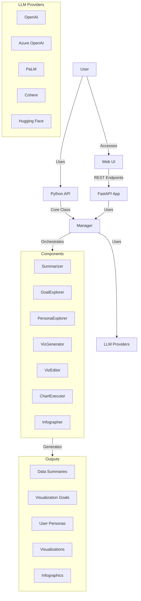

Sources:
- [lida/components/manager.py:1-431]()
- [README.md:19-33]()
- [lida/web/app.py:1-311]()

## Core Components and Their Responsibilities

The LIDA architecture centers around the `Manager` class which orchestrates all operations by delegating specific tasks to specialized components. Each component has a well-defined responsibility within the visualization generation pipeline.

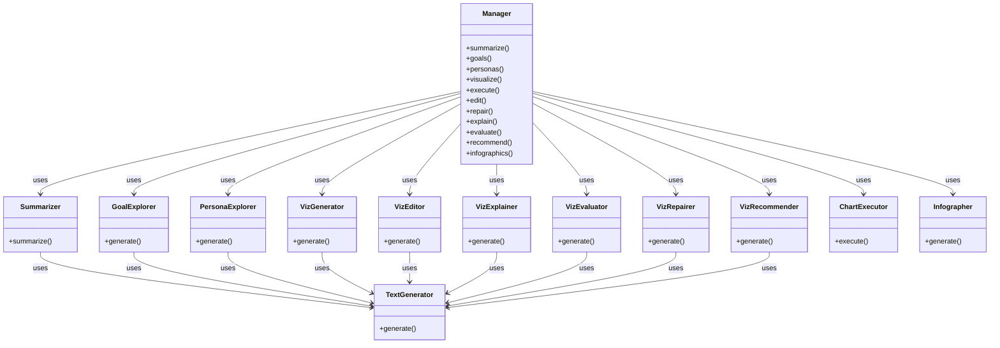

Sources:
- [lida/components/manager.py:28-50]()
- [lida/components/manager.py:72-431]()

### Component Responsibilities

| Component | Responsibility |
|-----------|----------------|
| **Manager** | Central orchestrator that provides the main API and coordinates all components |
| **Summarizer** | Analyzes datasets to create concise summaries of their structure and content |
| **GoalExplorer** | Generates potential visualization goals based on the data summary |
| **PersonaExplorer** | Creates user personas to contextualize visualization goals |
| **VizGenerator** | Generates visualization code based on summary and goal |
| **VizEditor** | Modifies existing visualization code based on natural language instructions |
| **VizExplainer** | Generates natural language explanations of visualization code |
| **VizEvaluator** | Evaluates visualizations for effectiveness and adherence to goals |
| **VizRepairer** | Fixes issues in visualization code based on feedback |
| **VizRecommender** | Suggests alternative visualizations for a dataset |
| **ChartExecutor** | Executes visualization code to produce the actual visual output |
| **Infographer** | Generates stylized infographics from visualizations |

Sources:
- [lida/components/manager.py:38-50]()
- [README.md:25-32]()

## Data Flow Through the System

LIDA follows a sequential data flow where outputs from one component become inputs to the next. The flowchart below illustrates how data progresses through the system to generate visualizations.

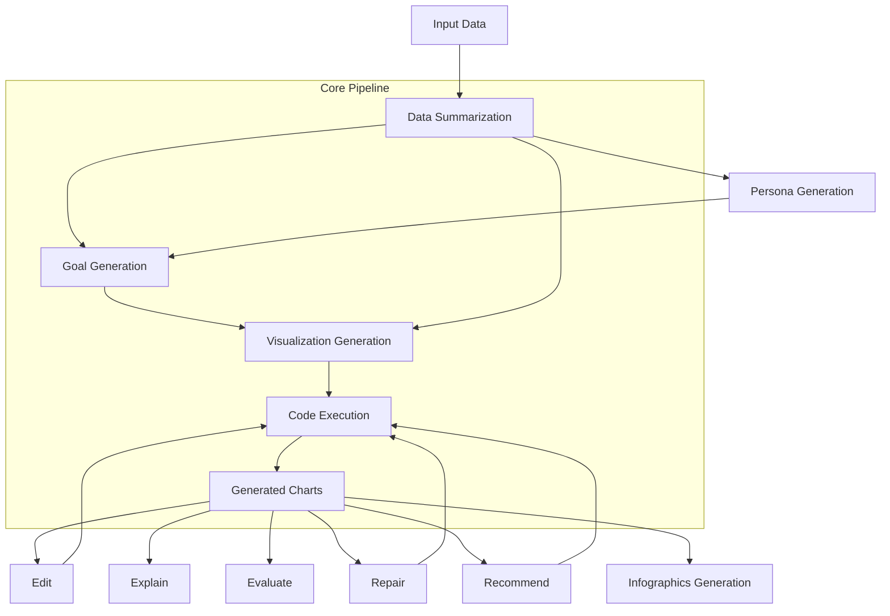

Sources:
- [lida/components/manager.py:72-134]() - Summarization
- [lida/components/manager.py:135-186]() - Goal and Persona Generation
- [lida/components/manager.py:188-212]() - Visualization Generation
- [lida/components/manager.py:214-238]() - Execution
- [lida/components/manager.py:240-431]() - Edit/Repair/Explain/Evaluate/Recommend/Infographics

## Visualization Generation Process

The diagram below shows the sequence of operations that occur during the visualization generation process, from data input to chart output.

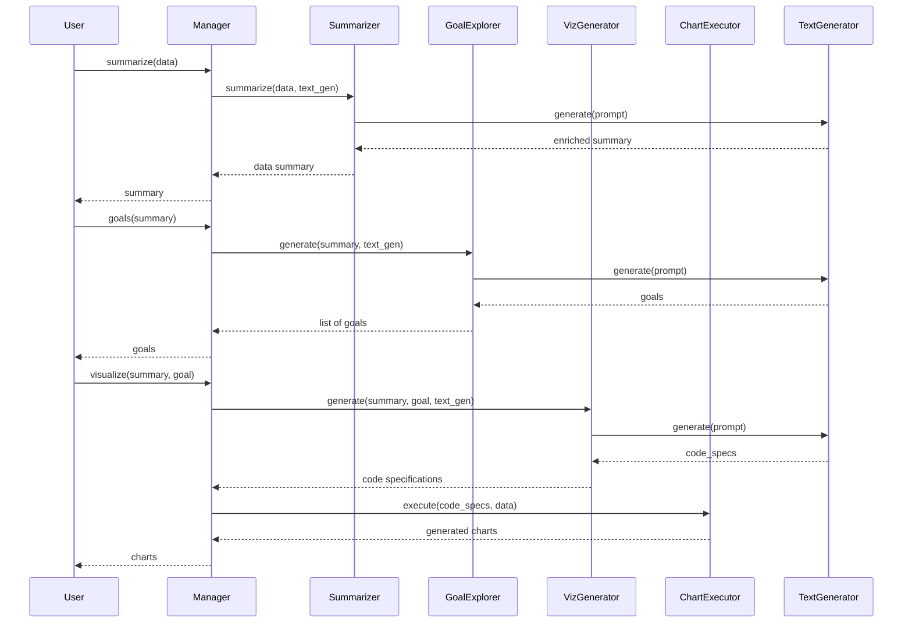

Sources:
- [lida/components/manager.py:72-134]() - Summarize method
- [lida/components/manager.py:135-186]() - Goals and Personas methods
- [lida/components/manager.py:188-212]() - Visualize method
- [lida/components/manager.py:214-238]() - Execute method

## API and User Interaction

LIDA provides two primary interfaces for user interaction: a Python API and a Web UI with REST endpoints. The diagram below shows how these interfaces connect to the core functionality.

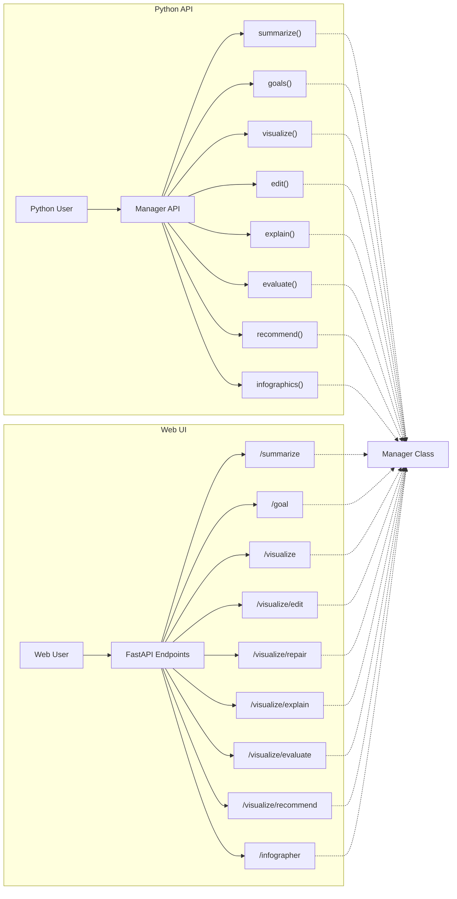

Sources:
- [lida/components/manager.py:28-50]() - Manager class definition
- [lida/components/manager.py:72-431]() - Manager methods
- [lida/web/app.py:51-303]() - Web API endpoints
- [README.md:66-76]() - Web UI information

### Web API Endpoints

The following table maps the FastAPI endpoints to their corresponding Manager methods:

| Endpoint | HTTP Method | Manager Method | Description |
|----------|------------|----------------|-------------|
| `/summarize` | POST | `summarize()` | Generate data summary from uploaded file |
| `/summarize/url` | POST | `summarize()` | Generate data summary from URL |
| `/goal` | POST | `goals()` | Generate visualization goals |
| `/visualize` | POST | `visualize()` | Generate visualizations |
| `/visualize/edit` | POST | `edit()` | Edit visualizations |
| `/visualize/repair` | POST | `repair()` | Repair visualizations |
| `/visualize/explain` | POST | `explain()` | Explain visualizations |
| `/visualize/evaluate` | POST | `evaluate()` | Evaluate visualizations |
| `/visualize/recommend` | POST | `recommend()` | Recommend visualizations |
| `/infographer` | POST | `infographics()` | Generate infographics |
| `/models` | GET | - | List supported LLM models |
| `/text/generate` | POST | - | Direct text generation |

Sources:
- [lida/web/app.py:51-303]()

## Data Models and Request Objects

LIDA uses several data models to represent the various entities and requests in the system. The key data models are defined in `datamodel.py`.

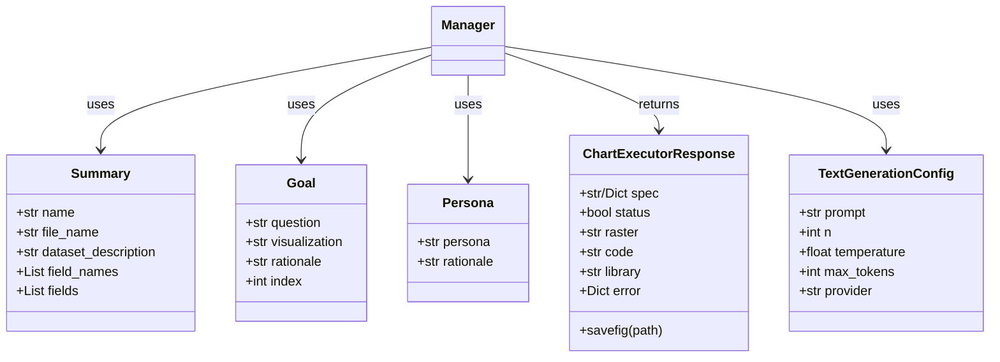

Sources:
- [lida/datamodel.py:10-235]()

## Deployment Options

LIDA supports multiple deployment options, including:

1. **Python Library**: Use as a Python library in your own applications
2. **Web UI**: Run the bundled web UI and API server
3. **Docker**: Deploy using the provided Docker configuration

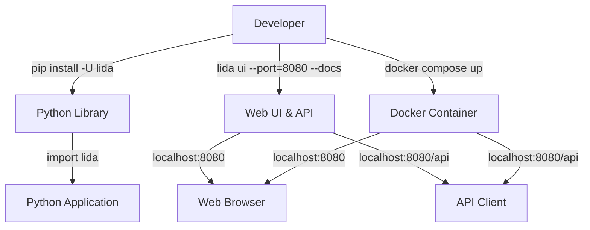

Sources:
- [README.md:44-50]() - Installation
- [README.md:67-76]() - Web UI
- [README.md:78-84]() - Docker
- [docker-compose.yml:1-11]()
- [dockerfile:1-18]()

## LLM Integration

LIDA works with multiple LLM providers through the `llmx` library. It supports:

1. **OpenAI** (GPT models)
2. **Azure OpenAI**
3. **Google PaLM**
4. **Cohere**
5. **Hugging Face** (local models)

The `TextGenerator` class from `llmx` serves as an abstraction layer for all LLM interactions, allowing LIDA components to use different LLM providers interchangeably.

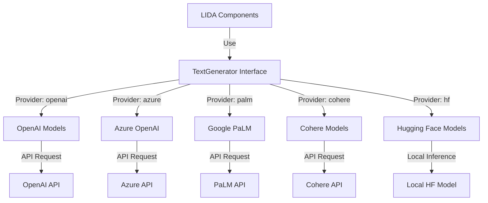

Sources:
- [lida/components/manager.py:37-37]() - TextGenerator initialization
- [lida/components/manager.py:52-70]() - TextGenerator configuration
- [README.md:160-190]() - Local LLM usage

## Security Considerations

LIDA generates and executes code to create visualizations, which has important security implications:

1. **Code Execution**: LIDA generates and executes Python code, which could potentially execute harmful operations if used with malicious data or prompts.
2. **Environment Isolation**: Users should run LIDA in a secure environment with appropriate permissions.
3. **API Keys**: When using LLM providers, API keys need to be handled securely.

Sources:
- [README.md:15-17]() - Note on code execution
- [README.md:192-197]() - Important notes/caveats

## Summary

LIDA's architecture follows these key design principles:

1. **Centralized Orchestration**: The `Manager` class serves as the central orchestrator.
2. **Component-based Design**: The system is composed of focused components with single responsibilities.
3. **LLM Integration**: All components leverage LLMs through a consistent `TextGenerator` interface.
4. **Dual Interface**: Users can interact through either a Python API or a web UI.
5. **Progressive Generation**: Outputs from one component feed into the next in a pipeline fashion.
6. **Extensibility**: The architecture supports optional components and can be extended.

This modular design makes LIDA adaptable to different visualization needs while maintaining a consistent interface for LLM-powered generation and editing.

Sources:
- [lida/components/manager.py:1-431]()
- [README.md:19-33]()

---

# Page: Core Components

# Core Components

<details>
<summary>Relevant source files</summary>

The following files were used as context for generating this wiki page:

- [lida/__init__.py](lida/__init__.py)
- [lida/components/goal.py](lida/components/goal.py)
- [lida/components/manager.py](lida/components/manager.py)
- [lida/components/scaffold.py](lida/components/scaffold.py)
- [lida/components/summarizer.py](lida/components/summarizer.py)
- [lida/utils.py](lida/utils.py)
- [tests/test_components.py](tests/test_components.py)

</details>


This page documents the core components of LIDA (Language-based Interactive Data Analytics), explaining their structure, responsibilities, and interactions. These components form the foundation of LIDA's architecture and enable its data visualization capabilities. For visualization-specific components, see [Visualization Components](#2.2), and for infographics generation, see [Infographics Generation](#2.3).

## Overview of Core Components

LIDA follows a modular, component-based architecture where specialized components handle different stages of the data visualization pipeline. The Manager acts as a central orchestrator, coordinating the workflow between various components.

```mermaid
classDiagram
    class "Manager" {
        +summarize()
        +goals()
        +personas()
        +visualize()
        +execute()
    }
    
    class "Summarizer" {
        +summarize()
        +get_column_properties()
        +enrich()
    }
    
    class "GoalExplorer" {
        +generate()
    }
    
    class "PersonaExplorer" {
        +generate()
    }
    
    class "TextGenerator" {
        +generate()
    }
    
    class "ChartExecutor" {
        +execute()
    }
    
    "Manager" --> "Summarizer" : uses
    "Manager" --> "GoalExplorer" : uses
    "Manager" --> "PersonaExplorer" : uses
    "Manager" --> "ChartExecutor" : uses
    "Summarizer" --> "TextGenerator" : uses
    "GoalExplorer" --> "TextGenerator" : uses
    "PersonaExplorer" --> "TextGenerator" : uses
```

Sources: [lida/components/manager.py:27-50](), [lida/components/summarizer.py:21-22](), [lida/components/goal.py:25-26]()

## Manager Component

The Manager is the central orchestrator that exposes LIDA's functionality through a unified API. It initializes and coordinates all other components, providing methods that correspond to each step of the data visualization pipeline.

### Key Responsibilities

- Initialize and manage all other components
- Provide a unified API for data summarization, goal generation, visualization creation, and more
- Handle data loading and preprocessing
- Execute visualization code
- Coordinate the workflow between components

The Manager provides these primary methods:
- `summarize()`: Generate a summary of the input data
- `goals()`: Generate visualization goals based on a data summary
- `personas()`: Generate user personas based on a data summary
- `visualize()`: Create visualizations based on a goal and summary
- `execute()`: Execute visualization code
- Additional methods for visualization modification and explanation

Sources: [lida/components/manager.py:28-51](), [lida/__init__.py:1-5]()

## Data Flow Through Components

The following diagram illustrates how data flows through LIDA's core components:

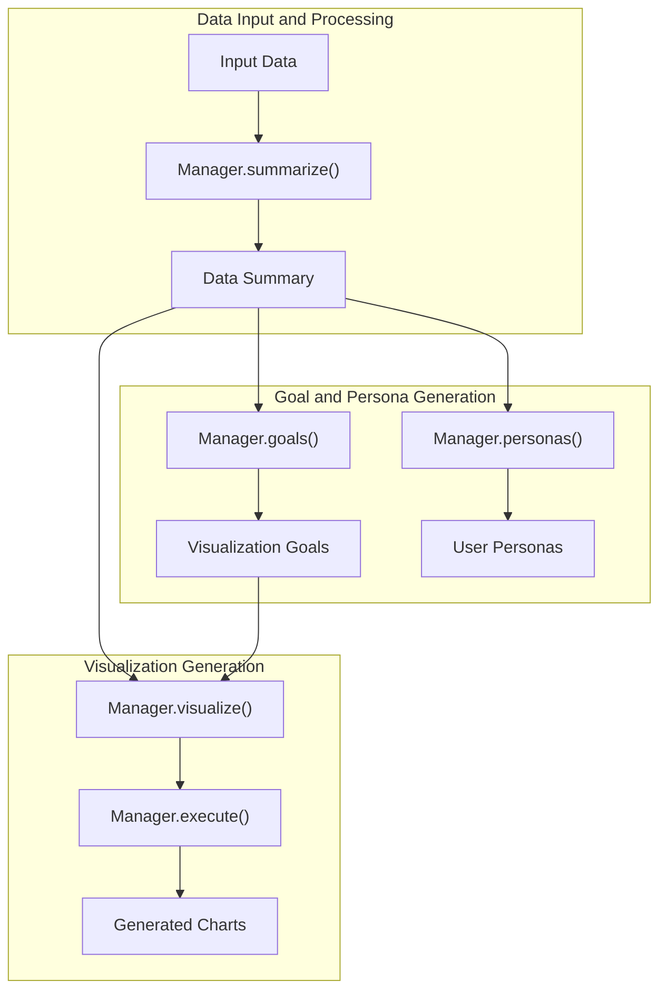

Sources: [lida/components/manager.py:72-133](), [lida/components/manager.py:135-178](), [lida/components/manager.py:188-212]()

## Core Component Details

### Summarizer

The Summarizer component analyzes input data and generates a structured summary containing information about the dataset and its fields.

**Key Methods:**
- `summarize()`: Generate a summary from input data
- `get_column_properties()`: Extract properties from each column in a dataframe
- `enrich()`: Enhance the summary with LLM-generated descriptions

**Data Summary Structure:**
```
{
  "name": "filename.csv",
  "file_name": "filename.csv",
  "dataset_description": "...",
  "fields": [
    {
      "column": "column_name",
      "properties": {
        "dtype": "string|number|date|category|boolean",
        "samples": [...],
        "num_unique_values": 123,
        "semantic_type": "...",
        "description": "..."
      }
    },
    ...
  ],
  "field_names": ["column1", "column2", ...]
}
```

Sources: [lida/components/summarizer.py:21-159](), [lida/utils.py:23-33](), [lida/utils.py:45-104]()

### GoalExplorer

The GoalExplorer component generates visualization goals based on a data summary. Each goal consists of a question to answer, a visualization type, and a rationale for why this visualization would be informative.

**Key Methods:**
- `generate()`: Create visualization goals based on a data summary

**Goal Structure:**
```
{
  "index": 0,
  "question": "What is the distribution of X?",
  "visualization": "histogram of X",
  "rationale": "This shows the frequency distribution..."
}
```

Sources: [lida/components/goal.py:25-65]()

### PersonaExplorer

The PersonaExplorer component generates user personas that represent potential users with specific interests and perspectives. These personas can be used to customize the generated goals and visualizations.

**Key Methods:**
- `generate()`: Create user personas based on a data summary

Sources: [lida/components/manager.py:180-186]()

### ChartScaffold

The ChartScaffold component provides code templates for different visualization libraries. These templates form the structure that the VizGenerator fills with specific visualization code.

**Key Methods:**
- `get_template()`: Get a code template for a specific visualization library

**Supported Libraries:**
- Matplotlib
- Seaborn
- ggplot
- Altair
- Plotly

Sources: [lida/components/scaffold.py:10-115]()

### ChartExecutor

The ChartExecutor component executes the visualization code generated by the VizGenerator, producing the actual visual output.

**Key Methods:**
- `execute()`: Execute visualization code with the provided data

Sources: [lida/components/manager.py:214-238]()

## Component Interaction Sequence

The following sequence diagram illustrates how components interact during a typical LIDA workflow:

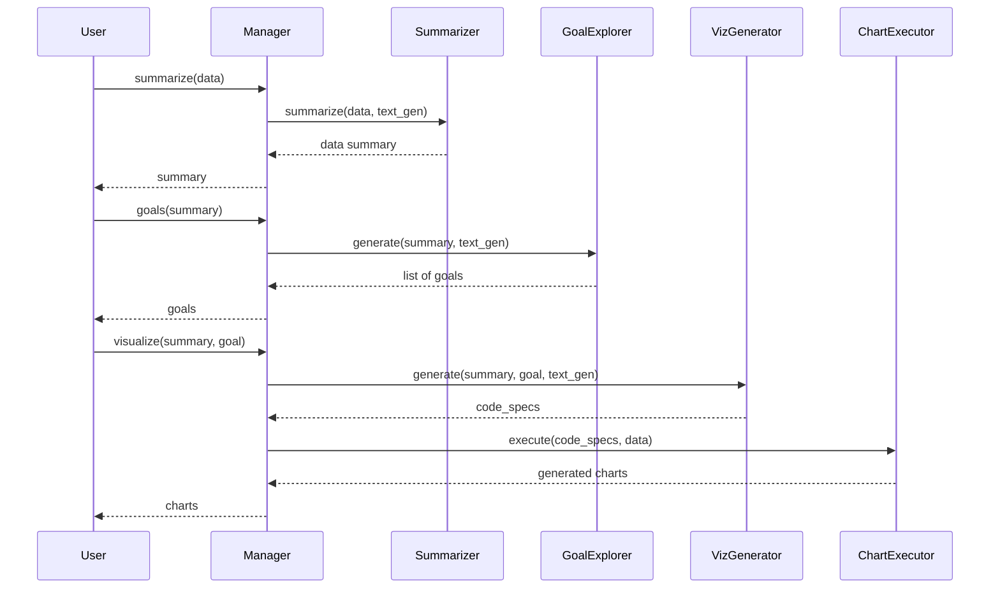

Sources: [lida/components/manager.py:72-212](), [tests/test_components.py:10-72]()

## Component API Reference

### Manager API

| Method | Parameters | Description |
|--------|------------|-------------|
| `summarize` | `data`, `file_name`, `n_samples`, `summary_method`, `textgen_config` | Summarizes input data (DataFrame or file path) |
| `goals` | `summary`, `textgen_config`, `n`, `persona` | Generates visualization goals based on a summary |
| `personas` | `summary`, `textgen_config`, `n` | Generates user personas based on a summary |
| `visualize` | `summary`, `goal`, `textgen_config`, `library`, `return_error` | Creates visualizations based on a goal and summary |
| `execute` | `code_specs`, `data`, `summary`, `library`, `return_error` | Executes visualization code |
| `edit` | `code`, `summary`, `instructions`, `textgen_config`, `library`, `return_error` | Edits a visualization based on instructions |
| `repair` | `code`, `goal`, `summary`, `feedback`, `textgen_config`, `library`, `return_error` | Repairs a visualization based on feedback |
| `explain` | `code`, `textgen_config`, `library` | Explains a visualization |
| `evaluate` | `code`, `goal`, `textgen_config`, `library` | Evaluates a visualization against a goal |
| `recommend` | `code`, `summary`, `n`, `textgen_config`, `library`, `return_error` | Recommends alternative visualizations |
| `infographics` | `visualization`, `n`, `style_prompt`, `return_pil` | Generates infographics from a visualization |

Sources: [lida/components/manager.py:72-430]()

## Core Component Integration with LLMs

LIDA components integrate with Large Language Models (LLMs) through a common TextGenerator interface. The Manager initializes a TextGenerator and passes it to other components as needed. This design enables:

1. Consistent LLM access across all components
2. Support for multiple LLM providers (OpenAI, Azure OpenAI, PaLM, Cohere, HuggingFace)
3. Configuration of generation parameters through TextGenerationConfig

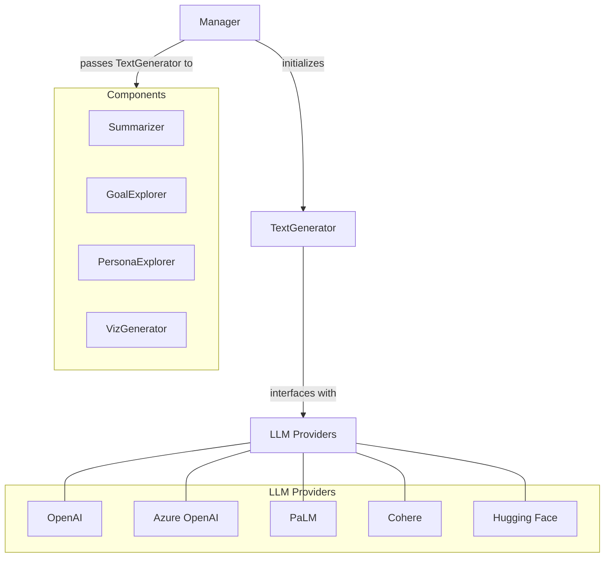

Sources: [lida/components/manager.py:29-38](), [lida/components/manager.py:52-70]()

For more details on LLM integration and configuration, see [LLM Integration](#5).

---

# Page: Visualization Components

# Visualization Components

<details>
<summary>Relevant source files</summary>

The following files were used as context for generating this wiki page:

- [lida/components/viz/vizeditor.py](lida/components/viz/vizeditor.py)
- [lida/components/viz/vizevaluator.py](lida/components/viz/vizevaluator.py)
- [lida/components/viz/vizexplainer.py](lida/components/viz/vizexplainer.py)
- [lida/components/viz/vizgenerator.py](lida/components/viz/vizgenerator.py)
- [lida/components/viz/vizrecommender.py](lida/components/viz/vizrecommender.py)

</details>


This document details the components responsible for visualization generation, editing, evaluation, and execution within the LIDA system. These components form the core visualization pipeline that transforms data summaries and goals into visualizations, provides explanations, and offers refinement capabilities.

For information about the Infographics Generation system, which builds upon visualizations, see [Infographics Generation](#2.3).

## Overview of Visualization Components

LIDA's visualization system is composed of multiple specialized components that work together to enable the complete visualization lifecycle. Each component is designed with a specific responsibility in the pipeline, from initial generation to evaluation and recommendation.

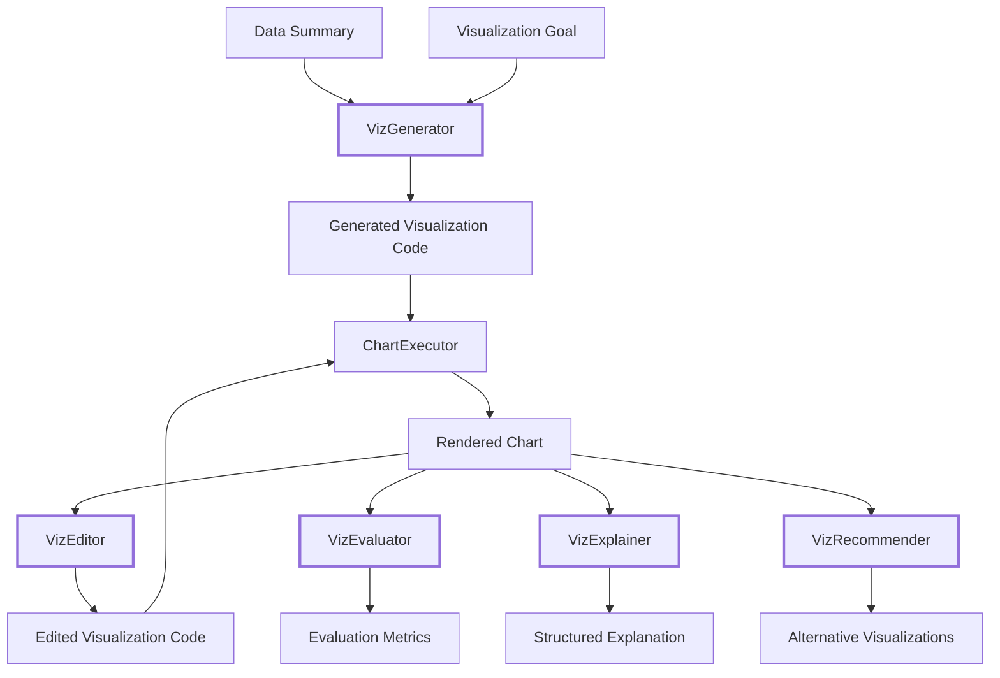

Sources: [lida/components/viz/vizgenerator.py](), [lida/components/viz/vizeditor.py](), [lida/components/viz/vizevaluator.py](), [lida/components/viz/vizexplainer.py](), [lida/components/viz/vizrecommender.py]()

## Visualization Component Architecture

The visualization components are implemented as Python classes that follow a common pattern. Each component:

1. Utilizes an LLM via the `TextGenerator` interface
2. Employs carefully crafted prompts to guide the LLM
3. Returns structured outputs for further processing

```mermaid
classDiagram
    class VizGenerator {
        +scaffold: ChartScaffold
        +generate(summary, goal, textgen_config, text_gen, library): string[]
    }
    
    class VizEditor {
        +scaffold: ChartScaffold
        +generate(code, summary, instructions, textgen_config, text_gen, library): string[]
    }
    
    class VizEvaluator {
        +generate(code, goal, textgen_config, text_gen, library): list
    }
    
    class VizExplainer {
        +scaffold: ChartScaffold
        +generate(code, textgen_config, text_gen, library): list
    }
    
    class VizRecommender {
        +scaffold: ChartScaffold
        +generate(code, summary, textgen_config, text_gen, n, library): string[]
    }
    
    class ChartScaffold {
        +get_template(goal, library): tuple
    }
    
    class TextGenerator {
        +generate(messages, config): TextGenerationResponse
    }
    
    VizGenerator --> ChartScaffold: uses
    VizEditor --> ChartScaffold: uses
    VizExplainer --> ChartScaffold: uses
    VizRecommender --> ChartScaffold: uses
    
    VizGenerator --> TextGenerator: uses
    VizEditor --> TextGenerator: uses
    VizEvaluator --> TextGenerator: uses
    VizExplainer --> TextGenerator: uses
    VizRecommender --> TextGenerator: uses
```

Sources: [lida/components/viz/vizgenerator.py:14-40](), [lida/components/viz/vizeditor.py:11-44](), [lida/components/viz/vizevaluator.py:28-58](), [lida/components/viz/vizexplainer.py:28-60](), [lida/components/viz/vizrecommender.py:41-86]()

## Core Visualization Components

### VizGenerator

The `VizGenerator` component creates visualization code based on a data summary and a visualization goal. It uses the `ChartScaffold` to get templates for different visualization libraries and generates code that follows best practices.

**Key Features:**
- Takes a data summary and goal as input
- Uses templates for different visualization libraries (like Altair or Seaborn)
- Produces full runnable Python code for visualizations

**Implementation:**
The `generate` method in `VizGenerator` constructs a prompt with the data summary, goal, and library-specific template, then uses the LLM to generate the visualization code.

Sources: [lida/components/viz/vizgenerator.py:14-40]()

### VizEditor

The `VizEditor` component modifies existing visualization code based on user instructions. It takes the current code, dataset summary, and a list of modification instructions as input.

**Key Features:**
- Takes existing code and modification instructions as input
- Applies changes while maintaining correct syntax and following best practices
- Outputs modified code that still follows the appropriate template structure

**Implementation:**
The `generate` method in `VizEditor` formats the instructions and passes them to the LLM along with the existing code and library template to produce modified code.

Sources: [lida/components/viz/vizeditor.py:11-44]()

### VizEvaluator

The `VizEvaluator` component assesses the quality of visualization code across multiple dimensions such as bugs, data transformation, goal compliance, visualization type, data encoding, and aesthetics.

**Key Features:**
- Evaluates visualizations on six dimensions
- Provides a numerical score (1-10) for each dimension
- Includes a detailed rationale for each score

**Evaluation Dimensions:**

| Dimension | Description |
|-----------|-------------|
| Bugs | Presence of bugs, logic errors, syntax errors, or typos |
| Transformation | Appropriate data transformation for the visualization type |
| Compliance | How well the code meets the specified visualization goals |
| Type | Appropriateness of the visualization type for the data and intent |
| Encoding | Appropriate data encoding for the visualization type |
| Aesthetics | Appropriateness of the visualization aesthetics |

**Implementation:**
The `generate` method in `VizEvaluator` prompts the LLM to assess the visualization code on each dimension and returns a structured JSON output with scores and rationales.

Sources: [lida/components/viz/vizevaluator.py:28-58]()

### VizExplainer

The `VizExplainer` component provides structured explanations of visualization code across three key dimensions: accessibility, transformation, and visualization.

**Key Features:**
- Divides code explanations into three sections
- Provides code-to-explanation mapping for each section
- Enhances understanding of the visualization's purpose and implementation

**Explanation Dimensions:**

| Section | Description |
|---------|-------------|
| Accessibility | Describes the physical appearance, goal, and main insights |
| Transformation | Explains data transformation aspects (filtering, aggregation, etc.) |
| Visualization | Provides step-by-step description of the visualization creation |

**Implementation:**
The `generate` method in `VizExplainer` prompts the LLM to provide explanations for each section and returns a structured JSON output.

Sources: [lida/components/viz/vizexplainer.py:28-60]()

### VizRecommender

The `VizRecommender` component suggests additional visualizations based on an existing visualization, the dataset summary, and visualization goals.

**Key Features:**
- Takes an existing visualization as a starting point
- Recommends alternative visualizations that provide different perspectives
- Considers different aggregations, chart types, and variables

**Implementation:**
The `generate` method in `VizRecommender` takes an existing code snippet and data summary, then prompts the LLM to generate multiple alternative visualization code snippets.

Sources: [lida/components/viz/vizrecommender.py:41-86]()

## Prompt-Driven Visualization Generation

Each visualization component utilizes carefully crafted system prompts to guide the LLM in generating appropriate outputs. These prompts define the task, output format, and best practices to follow.

**Example System Prompts:**

| Component | Prompt Focus |
|-----------|--------------|
| VizGenerator | Writing perfect visualization code following best practices |
| VizEditor | Modifying visualization code based on specific instructions |
| VizEvaluator | Evaluating visualization quality across multiple dimensions |
| VizExplainer | Providing structured explanations of visualization code |
| VizRecommender | Recommending diverse alternative visualizations |

The prompt design is critical to achieving high-quality outputs from the LLMs. For example, the VizGenerator's system prompt explicitly instructs the LLM to:
- Follow visualization best practices
- Apply correct transformations
- Use appropriate visualization types
- Ensure proper data encoding
- Maintain legible aesthetics

Sources: [lida/components/viz/vizgenerator.py:9-11](), [lida/components/viz/vizeditor.py:6-8](), [lida/components/viz/vizevaluator.py:8-25](), [lida/components/viz/vizexplainer.py:8-14](), [lida/components/viz/vizrecommender.py:10-35]()

## Integration with Visualization Libraries

The visualization components support multiple visualization libraries through the `ChartScaffold` system, which provides templates and instructions for each library.

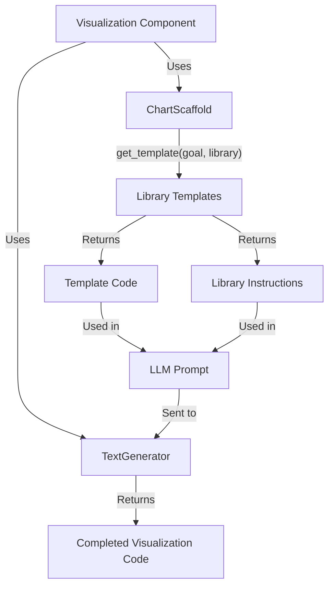

**Supported Libraries:**
- Altair (default for VizGenerator)
- Seaborn (default for VizRecommender)
- Others as supported by ChartScaffold

Each visualization component accepts a `library` parameter that determines which visualization library templates and instructions to use.

Sources: [lida/components/viz/vizgenerator.py:23-24](), [lida/components/viz/vizeditor.py:21-22](), [lida/components/viz/vizevaluator.py:36-37](), [lida/components/viz/vizexplainer.py:37-38](), [lida/components/viz/vizrecommender.py:54]()

## Visualization Generation Process

The typical flow for visualization generation and refinement involves multiple components working together:

1. **Initial Visualization Generation:**
   - `VizGenerator` creates visualization code based on data summary and goal
   - Code is executed through a `ChartExecutor` to produce the actual visualization

2. **Visualization Enhancement and Analysis:**
   - `VizExplainer` provides explanations of the generated visualization
   - `VizEvaluator` assesses visualization quality and identifies potential improvements
   - `VizEditor` applies specific modifications to the visualization code
   - `VizRecommender` suggests alternative visualizations

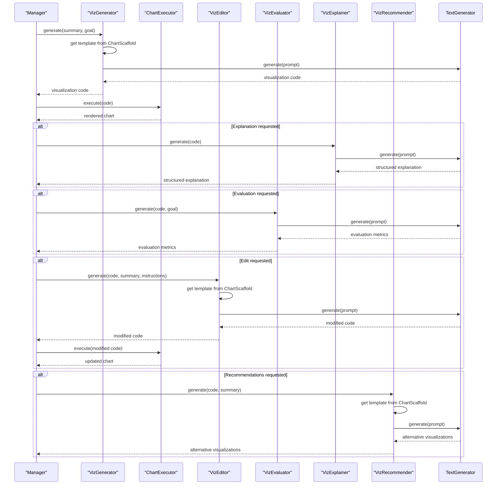

Sources: [lida/components/viz/vizgenerator.py](), [lida/components/viz/vizeditor.py](), [lida/components/viz/vizevaluator.py](), [lida/components/viz/vizexplainer.py](), [lida/components/viz/vizrecommender.py]()

## Summary

The visualization components in LIDA provide a comprehensive system for generating, editing, evaluating, explaining, and recommending data visualizations. These components:

1. Use LLMs to generate and manipulate visualization code
2. Support multiple visualization libraries through templating
3. Provide structured evaluation and explanation of visualizations
4. Offer recommendations for alternative visualization approaches

Together, these components enable a flexible and powerful visualization pipeline that supports the complete visualization lifecycle from initial generation to refinement and optimization.

---

# Page: Infographics Generation

# Infographics Generation

<details>
<summary>Relevant source files</summary>

The following files were used as context for generating this wiki page:

- [.dockerignore](.dockerignore)
- [CITATION.cff](CITATION.cff)
- [README.md](README.md)
- [docker-compose.yml](docker-compose.yml)
- [dockerfile](dockerfile)
- [lida/components/infographer.py](lida/components/infographer.py)
- [lida/version.py](lida/version.py)
- [notebooks/tutorial.ipynb](notebooks/tutorial.ipynb)

</details>


This document describes the Infographics Generation feature of LIDA, which transforms data visualizations into styled infographics using stable diffusion models. The infographics generation functionality is currently in beta.

## Overview

The Infographics Generation feature in LIDA allows users to take existing data visualizations and convert them into aesthetically styled infographics while preserving the data representation. This component uses stable diffusion models to stylize visualizations based on user-provided style prompts.

The feature is implemented through the `Infographer` class, which serves as a bridge between LIDA's visualization pipeline and image generation models from the `peacasso` library.

```mermaid
flowchart TD
    subgraph "Infographics Generation Process"
        vis["Visualization Image"] --> infographer["Infographer"]
        style["Style Prompt"] --> infographer
        infographer --> sd["Stable Diffusion Model"]
        sd --> output["Styled Infographics"]
    end
```

Sources: [lida/components/infographer.py:13-62](), [README.md:152-158]()

## Installation

The infographics generation feature requires additional dependencies beyond the base LIDA package. To install LIDA with infographics support:

```bash
pip install lida[infographics]
```

This installs the necessary dependencies including the `peacasso` library, which provides the stable diffusion models used for image generation.

Sources: [README.md:152-153](), [notebooks/tutorial.ipynb:90]()

## Architecture

The Infographics Generation component fits into the broader LIDA architecture as an optional extension to the visualization pipeline. The `Infographer` class is one of the specialized components orchestrated by the central `Manager` class.

```mermaid
classDiagram
    class Manager {
        +summarize()
        +goals()
        +personas()
        +visualize()
        +execute()
        +infographics()
    }
    
    class Infographer {
        +generate()
        -load_model()
    }
    
    class ImageGenerator {
        +generate()
    }
    
    Manager --> Infographer : uses
    Infographer --> ImageGenerator : uses
    
    note for Infographer "Converts visualizations\ninto infographics"
    note for ImageGenerator "From peacasso library"
```

In the data flow of LIDA, infographics generation is typically the final step after creating and executing visualization code:

```mermaid
flowchart LR
    subgraph "LIDA Pipeline"
        direction LR
        data["Input Data"] --> summary["Data Summarization"]
        summary --> goals["Goal Generation"]
        goals --> visualize["Visualization Generation"]
        visualize --> execute["Code Execution"]
        execute --> charts["Generated Charts"]
        charts --> infographics["Infographics Generation"]
    end
    
    style infographics stroke:bold
```

Sources: [lida/components/infographer.py:13-62]()

## Usage

The infographics generation feature can be accessed through the LIDA Python API via the `infographics()` method of the `Manager` class. Here is a basic example:

```python
from lida import Manager, llm

lida = Manager(text_gen=llm("openai"))
summary = lida.summarize("data/cars.csv")
goals = lida.goals(summary, n=2)
charts = lida.visualize(summary=summary, goal=goals[0])

# Generate infographics from the first chart
infographics = lida.infographics(visualization=charts[0].raster, n=3, style_prompt="line art")
```

The `infographics()` method takes the following parameters:

| Parameter | Type | Description |
|-----------|------|-------------|
| visualization | Image/str | The visualization to convert (raster image or base64 string) |
| n | int | Number of infographic variants to generate |
| style_prompt | str/List[str] | Style description for the infographic (e.g., "line art", "watercolor") |
| return_pil | bool | Whether to return PIL images (True) or base64 strings (False) |

Sources: [README.md:152-158](), [lida/components/infographer.py:28-62]()

## Implementation Details

### Infographer Class

The `Infographer` class is the main implementation of the infographics generation feature. It wraps around the `peacasso` library's `ImageGenerator` class to provide a simplified interface for LIDA users.

Key methods:
- `load_model()`: Loads the stable diffusion model 
- `generate()`: Generates infographics based on input visualization and style prompts

### Behind the Scenes

When generating infographics, the following process occurs:

1. The input visualization (either a PIL Image or base64 string) is converted to a format usable by the stable diffusion model
2. The model is loaded if it hasn't been already
3. Generation parameters are configured, including style prompt, image dimensions, and guidance scale
4. The stable diffusion model performs image-to-image transformation, preserving the essential visual elements while applying the requested style
5. The resulting images are returned either as PIL Image objects or base64 strings

```mermaid
sequenceDiagram
    participant User
    participant Manager
    participant Infographer
    participant ImageGenerator
    
    User->>Manager: infographics(visualization, style_prompt, n)
    Manager->>Infographer: generate(visualization, style_prompt, n)
    Infographer->>Infographer: load_model()
    Infographer->>ImageGenerator: generate(config)
    ImageGenerator-->>Infographer: result
    Infographer-->>Manager: styled images
    Manager-->>User: infographics
```

Sources: [lida/components/infographer.py:24-62]()

## Model Configuration

The infographics generation uses the Stable Diffusion v1.5 model by default. The model configuration can be customized when initializing the `Infographer` class:

```python
from lida import Manager, llm
from peacasso.datamodel import ModelConfig
from lida.components.infographer import Infographer

# Custom model configuration
model_config = ModelConfig(
    device="cuda",  # or "cpu" for machines without GPU
    model="runwayml/stable-diffusion-v1-5",
    revision="main"
)

# Initialize with custom infographer
infographer = Infographer(model_config=model_config)
lida = Manager(text_gen=llm("openai"), infographer=infographer)
```

The generation process can be customized through several parameters:

| Parameter | Default Value | Description |
|-----------|---------------|-------------|
| width | 512 | Width of generated images |
| height | 512 | Height of generated images |
| guidance_scale | 7.5 | Controls how closely the image follows the prompt |
| num_inference_steps | 50 | Number of denoising steps (more = higher quality but slower) |
| strength | 0.6 | How much to transform the original image (0-1) |
| negative_prompt | "text, background shapes..." | Elements to avoid in the generated image |

Sources: [lida/components/infographer.py:16-22](), [lida/components/infographer.py:44-57]()

## Limitations and Best Practices

The infographics generation feature has some limitations to be aware of:

1. It requires significant computational resources, especially GPU memory
2. The quality of the output depends on the input visualization and style prompt
3. Text from the original visualization may be distorted or removed in the generated infographics
4. It's currently in beta, so expect potential changes or improvements in future versions

Best practices for generating high-quality infographics:

- Use clear, high-contrast visualizations as input
- Experiment with different style prompts (e.g., "watercolor", "line art", "digital illustration")
- Generate multiple variants (using the `n` parameter) to choose from
- If using GPU, ensure you have sufficient VRAM (at least 4GB recommended)

Sources: [README.md:152-158](), [lida/components/infographer.py:44-57]()

## Integration with the Web UI

The infographics generation feature is also available through LIDA's web UI via the `/infographer` endpoint.

```mermaid
flowchart TD
    subgraph "Web UI"
        webUser["Web User"] --> webAPI["FastAPI Endpoints"]
        webAPI --> webInfographer["/infographer"]
    end
    
    webInfographer -.-> Manager
    
    subgraph "Core Functionality"
        Manager --> Infographer
    end
```

To use the web UI with infographics support, ensure you've installed the infographics dependencies:

```bash
pip install lida[infographics]
lida ui --port=8080 --docs
```

Then navigate to http://localhost:8080/ in your browser and use the infographics generation interface.

Sources: [README.md:152-158](), [docker-compose.yml:1-11](), [dockerfile:1-18]()

---

# Page: Python API

# Python API

<details>
<summary>Relevant source files</summary>

The following files were used as context for generating this wiki page:

- [.dockerignore](.dockerignore)
- [CITATION.cff](CITATION.cff)
- [README.md](README.md)
- [docker-compose.yml](docker-compose.yml)
- [dockerfile](dockerfile)
- [lida/components/manager.py](lida/components/manager.py)
- [lida/version.py](lida/version.py)
- [notebooks/tutorial.ipynb](notebooks/tutorial.ipynb)

</details>


This document provides comprehensive documentation for LIDA's Python API, which is the primary programmatic interface for interacting with LIDA's visualization generation capabilities. The Python API enables developers to integrate LIDA's functionality into their own applications and workflows.

For information about the Web UI, see [Web UI](#4).

## Installation and Setup

Before using the Python API, you need to install LIDA:

```bash
pip install -U lida
```

If you plan to use the infographics generation feature, install with:

```bash
pip install lida[infographics]
```

## Core Concepts

LIDA's Python API is structured around a central `Manager` class that orchestrates all visualization generation processes. The `Manager` class handles the following functionalities:

- Data summarization
- Goal generation
- Persona generation
- Visualization generation
- Visualization editing, explanation, evaluation, and repair
- Infographics generation

### API Architecture

The Python API interacts with various components coordinated by the `Manager` class:

```mermaid
graph TD
    User["User"] -->|"Uses"| Manager["Manager Class"]
    
    Manager -->|"Uses"| Summarizer["Summarizer"]
    Manager -->|"Uses"| GoalExplorer["GoalExplorer"]
    Manager -->|"Uses"| PersonaExplorer["PersonaExplorer"]
    Manager -->|"Uses"| VizGenerator["VizGenerator"]
    Manager -->|"Uses"| VizEditor["VizEditor"]
    Manager -->|"Uses"| ChartExecutor["ChartExecutor"]
    Manager -->|"Uses"| VizExplainer["VizExplainer"]
    Manager -->|"Uses"| VizEvaluator["VizEvaluator"]
    Manager -->|"Uses"| VizRepairer["VizRepairer"]
    Manager -->|"Uses"| VizRecommender["VizRecommender"]
    Manager -->|"Uses"| Infographer["Infographer"]
    
    TextGen["TextGenerator"] --> LLMProviders["LLM Providers"]
    
    Summarizer -->|"Uses"| TextGen
    GoalExplorer -->|"Uses"| TextGen
    PersonaExplorer -->|"Uses"| TextGen
    VizGenerator -->|"Uses"| TextGen
    VizEditor -->|"Uses"| TextGen
    VizExplainer -->|"Uses"| TextGen
    VizEvaluator -->|"Uses"| TextGen
    VizRepairer -->|"Uses"| TextGen
    VizRecommender -->|"Uses"| TextGen
    
    subgraph "LLM Providers"
        LLMProviders --> OpenAI["OpenAI"]
        LLMProviders --> Azure["Azure OpenAI"]
        LLMProviders --> PaLM["PaLM"]
        LLMProviders --> Cohere["Cohere"]
        LLMProviders --> HuggingFace["Hugging Face"]
    end
```

Sources: [lida/components/manager.py:27-51]()

## The Manager Class

The `Manager` class is the primary interface for interacting with LIDA. It coordinates all components and provides methods for each stage of the visualization pipeline.

### Initialization

```python
from lida import Manager, llm

# Initialize with default LLM provider (OpenAI)
lida = Manager()

# Initialize with specific LLM provider
lida = Manager(text_gen=llm("openai"))
```

Sources: [lida/components/manager.py:28-51]()

### Typical Workflow

The following diagram illustrates the typical workflow when using LIDA's Python API:

```mermaid
sequenceDiagram
    participant User
    participant Manager
    participant Summarizer
    participant GoalExplorer
    participant VizGenerator
    participant ChartExecutor
    
    User->>Manager: summarize(data)
    Manager->>Summarizer: summarize(data)
    Summarizer-->>Manager: summary
    Manager-->>User: summary
    
    User->>Manager: goals(summary)
    Manager->>GoalExplorer: generate(summary)
    GoalExplorer-->>Manager: goals
    Manager-->>User: goals
    
    User->>Manager: visualize(summary, goal)
    Manager->>VizGenerator: generate(summary, goal)
    VizGenerator-->>Manager: code_specs
    Manager->>ChartExecutor: execute(code_specs, data)
    ChartExecutor-->>Manager: charts
    Manager-->>User: charts
```

Sources: [lida/components/manager.py:72-134](), [lida/components/manager.py:135-178](), [lida/components/manager.py:188-212](), [lida/components/manager.py:214-238]()

## API Methods

### Data Summarization

The `summarize()` method generates a summary of a dataset, which includes statistical information and, optionally, enriched descriptions using an LLM.

```python
summary = lida.summarize(
    data="data/cars.csv",  # Path to data file or pandas DataFrame
    file_name="",          # Optional file name if data is a DataFrame
    n_samples=3,           # Number of samples to include in the summary
    summary_method="default",  # Summary method: "default" or "llm"
    textgen_config=TextGenerationConfig(n=1, temperature=0)  # LLM configuration
)
```

**Parameters:**
- `data`: A pandas DataFrame or path to a data file (CSV, JSON, etc.)
- `file_name`: Name of the file if data is loaded from a file path (optional)
- `n_samples`: Number of samples to include in the summary (default: 3)
- `summary_method`: Method for generating the summary, either "default" or "llm" (default: "default")
- `textgen_config`: Configuration for the text generation model

**Returns:**
- `Summary` object containing dataset information, column properties, and statistics

Sources: [lida/components/manager.py:72-134]()

### Goal Generation

The `goals()` method generates visualization goals based on a data summary.

```python
goals = lida.goals(
    summary=summary,  # Data summary from summarize()
    textgen_config=TextGenerationConfig(n=1, temperature=0.5),  # LLM configuration
    n=5,  # Number of goals to generate
    persona="data scientist exploring correlations"  # Optional persona
)
```

**Parameters:**
- `summary`: Summary object from `summarize()`
- `textgen_config`: Configuration for the text generation model
- `n`: Number of goals to generate (default: 5)
- `persona`: Optional persona information to guide goal generation

**Returns:**
- List of `Goal` objects, each containing a question, visualization type, and rationale

Sources: [lida/components/manager.py:135-178]()

### Persona Generation

The `personas()` method generates user personas relevant to the data.

```python
personas = lida.personas(
    summary=summary,  # Data summary from summarize()
    textgen_config=TextGenerationConfig(n=1, temperature=0.5),  # LLM configuration
    n=5  # Number of personas to generate
)
```

**Parameters:**
- `summary`: Summary object from `summarize()`
- `textgen_config`: Configuration for the text generation model
- `n`: Number of personas to generate (default: 5)

**Returns:**
- List of `Persona` objects

Sources: [lida/components/manager.py:180-186]()

### Visualization Generation

The `visualize()` method generates visualizations based on a data summary and goal.

```python
charts = lida.visualize(
    summary=summary,  # Data summary from summarize()
    goal=goals[0],    # Visualization goal from goals()
    textgen_config=TextGenerationConfig(n=1, temperature=0.2),  # LLM configuration
    library="seaborn",  # Visualization library to use
    return_error=False  # Whether to return error information
)
```

**Parameters:**
- `summary`: Summary object from `summarize()`
- `goal`: Goal object from `goals()` or dict/string representing a goal
- `textgen_config`: Configuration for the text generation model
- `library`: Visualization library to use (e.g., "matplotlib", "seaborn", "plotly")
- `return_error`: Whether to return error information (default: False)

**Returns:**
- List of generated chart objects, each containing code, raster image, and other metadata

Sources: [lida/components/manager.py:188-212]()

### Visualization Execution

The `execute()` method executes visualization code.

```python
charts = lida.execute(
    code_specs=code_specs,  # Code specifications
    data=data,              # Dataset
    summary=summary,        # Data summary
    library="seaborn",      # Visualization library
    return_error=False      # Whether to return error information
)
```

**Parameters:**
- `code_specs`: Visualization code specifications
- `data`: Dataset to use for visualization
- `summary`: Summary object from `summarize()`
- `library`: Visualization library to use
- `return_error`: Whether to return error information (default: False)

**Returns:**
- List of chart objects with executed visualizations

Sources: [lida/components/manager.py:214-238]()

### Visualization Editing

The `edit()` method modifies visualizations using natural language instructions.

```python
edited_charts = lida.edit(
    code=charts[0].code,    # Original visualization code
    summary=summary,        # Data summary
    instructions=["convert to bar chart", "change color to red"],  # Edit instructions
    textgen_config=TextGenerationConfig(n=1, temperature=0.2),  # LLM configuration
    library="matplotlib",   # Visualization library
    return_error=False      # Whether to return error information
)
```

**Parameters:**
- `code`: Original visualization code to edit
- `summary`: Summary object from `summarize()`
- `instructions`: List of natural language edit instructions
- `textgen_config`: Configuration for the text generation model
- `library`: Visualization library to use
- `return_error`: Whether to return error information (default: False)

**Returns:**
- List of chart objects with edited visualizations

Sources: [lida/components/manager.py:240-280]()

### Visualization Repair

The `repair()` method fixes visualization code based on feedback.

```python
repaired_charts = lida.repair(
    code=charts[0].code,    # Original visualization code
    goal=goals[0],          # Visualization goal
    summary=summary,        # Data summary
    feedback="The x-axis label is missing",  # Feedback for repair
    textgen_config=TextGenerationConfig(n=1, temperature=0.2),  # LLM configuration
    library="matplotlib",   # Visualization library
    return_error=False      # Whether to return error information
)
```

**Parameters:**
- `code`: Visualization code to repair
- `goal`: Goal object associated with the visualization
- `summary`: Summary object from `summarize()`
- `feedback`: Feedback describing issues to fix
- `textgen_config`: Configuration for the text generation model
- `library`: Visualization library to use
- `return_error`: Whether to return error information (default: False)

**Returns:**
- List of chart objects with repaired visualizations

Sources: [lida/components/manager.py:282-310]()

### Visualization Explanation

The `explain()` method generates explanations for visualization code.

```python
explanation = lida.explain(
    code=charts[0].code,    # Visualization code to explain
    textgen_config=TextGenerationConfig(n=1, temperature=0.2),  # LLM configuration
    library="matplotlib"    # Visualization library
)
```

**Parameters:**
- `code`: Visualization code to explain
- `textgen_config`: Configuration for the text generation model
- `library`: Visualization library used in the code

**Returns:**
- Explanation object with details about the visualization code

Sources: [lida/components/manager.py:312-333]()

### Visualization Evaluation

The `evaluate()` method evaluates visualization code against a goal.

```python
evaluation = lida.evaluate(
    code=charts[0].code,    # Visualization code to evaluate
    goal=goals[0],          # Visualization goal
    textgen_config=TextGenerationConfig(n=1, temperature=0.2),  # LLM configuration
    library="matplotlib"    # Visualization library
)
```

**Parameters:**
- `code`: Visualization code to evaluate
- `goal`: Goal object to evaluate against
- `textgen_config`: Configuration for the text generation model
- `library`: Visualization library used in the code

**Returns:**
- Evaluation object with assessment of how well the visualization meets the goal

Sources: [lida/components/manager.py:335-360]()

### Visualization Recommendation

The `recommend()` method generates alternative visualization recommendations.

```python
recommendations = lida.recommend(
    code=charts[0].code,    # Original visualization code
    summary=summary,        # Data summary
    n=4,                    # Number of recommendations to generate
    textgen_config=TextGenerationConfig(n=1, temperature=0.5),  # LLM configuration
    library="matplotlib",   # Visualization library
    return_error=False      # Whether to return error information
)
```

**Parameters:**
- `code`: Original visualization code
- `summary`: Summary object from `summarize()`
- `n`: Number of recommendations to generate (default: 4)
- `textgen_config`: Configuration for the text generation model
- `library`: Visualization library to use
- `return_error`: Whether to return error information (default: False)

**Returns:**
- List of chart objects with recommended visualizations

Sources: [lida/components/manager.py:362-398]()

### Infographics Generation

The `infographics()` method generates stylized infographics from visualizations.

```python
infographics = lida.infographics(
    visualization=charts[0].raster,  # Visualization image
    n=3,                             # Number of infographics to generate
    style_prompt="line art",         # Style prompt for the infographic
    return_pil=False                 # Whether to return PIL images
)
```

**Parameters:**
- `visualization`: Visualization image to convert to an infographic
- `n`: Number of infographics to generate (default: 1)
- `style_prompt`: Style prompt for the infographic generation
- `return_pil`: Whether to return PIL images (default: False)

**Returns:**
- List of generated infographic objects

Note: Requires installation of additional dependencies: `pip install lida[infographics]`

Sources: [lida/components/manager.py:400-430]()

## LLM Integration

LIDA supports multiple LLM providers, configured through the `llm` function from the `llmx` library.

### Supported LLM Providers

| Provider | Configuration Example |
|----------|------------------------|
| OpenAI | `lida = Manager(text_gen=llm("openai"))` |
| Azure OpenAI | `lida = Manager(text_gen=llm(provider="openai", api_type="azure", azure_endpoint=os.environ["AZURE_OPENAI_BASE"], api_key=os.environ["AZURE_OPENAI_API_KEY"], api_version="2023-07-01-preview"))` |
| PaLM | `lida = Manager(text_gen=llm("palm"))` |
| Cohere | `lida = Manager(text_gen=llm("cohere"))` |
| Hugging Face | `lida = Manager(text_gen=llm(provider="hf", model="uukuguy/speechless-llama2-hermes-orca-platypus-13b", device_map="auto"))` |

### API Key Configuration

LLM-specific API keys can be set as environment variables:

```bash
export OPENAI_API_KEY=<your key>
export COHERE_API_KEY=<your key>
# for PaLM
export PALM_SERVICE_ACCOUNT_KEY_FILE=<path to gcp service account key file>
export PALM_PROJECT_ID=<your gcp project id>
```

Sources: [notebooks/tutorial.ipynb:30-75]()

## Complete Workflow Example

This example demonstrates a typical workflow using LIDA's Python API:

```python
from lida import Manager, llm, TextGenerationConfig

# Initialize LIDA
lida = Manager(text_gen=llm("openai"))
textgen_config = TextGenerationConfig(n=1, temperature=0.5, model="gpt-3.5-turbo-0301", use_cache=True)

# Step 1: Summarize dataset
summary = lida.summarize("data/cars.csv", summary_method="default", textgen_config=textgen_config)

# Step 2: Generate goals
goals = lida.goals(summary, n=2, textgen_config=textgen_config)
# Optional: Generate goals with a specific persona
persona_goals = lida.goals(summary, n=2, 
                          persona="a mechanic who wants to buy a car that is cheap but has good gas mileage", 
                          textgen_config=textgen_config)

# Step 3: Generate visualizations
charts = lida.visualize(summary=summary, goal=goals[0], library="matplotlib", textgen_config=textgen_config)

# Step 4: Edit visualizations
instructions = ["convert to bar chart", "change color to red", "add title 'Car Analysis'"]
edited_charts = lida.edit(code=charts[0].code, summary=summary, instructions=instructions, 
                         textgen_config=textgen_config)

# Step 5: Explain visualization
explanation = lida.explain(code=charts[0].code, textgen_config=textgen_config)

# Step 6: Evaluate visualization
evaluation = lida.evaluate(code=charts[0].code, goal=goals[0], textgen_config=textgen_config)

# Step 7: Generate recommendations
recommendations = lida.recommend(code=charts[0].code, summary=summary, n=2, 
                                textgen_config=textgen_config)

# Step 8: Generate infographics (requires lida[infographics])
# infographics = lida.infographics(visualization=charts[0].raster, n=2, style_prompt="line art")
```

Sources: [notebooks/tutorial.ipynb:86-166](), [README.md:84-158]()

## Data Flow in the Python API

The following diagram shows how data flows through LIDA's Python API from input to visualization:

```mermaid
flowchart TD
    Data["Input Data<br>(CSV, JSON, DataFrame)"] --> Summarizer["summarize()"]
    Summarizer --> Summary["Data Summary"]
    
    Summary --> GoalGen["goals()"]
    Summary --> PersonaGen["personas()"]
    
    GoalGen --> Goals["Visualization Goals"]
    PersonaGen --> Personas["User Personas"]
    Personas -.-> GoalGen
    
    Summary --> VizGen["visualize()"]
    Goals --> VizGen
    
    VizGen --> CodeSpecs["Visualization Code"]
    CodeSpecs --> Executor["execute()"]
    Data --> Executor
    
    Executor --> Charts["Generated Charts"]
    
    Charts --> Editor["edit()"]
    Charts --> Explainer["explain()"]
    Charts --> Evaluator["evaluate()"]
    Charts --> Repairer["repair()"]
    Charts --> Recommender["recommend()"]
    Charts --> Infographer["infographics()"]
    
    Editor --> CodeSpecs2["Modified Code"]
    Repairer --> CodeSpecs3["Repaired Code"]
    Recommender --> CodeSpecs4["Alternative Code"]
    
    CodeSpecs2 --> Executor
    CodeSpecs3 --> Executor
    CodeSpecs4 --> Executor
    
    Explainer --> Explanation["Explanation"]
    Evaluator --> Evaluation["Evaluation"]
    Infographer --> Infographics["Infographics"]
```

Sources: [lida/components/manager.py:27-430]()

## Important Notes and Limitations

- LIDA generates and executes code based on provided input. Ensure that you run LIDA in a secure environment with appropriate permissions.
- LIDA currently works best with datasets that have a small number of columns (<= 10). This is mainly due to the limited context size for most models.
- Smaller LLMs (e.g., OSS LLMs on Huggingface) have limited instruction following capabilities and may not work well with LIDA. LIDA works best with larger LLMs (e.g., OpenAI GPT 3.5, GPT 4).
- For better performance, you can use caching by setting `use_cache=True` in the `TextGenerationConfig`.

Sources: [README.md:192-200](), [notebooks/tutorial.ipynb:74-81]()

---

# Page: Data Summarization API

# Data Summarization API

<details>
<summary>Relevant source files</summary>

The following files were used as context for generating this wiki page:

- [lida/__init__.py](lida/__init__.py)
- [lida/components/summarizer.py](lida/components/summarizer.py)
- [lida/utils.py](lida/utils.py)
- [lida/version.py](lida/version.py)
- [notebooks/tutorial.ipynb](notebooks/tutorial.ipynb)
- [tests/test_components.py](tests/test_components.py)

</details>


## Purpose and Scope

The Data Summarization API is a core component of the LIDA (Language-based Interactive Data Analytics) system that analyzes and summarizes datasets before visualization. This document explains how to use the API, the available summarization methods, and the structure of the generated summaries. This API serves as the first step in LIDA's visualization pipeline, providing the foundation for visualization goal generation and chart creation.

For information about generating visualization goals from a summary, see [Goal Generation API](#3.2).

## Overview

The Data Summarization API analyzes datasets to extract their structure, properties, and statistics, optionally enriching this information with natural language descriptions using Large Language Models (LLMs). The resulting summaries provide a comprehensive understanding of the dataset that serves as input for downstream visualization tasks.

```mermaid
flowchart TD
    A["Input Data (DataFrame/File Path)"] --> B["summarize()"]
    B --> C["Basic Summary Generation"]
    C --> D{"summary_method?"}
    
    D -->|"default"| E["Return Basic Summary"]
    D -->|"llm"| F["LLM Enrichment"]
    D -->|"columns"| G["Column Names Only"]
    
    F --> H["TextGenerator.generate()"]
    H --> I["Return Enriched Summary"]
    
    E --> J["Downstream Tasks (Goal Generation, Visualization)"]
    I --> J
    G --> J
    
    style C fill:#f9f9f9,stroke:#333,stroke-width:1px
    style F fill:#f9f9f9,stroke:#333,stroke-width:1px
```

Sources: [lida/components/summarizer.py:118-159]()

## Architecture and Components

The Data Summarization API is implemented by the `Summarizer` class and exposed through the `Manager.summarize()` method. This design allows for centralized control while separating the specific summarization logic.

```mermaid
classDiagram
    class Manager {
        +summarize(data, text_gen, ...)
    }
    
    class Summarizer {
        +summarize(data, text_gen, ...)
        +get_column_properties(df, n_samples)
        +enrich(base_summary, text_gen, textgen_config)
        -check_type(dtype, value)
    }
    
    class TextGenerator {
        +generate(messages, config)
    }
    
    Manager --> Summarizer : uses
    Summarizer --> TextGenerator : uses for enrichment
```

Sources: [lida/components/summarizer.py:21-159](), [lida/components/manager.py]()

## API Reference

### Manager.summarize()

The primary entry point for data summarization is the `Manager.summarize()` method:

```python
def summarize(
    self, data: Union[pd.DataFrame, str],
    text_gen: TextGenerator, file_name="", n_samples: int = 3,
    textgen_config=TextGenerationConfig(n=1),
    summary_method: str = "default", encoding: str = 'utf-8'
) -> dict:
    # ...
```

Sources: [lida/components/summarizer.py:118-159]()

#### Parameters

| Parameter | Type | Description |
|-----------|------|-------------|
| `data` | `pd.DataFrame` or `str` | DataFrame or path to a data file |
| `text_gen` | `TextGenerator` | Text generator for LLM enrichment |
| `file_name` | `str` | Optional name for the dataset (default: "") |
| `n_samples` | `int` | Number of sample values per column (default: 3) |
| `textgen_config` | `TextGenerationConfig` | Configuration for text generation |
| `summary_method` | `str` | Summarization method: "default", "llm", or "columns" |
| `encoding` | `str` | Character encoding for file reading (default: 'utf-8') |

Sources: [lida/components/summarizer.py:118-124]()

#### Summarization Methods

The API supports three summarization methods:

1. **default**: Generates a basic statistical summary without LLM enrichment
2. **llm**: Enriches the basic summary with LLM-generated descriptions of the dataset and columns
3. **columns**: Provides only column names without detailed properties

Sources: [lida/components/summarizer.py:140-154]()

## Summary Process

The summarization process follows these steps:

1. If `data` is a file path, read it into a DataFrame using appropriate functions
2. Extract column properties using `get_column_properties()`
3. Create a basic summary with structural information
4. If using "llm" method, enrich the summary with LLM-generated descriptions
5. Add column names to the summary
6. Return the summary dictionary

```mermaid
sequenceDiagram
    participant User
    participant Manager
    participant Summarizer
    participant TextGenerator
    
    User->>Manager: summarize(data, text_gen, ...)
    Manager->>Summarizer: summarize(data, text_gen, ...)
    
    alt data is file path
        Summarizer->>Summarizer: read_dataframe(data)
    end
    
    Summarizer->>Summarizer: get_column_properties(data)
    Summarizer->>Summarizer: Create base_summary
    
    alt summary_method is "llm"
        Summarizer->>TextGenerator: generate(messages)
        TextGenerator-->>Summarizer: response
        Summarizer->>Summarizer: Parse LLM response
    end
    
    Summarizer-->>Manager: data_summary
    Manager-->>User: data_summary
```

Sources: [lida/components/summarizer.py:118-159]()

## Column Property Extraction

The `get_column_properties()` method analyzes each column in a DataFrame to determine:

- Data type classification (`number`, `string`, `date`, `category`, `boolean`)
- Statistical information for numeric columns (`min`, `max`, `std`)
- Date range for date columns
- Sample values (controlled by `n_samples` parameter)
- Number of unique values

The method automatically detects date columns by attempting to convert string columns to datetime objects.

Sources: [lida/components/summarizer.py:34-91]()

## LLM Enrichment

When using the "llm" summary method, the `enrich()` method:

1. Sends the base summary to the LLM with a system prompt that guides the model to:
   - Generate a dataset name and description
   - Generate column descriptions
   - Identify semantic types for each column

2. Processes the LLM response to extract the enriched information

3. Handles errors if the LLM response cannot be parsed

Sources: [lida/components/summarizer.py:93-116]()

## Summary Output Structure

The output is a dictionary with the following structure:

```
{
  "name": "dataset_name",
  "file_name": "file_name.csv",
  "dataset_description": "Description of the dataset",
  "fields": [
    {
      "column": "column_name",
      "properties": {
        "dtype": "number|string|date|category|boolean",
        "min": minimum_value,         # for numeric and date columns
        "max": maximum_value,         # for numeric and date columns
        "std": standard_deviation,    # for numeric columns
        "samples": ["sample1", "sample2", "sample3"],
        "num_unique_values": count,
        "semantic_type": "semantic type of the column",
        "description": "Description of the column"
      }
    },
    # Additional columns...
  ],
  "field_names": ["column1", "column2", ...]
}
```

The `semantic_type` and `description` fields are populated only when using the "llm" method.

Sources: [lida/components/summarizer.py:133-157]()

## Usage Examples

### Basic Usage

```python
from lida import Manager, TextGenerationConfig, llm

# Initialize the Manager with a text generator
lida = Manager(text_gen=llm("openai"))

# Generate a basic summary
summary = lida.summarize("path/to/data.csv", summary_method="default")
```

### Enriched Summary with LLM

```python
from lida import Manager, TextGenerationConfig, llm

# Initialize with text generator
lida = Manager(text_gen=llm("openai"))

# Configure text generation
textgen_config = TextGenerationConfig(
    n=1, 
    temperature=0.5, 
    model="gpt-3.5-turbo",
    use_cache=True
)

# Generate an enriched summary
summary = lida.summarize(
    "https://raw.githubusercontent.com/uwdata/draco/master/data/cars.csv",
    textgen_config=textgen_config,
    summary_method="llm"
)
```

Sources: [notebooks/tutorial.ipynb:155-156]()

### With Different LLM Providers

The API supports multiple LLM backends:

```python
# OpenAI
text_gen = llm("openai")

# Azure OpenAI
text_gen = llm(
    provider="openai",
    api_type="azure",
    azure_endpoint=os.environ["AZURE_OPENAI_BASE"],
    api_key=os.environ["AZURE_OPENAI_API_KEY"],
    api_version="2023-07-01-preview"
)

# Cohere
text_gen = llm("cohere")

# PaLM
text_gen = llm("palm")

# Hugging Face
text_gen = llm(
    provider="hf", 
    model="uukuguy/speechless-llama2-hermes-orca-platypus-13b", 
    device_map="auto"
)
```

Sources: [notebooks/tutorial.ipynb:40-48]()

## Performance Considerations

1. **Large Datasets**: For datasets with more than 4500 rows, the system automatically samples down to 4500 rows to improve performance.

2. **Caching**: Use `use_cache=True` in `TextGenerationConfig` to cache LLM requests for faster repeated execution.

3. **Column Names**: The API automatically cleans column names to ensure they are valid Python identifiers, replacing special characters with underscores.

4. **Error Handling**: The API may raise `ValueError` if the LLM returns invalid JSON during enrichment. Consider using try/except blocks to handle these errors.

Sources: [lida/utils.py:45-104](), [notebooks/tutorial.ipynb:77-79]()

## Implementation Details

The Data Summarization API leverages several utility functions from the `lida.utils` module:

- `read_dataframe()`: Reads data from various file formats (CSV, JSON, Excel, Parquet, Feather, TSV)
- `clean_column_names()`: Sanitizes column names by replacing special characters with underscores
- `clean_code_snippet()`: Extracts code from text that may contain Markdown formatting

Sources: [lida/utils.py:23-227]()

---

# Page: Goal Generation API

# Goal Generation API

<details>
<summary>Relevant source files</summary>

The following files were used as context for generating this wiki page:

- [lida/components/goal.py](lida/components/goal.py)
- [lida/components/persona.py](lida/components/persona.py)
- [lida/version.py](lida/version.py)
- [notebooks/tutorial.ipynb](notebooks/tutorial.ipynb)

</details>


The Goal Generation API in LIDA provides functionality to automatically generate visualization goals based on data summaries. A goal is a structured recommendation for what kind of visualization might be insightful for a given dataset, including a specific question to answer, a visualization type, and a rationale. This page documents how to use the Goal Explorer component, which leverages LLMs to generate these visualization goals.

For information about creating visualizations based on these goals, see [Visualization API](#3.3). For summarizing data before generating goals, see [Data Summarization API](#3.1).

## Overview

The Goal Generation API takes a data summary as input and generates meaningful visualization goals that can be used to guide the creation of visualizations. Each goal includes:

- A **question** to be answered
- A **visualization** type recommendation
- A **rationale** explaining why this visualization would be useful

The API can also incorporate user **personas** to tailor goals to specific stakeholder needs and interests.

```mermaid
graph TD
    DataSummary["Data Summary"] --> GoalExplorer["GoalExplorer"]
    Persona["Optional Persona"] --> GoalExplorer
    GoalExplorer --> Goals["Visualization Goals"]
    TextGenerator["Text Generation Model"] --- GoalExplorer
    
    subgraph "Goal Generation API"
        GoalExplorer
        Goals
    end
    
    style GoalExplorer fill:#f9f,stroke:#333,stroke-width:2px
```

*Diagram: Goal Generation API components and data flow*

Sources: [lida/components/goal.py:25-65](), [notebooks/tutorial.ipynb:154-162]()

## Core Components

### GoalExplorer

The `GoalExplorer` class is the main component responsible for generating visualization goals. It takes a data summary, constructs a prompt for a large language model, and parses the response into structured goal objects.

```mermaid
classDiagram
    class GoalExplorer {
        +generate(summary, textgen_config, text_gen, n, persona) list[Goal]
    }
    
    class Goal {
        +question: str
        +visualization: str
        +rationale: str
        +index: int
    }
    
    class TextGenerationConfig {
        +n: int
        +temperature: float
        +model: str
        +use_cache: bool
    }
    
    class TextGenerator {
        +generate(messages, config) Result
    }
    
    GoalExplorer ..> Goal : creates
    GoalExplorer ..> TextGenerator : uses
    GoalExplorer ..> TextGenerationConfig : uses
```

*Diagram: GoalExplorer class and its relationships*

Sources: [lida/components/goal.py:25-65]()

### PersonaExplorer

The `PersonaExplorer` class generates user personas that can be used to tailor goals to specific stakeholder needs. Personas help contextualize visualization goals for different audiences.

```mermaid
classDiagram
    class PersonaExplorer {
        +generate(summary, textgen_config, text_gen, n) list[Persona]
    }
    
    class Persona {
        +persona: str
        +rationale: str
    }
    
    PersonaExplorer ..> Persona : creates
```

*Diagram: PersonaExplorer class and its relationships*

Sources: [lida/components/persona.py:17-52]()

## API Usage

### Basic Usage

The Goal Generation API is primarily accessed through the `Manager` class, which provides a high-level interface to LIDA's functionality:

```python
# First get a data summary
summary = lida.summarize("data.csv", summary_method="default", textgen_config=textgen_config)

# Generate goals based on the summary
goals = lida.goals(summary, n=2, textgen_config=textgen_config)

# Display the generated goals
for goal in goals:
    display(goal)
```

Each generated goal contains:
- A **question** to be answered by the visualization
- A **visualization** type that specifies what type of chart to create and which columns to use
- A **rationale** explaining why this visualization is useful

Sources: [notebooks/tutorial.ipynb:154-163]()

### Using with Personas

You can also generate goals tailored to specific personas:

```python
# Define a persona
persona = "a mechanic who wants to buy a car that is cheap but has good gas mileage"

# Generate goals based on the persona
personal_goals = lida.goals(summary, n=2, persona=persona, textgen_config=textgen_config)

# Display the persona-specific goals
for goal in personal_goals:
    display(goal)
```

Persona-based goals focus on aspects of the data that would be most relevant to the specified persona.

Sources: [notebooks/tutorial.ipynb:210-215]()

## Goal Generation Process

The following sequence diagram illustrates the goal generation process:

```mermaid
sequenceDiagram
    participant User
    participant Manager
    participant GoalExplorer
    participant TextGenerator
    
    User->>Manager: goals(summary, n, persona, textgen_config)
    Manager->>GoalExplorer: generate(summary, textgen_config, text_gen, n, persona)
    
    alt No persona provided
        GoalExplorer->>GoalExplorer: Create default persona
    end
    
    GoalExplorer->>GoalExplorer: Construct prompt
    GoalExplorer->>TextGenerator: generate(messages, config)
    TextGenerator-->>GoalExplorer: LLM response
    GoalExplorer->>GoalExplorer: Parse JSON to Goal objects
    GoalExplorer-->>Manager: list[Goal]
    Manager-->>User: goals
```

*Diagram: Sequence of goal generation process*

Sources: [lida/components/goal.py:31-65]()

## Implementation Details

### Goal Format

Each goal is a structured object with the following properties:

| Property | Description |
|----------|-------------|
| question | A question about the data that the visualization aims to answer |
| visualization | A description of the visualization type and which columns to use |
| rationale | An explanation of why this visualization is useful and what insights it might provide |
| index | A numeric identifier for the goal |

### Prompt Engineering

The `GoalExplorer` uses carefully crafted prompts to guide the LLM:

1. **System Instructions**: Directs the LLM to act as an experienced data analyst and follow visualization best practices
2. **User Prompt**: Contains the data summary, number of goals to generate, and optional persona information
3. **Format Instructions**: Specifies that the output should be a valid JSON list of goal objects

Sources: [lida/components/goal.py:8-20]()

### Error Handling

The implementation includes error handling for JSON parsing failures. If the LLM doesn't return a valid JSON response, it raises a `ValueError` with a helpful message suggesting using a larger model or increasing the max token length.

Sources: [lida/components/goal.py:53-65]()

## Integration with Other Components

The Goal Generation API is part of LIDA's end-to-end visualization generation pipeline:

```mermaid
flowchart TD
    Data["Input Data"]
    Summary["Data Summary"]
    Goals["Visualization Goals"]
    Visualization["Visualization Specs"]
    Charts["Generated Charts"]
    
    Data -->|summarize()| Summary
    Summary -->|goals()| Goals
    Goals -->|visualize()| Visualization
    Visualization -->|execute()| Charts
    
    style Summary fill:#f9f,stroke:#333,stroke-width:2px
    style Goals fill:#f9f,stroke:#333,stroke-width:2px
```

*Diagram: Goal Generation in LIDA's Pipeline*

Sources: High-Level System Architecture diagrams

## Practical Examples

### Example Goal Output

```
Question: What is the relationship between engine size and horsepower?

Visualization: scatter plot of Engine_Size__l_ vs Horsepower_HP_

Rationale: This visualization will help us understand if there is a correlation between engine size and horsepower. By plotting the two variables against each other, we can see if there is a positive or negative correlation, and how strong it is. This information will be useful for understanding the performance of different cars and for making decisions about engine size and horsepower in future car models.
```

### Example Persona-based Goal

```
Question: What is the relationship between Retail Price and City Miles Per Gallon for cars?

Visualization: scatter plot of Retail Price vs City Miles Per Gallon

Rationale: This visualization will help the mechanic identify which cars are both cheap and have good gas mileage. By plotting the Retail Price against the City Miles Per Gallon, we can see if there is a trend in the data that shows which cars offer the best value for money.
```

Sources: [notebooks/tutorial.ipynb:112-163](), [notebooks/tutorial.ipynb:171-216]()

## Configuration Options

The Goal Generation API accepts several configuration parameters:

| Parameter | Description | Default |
|-----------|-------------|---------|
| summary | The data summary to use as input | Required |
| n | Number of goals to generate | 5 |
| persona | A description of the target user | None (uses default) |
| textgen_config | Configuration for the text generation model | Required |

The `textgen_config` parameter allows configuration of the underlying LLM, including:
- `n`: Number of completions to generate
- `temperature`: Controls randomness (higher = more creative)
- `model`: The specific LLM to use
- `use_cache`: Whether to cache results for faster repeated runs

Sources: [lida/components/goal.py:31-37](), [notebooks/tutorial.ipynb:156]()

## Best Practices

1. **Start with a good summary**: The quality of goals depends on the quality of the data summary
2. **Use specific personas**: More specific personas lead to more focused and relevant goals
3. **Generate multiple goals**: Request more goals than needed to get a variety of perspectives
4. **Adjust temperature**: Higher temperature (0.7-0.9) for more creative goals, lower (0.2-0.5) for more consistent ones
5. **Enable caching**: Set `use_cache=True` in `textgen_config` to speed up development and avoid hitting API limits

---

# Page: Visualization API

# Visualization API

<details>
<summary>Relevant source files</summary>

The following files were used as context for generating this wiki page:

- [lida/components/viz/vizeditor.py](lida/components/viz/vizeditor.py)
- [lida/components/viz/vizevaluator.py](lida/components/viz/vizevaluator.py)
- [lida/components/viz/vizexplainer.py](lida/components/viz/vizexplainer.py)
- [lida/components/viz/vizgenerator.py](lida/components/viz/vizgenerator.py)
- [lida/components/viz/vizrecommender.py](lida/components/viz/vizrecommender.py)
- [lida/version.py](lida/version.py)
- [notebooks/tutorial.ipynb](notebooks/tutorial.ipynb)

</details>


This document provides a comprehensive guide to LIDA's Visualization API, which enables users to generate, edit, evaluate, explain, and recommend data visualizations using Large Language Models (LLMs). The API is part of LIDA's Python interface for creating data visualizations and infographics.

For information about generating visualization goals, see [Goal Generation API](#3.2). For data summarization capabilities, see [Data Summarization API](#3.1).

## Overview

The Visualization API provides methods for the complete visualization lifecycle, from initial generation to refinement and evaluation. These capabilities are exposed through the central `Manager` class, which serves as the orchestrator for all visualization operations.

```mermaid
flowchart TD
    subgraph "Visualization API Components"
        VizGenerator["VizGenerator"]
        VizEditor["VizEditor"]
        VizEvaluator["VizEvaluator"]
        VizExplainer["VizExplainer"]
        VizRecommender["VizRecommender"]
    end
    
    subgraph "Dependencies"
        TextGenerator["TextGenerator"]
        ChartScaffold["ChartScaffold"]
    end
    
    subgraph "Input/Output"
        Summary["Data Summary"]
        Goals["Visualization Goals"]
        Code["Visualization Code"]
        Instructions["Edit Instructions"]
        ModifiedCode["Modified Code"]
        Evaluations["Evaluation Results"]
        Explanations["Explanations"]
        Recommendations["Recommended Visualizations"]
    end
    
    Summary --> VizGenerator
    Goals --> VizGenerator
    VizGenerator --> Code
    
    Code --> VizEditor
    Summary --> VizEditor
    Instructions --> VizEditor
    VizEditor --> ModifiedCode
    
    Code --> VizEvaluator
    Goals --> VizEvaluator
    VizEvaluator --> Evaluations
    
    Code --> VizExplainer
    VizExplainer --> Explanations
    
    Code --> VizRecommender
    Summary --> VizRecommender
    VizRecommender --> Recommendations
    
    VizGenerator --> TextGenerator
    VizEditor --> TextGenerator
    VizEvaluator --> TextGenerator
    VizExplainer --> TextGenerator
    VizRecommender --> TextGenerator
    
    VizGenerator --> ChartScaffold
    VizEditor --> ChartScaffold
    VizRecommender --> ChartScaffold
```

Sources: [lida/components/viz/vizgenerator.py](), [lida/components/viz/vizeditor.py](), [lida/components/viz/vizevaluator.py](), [lida/components/viz/vizexplainer.py](), [lida/components/viz/vizrecommender.py]()

## Core Components

The Visualization API consists of five main components that each handle different aspects of the visualization process:

### VizGenerator

`VizGenerator` transforms natural language goals into executable visualization code. It uses templates specific to visualization libraries (like Matplotlib, Seaborn, or Altair) and leverages LLMs to complete these templates based on the dataset summary and visualization goal.

```mermaid
sequenceDiagram
    participant Manager
    participant VizGenerator
    participant ChartScaffold
    participant TextGenerator
    
    Manager->>VizGenerator: generate(summary, goal, ...)
    VizGenerator->>ChartScaffold: get_template(goal, library)
    ChartScaffold-->>VizGenerator: template, instructions
    VizGenerator->>TextGenerator: generate(messages)
    Note right of TextGenerator: Includes prompts with dataset summary, goal, template
    TextGenerator-->>VizGenerator: completed code
    VizGenerator-->>Manager: visualization code
```

Sources: [lida/components/viz/vizgenerator.py:23-40]()

### VizEditor

`VizEditor` modifies existing visualization code based on natural language instructions. This allows for iterative refinement of visualizations without requiring manual code editing.

```mermaid
sequenceDiagram
    participant Manager
    participant VizEditor
    participant ChartScaffold
    participant TextGenerator
    
    Manager->>VizEditor: generate(code, summary, instructions, ...)
    VizEditor->>ChartScaffold: get_template(goal, library)
    ChartScaffold-->>VizEditor: template, instructions
    VizEditor->>TextGenerator: generate(messages)
    Note right of TextGenerator: Includes existing code, edit instructions
    TextGenerator-->>VizEditor: modified code
    VizEditor-->>Manager: edited visualization
```

Sources: [lida/components/viz/vizeditor.py:19-44]()

### VizEvaluator

`VizEvaluator` assesses visualization code quality across multiple dimensions, providing structured feedback on aspects like bugs, data transformation, goal compliance, visualization type, data encoding, and aesthetics.

```mermaid
sequenceDiagram
    participant Manager
    participant VizEvaluator
    participant TextGenerator
    
    Manager->>VizEvaluator: generate(code, goal, ...)
    VizEvaluator->>TextGenerator: generate(messages)
    Note right of TextGenerator: Includes code and evaluation criteria
    TextGenerator-->>VizEvaluator: evaluation results as JSON
    VizEvaluator-->>Manager: structured evaluation
```

Sources: [lida/components/viz/vizevaluator.py:36-58]()

### VizExplainer

`VizExplainer` provides explanations for visualization code by breaking it down into sections (accessibility, transformation, visualization) and explaining each section in natural language.

```mermaid
sequenceDiagram
    participant Manager
    participant VizExplainer
    participant TextGenerator
    
    Manager->>VizExplainer: generate(code, ...)
    VizExplainer->>TextGenerator: generate(messages)
    Note right of TextGenerator: Contains code to be explained
    TextGenerator-->>VizExplainer: structured explanation as JSON
    VizExplainer-->>Manager: visualization explanation
```

Sources: [lida/components/viz/vizexplainer.py:36-60]()

### VizRecommender

`VizRecommender` suggests alternative visualizations based on an existing visualization, dataset summary, and goals, enabling exploration of different visualization approaches.

```mermaid
sequenceDiagram
    participant Manager
    participant VizRecommender
    participant ChartScaffold
    participant TextGenerator
    
    Manager->>VizRecommender: generate(code, summary, ...)
    VizRecommender->>ChartScaffold: get_template(goal, library)
    ChartScaffold-->>VizRecommender: template, instructions
    VizRecommender->>TextGenerator: generate(messages)
    Note right of TextGenerator: Includes existing code, dataset summary
    TextGenerator-->>VizRecommender: recommended visualizations
    VizRecommender-->>Manager: alternative visualization options
```

Sources: [lida/components/viz/vizrecommender.py:49-86]()

## API Methods

The Visualization API is exposed through the `Manager` class, which provides the following key methods:

### visualize()

Generates visualization code based on a dataset summary and a goal.

```python
def visualize(self, summary, goal, library='altair', textgen_config=None):
    """
    Generates a visualization based on a summary and a goal.
    
    Parameters:
    - summary: Data summary object or string
    - goal: Goal object with question, visualization, and rationale
    - library: Visualization library to use (default: 'altair')
    - textgen_config: Configuration for text generation
    
    Returns:
    - List of visualization code strings
    """
```

### edit()

Modifies existing visualization code based on natural language instructions.

```python
def edit(self, code, summary, instructions, library='altair', textgen_config=None):
    """
    Edits a visualization based on instructions.
    
    Parameters:
    - code: Existing visualization code
    - summary: Data summary object or string
    - instructions: List of edit instructions in natural language
    - library: Visualization library to use (default: 'altair')
    - textgen_config: Configuration for text generation
    
    Returns:
    - List of modified visualization code strings
    """
```

### evaluate()

Evaluates the quality of a visualization across multiple dimensions.

```python
def evaluate(self, code, goal, library='altair', textgen_config=None):
    """
    Evaluates a visualization against a goal.
    
    Parameters:
    - code: Visualization code to evaluate
    - goal: Goal object with question, visualization, and rationale
    - library: Visualization library used (default: 'altair')
    - textgen_config: Configuration for text generation
    
    Returns:
    - List of evaluation results as dictionaries
    """
```

### explain()

Provides explanations for visualization code.

```python
def explain(self, code, library='altair', textgen_config=None):
    """
    Explains a visualization code.
    
    Parameters:
    - code: Visualization code to explain
    - library: Visualization library used (default: 'altair')
    - textgen_config: Configuration for text generation
    
    Returns:
    - List of explanation sections as dictionaries
    """
```

### recommend()

Suggests alternative visualizations based on an existing visualization.

```python
def recommend(self, code, summary, n=3, library='altair', textgen_config=None):
    """
    Recommends alternative visualizations.
    
    Parameters:
    - code: Existing visualization code
    - summary: Data summary object or string
    - n: Number of recommendations to generate (default: 3)
    - library: Visualization library to use (default: 'altair')
    - textgen_config: Configuration for text generation
    
    Returns:
    - List of recommended visualization code strings
    """
```

## Usage Examples

Below are examples demonstrating how to use the Visualization API with the LIDA Manager:

### Basic Visualization Generation

```python
from lida import Manager, TextGenerationConfig, llm

# Initialize LIDA with your preferred LLM provider
lida = Manager(text_gen=llm("openai"))

# Generate a summary of the dataset
summary = lida.summarize("https://raw.githubusercontent.com/mwaskom/seaborn-data/master/tips.csv")

# Generate visualization goals
goals = lida.goals(summary, n=2)

# Configure text generation
textgen_config = TextGenerationConfig(n=1, temperature=0.2)

# Generate a visualization using the first goal
visualizations = lida.visualize(summary, goals[0], library="seaborn", textgen_config=textgen_config)

# The first visualization code
visualization_code = visualizations[0]
```

### Editing a Visualization

```python
# Edit the visualization with specific instructions
instructions = [
    "Change the color palette to blues",
    "Add a title 'Restaurant Tips Analysis'",
    "Show data points as small circles"
]

edited_visualizations = lida.edit(
    visualization_code, 
    summary, 
    instructions, 
    library="seaborn", 
    textgen_config=textgen_config
)

edited_code = edited_visualizations[0]
```

### Evaluating a Visualization

```python
# Evaluate the visualization against the original goal
evaluations = lida.evaluate(
    visualization_code, 
    goals[0], 
    library="seaborn", 
    textgen_config=textgen_config
)

# Example evaluation structure:
# [
#   {"dimension": "bugs", "score": 9, "rationale": "The code is free of bugs..."},
#   {"dimension": "transformation", "score": 8, "rationale": "The data is appropriately..."},
#   ...
# ]
```

### Explaining a Visualization

```python
# Get an explanation of the visualization code
explanations = lida.explain(
    visualization_code, 
    library="seaborn", 
    textgen_config=textgen_config
)

# Example explanation structure:
# [
#   {"section": "accessibility", "code": "None", "explanation": "This visualization is a scatter plot..."},
#   {"section": "transformation", "code": "...", "explanation": "The code filters the dataset..."},
#   {"section": "visualization", "code": "...", "explanation": "The plot is created using seaborn's..."}
# ]
```

### Recommending Alternative Visualizations

```python
# Get recommendations for alternative visualizations
recommendations = lida.recommend(
    visualization_code, 
    summary, 
    n=2, 
    library="seaborn", 
    textgen_config=textgen_config
)

# First recommended alternative
alternative_viz = recommendations[0]
```

## Customization

The Visualization API can be customized in several ways:

### Visualization Libraries

LIDA supports multiple visualization libraries:

| Library | Description | Default |
|---------|-------------|---------|
| `altair` | Declarative visualization based on Vega-Lite | ✓ |
| `matplotlib` | Comprehensive plotting library | |
| `seaborn` | Statistical data visualization based on matplotlib | |
| `plotly` | Interactive, browser-based visualizations | |

You can specify which library to use in the API methods:

```python
viz = lida.visualize(summary, goals[0], library='seaborn', textgen_config=textgen_config)
```

### Text Generation Configuration

You can configure the LLM text generation process by passing a `TextGenerationConfig` object:

```python
from lida import TextGenerationConfig

textgen_config = TextGenerationConfig(
    n=1,                      # Number of completions to generate
    temperature=0.2,          # Lower = more deterministic
    model="gpt-3.5-turbo",    # LLM model to use
    use_cache=True            # Enable caching to avoid redundant API calls
)

viz = lida.visualize(summary, goals[0], textgen_config=textgen_config)
```

## Best Practices

For effective use of the Visualization API:

1. **Start with a quality data summary**: A comprehensive data summary improves visualization accuracy. Use `lida.summarize()` with `summary_method="llm"` for enhanced summaries.

2. **Generate specific goals**: Clear, specific visualization goals lead to better visualizations. Use `lida.goals()` to generate visualization goals that address specific questions.

3. **Iterate with edits**: Rather than regenerating visualizations from scratch, use `lida.edit()` to refine existing visualizations with natural language instructions.

4. **Validate with evaluation**: Use `lida.evaluate()` to assess visualization quality across multiple dimensions and identify areas for improvement.

5. **Explore alternatives**: Use `lida.recommend()` to explore different visualization approaches for the same data and goal.

6. **Understand the code**: Use `lida.explain()` to get detailed explanations of visualization code to understand how it works and how to modify it.

7. **Control temperature**: For more consistent results, use a lower temperature (0.1-0.3). For more creative visualizations, use a higher temperature (0.7-0.9).

8. **Enable caching**: Set `use_cache=True` in your `TextGenerationConfig` to avoid redundant API calls when using the same inputs.

Sources: [notebooks/tutorial.ipynb:1-215]()

## Visualization Process Flow

The complete visualization process in LIDA typically follows this sequence:

```mermaid
flowchart TD
    Start["Start"] --> SummarizeData["Summarize Data\nlida.summarize()"]
    SummarizeData --> GenerateGoals["Generate Goals\nlida.goals()"]
    GenerateGoals --> GenerateViz["Generate Visualization\nlida.visualize()"]
    
    GenerateViz --> EvaluateViz["Evaluate Visualization\nlida.evaluate()"]
    GenerateViz --> ExplainViz["Explain Visualization\nlida.explain()"]
    GenerateViz --> EditViz["Edit Visualization\nlida.edit()"]
    GenerateViz --> RecommendViz["Recommend Alternatives\nlida.recommend()"]
    
    EditViz --> ExecuteCode["Execute Code to\nRender Visualization"]
    EvaluateViz --> ImproveViz["Identify Improvements"]
    ImproveViz --> EditViz
    
    ExplainViz --> UnderstandViz["Understand Visualization Logic"]
    RecommendViz --> ExploreAlternatives["Explore Alternative\nVisualization Approaches"]
    
    ExecuteCode --> FinalViz["Final Visualization"]
```

Sources: [notebooks/tutorial.ipynb:103-163]()

---

# Page: Web UI

# Web UI

<details>
<summary>Relevant source files</summary>

The following files were used as context for generating this wiki page:

- [.dockerignore](.dockerignore)
- [CITATION.cff](CITATION.cff)
- [README.md](README.md)
- [docker-compose.yml](docker-compose.yml)
- [dockerfile](dockerfile)
- [lida/cli.py](lida/cli.py)
- [lida/datamodel.py](lida/datamodel.py)
- [lida/web/app.py](lida/web/app.py)

</details>


The Web UI is a user interface and API layer that provides access to LIDA's data visualization and infographics generation capabilities. It offers both a graphical interface for interactive use and a REST API for programmatic integration. This page documents the architecture, components, and usage of the Web UI system.

For information about the Python API, see [Python API](#3).

## Architecture

The LIDA Web UI consists of a FastAPI backend that serves both API endpoints and a static frontend interface. The Web UI layer integrates with the core LIDA components and provides a user-friendly interface for performing operations such as data summarization, goal generation, visualization creation, and infographics generation.

### Web UI in LIDA System Context

```mermaid
graph TD
    User["User/Client"] -->|Uses| WebUI["Web UI"]
    
    WebUI -->|REST Endpoints| FastAPI["FastAPI App (app.py)"]
    FastAPI -->|Uses| Manager["Manager"]
    
    Manager -->|Uses| LLMs["LLM Providers"]
    Manager -->|Orchestrates| Components["Components"]
    
    subgraph "Components"
        Summarizer["Summarizer"]
        GoalExplorer["GoalExplorer"]
        VizGenerator["VizGenerator"]
        VizEditor["VizEditor"]
        ChartExecutor["ChartExecutor"]
        Infographer["Infographer"]
    end
    
    Components -->|Generates| Outputs["Outputs"]
```

Sources: [lida/web/app.py:1-32](), [README.md:66-77]()

### Web UI Components

```mermaid
graph TD
    User["User/Client"] -->|Uses| WebUI["Web UI"]
    
    WebUI -->|REST Endpoints| FastAPI["FastAPI App (app.py)"]
    
    FastAPI -->|Serves| StaticFiles["Static Files (ui folder)"]
    FastAPI -->|Defines| Endpoints["API Endpoints"]
    
    Endpoints -->|Uses| LIDAManager["LIDA Manager"]
    
    subgraph "API Endpoints"
        Summarize["/api/summarize"]
        Goal["/api/goal"]
        Visualize["/api/visualize"]
        Edit["/api/visualize/edit"]
        Repair["/api/visualize/repair"]
        Explain["/api/visualize/explain"]
        Evaluate["/api/visualize/evaluate"]
        Recommend["/api/visualize/recommend"]
        Infographer["/api/infographer"]
        Models["/api/models"]
    end
```

Sources: [lida/web/app.py:31-46](), [lida/web/app.py:51-310]()

## Request Flow

The following sequence diagram illustrates how requests flow through the Web UI system:

```mermaid
sequenceDiagram
    participant User as "User"
    participant WebUI as "Web UI (Frontend)"
    participant FastAPI as "FastAPI Backend"
    participant Manager as "LIDA Manager"
    participant Components as "LIDA Components"
    
    User->>WebUI: Makes request
    WebUI->>FastAPI: Forwards to API endpoint
    FastAPI->>Manager: Calls Manager method
    Manager->>Components: Uses appropriate Component
    Components->>Manager: Returns result
    Manager->>FastAPI: Returns response
    FastAPI->>WebUI: Returns formatted response
    WebUI->>User: Displays result
```

Sources: [lida/web/app.py:51-310]()

## Data Models

The Web UI uses a set of data models defined in `datamodel.py` to structure requests and responses. These models utilize Pydantic for validation and serialization.

```mermaid
classDiagram
    class Summary {
        +name: str
        +file_name: str
        +dataset_description: str
        +field_names: List
        +fields: List
    }
    
    class Goal {
        +question: str
        +visualization: str
        +rationale: str
        +index: int
    }
    
    class ChartExecutorResponse {
        +spec: Optional[Union[str, Dict]]
        +status: bool
        +raster: Optional[str]
        +code: str
        +library: str
        +error: Optional[Dict]
    }
    
    class GoalWebRequest {
        +summary: Summary
        +textgen_config: TextGenerationConfig
        +n: int
    }
    
    class VisualizeWebRequest {
        +summary: Summary
        +goal: Goal
        +library: str
        +textgen_config: TextGenerationConfig
    }
    
    GoalWebRequest --> Summary
    VisualizeWebRequest --> Summary
    VisualizeWebRequest --> Goal
```

Sources: [lida/datamodel.py:10-235]()

## API Endpoints

The Web UI exposes the following REST API endpoints:

| Endpoint | Method | Description |
|----------|--------|-------------|
| `/api/summarize` | POST | Upload a file and get a summary of the data |
| `/api/goal` | POST | Generate visualization goals based on a dataset summary |
| `/api/visualize` | POST | Generate visualizations based on a dataset summary and a goal |
| `/api/visualize/edit` | POST | Edit a visualization using natural language instructions |
| `/api/visualize/repair` | POST | Repair a visualization based on feedback |
| `/api/visualize/explain` | POST | Get an explanation of a visualization |
| `/api/visualize/evaluate` | POST | Evaluate a visualization based on a goal |
| `/api/visualize/recommend` | POST | Get visualization recommendations |
| `/api/text/generate` | POST | Generate text using the configured LLM |
| `/api/models` | GET | List supported LLM models |
| `/api/infographer` | POST | Generate infographics from a visualization |

Sources: [lida/web/app.py:51-310]()

### Key Endpoint Details

#### `/api/summarize`

Uploads a file and returns a summary of the dataset.

**Request:**
- File upload (CSV, Excel, or JSON)

**Response:**
```json
{
  "status": true,
  "summary": {
    "name": "Cars Dataset",
    "file_name": "cars.csv",
    "dataset_description": "...",
    "field_names": ["mpg", "cylinders", "displacement", "..."],
    "fields": ["Numeric, average 23.4", "Numeric, 4-8", "..."]
  },
  "data_filename": "cars.csv"
}
```

Sources: [lida/web/app.py:227-257]()

#### `/api/goal`

Generates visualization goals based on a dataset summary.

**Request Body:**
```json
{
  "summary": {
    "name": "Cars Dataset",
    "file_name": "cars.csv",
    "dataset_description": "...",
    "field_names": ["mpg", "cylinders", "displacement", "..."],
    "fields": ["Numeric, average 23.4", "Numeric, 4-8", "..."]
  },
  "n": 5,
  "textgen_config": {
    "temperature": 0.7
  }
}
```

**Response:**
```json
{
  "status": true,
  "data": [
    {
      "question": "What is the relationship between MPG and horsepower?",
      "visualization": "Scatter plot",
      "rationale": "To understand how fuel efficiency is affected by engine power",
      "index": 0
    },
    "..."
  ],
  "message": "Successfully generated 5 goals"
}
```

Sources: [lida/web/app.py:203-224]()

#### `/api/visualize`

Generates visualizations based on a dataset summary and goal.

**Request Body:**
```json
{
  "summary": {...},
  "goal": {
    "question": "What is the relationship between MPG and horsepower?",
    "visualization": "Scatter plot",
    "rationale": "To understand how fuel efficiency is affected by engine power",
    "index": 0
  },
  "library": "seaborn",
  "textgen_config": {
    "temperature": 0.7
  }
}
```

**Response:**
```json
{
  "status": true,
  "charts": [
    {
      "spec": null,
      "status": true,
      "raster": "base64_encoded_image",
      "code": "import seaborn as sns\nimport matplotlib.pyplot as plt\n...",
      "library": "seaborn",
      "error": null
    }
  ],
  "message": "Successfully generated charts."
}
```

Sources: [lida/web/app.py:51-70]()

## Running the Web UI

### Via CLI

LIDA includes a CLI command for launching the Web UI:

```bash
lida ui --port=8080 --docs
```

Parameters:
- `--host`: Host to run the server on (default: 127.0.0.1)
- `--port`: Port to run the server on (default: 8081)
- `--workers`: Number of worker processes (default: 1)
- `--reload`: Enable auto-reload during development (default: True)
- `--docs`: Enable API documentation at `/api/docs` (default: False)

Sources: [lida/cli.py:12-30](), [README.md:66-77]()

### Via Docker

You can also run the Web UI using Docker:

```bash
docker compose up
```

This builds and starts a Docker container running the Web UI on port 8080.

Sources: [docker-compose.yml:1-11](), [dockerfile:1-18](), [README.md:78-85]()

## API Usage Examples

### Example: Summarizing a Dataset

```python
import requests

# Upload a dataset
with open('data/cars.csv', 'rb') as f:
    response = requests.post('http://localhost:8080/api/summarize', files={'file': f})

summary = response.json()['summary']
```

### Example: Generating Visualization Goals

```python
import requests

# Generate visualization goals
response = requests.post('http://localhost:8080/api/goal', json={
    'summary': summary,
    'n': 5
})

goals = response.json()['data']
```

### Example: Generating Visualizations

```python
import requests

# Generate visualizations
response = requests.post('http://localhost:8080/api/visualize', json={
    'summary': summary,
    'goal': goals[0],
    'library': 'seaborn'
})

charts = response.json()['charts']
```

## Web UI Workflow

The typical workflow for using the Web UI involves:

1. Uploading a dataset to get a summary
2. Generating visualization goals based on the summary
3. Creating visualizations based on selected goals
4. Optionally editing, repairing, or enhancing visualizations
5. Optionally creating infographics from visualizations

This workflow mirrors the programmatic workflow available in the Python API but provides a user-friendly interface for non-programmers.

Sources: [README.md:66-77](), [lida/web/app.py:51-310]()

---

# Page: LLM Integration

# LLM Integration

<details>
<summary>Relevant source files</summary>

The following files were used as context for generating this wiki page:

- [.dockerignore](.dockerignore)
- [CITATION.cff](CITATION.cff)
- [README.md](README.md)
- [docker-compose.yml](docker-compose.yml)
- [dockerfile](dockerfile)
- [lida/version.py](lida/version.py)
- [notebooks/tutorial.ipynb](notebooks/tutorial.ipynb)
- [pyproject.toml](pyproject.toml)

</details>


This document explains how LIDA integrates with different Large Language Model (LLM) providers and how to configure them for use with the system. LIDA's architecture is designed to work with multiple LLM backends, allowing flexibility in choosing which provider to use for text generation tasks that power visualization and infographics creation.

## Overview of LLM Integration

LIDA uses the `llmx` library as an abstraction layer for communicating with various LLM providers. This design allows LIDA to remain provider-agnostic, supporting commercial APIs like OpenAI and Azure OpenAI as well as locally-hosted open-source models.

```mermaid
flowchart TD
    subgraph "LIDA System"
        Manager["Manager"]
        TextGenerator["llmx.TextGenerator"]
    end
    
    subgraph "LLM Providers"
        OpenAI["OpenAI"]
        Azure["Azure OpenAI"]
        PaLM["PaLM"]
        Cohere["Cohere"]
        HF["Hugging Face"]
        Custom["Custom/Local Models"]
    end
    
    Manager -->|"Uses"| TextGenerator
    TextGenerator -->|"Interfaces with"| OpenAI
    TextGenerator -->|"Interfaces with"| Azure
    TextGenerator -->|"Interfaces with"| PaLM
    TextGenerator -->|"Interfaces with"| Cohere
    TextGenerator -->|"Interfaces with"| HF
    TextGenerator -->|"Interfaces with"| Custom
```

Sources: [README.md:36-38](), [notebooks/tutorial.ipynb:40-47]()

## Supported LLM Providers

LIDA currently supports the following LLM providers:

| Provider      | Description                                    | API Key Environment Variable |
|---------------|------------------------------------------------|------------------------------|
| OpenAI        | Default provider using GPT models              | `OPENAI_API_KEY`             |
| Azure OpenAI  | Microsoft's Azure-hosted OpenAI models         | `AZURE_OPENAI_API_KEY`       |
| PaLM          | Google's PaLM models                           | `PALM_SERVICE_ACCOUNT_KEY_FILE` and `PALM_PROJECT_ID` |
| Cohere        | Cohere's language models                       | `COHERE_API_KEY`             |
| Hugging Face  | Open-source models from Hugging Face           | Varies by model              |

Sources: [README.md:61-62](), [notebooks/tutorial.ipynb:52-60]()

## LLM Integration Architecture

The following diagram illustrates how LIDA components interact with LLM providers:

```mermaid
sequenceDiagram
    participant User
    participant Manager as "Manager"
    participant TextGen as "llmx.TextGenerator"
    participant LLMProvider as "LLM Provider API"
    
    User->>Manager: Create with text_gen parameter
    Manager->>TextGen: Initialize
    User->>Manager: Call method (e.g., summarize, goals)
    Manager->>Manager: Create prompt
    Manager->>TextGen: generate(prompt, config)
    TextGen->>LLMProvider: API call
    LLMProvider-->>TextGen: Response
    TextGen-->>Manager: Processed text
    Manager-->>User: Method result
```

The `Manager` class serves as the central orchestrator that coordinates interactions with the LLM providers through the `TextGenerator` interface from the `llmx` library. This architecture allows LIDA to remain flexible with respect to which LLM provider is used.

Sources: [README.md:36-42](), [notebooks/tutorial.ipynb:31-47]()

## Basic LLM Configuration

### Initializing with Default Provider (OpenAI)

The simplest way to initialize LIDA with an LLM provider is:

```python
from lida import Manager, llm

# Initialize with OpenAI (default)
lida = Manager(text_gen=llm("openai"))
```

Before running this code, you need to set your OpenAI API key as an environment variable:

```bash
export OPENAI_API_KEY=<your key>
```

Sources: [README.md:61-62](), [notebooks/tutorial.ipynb:155]()

## Configuring Different LLM Providers

### Azure OpenAI

```python
from lida import Manager, llm
import os

text_gen = llm(
    provider="openai",
    api_type="azure",
    azure_endpoint=os.environ["AZURE_OPENAI_BASE"],
    api_key=os.environ["AZURE_OPENAI_API_KEY"],
    api_version="2023-07-01-preview"
)
lida = Manager(text_gen=text_gen)
```

Environment variables required:
- `AZURE_OPENAI_BASE`: Your Azure OpenAI endpoint
- `AZURE_OPENAI_API_KEY`: Your Azure OpenAI API key

Sources: [notebooks/tutorial.ipynb:64-72]()

### Cohere

```python
from lida import Manager, llm

text_gen = llm("cohere")
lida = Manager(text_gen=text_gen)
```

Environment variable required:
- `COHERE_API_KEY`: Your Cohere API key

Sources: [notebooks/tutorial.ipynb:43-44]()

### PaLM (Google)

```python
from lida import Manager, llm

text_gen = llm("palm")
lida = Manager(text_gen=text_gen)
```

Environment variables required:
- `PALM_SERVICE_ACCOUNT_KEY_FILE`: Path to your GCP service account key file
- `PALM_PROJECT_ID`: Your GCP project ID

Sources: [notebooks/tutorial.ipynb:45-57]()

## Using Local LLMs

LIDA supports two main approaches for using locally-hosted models:

```mermaid
flowchart TD
    subgraph "Local LLM Integration Options"
        HFDirect["Direct HuggingFace\nModels Integration"]
        OpenAICompat["OpenAI-Compatible\nEndpoint (e.g., vLLM)"]
    end
    
    LIDA["LIDA Manager"] -->|"Option 1"| HFDirect
    LIDA -->|"Option 2"| OpenAICompat
    
    HFDirect -->|"Loads model\ndirectly in memory"| GPU["GPU Resource"]
    OpenAICompat -->|"Connects to\nlocal server"| Server["Local LLM Server"]
    Server -->|"Uses"| GPU
```

### Option 1: Using Hugging Face Models Directly

This method loads the model directly into memory, requiring sufficient GPU resources:

```python
from lida import Manager
from llmx import llm

# Note: Requires pip install lida[transformers]
text_gen = llm(
    provider="hf", 
    model="uukuguy/speechless-llama2-hermes-orca-platypus-13b", 
    device_map="auto"
)
lida = Manager(text_gen=text_gen)
```

Sources: [README.md:160-177](), [notebooks/tutorial.ipynb:46]()

### Option 2: Using OpenAI-Compatible Endpoint

This method connects to a server running locally (e.g., using vLLM) that exposes an OpenAI-compatible API:

```python
from lida import Manager, TextGenerationConfig, llm

model_name = "uukuguy/speechless-llama2-hermes-orca-platypus-13b"
model_details = [{'name': model_name, 'max_tokens': 2596, 'model': {'provider': 'openai', 'parameters': {'model': model_name}}}]

# Assuming your vLLM endpoint is running on localhost:8000
text_gen = llm(
    provider="openai", 
    api_base="http://localhost:8000/v1", 
    api_key="EMPTY", 
    models=model_details
)
lida = Manager(text_gen=text_gen)
```

Sources: [README.md:182-189]()

## Advanced LLM Configuration

### Text Generation Configuration

LIDA allows you to configure the text generation process using the `TextGenerationConfig` class:

```python
from lida import TextGenerationConfig

textgen_config = TextGenerationConfig(
    n=1,                      # Number of completions
    temperature=0.5,          # Controls randomness (0-1)
    model="gpt-3.5-turbo",    # Specific model to use
    use_cache=True            # Enable caching of responses
)

# Use in any LIDA method
summary = lida.summarize("data.csv", textgen_config=textgen_config)
```

This configuration can be passed to any LIDA method that interacts with LLMs.

Sources: [notebooks/tutorial.ipynb:156]()

### Model Selection and Parameters

When initializing the text generator, you can specify which model to use:

```python
from lida import llm

# OpenAI with specific model
text_gen = llm("openai", model="gpt-4")

# PaLM with specific model
text_gen = llm("palm", model="text-bison")

# Cohere with specific model
text_gen = llm("cohere", model="command")
```

### Caching LLM Responses

To improve performance and reduce API costs, LIDA supports caching of LLM responses:

```python
from lida import TextGenerationConfig

# Enable caching
textgen_config = TextGenerationConfig(use_cache=True)

# Use config in LIDA methods
summary = lida.summarize("data.csv", textgen_config=textgen_config)
```

Sources: [notebooks/tutorial.ipynb:79-80]()

## Using LIDA with Docker

If you're using LIDA with Docker, you can pass LLM API keys as environment variables when starting the container:

```bash
docker compose up
```

The Docker setup automatically uses the `OPENAI_API_KEY` environment variable from your host system.

Sources: [README.md:80-84](), [docker-compose.yml:10-11](), [Dockerfile:1-18]()

## Installation Requirements

LIDA depends on `llmx` for LLM integration. When installing LIDA, make sure you have the required dependencies:

```bash
pip install -U lida
pip install -U llmx openai
```

For using Hugging Face models directly, install the transformers extra:

```bash
pip install lida[transformers]
```

Sources: [README.md:49-56](), [pyproject.toml:20-42]()

## Troubleshooting

### API Key Issues

If you encounter authentication errors:
1. Verify your API key is correctly set in the environment variables
2. Check that your API key has the necessary permissions
3. Ensure you're using the correct environment variable name for your provider

### Model Compatibility

Not all models from a provider may be compatible with LIDA's prompts. If you encounter issues:
1. Start with recommended models (e.g., GPT-3.5-Turbo for OpenAI)
2. For open-source models, prefer larger models with good instruction-following capabilities
3. If a model produces incorrect output, try adjusting the temperature (higher for more creativity, lower for more deterministic outputs)

### Performance Considerations

- Smaller open-source models may struggle with LIDA's complex prompts
- For production use, consider implementing a caching strategy to reduce API calls
- Monitor token usage when using commercial providers to manage costs

## Limitations

- Smaller LLMs (e.g., some open-source models on Hugging Face) have limited instruction-following capabilities and may not work well with LIDA
- LIDA works best with larger LLMs like OpenAI GPT-3.5 and GPT-4
- Local models require substantial GPU resources depending on the model size

Sources: [README.md:196-197]()

---

# Page: Installation and Setup

# Installation and Setup

<details>
<summary>Relevant source files</summary>

The following files were used as context for generating this wiki page:

- [.dockerignore](.dockerignore)
- [CITATION.cff](CITATION.cff)
- [README.md](README.md)
- [SUPPORT.md](SUPPORT.md)
- [docker-compose.yml](docker-compose.yml)
- [dockerfile](dockerfile)
- [pyproject.toml](pyproject.toml)
- [requirements.txt](requirements.txt)

</details>


This page provides comprehensive instructions for installing and configuring LIDA (Language-based Interactive Data Analytics), a library for generating data visualizations and infographics powered by Large Language Models. For information about using the Python API once installed, see [Python API](#3), and for information about the Web UI, see [Web UI](#4).

## System Requirements

Before installing LIDA, ensure your environment meets the following requirements:

- **Python**: 3.9 or higher (3.10+ recommended)
- **Operating System**: Cross-platform (Windows, macOS, Linux)
- **Dependencies**: Basic Python package management tools (pip)
- **API Keys**: Access to at least one supported LLM provider (OpenAI, Azure OpenAI, PaLM, Cohere, or Hugging Face)

Sources: [README.md:44-46](), [pyproject.toml:13]()

## Installation Options

LIDA offers multiple installation methods depending on your requirements and environment:

```mermaid
flowchart TD
    Start["Installation Options"]
    Pip["Standard Installation\nvia pip"]
    Dev["Development Installation\nfrom source"]
    Docker["Docker\nContainerized Setup"]
    Verify["Verify Installation"]
    
    Start --> Pip
    Start --> Dev
    Start --> Docker
    
    Pip --> |"pip install -U lida"| Verify
    Dev --> |"1. Clone repo\n2. pip install -e ."| Verify
    Docker --> |"docker compose up"| Verify
```

### Standard Installation (pip)

The recommended installation method is using pip:

```bash
pip install -U lida
```

For optimal performance, ensure related packages are up-to-date:

```bash
pip install -U llmx openai
```

Optional features can be installed with:

```bash
# For infographics support
pip install lida[infographics]

# For web UI support
pip install lida[web]

# For transformers support (local models)
pip install lida[transformers]

# For geographic visualization tools
pip install lida[tools]
```

Sources: [README.md:47-52](), [pyproject.toml:20-42]()

### Development Installation

For contributing to LIDA or customizing the source code:

```bash
# Clone the repository
git clone https://github.com/microsoft/lida.git

# Navigate to repository root
cd lida

# Install in development mode
pip install -e .
```

Sources: [README.md:64]()

### Docker Installation

LIDA can be run in a containerized environment using Docker:

1. Ensure Docker and Docker Compose are installed on your system
2. Create a docker-compose.yml file with the provided configuration
3. Run the following command:

```bash
docker compose up
```

This will build and start a container exposing the LIDA web UI on port 8080.

Sources: [README.md:78-84](), [dockerfile:1-18](), [docker-compose.yml:1-11]()

## LLM Configuration

LIDA requires configuration for at least one LLM provider to function. The setup varies by provider:

```mermaid
classDiagram
    class "TextGenerator" {
        +generate()
    }
    
    class "LLM Providers" {
        OpenAI
        Azure OpenAI
        PaLM
        Cohere
        Hugging Face
    }
    
    class "Manager" {
        +text_gen: TextGenerator
        +summarize()
        +goals()
        +visualize()
        +execute()
    }
    
    "Manager" --> "TextGenerator" : uses
    "TextGenerator" --> "LLM Providers" : implements
```

### OpenAI Setup

Set your OpenAI API key as an environment variable:

```bash
export OPENAI_API_KEY=<your key>
```

In your Python code:

```python
from lida import Manager, llm
lida = Manager(text_gen=llm("openai"))
```

### Azure OpenAI Setup

For Azure OpenAI:

```bash
export AZURE_OPENAI_API_KEY=<your key>
export AZURE_OPENAI_ENDPOINT=<your endpoint>
```

In your Python code:

```python
from lida import Manager, llm
lida = Manager(text_gen=llm("azure"))
```

### Local Models (Hugging Face)

For using locally hosted models:

```python
from lida import Manager, llm
text_gen = llm(provider="hf", model="uukuguy/speechless-llama2-hermes-orca-platypus-13b", device_map="auto")
lida = Manager(text_gen=text_gen)
```

Sources: [README.md:57-62](), [README.md:160-190]()

## Verifying Installation

To verify that LIDA is correctly installed and configured:

1. Start the web UI:

```bash
lida ui --port=8080 --docs
```

2. Navigate to http://localhost:8080/ in your browser
3. The API documentation can be accessed at http://localhost:8080/api/docs

Alternatively, run a simple LIDA operation in Python:

```python
from lida import Manager, llm
lida = Manager(text_gen=llm("openai"))  # Replace with your configured provider
summary = lida.summarize("path/to/your/data.csv")
print(summary)
```

Sources: [README.md:66-76]()

## Dependencies

LIDA relies on the following key dependencies:

| Category | Packages |
|----------|----------|
| **Core** | llmx, pydantic, uvicorn, typer, fastapi, python-multipart |
| **Data Processing** | pandas, numpy, scipy |
| **Visualization** | matplotlib, altair, seaborn, plotly, plotnine, networkx, geopandas, matplotlib-venn, wordcloud |
| **Optional** | peacasso (for infographics), geopy, basemap, basemap-data-hires (for geographic tools) |

Sources: [pyproject.toml:20-42]()

## Security Considerations

LIDA generates and executes code to create visualizations. Ensure that:

1. You run LIDA in a secure environment with appropriate permissions
2. You understand and trust the data sources being used
3. You review generated code before execution in production environments

Sources: [README.md:15-17](), [README.md:192-196]()

## Troubleshooting

Common installation issues and their solutions:

### Python Version Compatibility

If you encounter errors related to Python version:

```bash
# Check your Python version
python --version

# Install or upgrade Python if needed (platform-specific)
```

### Package Conflicts

For dependency conflicts:

```bash
# Create a clean virtual environment
python -m venv lida_env
source lida_env/bin/activate  # On Windows: lida_env\Scripts\activate

# Install LIDA in the clean environment
pip install -U lida
```

### API Key Issues

If experiencing authentication errors:

1. Verify your API key is correct and has the necessary permissions
2. Check that the environment variable is properly set
3. For persistent environment variables, add them to your shell profile (.bashrc, .zshrc, etc.)

For additional support, refer to the [project's GitHub issues](https://github.com/microsoft/lida/issues) or open a new issue following the guidelines in the SUPPORT.md file.

Sources: [SUPPORT.md:1-14]()

---

# Page: Tutorials and Examples

# Tutorials and Examples

<details>
<summary>Relevant source files</summary>

The following files were used as context for generating this wiki page:

- [.dockerignore](.dockerignore)
- [CITATION.cff](CITATION.cff)
- [README.md](README.md)
- [docker-compose.yml](docker-compose.yml)
- [dockerfile](dockerfile)
- [lida/version.py](lida/version.py)
- [notebooks/tutorial.ipynb](notebooks/tutorial.ipynb)

</details>


This page provides practical tutorials and examples for using LIDA (Language-based Interactive Data Analytics). It includes step-by-step guides for common workflows, code examples for using different LIDA features, and demonstrations of practical applications. For information about LIDA's architecture and components, see [Architecture](#2), and for detailed API documentation, see [Python API](#3).

## 1. Getting Started

Before working through these tutorials, ensure you have installed LIDA and have set up the necessary API keys for the LLM provider you plan to use.

### 1.1 Installing LIDA

LIDA requires Python 3.10 or higher. Install the library using pip:

```bash
pip install -U lida
```

For infographics support, install the additional dependencies:

```bash
pip install lida[infographics]
```

For using LIDA with local Hugging Face models, install the transformers dependencies:

```bash
pip install lida[transformers]
```

Sources: [README.md:44-56](https://github.com/microsoft/lida/blob/main/README.md), [notebooks/tutorial.ipynb:12-23]()

### 1.2 Setting Up API Keys

Set up your API keys for the desired LLM provider:

```bash
# For OpenAI
export OPENAI_API_KEY=<your key>

# For Cohere
export COHERE_API_KEY=<your key>

# For PaLM
export PALM_SERVICE_ACCOUNT_KEY_FILE=<path to gcp service account key file>
export PALM_PROJECT_ID=<your gcp project id>
```

Sources: [notebooks/tutorial.ipynb:52-59](), [README.md:58-62]()

## 2. Basic LIDA Workflow

This section covers the fundamental workflow for using LIDA to generate visualizations.

### 2.1 Workflow Overview

```mermaid
flowchart TD
    A["1. Initialize LIDA Manager"] --> B["2. Summarize Dataset"]
    B --> C["3. Generate Visualization Goals"]
    C --> D["4. Create Visualizations"]
    D --> E["5. Optional: Edit/Explain/Evaluate"]
    
    style A stroke-width:2px
    style B stroke-width:2px
    style C stroke-width:2px
    style D stroke-width:2px
    style E stroke-width:2px
```

Sources: [README.md:20-33](), [notebooks/tutorial.ipynb:31-34]()

### 2.2 Initializing the LIDA Manager

The first step is to create a Manager instance with a configured LLM provider:

```python
from lida import Manager, llm

# Initialize with OpenAI
lida = Manager(text_gen = llm("openai"))

# Or with another provider (Cohere, PaLM, etc.)
lida = Manager(text_gen = llm("cohere"))
```

Sources: [README.md:36-38](), [notebooks/tutorial.ipynb:38-48]()

### 2.3 Summarizing Data

Data summarization creates a compact representation of your dataset:

```python
# Load data from a URL, CSV, or JSON file
summary = lida.summarize("data/cars.csv")

# Optionally, use LLM to enrich the summary
summary = lida.summarize("data/cars.csv", summary_method="llm")
```

LIDA supports two summarization methods:
- `default`: Generates basic statistics without using LLM
- `llm`: Enriches the base summary with LLM-generated insights

Sources: [README.md:87-95](), [notebooks/tutorial.ipynb:76-79]()

### 2.4 Generating Visualization Goals

Goals are high-level visualization objectives:

```python
# Generate multiple goals
goals = lida.goals(summary, n=2)

# Generate persona-based goals
persona = "a mechanic who wants to buy a car that is cheap but has good gas mileage"
personal_goals = lida.goals(summary, n=2, persona=persona)
```

Each goal contains:
- A question to answer
- A suggested visualization
- A rationale explaining why this visualization is useful

Sources: [README.md:98-103](), [notebooks/tutorial.ipynb:155-166](), [notebooks/tutorial.ipynb:210-214]()

### 2.5 Creating Visualizations

Generate visualizations based on a goal:

```python
# Generate charts for a specific goal
charts = lida.visualize(summary=summary, goal=goals[0], library="matplotlib")
```

You can specify different visualization libraries:
- matplotlib
- seaborn
- altair
- plotly
- ggplot
- And others

Sources: [README.md:112-114](), [notebooks/tutorial.ipynb:228-230]()

## 3. Advanced LIDA Features

### 3.1 Visualization Editing

Edit visualizations using natural language instructions:

```python
instructions = [
    "convert this to a bar chart", 
    "change the color to red", 
    "change y axes label to Fuel Efficiency",
    "translate the title to french"
]
edited_charts = lida.edit(code=charts[0].code, summary=summary, instructions=instructions)
```

Sources: [README.md:120-124]()

### 3.2 Visualization Explanation

Generate explanations for visualizations:

```python
explanation = lida.explain(code=charts[0].code, summary=summary)
```

Explanations include details about:
- Accessibility considerations
- Data transformations applied
- Visualization code structure

Sources: [README.md:132-134]()

### 3.3 Visualization Evaluation and Repair

Evaluate visualizations for potential improvements:

```python
evaluations = lida.evaluate(code=charts[0].code, goal=goals[0])
```

Based on evaluation results, you can repair issues:

```python
repaired_chart = lida.repair(code=charts[0].code, summary=summary, evaluation=evaluations[0])
```

Sources: [README.md:141-142]()

### 3.4 Visualization Recommendation

LIDA can recommend alternative visualizations:

```python
recommendations = lida.recommend(code=charts[0].code, summary=summary, n=2)
```

Sources: [README.md:149-150]()

### 3.5 Infographic Generation

Generate data-faithful infographics based on visualizations:

```python
# Requires lida[infographics] installation
infographics = lida.infographics(visualization=charts[0].raster, n=3, style_prompt="line art")
```

Sources: [README.md:156-158]()

## 4. Working with Different LLM Providers

LIDA supports multiple LLM providers through the `llm` function. Here's how to configure different providers:

```mermaid
flowchart TD
    A["LIDA Manager"] --> B["llm() function"]
    B --> C1["OpenAI"]
    B --> C2["Azure OpenAI"]
    B --> C3["PaLM"]
    B --> C4["Cohere"]
    B --> C5["Hugging Face"]
    
    C1 --> D["TextGenerator Interface"]
    C2 --> D
    C3 --> D
    C4 --> D
    C5 --> D
    
    D --> E["LIDA Components"]
```

Sources: [notebooks/tutorial.ipynb:36-75]()

### 4.1 OpenAI Configuration

```python
from lida import Manager, llm, TextGenerationConfig

# Basic configuration
text_gen = llm("openai")

# With configuration
textgen_config = TextGenerationConfig(n=1, temperature=0.5, model="gpt-3.5-turbo")
lida = Manager(text_gen=text_gen)
```

Sources: [notebooks/tutorial.ipynb:155-156](), [README.md:36-38]()

### 4.2 Azure OpenAI Configuration

```python
import os
from lida import Manager, llm

text_gen = llm(
    provider="openai",
    api_type="azure",
    azure_endpoint=os.environ["AZURE_OPENAI_BASE"],
    api_key=os.environ["AZURE_OPENAI_API_KEY"],
    api_version="2023-07-01-preview"
)
lida = Manager(text_gen=text_gen)
```

Sources: [notebooks/tutorial.ipynb:60-72]()

### 4.3 Using Local Hugging Face Models

```python
from lida import Manager, llm

# Direct usage with Hugging Face
text_gen = llm(
    provider="hf", 
    model="uukuguy/speechless-llama2-hermes-orca-platypus-13b", 
    device_map="auto"
)
lida = Manager(text_gen=text_gen)
```

You can also use an OpenAI-compatible endpoint (e.g., using vllm):

```python
from lida import Manager, llm

model_name = "uukuguy/speechless-llama2-hermes-orca-platypus-13b"
model_details = [{'name': model_name, 'max_tokens': 2596, 'model': {'provider': 'openai', 'parameters': {'model': model_name}}}]

# Assuming vllm endpoint running on localhost:8000
text_gen = llm(
    provider="openai",  
    api_base="http://localhost:8000/v1", 
    api_key="EMPTY", 
    models=model_details
)
lida = Manager(text_gen=text_gen)
```

Sources: [README.md:162-189]()

## 5. Using the Web UI

LIDA includes a web-based user interface for interactive visualization generation.

### 5.1 Starting the Web UI

To launch the web UI:

```bash
lida ui --port=8080 --docs
```

Then navigate to http://localhost:8080/ in your browser. Adding the `--docs` option enables API documentation at http://localhost:8080/api/docs.

Sources: [README.md:68-76]()

### 5.2 Using Docker for the Web UI

You can use Docker to run the web UI:

```bash
docker compose up
```

This will build and start the web UI using the configuration specified in the docker-compose.yml file.

Sources: [README.md:80-84](), [docker-compose.yml:1-11](), [dockerfile:1-18]()

### 5.3 Web UI Architecture

```mermaid
flowchart TD
    A["Web Browser"] --> B["FastAPI Frontend (port 8080)"]
    B --> C["API Endpoints"]
    C --> D["LIDA Manager"]
    D --> E1["Data Summarization"]
    D --> E2["Goal Generation"]
    D --> E3["Visualization Generation"]
    D --> E4["Visualization Editing"]
    D --> E5["Other Features"]
```

Sources: [docker-compose.yml:1-11](), [dockerfile:1-18]()

## 6. Practical Examples

### 6.1 Exploratory Data Analysis Example

This example demonstrates how to perform exploratory data analysis on a cars dataset.

```python
from lida import Manager, llm, TextGenerationConfig

# Initialize LIDA
lida = Manager(text_gen=llm("openai"))
textgen_config = TextGenerationConfig(n=1, temperature=0.5, use_cache=True)

# Load and summarize data
summary = lida.summarize("https://raw.githubusercontent.com/uwdata/draco/master/data/cars.csv")

# Generate visualization goals
goals = lida.goals(summary, n=2, textgen_config=textgen_config)

# Print the goals
for goal in goals:
    print(f"Question: {goal.question}")
    print(f"Visualization: {goal.visualization}")
    print(f"Rationale: {goal.rationale}")
    print("---")

# Generate visualization for the first goal
charts = lida.visualize(summary=summary, goal=goals[0], library="matplotlib")

# Display the first chart
charts[0].display()
```

Sources: [notebooks/tutorial.ipynb:99-166]()

### 6.2 Persona-Based Visualization Example

This example shows how to generate visualizations for a specific persona:

```python
# Define a persona
persona = "a mechanic who wants to buy a car that is cheap but has good gas mileage"

# Generate goals for this persona
persona_goals = lida.goals(summary, n=2, persona=persona, textgen_config=textgen_config)

# Print the persona-based goals
for goal in persona_goals:
    print(f"Question: {goal.question}")
    print(f"Visualization: {goal.visualization}")
    print(f"Rationale: {goal.rationale}")
    print("---")

# Generate visualization for the first persona-based goal
persona_charts = lida.visualize(summary=summary, goal=persona_goals[0], library="seaborn")
```

Sources: [notebooks/tutorial.ipynb:210-214]()

### 6.3 Complete Workflow with Visualization Editing

This example demonstrates a complete workflow including visualization editing and explanation:

```python
from lida import Manager, llm, TextGenerationConfig

# Initialize LIDA
lida = Manager(text_gen=llm("openai"))

# Load and summarize data
dataset_path = "data/sales_data.csv"
summary = lida.summarize(dataset_path)

# Generate goals
goals = lida.goals(summary, n=3)

# Generate visualization
charts = lida.visualize(summary=summary, goal=goals[0], library="matplotlib")

# Edit the visualization
edit_instructions = ["convert to horizontal bar chart", "add a title 'Monthly Sales'"]
edited_charts = lida.edit(code=charts[0].code, summary=summary, instructions=edit_instructions)

# Get explanation
explanation = lida.explain(code=edited_charts[0].code, summary=summary)
print(explanation)

# Evaluate the chart
evaluations = lida.evaluate(code=edited_charts[0].code, goal=goals[0])

# Get recommendations
recommendations = lida.recommend(code=edited_charts[0].code, summary=summary, n=2)
```

## 7. Community Examples

### 7.1 LIDA with Streamlit

The LIDA community has created integration examples with other popular frameworks. One notable example is the LIDA + Streamlit integration:

- [lida-streamlit](https://github.com/lida-project/lida-streamlit): An integration of LIDA with the Streamlit framework for interactive data applications.

Sources: [README.md:204-206]()

## 8. Key Considerations and Limitations

When working with the tutorials and examples, keep these points in mind:

1. **Security**: LIDA generates and executes code. Ensure you run it in a secure environment with appropriate permissions.

2. **Dataset Size**: LIDA works best with datasets that have a small number of columns (≤ 10) due to LLM context size limitations.

3. **Data Preparation**: LIDA assumes the dataset exists and is in a format that can be loaded into a pandas dataframe. You may need to preprocess your data.

4. **LLM Selection**: Smaller LLMs have limited instruction-following capabilities. LIDA works best with larger models like OpenAI GPT-3.5 or GPT-4.

5. **Error Rates**: With current versions of prompts and LLMs, LIDA has an error rate of <3.5% on over 2200 visualizations generated.

Sources: [README.md:192-200]()

## 9. Additional Resources

For more in-depth learning, see these resources:

1. **Tutorial Notebook**: A comprehensive tutorial is available in the [notebooks/tutorial.ipynb](https://github.com/microsoft/lida/blob/main/notebooks/tutorial.ipynb) file, which can be run in Google Colab.

2. **Research Paper**: The ACL 2023 paper describing LIDA is available at [arXiv](https://arxiv.org/abs/2303.02927).

3. **API Documentation**: For detailed API documentation, see the [Python API](#3) wiki page.

Sources: [README.md:7-13](), [README.md:209-224]()

---

# Page: Developer Guide

# Developer Guide

<details>
<summary>Relevant source files</summary>

The following files were used as context for generating this wiki page:

- [.gitignore](.gitignore)
- [SUPPORT.md](SUPPORT.md)
- [lida/components/__init__.py](lida/components/__init__.py)
- [lida/components/executor.py](lida/components/executor.py)
- [lida/components/viz/__init__.py](lida/components/viz/__init__.py)
- [pyproject.toml](pyproject.toml)
- [requirements.txt](requirements.txt)

</details>


This guide provides essential information for developers who want to contribute to LIDA (Language-based Interactive Data Analytics). It covers the development environment setup, project architecture, contribution workflow, and extension points. For information about using LIDA as an end-user, please refer to the [Python API](#3) and [Web UI](#4) documentation.

## 1. Setting Up the Development Environment

### Prerequisites

- Python 3.9 or higher
- Git

### Clone and Install

```bash
# Clone the repository
git clone https://github.com/microsoft/lida.git
cd lida

# Create and activate a virtual environment (recommended)
python -m venv venv
source venv/bin/activate  # On Windows: venv\Scripts\activate

# Install in development mode
pip install -e .

# Install optional dependencies
pip install -e ".[web,transformers,tools,infographics]"
```

Sources: [pyproject.toml:1-66]()

### Project Dependencies

LIDA requires various Python libraries for its functionality:

- **Core Dependencies**: llmx, pydantic, pandas, numpy
- **Visualization Libraries**: matplotlib, altair, seaborn, plotly, plotnine
- **Web Interface**: fastapi, uvicorn, typer
- **Optional Dependencies**:
  - Web: fastapi, uvicorn
  - Transformers: llmx[transformers]
  - Tools: geopy, basemap, basemap-data-hires
  - Infographics: peacasso

Sources: [pyproject.toml:20-42]()

## 2. Project Structure

### Directory Organization

```mermaid
graph TD
    subgraph "Project Structure"
        Root["lida/"] --> Components["lida/components/"]
        Root --> Web["lida/web/"]
        Root --> DataModel["lida/datamodel/"]
        Root --> CLI["lida/cli.py"]
        Root --> Version["lida/version.py"]
        
        Components --> CoreComponents["Core Components
        (Manager, Summarizer)"]
        Components --> VizComponents["lida/components/viz/
        (VizGenerator, VizEditor, etc.)"]
        Components --> GoalComponents["lida/components/goal/
        (GoalExplorer)"]
        Components --> ScaffoldComponents["lida/components/scaffold/
        (ChartScaffold)"]
        Components --> ExecutorComponent["executor.py
        (ChartExecutor)"]
        Components --> PersonaComponents["lida/components/persona/
        (PersonaExplorer)"]
    end
```

Sources: [lida/components/__init__.py:1-8](), [lida/components/viz/__init__.py:1-6]()

### Component Architecture

LIDA follows a modular architecture where specialized components handle different aspects of the data visualization pipeline:

```mermaid
classDiagram
    class Manager {
        +summarize()
        +goals()
        +personas()
        +visualize()
        +execute()
        +edit()
        +repair()
        +explain()
        +evaluate()
        +recommend()
        +infographics()
    }
    
    class Summarizer {
        +summarize()
        +get_column_properties()
        +enrich()
    }
    
    class ChartExecutor {
        +execute()
    }
    
    class VizGenerator {
        +generate()
    }
    
    class VizEditor {
        +edit()
    }
    
    class VizExplainer {
        +explain()
    }
    
    class VizEvaluator {
        +evaluate()
    }
    
    class VizRepairer {
        +repair()
    }
    
    class VizRecommender {
        +recommend()
    }
    
    class GoalExplorer {
        +generate()
    }
    
    class PersonaExplorer {
        +generate()
    }
    
    Manager --> Summarizer: uses
    Manager --> ChartExecutor: uses
    Manager --> VizGenerator: uses
    Manager --> VizEditor: uses
    Manager --> VizExplainer: uses
    Manager --> VizEvaluator: uses
    Manager --> VizRepairer: uses
    Manager --> VizRecommender: uses
    Manager --> GoalExplorer: uses
    Manager --> PersonaExplorer: uses
```

Sources: [lida/components/__init__.py:1-8](), [lida/components/viz/__init__.py:1-6](), [lida/components/executor.py:82-282]()

## 3. Development Workflow

### Code Organization Principles

LIDA follows these key design principles:

1. **Centralized Orchestration**: The `Manager` class serves as the central orchestrator, providing a unified API for all system functionalities.

2. **Component-based Design**: The system is divided into focused components, each with a single responsibility in the visualization pipeline.

3. **LLM Integration**: Components leverage LLMs through a consistent `TextGenerator` interface, which abstracts away specific LLM providers.

4. **Progressive Generation**: The system follows a pipeline approach where outputs from one component feed into the next.

### Data Flow

```mermaid
flowchart TD
    subgraph "LIDA Data Flow"
        Data["Input Data"] --> Summarizer["Summarizer.summarize()"]
        Summarizer --> Summary["Data Summary"]
        
        Summary --> GoalExplorer["GoalExplorer.generate()"]
        Summary --> PersonaExplorer["PersonaExplorer.generate()"]
        
        GoalExplorer --> Goals["Visualization Goals"]
        PersonaExplorer --> Personas["User Personas"]
        
        Summary --> VizGenerator["VizGenerator.generate()"]
        Goals --> VizGenerator
        Personas -.-> VizGenerator
        
        VizGenerator --> CodeSpecs["Visualization Code Specs"]
        
        CodeSpecs --> ChartExecutor["ChartExecutor.execute()"]
        Data --> ChartExecutor
        
        ChartExecutor --> Charts["Visualization Results"]
        
        Charts --> VizEditor["VizEditor.edit()"]
        Charts --> VizExplainer["VizExplainer.explain()"]
        Charts --> VizEvaluator["VizEvaluator.evaluate()"]
        Charts --> VizRepairer["VizRepairer.repair()"]
        Charts --> VizRecommender["VizRecommender.recommend()"]
        
        VizEditor --> CodeSpecs
        VizRepairer --> CodeSpecs
        VizRecommender --> CodeSpecs
    end
```

Sources: [lida/components/executor.py:82-282]()

## 4. Contributing to LIDA

### Contribution Process

1. **Fork the Repository**: Create your own fork of the LIDA repository.
2. **Create a Feature Branch**: Make your changes in a new branch.
3. **Develop and Test**: Implement your changes and test them thoroughly.
4. **Submit a Pull Request**: Open a PR against the main branch.

### Code Standards

- Follow PEP 8 style guidelines
- Include docstrings for all functions, classes, and modules
- Write unit tests for new functionality
- Keep commits focused and descriptive

### Issue Reporting

When reporting issues:

1. Check existing issues to avoid duplicates
2. Use a clear and descriptive title
3. Provide detailed steps to reproduce
4. Include relevant environment information

Sources: [SUPPORT.md:1-14]()

## 5. Extending LIDA

LIDA is designed to be extensible. Here are the main ways to extend the system:

### Adding a New Visualization Library

The `ChartExecutor` class handles the execution of visualization code. To support a new visualization library:

1. Add the library to the dependencies in `pyproject.toml`
2. Extend the `execute` method in `ChartExecutor` to handle the new library

```mermaid
flowchart TD
    subgraph "ChartExecutor Extension Process"
        CodeSpecs["Code Specifications"] --> CodePreprocessing["preprocess_code()"]
        CodePreprocessing --> LibrarySelection["Library Selection"]
        
        LibrarySelection --> Altair["Altair Handler"]
        LibrarySelection --> Matplotlib["Matplotlib Handler"]
        LibrarySelection --> Seaborn["Seaborn Handler"]
        LibrarySelection --> GGPlot["GGPlot Handler"]
        LibrarySelection --> Plotly["Plotly Handler"]
        LibrarySelection --> NewLibrary["New Library Handler"]
        
        Altair --> ExecuteCode["Execute Code"]
        Matplotlib --> ExecuteCode
        Seaborn --> ExecuteCode
        GGPlot --> ExecuteCode
        Plotly --> ExecuteCode
        NewLibrary --> ExecuteCode
        
        ExecuteCode --> CreateResponse["Create ChartExecutorResponse"]
    end
```

Sources: [lida/components/executor.py:82-282]()

### Adding a New Component

To add a new component:

1. Create a new module under the appropriate subdirectory in `lida/components/`
2. Implement the component's functionality
3. Update the appropriate `__init__.py` file to expose the component
4. Extend the `Manager` class to use the new component

### Supporting a New LLM Provider

LIDA uses the `llmx` library to abstract LLM providers. To add support for a new provider:

1. Ensure the provider is supported by `llmx` or extend `llmx` to support it
2. Configure the `TextGenerator` to use the new provider

## 6. Understanding Key Components

### ChartExecutor

The `ChartExecutor` is responsible for executing visualization code and returning chart objects:

```mermaid
sequenceDiagram
    participant M as "Manager"
    participant E as "ChartExecutor"
    participant G as "Globals Dict"
    
    M->>E: execute(code_specs, data, summary)
    E->>E: preprocess_code(code)
    E->>G: get_globals_dict(code, data)
    E->>E: exec(code, globals_dict)
    E->>E: capture output (spec or image)
    E->>M: return ChartExecutorResponse
```

Key features:
- Supports multiple visualization libraries (Altair, Matplotlib, Seaborn, GGPlot, Plotly)
- Preprocesses code to extract the visualization component
- Handles exceptions and provides meaningful error messages
- Returns standardized response objects with visualization specs or raster images

Sources: [lida/components/executor.py:17-48](), [lida/components/executor.py:51-79](), [lida/components/executor.py:82-282]()

## 7. Troubleshooting

### Common Issues

1. **Dependency Conflicts**: If you encounter package conflicts, try creating a fresh virtual environment.

2. **LLM Configuration**: Ensure your LLM API keys are properly configured.

3. **Code Execution Permission**: The `ChartExecutor` requires permission to execute code. Set the environment variable `LIDA_ALLOW_CODE_EVAL` to `1`.

### Getting Help

- Search existing issues on the GitHub repository
- Open a new issue with detailed information
- Consult the project README

Sources: [SUPPORT.md:1-14]()

## 8. Release Process

### Versioning

LIDA follows semantic versioning (SemVer):
- **Major version**: Breaking API changes
- **Minor version**: New features without breaking changes
- **Patch version**: Bug fixes and minor improvements

The version is defined in `lida/version.py` and referenced in `pyproject.toml`.

Sources: [pyproject.toml:49-50]()

### Package Distribution

LIDA is distributed as a Python package through PyPI. The package configuration is defined in `pyproject.toml`.

Sources: [pyproject.toml:5-19](), [pyproject.toml:46-50]()

## 9. Conclusion

This developer guide provides an overview of LIDA's architecture, development workflow, and extension points. By understanding these aspects, you can effectively contribute to the project and extend its functionality.

For further assistance, please refer to the project's GitHub repository and open issues for any questions or problems you encounter.

Sources: [SUPPORT.md:1-14]()