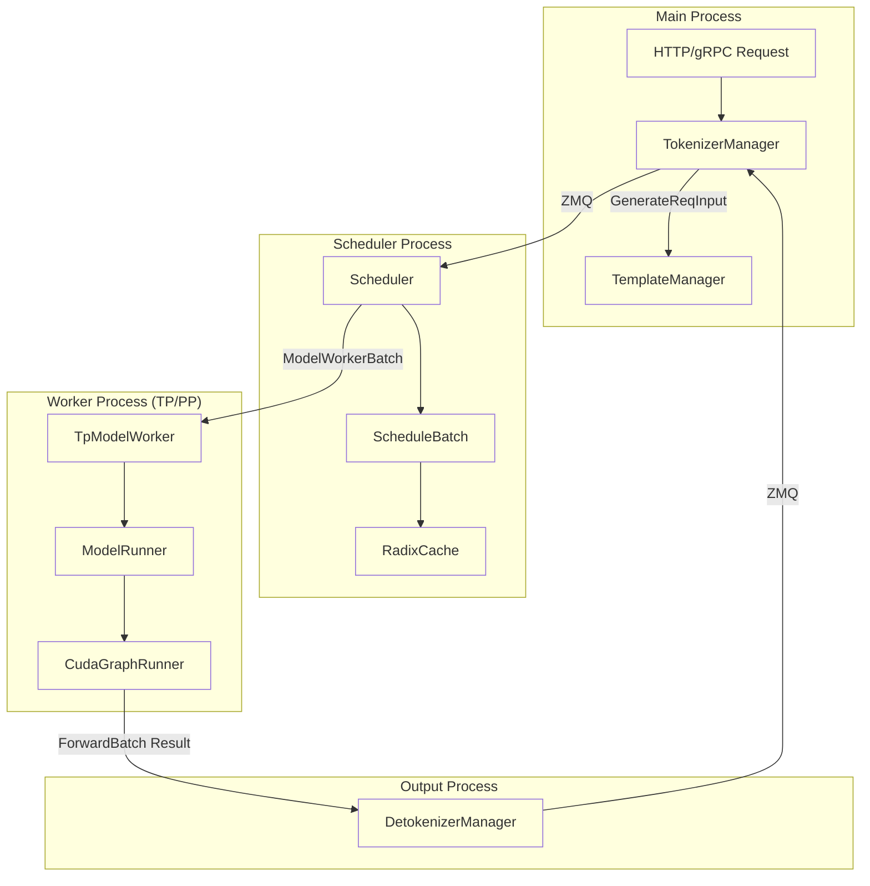

<!-- source: DeepWiki mcp.deepwiki.com · repo microsoft/llm-42 · page 1 Overview · fetched 2026-10-26 -->

# Overview

Relevant source files

The following files were used as context for generating this wiki page:

- [README.md](README.md)
- [benchmark/deepseek_v3/README.md](benchmark/deepseek_v3/README.md)
- [docker/rocm.Dockerfile](docker/rocm.Dockerfile)
- [docs/get_started/install.md](docs/get_started/install.md)
- [docs/platforms/amd_gpu.md](docs/platforms/amd_gpu.md)
- [docs/platforms/ascend_npu.md](docs/platforms/ascend_npu.md)
- [python/pyproject.toml](python/pyproject.toml)
- [python/pyproject_cpu.toml](python/pyproject_cpu.toml)
- [python/pyproject_other.toml](python/pyproject_other.toml)
- [python/pyproject_xpu.toml](python/pyproject_xpu.toml)
- [python/sglang/__init__.py](python/sglang/__init__.py)
- [python/sglang/srt/entrypoints/engine.py](python/sglang/srt/entrypoints/engine.py)
- [python/sglang/srt/entrypoints/http_server.py](python/sglang/srt/entrypoints/http_server.py)
- [python/sglang/srt/layers/logits_processor.py](python/sglang/srt/layers/logits_processor.py)
- [python/sglang/srt/layers/sampler.py](python/sglang/srt/layers/sampler.py)
- [python/sglang/srt/llm42/__init__.py](python/sglang/srt/llm42/__init__.py)
- [python/sglang/srt/llm42/llm42_info.py](python/sglang/srt/llm42/llm42_info.py)
- [python/sglang/srt/llm42/llm42_worker.py](python/sglang/srt/llm42/llm42_worker.py)
- [python/sglang/srt/managers/detokenizer_manager.py](python/sglang/srt/managers/detokenizer_manager.py)
- [python/sglang/srt/managers/io_struct.py](python/sglang/srt/managers/io_struct.py)
- [python/sglang/srt/managers/multi_tokenizer_mixin.py](python/sglang/srt/managers/multi_tokenizer_mixin.py)
- [python/sglang/srt/managers/schedule_batch.py](python/sglang/srt/managers/schedule_batch.py)
- [python/sglang/srt/managers/scheduler.py](python/sglang/srt/managers/scheduler.py)
- [python/sglang/srt/managers/scheduler_metrics_mixin.py](python/sglang/srt/managers/scheduler_metrics_mixin.py)
- [python/sglang/srt/managers/scheduler_output_processor_mixin.py](python/sglang/srt/managers/scheduler_output_processor_mixin.py)
- [python/sglang/srt/managers/scheduler_runtime_checker_mixin.py](python/sglang/srt/managers/scheduler_runtime_checker_mixin.py)
- [python/sglang/srt/managers/scheduler_update_weights_mixin.py](python/sglang/srt/managers/scheduler_update_weights_mixin.py)
- [python/sglang/srt/managers/tokenizer_communicator_mixin.py](python/sglang/srt/managers/tokenizer_communicator_mixin.py)
- [python/sglang/srt/managers/tokenizer_manager.py](python/sglang/srt/managers/tokenizer_manager.py)
- [python/sglang/srt/managers/tp_worker.py](python/sglang/srt/managers/tp_worker.py)
- [python/sglang/srt/metrics/collector.py](python/sglang/srt/metrics/collector.py)
- [python/sglang/srt/model_executor/cuda_graph_runner.py](python/sglang/srt/model_executor/cuda_graph_runner.py)
- [python/sglang/srt/model_executor/forward_batch_info.py](python/sglang/srt/model_executor/forward_batch_info.py)
- [python/sglang/srt/model_executor/model_runner.py](python/sglang/srt/model_executor/model_runner.py)
- [python/sglang/srt/sampling/sampling_batch_info.py](python/sglang/srt/sampling/sampling_batch_info.py)
- [python/sglang/srt/sampling/sampling_params.py](python/sglang/srt/sampling/sampling_params.py)
- [python/sglang/srt/server_args.py](python/sglang/srt/server_args.py)
- [python/sglang/version.py](python/sglang/version.py)

LLM-42 is a high-performance inference engine built on the SGLang architecture, specifically designed to provide **deterministic LLM inference** without the performance penalties of traditional serial execution or the complexity of rewriting specialized GPU kernels [README.md:28-29](). It achieves this through a novel **Decode-Verify-Rollback (DVR)** protocol [README.md:32-37]().

While standard LLM serving is non-deterministic due to dynamic batching and variable GPU reduction orders, LLM-42 allows users to mark specific requests as deterministic via `is_deterministic=True` [README.md:38](). These requests undergo a verification loop while non-deterministic requests continue to run at full speed [README.md:38-39]().

### Core Architecture: Decode-Verify-Rollback (DVR)

The LLM-42 system extends the SGLang Runtime (SRT) by introducing a speculation-based verification mechanism. Instead of forcing all kernels to be deterministic (which often degrades performance), LLM-42 uses fast, non-deterministic kernels for generation and verifies the output in chunks.

1.  **Decode**: Tokens are generated rapidly using standard dynamic batching and optimized kernels [README.md:34]().
2.  **Verify**: The engine replays a window of tokens (defined by `--llm42-window-size`) using a fixed-shape schedule that ensures bit-wise identical results [README.md:35](), [python/sglang/srt/server_args.py:69]().
3.  **Rollback**: If a mismatch is detected between the decoded tokens and the verified tokens, the engine discards the inconsistent tail and resumes generation from the last known-good state [README.md:36]().

### System Components and Data Flow

The architecture is composed of several multi-process managers that coordinate tokenization, scheduling, and hardware execution.

#### Request Lifecycle Diagram
This diagram maps the high-level request flow to the specific classes and processes responsible for execution.

**Sources:** [python/sglang/srt/entrypoints/engine.py:122-130](), [python/sglang/srt/managers/schedule_batch.py:27-35](), [python/sglang/srt/managers/tokenizer_manager.py:14-15]()

### Key Subsystems

| Subsystem | Key Entities | Purpose |
| :--- | :--- | :--- |
| **DVR Engine** | `LLM42Worker`, `LLM42Info` | Manages the verification windows and rollback state for deterministic requests. |
| **Inference Runtime** | `Scheduler`, `ModelRunner` | Orchestrates batching, KV cache management, and model forward passes. |
| **Batch Invariance** | `batch_invariant_ops` | Provides wrappers for GPU operations (like matmul) that remain consistent regardless of batch size. |
| **Memory Management** | `RadixCache`, `ReqToTokenPool` | Manages GPU memory and KV cache prefix sharing to optimize throughput. |
| **Communication** | `parallel_state.py`, `ZMQ` | Handles Tensor Parallelism (TP) and inter-process communication. |

**Sources:** [python/sglang/srt/managers/scheduler.py:149-155](), [python/sglang/srt/model_executor/model_runner.py:116-119](), [python/sglang/srt/batch_invariant_ops.py:189-189]()

### Hardware and Platform Support

LLM-42 is designed for high-end NVIDIA hardware but maintains compatibility with a wide range of accelerators via the underlying SGLang architecture.

*   **Primary Platform**: NVIDIA H100 (80GB HBM3) [README.md:76]().
*   **Extended Support**: AMD (ROCm/aiter), Intel (Xeon/AMX/XPU), and Huawei Ascend (NPU) [python/sglang/srt/server_args.py:122-144]().
*   **Kernel Integration**: Utilizes `sgl-kernel` for custom CUDA/Triton operations [pyproject.toml:63]().

### Navigation

This wiki is structured to provide both high-level conceptual overviews and deep technical references.

*   **[Getting Started](#1.1)**: Instructions for Docker setup, building the `sgl-kernel`, and launching your first deterministic server.
*   **[SOSP Artifact Evaluation](#1.2)**: Specific guide for researchers looking to reproduce the performance and determinism benchmarks from the SOSP 2026 paper.
*   **Deterministic Inference Engine (Section 2)**: Detailed breakdown of the DVR protocol and the `batch_invariant_ops` implementation.
*   **SRT Core Architecture (Section 3)**: Deep dive into the scheduling, memory management, and distributed execution layers.

**Sources:** [README.md:42-62](), [README.md:80-100]()

---

