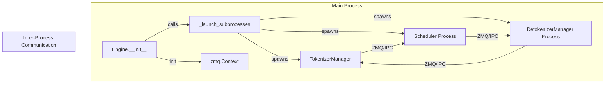
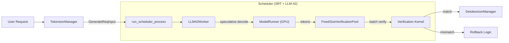

<!-- source: DeepWiki mcp.deepwiki.com · repo microsoft/llm-42 · page 1.1 Getting Started · fetched 2026-10-26 -->

# Getting Started

<details>
<summary>Relevant source files</summary>

The following files were used as context for generating this wiki page:

- [README.md](README.md)
- [benchmark/deepseek_v3/README.md](benchmark/deepseek_v3/README.md)
- [docker/Dockerfile](docker/Dockerfile)
- [docker/rocm.Dockerfile](docker/rocm.Dockerfile)
- [docker/xeon.Dockerfile](docker/xeon.Dockerfile)
- [docker/xpu.Dockerfile](docker/xpu.Dockerfile)
- [docs/get_started/install.md](docs/get_started/install.md)
- [docs/platforms/amd_gpu.md](docs/platforms/amd_gpu.md)
- [docs/platforms/ascend_npu.md](docs/platforms/ascend_npu.md)
- [docs/platforms/cpu_server.md](docs/platforms/cpu_server.md)
- [docs/platforms/xpu.md](docs/platforms/xpu.md)
- [docs/references/environment_variables.md](docs/references/environment_variables.md)
- [python/pyproject.toml](python/pyproject.toml)
- [python/pyproject_cpu.toml](python/pyproject_cpu.toml)
- [python/pyproject_other.toml](python/pyproject_other.toml)
- [python/pyproject_xpu.toml](python/pyproject_xpu.toml)
- [python/sglang/__init__.py](python/sglang/__init__.py)
- [python/sglang/check_env.py](python/sglang/check_env.py)
- [python/sglang/srt/batch_invariant_ops/__init__.py](python/sglang/srt/batch_invariant_ops/__init__.py)
- [python/sglang/srt/batch_invariant_ops/batch_invariant_ops.py](python/sglang/srt/batch_invariant_ops/batch_invariant_ops.py)
- [python/sglang/srt/entrypoints/engine.py](python/sglang/srt/entrypoints/engine.py)
- [python/sglang/srt/environ.py](python/sglang/srt/environ.py)
- [python/sglang/srt/layers/activation.py](python/sglang/srt/layers/activation.py)
- [python/sglang/srt/layers/communicator.py](python/sglang/srt/layers/communicator.py)
- [python/sglang/srt/layers/flashinfer_comm_fusion.py](python/sglang/srt/layers/flashinfer_comm_fusion.py)
- [python/sglang/srt/layers/layernorm.py](python/sglang/srt/layers/layernorm.py)
- [python/sglang/srt/layers/rotary_embedding.py](python/sglang/srt/layers/rotary_embedding.py)
- [python/sglang/srt/utils/common.py](python/sglang/srt/utils/common.py)
- [python/sglang/version.py](python/sglang/version.py)
- [sgl-kernel/Makefile](sgl-kernel/Makefile)
- [sgl-kernel/pyproject.toml](sgl-kernel/pyproject.toml)
- [sgl-kernel/pyproject_cpu.toml](sgl-kernel/pyproject_cpu.toml)
- [sgl-kernel/pyproject_rocm.toml](sgl-kernel/pyproject_rocm.toml)
- [sgl-kernel/python/sgl_kernel/version.py](sgl-kernel/python/sgl_kernel/version.py)

</details>


This page provides the technical requirements and procedures for installing, configuring, and launching the LLM-42 (SGLang-based) deterministic inference engine. LLM-42 extends the SGLang Runtime (SRT) with a **Decode-Verify-Rollback (DVR)** protocol to ensure bit-wise identical outputs across different batching conditions [README.md:28-36]().

## System Requirements

LLM-42 is designed for high-performance LLM serving across multiple hardware architectures.

### Hardware
*   **NVIDIA:** Support for Ampere, Hopper, and Blackwell architectures. Typical benchmarking configuration uses 4× NVIDIA H100 PCIe (80 GB HBM3) [README.md:74-76]().
*   **AMD:** Supported via ROCm and `aiter` kernels [python/sglang/srt/layers/rotary_embedding.py:33-49]().
*   **Intel:** Support for Xeon CPUs (AMX) and Intel Arc GPUs (XPU) [python/sglang/srt/utils/common.py:148-187]().
*   **Huawei Ascend:** Supported via `torch_npu` and specialized backends [python/sglang/srt/utils/common.py:153-162]().

### Software
*   **Python:** 3.10 or higher [python/pyproject.toml:10]().
*   **PyTorch:** Version 2.9.1 (pinned for compatibility) [python/pyproject.toml:68]().
*   **CUDA:** 12.1 through 13.0 (12.9 recommended) [docker/Dockerfile:1-199]().

**Sources:** [README.md:74-76](), [python/pyproject.toml:10-83](), [python/sglang/srt/utils/common.py:133-187]().

---

## Installation

The build system utilizes `setuptools` with `scikit-build-core` for C++/CUDA extensions in the `sgl-kernel` package [sgl-kernel/pyproject.toml:1-7]().

### Docker (Recommended)
The project provides a multi-stage `Dockerfile` that handles system dependencies, `GDRCopy`, and `DeepEP` optimizations [docker/Dockerfile:134-145]().

```bash
# Create and attach to the development container
./run_container.sh create && ./run_container.sh attach

# Build the sgl-kernel and install sglang in editable mode
./build_all.sh
```

### Manual Installation
For manual setup, the `sgl-kernel` must be built before the main `sglang` package.

1.  **Build Kernels:**
    ```bash
    cd sgl-kernel
    pip install .
    ```
2.  **Install SGLang:**
    ```bash
    cd ../python
    pip install -e .
    ```

**Sources:** [README.md:42-53](), [sgl-kernel/pyproject.toml:1-11](), [python/pyproject.toml:1-100]().

---

## Launching the Server

The server is managed by the `Engine` class, which orchestrates three primary processes: `TokenizerManager`, `Scheduler`, and `DetokenizerManager` [python/sglang/srt/entrypoints/engine.py:118-130]().

### Basic Execution
To enable the LLM-42 deterministic protocol, the `--enable-llm42` flag must be set.

```bash
python3 -m sglang.launch_server \
    --model-path meta-llama/Llama-3.1-8B-Instruct \
    --enable-llm42 3 \
    --llm42-window-size 64 \
    --llm42-verify-batch-size 8
```

### Configuration Parameters
| Argument | Type | Default | Description |
| :--- | :--- | :--- | :--- |
| `--enable-llm42` | int | `0` | Set to `3` to activate the DVR protocol [README.md:68](). |
| `--llm42-window-size` | int | `64` | Number of tokens generated in speculative "Decode" phase before verification [README.md:69](). |
| `--llm42-verify-batch-size` | int | `8` | Group size for the "Verify" phase to improve throughput [README.md:70](). |
| `--enable-deterministic-inference` | int | `0` | Global flag for batch-invariant kernel operations [README.md:72](). |

**Sources:** [README.md:57-72](), [python/sglang/srt/entrypoints/engine.py:118-137]().

---

## Implementation Architecture

The following diagrams illustrate the initialization flow and how the Python-level `Engine` interface maps to the underlying process-level components.

### Component Initialization Flow
This diagram bridges the `Engine` initialization in `engine.py` to the multi-process execution model.


**Sources:** [python/sglang/srt/entrypoints/engine.py:118-181]().

### Data Flow: Request to Verification
This diagram maps the natural language request lifecycle to the code entities responsible for the LLM-42 DVR protocol.


**Sources:** [python/sglang/srt/entrypoints/engine.py:48-68](), [README.md:32-38](), [python/sglang/srt/entrypoints/engine.py:118-130]().

---

## Environment Configuration

LLM-42 uses a structured environment variable system defined in `Envs` to control runtime behavior [python/sglang/srt/environ.py:159-160]().

### Key Environment Variables
*   `SGLANG_USE_CPU_ENGINE`: Set to `1` to bypass GPU requirements and run on host CPU [python/sglang/srt/utils/common.py:187]().
*   `SGLANG_ROPE_CACHE_ALIGN`: Controls memory alignment for Rotary Embedding caches to reduce reallocations [python/sglang/srt/layers/rotary_embedding.py:200]().
*   `SGLANG_USE_AITER`: Enables AMD-optimized kernels for ROCm environments [python/sglang/srt/layers/rotary_embedding.py:33]().
*   `SGLANG_CUDA_COREDUMP`: Enables collection of CUDA coredumps for debugging kernel crashes [python/sglang/srt/environ.py:179]().

**Sources:** [python/sglang/srt/environ.py:159-220](), [python/sglang/srt/utils/common.py:185-187](), [python/sglang/srt/layers/rotary_embedding.py:191-200]().

---

