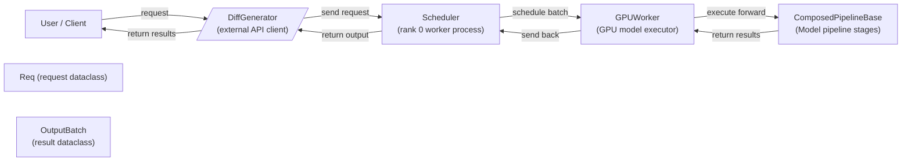
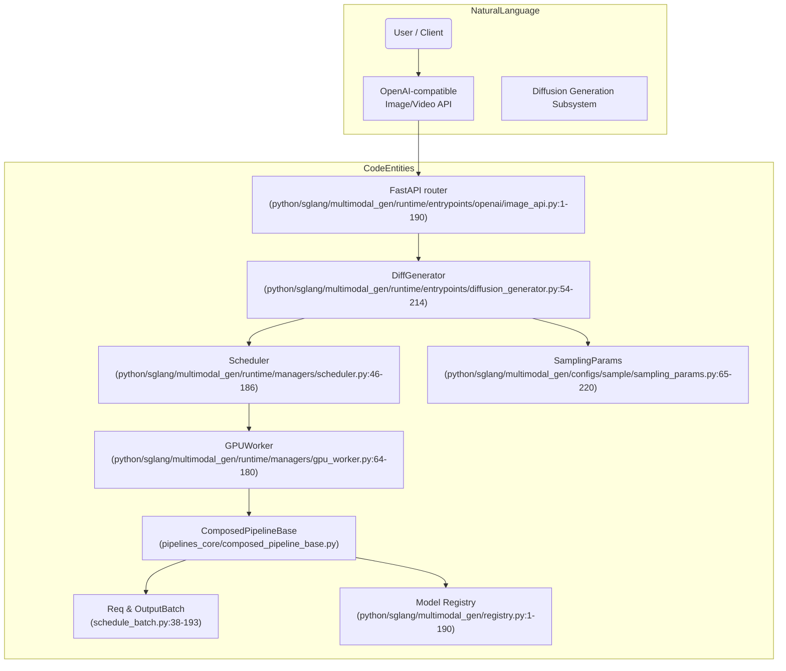
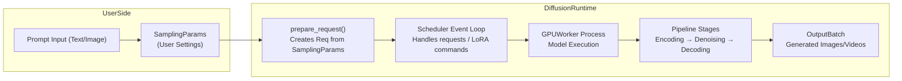

<!-- source: DeepWiki mcp.deepwiki.com · repo microsoft/llm-42 · page 10 Multimodal Generation (Diffusion) · fetched 2026-10-26 -->

# Multimodal Generation (Diffusion)

<details>
<summary>Relevant source files</summary>

The following files were used as context for generating this wiki page:

- [python/sglang/multimodal_gen/benchmarks/bench_serving.py](python/sglang/multimodal_gen/benchmarks/bench_serving.py)
- [python/sglang/multimodal_gen/configs/models/dits/flux.py](python/sglang/multimodal_gen/configs/models/dits/flux.py)
- [python/sglang/multimodal_gen/configs/models/dits/qwenimage.py](python/sglang/multimodal_gen/configs/models/dits/qwenimage.py)
- [python/sglang/multimodal_gen/configs/pipeline_configs/__init__.py](python/sglang/multimodal_gen/configs/pipeline_configs/__init__.py)
- [python/sglang/multimodal_gen/configs/pipeline_configs/base.py](python/sglang/multimodal_gen/configs/pipeline_configs/base.py)
- [python/sglang/multimodal_gen/configs/pipeline_configs/flux.py](python/sglang/multimodal_gen/configs/pipeline_configs/flux.py)
- [python/sglang/multimodal_gen/configs/pipeline_configs/qwen_image.py](python/sglang/multimodal_gen/configs/pipeline_configs/qwen_image.py)
- [python/sglang/multimodal_gen/configs/sample/qwenimage.py](python/sglang/multimodal_gen/configs/sample/qwenimage.py)
- [python/sglang/multimodal_gen/configs/sample/sampling_params.py](python/sglang/multimodal_gen/configs/sample/sampling_params.py)
- [python/sglang/multimodal_gen/registry.py](python/sglang/multimodal_gen/registry.py)
- [python/sglang/multimodal_gen/runtime/entrypoints/cli/generate.py](python/sglang/multimodal_gen/runtime/entrypoints/cli/generate.py)
- [python/sglang/multimodal_gen/runtime/entrypoints/diffusion_generator.py](python/sglang/multimodal_gen/runtime/entrypoints/diffusion_generator.py)
- [python/sglang/multimodal_gen/runtime/entrypoints/http_server.py](python/sglang/multimodal_gen/runtime/entrypoints/http_server.py)
- [python/sglang/multimodal_gen/runtime/entrypoints/openai/common_api.py](python/sglang/multimodal_gen/runtime/entrypoints/openai/common_api.py)
- [python/sglang/multimodal_gen/runtime/entrypoints/openai/image_api.py](python/sglang/multimodal_gen/runtime/entrypoints/openai/image_api.py)
- [python/sglang/multimodal_gen/runtime/entrypoints/openai/protocol.py](python/sglang/multimodal_gen/runtime/entrypoints/openai/protocol.py)
- [python/sglang/multimodal_gen/runtime/entrypoints/openai/utils.py](python/sglang/multimodal_gen/runtime/entrypoints/openai/utils.py)
- [python/sglang/multimodal_gen/runtime/entrypoints/openai/video_api.py](python/sglang/multimodal_gen/runtime/entrypoints/openai/video_api.py)
- [python/sglang/multimodal_gen/runtime/entrypoints/utils.py](python/sglang/multimodal_gen/runtime/entrypoints/utils.py)
- [python/sglang/multimodal_gen/runtime/managers/gpu_worker.py](python/sglang/multimodal_gen/runtime/managers/gpu_worker.py)
- [python/sglang/multimodal_gen/runtime/managers/scheduler.py](python/sglang/multimodal_gen/runtime/managers/scheduler.py)
- [python/sglang/multimodal_gen/runtime/pipelines/qwen_image.py](python/sglang/multimodal_gen/runtime/pipelines/qwen_image.py)
- [python/sglang/multimodal_gen/runtime/pipelines_core/__init__.py](python/sglang/multimodal_gen/runtime/pipelines_core/__init__.py)
- [python/sglang/multimodal_gen/runtime/pipelines_core/schedule_batch.py](python/sglang/multimodal_gen/runtime/pipelines_core/schedule_batch.py)
- [python/sglang/multimodal_gen/runtime/pipelines_core/stages/__init__.py](python/sglang/multimodal_gen/runtime/pipelines_core/stages/__init__.py)
- [python/sglang/multimodal_gen/runtime/pipelines_core/stages/base.py](python/sglang/multimodal_gen/runtime/pipelines_core/stages/base.py)
- [python/sglang/multimodal_gen/runtime/pipelines_core/stages/decoding.py](python/sglang/multimodal_gen/runtime/pipelines_core/stages/decoding.py)
- [python/sglang/multimodal_gen/runtime/pipelines_core/stages/encoding.py](python/sglang/multimodal_gen/runtime/pipelines_core/stages/encoding.py)
- [python/sglang/multimodal_gen/runtime/pipelines_core/stages/image_encoding.py](python/sglang/multimodal_gen/runtime/pipelines_core/stages/image_encoding.py)
- [python/sglang/multimodal_gen/runtime/pipelines_core/stages/input_validation.py](python/sglang/multimodal_gen/runtime/pipelines_core/stages/input_validation.py)
- [python/sglang/multimodal_gen/runtime/pipelines_core/stages/timestep_preparation.py](python/sglang/multimodal_gen/runtime/pipelines_core/stages/timestep_preparation.py)
- [python/sglang/multimodal_gen/runtime/server_args.py](python/sglang/multimodal_gen/runtime/server_args.py)
- [python/sglang/multimodal_gen/runtime/utils/perf_logger.py](python/sglang/multimodal_gen/runtime/utils/perf_logger.py)

</details>


This section provides an overview of the Multimodal Generation subsystem in LLM-42 focused on diffusion-based image and video generation. The SGLang Diffusion subsystem integrates diverse diffusion transformer (DiT) models and offers an extensible runtime for generating images, videos, and multimodal content with infrastructure for scheduler coordination, GPU execution, and API exposure.

The purpose is to introduce the design and main components of this subsystem, linking to detailed child pages that cover runtime architecture, model support, and testing strategies. This page serves as a parent hub for developers and researchers who want to understand or extend the multimodal diffusion workflows within the codebase.

---

## Overview

The diffusion subsystem, also known as **sglang-diffusion**, supports generation of images and videos through powerful DiT-based architectures. It leverages PyTorch, distributed parallelism, and efficient scheduling to provide high-throughput, multi-GPU generation services.

Key elements:
- A **scheduler** process coordinates generation requests.
- Workers run on GPUs and host the diffusion model pipelines.
- The runtime supports various workloads: Text to Image (T2I), Image to Image (I2I), Text to Video (T2V), Image to Video (I2V).
- Supports specialized floating point precision settings, LoRA adapter integration, and layerwise offloading for memory management.
- Compatible with OpenAI-style image and video generation APIs.

This subsystem is integrated closely with the larger LLM-42 project and SGLang runtime but focuses on the unique demands of diffusion-based multimodal generation.

Sources: [python/sglang/multimodal_gen/runtime/entrypoints/diffusion_generator.py:54-214](), [python/sglang/multimodal_gen/runtime/managers/gpu_worker.py:64-180](), [python/sglang/multimodal_gen/runtime/managers/scheduler.py:46-186]()

---

## Core Components and Workflow

At a high level, the subsystem has several interacting components:

1. **DiffGenerator**:  
   This class is the main interface for outside programs to perform image/video generation via diffusion models. It abstracts the scheduler client communication, request preparation, and assembly of generation results. It supports launching a local scheduler server when needed or connecting to a remote server seamlessly.

2. **Scheduler (rank 0 worker process)**:  
   The scheduler listens for generation requests asynchronously (typically over ZeroMQ), manages request queuing, schedules GPU workloads, handles LoRA adapter commands, and communicates with GPU workers. It maintains warmup requests and enforces error limits.

3. **GPUWorkers**:  
   Dedicated worker processes that handle GPU device initialization, model loading, distributed environment setup, and execute the forward passes to generate images/videos. Each worker hosts a `ComposedPipelineBase` instance which runs the model pipeline.

4. **Req and OutputBatch**:  
   Immutable dataclasses (`Req`) are used to encapsulate the full state of an input generation request including prompts, embeddings, latents, timesteps, and other metadata passed between pipeline stages functionally. The pipeline outputs results in `OutputBatch` containers.

5. **PipelineBase and ComposedPipelineBase**:  
   Abstract base classes for defining diffusion pipelines composed of stages like input validation, encoding, decoding/denoising, and output processing. Each pipeline interacts with different specialized DiT models.

6. **Model Registry and Configuration**:  
   Centralized registration maps model names and paths to pipeline and sampling configurations. This supports flexible loading and LoRA adapter support for multiple diffusion transformer variants.

The typical generation flow:  
User → DiffGenerator → Scheduler → GPUWorker → PipelineStage(s) → Output → Scheduler → DiffGenerator → User



Sources: [python/sglang/multimodal_gen/runtime/entrypoints/diffusion_generator.py:54-214](), [python/sglang/multimodal_gen/runtime/managers/scheduler.py:46-186](), [python/sglang/multimodal_gen/runtime/managers/gpu_worker.py:64-180](), [python/sglang/multimodal_gen/runtime/pipelines_core/schedule_batch.py:38-193]()

---

## Supported Workloads and Models

The diffusion subsystem accommodates a range of multimodal generation tasks characterized by input-output mappings:

| Workload Type | Description       | Examples                   |
|---------------|-------------------|----------------------------|
| T2I           | Text to Image     | Generate images from text   |
| I2I           | Image to Image    | Image editing, manipulation |
| T2V           | Text to Video     | Generate videos from text   |
| I2V           | Image to Video    | Video generation conditioned on images |

Models supporting these tasks include diverse DiT families such as Wan, Flux, HunyuanVideo, Qwen-Image, Z-Image, GLM-Image, and MoVA. Models integrate LoRA adapters and support model loading with advanced parallelism (e.g., FSDP).

The registry system maps model names and paths to their corresponding pipeline and sampling configurations, enabling centralized management and discovery.

```mermaid
graph TB
    Registry["Model Registry\n(_PIPELINE_REGISTRY, _CONFIG_REGISTRY)"]
    Wan["Wan Models"]
    Flux["Flux Models"]
    Hunyuan["HunyuanVideo"]
    QwenImage["Qwen-Image"]
    ZImage["Z-Image"]
    GLMImage["GLM-Image"]
    MoVA["MoVA"]

    Registry --> Wan
    Registry --> Flux
    Registry --> Hunyuan
    Registry --> QwenImage
    Registry --> ZImage
    Registry --> GLMImage
    Registry --> MoVA

    Wan -->|supports| "T2I, T2V, I2V"
    Flux -->|supports| "T2I, T2V"
    Hunyuan -->|supports| "T2V"
    QwenImage -->|supports| "T2I, I2I"
    ZImage -->|supports| "T2I"
    GLMImage -->|supports| "T2I"
    MoVA -->|supports| "Video generation"
```

Sources: [python/sglang/multimodal_gen/registry.py:1-190](), [python/sglang/multimodal_gen/configs/pipeline_configs/base.py:40-230]() 

---

## Sampling Parameters

Sampling parameters for generation are encoded in `SamplingParams` dataclasses, supporting rich specification of prompts, seeds, output size, inference steps, guidance scales, and debugging flags.

Key capabilities:
- Supports both image and video data types.
- Handles prompt lists for batch generation.
- Supports output file naming, quality, compression controls.
- Allows fine-grained control of timesteps, CFG scaling, and seed management.
- Supports experimental features like TeaCache and trajectory return flags.

These parameters are used internally to prepare requests (`Req` objects) to the generation pipeline.

Sources: [python/sglang/multimodal_gen/configs/sample/sampling_params.py:65-220]()

---

## API Exposure

The subsystem exposes OpenAI-compatible HTTP endpoints for image and video generation:

- `/v1/images/generations` accepts requests for image generation.
- `/v1/images/edits` supports image editing input.
- `/v1/videos/generations` supports video generation.

The FastAPI-based router processes inputs, resolves images and URLs, builds sampling parameters, forwards requests via the scheduler client, and curates responses including base64-encoded images or cloud URLs.

This provides seamless integration for external callers and tools expecting OpenAI API semantics.

Sources: [python/sglang/multimodal_gen/runtime/entrypoints/openai/image_api.py:1-190]()  

---

## Related Subsystem Pages

For deeper technical details on the diffusion subsystem, refer to the child pages:

- ### [Diffusion Runtime Architecture](#10.1)
  Covers internals of the multimodal_gen runtime, including DiffGenerator, the Scheduler service, GPU worker details, and pipeline stages such as denoising loops, image encoding, and input validation. This page documents the OpenAI-compatible image/video API endpoints.

- ### [Supported DiT Models and LoRA](#10.2)
  Describes the supported diffusion transformer (DiT) models like Wan, Flux, HunyuanVideo, Qwen-Image, Z-Image, GLM-Image, MoVA. Discusses model loading (including Fully Sharded Data Parallel - FSDP), LoRA adapter support, and the model registry architecture.

- ### [Testing, Benchmarking, and CI/CD](#13)
  Though covering the entire project testing, useful for multimodal generation validation tests, benchmarks, and performance profiling related to diffusion models.

---

# Natural Language to Code Entity Mapping Diagrams

### Mapping Diffusion Subsystem Components to Code Entities



### Natural Language Requests to Runtime Data Flow



---

# Summary

The SGLang Multimodal Generation (Diffusion) subsystem is a comprehensive platform for diffusion-based image and video generation. It features:

- A modular runtime separating scheduling, GPU execution, and pipelines.
- Support for multiple diffusion transformer models managed through a registry.
- Convenient external APIs mirroring OpenAI image generation endpoints.
- Rich sampling configuration and request handling abstractions.
- Distributed system capabilities with multi-GPU and model parallel support.

This high-level overview covers architecture and major components, directing readers to detailed child pages for runtime implementation, model support, and testing practices.

---
**Sources:**  
- python/sglang/multimodal_gen/runtime/entrypoints/diffusion_generator.py:54-214  
- python/sglang/multimodal_gen/runtime/managers/gpu_worker.py:64-180  
- python/sglang/multimodal_gen/runtime/managers/scheduler.py:46-186  
- python/sglang/multimodal_gen/runtime/pipelines_core/schedule_batch.py:38-193  
- python/sglang/multimodal_gen/registry.py:1-190  
- python/sglang/multimodal_gen/configs/sample/sampling_params.py:65-220  
- python/sglang/multimodal_gen/runtime/entrypoints/openai/image_api.py:1-190  
- python/sglang/multimodal_gen/configs/pipeline_configs/base.py:40-230

---

